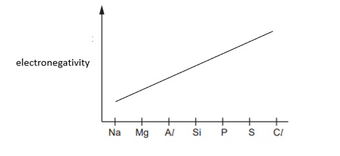

# Mark Schemes — Periodicity of Physical Properties of the Elements in Period 3
**9. The Periodic Table: Chemical Periodicity** · Cambridge (CIE) A-LEVEL chemistry (9701)

## Multiple Choice Questions (10 questions)

### Q1
**Final answer:** **The correct answer is B**

- In the graph, there is a large increase between the 6th and 7th ionisation energies.
- This means the atom has 6 outer-shell (valence) electrons, placing element X in Group 16.
- Group 16, Period 3 corresponds to **sulfur** (S).
- Sulfur has the electron configuration [Ne] 3s2 3p4 and can reach a maximum oxidation state of **+6**, as seen in compounds such as SO3 and H2SO4.

**A **is incorrect as it is aluminium (not sulfur) that reacts with excess hot NaOH (aq) to produce hydrogen gas:

2Al (s) + 2NaOH (aq) + 2H2O (l) → 2NaAlO2 (aq) + 3H2 (g)

**C **is incorrect as it describes silicon, not sulfur. Silicon forms a giant covalent oxide (SiO2) that is insoluble in water. Sulfur forms SO3 and SO2, which are molecular and react with water.

**D **is incorrect as sulfur has a **lower** first ionisation energy than phosphorus (the element to its left), not higher than the element to its right. The lower IE of sulfur compared to phosphorus is due to electron-pair repulsion in the 3p orbitals.

### Q2
**Final answer:** **The correct answer is A**

- **Electronegativity** is a measure of the tendency of an atom to attract a bonding pair of electrons.

  - Electronegativity increases across a period.
  - The number of principal quantum shells remains the same, but nuclear charge increases (more protons), so there is a stronger pull on the bonding electrons in the outer shell.
  - Therefore, the electronegativity of the elements in the question is: Na (smallest) < Mg < A*l* < Si (biggest)
- **First ionisation energy** is the energy required to remove one mole of electrons (the easiest to remove) from one mole of gaseous atoms:

X (g) → X+ (g) + e-

- **Sodium** has the lowest ionisation energy as the outer electron is unpaired (3s1) and nuclear charge is lowest of the four.
- **Aluminium** has a lower ionisation energy than magnesium because the 3p electron is shielded from the nucleus by the 3s electrons, reducing the attraction to the outer electron.

  - This outweighs the effect of the extra proton.
- **Silicon** has the highest nuclear charge and therefore the highest first ionisation energy of the four.

**B **is incorrect as it shows an incorrect relationship between electronegativity and first ionisation energy.

**C **is incorrect as it shows an incorrect relationship between electronegativity and first ionisation energy.

**D **is incorrect as it shows an incorrect relationship between electronegativity and first ionisation energy.

### Q3
**Final answer:** **The correct answer is D**

- SO3 is a **simple covalent molecule.**
- SO3 has a **low melting point** because only weak van der Waals' forces between molecules need to be broken.
- SO3 **does not** conduct electricity as a solid because there are no mobile ions or delocalised electrons.
- When added to water, SO3 reacts to form **sulfuric acid** (H2SO4), a strong acid that fully dissociates into ions in solution.

SO3 (g) + H2O (l) → H2SO4 (aq)

- These mobile ions allow the solution to **conduct electricity.**

**A **is incorrect as aluminium metal does not dissolve in neutral water to produce ions, so its conductivity when added to water should be poor (not good).

**B **is incorrect as solid NaCl does not conduct electricity. The ions are fixed in the giant ionic lattice and are not free to move. Its conductivity of solid should be poor (not good).

**C** is incorrect as SiO2 is insoluble in water and does not produce ions in solution. Its conductivity when added to water should be poor (not good).

### Q4
**Final answer:** **The correct answer is D**

- The melting point of a metal depends on the strength of the metallic bonds.
- The strength of metallic bonding depends on the **charge** of the cation and the **radius** of the metal ion.

  - The higher the charge, the greater the number of delocalised electrons, increasing metallic bond strength.
  - The smaller the ionic radius, the stronger the metallic bonding.
- Al is a Group 13 element, so it forms Al3+ ions, giving it the highest charge and smallest ionic radius of the four metals.

  - Therefore Al has the strongest metallic bonding and the highest melting point.

**A **is incorrect as sodium forms Na+ ions (+1 charge) and has a larger ionic radius than Al3+.

**B **is incorrect as magnesium forms Mg2+ ions (+2 charge) and has a larger ionic radius than Al3+.

**C **is incorrect as potassium forms K+ ions (+1 charge) and has a larger ionic radius than Al3+.

### Q5
**Final answer:** **The correct answer is A**

- The three graphs show melting point, first ionisation energy, and atomic radius:
- **Melting point** increases from Na to Si then sharply drops.

  - The metals (Na, Mg, Al) have metallic bonding, and the number of delocalised electrons increases from Na to Al, requiring more energy to break.
  - Si has a giant covalent structure with many strong covalent bonds.
  - P, S, Cl, and Ar exist as simple molecules with weak van der Waals forces between them.

- **First ionisation energy** generally increases across the period.

  - The drop from Mg to Al occurs because Al's outer electron is in the 3p subshell, which is shielded by the 3s electrons, making it easier to remove.

- **Atomic radius** decreases from left to right.

  - The number of electron shells stays the same across a period, but nuclear charge increases, pulling the outer electrons closer to the nucleus.
- Electrical conductivity is not shown in any of the three graphs.

**B **is incorrect as atomic radius is shown in the third graph.

**C **is incorrect as melting point is shown in the first graph.

**D **is incorrect as first ionisation energy is shown in the second graph.

### Q6
**Final answer:** **The correct answer is A**

- The compound described is most consistent with **aluminium trichloride** (AlCl3).
- AlCl3 is a **covalent** compound with a **layer structure** and is a **white crystalline solid** at room temperature.
- When dissolved in water, AlCl3 gives an **acidic** solution (pH 2–3), not pH 12:

AlCl3 (s) + 6H2O (l) → [Al(H2O)6]3+ (aq) + 3Cl- (aq)

[Al(H2O)6]3+ (aq) → [Al(H2O)5OH]2+ (aq) + H+ (aq)

- AlCl3 melts at around 180 °C, which is relatively low and consistent with the significant covalent character of the compound.
- The observation that the compound gave a solution of pH 12 is incorrect.

**B **is incorrect as sodium chloride gives a neutral solution when dissolved in water and has a very high melting point (801 °C) due to its giant ionic lattice structure.

**C** is incorrect as silicon tetrachloride (SiCl4) is a liquid at room temperature, not a white crystalline solid.

**D **is incorrect as phosphorus pentachloride (PCl5) is a solid at room temperature and produces a strongly acidic solution when added to water.

### Q7
**Final answer:** **The correct answer is D**

- A substance with a **giant covalent structure** has strong covalent bonds throughout the lattice.

  - Giant covalent structures have **very high** melting and boiling points because a large amount of energy is required to break the many strong covalent bonds throughout the lattice.
  - Giant covalent structures **do not** conduct electricity in the solid state as there are no mobile electrons or ions to carry charge.
- D shows a substance with poor conductivity, a high melting point (1986 K) and a high boiling point (2950 K) with BP > MP.

  - This is consistent with a giant covalent structure such as SiO2.

**A **is incorrect as the low melting and boiling points indicate a simple molecular substance, not a giant covalent structure.

**B **is incorrect as good conductivity indicates a metallic structure, not a giant covalent structure.

**C **is incorrect on two grounds. Good conductivity is inconsistent with a giant covalent structure and the data is physically impossible as the boiling point (2943 K) is lower than the melting point (3031 K).

### Q8
**Final answer:** **The correct answer is D**

- The first ionisation energy is the energy required to remove one mole of electrons from one mole of gaseous atoms:

X (g) → X+ (g) + e-

- **Group 2 elements** have the third lowest ionisation energy in their period.
- Despite the general increase in ionisation energy across a period, Group 13 elements have **lower** first ionisation energy than Group 2 elements.

  - This is because the outer electron in the p subshell is more shielded by the inner s electrons, reducing the nuclear pull.
- Therefore, the element must be either **magnesium or calcium.**
- Atomic radius is the distance between the nucleus and the outermost electron.
- Atomic radius increases down a group because an extra principal quantum shell is added each time.

  - The third smallest atomic radius in a group belongs to the element in period 4, which in this case is **calcium.**

**A **is incorrect as magnesium is in period 3, giving it the second smallest (not third smallest) atomic radius in Group 2.

**B **is incorrect as boron is the smallest element in Group 13, not the third smallest.

**C **is incorrect as sodium has the lowest (not third lowest) first ionisation energy in period 3.

### Q9
**Final answer:** **The correct answer is A**

- First ionisation energies:

silicon (X) < sulfur (Z) < phosphorus (Y)

- Melting points:

phosphorus (Y) < sulfur (Z) < silicon (X)

- The **first ionisation energy** is the energy required to remove one mole of electrons from one mole of gaseous atoms:

X (g) → X+ (g) + e-

- There is a general increase in first ionisation energy across a period as nuclear charge increases.
- However, there is a reduction between Group 15 and Group 16 because the electron being removed from sulfur is **paired** in one of the 3p orbitals, requiring less energy:

|   | 3px | 3py | 3pz |
|---|---|---|---|
| P | ↑ | ↑ | ↑ |
| S | ↑↓ | ↑ | ↑ |

- Silicon (X) has the highest melting point because it has a **giant covalent structure**, requiring large amounts of energy to break many strong covalent bonds throughout the lattice.
- Phosphorus (P4) and sulfur (S8) are both **simple covalent molecules**.

  - Sulfur has a higher melting point because it has more electrons, so the van der Waals' forces between molecules are stronger.

**B**, **C** and **D** are incorrect as they do not have the correct combination of first ionisation energies and melting points.

### Q10
**Final answer:** **The correct answer is B**

- Both sodium and sulfur are in **Period 3.**
- **Atomic radius**:

  - Decreases from left to right across a period.
  - The nuclear charge increases from Na (+11) to S (+16).
  - But, electrons are added to the same principal quantum shell (n = 3), so shielding remains relatively constant.
  - The increased nuclear attraction pulls the outer electrons closer.
  - This means that the atomic radius of Na is greater than that of S.
- **Ionic radius:**

  - Sodium forms Na+ by losing its outer 3s electron.
  - Electronic configuration of Na+: 1s2 2s2 2p6 (2 principal quantum shells)
  - Sulfur forms S2- by gaining two electrons to complete its 3p subshell.
  - Electronic configuration of S2-: 1s2 2s2 2p6 3s2 3p6 (3 principal quantum shells)
  - S2- has one more principal quantum shell than Na+.
  - This means that the ionic radius of Na+ is less than that of S2-.

**A** is incorrect as the ionic comparison is correct but the atomic radius of Na is greater than S, not less.

**C** is incorrect as the atomic comparison is correct but Na+ has fewer principal quantum shells than S2-, so the ionic radius of Na+ is less than that of S2-, not greater.

**D** is incorrect as both comparisons are reversed.

## Structured Questions (4 questions)

### Q1
> **[mark-scheme]**
> The general increase in melting point from Na to Al is because:
> 
> - (Na, Mg and Al all have) metallic bonding **[1 mark]**
> - The strength of the attraction between the positive metal ions and delocalised electrons increases
> **OR**
> More energy is needed to break the metallic bonds **[1 mark]**
> - Due to an increasing number of delocalised electrons / increasing cation charge / increasing charge density **[1 mark]**

> **[exam-tip]**
> Na, Mg, and Al are all metals with giant metallic structures. The key is how the strength of metallic bonding changes across these three elements.
> 
> Think about which Group each element is in: Na is in Group 1 (Na+ ions, 1 delocalised electron per atom), Mg is in Group 2 (Mg2+ ions, 2 delocalised electrons), and Al is in Group 13 (Al3+ ions, 3 delocalised electrons). As the ion charge and the number of delocalised electrons both increase, the electrostatic attraction between the positive ions and the electron sea becomes stronger, requiring more energy to overcome and giving a higher melting point.
> **[mark-scheme]**
> The variation of melting points from P to Ar:
> 
> - (P, S, Cl and Ar) all have / contain instantaneous dipole-induced dipole (id-id) forces (between molecules / atoms) **[1 mark]**
> - These forces are greatest in sulfur
> **OR**
> The relative magnitude is S > P > Cl > Ar **[1 mark]**
> - (Because) sulfur has the greatest number of electrons / the number of electrons decreases (from S to Ar) **[1 mark]**

> **[exam-tip]**
> Although P, S, and Cl have strong covalent bonds within their molecules, it is the instantaneous dipole-induced dipole (id-id) forces between molecules (or atoms, for Ar) that are broken at the melting point.
> 
> The strength of id-id forces depends on the number of electrons. Consider the size of the molecules: P4, S8, Cl2, Ar.
> 
> - Sulfur molecules are the largest with the most electrons, so the id-id forces between S8 molecules are the strongest and sulfur has the highest melting point in this section.
> - Argon exists as single atoms and has very few electrons, so its id-id forces are very weak.
> **[mark-scheme]**
> Si has a much higher melting point than any other element in Period 3 because:
> 
> - Silicon has a giant molecular / covalent structure **[1 mark]**
> - (With) strong covalent bonds (between silicon atoms) (throughout the lattice) **[1 mark]**

> **[exam-tip]**
> All other elements in Period 3 are either simple molecular structures (P, S, Cl, Ar) or giant metallic structures (Na, Mg, Al). Simple molecular structures have only weak id-id forces between molecules; metallic structures have metallic bonding of moderate strength.
> 
> Silicon, however, has a giant covalent/molecular structure in which every Si atom is covalently bonded to four others in a tetrahedral arrangement throughout the entire lattice. Breaking these many strong covalent bonds requires far more energy than overcoming weak intermolecular forces or breaking metallic bonds, giving silicon a much higher melting point than all other Period 3 elements.
> **[mark-scheme]**
> i) Electronegativity is:
> 
> - The ability of an atom to attract electrons / a pair of electrons to itself **[1 mark]**
> - In a covalent bond **[1 mark]**

ii) The completed electronegativity trend across Period 3:

**[1 mark]**

> **[mark-scheme]**
> 1 mark for a line that increases (from left to right) across Period 3
> 
> iii) Explanation of the trend in part (ii):
> 
> - (Going across Period 3) nuclear charge increases
> **AND**
> Atomic radius decreases **[1 mark]**
> - (Electron) shielding remains (approximately) the same **[1 mark]**

> **[exam-tip]**
> For part (i), the two marks are for: (1) the ability of an atom to attract electrons to itself, and (2) specifying that this is in a covalent bond. Both parts of the definition are required.
> 
> For part (ii), you can use the mark allocation as a clue. 1 mark means the trend must be a simple single line, either increasing or decreasing across the period. Electronegativity increases from Na to Cl.
> 
> For part (iii), the explanation follows the same logic as atomic radius trends. Going across Period 3, the nuclear charge increases (one more proton per element) while the number of electron shells and the shielding remain roughly the same. A greater nuclear charge on a smaller atom means the nucleus more strongly attracts the bonding pair of electrons in a covalent bond, so electronegativity increases.

### Q2
> **[mark-scheme]**
> The trend in atomic radius across Period 3:
> 
> - Decreases (across the period) **[1 mark]**

> **[exam-tip]**
> This trend can seem counter-intuitive as more electrons are added going across Period 3. However, each successive element also has one more proton, increasing the nuclear charge. The greater nuclear attraction pulls the outer electrons closer to the nucleus, so the atomic radius decreases. The number of electron shells stays constant across the period, so shielding does not change significantly.
> **[mark-scheme]**
> i) Aluminium has much higher electrical conductivity than sulfur because:
> 
> - Aluminium has a giant metallic structure
> **AND**
> (Has) free / delocalised electrons (to carry the charge) **[1 mark]**
> - Sulfur has a simple molecular structure
> **AND**
> (Has) no free / delocalised electrons **[1 mark]**
> 
> ii) Aluminium has higher electrical conductivity than magnesium because:
> 
> - Aluminium has more delocalised / outer electrons (per atom) than magnesium
> **OR**
> Aluminium has 3 outer electrons and magnesium has 2 outer electrons **[1 mark]**
> - (So) there are more delocalised electrons to carry the charge **[1 mark]**

> **[exam-tip]**
> When explaining electrical conductivity of elements, always identify the structure type first. Metallic structures contain free/delocalised electrons that move under an applied potential difference to carry charge. Simple molecular structures have no such mobile electrons.
> 
> For the Al vs Mg comparison, the difference lies in how many electrons each atom contributes to the delocalised sea. Aluminium is in Group 13, contributing 3 electrons per atom, while magnesium is in Group 2 and contributes 2. More delocalised electrons means greater conductivity.
> **[mark-scheme]**
> i) The melting point of silicon is high because:
> 
> - Silicon has a giant molecular / covalent structure **[1 mark]**
> - (With) strong covalent bonds (between silicon atoms) **[1 mark]**
> - (Which) require a large amount of energy to break / overcome **[1 mark]**
> 
> ii) The melting point of phosphorus is low because:
> 
> - Phosphorus has a simple molecular structure **[1 mark]**
> - (With) weak instantaneous dipole-induced dipole (id-id) forces (between molecules), which require little energy to overcome **[1 mark]**

> **[exam-tip]**
> For melting point explanations, always address three things: the type of structure, the type and relative strength of the bonds or forces holding the structure together, and the energy required to overcome them.
> 
> Silicon has a giant covalent/molecular structure in which every silicon atom is bonded to four others by strong covalent bonds throughout the entire lattice. A very large amount of energy is needed to break these bonds, giving silicon a high melting point.
> 
> Phosphorus exists as P4 molecules, which is a simple molecular structure. The only forces between P4 molecules are weak instantaneous dipole-induced dipole (id-id) forces. Only a small amount of energy is needed to overcome these, giving phosphorus a low melting point.

### Q3
> **[mark-scheme]**
> i) The ionic radius is:
> 
> - The size / radius of an ion
> **AND**
> (Measured as the distance) from the nucleus to the outermost electron shell **[1 mark]**
> 
> ii) A cation is smaller and an anion is larger than their parent atoms because:
> 
> Cations:
> 
> - (Cations are smaller because they) lose outer shell electrons **[1 mark]**
> - (So the) nuclear charge (now) acts on fewer electrons, increasing the nuclear attraction and pulling the remaining electrons closer (to the nucleus) **[1 mark]**
> 
> Anions:
> 
> - (Anions are larger because they) gain electrons, increasing electron-electron repulsion (which expands the electron cloud) **[1 mark]**

> **[exam-tip]**
> Ionic radius is defined as the size of an ion, measured from the nucleus to the outermost electron shell. You are expected to know what ionic and atomic radii are.
> 
> For cations (positive ions), electrons are removed. The same nuclear charge then acts on fewer electrons, so the attraction per electron is greater and the remaining electrons are pulled closer to the nucleus. Cations are therefore smaller than their parent atoms.
> 
> For anions (negative ions), electrons are gained. The extra electrons increase electron-electron repulsion within the outer shell, which pushes the electrons further from the nucleus. Anions are therefore larger than their parent atoms.
The trend in ionic radius across Period 3:

**[2 marks]**

> **[mark-scheme]**
> 1 mark for a decreasing trend from Na to Si (atomic numbers 11–14)
> 
> 1 mark for a sharp increase from Si to P (atomic numbers 14–15) followed by a decreasing trend from P to Cl (atomic numbers 15–17)

> **[exam-tip]**
> The graph of ionic radius across Period 3 has a distinctive shape: two separate decreasing sections connected by a sharp upward jump.
> 
> From Na to Si, the ions are cations (Na+, Mg2+, Al3+, Si4+) formed by losing electrons. As nuclear charge increases across this section with the same outer electron shell, ionic radius decreases.
> 
> At phosphorus, the trend reverses sharply. P, S, and Cl form anions (P3-, S2-, Cl-), which are much larger than the cation series because electrons are now added to the outer shell rather than removed. This sharp jump is the key feature to reproduce correctly.
> 
> Within the anion section (P to Cl), ionic radius decreases again as nuclear charge increases while shielding remains roughly constant.
> **[mark-scheme]**
> The trend in ionic radius shown in part (b):
> 
> Na to Si (cations):
> 
> - (Ionic radius decreases because) nuclear charge increases across the period
> **AND**
> Shielding remains (roughly) constant **[1 mark]**
> 
> Si to P (sharp jump):
> 
> - Electrons are now added to the outer shell to form anions (rather than removed)
> **AND**
> (So) the force of attraction between the nucleus and outermost electrons is weaker **[1 mark]**
> 
> P to Cl (anions):
> 
> - (Ionic radius decreases because) nuclear charge increases across the period
> **AND**
> Shielding remains (roughly) constant **[1 mark]**

> **[exam-tip]**
> The explanation has three distinct sections matching the three features of the graph:
> 
> 1. Na to Si (cations):
> 
>   - Increasing nuclear charge with constant shielding means each successive cation experiences a stronger nuclear attraction on the same outer electron shell, so ionic radius decreases.
> 2. Si to P (the sharp jump):
> 
>   - Si4+ has lost all outer-shell electrons. P forms P3- by gaining electrons into the same (third) shell.
>   - Adding electrons to an outer shell reduces the average nuclear attraction per electron and increases electron-electron repulsion, so P3- is much larger than Si4+.
> 3. P to Cl (anions):
> 
>   - The same logic as the cation section applies.
>   - Nuclear charge increases while shielding stays roughly constant, so ionic radius decreases across the anion series.

### Q4
> **[mark-scheme]**
> Magnesium has a higher melting point than sodium because:
> 
> - Magnesium ions have a greater (positive) charge / higher charge density (than sodium ions) **[1 mark]**
> - Magnesium has more delocalised electrons (per atom) (than sodium) **[1 mark]**
> - (So) there is a stronger / greater (electrostatic) attraction between ions and delocalised electrons
> **OR**
> Magnesium has stronger metallic bonds **[1 mark]**

> **[exam-tip]**
> Both sodium and magnesium have giant metallic structures. The strength of metallic bonding depends on two factors: the charge of the positive metal ions and the number of delocalised electrons.
> 
> Sodium is in Group 1 (Na+ ions, 1 delocalised electron per atom), while magnesium is in Group 2 (Mg2+ ions, 2 delocalised electrons per atom). The higher ion charge and greater number of delocalised electrons in magnesium result in stronger metallic bonds, requiring more energy to break and giving a higher melting point.
> **[mark-scheme]**
> Phosphorus has a lower melting point than sulfur because:
> 
> - Phosphorus exists as P4 molecules
> **AND**
> Sulfur exists as S8 molecules **[1 mark]**
> - Phosphorus molecules are smaller / have fewer electrons (than sulfur molecules) **[1 mark]**
> - (So) phosphorus has weaker instantaneous dipole-induced dipole (id-id) forces between molecules (than sulfur) **[1 mark]**

> **[exam-tip]**
> Both phosphorus and sulfur have simple molecular structures. The forces between molecules are instantaneous dipole-induced dipole (id-id) forces, and their strength depends on the number of electrons in the molecule.
> 
> Phosphorus forms P4 molecules (4 atoms) while sulfur forms S8 molecules (8 atoms). S8 molecules are larger and have more electrons, so the id-id forces between S8 molecules are stronger. More energy is needed to overcome these forces, giving sulfur a higher melting point.
> **[mark-scheme]**
> The trend in atomic radius across Period 3:
> 
> - (Across Period 3) nuclear charge increases / number of protons increases **[1 mark]**
> - (Electron) shielding remains (approximately) the same
> **OR**
> The number of electron shells remains the same **[1 mark]**
> - (So the outer electrons experience a) greater (nuclear) attraction, (pulling them closer to the nucleus) **[1 mark]**

> **[exam-tip]**
> The atomic radius decreases across Period 3. The explanation follows a standard three-point pattern: increasing nuclear charge, constant shielding (same number of inner electron shells), and therefore a stronger nuclear attraction for the outer electrons. These same three points appear in many CIE periodicity questions, so this pattern is well worth learning.
