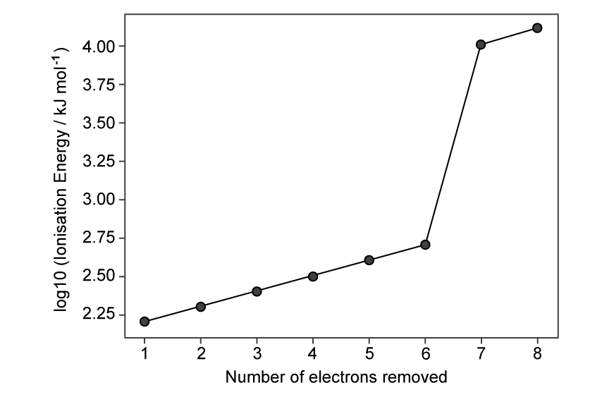
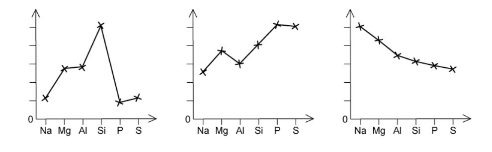
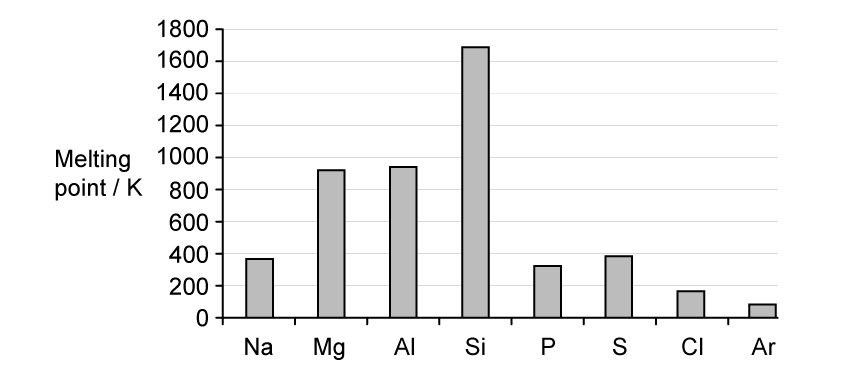
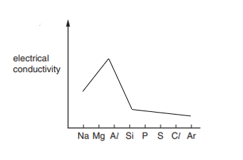

# Exam Questions — Periodicity of Physical Properties of the Elements in Period 3
**9. The Periodic Table: Chemical Periodicity** · Cambridge (CIE) A-LEVEL chemistry (9701)
> Source: [https://www.savemyexams.com/a-level/chemistry/cie/25/topic-questions/](https://www.savemyexams.com/a-level/chemistry/cie/25/topic-questions/) · 14 questions across 2 sets

## Multiple Choice Questions (10 questions)

### Q1 — medium — 1 marks

**Q1** [1 mark]

The graph shows the values of log ionisation energy for the first eight ionisation energies of an element **X** from Period 3.

Which statement about element **X** is correct?

### Q2 — easy — 1 marks

**Q2** [1 mark]

Which graph shows the electronegativity of the elements Na, Mg, Al and Si, from Period 3, plotted against their first ionisation energies?

### Q3 — medium — 1 marks

**Q3** [1 mark]

Which row correctly describes the physical properties of the substance?

|   | substance | melting point | conductivity of solid | conductivity when added to water |
|---|---|---|---|---|
| A | Al | high | good | good |
| B | NaCl | high | good | good |
| C | SiO2 | high | poor | good |
| D | SO3 | low | poor | good |

### Q4 — medium — 1 marks

**Q4** [1 mark]

Which metal has the highest melting point?

### Q5 — easy — 1 marks

**Q5** [1 mark]

The trends in three physical properties of the elements of Period 3 are shown in the graphs.

Which physical property is **not** shown?

### Q6 — hard — 1 marks

**Q6** [1 mark]

A student investigated the chloride of a Period 3 element and made the following observations:

- The compound was a white crystalline solid.
- It dissolved easily in water to give a solution of pH 12.
- When placed in a test-tube and heated in a roaring Bunsen flame, the compound melted after several minutes of heating.

What can be deduced from these observations?

### Q7 — hard — 1 marks

**Q7** [1 mark]

Which row describes a substance with a giant covalent structure?

|   | conductivity of solid | MP / K | BP / K |
|---|---|---|---|
| A | poor | 388 | 718 |
| B | good | 923 | 1363 |
| C | good | 3031 | 2943 |
| D | poor | 1986 | 2950 |

### Q8 — hard — 1 marks

**Q8** [1 mark]

Which element has the **third** lowest first ionisation energy in its period and the **third** smallest atomic radius in its group?

### Q9 — medium — 1 marks

**Q9** [1 mark]

Consecutive elements **X**, **Y** and **Z** are in Period 3. Element **Y** has the highest first ionisation energy and the lowest melting point of these three elements.

Which row identifies elements **X**, **Y** and **Z**?

### Q10 — easy — 1 marks

**Q10** [1 mark]

Which row compares the ionic radius and atomic radius of sodium and sulfur?

|   | **ionic radius** | **atomic radius** |
|---|---|---|
| **A** | Na+ < S2- | Na < S |
| **B** | Na+ < S2- | Na > S |
| **C** | Na+ > S2- | Na > S |
| **D** | Na+ > S2- | Na < S |

## Structured Questions (4 questions)

### Q1 — medium — 13 marks

**Q1** [3 marks]

The elements in Period 3 of the Periodic Table show variations in their behaviour across the period.

Fig. 3.1 shows the variation of melting points of the elements across Period 3.

**Fig. 3.1**

Explain the general increase in melting point from Na to Al.

**Q1** [3 marks]

**Extract:**

The elements in Period 3 of the Periodic Table show variations in their behaviour across the period.

Fig. 3.1 shows the variation of melting points of the elements across Period 3.

Explain the variation of melting points from P to Ar.

**Q1** [2 marks]

**Extract:**

The elements in Period 3 of the Periodic Table show variations in their behaviour across the period.

Fig. 3.1 shows the variation of melting points of the elements across Period 3.

Explain why Si has a much higher melting point than any of the other elements in the period.

**Q1** [5 marks]

Going across Period 3, a trend in electronegativity can also be observed.

i) Define electronegativity.

[2]

ii) Complete Fig. 3.2 to show how electronegativity changes along Period 3.

**Fig. 3.2**

[1]

iii) Explain your answer to part **(ii)**.

[2]

### Q2 — easy — 10 marks

**Q2** [1 mark]

State the trend in atomic radius across Period 3.

**Q2** [4 marks]

The electrical conductivity of the elements in Period 3 varies across the period as shown in Fig. 1.1.

**Fig. 1.1**

i) Explain why aluminium has a much higher electrical conductivity than sulfur. You should refer to the structure of both elements.

[2]

ii) Explain why aluminium has a higher electrical conductivity than magnesium.

[2]

**Q2** [5 marks]

The melting points of three successive elements in Period 3 are shown in Table 1.1.

**Table 1.1**

| **Element** | **Melting point / °C** |
|---|---|
| Aluminium | 660 |
| Silicon | 1410 |
| Phosphorus | 44 |

i) Explain, referring to its structure and bonding, why the melting point of silicon is high.

[3]

ii) Explain, referring to its structure and bonding, why the melting point of phosphorus is low.

[2]

### Q3 — medium — 9 marks

**Q3** [4 marks]

The properties of elements and their compounds show similarities, differences and trends depending on the positions of the elements in the Periodic Table.

i) State what is meant by the term *ionic radius*.

[1]

ii) Explain why a cation is smaller than its parent atom, whereas an anion is larger than its parent atom.

[3]

**Q3** [2 marks]

On Fig. 2.1, sketch a graph to show the trend in the ionic radius of successive elements in Period 3.

**Fig. 2.1**

**Q3** [3 marks]

**Extract:**

On Fig. 2.1, sketch a graph to show the trend in the ionic radius of successive elements in Period 3.

The trend in ionic radius across Period 3:
1 mark for a decreasing trend from Na to Si (atomic numbers 11–14)
1 mark for a sharp increase from Si to P (atomic numbers 14–15) followed by a decreasing trend from P to Cl (atomic numbers 15–17)

Explain the trend shown in part **(b)**.

### Q4 — medium — 9 marks

**Q4** [3 marks]

Table 3.1 shows the melting points and atomic radii of the elements in Period 3, Na to Cl.

**Table 3.1**

| **Element** | Na | Mg | Al | Si | P | S | Cl |
|---|---|---|---|---|---|---|---|
| **Melting point / °C** | 98 | 649 | 660 | 1410 | 44 | 113 | –101 |
| **Atomic radius / pm** | 186 | 160 | 143 | 118 | 110 | 102 | 99 |

Explain why magnesium has a higher melting point than sodium.

**Q4** [3 marks]

**Extract:**

Table 3.1 shows the melting points and atomic radii of the elements in Period 3, Na to Cl.

**Table 3.1**

| **Element** | Na | Mg | Al | Si | P | S | Cl |
| --- | :---: | :---: | :---: | :---: | :---: | :---: | :---: |
| **Melting point / °C** | 98 | 649 | 660 | 1410 | 44 | 113 | –101 |
| **Atomic radius / pm** | 186 | 160 | 143 | 118 | 110 | 102 | 99 |

Explain why phosphorus has a lower melting point than sulfur.

**Q4** [3 marks]

**Extract:**

Table 3.1 shows the melting points and atomic radii of the elements in Period 3, Na to Cl.

**Table 3.1**

| **Element** | Na | Mg | Al | Si | P | S | Cl |
| --- | :---: | :---: | :---: | :---: | :---: | :---: | :---: |
| **Melting point / °C** | 98 | 649 | 660 | 1410 | 44 | 113 | –101 |
| **Atomic radius / pm** | 186 | 160 | 143 | 118 | 110 | 102 | 99 |

Explain the trend in atomic radius shown in Table 3.1.
