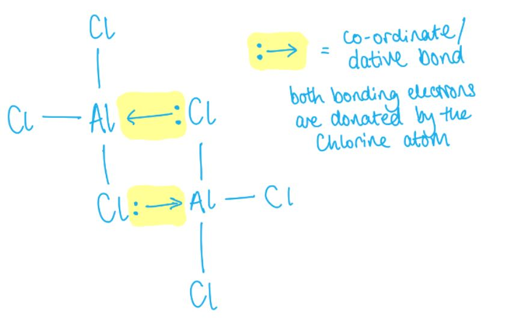

# Mark Schemes — Periodicity of Chemical Properties of the Elements in Period 3
**9. The Periodic Table: Chemical Periodicity** · Cambridge (CIE) A-LEVEL chemistry (9701)

## Multiple Choice Questions (18 questions)

### Q1
**Final answer:** **The correct answer is A**

- Across Period 3, the oxides change from **giant ionic** (metals) to **giant covalent** or **simple molecular** (non-metals).
- **MgO** is a giant ionic oxide with basic properties.

  - It is sparingly soluble in water but reacts to form magnesium hydroxide, giving a weakly alkaline solution of approximately pH 8–9.

**B** is incorrect as although Al2O3 is amphoteric, it is **insoluble** in water and does not produce a solution at pH ≈ 7.

**C** is incorrect as SiO2 is an acidic oxide with a giant covalent structure. It is **insoluble** in water and does not form an acidic solution.

**D** is incorrect as P4O10 reacts with water to form phosphoric acid, giving a solution of low pH (approximately 1–2), not pH ≈ 13.

### Q2
**Final answer:** **The correct answer is A**

- A colourless gas that dissolves in water to give an **alkaline solution** is **ammonia (NH****3****)**, so the second cation is NH4+.
- NH4+ reacts with OH- to release ammonia:

NH4+ + OH- $\rightarrow$ NH3 + H2O

- The Fe2+ ions in Mohr's salt react with OH- to form **iron(II) hydroxide**, an insoluble grey-green solid:

Fe2+ (aq) + 2OH- (aq) $\rightarrow$ Fe(OH)2 (s)

- Na2SO4 is also formed but it is a **white, soluble** solid

  - This does not account for the grey-green insoluble residue.

**B** is incorrect as SO2 is not produced. NaOH reacts with the NH4+ cation, not with SO42-.

**C** is incorrect as Na2SO4 is a **white, soluble** solid. It cannot be the grey-green insoluble residue.

**D** is incorrect as the gas produced is NH3 (dissolves to give alkaline solution), not SO2 (which dissolves to give an acidic solution).

> **[exam-tip]**
> The colour of the residue is a key identifier:
> 
> - Fe(OH)2 is grey-green
> - Fe(OH)3 is rust-coloured (orange-brown).
> 
> Knowing these colours allows you to eliminate options quickly.
> 
> The alkaline gas is always NH3 and is the only common colourless gas from Period 3 reactions with NaOH that gives an alkaline solution in water.

### Q3
**Final answer:** **The correct answer is C**

- When aluminium burns in oxygen, **aluminium oxide** is formed:

4Al (s) + 3O2 (g) $\rightarrow$ 2Al2O3 (s)

- Aluminium oxide is **amphoteric** as it reacts with both acids and bases.
- Aluminium oxide with hydrochloric acid produces aluminium chloride:

Al2O3 (s) + 6HCl (aq) $\rightarrow$ 2AlCl3 (aq) + 3H2O (l)

- Adding sodium hydroxide to aluminium chloride solution produces **insoluble aluminium hydroxide**:

AlCl3 (aq) + 3NaOH (aq) $\rightarrow$ Al(OH)3 (s) + 3NaCl (aq)

- In **excess** sodium hydroxide, the aluminium hydroxide dissolves to form the soluble aluminate ion:

Al(OH)3 (s) + NaOH (aq) $\rightarrow$ Na+[Al(OH)4]- (aq)

**A** is incorrect as Mg(OH)2 formed when magnesium chloride reacts with sodium hydroxide does **not** dissolve in excess NaOH. Magnesium hydroxide has no amphoteric properties.

**B** is incorrect as SiO2 is a **covalent** compound with **no basic properties**. It cannot react with hydrochloric acid, so the sequence cannot proceed.

**D** is incorrect as P4O10 is a **covalent** compound with **no basic properties**. It cannot react with hydrochloric acid.

### Q4
**Final answer:** **The correct answer is D**

- For a hydroxide to react with hydrochloric acid in a neutralisation reaction, it must act as a **base**.

  - Phosphorus does not form a simple hydroxide.
- The compound is **phosphoric acid** (H3PO4), which is itself an **acid**.

  - It donates H+ ions in solution.
- An acid cannot neutralise another acid, so H3PO4 does not react with hydrochloric acid in a neutralisation reaction.

**A** is incorrect as Mg(OH)2 acts as a base and reacts with HCl:

Mg(OH)2 + 2HCl $\rightarrow$ MgCl2 + 2H2O

**B** is incorrect as Al(OH)3 acts as a base and reacts with HCl:

Al(OH)3 + 3HCl $\rightarrow$ AlCl3 + 3H2O

**C** is incorrect as NaOH is a strong base and readily reacts with HCl:

NaOH + HCl $\rightarrow$ NaCl + H2O

### Q5
**Final answer:** **The correct answer is B**

- Increasing the pool water acidity adds H+ ions, which **reduces the concentration of OH****-**** ions**.
- By Le Chatelier's principle, the equilibrium shifts to the **right** (forward direction) to oppose the decrease in OH-, producing more HOCl.
- Increasing [HOCl] maintains the pool's bactericidal effectiveness.

**A** is incorrect as Cl- ions are not a component of this equilibrium, so adding them has no effect on [HOCl].

**C** is incorrect as none of the gases in air (O2, CO2, N2) appear in this equilibrium, so bubbling air through the water has no effect.

**D** is incorrect as adding OH- ions shifts the equilibrium to the **left** (reverse direction), opposing the increase in OH- and reducing [HOCl].

### Q6
**Final answer:** **The correct answer is A**

- When SO3 is added to water, it produces **sulfuric acid**:

SO3 (l) + H2O (l) $\rightarrow$ H2SO4 (aq)

- Na2O is a basic oxide. One mole of H2SO4 is neutralised by exactly one mole of Na2O:

H2SO4 + Na2O $\rightarrow$ Na2SO4 + H2O

- Sodium sulfate forms a neutral solution (pH 7).

**B** is incorrect as P4O10 reacts with water to produce **four** moles of phosphoric acid (4H3PO4). One mole of Na2O cannot neutralise four moles of H3PO4.

**C** is incorrect as the molar ratio of Al2O3 to H2SO4 is **1:3** (to form Al2(SO4)3), not 1:1. One mole of SO3 produces only one mole of H2SO4, which is not sufficient to fully neutralise one mole of Al2O3.

**D** is incorrect as P4O10 produces four moles of H3PO4, which cannot be neutralised by one mole of Al2O3 in a 1:1 ratio.

### Q7
**Final answer:** **The correct answer is A**

- Silicon has **4 valence electrons** and forms 4 covalent bonds; chlorine has **7 valence electrons** and forms 1 covalent bond.

- One silicon atom bonds with 4 chlorine atoms to form SiCl4.
- Since chlorine exists as diatomic Cl2, the balanced equation is:

Si + 2Cl2 $\rightarrow$ SiCl4

- Therefore, **2 moles of Cl****2** are required per mole of silicon.

**B** is incorrect as 3 moles of Cl2 would give SiCl6, which silicon cannot form (Period 3 elements beyond the 3s and 3p cannot expand their octet at this level).

**C** is incorrect as 4 refers to the number of chlorine *atoms* in SiCl4, not the number of Cl2 molecules. Since Cl2 is diatomic, only 2 moles are needed.

**D** is incorrect as 5 moles of Cl2 would give SiCl10, which is not a known compound.

### Q8
**Final answer:** **The correct answer is D**

- **Magnesium chloride** is an ionic compound and dissociates into Mg2+ and Cl- ions when dissolved in water.

- No reaction occurs because neither ion reacts with water.

- The chloride ion cannot extract H+ from water to form hydrochloric acid:

MgCl2 (s) $\rightarrow$ Mg2+ (aq) + 2Cl- (aq)

**A** is incorrect as aluminium chloride has significant **covalent character** and reacts with water to produce hydrochloric acid fumes:

AlCl3 + 3H2O $\rightarrow$ Al(OH)3 + 3HCl

**B** is incorrect as silicon tetrachloride is a **covalent molecule** that reacts readily with water to produce hydrochloric acid:

SiCl4 + 2H2O $\rightarrow$ SiO2 + 4HCl

**C** is incorrect as phosphorus(V) chloride is a covalent molecule that reacts with water to produce hydrochloric acid:

PCl5 + 4H2O $\rightarrow$ H3PO4 + 5HCl

### Q9
**Final answer:** **The correct answer is B**

- Phosphorus(V) chloride (PCl5) is a **covalent solid**.

- When added to water, it undergoes a violent hydrolysis reaction producing hydrogen chloride gas and phosphoric(V) acid:

PCl5 (s) + 4H2O (l) $\rightarrow$ H3PO4 (aq) + 5HCl (g)

- The HCl gas meets atmospheric moisture to produce visible **steamy white fumes**.
- All products are soluble or gaseous, so no precipitate forms.

**A** is incorrect as the reaction between PCl5 and water is vigorous, producing steamy HCl fumes.

**C** is incorrect as no precipitate forms and all products are either soluble (H3PO4) or gaseous (HCl).

**D** is incorrect as the only observation is steamy fumes of HCl. No white precipitate is produced.

### Q10
**Final answer:** **The correct answer is C**

- The oxides of Period 3 are:

  - **Basic** on the left-hand side (Na and Mg).
  - **Acidic** on the right-hand side (Si, P, S and Cl).
  - Al2O3 is **amphoteric** (can act as both an acid and a base).

- MgO is a **basic oxide** as it contains oxide ions (O2-) that react with water to produce hydroxide ions:

MgO (s) + H2O (l) $\rightarrow$ Mg(OH)2 (aq)

- The ionic equation is:

O2- + H2O (l) $\rightarrow$ 2OH- (aq)

- The resulting Mg(OH)2 solution is alkaline (pH ~9), so the pH **increases**.

**A** is incorrect as MgO is a basic oxide, not an acidic one.

**B** is incorrect as MgO is basic and adding it to water increases (not decreases) the pH.

**D** is incorrect as MgO does react with water to form Mg(OH)2, raising the pH above 7.

### Q11
**Final answer:** **The correct answer is C**

- Magnesium chloride has the highest melting point because it forms a **giant ionic lattice**.

  - Strong electrostatic attractions between Mg2+ and Cl- ions extend throughout the lattice, so a large amount of energy is required to overcome these forces when the solid melts.
- CCl4, S2Cl2, and HCl are **simple covalent molecules**.

  - So, the forces between molecules are much weaker than ionic bonds.
- CCl4 is **non-polar** because of its symmetrical tetrahedral shape.

  - So, the only intermolecular forces present are **instantaneous dipole-induced dipole (id-id) forces**.
- S2Cl2 is **polar**.

  - So, it experiences **permanent dipole-permanent dipole (pd-pd) interactions** as well as id-id forces.
- However, CCl4 has a **larger molecular mass** (154 vs 135 g mol-1)

  - This gives it stronger id-id forces, so CCl4 has the higher melting point of the two.
- HCl is also a **simple covalent molecule** with pd-pd interactions and id-id forces, but these intermolecular forces are weak.

  - As a result, HCl is a **gas at room temperature** and has a very low melting point.

### Q12
**Final answer:** **The correct answer is B**

- Both **MgCl****2** and **NaCl** are ionic compounds that dissolve without altering [H+].
- Neither Mg2+ nor Na+ reacts with water, and Cl- does not extract H+ from water molecules.
- So, both give neutral solutions (pH 7).

**A** is incorrect as MgCl2 forms a **neutral** solution because Mg2+ does not react with water to produce H+ ions.

**C** is incorrect as SiCl4 is a **covalent molecule** that hydrolyses in water to produce an acidic solution:

SiCl4 + 2H2O $\rightarrow$ SiO2 + 4HCl

**D** is incorrect as NaCl forms a **neutral** solution because Na+ does not react with water to produce OH- ions.

> **[exam-tip]**
> A common misconception is that MgCl2 forms a slightly acidic solution because Mg2+ is a small, highly charged cation.
> 
> At CIE IAL level, MgCl2 is treated as forming a neutral solution. Only the chlorides of transition metals and aluminium (which form hydrated ions capable of donating H+) produce acidic solutions.

### Q13
**Final answer:** **The correct answer is A**

- The balanced equation for this reaction is:

P4O10 + 6CaO $\rightarrow$ 2Ca3(PO4)2

- The molar ratio of P4O10 : CaO = 1 : 6.

- Amount of P4O10 reacting with 3 mol CaO = 3 ÷ 6 = **0.5 mol**

**B** is incorrect as 1.5 mol results from using an incorrect 1:2 molar ratio rather than 1:6.

**C** is incorrect as a 1:1 ratio is not consistent with the balanced equation.

**D** is incorrect as 6 is the stoichiometric coefficient of CaO in the equation, not the amount of P4O10.

### Q14
**Final answer:** **The correct answer is B**

- **Aluminium oxide** does not react with water because the oxide ion is too strongly attracted to the Al3+ ion to be displaced.
- **Silicon dioxide** has a giant covalent structure with strong covalent bonds throughout, so it does not dissolve in water.
- Both Al2O3 and SiO2 are therefore **insoluble in water**.

**A** is incorrect as only Al2O3 is **amphoteric** (reacts with both acids and bases). SiO2 is acidic only. It reacts with strong bases but not with acids.

**C** is incorrect as neither AlCl3 nor SiCl4 produces simple metal cations in solution. AlCl3 reacts with water to form the hydrated aluminium ion [Al(H2O)6]3+. SiCl4 is a covalent molecule that hydrolyses and does not produce Si4+ ions.

**D** is incorrect as only AlCl3 has coordinate (dative) bonding. In the Al2Cl6 dimer, chlorine lone pairs are donated to aluminium. SiCl4 has only polar covalent bonds.

### Q15
**Final answer:** **The correct answer is A**

- Electronegativity increases continuously from Na to Si as nuclear charge increases while the number of electron shells remains constant:

Na < Mg < Al < Si (continuous increase on y-axis).

- **First ionisation energy** is the energy to remove one mole of electrons from one mole of gaseous atoms:

X (g) $\rightarrow$ X+ (g) + e-

- Na has the lowest first ionisation energy (lowest nuclear charge; outer electron is 3s1).
- Al has a *lower* first ionisation energy than Mg despite having one more proton.

  - Al's outer electron is in the 3p subshell, which is at a higher energy level and is shielded by the 3s2 electrons, outweighing the extra nuclear charge.
- Si has the highest first ionisation energy of the four (3p2, highest nuclear charge).
- The correct graph shows electronegativity increasing continuously on the y-axis, and first ionisation energy in the order Na < Al < Mg < Si on the x-axis (dip at Al).

**B**, **C**, and **D** are incorrect as they show the wrong trend for electronegativity, miss the dip in first ionisation energy at aluminium, or invert the relative positions of Mg and Al.

### Q16
**Final answer:** **The correct answer is C**

**Melting point:**

- Silicon has the highest melting point because it has a **giant covalent structure**.
- Many strong covalent bonds must be broken to melt it, requiring a large amount of energy.
- The melting points of the **metals** (Na, Mg, Al) increase across the period as more electrons are delocalised per atom (1 from Na, 2 from Mg, 3 from Al), strengthening the metallic bonding.
- Phosphorus (P4) and sulfur (S8) are **simple covalent molecules** with only id-id forces between molecules.
- S8 has a higher melting point than P4 because its larger molecular mass (256 vs 124 g mol-1) means stronger id-id forces.

**Electronegativity:**

- Electronegativity **increases steadily across Period 3** because nuclear charge increases while the shielding remains approximately constant, so the attraction on bonding electrons increases.

### Q17
**Final answer:** **The correct answer is D**

**Sulfur**

- The electron configuration of sulfur is 1s2 2s2 2p6 3s2 3p4.
- The 3p4 configuration has **one pair** of 3p electrons, so sulfur does **not** satisfy Property 1.
- However, sulfur trioxide reacts with water to produce **sulfuric acid**, a **strong acid** that fully dissociates in aqueous solution:

SO3 + H2O $\rightarrow$ H2SO4

- Therefore, sulfur satisfies **Property 2 only**.

**Phosphorus**

- The electron configuration of phosphorus is 1s2 2s2 2p6 3s2 3p3.
- By Hund's rule, the three 3p electrons each occupy a **separate 3p orbital**, so phosphorus has **no paired 3p electrons** and satisfies Property 1. 
- Phosphorus oxides (P4O6 and P4O10) produce only **weak acids** (H3PO3 and H3PO4) that do not fully dissociate, so phosphorus does **not** satisfy Property 2.
- Therefore, phosphorus satisfies **Property 1 only**.

**A** is incorrect as phosphorus oxides produce only weak acids, so phosphorus does not have Property 2.

**B** is incorrect as the electron configuration of sulfur is 3p4. Sulfur has one paired 3p electron and therefore does not satisfy Property 1.

**C** is incorrect as neither element has both properties. Sulfur lacks Property 1 and phosphorus lacks Property 2.

> **[exam-tip]**
> Sulfur dioxide (SO2) also produces an acid when added to water:
> 
> SO2 + H2O $\rightarrow$ H2SO3.
> 
> However, H2SO3 is a **weak acid** and does not fully dissociate, so it does not satisfy Property 2. Only SO3, which forms the strong acid H2SO4, satisfies Property 2.

### Q18
**Final answer:** **The correct answer is D**

- The oxidation states of the Period 3 elements in the chlorides listed are:

  - MgCl2 = +2
  - AlCl3 = +3
  - SiCl4 = +4
  - PCl3 = +3
  - SCl2 = +2

- The oxidation states in their **highest possible oxides** are:

  - MgO = +2
  - Al2O3 = +3
  - SiO2 = +4
  - P4O10 = **+5**
  - SO3 = **+6**

- Only **phosphorus** (+3 → +5) and **sulfur** (+2 → +6) have higher oxidation states in their oxides than in the chlorides listed.

**A** is incorrect as Mg (+2), Al (+3), and Si (+4) have the same oxidation state in both their chlorides and their highest oxides.

**B** is incorrect as Al has oxidation state +3 in both AlCl3 and Al2O3. It is not higher in the oxide.

**C** is incorrect as Mg and Si have the same oxidation states in their oxides as in their chlorides (+2 and +4 respectively).

> **[exam-tip]**
> Phosphorus and sulfur can reach higher oxidation states in their oxides because they can use d orbitals to expand beyond an octet.
> 
> Phosphorus reaches +5 (in P4O10) and sulfur reaches +6 (in SO3).
> 
> In the chlorides listed here, neither reaches its maximum oxidation state.
