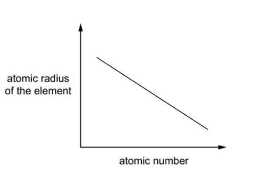

# Mark Schemes — Chemical Periodicity of Other Elements
**9. The Periodic Table: Chemical Periodicity** · Cambridge (CIE) A-LEVEL chemistry (9701)

## Multiple Choice Questions (9 questions)

### Q1
**Final answer:** **The correct answer is C**

- Group 15 chlorides, such as phosphorus(III) chloride (PCl3), undergo vigorous hydrolysis when added to water:

PCl3 (l) + 3H2O (l) → H3PO3 (aq) + 3HCl (aq)

- HCl fully dissociates in water, giving a strongly acidic solution (pH 1–2)

**A** is incorrect as Group 1 chlorides, such as NaCl, dissolve in water to give a neutral solution (pH 7). They do not hydrolyse.

**B** is incorrect as Group 2 chlorides, such as MgCl2, dissolve in water to give a neutral or very slightly acidic solution. They do not undergo complete hydrolysis.

**D** is incorrect as Group 16 is not the syllabus example for chlorides that produce strongly acidic solutions through hydrolysis. Group 15 (phosphorus) is the definitive case.

### Q2
**Final answer:** **The correct answer is D**

- The oxide of element **Z** can react with both acids and bases, meaning it is amphoteric
- Aluminium oxide (Al2O3) is the Period 3 oxide that is amphoteric:
- Al2O3 reacts with acids:

Al2O3 (s) + 6HCl (aq) → 2AlCl3 (aq) + 3H2O (l)

- Al2O3 reacts with bases:

Al2O3 (s) + 2NaOH (aq) + 3H2O (l) → 2NaAl(OH)4 (aq)

- Therefore, element **Z** must be Al

**A** is incorrect as silicon dioxide (SiO2) is an acidic oxide. It reacts with bases but not with acids.

**B** is incorrect as magnesium oxide (MgO) is a basic oxide. It reacts with acids but not with bases.

**C** is incorrect as chlorine forms simple molecular oxides (such as Cl2O) that are gases or liquids at room temperature, not solids. These are strictly acidic oxides.

### Q3
**Final answer:** **The correct answer is A**

- When 1.0 mol of SO3 is added to water, it produces exactly 1.0 mol of sulfuric acid:

SO3 (s) + H2O (l) → H2SO4 (aq)

- 1.0 mol of H2SO4 is then neutralised by exactly 1.0 mol of Na2O:

H2SO4 (aq) + Na2O (s) → Na2SO4 (aq) + H2O (l)

- The 1:1 molar ratio is satisfied

**B** is incorrect as 1.0 mol of P4O10 produces 4.0 mol of phosphoric(V) acid:

P4O10 + 6H2O → 4H3PO4.

Neutralising 4.0 mol of H3PO4 with Na2O requires 6.0 mol of Na2O, not 1.0 mol.

**C** is incorrect as 1.0 mol of SO3 produces 1.0 mol of H2SO4, but 1.0 mol of Al2O3 neutralises only 3.0 mol of HCl (not 2.0 mol of H2SO4):

3H2SO4 + Al2O3 → Al2(SO4)3 + 3H2O.

The molar ratio is 3:1, not 1:1.

**D** is incorrect as 1.0 mol of P4O10 produces 4.0 mol of H3PO4, which requires 2.0 mol of Al2O3 to neutralise:

4H3PO4 + 2Al2O3 → 4AlPO4 + 6H2O.

> **[exam-tip]**
> This question requires two separate balanced equations: one for the hydrolysis of J (forming an acid) and one for the neutralisation of that acid by G.
> 
> Work through each option systematically:
> 
> 1. Write the hydrolysis equation for J to find how many moles of acid are produced per mole of J
> 2. Write the neutralisation equation to find how many moles of G are needed per mole of acid
> 3. Multiply to find moles of G needed per mole of J

### Q4
**Final answer:** **The correct answer is C**

- PCl3 and SiCl4 are both simple covalent liquids at room temperature
- Simple covalent liquids contain no ions or delocalised electrons, so they do not conduct electricity in the liquid state
- When added to water, both undergo vigorous hydrolysis:

PCl3 + 3H2O → H3PO3 (aq) + 3HCl (aq)

SiCl4 + 2H2O → SiO2 (s) + 4HCl (aq)

- The HCl produced fully dissociates to give H+ and Cl- ions, so the resulting solutions conduct electricity

**A** is incorrect as MgCl2 is a giant ionic lattice. When molten, the ions become free to move, so MgCl2 does conduct electricity in its liquid state. A common trap is to only consider aqueous conductivity and overlook the molten state condition.

**B** is incorrect as MgCl2 conducts electricity when molten (see above), so it does not satisfy the condition of not conducting in the liquid state.

**D** is incorrect as NaCl is a giant ionic lattice that also conducts electricity when molten. Like MgCl2, it does not satisfy the condition.

### Q5
**Final answer:** **The correct answer is C**

- In Period 3, the oxides of phosphorus and sulfur dissolve in water to form acidic solutions:
- Phosphorus(V) oxide:

P4O10 + 6H2O → 4H3PO4

- Sulfur trioxide:

SO3 + H2O → H2SO4

- H3PO4 and H2SO4 dissociate in water to release H+ ions, forming acidic solutions
- As is directly below P and Se is directly below S, so their oxides will also dissolve in water to form acidic solutions

**A** is incorrect as gallium (Ga) is directly below aluminium (Al). Aluminium oxide is a giant ionic lattice that does not react with water, so the oxide of Ga will also be insoluble and will not form an acidic solution. Germanium (Ge) is directly below silicon (Si). Silicon dioxide has a giant covalent structure and also does not react with water.

**B** is incorrect as gallium (Ga) is below aluminium (Al), and the oxide of Ga is insoluble in water. It does not dissolve to form an acidic solution, so Ga should not be included.

**D** is incorrect as arsenic (As) is directly below phosphorus (P). The oxides of As dissolve in water to form an acidic solution, so As should also be included alongside Se.

### Q6
**Final answer:** **The correct answer is D**

- Atomic radius (measured as covalent radius) decreases across a period due to increasing nuclear charge pulling electrons in the same shell closer to the nucleus
- Chlorine has the smallest atomic radius in Period 3 because it has the highest nuclear charge of the non-noble gas elements
- Therefore, element **X** is chlorine

- Phosphorus (P4) and sulfur (S8) are simple molecular substances whose melting points depend on the strength of instantaneous dipole-induced dipole forces between molecules
- S8 has more electrons than P4, so sulfur has stronger intermolecular forces and a higher melting point than phosphorus
- The Period 3 melting point order for simple molecular non-metals is:

Cl2 < P4 < S8

- Apart from argon, only chlorine has a lower melting point than phosphorus
- Therefore, element **Y** is phosphorus, and compound **Z** is PCl3

**A** is incorrect as Na2S would require X to be Na and Y to be S. Sodium does not have the smallest atomic radius in Period 3.

**B** is incorrect as MgS would require X to be Mg and Y to be S. Magnesium does not have the smallest atomic radius in Period 3. Sulfur also has a higher melting point than phosphorus, so it does not fit the melting point clue.

**C** is incorrect as MgCl2 would require X to be Mg and Y to be Cl. Magnesium does not have the smallest atomic radius in Period 3.

> **[exam-tip]**
> Argon is a noble gas and its atomic radius is measured as a van der Waals radius (around 188 pm), which is much larger than the covalent radius of chlorine (around 99 pm). Argon does not have a smaller covalent radius than chlorine.

### Q7
**Final answer:** **The correct answer is A**

- A melting point of 1710 °C indicates a giant covalent (macromolecular) structure, requiring large amounts of energy to break covalent bonds throughout the lattice
- Silicon reacts with oxygen to form silicon dioxide, which has a giant covalent structure:

Si (s) + O2 (g) → SiO2 (s)

- SiO2 is an acidic oxide and reacts with hot aqueous sodium hydroxide:

SiO2 (s) + 2NaOH (aq) → Na2SiO3 (aq) + H2O (l)

- Therefore, element **X** is silicon

**B** is incorrect as sodium reacts with oxygen to form sodium oxide (Na2O), which is a giant ionic lattice. It is a basic oxide. Basic oxides react with acids, not with other bases, so Na2O will not react with sodium hydroxide.

**C** is incorrect as chlorine forms simple molecular oxides (such as Cl2O) with low melting points, because only weak intermolecular forces need to be overcome. This does not satisfy the 1710 °C clue.

**D** is incorrect as sulfur forms simple molecular oxides (SO2, SO3) with low melting points for the same reason. This does not satisfy the 1710 °C clue.

### Q8
**Final answer:** **The correct answer is D**

- Iron commonly exists as Fe2+ and Fe3+.
- Aluminium forms a 3+ ion (Al3+), which matches iron's common +3 oxidation state
- Al3+ has 10 electrons, which is the same number as neon
- Aluminium oxide (Al2O3) is insoluble in water
- Al2O3 reacts with dilute hydrochloric acid to produce aluminium chloride:

Al2O3 (s) + 6HCl (aq) → 2AlCl3 (aq) + 3H2O (l)

- Therefore, element **Z** is aluminium

**A** is incorrect as magnesium forms a 2+ ion (Mg2+), which matches iron's +2 oxidation state and has 10 electrons (isoelectronic with Ne). However, magnesium oxide is sparingly soluble in water, forming a weakly alkaline solution. It does not satisfy the condition of being insoluble in water.

**B** is incorrect as silicon(IV) oxide (SiO2) is insoluble in water, but it is an acidic oxide. It will not react with hydrochloric acid to produce a salt.

**C** is incorrect as sodium forms a 1+ ion (Na+). +1 is not a common oxidation state for iron.

> **[exam-tip]**
> A common trap is to select magnesium because it satisfies both the electron configuration and oxidation state clues, but MgO is sparingly soluble in water rather than truly insoluble.

### Q9
**Final answer:** **The correct answer is A**

- For element **X**, there is a large jump in ionisation energy between the 2nd and 3rd electrons.

  - This means that **X** must be in Group 2 with two outer electrons
- Argon has 18 electrons.
- The Group 2 element that forms a 2+ ion with 18 electrons is calcium:

20 − 2 = 18 electrons → Ca2+ is isoelectronic with Ar

- For element **Y**, there is a large jump in ionisation energy between the 5th and 6th electrons

  - This means that **Y** must be in Group 15 with five outer electrons
- Argon has 18 electrons.
- The Group 15 element that forms a 3− ion with 18 electrons is phosphorus:

15 + 3 = 18 electrons → P3- is isoelectronic with Ar

**B** is incorrect as a sodium ion (Na+) has 10 electrons and an oxygen ion (O2-) has 10 electrons, so neither is isoelectronic with argon (18 electrons). They are isoelectronic with neon.

**C** is incorrect as a magnesium ion (Mg2+) has 10 electrons and a nitrogen ion (N3-) has 10 electrons, so neither is isoelectronic with argon. They are isoelectronic with neon.

**D** is incorrect as potassium is in Group 1, not Group 2, so there is no large jump between the 2nd and 3rd ionisation energies. The elements are also written in the wrong order.

> **[exam-tip]**
> A common trap is to confuse argon (18 electrons) with neon (10 electrons). Sodium, oxygen, magnesium, and nitrogen all form ions with 10 electrons. They are isoelectronic with neon, not argon.

## Structured Questions (3 questions)

### Q1
> **[mark-scheme]**
> i) The element that forms a soluble hydroxide and an insoluble sulfate:
> 
> - Ba **[1 mark]**
> 
> ii) The most volatile element in a group that contains elements in all three states of matter at room temperature and pressure:
> 
> - F **[1 mark]**
> 
> iii) The element that forms the largest cation:
> 
> - Cs **[1 mark]**

> **[exam-tip]**
> The trend in solubility for Group 2 hydroxides and sulfates:
> 
> - Going down Group 2, the solubility of the hydroxides increases
> - Going down Group 2, the solubility of the sulfates decreases
> 
> Barium hydroxide is soluble and barium sulfate is insoluble. Barium is therefore the only Group 2 element that satisfies both conditions in part i).
> 
> Group 17 is the only group that contains elements in all three states of matter at room temperature and pressure:
> 
> - Fluorine = gas
> - Chlorine = gas
> - Bromine = liquid
> - Iodine = solid
> - Astatine = solid
> 
> Volatility refers to how easily a substance can evaporate. The lower the boiling point, the more volatile a substance is. Fluorine has the lowest boiling point in Group 17 and is therefore the most volatile.
> 
> Metals form cations (positively charged ions). For part iii), this eliminates the non-metal elements on the right-hand side of the Periodic Table. Caesium and barium are in the same period but caesium has a lower nuclear charge, so its outer electrons are held less strongly. Therefore, caesium forms the largest cation.
i) The first ionisation energy is:

- Energy required / energy change
- when one electron is removed
- from each atom in one mole of
- gaseous atoms

**[2 marks]**

> **[mark-scheme]**
> 2 marks for all four points
> 
> 1 mark for any two or three points.

> **[mark-scheme]**
> ii) The first ionisation energy of **B** is much less than that of **A** because:
> 
> - (For element **B**) the outer electron is removed from a higher energy level **[1 mark]**
> - There is more shielding (by inner electrons) **[1 mark]**
> - So there is less attraction to the nucleus **[1 mark]**

> **[exam-tip]**
> The four factors that affect the first ionisation energy are:
> 
> - Nuclear charge
> - Distance of outer electrons from nucleus
> - Shielding by inner electrons
> - Spin-pair repulsion
> 
> The question states that the ionisation energies are for six successive elements. Generally, across a period, ionisation energy increases due to increasing nuclear charge and reasonably constant shielding. Element **B** is an exception as its outer electron is in a new, higher energy level with more inner shells providing additional shielding, making the electron easier to remove despite the higher nuclear charge.
i) A graph showing the trend in atomic radius across Period 3 is:

**[1 mark]**

> **[mark-scheme]**
> 1 mark for a line that decreases from left to right across Period 3 (Na to Ar)

> **[mark-scheme]**
> ii) The trend occurs because:
> 
> - Increasing nuclear charge (across Period 3) **[1 mark]**
> - Electrons remain in the same electron shell / number of shells does not change **[1 mark]**
> - Greater attraction between the nucleus and outer electrons / increased effective nuclear charge **[1 mark]**

> **[exam-tip]**
> Atomic radius is the distance between the nucleus and the outermost electron.
> 
> Going across Period 3, each successive element has one more proton in the nucleus (greater nuclear charge), but all electrons are still added to the third shell. The shielding remains approximately constant, so the effective nuclear charge experienced by the outer electrons increases across the period. The nucleus pulls the outer electrons closer, reducing the atomic radius.

### Q2
> **[mark-scheme]**
> Element **A** is:
> 
> - Phosphorus / P **[1 mark]**
> - There is a (very) large jump between the 5th and 6th ionisation energies
> **OR**
> There is a (very) large jump in ionisation energy after the 5th ionisation energy **[1 mark]**

> **[exam-tip]**
> Successive ionisation energies increase because once an electron has been removed from an atom, you are left with a positive ion. Removing an electron from an increasingly positive ion requires progressively more energy.
> 
> The key to identifying an element from its successive ionisation energies is to look for the large jump in ionisation energy. In this question, the jump from the 5th to the 6th ionisation energy is almost 15,000 kJ mol-1, far greater than any earlier increase.
> 
> A common mistake is to correctly identify the large jump between the 5th and 6th ionisation energies, then incorrectly identify the element as being in Group 6. If the large jump occurs after the 5th ionisation energy, the element has 5 electrons in its outer shell and must be in Group 5.
> **[mark-scheme]**
> The trend shown in the graph:
> 
> - A general increase in first ionisation energy across Period 3 **[1 mark]**
> - (Across a period) nuclear charge increases / a proton is added to the nucleus **[1 mark]**
> - Aluminium deviates from the general trend because its outermost / valence electron is in a 3p orbital **[1 mark]**
> - The 3p orbital is further from the nucleus
> **OR**
> The 3p orbital has a slightly higher energy than the 3s orbital **[1 mark]**
> - Sulfur deviates because its outermost / valence electron is paired / shares a 3p orbital with another electron
> **AND**
> There is repulsion between the paired electrons (in the 3p orbital) **[1 mark]**
> **[mark-scheme]**
> The second ionisation energy of aluminium is larger than the first because:
> 
> - Electrons are now being removed from a positive ion
> **OR**
> The electrons being removed are closer to the nucleus
> **OR**
> Al+ ions are smaller than Al atoms
> **OR**
> The electron is being removed from a 3s orbital rather than a 3p orbital **[1 mark]**

> **[exam-tip]**
> Successive ionisation energies increase because the more positive an ion becomes, the more energy is needed to remove the next electron. You are removing a negatively charged electron from an increasingly positive ion.
> 
> In the case of aluminium, the 1st ionisation energy removes an electron from a 3p orbital, and the 2nd removes an electron from a 3s orbital. The 3s orbital is closer to the nucleus and at a lower energy than the 3p, so more energy is required to remove a 3s electron than a 3p electron.

### Q3
> **[mark-scheme]**
> Element **X** is:
> 
> - Sodium / Na **[1 mark]**
> 
> Its full electron configuration is:
> 
> - 1s2 2s2 2p6 3s1 **[1 mark]**
> 
> [Ne] 3s1 is not accepted as a full electron configuration.

> **[exam-tip]**
> The graph shows that a total of 11 electrons are removed from element X. The number of electrons equals the number of protons, so element X has 11 protons and is sodium.
> 
> The number of electron shells can be determined from the large jumps in ionisation energy. A large jump indicates the next electron is being removed from a shell closer to the nucleus:
> 
> - Large jump between the 1st and 2nd ionisation energies: only 1 electron in the outermost shell (n = 3)
> - Large jump between the 9th and 10th ionisation energies: the 10th electron is in the innermost shell (n = 1), so there are 2 electrons in that shell
> - Electrons 2 to 9 (8 electrons) are in the second shell (n = 2)
> 
> The question asks for the full electron configuration. The condensed noble gas configuration [Ne] 3s1 is not accepted for the second mark.
> **[mark-scheme]**
> The successive ionisation energy data relates to the electron configuration of element **X** as follows:
> 
> - The first electron is the easiest to remove
> **OR**
> There is 1 electron in the outermost energy level (n = 3) **[1 mark]**
> - Large increase between the 1st and 2nd ionisation energies as the electron is now removed from n = 2
> **AND**
> The next 8 electrons show a relatively small increase as these electrons are all in the same energy level (n = 2) **[1 mark]**
> - Large increase between the 9th and 10th ionisation energies as the electron is now removed from n = 1
> **AND**
> The final two electrons are the most difficult to remove / are in the innermost energy level (n = 1) **[1 mark]**

> **[exam-tip]**
> As successive electrons are removed, it becomes increasingly difficult to remove the next electron. This is because the effective nuclear charge experienced by the remaining electrons increases as the ion becomes more positive, strengthening the attraction to the nucleus.
> **[mark-scheme]**
> i) Element **Y** is:
> 
> - Silicon / Si **[1 mark]**

ii) The equation for the reaction of silicon tetrachloride with water is:

SiCl4 (l) + 2H2O (l) → SiO2 (s) + 4HCl (g)

**[2 marks]**

> **[mark-scheme]**
> 1 mark for correct formulas and state symbols
> 
> 1 mark for correctly balanced equation

> **[exam-tip]**
> Silicon tetrachloride (SiCl4) reacts rapidly with water to form a white precipitate of silicon dioxide (SiO2) and white steamy fumes of hydrogen chloride (HCl).
> 
> Make sure you know the observations and equations for Period 3 chlorides and oxides reacting with water as these are common exam questions.
