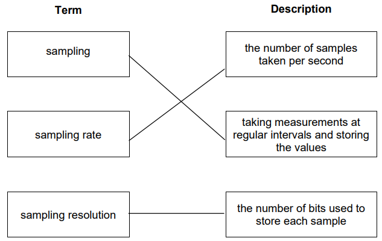

# Mark Schemes — Multimedia
**1. Information representation** · Cambridge (CIE) A-LEVEL computer-science (9618)

## Exam Questions (30 questions)

### Q1
The display area is only 600 by 400 pixels, so no more than 240 000 pixels of the photograph can ever be shown on the page. **[1]**

The extra pixels in the stored image are discarded when the photograph is displayed, so the image quality seen by the visitor does not fall. **[1]**

The stored image now holds 25 times fewer pixels, so each file is 25 times smaller, which uses less storage on the server, uses less bandwidth and makes the page load faster. **[1]**

The original photographs would still be needed if one is to be printed or enlarged, because the detail removed by reducing the image resolution cannot be recovered. **[1]**

**[4 marks]**

> **[mark-scheme]**
> **1 mark** for the display area being only 600 × 400 pixels, so no more detail than that can be seen on the page
> 
> **1 mark** for the quality seen by the visitor being unchanged // the extra pixels not being visible on the page
> 
> **1 mark** for a consequence of the smaller file: less storage used on the server // less bandwidth used // the page loads faster for the visitor
> 
> **1 mark** for a situation that still needs the original, with a reason: printing // enlarging or zooming into the photograph // reusing it in a larger design, because the removed detail cannot be recovered
> 
> Accept "25 times fewer pixels" or "one twenty-fifth of the file size" as an alternative wording of the third marking point
> 
> Accept "6 000 000 pixels reduced to 240 000 pixels" as working for the third marking point
> 
> Do not accept "the photograph will look better", because reducing the image resolution never improves quality

> **[exam-tip]**
> Reducing the image resolution throws detail away permanently, so the removed pixels can never be recovered. The last mark depends on naming a real use for the original, such as printing, where 600 by 400 pixels would look blocky. Writing "you might need it one day" earns nothing.

### Q2
(i) More pixels are used to store the same photograph, so more detail is captured and the image is sharper and less pixelated. **[1]**

(ii) Doubling the width and doubling the height gives 2 × 2 = 4 times as many pixels. **[1]**

The colour depth per pixel has not changed, so the file size becomes 4 times larger. **[1]**

**[3 marks]**

> **[mark-scheme]**
> **1 mark** for the image quality improving, with a reason: more pixels are stored for the same photograph // more detail is captured // the image is sharper // the image is less pixelated
> 
> **1 mark** for identifying that there are 4 times as many pixels
> 
> **1 mark** for the file size becoming 4 times larger
> 
> Accept "four times bigger" and "quadruples" for the factor
> 
> Accept the reason for the file size given as "the number of bits per pixel is unchanged"
> 
> Do not accept "the file size doubles", which is the most common error here; the width and the height were both doubled, not just one of them
> 
> Do not accept "the file size increases" on its own for the third mark, because the question asks how many times larger it becomes

> **[exam-tip]**
> Read exactly which measurement has been doubled. Doubling only the width doubles the file size, but doubling the width and the height multiplies the number of pixels by 4. Work out the change in the number of pixels first, then apply it to the file size, because the colour depth is unchanged and so the number of bits per pixel is unchanged.

### Q3
(i) The number of different colours increases from 16 (24) to 256 (28). **[1]**

(ii) The file size doubles, because twice as many bits are now stored for every pixel. **[1]**

**[2 marks]**

> **[mark-scheme]**
> **1 mark** for the number of colours increasing // increasing from 16 to 256 // increasing from 24 to 28
> 
> **1 mark** for the file size increasing // doubling
> 
> Accept "the file size doubles" and "the file size increases" equally
> 
> Accept 24 and 28 written as 16 and 256
> 
> Do not accept "the image quality improves" for part (i), because the question asks about the number of colours, not the quality
> 
> Do not accept "the file size increases by 4 bits", which confuses the extra bits stored per pixel with the change to the whole file

> **[exam-tip]**
> Colour depth is measured per pixel, so doubling it doubles the size of the whole file, not just one pixel. Note that the number of colours does not double. The number of colours is 2 raised to the power of the colour depth, so it goes from 16 to 256, which is 16 times more.

### Q4
Length of the recording = 2 × 60 = 120 seconds

Number of bits = 44 100 × 120 × 16 = 84 672 000 bits **[1]**

Number of bytes = 84 672 000 ÷ 8 = 10 584 000 bytes, which is 10.584 megabytes **[1]**

10.584 megabytes is greater than the 6 megabytes available, so the file will not fit. **[1]**

Reducing the sampling resolution from 16 bits to 8 bits halves the file size to 5.292 megabytes, which does fit. **[1]**

Each sample is then stored in fewer bits, so fewer different amplitude values can be recorded, the quantisation errors are larger and the digital waveform is further from the original analogue waveform. **[1]**

**[5 marks]**

> **[mark-scheme]**
> **1 mark** for 84 672 000 bits, from 44 100 × 120 × 16
> 
> **1 mark** for a file size of 10 584 000 bytes // 10.584 megabytes
> 
> **1 mark** for stating the file will not fit, because 10.584 megabytes is greater than the 6 megabytes available
> 
> **1 mark** for one change to the sampling settings that brings the file to 6 megabytes or less, with the new size shown: sampling resolution reduced from 16 bits to 8 bits, or sampling rate reduced from 44.1 kHz to 22.05 kHz, either giving 5.292 megabytes
> 
> **1 mark** for the matching effect on accuracy: for a lower sampling resolution, fewer amplitude values can be stored so the quantisation errors are larger; for a lower sampling rate, the amplitude is measured less often so the gaps between samples are wider. Either way the digital waveform is further from the analogue waveform
> 
> Accept 10.6 megabytes for the second mark, provided 10.584 or 10 584 000 appears in the working
> 
> Accept any change to the sampling rate or the sampling resolution for the fourth mark, provided the file size is recalculated for the new setting and is 6 megabytes or less. A new size of exactly 6 megabytes (for example a sampling rate of 25 kHz) fits, because the question gives exactly 6 megabytes of free space and defines 1 megabyte as 1 000 000 bytes
> 
> Accept the fifth mark for a correct effect of your own change, even where the fourth mark was not earned
> 
> Do not accept "record for a shorter time" for the fourth mark. It does make the file smaller, but the length of a recording is not a sampling setting
> 
> Do not accept "use compression" or "use a different file format" for the fourth mark, for the same reason
> 
> Do not accept a change given with no new file size, because the question asks for a change that makes the file fit
> 
> Do not accept an effect that belongs to the other setting, such as "fewer samples per second" for a change to the sampling resolution

> **[exam-tip]**
> This question hides a decision inside a calculation, and the marks for the decision are the ones most often left blank. Once you reach 10.584 megabytes, write in words whether it fits, because an examiner cannot award that mark for a number on its own. When you choose which setting to change, remember that sampling rate and sampling resolution sit in the same multiplication, so halving either one halves the file size. They do not damage the recording in the same way, though: halving the sampling resolution means fewer amplitude values for each sample, while halving the sampling rate means fewer samples taken each second. Describing the effect of the setting you did not change is the commonest way to lose the final mark.

### Q5
(i) Pixel data: 1024 × 1024 × 8 = 8 388 608 bits, and 8 388 608 ÷ 8 = 1 048 576 bytes, which is 1 048 576 ÷ 1024 = 1024 kibibytes. **[1]**

File header: 1024 ÷ 1024 = 1 kibibyte, so the total size of one file is 1024 + 1 = 1025 kibibytes. **[1]**

(ii) 20 mebibytes = 20 × 1024 = 20 480 kibibytes. **[1]**

20 files would need 20 × 1025 = 20 500 kibibytes, which is more than 20 480, so only 19 complete files can be stored. **[1]**

**[4 marks]**

> **[mark-scheme]**
> **1 mark** for 1024 kibibytes of pixel data // for `(1024 × 1024 × 8) ÷ (8 × 1024)`
> 
> **1 mark** for the total 1025 kibibytes
> 
> **1 mark** for converting the storage to 20 480 kibibytes // to 20 971 520 bytes
> 
> **1 mark** for the answer 19
> 
> Accept part (i) worked entirely in bytes, 1 048 576 + 1024 = 1 049 600 bytes, provided 1025 kibibytes is then given
> 
> Accept 19 supported by `20 480 ÷ 1025 = 19.98` as well as by the comparison shown above
> 
> Do not accept 20, which is what you get when the file header is left out of the file size
> 
> Do not accept 19.98 or any other decimal, because the question asks for the number of complete files

> **[exam-tip]**
> The file header is the whole point of this question. Leave it out and you get exactly 20 files, which looks like a tidy answer and is wrong. Choose one unit, kibibytes is easiest here, and convert everything into it before you divide. Then check that the last file really fits: 20 files need 20 500 kibibytes and only 20 480 are available, so the twentieth file does not fit.

### Q6
Length of the recording = 5 × 60 = 300 seconds

Number of bits = 40 000 × 300 × 16 = 192 000 000 bits **[1]**

Number of bytes = 192 000 000 ÷ 8 = 24 000 000 bytes **[1]**

Number of megabytes = 24 000 000 ÷ 1 000 000 = 24 **[1]**

The file size is **24 megabytes**.

**[3 marks]**

> **[mark-scheme]**
> **1 mark** for 192 000 000 bits, from 40 000 × 300 × 16
> 
> **1 mark** for dividing by 8 to give 24 000 000 bytes
> 
> **1 mark** for the final answer of 24 megabytes
> 
> Accept the working carried out in a different order, for example 40 000 × 16 = 640 000 bits per second, then × 300
> 
> Accept 24 MB as the final answer
> 
> Accept 24 000 kilobytes shown as an intermediate step
> 
> Do not accept 24 000 000 as the final answer, because the question asks for megabytes and not bytes
> 
> Do not accept an answer built on 5 seconds or on 300 minutes; the sampling rate is per second, so the length must be converted to 300 seconds
> 
> Do not accept 22.89, which comes from dividing by 1 048 576; that would give mebibytes and the question asks for megabytes

> **[exam-tip]**
> The order of this calculation never changes: sampling rate × sampling resolution × time in seconds gives the number of bits, divide by 8 for bytes, then divide by 1000 for each step up the units. The two marks most often lost are the time conversion, because the sampling rate is per second while the recording is given in minutes, and the final unit, because students stop at bytes. Write the unit beside every line of working so you can always see which one you are in. Watch the word used in the question as well: a megabyte is 1 000 000 bytes but a mebibyte is 1 048 576 bytes, and this paper uses both.

### Q7
1024 × 768 = 786 432 pixels **[1]**

786 432 × 24 = 18 874 368 bits

18 874 368 ÷ 8 = 2 359 296 bytes **[1]**

2 359 296 ÷ 1024 ÷ 1024 = 2.25 mebibytes **[1]**

**[3 marks]**

> **[mark-scheme]**
> **1 mark** for 786 432 pixels // for multiplying the width by the height
> 
> **1 mark** for 2 359 296 bytes // for `(1024 × 768 × 24) ÷ 8`
> 
> **1 mark** for the answer 2.25 mebibytes
> 
> Accept 2.25 MiB
> 
> Accept the route that converts the colour depth first: 24 bits = 3 bytes, then `1024 × 768 × 3 = 2 359 296 bytes`
> 
> Do not accept 18, which comes from dividing the total in bits by 1024 twice without ever dividing by 8
> 
> Do not accept 2.36, which comes from dividing the bytes by 1 000 000 instead of by 1024 × 1024

> **[exam-tip]**
> The colour depth here is given in bits, so you must divide by 8 exactly once. If you forget that step, you get 18 mebibytes, which is eight times too large and is the single most common wrong answer on this style of question. If you lose track of that division, convert 24 bits to 3 bytes at the very start and then never divide by 8 at all.

### Q8
| Change | File size increases | File size decreases | File size does not change |
|---|---|---|---|
| The sampling rate is changed from 44.1 kHz to 22.05 kHz. |   | **✓** |   |
| The sampling resolution is changed from 8 bits to 16 bits. | **✓** |   |   |
| The volume of the speaker used to play the saved file is increased. |   |   | **✓** |

**[2 marks]**

> **[mark-scheme]**
> **1 mark** for one or two rows ticked correctly
> 
> **1 mark** for all three rows ticked correctly, giving 2 marks in total
> 
> Accept a cross, or any other single clear mark, in place of a tick
> 
> Do not accept a row with more than one box marked; that row scores nothing
> 
> Do not accept "file size increases" for the third row, because the volume of a speaker is set during playback and no extra data is stored in the file

> **[exam-tip]**
> The third row catches students out every year. Anything done after the file has been saved, such as turning the speaker up or using headphones, cannot change the size of the file. Only the settings used while the sound is being recorded, which are the sampling rate, the sampling resolution and the length of the recording, decide how many bits are stored. Check the direction of each change as well: 44.1 kHz to 22.05 kHz is a decrease, even though 22.05 kHz is still a large number.

### Q9
320 × 256 = 81 920 pixels

81 920 × 4 = 327 680 bits

327 680 ÷ 8 = 40 960 bytes **[1]**

40 960 ÷ 1024 = 40 kibibytes **[1]**

**[2 marks]**

> **[mark-scheme]**
> **1 mark** for working that reaches 40 960 bytes, for example `(320 × 256 × 4) ÷ 8`
> 
> **1 mark** for the answer 40 kibibytes
> 
> Accept the whole calculation shown as one expression, `(320 × 256 × 4) ÷ (8 × 1024)`
> 
> Accept 40 KiB
> 
> Do not accept 40 960 on its own, because the question asks for the answer in kibibytes, not bytes
> 
> Do not accept 40.96, which comes from dividing the bytes by 1000 instead of by 1024
> 
> Do not accept 327 680, which is the size in bits

> **[exam-tip]**
> Work in bits first, divide by 8 once to reach bytes, then divide by 1024 for each step up the binary prefixes. A kibibyte is 1024 bytes, not 1000 bytes, and dividing by 1000 here gives 40.96 and loses the answer mark. Write the unit next to your final number so the examiner can see which conversion you stopped at.

### Q10
| Measured amplitude | Level number | 3-bit value stored |
|---|---|---|
| 2.4 | **2** | **010** |
| 5.9 | **5** | **101** |
| 7.2 | **7** | **111** |
| 0.7 | **0** | **000** |

**[4 marks]**

> **[mark-scheme]**
> **1 mark** for level `2` and the stored value `010`
> 
> **1 mark** for level `5` and the stored value `101`
> 
> **1 mark** for level `7` and the stored value `111`
> 
> **1 mark** for level `0` and the stored value `000`
> 
> Accept the stored value written with spaces between the bits, such as `0 1 0`
> 
> Do not accept a stored value shorter than 3 bits, such as `10` for level 2 or `0` for level 0, because the sampling resolution fixes every sample at exactly 3 bits
> 
> Do not accept level 3 for the amplitude 2.4, or level 6 for the amplitude 5.9, which come from rounding to the nearest level instead of using the level the amplitude falls inside
> 
> Do not accept level 8 for the amplitude 7.2, because 8 cannot be stored in 3 bits and the highest level is 7

> **[exam-tip]**
> Two errors take most of the marks here. The first is rounding to the nearest level: the rule in the question stores the level the amplitude falls inside, so 2.4 gives level 2 and not level 3. Read the rule you are given rather than assuming the one you are used to. The second is dropping the leading zeros. A sampling resolution of 3 bits means every sample occupies exactly 3 bits, so level 2 is stored as `010` and never as `10`. The difference between the real amplitude of 2.4 and the level that stores it is called quantisation error, and reducing that error is exactly why a higher sampling resolution gives a more accurate recording.

### Q11
The image is divided into pixels, and each pixel holds one colour. **[1]**

Each colour is given a unique binary code, and the code for each pixel is stored in sequence. **[1]**

The file header stores data about the image, including the image resolution and the colour depth. **[1]**

Without the header the software would not know how many bits belong to each pixel or where each row of pixels ends, so it could not rebuild the image correctly. **[1]**

**[4 marks]**

> **[mark-scheme]**
> **1 mark** each, to a maximum of 4:
> 
> **1 mark** for the image being divided into pixels, each holding one colour
> 
> **1 mark** for each colour being represented by a unique binary code
> 
> **1 mark** for the codes being stored in sequence / one after another
> 
> **1 mark** for the file header storing data about the image, with at least one example such as the image resolution, the colour depth or the file type
> 
> **1 mark** for a consequence: without the colour depth the software cannot tell how many bits belong to each pixel // without the image resolution the software cannot tell where each row of pixels ends
> 
> Accept "bit depth" in place of "colour depth" throughout
> 
> Accept "metadata" for "data about the image" only where at least one example is also given
> 
> Do not accept "the header stores the image", because the header stores data about the image, not the pixel data
> 
> Do not accept "the header compresses the file", because the file in this question is uncompressed

> **[exam-tip]**
> This question has two halves and needs both. A very common answer describes the pixels and the binary codes well, then stops, which caps you at two marks. Say what the header holds and say what would go wrong without it. A useful test: if the header were deleted, could the software still work out where the second row of pixels starts?

### Q12
The amplitude of the analogue sound wave is measured at regular intervals, a set number of times each second. **[1]**

Each measurement is called a sample, and each sample is given a binary value. **[1]**

The binary values are stored in sequence on the hard disk, and this sequence is the digital version of the sound wave. **[1]**

**[3 marks]**

> **[mark-scheme]**
> **1 mark** for the amplitude being measured at regular intervals // a set number of times per second
> 
> **1 mark** for each sample being given, or converted to, a binary value
> 
> **1 mark** for the binary values being stored in sequence
> 
> Accept "loudness" in place of "amplitude"
> 
> Accept "height of the wave" in place of "amplitude"
> 
> Do not accept "the sound is turned into binary" on its own, because it names no step of the process
> 
> Do not accept naming the process as analogue to digital conversion as a marking point, because the question asks how the conversion is carried out
> 
> Do not accept "the wave is stored" for the third mark without the idea of order or sequence

> **[exam-tip]**
> A three-mark describe question wants three separate steps, not one idea written three ways. Plan them as measure, convert, store, then write one sentence for each. Students who open with "the microphone converts the sound into binary" have jumped straight to the end of the process and can only reach one of the three marks. The order matters for the third mark too: the samples are only useful because they are kept in the order they were taken.

### Q13
(i) 5 bits per pixel give 25 = 32 different codes, which is fewer than the 40 colours needed. **[1]**

6 bits per pixel give 26 = 64 different codes, which is enough, so the minimum colour depth is 6 bits per pixel. **[1]**

(ii) 64 - 40 = 24 further colours. **[1]**

**[3 marks]**

> **[mark-scheme]**
> **1 mark** for working that shows 25 = 32 is fewer than 40 // that shows 26 = 64 is the first power of 2 to reach 40
> 
> **1 mark** for the answer 6 bits per pixel
> 
> **1 mark** for 24
> 
> Accept 6 bits, 6 bpp or 6 for the second mark
> 
> Accept 64 - 40 shown as working for the third mark
> 
> Do not accept 5 bits, which comes from stopping at the largest power of 2 below 40 instead of the smallest power of 2 that reaches it
> 
> Do not accept 40 bits, which confuses the number of colours with the number of bits per pixel

> **[exam-tip]**
> The colour depth is the number of bits stored for each pixel, not the number of colours. Work up through the powers of 2 until you reach or pass the number of colours needed: 25 = 32 is not enough for 40 colours, so 6 bits is the smallest that works. Rounding down to 5 is the usual mistake and it leaves eight of the colours with no code.

### Q14
Sampling rate is the number of samples taken per second from the sound wave. **[1]**

Sampling resolution is the number of bits used to store each sample. **[1]**

**[2 marks]**

> **[mark-scheme]**
> **1 mark** for sampling rate being the number of samples taken each second // how many times per second the amplitude is measured
> 
> **1 mark** for sampling resolution being the number of bits used to store each sample
> 
> Accept "measured in hertz" as part of the sampling rate answer, but not on its own
> 
> Accept "bit depth" as an alternative name for sampling resolution
> 
> Do not accept "the number of samples" for sampling rate without "per second", because that describes the whole file rather than the rate
> 
> Do not accept "how good the sound is" for either term, because that is the effect of the setting, not its meaning
> 
> Do not accept an answer that defines sampling resolution using the word "second", because that is the definition of sampling rate

> **[exam-tip]**
> These two terms are swapped more often than any other pair in this topic. Separate them by the unit each one uses. Sampling rate is counted in hertz, which is a number per second. Sampling resolution is counted in bits, which is a number per sample. If the word "second" appears in your answer for sampling resolution, you have written the wrong definition.

### Q15
(i) A pixel is the smallest element of a bitmap image, and it holds a single colour. **[1]**

(ii) The image resolution is the number of pixels that make up the image, found by multiplying the width in pixels by the height in pixels. **[1]**

**[2 marks]**

> **[mark-scheme]**
> **1 mark** for a pixel described as the smallest element / smallest addressable element of a bitmap image // a single square of one colour
> 
> **1 mark** for image resolution described as the number of pixels in the image // the width in pixels multiplied by the height in pixels
> 
> Accept "the total number of pixels that make up the image" for image resolution
> 
> Do not accept "the quality of the image" for image resolution, because that names an effect rather than the quantity being measured
> 
> Do not accept "a dot on the screen" on its own for a pixel, because it does not say that a pixel is the smallest element or that it holds one colour

> **[exam-tip]**
> Image resolution and screen resolution are two different things and CIE mark schemes keep them apart. Image resolution belongs to the image file. Screen resolution belongs to the display device. If you answer this with "the number of pixels across a monitor", you are describing screen resolution and you will not earn the mark.

### Q16
A bitmap image stores a binary code for the colour of every pixel, whereas a vector graphic stores a drawing list of drawing objects and their properties. **[1]**

The photographs contain continuous variation in colour and fine detail that cannot be described as shapes, so they must be stored as bitmap images. **[1]**

Storing a photograph as a vector graphic would need an impractical number of drawing objects and would still not look realistic. **[1]**

The logo is made of simple shapes, so it can be stored as a vector graphic and enlarged for the home page without pixelation, because each object is redrawn from its equation. **[1]**

If the logo were a bitmap image, enlarging it would pixelate it, so a separate bitmap file would be needed for the icon and for the home page image. **[1]**

**[5 marks]**

> **[mark-scheme]**
> **1 mark** for stating the difference in what is stored: a bitmap image stores a binary colour code for every pixel, a vector graphic stores a drawing list of drawing objects and their properties
> 
> Points about the photographs, maximum 3 marks:
> 
> **1 mark** for stating that photographs contain continuous variation in colour and fine detail that cannot be described as shapes / drawing objects
> 
> **1 mark** for stating that the photographs must therefore be stored as bitmap images
> 
> **1 mark** for stating that a vector version would need an impractical number of drawing objects // would not look realistic
> 
> **1 mark** for stating that a bitmap photograph has a large file size, which increases page loading time // may need compression
> 
> Points about the logo, maximum 3 marks:
> 
> **1 mark** for stating that the logo is made of simple shapes, so it can be stored as drawing objects in a vector graphic
> 
> **1 mark** for stating that the vector logo can be enlarged for the home page without pixelation, because each object is redrawn from its equation at the new size
> 
> **1 mark** for stating that a bitmap logo would pixelate when enlarged, so a separate bitmap file would be needed at each size
> 
> **1 mark** for stating that the vector logo generally has a smaller file size than the equivalent bitmap logo
> 
> Maximum 5 marks overall, and at least one marking point must be about each type of image
> 
> Accept "attribute" in place of "property"
> 
> Do not accept "vector graphics are better than bitmap images", because the photographs cannot be stored as vector graphics
> 
> Do not accept "bitmap images have a higher resolution than vector graphics", because a vector graphic has no image resolution

> **[exam-tip]**
> The most common error on this topic is treating vector as the winner in every situation. Vector is not simply better. Scaling favours a vector graphic, but only when the image is built from shapes. A photograph has no shapes to describe, so a bitmap image is the only realistic choice for it.
> 
> Compare means both formats must appear in your answer, and here both types of image must appear too. An answer that only explains why the logo should be a vector graphic gives away the marks available for the photographs.

### Q17
The sign is made only of text and a simple arrow, so it can be described as a small number of drawing objects with properties. **[1]**

A vector graphic can be enlarged to any size without pixelation, because each drawing object is redrawn from its equation at the new size. **[1]**

One vector file can therefore be used for the card, the wall panel and the banner, whereas a bitmap image enlarged to banner size would look pixelated. **[1]**

**[3 marks]**

> **[mark-scheme]**
> **1 mark** for stating that the sign is made of simple shapes and text, so it can be stored as drawing objects
> 
> **1 mark** for stating that a vector graphic can be enlarged without pixelation / without loss of quality, because each object is redrawn from its equation at the new size
> 
> **1 mark** for linking this to the situation: one file serves all three sizes // a bitmap image would pixelate at banner size // a separate bitmap file would be needed for each size
> 
> **1 mark** for stating that the vector file is generally smaller than an equivalent bitmap image of the sign
> 
> Maximum 3 marks
> 
> Accept "scaled up" or "resized" in place of "enlarged"
> 
> Do not accept "a vector graphic has a higher resolution", because a vector graphic has no image resolution
> 
> Do not accept "vector graphics are always better", because the format chosen depends on what the image shows

> **[exam-tip]**
> Justify means you must tie the reason to this situation, not list general facts about vector graphics. The three print sizes in the stem are the whole point, so say that one file can serve all three.
> 
> A frequent error is to claim the sign will have a higher resolution as a vector graphic. Resolution belongs to bitmap images only. Say instead that the sign is redrawn from its equations at whatever size is needed, so nothing is stretched.

### Q18
| Image | More suitable format |
|---|---|
| A photograph of a mountain for a news website | **Bitmap image** |
| A company logo printed on both a pen and a large poster | **Vector graphic** |
| A circuit diagram that users zoom into on screen | **Vector graphic** |
| A scan of a painting for an online art gallery | **Bitmap image** |

**[2 marks]**

> **[mark-scheme]**
> **2 marks** for all four rows correct
> 
> **1 mark** for two or three rows correct
> 
> Correct answers, in order: bitmap image, vector graphic, vector graphic, bitmap image
> 
> Accept "bitmap" for "bitmap image" and "vector" for "vector graphic"
> 
> Do not accept a named file extension such as .jpg or .svg in place of the format, because the question asks for the format
> 
> Do not award any mark where a row is left blank or names both formats

> **[exam-tip]**
> The rule that decides every row is what the image is made of, not how good each format is. A photograph and a scan of a painting both contain continuous variation in colour that cannot be described as shapes, so they have to be bitmap images. The logo and the circuit diagram are built from simple shapes and lines, so they can be drawing objects in a vector graphic.
> 
> Students who answer "vector graphic" in all four rows have learned that vector scales better and stopped there. Read what the image actually shows before you decide.

### Q19
Line thickness is a property of a drawing object, so the value stored for that property is changed. **[1]**

The change is made to the wall drawing objects only, and every other drawing object in the drawing list is left unchanged. **[1]**

A new drawing object for the doorway is added to the drawing list. **[1]**

The properties of that new drawing object are then stored, for example its position in the image, its dimensions and its line colour. **[1]**

**[4 marks]**

> **[mark-scheme]**
> **1 mark** for identifying line thickness / line weight as a property of a drawing object
> 
> **1 mark** for stating that the value of this property is changed for the wall drawing objects, and that the other drawing objects in the drawing list are unchanged
> 
> **1 mark** for stating that a new drawing object for the doorway is added to the drawing list
> 
> **1 mark** for stating that the properties of the new drawing object are stored, with at least one example such as position, coordinates, dimensions, line colour or fill colour
> 
> Accept "attribute" in place of "property"
> 
> Accept "shape" or "component" in place of "drawing object"
> 
> Do not accept "the pixels making up the walls are recoloured", because a vector graphic stores no pixels
> 
> Do not accept "the whole image is redrawn", because only the objects that change need to be edited

> **[exam-tip]**
> This question tests whether you know which of the three terms holds what. The drawing list holds the drawing objects, and each drawing object holds its properties. Students who swap those around, for example by saying the doorway is added as a new property, lose marks they knew the content well enough to earn.
> 
> The 400 objects in the stem are there for a reason. Say clearly that only the wall objects change, because being able to edit one component without touching the rest is a real benefit of storing an image this way.

### Q20
The drawing list stores the commands and mathematical equations needed to draw each drawing object, rather than a colour for every pixel. **[1]**

No fixed dimensions are stored for the graphic, so when it is enlarged the properties of each drawing object are recalculated for the new size. **[1]**

Each drawing object is then redrawn from its equation at the larger size, so nothing is stretched and no pixelation occurs. **[1]**

**[3 marks]**

> **[mark-scheme]**
> **1 mark** for stating that the file stores commands / mathematical equations / descriptions for each drawing object rather than pixels
> 
> **1 mark** for stating that no fixed dimensions are stored, so the properties of each drawing object are recalculated for the new size
> 
> **1 mark** for stating that each drawing object is redrawn from its equation at the new size, so there is no pixelation / no loss of quality
> 
> Accept "attribute" in place of "property", and "formula" in place of "equation"
> 
> Accept "the objects are scaled by recalculating their coordinates" for the second marking point
> 
> Do not accept "the resolution stays the same", because a vector graphic has no image resolution
> 
> Do not accept "vector graphics are better quality than bitmap images", because it gives no reason

> **[exam-tip]**
> The command word is Explain, so every mark needs a reason. Writing "it does not pixelate" simply repeats the question and scores nothing.
> 
> Many students borrow bitmap vocabulary here and write about resolution, or about the pixels being made bigger. A vector graphic has neither. Keep to the three terms the syllabus names for this topic: drawing list, drawing object and property.

### Q21
(i) A drawing object is one component, or shape, that makes up the image and that is created from a formula. **[1]**

(ii) The radius of the circle. **[1]**

**[2 marks]**

> **[mark-scheme]**
> **1 mark** for a definition of a drawing object: one component / shape of the image // a component created using a formula // one of the items stored in the drawing list
> 
> **1 mark** for one property of the circle: radius // diameter // centre point coordinates // position // fill colour // line colour // line thickness / line weight
> 
> Accept "attribute" in place of "property"
> 
> Do not accept "a pixel" or "a group of pixels" for a drawing object, because a vector graphic stores no pixels
> 
> Do not accept "resolution", "colour depth" or "file size" as a property of the circle, because those describe a bitmap image or the whole file, not one drawing object

> **[exam-tip]**
> Students often answer part (i) with an example, such as "a circle" or "a line". An example is not a definition. Say that a drawing object is one component or shape that makes up the image, and add that it is created from a formula, which is exactly what separates a vector graphic from a bitmap image.
> 
> The common loss in part (ii) is answering with a bitmap term such as colour depth or resolution. A property belongs to one drawing object, so give something that describes that circle alone, such as its radius or its fill colour.

### Q22
> **[mark-scheme]**
> **1 mark** for each bullet point:
> 
> - more pixels can be stored / are available
> - the image is sharper / less pixelated
> **[mark-scheme]**
> **1 mark** for answer. **1 mark** for working
> 
> Answer: 4096 kibibytes
> 
> Working:
> 
> File size = (2048 x 1024 x 16) / (8 x 1024)

### Q23
> **[mark-scheme]**
> **1 mark** for:
> 
> - data values that are continuously changing // variable // any value
> **[mark-scheme]**
> **1 mark** for 1 correct line
> 
> **2 marks** for 3 correct lines
> 
> 

### Q24
> **[mark-scheme]**
> **1 mark** for each bullet point (**max 3**)
> 
> Increase sampling resolution
> 
> - … the number of bits used for each sample is increased
> - … there will be more values available to represent each sample // more amplitudes can be represented
> - … each binary amplitude/note in the digital recording is closer to the analogue amplitude/note
> - … quantisation errors are reduced
> - … the digital soundwave is closer to the original analogue soundwave
> 
> Decrease sampling resolution
> 
> - … the number of bits used for each sample is decreased
> - … there will be fewer values available to represent each sample // fewer amplitudes can be stored
> - … each binary amplitude/note in the digital recording is further from the analogue amplitude/note
> - … quantisation errors are increased
> - … the digital soundwave is less like the original analogue soundwave
> **[mark-scheme]**
> **1 mark** for answer, **1 mark** for working
> 
> Answer: 2.5 mebibytes
> 
> Working:
> 
> (2048 x 1024 x 10) / (8 x 1024 x 1024)

### Q25
> **[mark-scheme]**
> **2 marks **for all 3 lines correct** **
> 
> **1 mark **for 1 line correct
> 
> 
> **[mark-scheme]**
> **1 mark **for the definition
> 
> - The number of bits used to represent each colour
> 
> **1 mark** for each bullet point for the explanation
> 
> - Increase in bit depth means the image has a greater range of colours // Decrease in bit depth means the image has a smaller range of colours
> - Increase in bit depth makes the image closer to the original / more realistic // Decrease in bit depth makes the image less like the original / less realistic

### Q26
> **[mark-scheme]**
> **1 mark **for working:
> 
> - 4000 * 3000 * *4
> 
> **1 mark** for correct answer:
> 
> - 48MB
> **[mark-scheme]**
> **1 mark** each to **max 2**:
> 
> - Colour/bit depth
> - Image resolution

### Q27
> **[mark-scheme]**
> (i)** 1 mark** each:
> 
> Image is made of pixels and each pixel has one colour
> 
> Each colour has a **unique **binary code
> 
> **Code for the colour** of each pixel is stored in **sequence.**
> 
> (ii)** 1 mark** each to **max 2**:
> 
> - List of objects in the drawing
> - A list that stores the command/description/equation required to draw each object
> - Properties of each object e.g. the fill colour, line weight/colour

### Q28
> **[mark-scheme]**
> **1 mark each to max 3: **
> 
> - Data transmission to user’s smartphone will take longer
> - … because there is more data to transmit
> - The secondary storage device will fill faster
> - … fewer videos will be able to be stored long-term // videos are overwritten more often

### Q29
> **[mark-scheme]**
> (i) **1 mark **for:
> 
> 256 // 28
> 
> (ii)** 1 mark **for:
> 
> Increased file size
> **[mark-scheme]**
> (i)** 1 mark** for each bullet point (**max 2**)
> 
> - Value/magnitude/size of the analogue sound wave is measured a set number of times each second/time / at set intervals
> - Each sample/reading/measurement is given the binary number and stored in sequence
> 
> (ii) **1 mark** for each correct point and **1 mark** for matching expansion
> 
> e.g.
> 
> - Decrease sample rate
> - … fewer samples/readings/measurements stored per second // fewer bits per second stored
> - Decrease sample resolution
> - … fewer bits per sample/reading/measurement // each sample has fewer bits
> - Sound outside of set/human hearing range is removed
> - … fewer measurements are stored / decreases the number of possible binary values so fewer bits are stored

### Q30
> **[mark-scheme]**
> (i) **1 mark **for each correct definition
> 
> Colour depth:
> 
> - the number of bits used to represent a colour // the number of colours that can be represented in an image
> 
> File header:
> 
> - stores data about the image file / metadata
> 
> (ii) **1 mark** for each correct explanation
> 
> Image quality:
> 
> - Decreasing resolution means details within the image are lost because there are fewer pixels // Increasing resolution means the image is more detailed because there are more pixels
> 
> File size:
> 
> - Decreasing the resolution will decrease the file size because there are fewer pixels therefore less data // Increasing the resolution will increase the file size because there are more pixels therefore more data
> **[mark-scheme]**
> **1 mark** for each correct definition
> 
> Property:
> 
> - an attribute of a drawing object // data about a shape // defines one aspect of the appearance of a drawing object
> 
> Drawing list:
> 
> - all the drawing objects/shapes in an image // stores the commands/descriptions / mathematical equations required to draw each object
