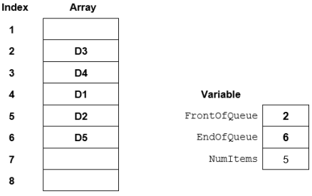
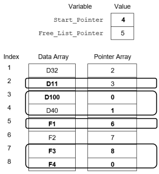
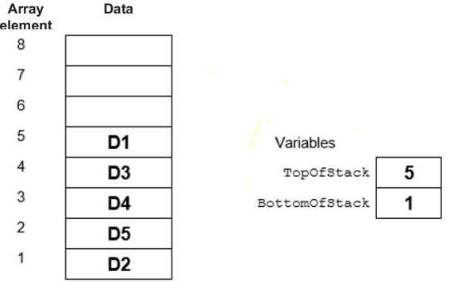
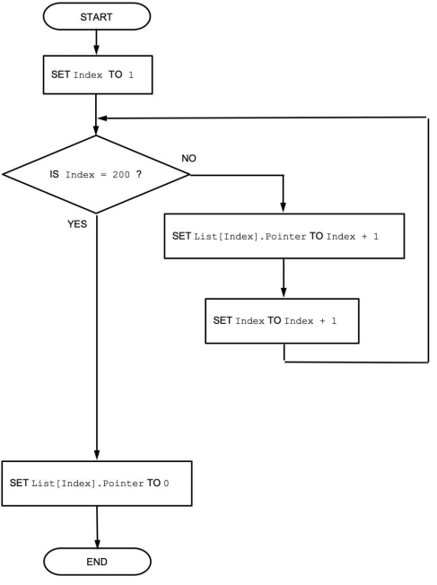

# Mark Schemes — Introduction to Abstract Data Types (ADT)
**10. Data Types & Structures** · Cambridge (CIE) A-LEVEL computer-science (9618)

## Exam Questions (17 questions)

### Q1
| Array element | Data |
|---|---|
| 1 | `"R25"` |
| 2 | `"R26"` |
| 3 | `"R27"` |
| 4 |   |
| 5 |   |
| 6 | `"R24"` |

`FrontOfQueue` = 6

`EndOfQueue` = 3

`NumItems` = 4

**[5 marks]**

> **[mark-scheme]**
> **1 mark** for element 6 still holding `"R24"`, with elements 4 and 5 empty
> 
> **1 mark** for elements 1 and 2 holding `"R25"` and `"R26"` in that order
> 
> **1 mark** for element 3 holding `"R27"`
> 
> **1 mark** for `FrontOfQueue` = 6
> 
> **1 mark** for `EndOfQueue` = 3 and `NumItems` = 4, both correct
> 
> Accept the values written without quotation marks.
> 
> Do not accept `"R25"` in an element 7. The array has six elements, so `EndOfQueue` wraps around from 6 to 1.
> 
> Do not accept `"R21"`, `"R22"` or `"R23"` anywhere in the completed table. All three were removed.
> 
> Do not accept `NumItems` = 3. Three data items were removed and three were added, so the count returns to 4.

> **[exam-tip]**
> Write down all three variables after every operation, not just at the end. Each add moves `EndOfQueue` forward by one and each remove moves `FrontOfQueue` forward by one, so the two pointers travel in the same direction and never move backwards.
> 
> The wrap is where this question is won or lost. When a pointer is at element 6 and has to move on, it goes to element 1, not to element 7. A queue that has wrapped has its front at a higher index than its end, which looks wrong but is correct.

### Q2
Step 1: Check that the queue is not empty. If `NumItems` is 0, stop. **[1]**

Step 2: Output the reference number stored in the array element at the index stored in `FrontOfQueue`. **[1]**

Step 3: Increment `FrontOfQueue`. If `FrontOfQueue` is now 9, set it to 1. **[1]**

Step 4: Decrement `NumItems`. **[1]**

`EndOfQueue` does not change, because removing a reference number only affects the front of the queue.

**[4 marks]**

> **[mark-scheme]**
> **Any four from:**
> 
> - checking that the queue is not empty // `NumItems` is not 0, and stopping if it is empty
> - outputting the reference number in the array element at the index stored in `FrontOfQueue`
> - incrementing `FrontOfQueue`
> - setting `FrontOfQueue` to 1 when it goes past 8 // when it becomes 9
> - decrementing `NumItems`
> 
> **[4 marks]**
> 
> The output of the reference number must come before `FrontOfQueue` is incremented for the second mark.
> 
> Accept "return" or "read" in place of "output" in the second point.
> 
> Do not accept changing `EndOfQueue` in place of `FrontOfQueue`. `EndOfQueue` only changes when a reference number is added.
> 
> Do not accept incrementing `NumItems`. Removing a reference number reduces the number of reference numbers in the queue.

> **[exam-tip]**
> Students often move the wrong pointer. Adding a reference number moves `EndOfQueue` and removing one moves `FrontOfQueue`. Both pointers only ever move forwards.
> 
> The wrap is the step most often left out. In a circular queue the front can reach element 8 like any other pointer, so say what happens next: it goes back to element 1. Output the reference number before you move `FrontOfQueue`, or you output the wrong one.

### Q3
(i) 5 **[1]**

(ii) 3 **[1]**

**[2 marks]**

> **[mark-scheme]**
> **1 mark** for 5 in part (i)
> 
> **1 mark** for 3 in part (ii)
> 
> Accept `NumItems` = 5 in part (i) and element 3 written as `MsgQueue[3]` in part (ii).
> 
> Do not accept 8 in part (i). Elements 3, 4 and 5 are empty, so only five of the eight elements hold data items.
> 
> Do not accept 4 in part (i), which comes from counting from element 6 to the end of the array and stopping there. The queue continues at element 1 because it is circular.
> 
> Do not accept 9 in part (ii). There is no element 9. `EndOfQueue` wraps around to element 1 only when it is already at element 8.

> **[exam-tip]**
> Read a circular queue by starting at `FrontOfQueue` and following the elements forwards, wrapping back to element 1 when you pass the end. Here that gives `"M4"`, `"M5"`, `"M6"`, `"M7"`, `"M8"`, which is the order in which they will be removed.
> 
> A common error is to assume that the front of the queue is element 1. In a circular queue the data can begin at any element, and after a few removals it usually does.

### Q4
Step 1: Check whether the stack is empty by testing whether `TopOfStack` holds 0. **[1]**

Step 2: If the stack is empty, output an error message and return an empty string, taking no further action. **[1]**

Step 3: Otherwise use `TopOfStack` as an index to the array and copy that element into a local variable. **[1]**

Step 4: Decrease `TopOfStack` by 1. **[1]**

Step 5: Return the value held in the local variable to the calling program. **[1]**

**[5 marks]**

> **[mark-scheme]**
> **1 mark** for testing whether the stack is empty, described as `TopOfStack` = 0 or as the stack holding no items
> 
> **1 mark** for outputting an error message and returning an empty string when the stack is empty
> 
> **1 mark** for using `TopOfStack` as an index to the array to read the item, storing it in a local variable
> 
> **1 mark** for decreasing `TopOfStack` by 1
> 
> **1 mark** for returning the item that was read
> 
> Accept `TopOfStack < 1`, or `TopOfStack` being less than the lower bound of the array, for the empty test.
> 
> Accept `subtract 1 from TopOfStack` or `move TopOfStack down one element` for the fourth mark.
> 
> Do not accept increasing `TopOfStack`. That is the `Push()` operation.
> 
> Do not accept returning `ItemStack[1]`. That is the item at the bottom of the stack, which is the first item that was added.
> 
> Do not accept reading the item after `TopOfStack` has been decreased, because this returns the wrong element.

> **[exam-tip]**
> The order of steps 3 and 4 is where marks are lost. If you move the pointer first and then read the array, you return the item below the one you were asked for. Read the element, then move the pointer.
> 
> When a question says do not use pseudocode, write plain sentences but keep the real identifier names from the question, such as `TopOfStack` and `ItemStack`. Cambridge credits the identifiers; it is the `IF ... THEN` and `ENDIF` keywords that earn nothing here.

### Q5
| Array element | Data |
|---|---|
| 6 |   |
| 5 |   |
| 4 | `"E7"` |
| 3 | `"E3"` |
| 2 | `"E2"` |
| 1 | `"E1"` |

`TopOfStack` = 4

**[4 marks]**

> **[mark-scheme]**
> **1 mark** for elements 1, 2 and 3 unchanged, holding `"E1"`, `"E2"` and `"E3"`
> 
> **1 mark** for element 4 holding `"E7"`
> 
> **1 mark** for elements 5 and 6 both shown as empty
> 
> **1 mark** for `TopOfStack` = 4
> 
> Accept the values written without quotation marks.
> 
> Do not accept `TopOfStack` = 3. The final `PUSH` increases the pointer again after the two `POP` operations.
> 
> Do not accept `"E5"` or `"E6"` anywhere in elements 1 to 4. Both were pushed and then popped again.

> **[exam-tip]**
> Redraw the whole stack after every single operation rather than trying to hold it in your head. Six operations is exactly the length at which students start to lose track, and one missed `POP` loses every mark that follows.
> 
> Remember that a `POP` does not have to erase anything from memory. It only moves `TopOfStack` down by one, so the old value can still be sitting in the array. This question tells you to leave an element empty once it is no longer part of the stack, so show elements 5 and 6 as empty, and always write down the value of `TopOfStack`, which is worth a mark on its own.

### Q6
| Statement | Answer |
|---|---|
| The value that will be removed by the next `POP` operation. | `"P51"` |
| The memory location that `TopOfStack` will point to after the operations `POP`, `POP` and `PUSH "P40"` have been performed, in that order. | 704 |

**[2 marks]**

> **[mark-scheme]**
> **1 mark** for `"P51"` in the first row
> 
> **1 mark** for `704` in the second row
> 
> Accept `P51` written without the quotation marks.
> 
> Do not accept `"P62"` in the first row. That value has been on the stack the longest, so a `POP` operation reaches it last, not first.
> 
> Do not accept `706` in the second row. The first `POP` moves `TopOfStack` to 704 and the second moves it to 703, so the `PUSH` stores `"P40"` in location 704.

> **[exam-tip]**
> Work through the operations one at a time and write the new value of `TopOfStack` beside each one. The common error here is counting only the `PUSH` operations and forgetting that every `POP` moves the pointer back the other way.
> 
> Check the direction of growth before you start. Cambridge always states it.

### Q7
Step 1: Assign the value of `StartPointer` to `ThisPointer`, so the search starts at the first node in the linked list. **[1]**

Step 2: Repeat steps 3 to 5 while `ThisPointer` is not 0, so the loop stops when the null pointer is reached. **[1]**

Step 3: Compare the `Data` field of the array element at index `ThisPointer` with the product code. **[1]**

Step 4: If they are the same, return the value of `ThisPointer` and stop. **[1]**

Step 5: If they are not the same, assign the `Pointer` field of the current node to `ThisPointer`, to move to the next node in the linked list. **[1]**

Step 6: If the loop ends because `ThisPointer` is 0, the product code was not found, so return 0. **[1]**

The test in step 2 comes before any array element is read. If the linked list is empty, `StartPointer` is 0, so the loop ends straight away and the function returns 0.

**[6 marks]**

> **[mark-scheme]**
> **1 mark** for assigning `StartPointer` to `ThisPointer` // identifying the first node using `StartPointer`
> 
> **1 mark** for looping until `ThisPointer` is 0 // until the null pointer is reached
> 
> **1 mark** for comparing the `Data` field of the array element at index `ThisPointer` // of the current node with the product code
> 
> **1 mark** for returning `ThisPointer` when the product code is found
> 
> **1 mark** for assigning the `Pointer` field of the current node // array element to `ThisPointer`
> 
> **1 mark** for returning 0 when the loop ends without finding the product code
> 
> Accept "current pointer" for `ThisPointer` and "null pointer" for 0.
> 
> Accept a version that uses a variable such as `Found`: set `Found` to 0 before the loop, set `Found` to `ThisPointer` when the product code is found, stop the loop when `Found` is not 0, and return `Found` after the loop. This version earns the fourth and sixth marks.
> 
> Do not accept "add 1 to `ThisPointer`" or "move to the next array element" for the fifth mark. The next node in the linked list is at the index stored in the `Pointer` field, which is not usually the next array element.
> 
> Do not accept checking every array element from 1 to 50 in turn. Some array elements are not part of the linked list, so this can find a product code in a node that has been deleted.

> **[exam-tip]**
> The most common error is moving on by adding 1 to the pointer. In a linked list the next node is wherever the `Pointer` field of the current node says it is, which is almost never the next array element.
> 
> Order matters. Test `ThisPointer` against 0 before you read the array element at that index, otherwise an empty linked list sends you to element 0, which does not exist in an `ARRAY[1:50]`. Students also often forget step 6. A search that only says what happens when the product code is found has not described the whole algorithm.

### Q8
| Index | Data | Pointer |
|---|---|---|
| 1 |   | **6** |
| 2 | `BK208` | **4** |
| 3 | `BK115` | **7** |
| 4 |   | **1** |
| 5 | `BK340` | **0** |
| 6 |   | **0** |
| 7 | `BK297` | **5** |
| 8 | `BK061` | **3** |

| Variable | Value |
|---|---|
| `StartPointer` | **8** |
| `FreeListPointer` | **2** |

`StartPointer` is unchanged, because `BK208` was not the first node in the linked list. **[1]**

Index 3 holds `BK115`, the node before the deleted one. Its `Pointer` field is changed from 2 to 7, so `BK115` now points straight to `BK297`. **[1]**

Index 2 is the deleted node. Its `Pointer` field is changed from 7 to 4, the old value of `FreeListPointer`, so it now points to the rest of the free list. **[1]**

`FreeListPointer` is changed from 4 to 2, so the deleted node is now the first node on the free list. **[1]**

The linked list is now `BK061`, `BK115`, `BK297`, `BK340`, and the free list runs 2, 4, 1, 6.

**[4 marks]**

> **[mark-scheme]**
> **1 mark** for `StartPointer` still 8
> 
> **1 mark** for the `Pointer` field of index 3 changed to 7
> 
> **1 mark** for the `Pointer` field of index 2 changed to 4
> 
> **1 mark** for `FreeListPointer` changed to 2
> 
> All six other `Pointer` fields must be left at their original values: 6, 1, 0, 0, 5, 3 for indices 1, 4, 5, 6, 7, 8. A response that alters any of these scores a maximum of 3.
> 
> Accept the `Data` field of index 2 either left as `BK208` or shown as empty. The `Data` field of a deleted node does not have to be erased, because the node is only reachable through the free list.
> 
> Do not accept `FreeListPointer` left at 4 with the `Pointer` field of index 2 set to 0. Index 2 is then on neither list and can never be reused.
> 
> Do not accept the `Pointer` field of index 3 set to 0. That would end the linked list at `BK115` and lose `BK297` and `BK340`.

> **[exam-tip]**
> Returning a node to the free list is two assignments and the order matters. Copy the current value of `FreeListPointer` into the `Pointer` field of the deleted node first, then set `FreeListPointer` to the index of the deleted node. Students who do it the other way round overwrite `FreeListPointer` before they have used it, and the rest of the free list is lost.
> 
> Check `StartPointer` before you change it. It only changes when the node you delete is the first node in the linked list.

### Q9
`StartPointer` is 2, so the first node is at index 2. Each `Pointer` field gives the index of the next node.

`Cairo` (index 2), `Dhaka` (index 4), `Lima` (index 6) **[1]**

`Nairobi` (index 1), `Oslo` (index 5), `Perth` (index 3), whose `Pointer` field is 0, so the linked list ends here **[1]**

**[2 marks]**

> **[mark-scheme]**
> **1 mark** for `Cairo`, `Dhaka`, `Lima` given as the first three names, in that order
> 
> **1 mark** for `Nairobi`, `Oslo`, `Perth` given as the last three names, in that order
> 
> Accept the six index values 2, 4, 6, 1, 5, 3 written in place of the six names.
> 
> Do not accept `Nairobi`, `Cairo`, `Perth`, `Dhaka`, `Oslo`, `Lima`. That is the `Data` column read downwards, which is the order the nodes sit in the array, not the order of the linked list.
> 
> Do not accept a correct set of six names in the wrong order. Both marks are for sequence.

> **[exam-tip]**
> The position of a node in the array tells you nothing about its position in the linked list. Start at the index held in `StartPointer`, read the `Data` field of that row, then jump to the index held in the `Pointer` field of the same row. Repeat until you reach a `Pointer` field of 0.
> 
> The most common error here is reading the `Data` column straight down the table. That answer scores zero even though every name is present.

### Q10
> **[mark-scheme]**
> (i)
> 
> **Two **marks for all five empty boxes correct 
> **One **mark for any three or four empty boxes correct
> 
> | **Identifier** | **Data type** | **Description** |
> |---|---|---|
> | `BasePointer` | `INTEGER` | Points to the bottom of the stack |
> | `TopPointer` | `INTEGER` | Points to the top of the stack |
> | `Stack` | `REAL` | List of decimal numbers stored in the stack |
> 
> (ii)
> 
> **One **mark for each correctly completed line **(Max 5) **
> 
> `CONSTANT MaxSize = 40 `
> `DECLARE BasePointer : INTEGER `
> `DECLARE TopPointer : INTEGER `
> `DECLARE Stack : ARRAY[1:40] OF REAL `
> 
> `// initialisation of stack `
> `PROCEDURE Initialise() `
>         **BasePointer** $\leftarrow$ `1 `
>         **TopPointer** $\leftarrow$ `0` 
> `ENDPROCEDURE `
> 
> `// adding an item to the stack `
> `PROCEDURE Push(NewItem) `
>         **IF TopPointer <** `MaxSize THEN` 
>               **TopPointer **$\leftarrow$** TopPointer + 1 **
>               `Stack[TopPointer] `$\leftarrow$` NewItem `
> `  ENDIF `
> `ENDPROCEDURE`
> **[mark-scheme]**
> **One **mark for linked list and one mark for array **(Max 2)**
> 
> **Linked list **
> MP1    A linked list is a dynamic data structure / not restricted in size 
> MP2   Has greater freedom to expand or contract by adding or removing nodes as necessary 
> MP3  Allows more efficient editing using pointers (instead of moving the data).
> 
> **Array **
> MP4  An array is a static data structure1 generally fixed in size 
> MP5  When the array is full, the stack cannot be extended any further.

### Q11
> **[mark-scheme]**
> 
> 
> **MP1   **D3, D4, D1, D2 and D5 in question order or reversed - in any five consecutive locations 
> **MP2**   `FoQ` value matches index with D3 
> **MP3**  `EoQ` value matches index with D5
> **[mark-scheme]**
> **MP1**  If` NumItems` <u>**is / = 8 **</u>**// (queue) full** then jump to step 6 
> **MP2**  Increment **EndOfQueue **
> **MP3**  If **EndOfQueue = 9** then set `EndOfQueue` to **1 **
> **MP4**  Increment **NumItems **
> 
> **MP5**  Set the **Element** at the index … 
> **MP6**  stored in **EndOfQueue** to **value/data/item** being added
> 
> Mark as follows: 
> Steps 1 to 4: One mark for gaps filled as shown 
> Step 5: One mark for 'element' and one mark for other two terms

### Q12
> **[mark-scheme]**
> (i)
> 
> One mark per point** Max 3 **marks:
> 
> **Decide on scenario and mark accordingly. **
> **Scenario one:**
> 
> - If more than one line is / all lines are stored on the stack (before line(s) are removed)
> - The stack operates as a FILO device // Last item added to stack will be in first item out
> - So **lines in the file** appear out of sequence
> 
> **Scenario two: **
> 
> - Stack is Full
> - Not all lines can be stored on the stack
> - so resulting **file **will not contain **all the original lines **
> 
> **Scenario three: **
> 
> - (All) the data in a line read can’t be stored on the stack
> - Stack elements have not been allocated enough memory
> - so only **part of each line** is stored in the **file**
> 
> **Scenario four: **
> 
> - Stack is empty
> - The stack is being read faster than it is being written to
> - so **blank lines** may be inserted into the **file**
> 
> (ii)
> 
> Queue

### Q13
> **[mark-scheme]**
> 
> 
> Mark as follows:
> 
> - One mark for `Start_Pointer` value
> - One mark each group of row(s):
> - 2
> - 3 and 4
> - 5
> - 7 and 8
> 
> For null pointer: accept 0 / ∅ / an out-of-bound index value less than 1, greater than 8
> **[mark-scheme]**
> One mark per step:
> 
> 1. Assign the data item **D6** to **F1 **
> 2. Set the **pointer **of this node to point to **D11**
> 3. Set Ptr2 to point to **F2**
> 4. Set pointer of **D32** to point to **D6**

### Q14
> **[mark-scheme]**
> 
> 
> **MP1**   all values in the order and location shown 
> **MP2**  `TopOfStack `value is index of element containing D1 
> **MP3**  `BottomOfStack` value is index of element containing D2
> **[mark-scheme]**
> **MP1**   If **TopOfStack = 8 // (stack) full **then return `FALSE`
> 
> **MP2**  Otherwise,** increment** `TopOfStack `
> 
> **MP3  **Use `TopOfStack `as an **index** to the Array
> 
> **MP4  **Set the element at this** index / location / position** to the **value / data / item** being added
> 
> **MP5**  Return **TRUE**

### Q15
> **[mark-scheme]**
> One mark per point:
> 
> 1. The PS contains a null pointer
> 2. The PF points to the first element on the free list
> 3. All the nodes are on the free list

### Q16
> **[mark-scheme]**
> 0 is not a valid <u>array / </u>`List`<u> index</u> value // No 0th element in the array
> **[mark-scheme]**
> 
> 
> Mark as follows: 
> **MP1**   Use of variable as array index **and** initialisation to 1 / to first element of array 
> **MP2**   Loop for 199 / 200 iterations 
> **MP3**   Assign Index+1 to each pointer field in a loop 
> **MP4**   Assign 0 to 200th pointer field
> **[mark-scheme]**
> One mark per step:
> 
> **MP1   **Assign `HeadPointer` to `ThisPointer` / Current Pointer // Identify first node using <u>headpointer</u>
> 
> **MP2**   Loop the following until `ThisPointer `value is 0 (zero) / null <u>pointer</u> reached
> 
> **MP3**   … Output data (field) from array element at index `ThisPointer `// Output data (field) of the current node / array element
> 
> **MP4**   … Assign pointer field from current array element / index / to `ThisPointer `/ Current Pointer // Assign pointer field from current node to` ThisPointer` / Current Pointer

### Q17
> **[mark-scheme]**
> (i)`    `
> 
> `     SP`: 1 
> `OnStack`: 0
> 
> One mark for both correct values
> 
> (ii)
> 
> **MP1**   Unused values cannot be popped / taken off the stack // initialised values would never be used / unused elements cannot be accessed
> 
> **MP2**   ... until a value has first been pushed / written // overwrites previous value
> **[mark-scheme]**
> Example solution:
> 
> `FUNCTION Push(ThisValue : REAL) RETURNS BOOLEAN `
> `   DECLARE ReturnValue : BOOLEAN `
>         `IF` **OnStack = 60 / >59 // SP = 61 / SP > 60** `// SP` **outside the range 1 to 60 **`THEN `
>                `RETURN` **FALSE** `// Stack is already full` 
>         `ENDIF` 
>         **ThisStack[SP]** $\leftarrow$ `ThisValue` 
>         `SP` $\leftarrow$ **SP + 1 **
>         `OnStack `$\leftarrow$` OnStack + 1 `
> `   RETURN TRUE `
> `ENDFUNCTION1 `
> 
> Mark as follows: 
> One mark per gap
