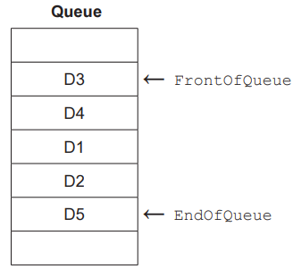
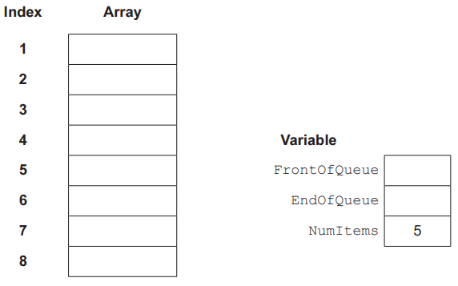
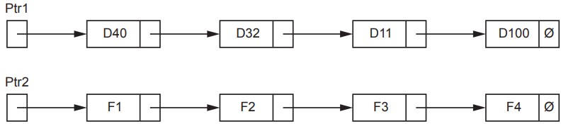
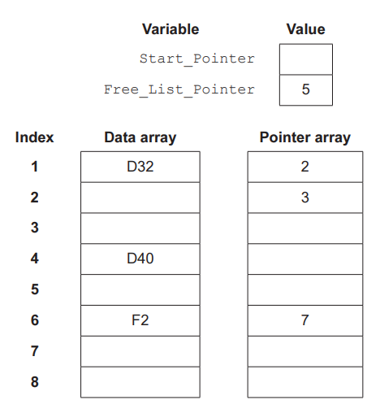
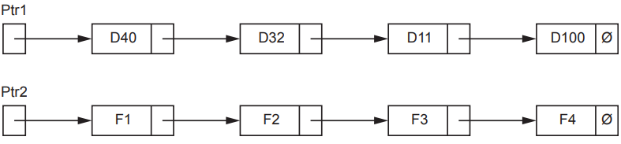
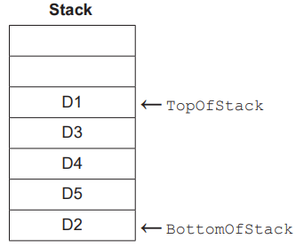
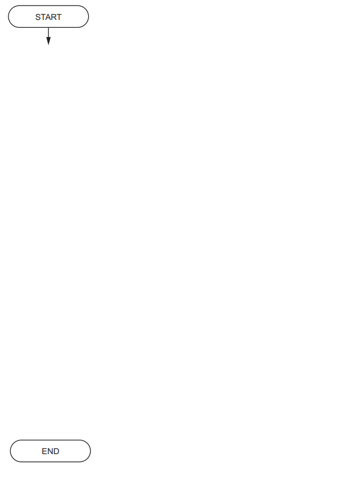

# Exam Questions — Introduction to Abstract Data Types (ADT)
**10. Data Types & Structures** · Cambridge (CIE) A-LEVEL computer-science (9618)
> Source: [https://www.savemyexams.com/a-level/computer-science/cie/19/topic-questions/](https://www.savemyexams.com/a-level/computer-science/cie/19/topic-questions/) · 17 questions across 1 sets

## Exam Questions (17 questions)

### Q1 — hard — 5 marks

**Q1** [5 marks]

A program uses a queue to store the reference numbers of parcels waiting to be loaded.

The queue is implemented as a circular queue using a 1D array of six elements, declared in pseudocode as `DECLARE ParcelQueue : ARRAY[1:6] OF STRING`.

The organisation of this queue may be summarised as follows:

- The `FrontOfQueue` pointer holds the index of the next data item to be removed.
- The `EndOfQueue` pointer holds the index of the last data item added.
- The variable `NumItems` holds the number of data items currently in the queue.
- The queue is circular. When a pointer moves past element 6 it wraps around to element 1.

The table shows the current state of the queue.

| Array element | Data |
|---|---|
| 1 |   |
| 2 |   |
| 3 | `"R21"` |
| 4 | `"R22"` |
| 5 | `"R23"` |
| 6 | `"R24"` |

`FrontOfQueue` = 3

`EndOfQueue` = 6

`NumItems` = 4

The following operations are then performed, in this order:

- Remove one data item
- Add `"R25"`
- Add `"R26"`
- Remove one data item
- Remove one data item
- Add `"R27"`

Complete the table to show the state of the array after all of these operations have been performed, and write the final value of each of the three variables.

Leave an array element empty if it no longer holds a data item that is part of the queue.

| Array element | Data |
|---|---|
| 1 |   |
| 2 |   |
| 3 |   |
| 4 |   |
| 5 |   |
| 6 |   |

`FrontOfQueue` = ..............................................

`EndOfQueue` = ..............................................

`NumItems` = ..............................................

### Q2 — medium — 4 marks

**Q2** [4 marks]

A help desk program stores the reference numbers of customers who are waiting to speak to a support agent. The reference numbers are stored in a queue Abstract Data Type (ADT).

The queue is implemented as a circular queue using a 1D array of eight elements, declared in pseudocode as `DECLARE CustQueue : ARRAY[1:8] OF STRING`.

The queue works as follows.

- The pointer `FrontOfQueue` stores the index of the reference number that will be removed next.
- The pointer `EndOfQueue` stores the index of the reference number added most recently.
- The variable `NumItems` stores how many reference numbers are in the queue.
- When either pointer moves on from element 8, it goes back to element 1.

When a support agent is free, the procedure `TakeNext()` removes the next reference number from the queue and outputs it.

Describe the algorithm for `TakeNext()` in **four** steps.

Do not use pseudocode statements in your answer.

Step 1 ..............................................................................................

Step 2 ..............................................................................................

Step 3 ..............................................................................................

Step 4 ..............................................................................................

### Q3 — easy — 2 marks

**Q3** [2 marks]

A program uses a queue to store the reference numbers of messages waiting to be sent.

The queue is implemented as a circular queue using a 1D array of eight elements, declared in pseudocode as `DECLARE MsgQueue : ARRAY[1:8] OF STRING`.

The organisation of this queue may be summarised as follows:

- The `FrontOfQueue` pointer holds the index of the next data item to be removed.
- The `EndOfQueue` pointer holds the index of the last data item added.
- The variable `NumItems` holds the number of data items currently in the queue.
- The queue is circular, so that array elements can be reused. When a pointer moves past element 8 it wraps around to element 1.

The table shows the current state of the queue. All eight elements have been used at least once.

| Array element | Data |
|---|---|
| 1 | `"M7"` |
| 2 | `"M8"` |
| 3 |   |
| 4 |   |
| 5 |   |
| 6 | `"M4"` |
| 7 | `"M5"` |
| 8 | `"M6"` |

`FrontOfQueue` = 6

`EndOfQueue` = 2

(i) State the number of data items currently in the queue.

[1]

(ii) State the index of the array element that will store the next data item added to the queue.

[1]

### Q4 — hard — 5 marks

**Q4** [5 marks]

A program uses a stack to store reference codes. The stack is implemented using a 1D array and one integer variable, declared in pseudocode as follows:

`DECLARE ItemStack : ARRAY[1:50] OF STRING`

`DECLARE TopOfStack : INTEGER`

The stack operates as follows:

- `TopOfStack` holds the index of the array element that contains the last item added to the stack.
- `TopOfStack` holds 0 when the stack is empty.
- The array is filled from the lowest indexed element towards the highest.

A module `Pop()` will remove the item at the top of the stack and return that item to the calling program.

If there are no items on the stack, `Pop()` will output an error message and return an empty string.

Describe the algorithm for module `Pop()` in five steps.

Do not use pseudocode in your answer.

Step 1 ..............................................

Step 2 ..............................................

Step 3 ..............................................

Step 4 ..............................................

Step 5 ..............................................

### Q5 — medium — 4 marks

**Q5** [4 marks]

A text editor uses a stack to store the codes of the edits that a user can undo.

The stack is implemented using a 1D array and one integer variable. The array is declared in pseudocode as `DECLARE EditStack : ARRAY[1:6] OF STRING`.

The stack operates as follows:

- `TopOfStack` holds the index of the array element that contains the last item added to the stack.
- `TopOfStack` holds 0 when the stack is empty.
- The array is filled from the lowest indexed element towards the highest.

The table shows the current state of the stack. `TopOfStack` currently holds 4.

| Array element | Data |
|---|---|
| 6 |   |
| 5 |   |
| 4 | `"E4"` |
| 3 | `"E3"` |
| 2 | `"E2"` |
| 1 | `"E1"` |

The following operations are then performed, in this order:

- `POP`
- `PUSH "E5"`
- `PUSH "E6"`
- `POP`
- `POP`
- `PUSH "E7"`

Complete the table to show the state of the array and the value of `TopOfStack` after all of these operations have been performed.

Leave an array element empty if it no longer holds an item that is part of the stack.

| Array element | Data |
|---|---|
| 6 |   |
| 5 |   |
| 4 |   |
| 3 |   |
| 2 |   |
| 1 |   |

`TopOfStack` = ..............................................

### Q6 — easy — 2 marks

**Q6** [2 marks]

A program uses a stack to store the product codes of items as they are scanned at a checkout.

The stack is held in memory locations 700 to 707.

The operation of this stack may be summarised as follows:

- The `TopOfStack` pointer points to the last item added to the stack.
- The `BottomOfStack` pointer points to the first item on the stack.
- The stack grows upwards when items are added.

The diagram shows the current state of the stack.

| Memory location | Value | Stack pointer |
|---|---|---|
| 707 |   |   |
| 706 |   |   |
| 705 | `"P51"` | `TopOfStack` |
| 704 | `"P18"` |   |
| 703 | `"P77"` |   |
| 702 | `"P34"` |   |
| 701 | `"P09"` |   |
| 700 | `"P62"` | `BottomOfStack` |

Complete the following table by writing the answers.

| Statement | Answer |
|---|---|
| The value that will be removed by the next `POP` operation. |   |
| The memory location that `TopOfStack` will point to after the operations `POP`, `POP` and `PUSH "P40"` have been performed, in that order. |   |

### Q7 — hard — 6 marks

**Q7** [6 marks]

An online shop stores product codes in a linked list.

The record type `Node` and the array `Product` are declared as follows.

The linked list works as follows.

- `StartPointer` stores the array index of the first node in the linked list.
- The `Pointer` field of a node stores the array index of the next node in the linked list.
- The value 0 is used as the null pointer.
- `StartPointer` has the value 0 when the linked list is empty.

The function `FindNode()` takes a product code as a parameter. It searches the linked list, in order, for that product code.

- If a node in the linked list stores the product code in its `Data` field, the function returns the array index of that node.
- If no node in the linked list stores the product code, the function returns 0.

The function uses a local integer variable `ThisPointer` to store the array index of the node currently being looked at.

Describe the algorithm for `FindNode()` in **six** steps.

Do not use pseudocode statements in your answer.

Step 1 ..............................................................................................

Step 2 ..............................................................................................

Step 3 ..............................................................................................

Step 4 ..............................................................................................

Step 5 ..............................................................................................

Step 6 ..............................................................................................

### Q8 — medium — 4 marks

**Q8** [4 marks]

A library program stores book reference codes in a linked list. The codes are held in ascending order.

The linked list is implemented using a 1D array `BookList` of record type `Node`. Each `Node` has a `Data` field and a `Pointer` field. The `Pointer` field stores the array index of the next node.

- `StartPointer` stores the array index of the first node in the linked list.
- `FreeListPointer` stores the array index of the first node in the free list.
- The value 0 is used as the null pointer.
- A node on the free list has nothing stored in its `Data` field.

`StartPointer` has the value 8 and `FreeListPointer` has the value 4.

| Index | Data | Pointer |
|---|---|---|
| 1 |   | 6 |
| 2 | `BK208` | 7 |
| 3 | `BK115` | 2 |
| 4 |   | 1 |
| 5 | `BK340` | 0 |
| 6 |   | 0 |
| 7 | `BK297` | 5 |
| 8 | `BK061` | 3 |

The node storing `BK208` is deleted from the linked list and returned to the free list. It becomes the first node on the free list.

Complete the table to show the `Pointer` field of every array element, and the values of `StartPointer` and `FreeListPointer`, after this deletion.

| Index | Data | Pointer |
|---|---|---|
| 1 |   |   |
| 2 | `BK208` |   |
| 3 | `BK115` |   |
| 4 |   |   |
| 5 | `BK340` |   |
| 6 |   |   |
| 7 | `BK297` |   |
| 8 | `BK061` |   |

| Variable | Value |
|---|---|
| `StartPointer` |   |
| `FreeListPointer` |   |

### Q9 — easy — 2 marks

**Q9** [2 marks]

A program stores the names of cities in a linked list.

The linked list is implemented using a 1D array `CityList` of record type `Node`. Each `Node` has two fields:

- `Data` stores one city name
- `Pointer` stores the array index of the next node in the linked list

`StartPointer` stores the array index of the first node in the linked list. The value 0 is used as the null pointer.

The table shows the contents of `CityList`. `StartPointer` has the value 2.

| Index | Data | Pointer |
|---|---|---|
| 1 | `Nairobi` | 5 |
| 2 | `Cairo` | 4 |
| 3 | `Perth` | 0 |
| 4 | `Dhaka` | 6 |
| 5 | `Oslo` | 3 |
| 6 | `Lima` | 1 |

State the order of the city names in the linked list.

### Q10 — medium — 9 marks

**Q10** [7 marks]

A stack Abstract Data Type (ADT) is to be implemented using pseudocode, with procedures to initialise it and to push new items onto the stack.

A 1D array `Stack` stores the contents of the stack.

(i) Study the pseudocode in **part (a)(ii)** and complete the table of identifiers by writing the missing data types and descriptions.

| **Identifier** | **Data type** | **Description** |
|---|---|---|
| `BasePointer` |   |   |
| `TopPointer` |   |   |
| `Stack` | `REAL` |   |

[2]

(ii) Complete the pseudocode.

`CONSTANT MaxSize = 40 `
`DECLARE BasePointer : INTEGER `
`DECLARE TopPointer : INTEGER `
`DECLARE Stack : ARRAY[1:40] OF REAL `

`// initialisation of stack `
`PROCEDURE Initialise() `

`   ...................................................................`$\leftarrow$  `1 .`

`   ...................................................................`$\leftarrow$ `0 `
`ENDPROCEDURE `

`// push an item onto the stack `
`PROCEDURE Push(NewItem : REAL) `

`   ..............................................................MaxSize THEN`

`     .................................................................... `

`     Stack[TopPointer]`$\leftarrow$`..................................................`
`   ENDIF `
`ENDPROCEDURE `

[5]

*Source: November 2023 9618/32 Q9AI,AII*

**Q10** [2 marks]

Justify the use of a linked list instead of an array to implement a stack.

*Source: November 2023 9618/32 Q9B*

### Q11 — medium — 9 marks

**Q11** [3 marks]

The diagram represents a queue Abstract Data Type (ADT).

The organisation of this queue may be summarised as follows:

- The `FrontOfQueue` pointer points to the next data item to be removed.
- The `EndOfQueue` pointer points to the last data item added.

The queue is implemented using three variables and a 1D array of eight elements as shown. The variable `NumItems` stores the number of items in the queue.

The pointer variables store indices (index numbers) of the array.

Complete the diagram to represent the state of the queue as shown above.

*Source: November 2023 9618/23 Q3A*

**Q11** [6 marks]

A module `AddTo()` will add a value to the queue by manipulating the array and variables in part **(a)**.

The queue implementation is circular. When pointers reach the end of the queue, they will ‘wrap around’ to the beginning.

Before a value can be added to the queue, it is necessary to check the queue is not full.

The algorithm to add a value to the queue is expressed in six steps.

Complete the steps.

1. If `NumItems `.............................. then jump to step 6.
2. Increment ................................... .
3. If ................................................. then set `EndOfQueue` to .............................. .
4. Increment ................................... .
5. Set the ............................ at the index stored in ........................... to the ............................ being added.
6. Stop.

*Source: November 2023 9618/23 Q3B*

### Q12 — medium — 3 marks

**Q12** [3 marks]

The program contains a module `GetFile()` which receives text files sent from another computer.

Lines from the file are sent one at a time. Each message contains one line and `ProcessMsg()` from part **(b)** adds each message as it is received onto stack 1.

Module `GetFile()` removes messages from stack 1 and writes the data to a text file.

There is a problem. Under certain circumstances, the received file does not appear as expected.

Assume that while a file is being received `ProcessMsg()` receives only messages containing lines from the file.

(i) Describe the circumstances and explain the problem.

Circumstances ........................................................................................................

Explanation .............................................................................................................

[3]

(ii) Suggest a more appropriate Abstract Data Type that could be used to store the messages that would not have the same problem.

[1]

*Source: November 2023 9618/22 Q8CI,CII*

### Q13 — medium — 9 marks

**Q13** [5 marks]

The diagram represents a linked list Abstract Data Type (ADT).

- Ptr1 is the start pointer. Ptr2 is the free list pointer.
- Labels D40, D32, D11 and D100 represent the data items of nodes in the list.
- Labels F1, F2, F3 and F4 represent the data items of nodes in the free list.
- The symbol Ø represents a null pointer.

The linked list is implemented using two variables and two 1D arrays as shown.

The pointer variables and the elements of the Pointer array store the indices (index numbers) of elements in the Data array.

Complete the diagram to show how the linked list as shown above may be represented using the variables and arrays.

*Source: November 2023 9618/22 Q3A*

**Q13** [4 marks]

The original linked list is to be modified. A new node D6 is inserted between nodes D32 and D11.

The algorithm required is expressed in four steps as shown.

Complete the steps.

1. Assign the data item .................................. to .................................. .
2. Set the .................................. of this node to point to .................................. .
3. Set Ptr2 to point to .................................. .
4. Set pointer of .................................. to point to .................................. .

*Source: November 2023 9618/22 Q3B*

### Q14 — medium — 8 marks

**Q14** [3 marks]

The diagram represents an Abstract Data Type (ADT).

The operation of this stack may be summarised as follows:

- The `TopOfStack` pointer points to the last item added to the stack.
- The `BottomOfStack` pointer points to the first item on the stack.

The stack is implemented using two variables and a 1D array of 8 elements as shown.

The variables are used to reference individual elements of the array, in such a way that:

- the array is filled from the lowest indexed element towards the highest
- all the elements of the array are available for the stack.

Complete the diagram to represent the state of the stack as shown above.

*Source: November 2023 9618/21 Q3A*

**Q14** [5 marks]

A function `Push()` will add a value onto the stack by manipulating the array and variables in **part (a)**.

Before adding a value onto the stack, the algorithm will check that space is available.

If the value is added to the stack, the function will return `TRUE,` otherwise it will return `FALSE.`

The algorithm is expressed in five steps.

Complete the steps.

1. If ........................................................ then return `FALSE`
2. Otherwise .......................................... `TopOfStack `
3. Use `TopOfStack `as an ................................... to the array.
4. Set the element at this ...................................... to the .............................. being added.
5. Return .............................. .

*Source: November 2023 9618/21 Q3B*

### Q15 — medium — 3 marks

**Q15** [3 marks]

The diagram shows an Abstract Data Type (ADT) representation of a linked list after data items have been added.

- PS is the start pointer.
- PF is the free list pointer.
- Labels Df, Dc, Db and Dy represent the data items of nodes in the list.
- Labels Fg, Fh, Fm and Fw represent the data items of nodes in the free list.
- The symbol Ø represents a null pointer.

Describe the linked list immediately after initialisation, before **any** data items are added.

*Source: June 2024 9618/21 Q3A*

### Q16 — medium — 9 marks

**Q16** [1 mark]

The implementation of a linked list uses an integer variable and a 1D array `List` of type `Node`.

Record type `Node` is declared in pseudocode as follows:

`TYPE Node `
`   DECLARE Data : STRING `
`   DECLARE Pointer : INTEGER `
`ENDTYPE `

The array `List` is declared in pseudocode as follows:

`DECLARE List : ARRAY[1:200] OF Node`

The linked list will operate as follows:

- Integer variable `HeadPointer` will store the array index for the first node in the linked list.
- The `Pointer` field of a node contains the index value of the next array element (the next node) in the linked list.
- The value 0 is used as a null pointer.

State why the value 0 has been selected as the null pointer.

*Source: November 2024 9618/23 Q3AI*

**Q16** [4 marks]

The array List will be initialised so that each node points to the following node. The last node will contain a null pointer.

Complete the program flowchart to represent the algorithm for this operation.

*Source: November 2024 9618/23 Q3B*

**Q16** [4 marks]

An algorithm outputs the `Data` field from all nodes in the array `List`. The order the `Data` is output should be the same order it is stored in the linked list.

Describe the algorithm in **four** steps.

Do **not** use pseudocode statements in your answer.

Step 1 ......................................................................................................................

Step 2 .....................................................................................................................

Step 3 .....................................................................................................................

Step 4 .....................................................................................................................

*Source: November 2024 9618/23 Q3C*

### Q17 — medium — 7 marks

**Q17** [3 marks]

A program uses a stack to hold up to 60 numeric values. 
The stack is implemented using two integer variables and a 1D array.

The array is declared in pseudocode as shown:

`DECLARE ThisStack : ARRAY[1:60] OF REAL `

The stack operates as follows:

- Global variable `SP` acts as a stack pointer that points to the next available stack location. The value of `SP` represents an array index.
- Global variable `OnStack` represents the number of values currently on the stack.
- The stack grows upwards from array element index 1.

(i) Give the initial values that should be assigned to the **two** variables.

`SP` ............................................................................................................

`OnStack` ...................................................................................................

[1]

(ii) Explain why it is not necessary to initialise the array elements before the stack is used.

[2]

*Source: November 2024 9618/22 Q3AI,AII*

**Q17** [4 marks]

A function to add a value to `ThisStack` is expressed in pseudocode as shown. The function will return a value to indicate whether the operation was successful or not.

Complete the pseudocode by filling in the gaps.

`FUNCTION Push(ThisValue : REAL) RETURNS BOOLEAN `

`   DECLARE ReturnValue : BOOLEAN `

`   IF ................................................ THEN `

`      RETURN ................................................ // stack is already full `

`   ENDIF `

`   ................................................`$\leftarrow$`ThisValue `

`   SP`$\leftarrow$` ................................................ `

`   OnStack`$\leftarrow$ `OnStack + 1 `

`   RETURN TRUE `

`ENDFUNCTION`

*Source: November 2024 9618/22 Q3B*

