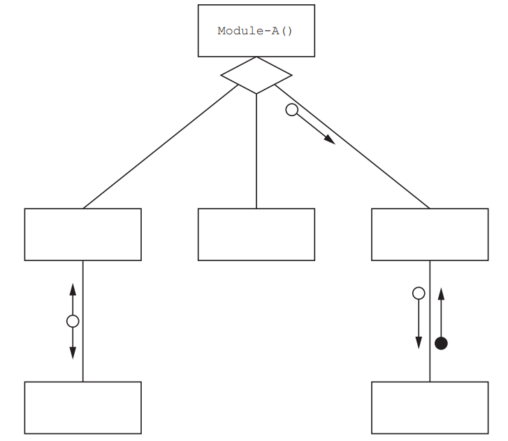

# Exam Questions — Constructs
**11. Programming** · Cambridge (CIE) A-LEVEL computer-science (9618)
> Source: [https://www.savemyexams.com/a-level/computer-science/cie/19/topic-questions/](https://www.savemyexams.com/a-level/computer-science/cie/19/topic-questions/) · 26 questions across 1 sets

## Exam Questions (26 questions)

### Q1 — very_hard — 6 marks

**Q1** [6 marks]

A biology program models the growth of a colony of cells. The number of cells doubles once every hour.

A function `HoursToReach()` will:

- take two parameters of type INTEGER, the starting number of cells and a target number of cells
- work out how many whole hours pass before the number of cells first becomes greater than the target
- return that number of hours.

If the starting number of cells is already greater than the target, the function returns 0.

Assume the starting number of cells is always 1 or more.

For example, `HoursToReach(1, 10)` returns 4, because the colony grows 1, 2, 4, 8, 16 and 16 is the first value greater than 10.

Write pseudocode for the function `HoursToReach()`.

You must declare all local variables that you use, and you must use a conditional loop.

### Q2 — medium — 3 marks

**Q2** [3 marks]

An operator enters temperature readings into a program. A reading is accepted only if it is a whole number from -40 to 60 inclusive.

The program must:

- prompt the operator and input a reading
- keep asking until an acceptable reading is entered
- count how many readings the operator entered altogether
- output the accepted reading and the number of readings entered.

Complete the pseudocode by writing the missing part at each of the three gaps.

### Q3 — hard — 4 marks

**Q3** [4 marks]

A shop gives every product a four-digit code, which is stored in an integer variable `Code`. Every code is in the range 1000 to 9999.

The first digit of the code identifies the department.

| First digit | Department |
|---|---|
| 1 | Books |
| 2 | Music |
| 3 | Films |
| 4 to 9 | Warehouse |

A variable `Dept` of type `STRING` has already been declared.

Write a CASE structure that assigns the correct department name to `Dept`.

### Q4 — easy — 2 marks

**Q4** [2 marks]

A warehouse program counts how many full packs of 10 items can be made from a quantity of loose items.

State the value that is output in each of the following two cases.

Case 1: the value 35 is input.

Case 2: the value 7 is input.

### Q5 — medium — 3 marks

**Q5** [3 marks]

A robot moves along a single track in a warehouse. An operator types one character at a time to control it.

The program stores the character in a variable `Command` of type `CHAR`. Three global variables have already been declared and given values:

- `Position`, of type `INTEGER`
- `Moving`, of type `BOOLEAN`
- `Errors`, of type `INTEGER`

The program must respond to `Command` as follows.

| Command | Action |
|---|---|
| F | add 1 to Position |
| B | subtract 1 from Position |
| H | set Moving to FALSE and set Position to 0 |
| any other character | add 1 to Errors |

Write a CASE structure for this.

### Q6 — very_hard — 6 marks

**Q6** [6 marks]

A hotel stores the number of bookings it took last year. The data is held in a global two-dimensional array that is declared as follows.

The first index is the month number, from 1 to 12. The second index is the room type, from 1 to 4.

For example, `Bookings[3, 2]` holds the number of bookings taken in month 3 for room type 2.

A procedure `MonthTotals()` will output, for each month in turn, the month number followed by the total number of bookings taken in that month across all four room types. The procedure produces 12 lines of output.

Write pseudocode for the procedure `MonthTotals()`.

You must declare all local variables that you use.

### Q7 — easy — 2 marks

**Q7** [2 marks]

A college converts an examination mark into an award. Marks are whole numbers from 0 to 100.

| Mark | Award |
|---|---|
| 0 to 49 | Fail |
| 50 to 69 | Pass |
| 70 to 89 | Merit |
| 90 to 100 | Distinction |

Part of the program is written in pseudocode as follows. Two clause values are missing.

Complete the pseudocode by writing the two missing clause values.

### Q8 — medium — 3 marks

**Q8** [3 marks]

A program contains the following pseudocode.

Complete the table by writing the answer for each row.

| Statement | Answer |
|---|---|
| The number of times the statement `Total ← Total + Position` is executed |   |
| The last value taken by `Position` inside the loop |   |
| The value that is output |   |

### Q9 — very_hard — 6 marks

**Q9** [6 marks]

A courier company works out the cost of sending one parcel.

The mass of a parcel may have a fractional part, for example 12.4 kilograms.

A program will:

1. input the mass of the parcel in kilograms and the delivery zone
2. output the message `"Parcel refused"` if the mass is greater than 30, and work out no cost
3. otherwise work out the cost, which is 5.00 for a mass of 10 or less and 9.00 for any greater mass
4. double the cost if the delivery zone is `"International"`
5. output the cost.

The program handles one parcel only.

Write pseudocode for the program.

You must declare all variables used.

### Q10 — easy — 2 marks

**Q10** [2 marks]

A shop records the number of items sold on each of the 14 days of a sales period. The values are held in a global array that is declared as follows.

The following pseudocode adds together all the values in the array and outputs the total.

Complete the pseudocode by writing the missing part at each of the two gaps.

### Q11 — medium — 3 marks

**Q11** [3 marks]

A weather station has a program that decides whether visitors may enter.

The program has already input two variables:

- `WindSpeed`, of type `INTEGER`, holding the wind speed in kilometres per hour
- `Visibility`, of type `INTEGER`, holding the visibility in metres

The program must output exactly one message, chosen as follows.

- If the wind speed is greater than 80, output `"Station closed"`.
- Otherwise, if the visibility is less than 200, output `"Restricted access"`.
- Otherwise, output `"Station open"`.

Write the pseudocode selection statement for this.

You must use nested IF statements.

### Q12 — easy — 2 marks

**Q12** [2 marks]

A security program controls the door of a laboratory.

The variable `CardValid` is of type `BOOLEAN` and has already been assigned a value.

Part of the program is written in pseudocode as follows.

The pseudocode contains a logical error.

Identify the error and suggest a correction.

### Q13 — medium — 6 marks

**Q13** [6 marks]

A global 1D array of integers contains four elements, which are assigned values as shown:

`  Mix[1] `$\leftarrow$` 4`
`  Mix[2] `$\leftarrow$` 2 `
`  Mix[3] `$\leftarrow$` 3 `
`  Mix[4] `$\leftarrow$` 5 `

A procedure `Process()` manipulates the values in the array.

The procedure is written in pseudocode as follows:

`    PROCEDURE Process(Start : INTEGER) `
                     `DECLARE Value, Index, Total : INTEGER `

`       Index `$\leftarrow$` Start `
`       Total `$\leftarrow$` 0 `

`       WHILE Total < 20 `
`          Value `$\leftarrow$` Mix[Index] `
`          Total `$\leftarrow$`Total + Value `

`          IF Index < 4 THEN `
`             Mix[Index] `$\leftarrow$` Mix[Index] + Mix[Index+1] `
`          ELSE `
`             Mix[Index] `$\leftarrow$` Mix[Index] + Mix[1] `
`          ENDIF `
`          Index `$\leftarrow$` (Value MOD 4) + 1 `

`       ENDWHILE `

`       Mix[1] `$\leftarrow$` Total * Index `

`    ENDPROCEDURE `

Complete the trace table on the opposite page by dry running the procedure when it is called as follows:

`     CALL Process(2)`

| **Index** | **Value** | **Total** | **Mix[1]** | **Mix[2]** | **Mix[3]** | **Mix[4]** |
|---|---|---|---|---|---|---|
|   |   |   |   |   |   |   |
|   |   |   |   |   |   |   |
|   |   |   |   |   |   |   |
|   |   |   |   |   |   |   |
|   |   |   |   |   |   |   |
|   |   |   |   |   |   |   |
|   |   |   |   |   |   |   |
|   |   |   |   |   |   |   |
|   |   |   |   |   |   |   |
|   |   |   |   |   |   |   |
|   |   |   |   |   |   |   |
|   |   |   |   |   |   |   |
|   |   |   |   |   |   |   |
|   |   |   |   |   |   |   |
|   |   |   |   |   |   |   |
|   |   |   |   |   |   |   |
|   |   |   |   |   |   |   |
|   |   |   |   |   |   |   |
|   |   |   |   |   |   |   |

*Source: November 2023 9618/23 Q5*

### Q14 — medium — 2 marks

**Q14** [2 marks]

A program contains six modules:

| **Pseudocode module header** |
|---|
| `PROCEDURE Module-A()` |
| `PROCEDURE Module-X(T1 : INTEGER, S2 : REAL)` |
| `PROCEDURE Reset(BYREF Code : INTEGER)` |
| `FUNCTION Restore(OldCode : INTEGER) RETURNS BOOLEAN` |
| `FUNCTION Module-Y(RA : INTEGER, RB : BOOLEAN) RETURNS BOOLEAN` |
| `FUNCTION Module-Z(SA : INTEGER) RETURNS INTEGER` |

`Module-X()`   calls   `Reset() `
`Module-Y() `calls   `Restore()`

Explain the meaning of the diamond symbol as used in the diagram in part **(a).**

*Source: November 2023 9618/22 Q7B*

### Q15 — medium — 2 marks

**Q15** [2 marks]

An algorithm will:

1. input a sequence of integer values, one at a time
2. ignore all values until the value 27 is input, then sum the remaining values in the sequence
3. stop summing values when the value 0 is input and then output the sum of the values.

The solution to the algorithm includes iteration.

Give the name of a suitable loop structure that could be used.

Justify your answer.

Name .....................................................................................................................

Justification ............................................................................................................

*Source: November 2023 9618/22 Q2B*

### Q16 — medium — 2 marks

**Q16** [2 marks]

Sequence is one programming construct.

Identify **two other** programming constructs that will be required when the algorithm is converted into pseudocode.

Construct 1 ..........................................................................................................

Construct 2 .........................................................................................................

*Source: November 2023 9618/21 Q2B*

### Q17 — medium — 8 marks

**Q17** [4 marks]

Refer to the [insert ](https://cdn.savemyexams.com/uploads/2025/11/34786-9618_w23_in_21.pdf)for the list of pseudocode functions and operators.

The following pseudocode represents part of the algorithm for a program:

`CASE OF ThisValue `
         `< 30      :  Level `$\leftarrow$`"Low"         // less than 30`
                                              `Check `$\leftarrow$` 1`
         `< 20      :  Level `$\leftarrow$`"Very Low"    // less than 20`
`                Check `$\leftarrow$` ThisValue / 2`
`   30 TO 40  :  Level `$\leftarrow$`"Medium"      // between 30 and 40`
`                Check `$\leftarrow$` ThisValue / 3 `
`                Data[ThisValue] `$\leftarrow$` Data[ThisValue] + 1`
     `> 40       :  Level `$\leftarrow$` "High" `
`ENDCASE`

Complete the table by writing the answer for each row:

|   | **Answer** |
|---|---|
| The value assigned to `Level` when `ThisValue` is 40 |   |
| The value assigned to `Check` when `ThisValue` is 36 |   |
| The value assigned to `Level` when `ThisValue` is 18 |   |
| The number of elements in array `Data` that may be incremented |   |

*Source: November 2023 9618/21 Q1A*

**Q17** [3 marks]

The pseudocode contains four assignments to variable `Level.` One of these assignments will never be performed.

Identify this assignment **and** explain why this is the case.

*Source: November 2023 9618/21 Q1B*

**Q17** [1 mark]

The following line is added immediately before the `ENDCASE `statement:

`    OTHERWISE : Level `$\leftarrow$` "Undefined"`

State why this assignment is never performed.

*Source: November 2023 9618/21 Q1C*

### Q18 — medium — 2 marks

**Q18** [2 marks]

A program is being designed in pseudocode.

The program contains the following declaration:

`    DECLARE Data : ARRAY[1:1000] OF STRING `

A procedure ArrayInitialise() is written to initialise the values in the array:

`     PROCEDURE ArrayInitialise(Label : STRING) `
`        DECLARE Index : INTEGER `
`        Index`$\leftarrow$`1 `
`        WHILE Index <= 1000 `
`           CASE OF (Index MOD 2) `
`              0 : Data[Index]`$\leftarrow$` FormatA(Label) `
`                  Index `$\leftarrow$`Index + 1 `
`              1 : Data[Index]`$\leftarrow$` FormatB(Label) `
`                  Index `$\leftarrow$`Index + 1 `
`           ENDCASE `
`        ENDWHILE `
`     ENDPROCEDURE `

Functions `FormatA()` and `FormatB()` apply fixed format case changes to the parameter string.

The design of the procedure does **not** use the most appropriate loop construct.

Suggest a **more appropriate** construct that could be used **and **explain your choice.

Construct ........................................................................................................

Explanation ......................................................................................................

*Source: June 2024 9618/23 Q5A*

### Q19 — medium — 3 marks

**Q19** [3 marks]

A record structure is declared to hold data relating to components being produced in a factory:

`TYPE Component `
`   DECLARE Item_ID : STRING `
`   DECLARE Reject : BOOLEAN `
`   DECLARE Weight : REAL `
`ENDTYPE `

The factory normally produces a batch (or set) of 1000 components at a time. A global array is declared to store 1000 records for a batch:

`    DECLARE Batch : ARRAY [1:1000] OF Component `

Two global variables contain the minimum and maximum acceptable weight for each component. The values represent an inclusive range and are declared as:

`    DECLARE Min, Max : REAL `

A program uses a variable `ThisIndex` as the array index to access a record.

Write a pseudocode clause to check whether or **not** the weight of an individual component is within the acceptable range.

*Source: June 2024 9618/23 Q3AI*

### Q20 — medium — 2 marks

**Q20** [2 marks]

A program uses a global 1D array of type string and a text file.

An algorithm that forms part of the program is expressed as follows:

- copy the first line from the file into the first element of the array
- copy the second line from the file into the second element of the array
- continue until all lines in the file have been copied into the array.

Sequence is one programming construct. Identify **one other** programming construct that will be required when the algorithm from part **(a)** is converted into pseudocode **and** explain its use.

Construct..........................................................................................................

Use....................................................................................................................

*Source: June 2024 9618/23 Q2B*

### Q21 — medium — 2 marks

**Q21** [2 marks]

A program is being designed in pseudocode.

The program contains a global 1D array `Data` of type string containing 200 elements.

The first element has the index value 1.

A procedure `Process()` is written to initialise the values in the array:

`PROCEDURE Process(Label : STRING) `
         `DECLARE Index : INTEGER `
         `Index `$\leftarrow$`0 `
         `INPUT Data[Index] `
         `WHILE Index < 200 `
                 `Index `$\leftarrow$`Index + 1 `
                 `CASE OF (Index MOD 2) `
                         `0 : Data[Index] `$\leftarrow$`TO_UPPER(Label) `
                         `1 : Data[Index] `$\leftarrow$`TO_LOWER(Label) `
                         `OTHERWISE : OUTPUT "Alarm 1201"  `
`      ENDCASE `
      `NEXT Index `
     `OUTPUT "Completed " & Index & " times" `
`ENDPROCEDURE`

`equation`The procedure contains a statement that is not needed.

Identify the pseudocode statement **and** explain why it is not needed.

Statement ..........................................................................................

Explanation .........................................................................................

*Source: June 2024 9618/22 Q5AII*

### Q22 — medium — 2 marks

**Q22** [2 marks]

A global 1D array of strings contains three elements which are assigned values as shown:` `

`Data[1] `$\leftarrow$`"aaaaaa" `
`Data[2] `$\leftarrow$`"bbbbbb" `
`Data `$\leftarrow$`[3] "cccccc" `

Procedure` Process() `manipulates the values in the array.` `

The procedure is written in pseudocode as follows:` `

`PROCEDURE Process(Format : STRING) `
`   DECLARE Count, Index, L : INTEGER `
`   DECLARE Result : STRING `
`   DECLARE C : CHAR `

`   Result`$\leftarrow$` "****" `

`   FOR `$\leftarrow$`Count 1 TO LENGTH(Format) STEP 2 `
`      C`$\leftarrow$`MID(Format, Count, 1) `
`      L`$\leftarrow$`STR_TO_NUM(MID(Format, Count + 1, 1)) `

`      Index (Count + 1) DIV 2 `

`      CASE OF C `
`         'X' : `$\leftarrow$`Result TO_UPPER(Data[Index]) `
`         'Y' : `$\leftarrow$`Result TO_LOWER(Data[Index]) `
`         'Z' : `$\leftarrow$`Result "**" & Data[Index] `
`       ENDCASE `

`       Data[Index] LEFT(Result, L) `
`    NEXT Count `

`ENDPROCEDURE`

The procedure is to be modified. If variable `C` is assigned a value other than` 'X', 'Y'` or` 'Z'`, then procedure `Error()` is called and passed the value of variable `C` as a parameter.

This modification can be implemented by adding a **single** **line** of pseudocode.

(i) Write the single line of pseudocode.

[1]

(ii) State where this new line should be placed.

[1]

*Source: June 2024 9618/21 Q5BI,BII*

### Q23 — medium — 2 marks

**Q23** [2 marks]

An algorithm will:

1. prompt and input a sequence of 100 integer values, one at a time
2. sum the positive integers
3. output the result of the sum.

The algorithm requires the use of basic constructs. One of these is sequence.

Identify **one other** basic construct required by the algorithm **and **describe how it is used.

Construct....................................................................................................

Use..............................................................................................................

*Source: November 2024 9618/23 Q2B*

### Q24 — medium — 4 marks

**Q24** [4 marks]

Refer to the** **[insert](https://cdn.savemyexams.com/uploads/2025/11/32550-9618_w24_in_23.pdf) for the list of pseudocode functions and operators.

The following table contains pseudocode examples.

Each example may contain statements that relate to one or more of the following:

- selection
- iteration (repetition)
- subroutine (procedure or function).

Complete the table by placing **one or more** ticks ('**✓**') in each row.

| **Pseudocode example** | ** Selection** | **Iteration** | **Subroutine** |
|---|---|---|---|
| `FOR Index ← 1 TO 3 ` `   IF Safe[Index] = TRUE THEN   `               `Flap[Index] ← 0 ` `   ENDIF ` `NEXT Index` |   |   |   |
| `CASE OF Compound(3)` |   |   |   |
| `REPEAT UNTIL AllDone() = TRUE` |   |   |   |
| `WHILE Result[3] <> FALSE` |   |   |   |

*Source: November 2024 9618/23 Q1A*

### Q25 — medium — 4 marks

**Q25** [2 marks]

One type of run-time error can cause a program to stop responding (‘freezing’).

Identify a particular type of programming construct that can generate this type of error and explain why it occurs.

Construct .......................................................................................................

Explanation.....................................................................................................

*Source: November 2024 9618/22 Q5B*

**Q25** [2 marks]

The function `Process() `contains a selection construct using a `CASE` structure.

Write pseudocode using a single selection construct with the same functionality **without** using a `CASE` structure.

*Source: November 2024 9618/22 Q5C*

### Q26 — medium — 1 marks

**Q26** [1 mark]

The final `CASE` condition `(> 200)` in the pseudocode example could be replaced with a keyword.

Give the keyword.

*Source: November 2024 9618/21 Q1D*

