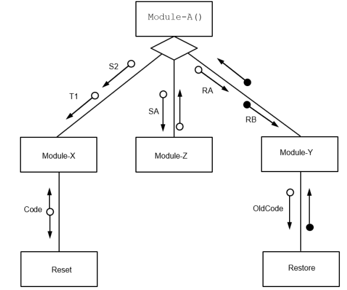

# Mark Schemes — Structured Programming
**11. Programming** · Cambridge (CIE) A-LEVEL computer-science (9618)

## Exam Questions (36 questions)

### Q1
A function returns a single value to the point at which it was called, so `StayCost()` can hand the total cost back to the line that needs it. **[1]**

The value returned replaces the function call inside the expression, so `StayCost(Nights)` can be written directly in each of the four calculations and the expression is then worked out. **[1]**

A procedure returns no value, and a procedure call such as `CALL StayCost(Nights)` is a complete program statement on its own, so it could not form part of a larger calculation. **[1]**

**[3 marks]**

> **[mark-scheme]**
> **1 mark** for stating that a function returns a single value to the point at which it is called
> 
> **1 mark** for stating that the returned value replaces the call inside the expression, so the call can be used directly in each of the four calculations
> 
> **1 mark** for stating that a procedure returns no value, so a procedure call is a complete statement and cannot appear inside an expression
> 
> Accept "the total cost is needed in an expression, and only a function call can be part of an expression" for the second mark
> 
> Accept a worked example such as `Total ← StayCost(Nights) * TaxRate` in support of the second mark
> 
> Do not accept answers that give only the general benefits of splitting a program into modules, such as less repeated code, easier testing or easier maintenance. Those are equally true of a procedure and do not explain the choice here
> 
> Do not accept "a function is faster" or "a function uses less memory", because neither follows from the description given

> **[exam-tip]**
> The commonest wrong answer here lists the benefits of modular design. Those benefits are real, but they apply to procedures just as much as to functions, so they cannot explain why this module has to be a function. Keep your answer on the returned value.
> 
> Watch how you write the call as well. The Pseudocode Guide says the keyword `CALL` is never used with a function, because a function call is not a complete statement. Writing `CALL StayCost(Nights)` tells the examiner you have not made the distinction.

### Q2
Line (1) sends 0.00 straight back to the calling expression, and because `RETURN` takes effect immediately the rest of the function is not carried out. **[1]**

Line (2) sends back the fee that has been worked out, after the maximum has been applied. **[1]**

**[2 marks]**

> **[mark-scheme]**
> **1 mark** for line (1) being `RETURN 0.00`
> 
> **1 mark** for line (2) being `RETURN Fee`
> 
> Accept `RETURN 0` or `RETURN 0.0` for line (1)
> 
> Do not accept `OUTPUT 0.00` or `OUTPUT Fee`. `OUTPUT` writes a value to the console and gives the calling expression nothing to use, so the function would not return a value
> 
> Do not accept `Fee ← 0.00` for line (1). Execution would carry on to `Fee ← DaysLate * DailyRate`, which overwrites it, and a `DaysLate` of -3 would then give a fee of -0.75
> 
> Do not accept `ENDFUNCTION`, or `RETURN` with no value after it, for line (2)

> **[exam-tip]**
> `RETURN` and `OUTPUT` are not interchangeable, and mixing them up is the single most common error on function questions. `OUTPUT` shows something on the screen. `RETURN` hands a value back to the point where the function was called, which is the whole reason a function exists.
> 
> Notice why the early `RETURN` on line (1) works. The Pseudocode Guide says that when `RETURN` is executed it takes effect immediately and any later lines are skipped, so a member who is not late never reaches the multiplication at all.

### Q3
| Index | Count | Score[1] | Score[2] | Score[3] | Score[4] | OUTPUT |
|---|---|---|---|---|---|---|
| **1** | **0** | **4** | **7** | **2** | **9** |   |
| **2** | **0** | **4** | **7** | **2** | **9** |   |
| **3** | **1** | **4** | **3** | **2** | **9** |   |
| **4** | **1** | **4** | **3** | **2** | **9** |   |
| **5** | **2** | **4** | **3** | **2** | **5** |   |
|   |   | **4** | **3** | **2** | **5** | **2** |

The first row records the state once `Index` and `Count` have been initialised. **[1]**

`Score[1]` holds 4, which is not greater than 4, so nothing changes on the first pass. `Score[2]` holds 7, so it becomes 3 and `Count` becomes 1. **[1]**

`Score[3]` holds 2, so nothing changes. `Score[4]` holds 9, so it becomes 5 and `Count` becomes 2. **[1]**

The loop stops when `Index` reaches 5, and `Count` is output as 2. **[1]**

**[4 marks]**

> **[mark-scheme]**
> **1 mark** for the initialisation row: `Index` 1, `Count` 0 and the array holding 4, 7, 2, 9
> 
> **1 mark** for the first two passes: `Index` reaching 3, `Score[2]` changed to 3 and `Count` 1
> 
> **1 mark** for the next two passes: `Index` reaching 5, `Score[4]` changed to 5 and `Count` 2
> 
> **1 mark** for `OUTPUT` 2, with `Score[1]` left at 4 and `Score[3]` left at 2 throughout
> 
> Accept a trace table in which only the values that change are written on each row and the unchanged cells are left blank
> 
> Accept the final row omitted if `OUTPUT` 2 is written on the row where `Index` reaches 5
> 
> Do not accept a final `Score[4]` of 1, which comes from testing 5 against the limit a second time. `Index` has already moved on, so each element is tested once only
> 
> Do not accept a final `Count` of 3, which comes from counting `Score[1]` as a change. 4 is not greater than 4

> **[exam-tip]**
> The trap here is the element that is still above the limit after it has been changed. `Score[4]` starts at 9 and becomes 5, and 5 is still greater than 4, but `Index` has already been increased so the loop never looks at that element again. Follow the order of the statements exactly and never go back.
> 
> The other lost mark is the boundary. `Score[1]` holds 4 and the test is `> Limit`, not `>= Limit`, so 4 is left alone and it is not counted. Write the condition out for each element before you decide.

### Q4
The procedure interface is the mechanism that allows the calling program to pass data into `PrintLabel()`. **[1]**

It defines the three parameters `Code`, `Quantity` and `Price`, giving the data type of each one and the order in which the values must be supplied when the procedure is called. **[1]**

**[2 marks]**

> **[mark-scheme]**
> **Any two from:**
> 
> - The interface provides the mechanism that allows the calling program to pass data to the procedure
> - It defines the parameters of `PrintLabel()`, which are `Code`, `Quantity` and `Price`
> - It gives the data type of each parameter, so `Code` is a `STRING`, `Quantity` is an `INTEGER` and `Price` is a `REAL`
> - It fixes the order in which the values must be supplied in the call
> 
> **[2 marks]**
> 
> Accept the three parameters listed by name without their data types for the second point only
> 
> Do not accept an answer that describes only what the procedure does with the data, such as "it prints a label", because that is the purpose of the procedure and not its interface
> 
> Do not accept "it is the first line of the procedure" on its own, with no reference to the parameters

> **[exam-tip]**
> The word interface makes many students think of a screen that a user sees. Here it means something different: the agreed list of what must be handed to the module, and in what order.
> 
> Answer with reference to the named procedure, as the question asks. A general definition of the word scores less well than one that actually names `Code`, `Quantity` and `Price` and states their data types.

### Q5
The procedure name is followed by brackets holding the three values. **[1]**

The keyword `CALL` is used, and the three values are in the same order and of the same data types as the parameters in the header. **[1]**

**[2 marks]**

> **[mark-scheme]**
> **1 mark** for the procedure name `SaveReading` followed by brackets containing at least one of the three values, correct
> 
> **1 mark** for a completely correct statement, which needs the keyword `CALL`, the string `"Delta"` in double quotes, then `14`, then `21.5`
> 
> Accept `21.50` or `21.5` for the temperature
> 
> Do not accept the statement written without `CALL`, because the Pseudocode Guide states that a procedure call is a complete program statement written in the form `CALL Identifier(value1, value2, ...)`
> 
> Do not accept `Result ← SaveReading("Delta", 14, 21.5)`, because a procedure does not return a value, so there is nothing to assign
> 
> Do not accept `"14"` or `"21.5"` written in quotes, because those parameters are an `INTEGER` and a `REAL`, not strings

> **[exam-tip]**
> The header is the only thing that tells you the order and the data types of the values, so read it before you write anything. Swapping `14` and `21.5` costs the second mark even though both numbers are right.
> 
> Students who have just met functions often drop the `CALL` keyword, or try to assign the result to a variable. Remember the split: a procedure call stands alone as a statement and needs `CALL`, while a function call is never written with `CALL` because its returned value has to be used inside an expression.

### Q6
`Total` is passed by value, because the header at line 20 specifies `BYVAL Total`. **[1]**

The procedure therefore receives a copy of `TotalWeight` rather than `TotalWeight` itself. **[1]**

Line 21 adds the weight to that copy only, and the copy is discarded when the procedure ends, so `TotalWeight` still holds the 0 assigned at line 02 when line 12 runs. **[1]**

Change the header at line 20 so that `Total` is passed by reference. **[1]**

The two calls at lines 10 and 11 do not need to change, because `Weight` stays a value parameter and 15 and 8 are literals.

**[4 marks]**

> **[mark-scheme]**
> **1 mark** for identifying that `Total` is passed by value // that the header uses `BYVAL Total`
> 
> **1 mark** for stating that a copy of `TotalWeight` is passed to the procedure
> 
> **1 mark** for stating that the change made at line 21 is lost when the procedure ends, so `TotalWeight` is still 0
> 
> **1 mark** for changing `BYVAL Total` to `BYREF Total` in the header at line 20
> 
> Accept local copy, separate copy or copy of the argument for the second marking point
> 
> Accept the corrected header written out in full for the fourth marking point
> 
> Accept passed by reference written in words in place of the keyword `BYREF`
> 
> Do not accept the procedure does not return a value on its own. `AddParcel()` is a procedure and is not expected to return one, and this names the symptom rather than the cause
> 
> Do not accept there is a syntax error. The header at line 20 is valid pseudocode, which is why the program compiles

> **[exam-tip]**
> The signal to look for is a procedure that is meant to send a value back to the calling routine but has no `BYREF` in its header. Weak answers say the procedure does not return the value, which just repeats the question. Say what a value parameter actually does: it copies the argument, and the copy dies at `ENDPROCEDURE`.
> 
> The question asks for a change to the header, so `BYREF` is the fix here. Note that the Cambridge pseudocode rules say a parameter should not be passed by reference to a function, so this technique belongs to procedures. When a function needs to send a single value back, use its return value instead.

### Q7
12 **[1]**

4 **[1]**

22 **[1]**

The first value is produced inside `Update()`. `Points` receives a copy of `Bonus`, which is 4, and the copy is trebled to 12.

The second value is 4. `Points` is passed by value, so only the copy changed and `Bonus` still holds 4 after the call.

The third value is 22. `Score` is passed by reference, so the addition writes 10 + 12 into `Result` itself.

**[3 marks]**

> **[mark-scheme]**
> **1 mark** for 12 as the first value
> 
> **1 mark** for 4 as the second value
> 
> **1 mark** for 22 as the third value
> 
> Accept the three values written as a list, on separate lines or in a table, provided the order is 12, then 4, then 22
> 
> Do not accept 12 as the second value. `Points` is passed by value, so `Bonus` cannot be changed by the procedure
> 
> Do not accept 10 as the third value. `Score` is passed by reference, so the new total is written back into `Result`

> **[exam-tip]**
> The second value is where the marks are lost. Students settle on one passing mechanism and then apply it to the whole procedure, which gives 12, 12, 22 or 12, 4, 10. Decide the mechanism for each parameter separately before you trace: a `BYVAL` parameter works on a copy that is thrown away at `ENDPROCEDURE`, while a `BYREF` parameter works on the calling routine's own variable.
> 
> The names in the call and the names in the header are deliberately different. `Bonus` is the argument and `Points` is the parameter, and the two are the same piece of storage only when the parameter is passed by reference.

### Q8
`StockLevel` is passed by reference. **[1]**

`Amount` is passed by value. **[1]**

**[2 marks]**

> **[mark-scheme]**
> **1 mark** for `StockLevel` passed by reference
> 
> **1 mark** for `Amount` passed by value
> 
> Accept `BYREF` in place of by reference, and `BYVAL` in place of by value
> 
> Do not accept `Amount` passed by reference. `BYREF` is written in front of `StockLevel` only
> 
> Do not accept the method for `Amount` is not stated. A parameter written with no keyword is passed by value

> **[exam-tip]**
> A header that contains `BYREF` somewhere does not make every parameter a reference parameter. The keyword belongs to the parameter it is written in front of, and a parameter written with no keyword at all is passed by value. The common error here is to spot `BYREF` anywhere in the header and then label both parameters by reference.

### Q9
The function returns TRUE only when all three rules have passed.

**[6 marks]**

> **[mark-scheme]**
> The command word 'write' means the answer must be given as 9618 pseudocode, not as a description of what the code would do.
> 
> **1 mark** for a function header taking one `STRING` parameter and `RETURNS BOOLEAN`, closed with `ENDFUNCTION`
> 
> **1 mark** for testing `LENGTH(ThisID) <> 7` and returning `FALSE`
> 
> **1 mark** for looping over the first two characters, extracting each one with `MID()` or `LEFT()`
> 
> **1 mark** for testing each of those characters lies in the range `'A'` to `'Z'` and returning `FALSE` if it does not
> 
> **1 mark** for testing the last five characters with `IS_NUM(RIGHT(ThisID, 5))` and returning `FALSE` if it fails
> 
> **1 mark** for returning `TRUE` only after every test has passed
> 
> Accept `ThisChar >= 'A' AND ThisChar <= 'Z'` in place of the `ASC()` comparison
> 
> Accept the three tests written in any order, provided `MID()` and `RIGHT()` are only reached after the length has been confirmed as 7
> 
> Accept `LEFT(ThisID, 2)` handled as a two-character string rather than looped over
> 
> Accept a single result variable in place of the early returns, for example:
> 
> Do not award the final mark if `TRUE` can be returned when one of the tests has failed

> **[exam-tip]**
> Check the insert before you invent a function. There is no `SUBSTRING()`, no `TRIM()` and no `IS_ALPHA()` in 9618 pseudocode, so a character range has to be tested with `ASC()` or with a direct comparison against `'A'` and `'Z'`. Writing a function that does not exist costs you the mark even when the logic is right.
> 
> Watch the order of your tests too. If you check the characters before you check the length, a one-character ID will send `MID()` past the end of the string.

### Q10
> **[mark-scheme]**
> `PROCEDURE Chat(Destination : STRING, Port : INTEGER) `
>          `DECLARE Data : STRING `
>          `DECLARE Finished : BOOLEAN `
>          `CONSTANT Terminator = "Bye" `
>          `CONSTANT STX = CHR(2) `
>          `CONSTANT ETX = CHR(3) `
> 
> `   Finished `$\leftarrow$` FALSE `
> 
> `   REPEAT `
>                  `Data `$\leftarrow$` GetData() `
>                  `OUTPUT Data `
>                  `IF Data = Terminator THEN `
>                          `Finished `$\leftarrow$` TRUE `
>                   `ENDIF`
> 
> `      IF NOT Finished THEN //about to reply `
>                          `INPUT Data `
>                          `Transmit(STX & Destination & MyID & Data & ETX, Port) `
> 
> `         IF Data = Terminator THEN `
>                                   `Finished `$\leftarrow$` TRUE `
>                           `ENDIF `
>                  `ENDIF `
> 
> `   UNTIL Finished = TRUE `
> 
> `ENDPROCEDURE `
> 
> Conditional loop 
> **MP1**    **Conditional loop **
> **MP2**   Test for terminator in both cases 
> **MP3**   Use `GetData()` to get the data from the message 
> **MP4**   `OUTPUT` the data **in a loop** 
> **MP5**    `INPUT` the data reply 
> **MP6**   ‘Attempted ‘ use of `Transmit` to send it **in a loop** 
> **MP7**    Correct formation of parameters to `Transmit()`
> **[mark-scheme]**
> **Note: Max 3** marks **(from either limitation or modification list)**
> 
> Limitation:
> 
> 1. `GetData()` does not return a value until a message has been received
> 2. So once a message has been sent the user has to wait for a reply // chat is half-duplex
> 
> Modification:
> 
> 3. If no response allow the receiver to exit chat at any time … 
>      4. `GetData()` should immediately return a suitable message // set a time limit 
>       5.  ... which `Chat()` can detect and respond by allowing the conversation to continue

### Q11
> **[mark-scheme]**
> `PROCEDURE Sub-9(BYREF Param : MyType) `
> 
> **MP 1**     One mark for BYREF 
> **MP 2**    One mark for the rest of the statement

### Q12
> **[mark-scheme]**
> `FUNCTION TestNum(ThisNum : STRING) RETURNS INTEGER `
> 
> `   IF LEFT(ThisNum,3) = RIGHT(ThisNum 3) THEN `
> `      RETURN 3 `
> `   ENDIF `
> 
> `   IF RIGHT(ThisNum, 3) = "000" THEN `
> `      RETURN 2 `
> `   ENDIF `
> 
> `   IF MID(ThisNum, 4, 1) = MID(ThisNum, 5, 1)__ AND MID(ThisNum, 5, 1) = MID(ThisNum, 6, 1) THEN `
> `      RETURN 1 `
> `   ENDIF `
> 
> `   RETURN 0 `
> 
> `ENDFUNCTION `
> 
> **MP1**    Function heading and ending **including** parameter and return type 
> **MP2**   Test for Condition 1 
> **MP3**   Test for Condition 2 
> **MP4**   Test for Condition 3 
> **MP5**   Return the highest value if more than one condition is satisfied 
> **MP6**   Return zero if no condition matched

### Q13
> **[mark-scheme]**
> `PROCEDURE RandList() `
>          `DECLARE Count, BaseNum, ThisNum : INTEGER `
>          `CONSTANT StepVal = 10 `
>          `BaseNum `$\leftarrow$` 0 `
> 
> `   FOR Count `$\leftarrow$` 1 TO 25 `
>                  `ThisNum `$\leftarrow$` BaseNum + INT(RAND(StepVal)) `
>                  `OUTPUT ThisNum `
>                  `BaseNum `$\leftarrow$` BaseNum + StepVal `
>         `NEXT Count `
> 
> `ENDPROCEDURE `
> 
> **MP1**    Procedure heading and ending 
> **MP2**   <u>Local</u> loop counter `Count` as integer 
> **MP3**   Loop to iterate 25 times or more for each unique number 
> **MP4**  ‘Attempt’ to generate a random number including use of `INT()` **in a loop** 
> **MP5**   Ensure that number generated is greater than previous and change ‘previous’ 
> **MP6**   Output random number after an attempt at MP5 **in a loop**

### Q14
> **[mark-scheme]**
> Example solution
> 
> `PROCEDURE ProcessMsg(ThisMsg : STRING) `
> `   DECLARE ThisDest : STRING `
> `   DECLARE Response : BOOLEAN `
> `   DECLARE StackNum : INTEGER `
> 
> `   IF LENGTH(ThisMsg) >= 4 THEN `
> 
> `      ThisDest `$\leftarrow$` LEFT(ThisMsg, 3) `
> 
> `      IF ThisDest = MyID THEN // It's for this computer `
> `         StackNum `$\leftarrow$` 1 `
> `      ELSE `
> `         StackNum `$\leftarrow$` 2 `
> `      ENDIF `
> 
> `      Response`$\leftarrow$` StackMsg(ThisMsg, StackNum) `
> 
> `      IF Response = FALSE THEN `
> `         OUTPUT "Message discarded - no room on stack" `
> `      ENDIF `
> 
> `   ENDIF `
> `ENDPROCEDURE`
> 
> Mark as follows:
> 
> 1. Ignore message if data field is empty
> 2. Extract `ThisDest` from `ThisMsg`
> 3. Test if destination is this computer
> 4. Attempt to use `StackMsg()`
> 5. **Fully correct **use of StackMsg()for** both** cases / stacks
> 6. Test `StackMsg()` return value for **both **cases
> 7. Following a reasonable attempt at MP6 output warning if `StackMsg()` returns `FALSE`

### Q15
> **[mark-scheme]**
> 
> 
> **One **mark per point:
> 
> 1. Module names
> 2. Parameters with labels to Module-X and between Module-X and Reset
> 3. Parameter (with label) to Module-Z and return from Module-Z
> 4. Parameters with labels to Module-Y and Restore and return values from Module-Y

### Q16
> **[mark-scheme]**
> (i)
> 
> Function
> 
> (ii)
> 
> `FUNCTION CheckFiles(NameRoot : STRING) RETURNS INTEGER`

### Q17
> **[mark-scheme]**
> Example Solution
> 
> `PROCEDURE Count() `
> `   DECLARE COdd, CEven, ThisNum : INTEGER `
> 
> `   COdd `$\leftarrow$` 0 `
> `   CEven `$\leftarrow$` 0 `
> 
> `   INPUT ThisNum `
> 
> `   WHILE ThisNum <> 99 `
> `      IF ThisNum MOD 2 = 1 THEN `
> 
> `         COdd `$\leftarrow$` COdd + 1 `
> `      ELSE `
> `         CEven `$\leftarrow$` CEven + 1 `
> `      ENDIF `
> `      INPUT ThisNum `
> `   ENDWHILE `
> 
> `   OUTPUT "Count of odd and even numbers: ", COdd, CEven `
> `ENDPROCEDURE `
> 
> Mark as follows **Max 6** marks:
> 
> 1. Procedure heading and ending
> 2. **Local** `COdd, CEven` and `ThisNum` declared as integers
> 3. Conditional loop while `ThisNum <> 99`
> 4. Input `ThisNum` **in a loop**
> 5. Check `ThisNum` is odd or even **in a loop**
> 6. Increment appropriate count **in a loop**, both counts must have been initialised **before loop **
> 7. **After the loop** output `COdd `and `CEven` **with a** suitable message following a reasonable attempt at counting

### Q18
> **[mark-scheme]**
> `FUNCTION GetField(Msg : STRING, FieldNo : INTEGER) RETURNS STRING `
> `   DECLARE RetString : STRING `
> 
> `   CASE OF FieldNo `
> `      1 : RetString `$\leftarrow$` MID(Msg, 2, 3) `
> `      2 : RetString `$\leftarrow$` MID(Msg, 5, 3) `
> `      3 : RetString `$\leftarrow$` MID(Msg, 8, LENGTH(Msg) - 8) `
> `      OTHERWISE : RetString `$\leftarrow$` "" `
> `    ENDCASE `
> 
> `    RETURN RetString `
> `ENDFUNCTION `
> 
> **MP1**    Use of `CASE` ... `ENDCASE` or `IF` ... `THEN `... `ENDIF` 
> **MP2**   Field 1 and Field 2 extracted correctly 
> **MP3**   Calculate a length of field 3 
> **MP4**   Field 3 extracted <u>correctly</u> 
> **MP5**   Return empty string in case of invalid parameter (via `OTHERWISE` or initialisation) 
> **MP6**   Final `RETURN`, after a reasonable attempt

### Q19
> **[mark-scheme]**
> `PROCEDURE MyOutput(NewString : STRING, EOL : BOOLEAN) `
> 
> `   IF LENGTH(MyString) + LENGTH(NewString) > 255 THEN `
> `      OUTPUT MyString // Resulting string would be too long `
> `      MyString `$\leftarrow$` NewString `
> `   ELSE `
> `      MyString `$\leftarrow$` MyString & NewString // Concat with MyString `
> `      IF EOL = TRUE THEN `
> `         OUTPUT MyString `
> `         MyString `$\leftarrow$` "" `
> `      ENDIF `
> `ENDIF ENDPROCEDURE `
> 
> **MP1**    Procedure heading, including parameters, and ending 
> **MP2**   Produce concatenated string 
> **MP3**   … Check whether resulting string would be too long
> 
> **MP4**   If so, then output old `MyString` 
> **MP5   **… and assign `NewString` to `MyString` 
> **MP6**   Else concatenate `NewString` to `MyString`
> 
> **MP7**   (test for length < 255) Test `EOL `– If `TRUE` then Output 
> **MP8**   … and reset `MyString` to empty string
> **[mark-scheme]**
> **MP1    **A new (instance of) variable `MyString` is created each time the procedure is called / executed 
> **MP2   **So the previous contents are lost

### Q20
> **[mark-scheme]**
> `FUNCTION TooMany(Search : STRING, Max : INTEGER) RETURNS BOOLEAN `
> `   DECLARE Count, Index : INTEGER`
> 
> `   Count `$\leftarrow$` 0 `
> 
> `   FOR Index `$\leftarrow$` 1 TO 150 `
> `      IF Data[Index] = Search THEN `
> `         Count `$\leftarrow$` Count + 1 `
> `      ENDIF `
> `   NEXT Index `
> 
> `   IF Count > Max THEN `
> `      RETURN TRUE `
> `   ELSE `
> `      RETURN FALSE `
> `   ENDIF `
> `ENDFUNCTION `
> 
> **MP1**   Function heading, ending and return type 
> **MP2**  Declare Count and Index as integers 
> **MP3**   Initialise Count 
> **MP4**   Loop (any type) for 150 iterations 
> **MP5**   Compare Data element with parameter - if equal, increment Count in a loop 
> **MP6**   Compare Count with Max and return Boolean in both cases outside the loop

### Q21
> **[mark-scheme]**
> Example:
> 
> `FUNCTION Header(Line : STRING) RETURNS STRING `
> 
> `   IF LENGTH(Line) >= 13 THEN `
> `      IF TO_UPPER(LEFT(Line, 9)) = "FUNCTION " THEN `
> `         RETURN "F" & RIGHT(Line, LENGTH(Line) - 9) `
> `      ENDIF `
> 
> `      IF TO_UPPER(LEFT(Line, 10)) = "PROCEDURE " THEN `
> `         RETURN "P" & RIGHT(Line, LENGTH(Line) - 10) `
> `      ENDIF `
> `    ENDIF `
> 
> `    RETURN "" `
> 
> `ENDFUNCTION`
> 
> Mark as follows:
> 
> 1. Function heading, parameter, return type and ending
> 2. Check that the line is at least 13 characters long before attempting to extract and return empty string
> 3. Attempt at: Extract characters, 9 or 10 characters, corresponding to keyword plus space and compare with appropriate keyword plus space
> 4. Completely correct MP3
> 5. Use of type case conversion to allow for 'any case'
> 6. Calculation of 'rest of line' and concatenation with 'P or 'F'
> 7. Return string

### Q22
> **[mark-scheme]**
> (i)
> 
> Mod-B() and Mod-E()
> 
> (ii)
> 
> Points required:
> 
> 1. any change made to the parameter value / `Par3 `within `Mod-G()`is reflected in the (subsequent) value in the calling module / `Mod-C()` (after `Mod-G()` terminates) 2
> 2. any change made to the parameter value / `Par3` within `Mod-F()`is NOT reflected in the (subsequent) value in the calling module / `Mod-C()` (after `Mod-F()` terminates)
> 
> Mark as follows:
> 
> 1 mark for a reasonable attempt to explain
> 
> 2 marks for full explanation including context

### Q23
> **[mark-scheme]**
> Example Solutions:
> 
> `PROCEDURE Progress(Percent : INTEGER, Root : STRING) `
> `   DECLARE StepValue : INTEGER `
> `   DECLARE Filename : STRING `
> 
> `   StepValue `$\leftarrow$` (Percent DIV 10) + 1 // INT(Percent / 10) + 1 `
> `   FileName `$\leftarrow$` Root & "-" & NUM_TO_STR(StepValue) & ".bmp" `
> `   CALL Display(Filename) ENDPROCEDURE `
> 
> Alternative:
> 
> `PROCEDURE Progress(Percent : INTEGER, Root : STRING)  `
> `   DECLARE StepValue : INTEGER `
> `   DECLARE Filename : STRING `
> `   DECLARE Found : BOOLEAN `
> `   StepValue `$\leftarrow$` 1 `
> `   Found `$\leftarrow$` FALSE `
> `   REPEAT `
> `      IF Percent < StepValue * 10 THEN `
> `         Found `$\leftarrow$` TRUE `
> `      ENDIF `
> `      StepValue`$\leftarrow$` StepValue + 1 `
> `   UNTIL Found `
> `   Filename `$\leftarrow$` Root & "-" & NUM_TO_STR(StepValue - 1) & ".bmp" `
> `   CALL Display(Filename) `
> `ENDPROCEDURE`
> 
> Mark as follows for use of DIV/INT or loop solution:
> 
> 1. Procedure heading, parameters and ending
> 2. Calculate `StepValue` as integer value // Attempt at calculating file number
> 3. Add 1 to obtain file number // Completely correct file number calculation
> 4. Use of `NUM_TO_STR()` to convert file number to string and use
> 5. Concatenate `Root,` hyphen, file number and ".bmp" suffix
> 6. Call `Display()` with filename as parameter following a reasonable attempt
> **[mark-scheme]**
> (i)
> 
> Example answer:
> 
> `FUNCTION Progress2(Percent, Steps : INTEGER, Root : STRING) RETURNS STRING`
> 
> - One mark for each: Keyword `FUNCTION Progress2` **and** three parameters of correct type
> - Keyword `RETURNS `and type string
> 
> (ii)
> 
> The progress display will more accurately show the progress of the task

### Q24
> **[mark-scheme]**
> Example algorithm based on finding position of first non-space character and then using substring function:
> 
> `FUNCTION   DeleteSpaces(Line : STRING) RETURNS STRING `
> `   DECLARE NewLine : STRING `
> `   DECLARE EndOfLeading : BOOLEAN `
> `   DECLARE Count, NumSpaces : INTEGER `
> `   DECLARE NextChar : CHAR `
> `   CONSTANT Space = " " `
> 
> `   NumSpaces `$\leftarrow$` 0 `
> `   EndOfLeading `$\leftarrow$` FALSE `
> 
> `   FOR Count `$\leftarrow$` 1 TO LENGTH(Line) `
> `      NextChar `$\leftarrow$` MID(Line, Count, 1) `
> `      IF NextChar <> Space AND EndOfLeading = FALSE THEN `
> `         NumSpaces `$\leftarrow$` Count - 1 // the number to trim `
> `         EndOfLeading = TRUE `
> `      ENDIF `
> `   NEXT Count `
> 
> `   NewLine `$\leftarrow$` RIGHT(Line, LENGTH(Line) - NumSpaces) `
> 
> `   RETURN NewLine `
> `ENDFUNCTION `
> 
> Mark as follows:
> 
> 1. Loop to length of parameter `// Loop until first non-space` `character in Line `
> 2. Extract a character **in a loop **
> 3. Identify <u>first</u> non-space character **in a loop **
> 4. Attempt at removing leading spaces in `Line`
> 5. Leading spaces removed from `Line` / / Create new string without leading space
> 6. Return a string following a reasonable attempt at removing leading spaces in `Line`

### Q25
> **[mark-scheme]**
> Example solution:
> 
> `PROCEDURE TwoParts()  `
> `   DECLARE NextNum, Average : REAL `
> 
> `   TotalA `$\leftarrow$` 0.0 // 0 `
> `   TotalB `$\leftarrow$` 0.0 // 0 `
> 
> `   REPEAT `
> `      INPUT NextNum `
> `      TotalA `$\leftarrow$` TotalA + NextNum `
> `   UNTIL NextNum = 0 `
> 
> `   REPEAT `
> `      INPUT NextNum `
> `      TotalB `$\leftarrow$` TotalB + NextNum `
> `   UNTIL NextNum = 0 `
> 
> `   Average `$\leftarrow$` (TotalA + TotalB) / 2 `
> `   OUTPUT "The average is ", Average `
> `ENDPROCEDURE `
> 
> Mark as follows:
> 
> 1. Procedure heading and ending
> 2. Declare all local variables
> 3. Initialise `TotalA` and `TotalB `
> 4. First conditional loop until zero entered, summing `TotalA` // Loop until both parts (sequences) have been entered
> 5. Second conditional loop until zero entered, summing `TotalB` // Loop summing appropriate Totals
> 6. Calculation of average and output with a message // Calculation of the average for the values making up the two totals and both output with a suitable message

### Q26
> **[mark-scheme]**
> (i)
> 
> Two marks for the benefits:
> 
> 1. The code can be called when needed
> 2. Any subsequent change to the algorithm / calculation needs to be made once only // Easier to manage / maintain (the program)
> 3. Less code / no code duplication
> 4. The algorithm / code / calculation can be designed / coded / tested once
> 
> **Note: Max 2 marks**
> 
> (ii)
> 
> 1. One mark per point: Create a module / function / procedure / subroutine **using the (old) code / algorithm **
> 2. Replace the old code / algorithm wherever it appears with a call to the module / function / procedure / subroutine
> 3. Pass the data as parameter(s) // Use of <u>global variable</u>(s)
> 4. <u>Return</u> the result (of the calculation) // Assign result to <u>global variable(s)</u> / <u>BYREF parameter(s)</u>
> 5. Create <u>local </u>variables as needed (to perform the calculation)
> 
> **Note: Max 3 marks**

### Q27
> **[mark-scheme]**
> Example solution:
> 
> `Function Trim(Name : STRING) RETURNS STRING    `
> `   CONSTANT Dots = "..." `
> `   CONSTANT Space = " " `
> 
> `   IF LENGTH(Name) <= 16 THEN `
> `      RETURN Name `
> `   ENDIF `
> 
> `   // Otherwise it has to be trimmed `
> 
> `   WHILE LENGTH(Name) > 13 `
>                  `REPEAT `
>                           `Name `$\leftarrow$`LEFT(Name, LENGTH(Name) - 1) // strip last char `
> `      UNTIL RIGHT(Name, 1) = Space // back to SPACE `
> `   ENDWHILE `
> 
> `   Name `$\leftarrow$`LEFT(Name, LENGTH(Name) - 1) // remove the space `
>         `Name `$\leftarrow$` Name & Dots `
>         `RETURN Name `
> 
> `ENDFUNCTION `
> 
> Mark as follows:
> 
> 1. Function heading, ending, parameter and return type
> 2. If length of original string <= 16 then return original string
> 3. Any Conditional loop...
> 4. until string is short enough
> 5. Inner conditional loop / second condition to identify word(s) to remove from the end of string // Check to identify word(s) to remove from the end of string
> 6. Attempt to strip characters back to space
> 7. Correct removal of word/words from end of string and remove final space
> 8. Concatenate `Dots `and return result
> 
> **Max 7 marks**

### Q28
> **[mark-scheme]**
> Example solution:
> 
> `PROCEDURE IsRA() `
> `   DECLARE a, b, c : INTEGER `
> 
> `   OUTPUT "Input length of the first side" `
> `   INPUT a `
> `   OUTPUT "Input length of the second side" `
> `   INPUT b `
> `   OUTPUT "Input length of the third side" `
> `   INPUT c `
> 
> `   IF (a * a = (b * b) + (c * c)) OR__ `
> `      (b*  b = (a * a) + (c * c)) OR__ `
> `      (c * c = (a * a) + (b * b)) THEN `
>                  `OUTPUT "It is right-angled" `
> `   ELSE `
> `      OUTPUT "Not right-angled" `
> `   ENDIF `
> `ENDPROCEDURE `
> 
> Mark as follows:
> 
> 1. Procedure heading **and** ending and declaration of all variables used
> 2. Appropriate prompt and input for each length
> 3. **One** correct length test
> 4. **All three** length tests // selection of which test is required
> 5. Output one of two messages following a reasonable attempt at MP3

### Q29
> **[mark-scheme]**
> `FUNCTION DeleteComment(Line : STRING) RETURNS STRING   `
> `   DECLARE NewLine, TwoChars : STRING `
> `   DECLARE Count, TrimTo : INTEGER `
> `   CONSTANT Comment = "//" `
> 
> `   NewLine `$\leftarrow$` Line `
> `   TrimTo `$\leftarrow$` 0 `
> `   Count `$\leftarrow$` 1 `
> `   WHILE Count < LENGTH(Line) AND TrimTo = 0 `
> `      TwoChars `$\leftarrow$` MID(Line, Count, 2) // extract 2 chars `
> `      IF TwoChars = Comment THEN `
> `         TrimTo `$\leftarrow$` Count `
> `      ENDIF `
> `      Count `$\leftarrow$` Count + 1 `
> `   ENDWHILE `
> 
> `   IF TrimTo <> 0 THEN `
> `      NewLine `$\leftarrow$` LEFT(Line, TrimTo - 1) `
> `   ENDIF `
> 
> `   RETURN NewLine `
> 
> `ENDFUNCTION `
> 
> Mark as follows:
> 
> 1. Loop to length of `Line` (parameter) // length of `Line -1`
> 2. Terminate loop on first double slash
> 3. Attempt to extract one/two characters **in a loop **
> 4. Check for "//" after attempt at extraction **in a loop**
> 5. Record start position of comment // Calculate amount of trim required
> 6. Attempt to trim `Line` from start of comment
> 7. Completely correct trimmed `Line` from start of comment
> 8. Return `Line` after a reasonable overall attempt

### Q30
> **[mark-scheme]**
> <u>PROCEDURE Sub-A</u>    <u>(Name : STRING, BYREF P2 : BOOLEAN)</u>
> 
> <u>FUNCTION Sub-B</u>          <u>(P1 : REAL) RETURNS REAL</u>
> 
> One mark per underlined part in each case

### Q31
> **[mark-scheme]**
> `FUNCTION IsRA(x1, y1, x2, y2, x3, y3 : INTEGER) RETURNS `
> `BOOLEAN `
> `   DECLARE Len1, Len2, Len3 : INTEGER `
> 
> `   Len1 `$\leftarrow$` (x1 - x2) ^ 2 + (y1 - y2) ^ 2 `
> `   Len2 `$\leftarrow$` (x1 - x3) ^ 2 + (y1 - y3) ^ 2 `
> `   Len3 `$\leftarrow$` (x2 - x3) ^ 2 + (y2 - y3) ^ 2 `
> 
> `   IF (Len1 = Len2 + Len3) OR__ `
> `      (Len2 = Len1 + Len3) OR__ `
> `      (Len3 = Len1 + Len2) THEN `
> `      RETURN TRUE `
> `   ELSE `
> `      RETURN FALSE `
> `   ENDIF `
> 
> `ENDFUNCTION `
> 
> Mark as follows:
> 
> 1. Calculate the square of the length of at least one side
> 2. Calculation of all three lengths squared correctly
> 3. **One** correct comparison of square of three lengths
> 4. **All three** comparisons…
> 5. combined using logical operators / nested `IF` // completely correct selection
> 6. Return result correctly in both cases

### Q32
> **[mark-scheme]**
> Example:
> 
> `FUNCTION Check() RETURNS STRING `
> `            DECLARE Odd, Even, Index : INTEGER `
> 
> `            Odd `$\leftarrow$` 0 `
> `            Even `$\leftarrow$` 0 `
> 
> `            FOR Index `$\leftarrow$` 1 TO 100 `
> `               IF Index MOD 2 = 0 THEN `
> `                  Even `$\leftarrow$` Even + Data[Index] `
> `               ELSE `
> `                  Odd `$\leftarrow$` Odd + Data[Index] `
> `               ENDIF `
> `            NEXT Index `
> 
> `ENDFUNCTION `
> 
> Mark as follows:
> 
> 1. Function heading, ending and return type
> 2. Declare local variables `Odd, Even` and `Index` as integers
> 3. Initialise Odd and Even
> 4. Loop for 100 `iterations `// through array
> 5. Sum `Odd` and `Even` element values **in a loop**
> 6. Compare `Odd` and `Even` after the loop and Return appropriate string

### Q33
> **[mark-scheme]**
> (i)
> 
> The names do not reflect / indicate the purpose of the variable // the names are not meaningful
> 
> (ii)
> 
> They make the program more difficult to understand / debug / maintain
> 
> (iii)
> 
> One mark from:
> 
> - Indentation / use of white space
> - Capitalisation of keywords
> - Use of comments
> - Use of modular programming
> - Use of local variables
> 
> **Note: max 1 mark**

### Q34
> **[mark-scheme]**
> Example:solution
> 
> `PROCEDURE GBInitialise() `
> `   DECLARE GBIndex, GBMark, ThisIndex : INTEGER `
> 
> `   FOR ThisIndex `$\leftarrow$`0 TO 75 `
> `      Check[ThisIndex] `$\leftarrow$` FALSE // initialise all values `
> `   NEXT ThisIndex `
> 
> `   FOR GBIndex `$\leftarrow$` 1 TO 5 `
> `      GBMark `$\leftarrow$` GB[GBIndex] `
> `      FOR ThisIndex `$\leftarrow$` GBMark - 2 TO GBMark + 2 `
> `         Check[ThisIndex]`$\leftarrow$` TRUE //Set GBMark `$\leftarrow$` 2 to TRUE `
> `     NEXT ThisIndex `
> `   NEXT GBIndex `
> `ENDPROCEDURE`
> 
> Mark as follows: 
> **MP1    **Procedure heading and ending 
> **MP2**   Initialise `Check` array to `FALSE` 
> **MP3**   Loop through `GB` array 
> **MP4   **Extract the `GB` mark 
> **MP5**   Loop for 5 elements across `GBMark` $\leftarrow$ 2 // Check if within `GBMark `$\leftarrow$ 2 
> **MP6**  Assign each element of `Check` array to `TRUE`
> 
> ALTERNATIVE – Example using selection Version 1
> 
> `FOR ThisIndex `$\leftarrow$` 0 TO 75 `
> `   CASE ThisIndex `
> `      GB[1] – 2 TO GB[1] + 2 : Check[ThisIndex] `$\leftarrow$` TRUE `
> `      GB[2] – 2 TO GB[2] + 2 : Check[ThisIndex] `$\leftarrow$` TRUE `
> `      GB[3] – 2 TO GB[3] + 2 : Check[ThisIndex] `$\leftarrow$` TRUE `
> `      GB[4] – 2 TO GB[4] + 2 : Check[ThisIndex] `$\leftarrow$` TRUE `
> `      GB[5] – 2 TO GB[5] + 2 : Check[ThisIndex] `$\leftarrow$` TRUE `
> `  OTHERWISE: Check[ThisIndex] `$\leftarrow$`FALSE `
> `  ENDCASE `
> `NEXT ThisIndex`
> 
> ALTERNATIVE – Example using selection Version 2
> 
> `   DECLARE ThisIndex, GBIndex : INTEGER `
> `   DECLARE Lower, Higher : INTEGER `
> 
> `   FOR ThisIndex  `$\leftarrow$` 0 TO 75 `
> `       For GBIndex  `$\leftarrow$` 1 T0 5 `
> `         Lower  `$\leftarrow$` GB[GBIndex] - 2 `
> `         Higher  `$\leftarrow$` GB[GBIndex] + 2 `
> `         IF ThisIndex >= Lower AND ThisIndex <= Higher THEN `
> `            Check[ThisIndex]  `$\leftarrow$` TRUE `
> `         ELSE `
> `            Check[ThisIndex]  `$\leftarrow$` FALSE `
> `         ENDIF `
> `       NEXT Index `
> `   NEXT ThisIndex `
> 
> Mark as follows: 
> **MP1   **Procedure heading and ending 
> **MP2**   Loop through `Check` array// loop from 0 to 75 
> **MP3**   Attempt at using CASE / Selection structure with five clauses/ **five** checks for range 
> **MP4**   Extract GB grade 
> **MP5**   Compare `ThisIndex` with each element in GB array $\pm$2 
> **MP6**   Assign each element of `Check` array to `TRUE` if in range **or **`FALSE` if not in range

### Q35
> **[mark-scheme]**
> Example ‘loop solution’:
> 
> `FUNCTION Conceal(CardNumber : STRING) RETURNS STRING `
> `   DECLARE MaskedString : STRING `
> `   DECLARE Count : INTEGER `
> `   CONSTANT Asterisk = '*' `
> 
> `   MaskedString `$\leftarrow$` RIGHT(CardNumber, 4) `
> `   FOR Count `$\leftarrow$` 1 TO LENGTH(CardNumber) - 4   `
> `       MaskedString `$\leftarrow$`Asterisk & MaskedString `
> `   NEXT Count `
> 
> `   RETURN MaskedString `
> 
> `ENDFUNCTION `
> 
> Mark as follows: 
> **MP1** Function heading and parameter and ending and return type 
> **MP2** Declaration of all local variables used - including the loop counter 
> **MP3** Calculate number of digits to mask / number of asterisks required 
> **MP4** use of a ‘relevant’ Loop 
> **MP5** Correct number of iterations 
> **MP6** Concatenate asterisk to start/end of `MaskedString `in a loop 
> **MP7** Assign last four characters to `MaskedString //` Concatenate the retained original last four digits 
> **MP8** Return masked string
> 
> **Max 6 marks**
> 
> ALTERNATIVE ‘non loop’ solution:
> 
> `FUNCTION Conceal(CardNumber : STRING) RETURNS STRING `
> `   DECLARE MaskedString : STRING `
> `   DECLARE Count : INTEGER `
> `   CONSTANT Asterisks = "********************" //20 asterisks `
> `   Count `$\leftarrow$`LENGTH(CardNumber) - 4 `
> `   MaskedString `$\leftarrow$` LEFT(Asterisks, Count) & RIGHT(CardNumber, 4) `
> `   RETURN MaskedString `
> 
> `ENDFUNCTION `
> 
> Mark as follows: 
> **MP1** Function heading **and** parameter **and** ending **and** return type 
> **MP2** Declaration of all local variables used 
> **MP3** Calculate number of digits to mask / number of asterisks required
> **MP4** Trim asterisk string to number calculated in **MP3** 
> **MP5** Extract the last four characters 
> **MP6** Concatenate trimmed asterisk string with last four characters of `CardNumber `
> **MP7** Return masked string
> 
> **Max 6 marks**
> **[mark-scheme]**
> Any reference to BYREF // ‘by reference’

### Q36
> **[mark-scheme]**
> Example solution:
> 
> `PROCEDURE Tick() `
> `   SS `$\leftarrow$` SS + 1 `
> `   IF SS = 60 THEN `
> `      SS `$\leftarrow$` 0 `
>                  `MM `$\leftarrow$` MM + 1 `
> `      IF MM = 60 THEN `
> `         MM `$\leftarrow$` 0 `
> `         HH `$\leftarrow$` HH + 1`
> `         IF HH = 24 THEN `
> `            HH `$\leftarrow$` 0 `
> `            CALL NewDay() `
> `         ENDIF `
> `      ENDIF `
> `      CALL CheckAlarm() `
> `   ENDIF `
> 
> `ENDPROCEDURE `
> 
> Mark as follows:
> 
> 1. Increment SS anywhere in the code
> 2. Call `CheckAlarm() `when <u>SS is set to zero</u>
> 3. Test if `SS` = 60 anywhere in the code … if so:
> 4. set `SS` to 0
> 5. increment `MM`
> 6. When `MM` is set to 60 set MM to 0 **and** increment `HH`
> 7. When `HH` is set to 24 set HH to 0 **and** call `NewDay() `
> 
> **Max 6 marks**
