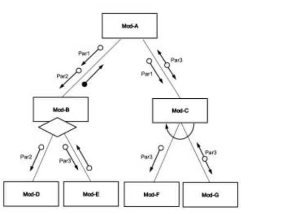
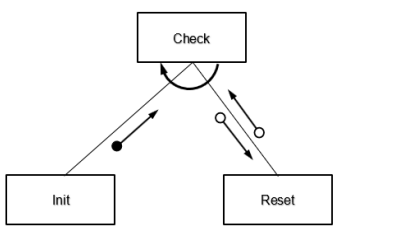
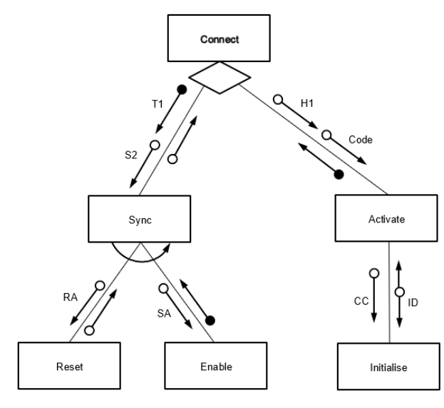
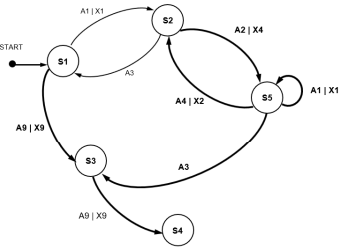

# Mark Schemes — Program Design
**12. Software Development** · Cambridge (CIE) A-LEVEL computer-science (9618)

## Exam Questions (15 questions)

### Q1
**[6 marks]**

> **[mark-scheme]**
> **1 mark** for `PROCEDURE Dispatch()` with no parameters, closed with `ENDPROCEDURE`
> 
> **1 mark** for declaring the local variables with correct data types
> 
> **1 mark** for storing the value returned by `CountParcels` in a variable
> 
> **1 mark** for a loop that runs once for each parcel, from 1 to that stored value, correctly closed
> 
> **1 mark** for storing the value returned by `Weigh`, called with the parcel number, inside the loop
> 
> **1 mark** for selection inside the loop that calls `Express` when the mass is greater than 2000 and `Standard` otherwise
> 
> Accept a conditional loop in place of the count-controlled loop, provided its counter is initialised before the loop and incremented inside it, for example `WHILE ParcelNum <= Total`.
> 
> Accept `NEXT` written without the identifier.
> 
> Accept the condition written as `Mass >= 2001`, since the mass is an integer number of grams.
> 
> Accept `IF Weigh(ParcelNum) > 2000 THEN` only where `Weigh` is then not called a second time.
> 
> Do not accept `FUNCTION Dispatch()`. `Dispatch` returns no value.
> 
> Do not accept `CALL CountParcels()` or `CALL Weigh(ParcelNum)`. `CALL` introduces a procedure call, and a function call must appear on the right of an assignment so that its value is kept.
> 
> Do not accept selection placed after the loop. Every parcel is weighed and routed separately, so `ENDIF` must come before `NEXT`.

> **[exam-tip]**
> Each phrase in the description maps onto one pseudocode construct. "Calls A followed by B" is sequence, "decided when the program runs" is the diamond and becomes `IF ... ELSE ... ENDIF`, and "once for each parcel" is the curved arrow and becomes `FOR ... NEXT`. Write the empty loop and the empty selection first, then drop the calls inside them.
> 
> The mark most often lost here is the nesting. If you write `NEXT ParcelNum` before `ENDIF`, the program weighs every parcel but routes only the last one. Line up each closing keyword under the keyword that opened it before you move on.
> 
> The other frequent error is `CALL` in front of a function. `Weigh` hands back a value, so it belongs on the right of an arrow: `Mass ← Weigh(ParcelNum)`. Writing `CALL Weigh(ParcelNum)` throws the mass away.

### Q2
**[3 marks]**

> **[mark-scheme]**
> **1 mark** for `FUNCTION ReadTemp(SensorID : INTEGER)`, with the parameter name and its data type
> 
> **1 mark** for `RETURNS REAL`
> 
> **1 mark** for `PROCEDURE StoreTemp(BYREF Saved : BOOLEAN)`, with `BYREF` and the data type
> 
> Accept `ENDFUNCTION` and `ENDPROCEDURE` written as well, even though only the headers were asked for.
> 
> Accept any spacing around the colon and the brackets.
> 
> Do not accept `FUNCTION StoreTemp`. `StoreTemp` returns no value, so it is a procedure.
> 
> Do not accept `BYVAL Saved`. A parameter passed by value cannot pass a change back to `Record`.
> 
> Do not accept `PROCEDURE ReadTemp`, or a header with `RETURNS` missing or with the wrong return type.

> **[exam-tip]**
> The word FUNCTION or PROCEDURE is decided by one thing only: does the description say a value is returned? Students lose this mark by reasoning that `StoreTemp` "sends something back" because `Saved` is passed by reference. Passing by reference is not the same as returning a value, and a module that does it is still a procedure.
> 
> Write the return type every time. `RETURNS` on its own earns nothing, and a real value returned as `RETURNS INTEGER` is wrong even though the rest of the header is right.

### Q3
(a) `GetZone` **[1]**

(b) `PrintTicket` **[1]**

**[2 marks]**

> **[mark-scheme]**
> **1 mark** for `GetZone` in part (a)
> 
> **1 mark** for `PrintTicket` in part (b)
> 
> Accept the module name written with or without brackets, so `GetZone()` and `PrintTicket()` are both credited.
> 
> Do not accept `PrintLine` in part (b). The iteration arrow is applied to the module that makes the repeated calls, not to the module that is called repeatedly.
> 
> Do not accept `Sell` in part (b). `Sell` calls `GetZone` and `PrintTicket` once each, in sequence, so the line from `Sell` carries no iteration arrow.
> 
> Do not accept `PrintTicket` in part (a). It returns no value, so it is a procedure.

> **[exam-tip]**
> A module is a function only when the description says it returns a value. Changing a parameter, or doing a lot of work, does not make a module a function. `PrintTicket` prints a whole ticket and is still a procedure.
> 
> The words in the description tell you which symbol the chart carries. "Repeatedly calls" gives the curved arrow, and "decided when the program runs" gives the diamond. Both symbols belong to the module doing the calling, so stay on the row where you found the words.

### Q4
| Input | Output | Next state |
|---|---|---|
|   |   | S1 |
| Plug-In | Show-Ready | S2 |
| Start-Charge | **Begin-Power** | **S3** |
| **Stop-Charge** | End-Power | **S2** |
| **Start-Charge** | **Begin-Power** | S3 |
| Full-Battery | **Show-Full** | **S4** |
| **Unplug** | **Show-Total** | S1 |

**[5 marks]**

> **[mark-scheme]**
> One mark per row, for rows 3 to 7. Every cell in a row must be correct for that row to earn its mark.
> 
> **1 mark** for row 3: Start-Charge, Begin-Power, S3
> 
> **1 mark** for row 4: Stop-Charge, End-Power, S2
> 
> **1 mark** for row 5: Start-Charge, Begin-Power, S3
> 
> **1 mark** for row 6: Full-Battery, Show-Full, S4
> 
> **1 mark** for row 7: Unplug, Show-Total, S1
> 
> Do not accept Full-Battery in row 4. Full-Battery is also an input from S3, but its output is Show-Full, not End-Power
> 
> Do not accept Unplug in row 5. Unplug is an input from S2, but it gives an output of none and a next state of S1, which does not match the S3 already given
> 
> Do not accept Reset in row 7. Reset is an input from S5, and the program is in S4 at the start of row 7

> **[exam-tip]**
> The current state is never written in this table, so you must keep track of it yourself. Before filling a row, look at the Next state in the row above and use that as the current state. Write it in the margin if it helps.
> 
> Rows 4, 5 and 7 are the hard ones because you are given the wrong end of the transition and must work backwards. For row 4 the current state is S3 and the output is End-Power, so find the row of the first table that starts at S3 and outputs End-Power. Students who instead read down the first table in order and copy the next input they see will get row 4 wrong, and then every row after it, because one wrong next state carries all the way down.

### Q5
Number of outputs: 4 **[1]**

Outputs in order: Print-Ticket, Open-Gate, Close-Gate, Print-Ticket **[1]**

Current state: S1 **[1]**

**[3 marks]**

> **[mark-scheme]**
> **1 mark** for the number of outputs given as 4
> 
> **1 mark** for the four outputs listed in this exact order: Print-Ticket, Open-Gate, Close-Gate, Print-Ticket
> 
> **1 mark** for the current state given as S1
> 
> Accept "four" written in words.
> 
> Accept the outputs separated by commas, by arrows or written on separate lines, provided the order is correct.
> 
> Do not accept 5 for the number of outputs. The fifth input, Timeout from S2, has an output of none, so it produces no output.
> 
> Do not accept S2 as the current state. S2 is the state reached after the fourth input, not after the fifth.

> **[exam-tip]**
> Work one input at a time and write the state down after each one. The most common mistake here is counting an output of none as an output, which gives 5 instead of 4. A row with none in the Output column still changes the state, it just produces nothing.
> 
> The second most common mistake is stopping one input early. There are five inputs, so trace all five. The state you must give is the one reached after input 5, even though input 5 produces no output.

### Q6
|   | Answer |
|---|---|
| The number of different inputs | **5** |
| The final or halting state | **S4** |

**[2 marks]**

> **[mark-scheme]**
> **1 mark** for the number of different inputs given as 5
> 
> **1 mark** for the final or halting state given as S4
> 
> Accept "five" written in words for the first row
> 
> Do not accept 6 for the first row. There are six transitions, but Scan-Code appears twice, so only five different input values are used
> 
> Do not accept S1 for the second row. S1 is where the software starts, not where it stops

> **[exam-tip]**
> The word "different" is doing the work in the first row. Count the distinct values in the Input column, not the number of rows. Here Scan-Code is used twice, once from S1 and once from S2, so six transitions use only five different inputs.
> 
> To find the halting state, look for a state that appears in the Next state column but never in the Current state column. Once the software reaches S4 there is no row that can take it anywhere else, so it stops there.

### Q7
> **[mark-scheme]**
> 
> 
> One mark per bullet:
> 
> 1. All modules correctly labelled and interconnected
> 2. Parameters between Mod-A and Mod-B and return value from Mod-B
> 3. Parameters between Mod-A and Mod-C
> 4. Diamond applied to Mod-B only
> 5. Iteration arrow applied to Mod-C only
> 6. All parameters at lower level and return value

### Q8
> **[mark-scheme]**
> One mark for reason, one for benefit
> 
> Reason: (Program is) easier to design / implement / test / debug / modify
> 
> Benefit: Easier to check that **each stage** works as expected

### Q9
> **[mark-scheme]**
> (i)
> 
> | Input | Output | Next state |
> |---|---|---|
> |   |   | S1 |
> | Input‑A | none | S3 |
> | **Input‑A** | Output‑W | **S3** |
> | **Input‑B** | none | **S2** |
> | Input‑B | **none** | **S5** |
> | Input‑A | **none** | **S2** |
> | **Input‑A** | **Output-X** | S4 |
> 
> One mark per row 3 to 7
> 
> (ii) Input-B, Input-A

### Q10
> **[mark-scheme]**
> Means that `Update `calls (one of) either `Sub-A`, `Sub-B `or `Sub-C `
> 
> One mark for each point:
> 
> - reference to selection / decision / if
> - naming all four modules correctly

### Q11
> **[mark-scheme]**
> One mark for name **and **use
> 
> Mark as follows: 
> Examples include:
> 
> Sub-module: `ScanCard()/ GetID() `
> Use: Read the barcode from the loyalty card / Get the customer ID from the barcode
> 
> Sub-module: `GetPoints() `
> Use: Get the number of points the customer has
> 
> Sub-module:` ExchangePoints() / UpdateCard() `
> Use: Reduce the number of loyalty points
> 
> Sub-module: `GetDiscount() / CalculateDiscount() `
> Use: Calculate the discount
> 
> Sub-module: `CalculatePoints() `
> Use: Calculate points (following a purchase)
> 
> Sub-module: `UpdatePoints() `
> Use: Update total points a customer has (following a purchase)
> 
> Sub-module: `ShowDiscount() `
> Use: Display the discount
> 
> **Max 4 marks**

### Q12
> **[mark-scheme]**
> **MP1 **Data structures // data dictionary // identifier table(s) // validation rules
> 
> **MP2** Data-flow diagram // state-transition diagram
> 
> **MP3 **User interface // Format for the email
> 
> **MP4 **Testing method / Test plan / Test data / Trace tables
> 
> **MP5** Choice of email protocol to be used // Programming language to be used // Development environment
> 
> **MP6 **Use of library routines // program to send the email
> 
> **Max 3 marks**
> **[mark-scheme]**
> 
> 
> **MP1 **Three boxes correctly labelled **and **correct hierarchy
> 
> **MP2 **Parameter **and **return values
> 
> **MP3 **Iteration arrow

### Q13
> **[mark-scheme]**
> 
> 
> One mark per point:
> 
> 1. All module identified in correct hierarchy
> 2. Parameters to both Sync and Activate and return values
> 3. Parameters to both Reset and Enable
> 4. Parameters to Initialise
> 5. Decision diamond
> **[mark-scheme]**
> Explanation:
> 
> Means that Sync repeatedly calls Reset and (then) Enable
> 
> One mark for each point:
> 
> MP1: reference to iteration
> 
> MP2: naming all three modules correctly including correct sequence of calls

### Q14
> **[mark-scheme]**
> Answers include:
> 
> **Reason: **
> 
> - This part of the algorithm performs a specific task // if the check or calculation is changed it is changed only once
> - A (similar) subroutine is already available // Library routine is already available
> - The program is simplified / easier to understand / easier to design / code / test / debug / maintain
> 
> **Max 1 marks for 'Reason' **
> 
> **Avoided: **
> 
> - Unnecessary code duplication
> - Errors caused by differences where several copies of the check and calculation exist
> 
> **Max 1 marks for 'Avoided'**

### Q15
> **[mark-scheme]**
> 
> 
> - **MP1 **    S2 labelled
> - **MP2**   S3, S4 and S5 added
> - **MP3**   Line from S1 to S3
> - **MP4**   All three lines between S2 and S5 (including S5 to S5)
> - **MP5**   Line from S5 to S3 AND from S3 to S4
