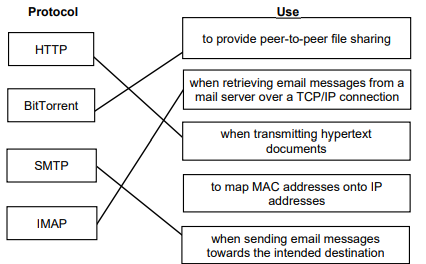
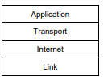

# Mark Schemes — Protocols
**14. Communication & internet technologies** · Cambridge (CIE) A-LEVEL computer-science (9618)

## Exam Questions (15 questions)

### Q1
At the Application layer, the software the user is working in passes the file data into the stack, because this layer gives the program access to the services provided by the layers below it. **[1]**

At the Transport layer, the data is divided into packets and a sequence number is added to the header of each packet. **[1]**

At the Internet layer, the source IP address and the destination IP address are added to each packet, and a route is chosen for each packet so that it reaches the intended network and host. **[1]**

At the Link layer, the packets are formatted into frames and converted into a signal that can be sent over the physical medium. **[1]**

**[4 marks]**

> **[mark-scheme]**
> **1 mark** for Application: the user's program passes the data into the stack // this layer gives applications access to the services of the other layers // it defines the protocols the application uses to exchange the data
> 
> **1 mark** for Transport: the data is divided into packets / segmented // a sequence number is added to each packet header
> 
> **1 mark** for Internet: the source and destination IP addresses are added to each packet // each packet is routed towards the intended network and host
> 
> **1 mark** for Link: the packets are formatted into frames // the data is converted into a signal for the physical medium // IP addresses are mapped onto MAC addresses
> 
> Accept the marks in any order, but each mark must be clearly linked to the correct layer. A correct description attached to the wrong layer earns nothing.
> 
> Accept "Network layer" in place of "Internet layer", and "Data Link layer" in place of "Link layer".

> **[exam-tip]**
> Four marks and four layers means one mark per layer, so write four separate sentences and name the layer at the start of each one. Long paragraphs about only two layers are the most common way to lose marks on this question.
> 
> Note the direction of travel. The file is going out, so it moves down the stack, from Application at the top to Link at the bottom. Describing the layers in the wrong order suggests to the examiner that you do not know which layer is at the top.

### Q2
The Internet layer identifies the network and the host that the data is intended for. **[1]**

It addresses each packet with the source IP address and the destination IP address. **[1]**

It then routes each packet independently, choosing the optimum route across the network for that packet, and passes the packets down to the Link layer. **[1]**

**[3 marks]**

> **[mark-scheme]**
> **Any three from:**
> 
> - It identifies the intended network and host
> - It addresses packets with their source and destination IP addresses
> - It routes the packets independently / through the optimum route
> - It transmits / passes the packets to the Link layer
> - It receives the packets from the Transport layer
> - It uses an IP address together with a port number to form a socket
> 
> **[3 marks]**
> 
> Accept "Network layer" wherever a student names this layer. Cambridge credits "Internet / Network Layer" as alternatives for the same layer.
> 
> Do not accept "it divides the data into packets" or "it adds sequence numbers". That is the work of the Transport layer, which has already been done before the data reaches the Internet layer.

> **[exam-tip]**
> The word "independently" matters here. Each packet is routed on its own, so two packets belonging to the same message can travel by different routes and can arrive out of order.
> 
> Students often mix the Transport layer and the Internet layer. A quick test: if the answer mentions splitting data up, sequence numbers or checking that data arrived error free, it belongs to the Transport layer, not this one.

### Q3
| Activity | Layer |
|---|---|
| The data is divided into packets and a sequence number is added to each packet header. | **Transport** |
| The data is formatted into frames so that it can be sent over the physical medium. | **Link** |

**[2 marks]**

> **[mark-scheme]**
> **1 mark** for: Transport (Layer)
> 
> **1 mark** for: Link (Layer)
> 
> Accept "Data Link (Layer)" or "Physical (Layer)" for the second answer. Cambridge credits these as alternative names for the same layer.
> 
> Do not accept "Internet (Layer)" for the second answer. The Internet layer works with packets and IP addresses; it is the Link layer that builds frames for the physical medium.

> **[exam-tip]**
> Learn the four layers by the unit of data each one works with. The Transport layer works with packets and sequence numbers, the Internet layer works with packets and IP addresses, and the Link layer works with frames and the physical medium.
> 
> A very common mistake is to answer "Network layer" for the bottom of the stack. On this syllabus "Network layer" is an accepted alternative name for the **Internet** layer, which sits one level higher up, so that answer will cost you the mark.

### Q4
Both hosts use the same agreed set of protocols, so each host handles the message according to the same rules. **[1]**

Those rules are independent of the hardware and the software used, so the fact that the hosts have different manufacturers and different operating systems does not stop them communicating. **[1]**

Each layer of the stack has its own functionality, and it carries out its own task on the message before the message moves on. **[1]**

A layer can only accept input from the layer immediately above it or the layer immediately below it, through the interface between those two adjacent layers, so the message passes through the layers in the same fixed order on both hosts. **[1]**

**[4 marks]**

> **[mark-scheme]**
> **1 mark** for: both hosts use the same set of protocols / the same agreed rules, so each handles the message in the same way
> 
> **1 mark** for: the protocols are independent of the hardware and the software // they allow communication between devices on different platforms or from different manufacturers
> 
> **1 mark** for: each layer has its own functionality / its own task, which it performs on the message
> 
> **1 mark** for: a layer can only accept input from the next higher layer or the next lower layer // the interface between adjacent layers is the only interaction between them, so the order in which the layers are used is fixed
> 
> Accept for the fourth mark: the layers are used in the same order on the sending host and the receiving host.
> 
> Accept "platform" in place of "operating system" for the second mark.

> **[exam-tip]**
> This question has two halves and you need both. One half is about the protocols being agreed and standard, and the other half is about the stack imposing a fixed order on how the message is handled. Answers that only say "they both use TCP/IP" score one mark at most.
> 
> Do not write that the layers make the network easier to design, update or troubleshoot. That is a common claim in textbooks, but this syllabus asks for the purpose and function of each layer and for how the layers interact, and a general benefit of layering is not on the mark scheme.

### Q5
The computer at the other organisation does not follow the company's private set of rules, so the two computers are using different protocols. **[1]**

The receiving computer therefore cannot interpret the data that arrives, for example it cannot tell how the data has been formatted or where each piece of data begins and ends, so the data is not transferred successfully. **[1]**

A standard protocol is needed instead, because a standard set of rules allows devices on different platforms, and from different manufacturers, to communicate independently of the hardware and software each one uses. **[1]**

**[3 marks]**

> **[mark-scheme]**
> **1 mark** for: the two computers are using different protocols // the other organisation's computer does not use the company's private rules
> 
> **1 mark** for: so the receiving computer cannot interpret / understand / correctly structure the data // the data cannot be transferred successfully
> 
> **1 mark** for: a standard protocol allows communication between devices on different platforms / from different manufacturers // makes the communication independent of the hardware and software used
> 
> Accept for the third mark: a standard protocol is one that both organisations already have, so no agreement has to be reached first.
> 
> Do not accept "the connection is too slow" or "the file is too large". Nothing in the scenario limits speed or size, and neither would explain why the transfer works inside the company and fails outside it.

> **[exam-tip]**
> The clue in this question is that the software works in one situation and fails in another. The hardware, the file and the software are the same in both cases, so the explanation must be about the rules the two computers are following.
> 
> Weak answers stop after "they use different protocols". That is only the first mark. Go on and say what actually goes wrong, which is that the receiving computer cannot interpret data that was formatted using rules it does not know.

### Q6
A protocol is an agreed set of rules, or an agreed standard, that devices follow when they communicate with each other. **[1]**

The rules cover how the data is formatted, addressed and transmitted, so that data sent by one device is received and understood correctly by the other device. **[1]**

**[2 marks]**

> **[mark-scheme]**
> **1 mark** for: a set of rules // an agreed standard // an agreed convention
> 
> **1 mark** for: that governs how data is transmitted / formatted / addressed / exchanged between devices // so that the data is understood correctly by the receiving device
> 
> Accept "rules for communication between computers on a network" for the first mark.
> 
> Accept "so that devices made by different manufacturers can exchange data successfully" for the second mark.
> 
> Do not accept "a program" or "a piece of software" for the first mark. A protocol is the set of rules; the software only implements those rules.

> **[exam-tip]**
> Many students answer this question by naming protocols, writing something like "HTTP, FTP and SMTP are protocols". Naming examples is not a definition and it earns no marks here. Say what a protocol is first, which is a set of rules.
> 
> The word "agreed" is worth writing down. Rules invented by one computer on its own are of no use. The examiner is looking for the idea that both devices follow the same rules.

### Q7
SMTP is a push protocol. It is used to send or upload the email from the sender towards the intended destination. **[1]**

SMTP carries the email only as far as the mail server that the colleague uses, where the email is stored. It does not bring the email down to the colleague's own computer. **[1]**

A pull protocol is therefore needed so that the email client can retrieve or download the email from that mail server. **[1]**

The email client could use POP3 or IMAP. **[1]**

**[4 marks]**

> **[mark-scheme]**
> **1 mark** for SMTP is a push protocol // SMTP sends or uploads the email towards the intended destination
> 
> **1 mark** for SMTP carries the email only as far as the mail server, where it is stored // SMTP does not transfer the email to the colleague's computer
> 
> **1 mark** for a pull protocol is needed so the email client can retrieve or download the email from the mail server
> 
> **1 mark** for naming POP3 or IMAP
> 
> Accept Post Office Protocol 3 or Internet Message Access Protocol written in full
> 
> Accept sending and retrieving described in plain words in place of push and pull
> 
> Accept either POP3 or IMAP on its own. Both are credited for receiving email and the answer does not have to say how they differ
> 
> Do not accept HTTP, FTP or BitTorrent as the protocol used by the email client

> **[exam-tip]**
> The trap here is trying to separate POP3 from IMAP. The mark schemes credit them as alternatives for receiving email, so naming either one is enough and an explanation of how they differ earns nothing extra.
> 
> Learn the email protocols as a pair of directions rather than as three names. SMTP pushes email away from the sender and towards the destination server; POP3 and IMAP pull email down from a server to the email client. A student who writes that SMTP both sends and receives email loses two marks in one sentence.

### Q8
BitTorrent allows the file to be shared between many thousands of users who are connected together over the internet. **[1]**

It provides peer-to-peer file sharing: the users share the file directly with each other, because their computers act as peers. **[1]**

No central device or web server holds the file and supplies it to everyone, so all of the users are of equal status. **[1]**

**[3 marks]**

> **[mark-scheme]**
> **Any three from:**
> 
> - the file is shared between many thousands of users connected together over the internet
> - more users can share files with each other than would be the case with a peer-to-peer network
> - peer-to-peer file sharing // users share the file directly with each other // the users' computers act as peers
> - no central device or web server is used // all users are of equal status
> 
> **[3 marks]**
> 
> Accept a description of peer-to-peer sharing that does not use the term peer-to-peer, provided it says the users obtain the file from each other
> 
> Do not accept a description of downloading the file from a website or from one central server. That is the purpose of HTTP or FTP, not BitTorrent
> 
> Do not accept the names of BitTorrent software or of any file-sharing website. No mark is available for naming a product

> **[exam-tip]**
> The central idea in the BitTorrent mark scheme is that the users get the file from each other rather than from a central server. Students who have used file sharing often write about download speed instead, and speed on its own earns nothing.
> 
> The syllabus lists six protocols and only BitTorrent is peer-to-peer. If a question describes users supplying a file to one another with no server in the middle, BitTorrent is the answer.

### Q9
| Task | Protocol |
|---|---|
| A web browser requests the hypertext documents that make up a web page from a web server. | **HTTP** **[1]** |
| An employee transfers a folder of large video files from a laptop to a file server on the company network. | **FTP** **[1]** |

**[2 marks]**

> **[mark-scheme]**
> **1 mark** for HTTP in the first row
> 
> **1 mark** for FTP in the second row
> 
> Accept HTTPS or HTTP(S) in the first row
> 
> Accept the names written in full: Hypertext Transfer Protocol, File Transfer Protocol
> 
> Do not accept TCP/IP in either row. TCP/IP is the protocol suite, not the protocol that carries out the task
> 
> Do not accept SMTP, POP3, IMAP or BitTorrent in either row
> 
> Do not accept HTTP in the second row. The files being moved are not hypertext documents or web pages, so the task is a file transfer between devices on a network

> **[exam-tip]**
> Two answers lose marks here almost every time. The first is writing TCP/IP, which is the name of the whole protocol suite and never the answer when a question asks which protocol carries out one named task. The second is writing HTTP for every transfer of a file. HTTP is credited only when the files are the hypertext documents that make up a web page; moving other files between devices on a network is FTP.

### Q10
> **[mark-scheme]**
> **One **mark per mark point **(Max 2) **
> 
> - MP1    Protocols provide a standard set of rules that enables successful data transfer between devices.
> - MP2    Allows communication between devices on different platforms.
> - MP3    Makes communications independent of software and hardware.
> **[mark-scheme]**
> **One** mark per mark point
> 
> - MP1    Sending - SMTP
> - MP2   Receiving – POP3 // IMAP // Post Office Protocol 3

### Q11
> **[mark-scheme]**
> **One **mark for each correct word** (Max 3) **
> 
> The protocols in a<u> stack </u>determine the interconnectivity rules for a <u>layered</u> network model such as the <u>TCP/IP</u> mode

### Q12
> **[mark-scheme]**
> **One **mark for each correct line connecting a protocol to its most appropriate description **(Max 4).**
> 
> 
> **[mark-scheme]**
> **One** mark per mark point **(Max 2) **
> MP1    To ensure correct network protocols are followed 
> MP2    To enable the upper layers to access the physical medium // enables connection/ communication with the internet / network layer MP3    To be responsible for transporting data within the network/local segments 
> MP4    To format the data into frames for transmission 
> MP5    Maps IP addresses to MAC/Physical addresses.

### Q13
> **[mark-scheme]**
> **Two **marks for all protocols in correct position 
> **One **mark for at least two protocols in correct position
> 
> 
> **[mark-scheme]**
> **One **mark per mark point **(Max 2) **
> 
> - MP1    The transport layer is responsible for delivery of data from the source host to the destination host
> - MP2    It is where data is broken up into packets and sent to the internet layer
> - MP3    Adds the sequence number to the packet header
> - MP4    It establishes end to end contact
> - MP5    It ensures data arrives error free // It retransmits packets if lost.
> **[mark-scheme]**
> **One** mark for name of protocol and one mark for expansion **(Max 2) **
> 
> HTTP(S) – responsible for correct transfer of files / hypertext documents that make up web pages on the world wide web
> 
> FTP – used when transferring files from a server to a client on a network
> 
> POP3 – handles the receiving of emails
> 
> IMAP – handles the receiving of emails
> 
> SMTP – handles the sending of emails BitTorrent – provides peer-to-peer file sharing

### Q14
> **[mark-scheme]**
> **One **mark for each correct name** (Max 2) **
> **One** mark for each correct corresponding expansion **(Max 2)**
> 
> - MP1    HTTP/HTTPS
> - MP2    For sending and receiving / transferring web pages / hypertext
> - MP3    FTP
> - MP4    For sending and receiving files over a network / between devices
> - MP5    POP3
> - MP6    Pull protocol / for receiving / downloading emails
> - MP7    IMAP
> - MP8    Pull protocol / for receiving / downloading emails
> - MP9    SMTP
> - MP10  Push protocol / for sending / uploading emails
> - MP11    BitTorrent
> - MP12   Peer-to-peer file sharing over a network
> **[mark-scheme]**
> **One **mark per mark point **(Max 3) **
> 
> - MP1    The application layer provides access to all the programs that exchange data // Interacts directly with user.
> - MP2    … used by, for example, web browsers, server software.
> - MP3    Communicates/enables data transfer to/from Transport layer // It allows applications to access the services used in other TCP/IP layers.
> - MP4    It defines the protocols that any application uses to allow the exchange of data.

### Q15
> **[mark-scheme]**
> **One** mark per mark point (**Max 4**)
> 
> - MP1    Each layer can only accept input from the next higher layer or the next lower layer
> - MP2    There is an interface between the adjacent layers which is the only interaction between layers
> - MP3    Data is added to the headers as the frames/packets pass through the layers
> - MP4    The interactions are carried out by installed software
> - MP5    User interaction takes place at the highest/Application layer of the stack through protocols associated with that layer of the stack
> - MP6    Direct access to hardware takes place at the lowest/Link layer of the stack.
