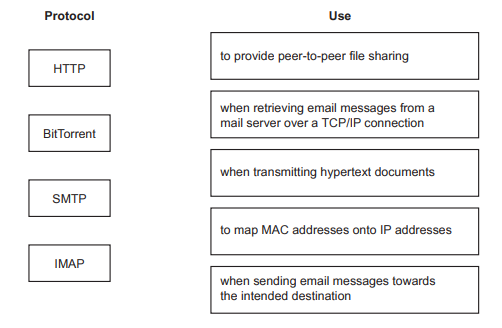
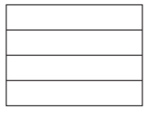

# Exam Questions — Protocols
**14. Communication & internet technologies** · Cambridge (CIE) A-LEVEL computer-science (9618)
> Source: [https://www.savemyexams.com/a-level/computer-science/cie/19/topic-questions/](https://www.savemyexams.com/a-level/computer-science/cie/19/topic-questions/) · 15 questions across 1 sets

## Exam Questions (15 questions)

### Q1 — hard — 4 marks

**Q1** [4 marks]

A user uploads a file to a server that is on a different network. Before the file leaves the user's computer it passes down through the four layers of the TCP/IP protocol stack.

Describe what happens to the file at each of the four layers.

### Q2 — medium — 3 marks

**Q2** [3 marks]

Describe the function of the Internet layer of the TCP/IP protocol suite.

### Q3 — easy — 2 marks

**Q3** [2 marks]

The TCP/IP protocol suite is implemented as a stack of four layers: Application, Transport, Internet and Link.

Complete the table by writing the name of the layer at which each activity takes place.

| Activity | Layer |
|---|---|
| The data is divided into packets and a sequence number is added to each packet header. |   |
| The data is formatted into frames so that it can be sent over the physical medium. |   |

### Q4 — hard — 4 marks

**Q4** [4 marks]

A message is sent from one host to another host on the internet. The two hosts are made by different manufacturers and they run different operating systems.

On each host the protocols are implemented as a stack of layers.

Explain how this arrangement allows the message to be delivered successfully.

### Q5 — medium — 3 marks

**Q5** [3 marks]

A company writes its own file-transfer software. Instead of using standard protocols, the company invents its own private set of rules for how data is formatted and sent.

The software works correctly when two of the company's own computers exchange files. It fails when one of the company's computers tries to exchange a file with a computer that belongs to a different organisation.

Explain why the file transfer fails.

### Q6 — easy — 2 marks

**Q6** [2 marks]

Define the term **protocol** as it is used in the communication of data between computers.

### Q7 — hard — 4 marks

**Q7** [4 marks]

A user sends an email to a colleague. The sending computer uses the SMTP protocol. The email is delivered to the mail server that the colleague uses.

The colleague then opens an email client on their own computer to read the email. The email client does not use SMTP.

Explain why the email client needs a different protocol, and name a protocol that the email client could use.

### Q8 — medium — 3 marks

**Q8** [3 marks]

A group of users want to share one very large video file with each other over the internet. They use the BitTorrent protocol to do this.

Explain how the BitTorrent protocol allows these users to share the file.

### Q9 — easy — 2 marks

**Q9** [2 marks]

A company uses a network that is connected to the internet. The table describes two tasks that are carried out on this network.

Complete the table by writing the name of the protocol that is used for each task.

| Task | Protocol |
|---|---|
| A web browser requests the hypertext documents that make up a web page from a web server. |   |
| An employee transfers a folder of large video files from a laptop to a file server on the company network. |   |

### Q10 — medium — 4 marks

**Q10** [2 marks]

Outline why protocols are essential for communication between computers.

*Source: June 2024 9618/32 Q2A*

**Q10** [2 marks]

State the names of two different protocols associated with the sending and receiving of emails between computers

Sending.......................................................................

Receiving....................................................................

*Source: June 2024 9618/32 Q2B*

### Q11 — medium — 3 marks

**Q11** [3 marks]

Complete the following paragraph about a protocol suite, using words from the given list.

Some words are** not **used.

**BitTorrent                           circuit switching                 layered                link                          list **

**peer‑to‑peer                                   queue                         stack                  star                              TCP/IP **

The protocols in a ............................................................................. determine

the interconnectivity rules for a .............................................................................

network model such as the .............................................................................

model.

*Source: November 2023 9618/32 Q4A*

### Q12 — medium — 6 marks

**Q12** [4 marks]

Draw one line to connect each protocol to its most appropriate use.

*Source: November 2023 9618/31 Q2A*

**Q12** [2 marks]

Outline the purpose of the Link layer in the TCP/IP protocol suite.

*Source: November 2023 9618/31 Q2B*

### Q13 — medium — 6 marks

**Q13** [2 marks]

The TCP/IP protocol suite has four layers:

Transport, Application, Link, Internet

Complete the diagram to show the correct order for these layers.

*Source: June 2024 9618/31 Q2A*

**Q13** [2 marks]

Describe the function of the Transport layer.

*Source: June 2024 9618/31 Q2B*

**Q13** [2 marks]

Outline one protocol that is associated with the Application layer.

*Source: June 2024 9618/31 Q2C*

### Q14 — medium — 7 marks

**Q14** [4 marks]

Name and describe two protocols used by the Application Layer of the TCP/IP protocol suite.

Protocol 1

Description

Protocol 2

Description

*Source: November 2024 9618/32 Q5A*

**Q14** [3 marks]

Explain the purpose and function of the Application Layer in the TCP/IP protocol suite.

*Source: November 2024 9618/32 Q5B*

### Q15 — medium — 4 marks

**Q15** [4 marks]

The TCP/IP protocol may be viewed as a stack that contains four layers: Application, Transport, Internet, Link.

Describe how the layers of the TCP/IP protocol stack interact with each other.

*Source: November 2024 9618/31 Q4*

