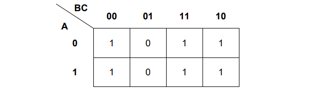
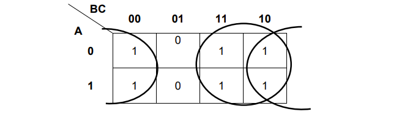
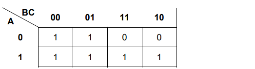
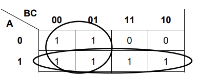
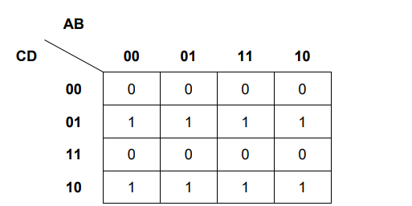
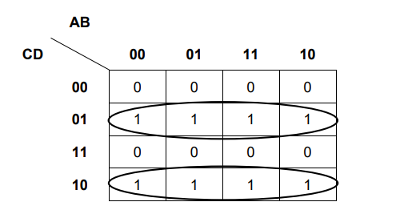
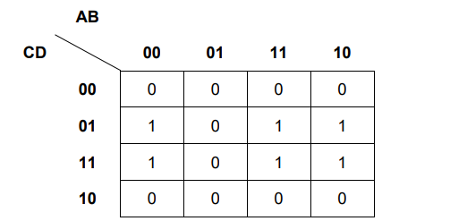
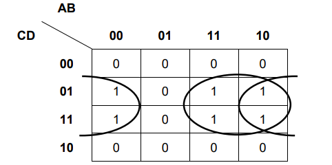
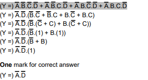

# Mark Schemes — Boolean Algebra & Logic Circuits
**15. Hardware & Virtual Machines** · Cambridge (CIE) A-LEVEL computer-science (9618)

## Exam Questions (25 questions)

### Q1
Apply De Morgan's laws to each term. The second term also needs the Double Negation law, because B already carries a bar.

$T = \overline{A} . \overline{B} + \overline{A} . B$

**[1]**

Apply the Distributive law to take the common term outside a bracket.

`T = \bar{A} . \left(\bar{B} + B\right)`

**[1]**

Apply the Complement law and then the Identity law.

$T = \overline{A}$

**[1]**

**[3 marks]**

> **[mark-scheme]**
> **1 mark** for correct application of De Morgan's laws to both terms
> 
> **1 mark** for correct application of the Double Negation law or the Distributive law
> 
> **1 mark** for the correct answer
> 
> $T = \overline{A}$
> 
> Accept the two products of the intermediate line in either order.
> 
> Accept the omission of the AND dot, and accept brackets around any term.
> 
> Award the answer mark for a correct final answer even where the working is wrong or missing. A truth table shows that the result is correct but does not show the laws, so it earns the answer mark only.
> 
> Do not accept an answer that keeps B or its complement attached to A. Each of those keeps one half of the bracket and drops the other, and each differs from the correct answer on one of the four rows of the truth table.
> 
> Do not accept an answer in which the two terms are joined by OR. De Morgan's laws change the operator inside each barred term, not the operator that joins the two terms together.

> **[exam-tip]**
> There are two bars to break here and students break only the first. Treat each term on its own, write the full intermediate line down, and only then look for what the two terms have in common. The second term hides a double bar on B, and missing it sends the whole simplification to the wrong letter.
> 
> Cambridge gives a mark for correctly applying a law even when the final answer is wrong, so write every line out. One correct line of algebra with no answer at the end still scores.

### Q2
Apply De Morgan's laws. The bar over the whole expression is removed, the OR becomes an AND, and each term is complemented. **[1]**

$Y = \overline{\overline{A}} . \overline{B}$

Apply the Double Negation law to the first term. **[1]**

$Y = A . \overline{B}$

**[2 marks]**

> **[mark-scheme]**
> **1 mark** for correct application of De Morgan's laws, giving a product of the two complemented terms
> 
> **1 mark** for the correct simplest form
> 
> $Y = A . \overline{B}$
> 
> Accept the two terms in either order, and accept the omission of the AND dot.
> 
> Award both marks where a student goes straight to the correct final answer with no intermediate line.
> 
> Do not accept an answer in which A is still complemented. The two bars on A cancel, and leaving one behind changes the output on two of the four rows of the truth table.
> 
> Do not accept an answer in which the two terms are joined by OR. The operator under the bar must change from OR to AND.

> **[exam-tip]**
> This is the version where a double bar appears, and students throw one bar away instead of cancelling both. Two bars over the same letter cancel exactly, so A carrying two bars is simply A. Leave one bar behind and you have written the complement of what you wanted.
> 
> Always deal with the outer bar first. Break it, swap the operator, and only then tidy up whatever bars are left sitting on the individual letters.

### Q3
$X = \overline{A} + \overline{B} + \overline{C}$

**[1]**

**[1 mark]**

> **[mark-scheme]**
> **1 mark** for
> 
> $\overline{A} + \overline{B} + \overline{C}$
> 
> Accept the three terms in any order.
> 
> Accept brackets placed around the whole expression.
> 
> Do not accept an answer in which all three variables are complemented but the terms are still joined by AND. Removing the long bar without changing the operator gives a different output on six of the eight rows of the truth table.
> 
> Do not accept an answer that leaves any variable uncomplemented.

> **[exam-tip]**
> De Morgan's laws come as a pair, and the most common error by far is doing half the job. Make two separate moves every time. First break the long bar, then swap the operator underneath it. AND becomes OR, and OR becomes AND. If you break the bar but leave the dots in place you have applied no law at all and score nothing.
> 
> Cambridge always writes NOT as a bar, so the length of the bar carries the meaning. One long bar over the whole expression is not the same as three short bars over the individual letters, and this question is asking you to turn the first into the second.

### Q4
(i)

`\left(X =\right) \bar{A} . \bar{B} . \bar{C} + \bar{A} . \bar{B} . C + A . B . \bar{C} + A . B . C`

**[2]**

(ii) Apply the Distributive law to each pair of terms. **[1]**

`X = \bar{A} . \bar{B} . \left(\bar{C} + C\right) + A . B . \left(\bar{C} + C\right)`

Apply the Complement law and then the Identity law.

$X = \overline{A} . \overline{B} + A . B$

**[1]**

**[4 marks]**

> **[mark-scheme]**
> **1 mark** in part (i) for any two correct products
> 
> **1 mark** in part (i) for all four products correct with no additional products
> 
> **1 mark** in part (ii) for working that takes a common product outside a bracket and reduces the complement pair to 1
> 
> **1 mark** in part (ii) for the correct simplest form
> 
> $X = \overline{A} . \overline{B} + A . B$
> 
> Accept the four products in part (i) in any order, and the two terms of the final answer in either order.
> 
> Accept the omission of the AND dot, so ABC for A.B.C.
> 
> Award the part (ii) answer mark for a correct simplest form even where the working is wrong or missing. The working mark requires Boolean laws, so a bare restatement of the four products earns nothing.
> 
> Do not accept a part (ii) answer that still contains C. C appears in both pairs and cancels, so the output does not depend on it.
> 
> Do not accept the two final terms joined by AND. That gives 0 on every one of the eight rows.

> **[exam-tip]**
> Write one product for each row where the output is 1, and complement every input that is 0 in that row. Students who complement the 1s instead write each product for the wrong row. Check every product by putting its row back in: it must give 1.
> 
> In part (ii) look for pairs of products that differ in exactly one variable. Here the first two differ only in C and the last two differ only in C, so C comes out of each pair. If you cannot find a pair, count your products first, because a product missed in part (i) makes part (ii) impossible.

### Q5
The student has drawn two separate loops of two squares in the columns AB = 11 and AB = 10, one loop in the row CD = 00 and one loop in the row CD = 10. **[1]**

The top row (CD = 00) and the bottom row (CD = 10) of a K-map are next to each other, so those four squares form a single loop of four squares. The student has not used the largest loop available. **[1]**

The loop of four squares gives this term: **[1]**

$A . \overline{D}$

The two 1s in the row CD = 11 can only form a loop of two squares, so the student's third term does not change: **[1]**

$B . C . D$

The optimal sum-of-products is:

$T = A . \overline{D} + B . C . D$

**[4 marks]**

> **[mark-scheme]**
> **1 mark** for identifying that the student has used two loops of two squares where one larger loop is available
> 
> **1 mark** for the reason: the top row and the bottom row of the K-map are next to each other, so those four squares form one loop of four
> 
> **1 mark** for the term A . D with D inverted
> 
> **1 mark** for the term B . C . D, with no other terms present
> 
> Accept for the first two marks: the loops are not the largest possible; the loop can continue from the bottom row to the top row; CD = 00 and CD = 10 differ in the value of C only
> 
> Accept the two terms of the answer written in either order
> 
> Do not accept a reason that only says the expression is too long, with no reference to the loops or to the rows of the map
> 
> Do not accept A . B . C in place of B . C . D, because that leaves the 1 in the column AB = 01, row CD = 11 outside every loop

> **[exam-tip]**
> A K-map has no edges for the purpose of looping. The top row and the bottom row are next to each other, and so are the left-hand column and the right-hand column. Students lose this mark more often than any other on K-maps, because the two halves of the loop are printed at opposite ends of the map and do not look like a group.
> 
> Count the squares in each loop and check the count against the number of variables in your term. In a four-variable map a loop of two squares gives three variables and a loop of four squares gives two variables. Here the student wrote two terms of three variables, which shows that two loops of two were used where one loop of four was available.

### Q6
Apply the Distributive law to take A outside the brackets. **[1]**

$Z = A + B . \overline{B}$

Apply the Complement law, because B and its complement can never both be 1. **[1]**

$Z = A + 0$

Apply the Identity law. **[1]**

$Z = A$

**[3 marks]**

> **[mark-scheme]**
> **1 mark** for correct application of the Distributive law, giving
> 
> $A + B . \overline{B}$
> 
> **1 mark** for correct application of the Complement law, giving
> 
> $A + 0$
> 
> **1 mark** for the correct final answer
> 
> $Z = A$
> 
> Accept the alternative route of multiplying the brackets out in full to give
> 
> $A . A + A . \overline{B} + A . B + B . \overline{B}$
> 
> and award the first two marks for any two correct lines of working on that route.
> 
> Accept the omission of the AND dot, so AB for A.B.
> 
> Award the answer mark for a correct final answer even where the working is wrong or missing.
> 
> Do not accept Z = A + B. That output is 1 when A is 0 and B is 1, where the original expression gives 0.
> 
> Do not accept Z = A.B. That output is 0 when A is 1 and B is 0, where the original expression gives 1.

> **[exam-tip]**
> The trap here is that the expression is a product of two sums, not a sum of products, and students assume the Distributive law only works one way round. It works both ways. A is common to both brackets, so it can come straight out, exactly as a common factor would in ordinary algebra.
> 
> If you multiply the brackets out instead, you must keep the B AND NOT B term. Students drop it because it looks like it disappears, and it does equal 0, but you have to write that line down to earn the working mark.

### Q7
The 1s in the columns AB = 00 and AB = 10, in the rows CD = 11 and CD = 10, form one loop of four squares. This loop gives the term: **[1]**

$\overline{B} . C$

The two 1s in the column AB = 11 form one loop of two squares. This loop gives the term: **[1]**

$A . B . \overline{C}$

The optimal sum-of-products is:

$X = \overline{B} . C + A . B . \overline{C}$

The largest loop contains 4 squares. **[1]**

**[3 marks]**

> **[mark-scheme]**
> **1 mark** for the term B . C with B inverted
> 
> **1 mark** for the term A . B . C with C inverted, and no other terms present
> 
> **1 mark** for 4
> 
> Accept the two terms written in either order
> 
> Accept four written in words
> 
> Do not accept a three-term answer built from three loops of two squares. It gives the correct output but it is not optimal, because the column AB = 00 and the column AB = 10 are next to each other and two of those loops join into one loop of four
> 
> Do not accept 2 for the number of squares in the largest loop

> **[exam-tip]**
> The left-hand column and the right-hand column of a K-map are next to each other. Here AB = 00 and AB = 10 differ in the value of A only, so a loop may run off the right-hand edge and continue on the left-hand edge. Missing this is the most common reason a student writes three terms where two are enough.
> 
> Check the size of your largest loop before you write the expression. In a four-variable map a loop of four squares leaves a term of two variables and a loop of two squares leaves a term of three variables. A term of three variables where a two-variable term was available is a sign that a loop was drawn too small.

### Q8
The four 1s in the row A = 1 form one loop of four squares. This loop gives the term A **[1]**

The two 1s in the column BC = 11 form one loop of two squares. This loop gives the term B . C **[1]**

The simplified sum-of-products is:

$Z = A + B . C$

**[2 marks]**

> **[mark-scheme]**
> **1 mark** for either correct term, A or B . C
> 
> **1 mark** for both terms joined by the OR operator and no other terms present
> 
> Accept the two terms written in either order, for example B . C + A
> 
> Accept a dot, a full stop or no symbol between B and C, and accept brackets around a term
> 
> Do not accept an answer that keeps five terms of three variables, one for each 1 in the map, because a K-map answer gives one term for each loop
> 
> Do not accept A + B + C, which is a different function

> **[exam-tip]**
> Write one term for each loop, not one term for each 1 in the map. Students who work square by square finish with five terms and lose the second mark, because extra terms are present.
> 
> Read the term straight off the loop and stop there. In a three-variable map a loop of four squares leaves one variable and a loop of two squares leaves two variables. Counting the squares in the loop tells you how many variables the term should have before you write it down.

### Q9
| Expression | Simplest form |
|---|---|
| $A . 1$ | $A$ |
| $A + 0$ | $A$ |
| $A . \overline{A}$ | $0$ |
| $A + \overline{A}$ | $1$ |

**[2 marks]**

> **[mark-scheme]**
> **1 mark** for every two correct rows (Max 2)
> 
> Rows 1 and 2 are the Identity law. ANDing a value with 1, or ORing it with 0, leaves the value unchanged.
> 
> Rows 3 and 4 are the Complement law. A value ANDed with its own complement is always 0, and a value ORed with its own complement is always 1.
> 
> Accept a lower case a in place of A throughout.
> 
> Do not accept 1 for row 1 or 0 for row 2. The result is the variable itself, not a fixed value.
> 
> Do not accept A for row 3 or row 4. Once a variable is combined with its own complement the result no longer depends on that variable.

> **[exam-tip]**
> The two complement rows are the ones students reverse under pressure. Read the operator first. With AND you are asking whether both inputs are 1, and a variable and its complement can never both be 1, so the answer is 0. With OR you are asking whether either input is 1, and exactly one of them always is, so the answer is 1.
> 
> Cambridge writes NOT as a bar above the variable. It is never an apostrophe after the letter and never a symbol in front of it, so write the bar and check how far it stretches. A bar over a whole bracket means something quite different from a bar over one letter.

### Q10
(a)

| INPUT | Working space | OUTPUT |   |   |   |   |   |
|---|---|---|---|---|---|---|---|
| **A** | **B** | **C** | **P** | **Q** | **R** | **Y** | **Z** |
| 0 | 0 | 0 | **0** | **0** | **0** | **0** | **0** |
| 0 | 0 | 1 | **0** | **0** | **0** | **1** | **0** |
| 0 | 1 | 0 | **1** | **0** | **0** | **1** | **0** |
| 0 | 1 | 1 | **1** | **0** | **1** | **0** | **1** |
| 1 | 0 | 0 | **1** | **0** | **0** | **1** | **0** |
| 1 | 0 | 1 | **1** | **0** | **1** | **0** | **1** |
| 1 | 1 | 0 | **0** | **1** | **0** | **0** | **1** |
| 1 | 1 | 1 | **0** | **1** | **0** | **1** | **1** |

Columns P, Q and R hold the three intermediate signals. **[1]**

Output Y is 1 when an odd number of A, B and C are 1. **[1]**

Output Z is 1 when two or more of A, B and C are 1. **[1]**

(b) Full adder **[1]**

**[4 marks]**

> **[mark-scheme]**
> (a)
> 
> **1 mark** for all three working space columns correct, reading down: P is 0, 0, 1, 1, 1, 1, 0, 0 and Q is 0, 0, 0, 0, 0, 0, 1, 1 and R is 0, 0, 0, 1, 0, 1, 0, 0
> 
> **1 mark** for column Y correct in all eight rows, reading down: 0, 1, 1, 0, 1, 0, 0, 1
> 
> **1 mark** for column Z correct in all eight rows, reading down: 0, 0, 0, 1, 0, 1, 1, 1
> 
> Award the marks for columns Y and Z on values that follow correctly from a wrong working space column.
> 
> (b)
> 
> **1 mark** for: Full adder
> 
> Accept "full adder circuit".
> 
> Do not accept "half adder". A half adder has two inputs and this circuit has three.

> **[exam-tip]**
> R is the trap. It is P AND C, not A AND C, so you cannot fill it in until column P is finished. Work the working space columns strictly from left to right and never jump ahead to an output.
> 
> You can check the whole table in one step. On every row the two outputs read as a two-digit binary number, Z first and then Y, and that number must equal A + B + C. If a row fails that test, one of your working space values is wrong.

### Q11
(a) Full adder **[1]**

(b) Purpose of Y: the sum bit **[1]**

Purpose of Z: the carry output **[1]**

**[3 marks]**

> **[mark-scheme]**
> (a)
> 
> **1 mark** for: Full adder
> 
> Accept "full adder circuit".
> 
> Do not accept "half adder". A half adder has two inputs and this circuit has three.
> 
> Do not accept "adder" on its own, because it does not separate the two circuits named in the syllabus.
> 
> (b)
> 
> **1 mark** for output Y: Sum
> 
> **1 mark** for output Z: Carry
> 
> Accept "sum bit" for Y and "carry output" for Z.
> 
> Accept a description in place of the word, for example "Y is the result of adding the three inputs" or "Z is the digit that is carried into the next column".

> **[exam-tip]**
> Count the inputs before you answer part (a). Three inputs means a full adder and two inputs means a half adder. Students who count the outputs instead get this wrong every time, because both circuits have exactly two outputs.
> 
> In part (b), do not use the row where all three inputs are 1. Both outputs are 1 there, so it tells you nothing. Use a row where exactly two inputs are 1 instead. The total is 2, so the carry must be 1 and the sum must be 0, and that identifies Z as the carry.

### Q12
| INPUT | OUTPUT |   |   |   |
|---|---|---|---|---|
| **A** | **B** | **C** | **Y** | **Z** |
| 0 | 0 | 0 | **0** | **0** |
| 0 | 0 | 1 | **1** | **0** |
| 0 | 1 | 0 | **1** | **0** |
| 0 | 1 | 1 | **0** | **1** |
| 1 | 0 | 0 | **1** | **0** |
| 1 | 0 | 1 | **0** | **1** |
| 1 | 1 | 0 | **0** | **1** |
| 1 | 1 | 1 | **1** | **1** |

Output Y is 1 when an odd number of the three inputs are 1. **[1]**

Output Z is 1 when two or more of the three inputs are 1. **[1]**

**[2 marks]**

> **[mark-scheme]**
> **1 mark** for column Y correct in all eight rows, reading down: 0, 1, 1, 0, 1, 0, 0, 1
> 
> **1 mark** for column Z correct in all eight rows, reading down: 0, 0, 0, 1, 0, 1, 1, 1
> 
> Each column carries one mark and it is all or nothing. Do not award a mark for a column that is correct in seven rows out of eight.

> **[exam-tip]**
> Do not try to remember this table. Build it. Add the three input values on each row and write the total as a two-digit binary number, with the carry Z on the left and the sum Y on the right. A total of 0 gives 00, a total of 1 gives 01, a total of 2 gives 10 and a total of 3 gives 11.
> 
> The last row catches most students out. A, B and C are all 1, so the total is 3, which is 11 in binary, and both outputs are 1. Students who work from memory usually write 0 for Y on that row.

### Q13
| Event | S | R | Q after the event |
|---|---|---|---|
| The temperature rises above the safe limit | 1 | 0 | **1** |
| The temperature returns to a safe value | 0 | 0 | **1** |
| The operator holds down the reset button | 0 | 1 | **0** |
| The operator releases the reset button | 0 | 0 | **0** |

**[4 marks]**

> **[mark-scheme]**
> **1 mark** for Q = 1 after the temperature rises above the safe limit
> 
> **1 mark** for Q = 1 after the temperature returns to a safe value
> 
> **1 mark** for Q = 0 after the operator holds down the reset button
> 
> **1 mark** for Q = 0 after the operator releases the reset button
> 
> Accept the value written as "Q = 1" or "Q = 0" rather than the digit on its own.
> 
> Accept "no change" in the second and the fourth rows, because Q keeps the value it held in the row above.
> 
> Do not accept Q = 0 in the second row. Inputs of S = 0 and R = 0 do not clear the flip-flop, so the alarm keeps sounding after the temperature is safe again.
> 
> Do not accept Q = 1 in the fourth row. Releasing the button returns both inputs to 0, which leaves Q at the value it was reset to.

> **[exam-tip]**
> Almost every mark lost here is the second row. Students read S = 0 and R = 0 as "nothing is happening now, so the alarm goes off". It does not. The flip-flop remembers that the temperature went above the limit, so the alarm keeps sounding until somebody resets it. An alarm that sounded only while the fault was present would let a short fault pass unnoticed.
> 
> Do not carry your Paper 1 habits into this question. In an ordinary logic circuit the output depends only on the current input values, so S = 0 and R = 0 would always give the same output. Here each gate's output is fed back into the other gate, so the value the flip-flop already holds is part of the answer. Work down the table one row at a time and carry the previous value of Q forward into the next row.

### Q14
| S | R | Q | NOT Q |
|---|---|---|---|
| 1 | 0 | 1 | 0 |
| 0 | 0 | **1** | **0** |
| 0 | 1 | **0** | **1** |
| 1 | 1 | **0** | **0** |

**[3 marks]**

> **[mark-scheme]**
> **1 mark** for S = 0, R = 0 giving Q = 1 and NOT Q = 0
> 
> **1 mark** for S = 0, R = 1 giving Q = 0 and NOT Q = 1
> 
> **1 mark** for S = 1, R = 1 giving Q = 0 and NOT Q = 0
> 
> Both values in a row must be correct for that row to earn its mark.
> 
> Accept "no change" written across the S = 0, R = 0 row, because the flip-flop keeps the value it is already storing.
> 
> Do not accept Q = 0 in the S = 0, R = 0 row. Two inputs of 0 do not clear the flip-flop.
> 
> Do not accept NOT Q = 1 in the S = 1, R = 1 row. Each NOR gate has an input of 1, so each NOR gate outputs 0 and the two outputs are equal.

> **[exam-tip]**
> The row that loses the most marks is S = 0, R = 0. Students see two zeros and write 0 for Q, reading the circuit as though it were an ordinary logic circuit. Work the gates out instead. With both inputs at 0, each NOR gate is fed only by the other gate's output, so each output stays where it was and the flip-flop holds the value it was already storing. That is exactly why it can store data.
> 
> In the S = 1, R = 1 row students write the two outputs as opposites out of habit, because Q and NOT Q are opposites in every other row. Take the input values into the gates instead: a NOR gate with any input of 1 outputs 0, so here both outputs are 0 at the same time. This is the input combination that circuit designers avoid, for that reason.

### Q15
(a)

| INPUT | Working space | OUTPUT |   |   |   |
|---|---|---|---|---|---|
| **A** | **B** | **P** | **Q** | **E** | **F** |
| 0 | 0 | **1** | **0** | **0** | **0** |
| 0 | 1 | **1** | **1** | **1** | **0** |
| 1 | 0 | **1** | **1** | **1** | **0** |
| 1 | 1 | **0** | **1** | **0** | **1** |

Columns P and Q hold the two intermediate signals. **[1]**

Output E is 1 when exactly one of A and B is 1. **[1]**

Output F is 1 only when both A and B are 1. **[1]**

(b) Half adder **[1]**

**[4 marks]**

> **[mark-scheme]**
> (a)
> 
> **1 mark** for both working space columns correct, reading down: P is 1, 1, 1, 0 and Q is 0, 1, 1, 1
> 
> **1 mark** for column E correct in all four rows, reading down: 0, 1, 1, 0
> 
> **1 mark** for column F correct in all four rows, reading down: 0, 0, 0, 1
> 
> Award the marks for columns E and F on values that follow correctly from a wrong P or a wrong Q.
> 
> (b)
> 
> **1 mark** for: Half adder
> 
> Accept "half adder circuit".
> 
> Do not accept "full adder". A full adder has three inputs and this circuit has two.

> **[exam-tip]**
> The most common mistake is reading P as A AND B and forgetting the NOT that NAND carries. Work that column out in two steps. Write down A AND B first, then invert every value you have written.
> 
> Part (b) is not asking you to recognise a picture. This circuit is built from different gates from the half adder in your notes, but its two output columns behave in exactly the same way. Name a circuit from what its truth table does, not from what it looks like.

### Q16
(i) A flip-flop stores one binary digit, that is one bit, of data. **[1]**

(ii) 8 **[1]**

**[2 marks]**

> **[mark-scheme]**
> **1 mark** for (a flip-flop stores) a binary digit // a (single) bit // one bit of data
> 
> **1 mark** for 8
> 
> Accept for (i) "1 bit", "a single bit", or "one binary value that is 0 or 1".
> 
> Do not accept for (i) "it stores data" or "it stores memory" on its own. Every storage device stores data, so a general answer does not identify what a flip-flop does. The amount, one bit, is the marking point.
> 
> Do not accept for (ii) any answer other than 8. One flip-flop holds one bit and a byte is 8 bits.

> **[exam-tip]**
> The keyed answer to part (i) is short and exact, and students lose the mark by writing too much. Answers such as "it stores information" or "it is used for memory" are true of every storage device on the syllabus and score nothing. Write the quantity: one bit.
> 
> Part (ii) depends on knowing part (i). If you think a flip-flop stores a whole byte you will write 1 here. Fix the quantity in part (i) first and the arithmetic follows.

### Q17
(a)

| INPUT | OUTPUT |   |   |
|---|---|---|---|
| **A** | **B** | **E** | **F** |
| 0 | 0 | **0** | **0** |
| 0 | 1 | **1** | **0** |
| 1 | 0 | **1** | **0** |
| 1 | 1 | **0** | **1** |

Output E is 1 when exactly one of A and B is 1. **[1]**

Output F is 1 only when both A and B are 1. **[1]**

(b) Half adder **[1]**

**[3 marks]**

> **[mark-scheme]**
> (a)
> 
> **1 mark** for column E correct in all four rows, reading down: 0, 1, 1, 0
> 
> **1 mark** for column F correct in all four rows, reading down: 0, 0, 0, 1
> 
> (b)
> 
> **1 mark** for: Half adder
> 
> Accept "half adder circuit".
> 
> Do not accept "full adder". A full adder has three inputs and this circuit has two.
> 
> Do not accept "XOR gate" or "AND gate" on its own. The question asks for the name of the whole circuit, not the name of one gate inside it.

> **[exam-tip]**
> The single most common error here is filling the last row of column E with 1. That is the OR result, not the XOR result. XOR is 1 only when the two inputs are different, so when A and B are both 1 the sum output is 0 and the 1 appears in the carry instead.
> 
> Check your finished table by adding. On every row the two outputs read as a two-digit binary number, carry first, and that number must equal A + B. The last row gives 1 + 1 = 2, which is 10 in binary, so F is 1 and E is 0.

### Q18
Purpose of E: the sum of A and B **[1]**

Purpose of F: the carry **[1]**

**[2 marks]**

> **[mark-scheme]**
> **1 mark** for output E: Sum
> 
> **1 mark** for output F: Carry
> 
> Accept "sum bit" for E and "carry output" for F.
> 
> Accept a description in place of the word, for example "E is the result of adding A and B" for E, or "F is the digit that is carried into the next column" for F.
> 
> Do not accept "adds A and B together" as the purpose of F. That describes what the whole circuit does, not what the single output F does.
> 
> Do not accept "remainder" or "difference" for either output. A half adder performs addition, not division or subtraction.

> **[exam-tip]**
> Students often learn the outputs from a textbook diagram and then write the textbook labels back as the answer. Cambridge does not label the outputs in the question, so writing "E is C out" names nothing and scores zero. Write the words Sum and Carry.
> 
> The order of the two output columns is not fixed, so never assume the first one is the sum. Look at the row where A and B are both 1. The output that is 1 on that row is the carry, and the output that is 0 on that row is the sum.

### Q19
> **[mark-scheme]**
> **Two **marks for all six correct terms only
> 
> **One **mark for any three correct terms
> 
> $(Z=)\overline{A}.\overline{B}.C+\overline{A}.B.\overline{C}+\overline{A}.B.C+A.\overline{B}.C+A.B.\overline{C}+A.B.C$
> **[mark-scheme]**
> (i) **Two **marks if all correct
> 
> **One **mark if only one error present
> 
> 
> 
> (ii) **One **mark for each correct loop (**Max 2**)
> 
> 

### Q20
> **[mark-scheme]**
> **Two** marks for all five correct terms and no extras
> 
> **One **mark for any three correct terms
> 
> $(Z=)\overline{A}.\overline{B}.\overline{C}+\overline{A}.\overline{B}.C+A.\overline{B}.C+A.B.\overline{C}+A.B.C$
> **[mark-scheme]**
> (i) **Two **marks if all correct
> 
> **One **mark if one error present
> 
> 
> 
> (ii) **One **mark for each correct loop (**Max 2**)
> 
> 
> 
> (iii) A + <u>B</u>

### Q21
> **[mark-scheme]**
> **Three **marks for all eight correct products **and **no additional products
> 
> **Two **marks for five, six or seven correct products
> 
> **One **mark for three or four correct products
> 
> $(X=)\overline{A}.\overline{B}.\overline{C}.D+\overline{A}.\overline{B}.C.\overline{D}+\overline{A}.B.\overline{C}.D.+\overline{A}.B.C.\overline{D}+A.\overline{B}.\overline{C}.D+A.\overline{B}.C.\overline{D}+A.B.\overline{C}.D+A.B.C.\overline{D}$
> **[mark-scheme]**
> **Two **marks if no errors present
> 
> **One **mark if one error present
> 
> 
> **[mark-scheme]**
> **One **mark for each correct loop (**Max 2**)
> 
> 
> **[mark-scheme]**
> **One **mark for each mark point (**Max 2**)
> 
> MP1 Any correct relevant Boolean term
> 
> MP2 Boolean terms with correct operator + and no other terms present
> 
> $(X=)C.\overline{D}+\overline{C}.D//\overline{C}.D.+C.\overline{D}$

### Q22
> **[mark-scheme]**
> **One **mark for every two correct products (**Max 3**)
> 
> $(T=)\overline{A}.\overline{B}.\overline{C}.D+\overline{A}.\overline{B}.C.D+A.\overline{B}.\overline{C}.D+A.\overline{B}.C.D+A.B.\overline{C}.D+A.B.C.D$
> **[mark-scheme]**
> **Two **marks if no errors present
> 
> **One** mark if one error present
> 
> 
> **[mark-scheme]**
> **One **mark for each correct loop (**Max 2**)
> 
> 
> **[mark-scheme]**
> (i)** One **mark for each mark point (**Max 2**)
> 
> Any correct Boolean term
> 
> Boolean terms and operator correct and no other terms present
> 
> $(T=)A.D+\overline{B}.D//\overline{B}.D.+A.D$
> 
> (ii) **One **mark for simplest form (**Max 1**)
> 
> $(T=)D.(A.\overline{B})$

### Q23
> **[mark-scheme]**
> **One** mark for correct working from points **(Max 2)**, for example:
> 
> `equation`**(Y =)** `straight A with bar on top. straight B with bar on top. straight C with bar on top. straight D with bar on top space plus stack space straight A with bar on top. straight B with bar on top. straight C. stack straight D space with bar on top plus stack space straight A with bar on top. straight B. straight C with bar on top. straight D with bar on top space plus space straight A with bar on top. straight B. straight C. straight D with bar on top space`
> $(Y=)\overline{A}.\overline{D}.(\overline{B}.\overline{C}+\overline{B}.C+B.\overline{C}+B.C)$$(Y=)\overline{A}.\overline{D}.(\overline{B}.(\overline{C}+C)+B.(\overline{C}+C))$
> $(Y=)\overline{A}\overline{.D}.(\overline{B}.(1)+B.(1))$
> $(Y=)\overline{A}.\overline{D}.(\overline{B}+B)$
> `left parenthesis straight Y space equals right parenthesis space straight A with bar on top. straight D with bar on top. left parenthesis 1 right parenthesis space`
> 
> **One** mark for correct answer 
> `left parenthesis straight Y space equals right parenthesis space straight A with bar on top. straight D with bar on top`

### Q24
| **A** | **B** | **C** | **X** |
|---|---|---|---|
| 0 | 0 | 0 | 1 |
| 0 | 0 | 1 | 0 |
| 0 | 1 | 0 | 0 |
| 0 | 1 | 1 | 0 |
| 1 | 0 | 0 | 0 |
| 1 | 0 | 1 | 0 |
| 1 | 1 | 0 | 0 |
| 1 | 1 | 1 | 0 |
> **[mark-scheme]**
> $X=\overline{A}.\overline{B}.\overline{C}$
> **[mark-scheme]**
> **(Max 2)** for correct working from points shown
> 
> (T =) X.Y.Z + X.$\overline{Y.}$Z + $\overline{X}$`equation`
>            Distributive law
> 
> (T=) X.Z.(Y +`straight Y with bar on top` ) +  $\overline{X}$
>          Complement law
> 
> (T=) X.Z.(1) + `straight X with bar on top`
>           Identity law
> 
> (T=) X.Z + $\overline{X}$
>           Redundancy law (to get final answer)
> 
> One mark for correct answer
> 
> (T=) $\overline{X}$ + Z

### Q25
> **[mark-scheme]**
> **One** mark for every shaded block of rows for column Z correct **(Max 3)**
> 
> | **A** | **B** | **C** | **D** | **Z** |
> |---|---|---|---|---|
> | 0 | 0 | 0 | 0 | 1  0 |
> | 0 | 0 | 0 | 1 |   |
> | 0 | 0 | 1 | 0 | 1  0 |
> | 0 | 0 | 1 | 1 |   |
> | 0 | 1 | 0 | 0 | 1  0 |
> | 0 | 1 | 0 | 1 |   |
> | 0 | 1 | 1 | 0 | 1  0 |
> | 0 | 1 | 1 | 1 |   |
> | 1 | 0 | 0 | 0 | 1  0  1 |
> | 1 | 0 | 0 | 1 |   |
> | 1 | 0 | 1 | 0 |   |
> | 1 | 0 | 1 | 1 | 0  1 |
> | 1 | 1 | 0 | 0 |   |
> | 1 | 1 | 0 | 1 | 0  0  0 |
> | 1 | 1 | 1 | 0 |   |
> | 1 | 1 | 1 | 1 |   |
> **[mark-scheme]**
> **One **mark for correct working from points **(Max 2),** for example:
> 
> 
