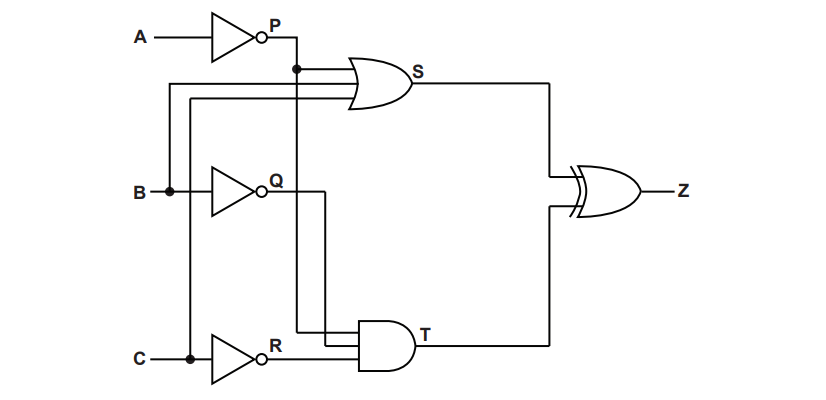
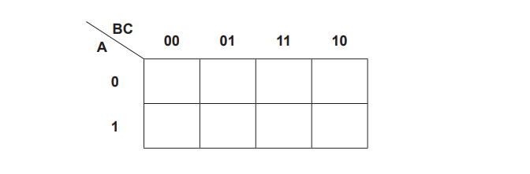
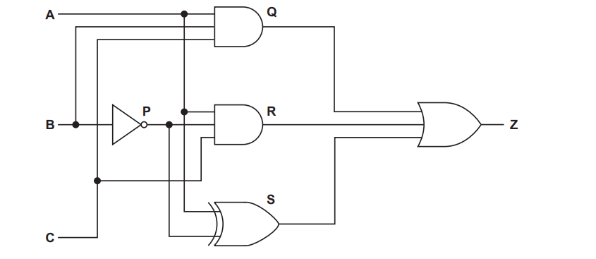
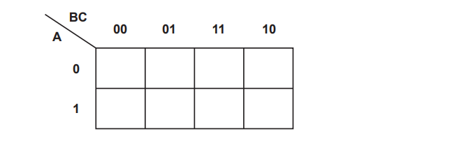
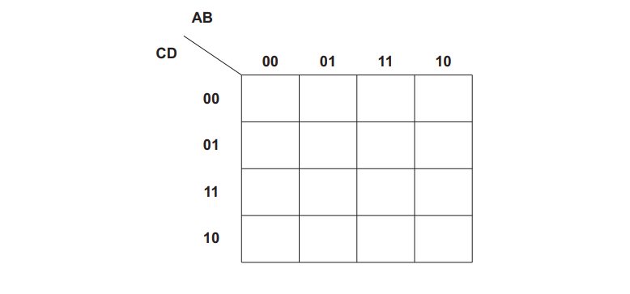
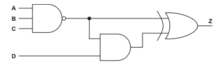
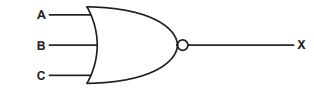
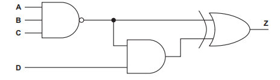
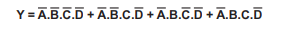

# Exam Questions — Boolean Algebra & Logic Circuits
**15. Hardware & Virtual Machines** · Cambridge (CIE) A-LEVEL computer-science (9618)
> Source: [https://www.savemyexams.com/a-level/computer-science/cie/19/topic-questions/](https://www.savemyexams.com/a-level/computer-science/cie/19/topic-questions/) · 25 questions across 1 sets

## Exam Questions (25 questions)

### Q1 — hard — 3 marks

**Q1** [3 marks]

A logic circuit produces the output T.

$T = \overline{A+B} + \overline{A+\overline{B}}$

Simplify this expression using Boolean algebra, including De Morgan's laws.

Show your working.

### Q2 — medium — 2 marks

**Q2** [2 marks]

A logic circuit produces the output Y.

$Y = \overline{\overline{A}+B}$

Apply De Morgan's laws to this expression and write the result in its simplest form.

### Q3 — easy — 1 marks

**Q3** [1 mark]

A logic circuit produces the output X.

$X = \overline{A.B.C}$

Apply De Morgan's laws to this expression.

### Q4 — hard — 4 marks

**Q4** [4 marks]

The truth table for a logic circuit is shown.

| INPUT | OUTPUT |   |   |
|---|---|---|---|
| **A** | **B** | **C** | **X** |
| 0 | 0 | 0 | 1 |
| 0 | 0 | 1 | 1 |
| 0 | 1 | 0 | 0 |
| 0 | 1 | 1 | 0 |
| 1 | 0 | 0 | 0 |
| 1 | 0 | 1 | 0 |
| 1 | 1 | 0 | 1 |
| 1 | 1 | 1 | 1 |

(i) Write the Boolean expression that corresponds to the given truth table as a sum-of-products.

(2)

(ii) Use Boolean algebra to write your answer to part (i) in its simplest form.

Show your working.

(2)

### Q5 — hard — 4 marks

**Q5** [4 marks]

A logic circuit has the inputs A, B, C and D, and the output T.

The completed Karnaugh map (K-map) for the output T is shown. The columns are labelled with the values of AB and the rows are labelled with the values of CD.

| AB → CD ↓ | 00 | 01 | 11 | 10 |
|---|---|---|---|---|
| 00 | 0 | 0 | 1 | 1 |
| 01 | 0 | 0 | 0 | 0 |
| 11 | 0 | 1 | 1 | 0 |
| 10 | 0 | 0 | 1 | 1 |

A student has used this K-map and has written the following sum-of-products for T.

$T = A . \overline{C} . \overline{D} + A . C . \overline{D} + B . C . D$

The student's expression gives the correct output for every combination of inputs, but it is not the optimal sum-of-products.

Explain why the student's expression is not the optimal sum-of-products, and write the optimal sum-of-products for T.

### Q6 — medium — 3 marks

**Q6** [3 marks]

A logic circuit produces the output Z.

`Z = \left(A + B\right) . \left(A + \bar{B}\right)`

Simplify this expression using Boolean algebra.

Show your working.

### Q7 — medium — 3 marks

**Q7** [3 marks]

A logic circuit has the inputs A, B, C and D, and the output X.

The completed Karnaugh map (K-map) for the output X is shown. The columns are labelled with the values of AB and the rows are labelled with the values of CD.

| AB → CD ↓ | 00 | 01 | 11 | 10 |
|---|---|---|---|---|
| 00 | 0 | 0 | 1 | 0 |
| 01 | 0 | 0 | 1 | 0 |
| 11 | 1 | 0 | 0 | 1 |
| 10 | 1 | 0 | 0 | 1 |

Write the Boolean logic expression for the output X as the optimal sum-of-products.

State the number of squares in the largest loop you have used.

### Q8 — easy — 2 marks

**Q8** [2 marks]

A logic circuit has the inputs A, B and C, and the output Z.

The completed Karnaugh map (K-map) for the output Z is shown. The columns are labelled with the values of BC and the rows are labelled with the values of A.

| BC → A ↓ | 00 | 01 | 11 | 10 |
|---|---|---|---|---|
| 0 | 0 | 0 | 1 | 0 |
| 1 | 1 | 1 | 1 | 1 |

Write the Boolean expression for the output Z as a simplified sum-of-products.

### Q9 — easy — 2 marks

**Q9** [2 marks]

A student is learning the rules of Boolean algebra.

Complete the table by writing the simplest form of each Boolean expression.

| Expression | Simplest form |
|---|---|
| $A . 1$ |   |
| $A + 0$ |   |
| $A . \overline{A}$ |   |
| $A + \overline{A}$ |   |

### Q10 — hard — 4 marks

**Q10** [4 marks]

A logic circuit has three inputs, A, B and C, and two outputs, Y and Z.

The circuit uses three intermediate signals, P, Q and R, which are given by these logic expressions:

P = A XOR B

Q = A AND B

R = P AND C

The two outputs are given by these logic expressions:

Y = P XOR C

Z = Q OR R

(a) Complete the truth table for this logic circuit.

Show your working in the working space columns.

| INPUT | Working space | OUTPUT |   |   |   |   |   |
|---|---|---|---|---|---|---|---|
| **A** | **B** | **C** | **P** | **Q** | **R** | **Y** | **Z** |
| 0 | 0 | 0 |   |   |   |   |   |
| 0 | 0 | 1 |   |   |   |   |   |
| 0 | 1 | 0 |   |   |   |   |   |
| 0 | 1 | 1 |   |   |   |   |   |
| 1 | 0 | 0 |   |   |   |   |   |
| 1 | 0 | 1 |   |   |   |   |   |
| 1 | 1 | 0 |   |   |   |   |   |
| 1 | 1 | 1 |   |   |   |   |   |

(3)

(b) State the name of this logic circuit.

(1)

### Q11 — medium — 3 marks

**Q11** [3 marks]

A logic circuit has three inputs, A, B and C, and two outputs, Y and Z.

The completed truth table for the logic circuit is shown.

| INPUT | OUTPUT |   |   |   |
|---|---|---|---|---|
| **A** | **B** | **C** | **Y** | **Z** |
| 0 | 0 | 0 | 0 | 0 |
| 0 | 0 | 1 | 1 | 0 |
| 0 | 1 | 0 | 1 | 0 |
| 0 | 1 | 1 | 0 | 1 |
| 1 | 0 | 0 | 1 | 0 |
| 1 | 0 | 1 | 0 | 1 |
| 1 | 1 | 0 | 0 | 1 |
| 1 | 1 | 1 | 1 | 1 |

(a) State the name of this logic circuit.

(1)

(b) State the purpose of each of the two outputs Y and Z.

(2)

### Q12 — easy — 2 marks

**Q12** [2 marks]

A full adder is a logic circuit that adds three single binary digits, A, B and C.

The circuit has two outputs. Output Y is the sum and output Z is the carry.

Complete the truth table for the full adder.

| INPUT | OUTPUT |   |   |   |
|---|---|---|---|---|
| **A** | **B** | **C** | **Y** | **Z** |
| 0 | 0 | 0 |   |   |
| 0 | 0 | 1 |   |   |
| 0 | 1 | 0 |   |   |
| 0 | 1 | 1 |   |   |
| 1 | 0 | 0 |   |   |
| 1 | 0 | 1 |   |   |
| 1 | 1 | 0 |   |   |
| 1 | 1 | 1 |   |   |

### Q13 — hard — 4 marks

**Q13** [4 marks]

A factory uses an SR flip-flop built from two NOR gates to store the state of a temperature alarm.

- Input S is connected to a temperature sensor. S becomes 1 when the temperature rises above the safe limit.
- Input R is connected to a reset button. R is 1 only while an operator holds the button down.
- Output Q drives the alarm. The alarm sounds when Q = 1.

Before the first event the flip-flop is storing Q = 0, so NOT Q = 1.

The four events in the table happen one after the other, in the order shown.

Complete the table to give the value of output Q after each event.

| Event | S | R | Q after the event |
|---|---|---|---|
| The temperature rises above the safe limit | 1 | 0 |   |
| The temperature returns to a safe value | 0 | 0 |   |
| The operator holds down the reset button | 0 | 1 |   |
| The operator releases the reset button | 0 | 0 |   |

### Q14 — medium — 3 marks

**Q14** [3 marks]

An SR flip-flop is built from two NOR gates that are connected together as follows.

- The output of the first NOR gate is Q.
- The output of the second NOR gate is NOT Q.
- The two inputs to the first NOR gate are R and NOT Q.
- The two inputs to the second NOR gate are S and Q.

The flip-flop is storing the value Q = 1, so NOT Q = 0.

Each pair of input values in the table is applied to the flip-flop while it is storing Q = 1. The first row has been completed for you.

Complete the table to show the values of Q and NOT Q produced by each of the other three pairs of input values.

| S | R | Q | NOT Q |
|---|---|---|---|
| 1 | 0 | 1 | 0 |
| 0 | 0 |   |   |
| 0 | 1 |   |   |
| 1 | 1 |   |   |

### Q15 — hard — 4 marks

**Q15** [4 marks]

A logic circuit has two inputs, A and B, and two outputs, E and F.

The circuit uses two intermediate signals, P and Q, which are given by these logic expressions:

P = A NAND B

Q = A OR B

The two outputs are given by these logic expressions:

E = P AND Q

F = NOT P

(a) Complete the truth table for this logic circuit.

Show your working in the working space columns.

| INPUT | Working space | OUTPUT |   |   |   |
|---|---|---|---|---|---|
| **A** | **B** | **P** | **Q** | **E** | **F** |
| 0 | 0 |   |   |   |   |
| 0 | 1 |   |   |   |   |
| 1 | 0 |   |   |   |   |
| 1 | 1 |   |   |   |   |

(3)

(b) State the name of this logic circuit.

(1)

### Q16 — easy — 2 marks

**Q16** [2 marks]

An SR flip-flop is a logic circuit built from two logic gates that are connected together. Flip-flops are used inside a computer as data storage elements.

(i) State the purpose of one flip-flop.

(1)

(ii) A computer stores one byte of data in Static RAM (SRAM), which is built from flip-flops.

State the number of flip-flops that are needed to store this one byte.

(1)

### Q17 — medium — 3 marks

**Q17** [3 marks]

A logic circuit has two inputs, A and B, and two outputs, E and F.

The two outputs are given by these logic expressions:

E = A XOR B

F = A AND B

(a) Complete the truth table for this logic circuit.

| INPUT | OUTPUT |   |   |
|---|---|---|---|
| **A** | **B** | **E** | **F** |
| 0 | 0 |   |   |
| 0 | 1 |   |   |
| 1 | 0 |   |   |
| 1 | 1 |   |   |

(2)

(b) State the name of this logic circuit.

(1)

### Q18 — easy — 2 marks

**Q18** [2 marks]

A half adder is a logic circuit with two inputs, A and B, and two outputs, E and F.

The completed truth table for the half adder is shown.

| INPUT | OUTPUT |   |   |
|---|---|---|---|
| **A** | **B** | **E** | **F** |
| 0 | 0 | 0 | 0 |
| 0 | 1 | 1 | 0 |
| 1 | 0 | 1 | 0 |
| 1 | 1 | 0 | 1 |

State the purpose of each of the two outputs E and F.

### Q19 — medium — 7 marks

**Q19** [2 marks]

The diagram shows a logic circuit.

Write the Boolean expression that corresponds to the logic circuit as a sum-of-products.

*Source: June 2024 9618/32 Q6B*

**Q19** [5 marks]

(i) Complete the Karnaugh map (K-map) for this Boolean expression:

$\overline{A}.\overline{B}.\overline{C}+\overline{A}.B.\overline{C}+\overline{A}.B.C+A.\overline{B}.\overline{C}--+A.B.\overline{C}+A.B.C$

(2)

(ii) Draw loop(s) around appropriate group(s) in the K-map to produce an optimal sum-of-products.

(2)

(iii) Write the Boolean expression from your answer to part c(ii) as a simplified sum-of-products.

(1)

*Source: June 2024 9618/32 Q6C*

### Q20 — medium — 7 marks

**Q20** [2 marks]

The diagram shows a logic circuit.

Write the Boolean expression that corresponds to the logic circuit as a sum-of-products.

*Source: June 2024 9618/31 Q6B*

**Q20** [5 marks]

Complete the Karnaugh map (K-map) for the Boolean expression:

$\overline{A}.\overline{B}.\overline{C}+\overline{A}.\overline{B}.C+A.\overline{B}.\overline{C}+A.\overline{B}.C+A.B.\overline{C}+A.B.C$

(2)

(ii) Draw loop(s) around appropriate group(s) in the K-map to produce an optimal sum-of-products.

(2)

(iii) Write the Boolean expression from your answer to part **(c)(ii)** as a simplified sum-of-products.

(1)

*Source: June 2024 9618/31 Q6C*

### Q21 — medium — 9 marks

**Q21** [3 marks]

The truth table for a logic circuit is shown.

| INPUT | OUTPUT |   |   |   |
|---|---|---|---|---|
| **A** | **B** | **C** | **D** | **X** |
| 0 | 0 | 0 | 0 | 0 |
| 0 | 0 | 0 | 1 | 1 |
| 0 | 0 | 1 | 0 | 1 |
| 0 | 0 | 1 | 1 | 0 |
| 0 | 1 | 0 | 0 | 0 |
| 0 | 1 | 0 | 1 | 1 |
| 0 | 1 | 1 | 0 | 1 |
| 0 | 1 | 1 | 1 | 0 |
| 1 | 0 | 0 | 0 | 0 |
| 1 | 0 | 0 | 1 | 1 |
| 1 | 0 | 1 | 0 | 1 |
| 1 | 0 | 1 | 1 | 0 |
| 1 | 1 | 0 | 0 | 0 |
| 1 | 1 | 0 | 1 | 1 |
| 1 | 1 | 1 | 0 |   |

Write the Boolean logic expression that corresponds to the given truth table as the sum‑of‑products.

*Source: Nov 2024 9618/32 Q6A*

**Q21** [2 marks]

Complete the Karnaugh map (K‑map) for the given truth table.

*Source: Nov 2024 9618/32 Q6B*

**Q21** [2 marks]

Draw loop(s) around appropriate group(s) in the K‑map to produce an optimal sum‑of‑products.

*Source: Nov 2024 9618/32 Q6C*

**Q21** [2 marks]

Write the Boolean logic expression from your answer to part (c) as the simplified sum‑of‑products.

*Source: Nov 2024 9618/32 Q6D*

### Q22 — medium — 10 marks

**Q22** [3 marks]

The truth table for a logic circuit is shown.

| INPUT | OUTPUT |   |   |   |
|---|---|---|---|---|
| **A** | **B** | **C** | **D** | **T** |
| 0 | 0 | 0 | 0 | 0 |
| 0 | 0 | 0 | 1 | 1 |
| 0 | 0 | 1 | 0 | 0 |
| 0 | 0 | 1 | 1 | 1 |
| 0 | 1 | 0 | 0 | 0 |
| 0 | 1 | 0 | 1 | 0 |
| 0 | 1 | 1 | 0 | 0 |
| 0 | 1 | 1 | 1 | 0 |
| 1 | 0 | 0 | 0 | 0 |
| 1 | 0 | 0 | 1 | 1 |
| 1 | 0 | 1 | 0 | 0 |
| 1 | 0 | 1 | 1 | 1 |
| 1 | 1 | 0 | 0 | 0 |
| 1 | 1 | 0 | 1 | 1 |
| 1 | 1 | 1 | 0 | 0 |
| 1 | 1 | 1 | 1 | 1 |

Write the Boolean logic expression that corresponds to the given truth table as the sum-of-products.

*Source: Nov 2024 9618/31 Q7A*

**Q22** [2 marks]

Complete the Karnaugh map (K-map) for the given truth table.

*Source: Nov 2024 9618/31 Q7B*

**Q22** [2 marks]

Draw loop(s) around appropriate group(s) in the K-map to produce an optimal sum-of-products.

*Source: Nov 2024 9618/31 Q7C*

**Q22** [3 marks]

(i) Write the Boolean logic expression from your answer to part **(c)** as the simplified sum-of-products.

(2)

(ii) Use Boolean algebra to write your answer to part **(d)(i)** in its simplest form.

(1)

*Source: Nov 2024 9618/31 Q7D*

### Q23 — medium — 3 marks

**Q23** [3 marks]

This diagram represents a logic circuit.

Simplify the given Boolean expression using Boolean algebra. 
Show your working.

**Y** = `straight A with bar on top. straight B with bar on top. straight C with bar on top. straight D with bar on top space plus space straight A with bar on top. straight B with bar on top. straight C. straight D with bar on top space plus space straight A with bar on top. straight B. straight C with bar on top. straight D with bar on top space plus space straight A with bar on top. straight B. straight C. straight D with bar on top`

*Source: November 2023 9618/33 Q6B*

### Q24 — medium — 5 marks

**Q24** [1 mark]

This logic circuit represents the Boolean expression:  **X =** $\overline{A+B+C}$

Complete this truth table for the given logic circuit.

| **A** | **B** | **C** | **X** |
|---|---|---|---|
| 0 | 0 | 0 |   |
| 0 | 0 | 1 |   |
| 0 | 1 | 0 |   |
| 0 | 1 | 1 |   |
| 1 | 0 | 0 |   |
| 1 | 0 | 1 |   |
| 1 | 1 | 0 |   |
| 1 | 1 | 1 |   |

*Source: November 2023 9618/32 Q7A*

**Q24** [1 mark]

Apply De Morgan’s laws to the expression:* ***X =** $\overline{A+B+C}$

X = ...................................................................................

*Source: November 2023 9618/32 Q7B*

**Q24** [3 marks]

Simplify the following expression using Boolean algebra.

Show all the stages in your simplification.

**T = X.Y.Z + X.**$\overline{Y.}$**Z + **`straight X with bar on top`

*Source: November 2023 9618/32 Q7C*

### Q25 — medium — 6 marks

**Q25** [3 marks]

This diagram represents a logic circuit.

Complete the truth table for the given logic circuit.

| **A** | **B** | **C** | **D** | **Working space** | **Z** |
|---|---|---|---|---|---|
| 0 | 0 | 0 | 0 |   |   |
| 0 | 0 | 0 | 1 |   |   |
| 0 | 0 | 1 | 0 |   |   |
| 0 | 0 | 1 | 1 |   |   |
| 0 | 1 | 0 | 0 |   |   |
| 0 | 1 | 0 | 1 |   |   |
| 0 | 1 | 1 | 0 |   |   |
| 0 | 1 | 1 | 1 |   |   |
| 1 | 0 | 0 | 0 |   |   |
| 1 | 0 | 0 | 1 |   |   |
| 1 | 0 | 1 | 0 |   |   |
| 1 | 0 | 1 | 1 |   |   |
| 1 | 1 | 0 | 0 |   |   |
| 1 | 1 | 0 | 1 |   |   |
| 1 | 1 | 1 | 0 |   |   |
| 1 | 1 | 1 | 1 |   |   |

*Source: November 2023 9618/31 Q6A*

**Q25** [3 marks]

Simplify the given Boolean expression using Boolean algebra. 
Show your working.

*Source: November 2023 9618/31 Q6B*

