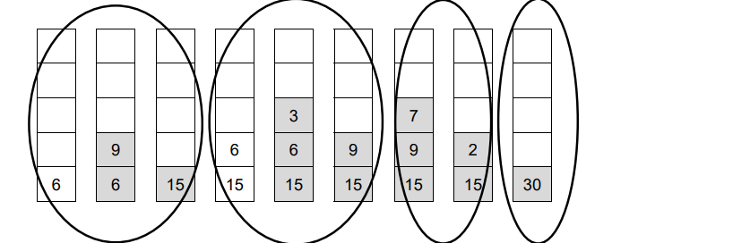
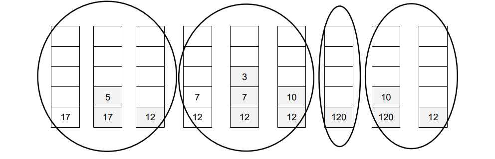
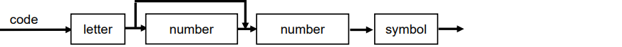
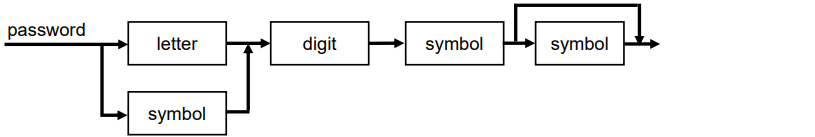

# Mark Schemes — Translation Software
**16. System Software** · Cambridge (CIE) A-LEVEL computer-science (9618)

## Exam Questions (18 questions)

### Q1
One mark for `<integer> ::= <digit>` as one alternative **[1]**

One mark for `<integer><digit>` as the second alternative **[1]**

One mark for `<reading> ::= <integer> | <sign><integer>` **[1]**

One mark for `<message> ::= <reading>` as one alternative **[1]**

One mark for `<message>,<reading>` as the second alternative **[1]**

**[5 marks]**

> **[mark-scheme]**
> **1 mark** for `<integer> ::= <digit>` as one alternative
> 
> **1 mark** for a second alternative of `<integer><digit>` // `<digit><integer>`
> 
> **1 mark** for `<reading> ::= <integer> | <sign><integer>`
> 
> **1 mark** for `<message> ::= <reading>` as one alternative
> 
> **1 mark** for a second alternative of `<message>,<reading>` // `<reading>,<message>`
> 
> The alternatives can be written in either order
> 
> Do not accept `<integer> ::= <digit><integer>` with no single `<digit>` alternative: the rule never ends, so it cannot produce any integer
> 
> Do not accept `<message> ::= <reading> | <reading>,<reading>`: this allows only one or two readings, not three or more
> 
> Do not accept `<reading> ::= <integer> | <sign><reading>`: this allows more than one sign, such as `--4`

> **[exam-tip]**
> "One or more" in a question means the rule must refer to itself. Every rule that refers to itself also needs an alternative that does not, such as the single `<digit>` in `<integer>`. Without it, the rule can never finish, so it matches nothing.
> 
> Check where the comma goes. The alternative `<message>,<reading>` always puts a comma between two readings. It can never give a message that starts or ends with a comma, and the question does not allow one.
> 
> In a syntax diagram, "one or more" is drawn as a loop that goes back over the box. In BNF, that loop becomes the rule referring to itself.

### Q2
One mark for `<locker> ::=` followed by one correct alternative **[1]**

One mark for two more correct alternatives, separated by `|` **[1]**

One mark for all four alternatives correct, with no incorrect alternative **[1]**

**[3 marks]**

> **[mark-scheme]**
> **1 mark** for `<locker> ::=` followed by any one correct alternative
> 
> **1 mark** for two further correct alternatives, each separated by `|`
> 
> **1 mark** for all four alternatives correct and no incorrect alternative
> 
> The alternatives can be written in any order
> 
> Accept this answer, which uses extra rules. Award one mark for each correct rule:
> 
> Any names can be used for the extra rules, as long as each one is defined and used correctly
> 
> Do not accept an attempt such as `<locker> ::= <letter><letter><digit> | <symbol><digit><digit>`: `|` separates whole alternatives, so the second alternative allows a code with no letters

> **[exam-tip]**
> A common error is to put `|` in the middle of an alternative, expecting it to choose only between the two items next to it. In BNF, `|` separates complete alternatives. Anything written before `|` is one whole alternative and anything after it is another.
> 
> Work through the description and list every combination before you write any BNF. Two middle options and two endings give four alternatives. Students often write three and miss a code made of a letter, a letter, a symbol, a digit and a digit, such as `PQ#12`.
> 
> In a syntax diagram, the choice between a digit and a symbol is two parallel paths, and the second end digit is a path that can bypass the box. In BNF, each of these choices becomes an extra alternative.

### Q3
| Item read | `a` | `b` | `c` | `d` | `+` | `*` | `-` | `e` | `/` |
|---|---|---|---|---|---|---|---|---|---|
|   |   |   |   | **4** |   |   |   |   |   |
|   |   |   | **2** | **2** | **6** |   |   |   |   |
|   |   | **3** | **3** | **3** | **3** | **18** |   | **11** |   |
| Bottom of stack | **40** | **40** | **40** | **40** | **40** | **40** | **22** | **22** | **2** |

Columns 1 to 3: a, b and c are pushed, giving 40, then 40, 3, then 40, 3, 2 **[1]**

Columns 4 and 5: d is pushed, giving 40, 3, 2, 4, then the addition pops 4 and 2 and pushes 6, giving 40, 3, 6 **[1]**

Columns 6 and 7: the multiplication pops 6 and 3 and pushes 18, then the subtraction pops 18 and 40 and pushes 40 - 18 = 22 **[1]**

Columns 8 and 9: e is pushed, giving 22, 11, then the division pops 11 and 22 and pushes 22 / 11 = 2 **[1]**

The value of the expression is 2.

**[4 marks]**

> **[mark-scheme]**
> **1 mark** for columns 1 to 3: 40; 40, 3; 40, 3, 2
> 
> **1 mark** for columns 4 and 5: 40, 3, 2, 4; 40, 3, 6
> 
> **1 mark** for columns 6 and 7: 40, 18; 22
> 
> **1 mark** for columns 8 and 9: 22, 11; 2
> 
> Values within a column are listed from the bottom of the stack to the top, and semicolons separate the columns.
> 
> Accept the values in each column placed at the top of the column instead of the bottom, provided the most recently pushed value is the highest one in that column
> 
> Do not accept operators written into the stack
> 
> Do not accept -22 in column 7 or -2 in column 9, which come from subtracting 40 from 18 instead of 18 from 40
> 
> Do not accept 0.5 in column 9, which comes from dividing 11 by 22

> **[exam-tip]**
> The first value popped is the right-hand operand, not the left-hand one. When the minus sign is read, 18 is popped first and 40 second, so the calculation is 40 - 18. Students who work out "first pop minus second pop" get -22, and every column after that is wrong too.
> 
> Keep every value that is not popped. After the multiplication, 40 is still at the bottom of the stack, waiting. A column that loses it cannot earn the mark.

### Q4
Lexical analysis: the characters in the statement are converted into a sequence of tokens, `Area`, `←`, `Length`, `*`, `Width`, `+` and `10`. **[1]**

Syntax analysis: the sequence of tokens is checked against the grammar of the language. The statement follows the rules, so no syntax error is reported and a parse tree is produced. **[1]**

Code generation: the intermediate representation of the statement is converted into an executable form, for example object code. **[1]**

Optimisation: the code is changed to minimise the program's execution time and memory requirement. **[1]**

**[4 marks]**

> **[mark-scheme]**
> **1 mark** for each stage named with a correct description, **max 4**:
> 
> - Lexical analysis: the characters are converted into a sequence of tokens
> - Syntax analysis: the tokens are checked against the grammar / rules of the language // a parse tree is produced
> - Code generation: the intermediate representation / parse tree is converted into an executable form // object code / machine code is produced
> - Optimisation: the code is changed to minimise execution time // to minimise memory requirement
> 
> **[4 marks]**
> 
> A stage name without a description, or a description without a stage name, earns no mark.
> 
> Accept the stages described in any order.
> 
> Do not accept "the statement is executed" for any stage. A compiler translates the program; no stage of compilation executes it.

> **[exam-tip]**
> A frequent error is to describe code generation as the stage that runs the code. No stage of compilation runs the program. Code generation produces the executable form, and the program is run later.
> 
> Tie each description to what the stage takes in and what it produces: characters into tokens, tokens into a parse tree, intermediate representation into executable form. "It checks the code" is too vague to earn the mark for any stage.

### Q5
The error is reported during syntax analysis. **[1]**

Lexical analysis converts the characters into a sequence of tokens: `Cost`, `←`, `Price`, `+`, `*` and `Quantity`. Every one of these is a valid token, so lexical analysis finds no error. **[1]**

Syntax analysis checks that the sequence of tokens follows the grammar of the language. There is no operand between the operators `+` and `*`, so the rules are broken and a syntax error is reported. **[1]**

**[3 marks]**

> **[mark-scheme]**
> **1 mark** for syntax analysis
> 
> **Any two from:**
> 
> - Lexical analysis only converts the characters into tokens
> - Each token in the statement is valid // `+` and `*` are both valid tokens
> - Syntax analysis checks the sequence of tokens against the grammar / rules of the language
> - Two operators next to each other do not match the rules // an operand is missing between `+` and `*`
> 
> **[2 marks]**
> 
> Accept "parsing" or "the parser" for syntax analysis.
> 
> Do not accept lexical analysis or code generation as the stage.
> 
> Do not accept "run-time error" or "logic error". This error is found during compilation, before the program can be run.

> **[exam-tip]**
> Students often choose lexical analysis because it is the first stage, and they expect the first stage to find every mistake. Lexical analysis only decides whether each group of characters is a valid token. It does not check the order of the tokens.
> 
> A statement made entirely of valid tokens can still break the rules of the language. Checking the order of the tokens against the grammar is the job of syntax analysis.

### Q6
`C4%` is **valid**. It is a letter (C), followed by a digit (4), followed by a symbol (%), so it matches `<letter><digit><symbol>`. **[1]**

`B6@` is **invalid**. The 6 is not a valid digit, because `<digit>` only allows 1, 2, 3, 4 or 5. **[1]**

**[2 marks]**

> **[mark-scheme]**
> **1 mark** for `C4%` valid, with a reason: a letter followed by a digit followed by a symbol // it matches `<letter><digit><symbol>`
> 
> **1 mark** for `B6@` invalid, with a reason: 6 is not a valid digit // `<digit>` only allows 1 to 5
> 
> Each mark needs both the decision and a correct reason
> 
> Do not accept that `B6@` is invalid because it ends with a symbol: a code can end with a symbol, and @ is a valid symbol

> **[exam-tip]**
> `B6@` has the right shape: a letter, then a digit, then a symbol. Many students stop there and call it valid. Check every character against its own rule. The rule `<digit>` allows only the values listed after `::=`, and 6 is not one of them.
> 
> When you give a reason, say exactly which character breaks which rule. "It does not follow the rules" does not earn the mark.

### Q7
(i) Lexical analysis **[1]**

(ii) Optimisation **[1]**

**[2 marks]**

> **[mark-scheme]**
> **1 mark** for lexical analysis
> 
> **1 mark** for optimisation
> 
> Accept the spelling "optimization".
> 
> Do not accept syntax analysis for (i). Syntax analysis works on the tokens after lexical analysis has produced them.
> 
> Do not accept code generation for (ii). Code generation converts the program into an executable form. Its purpose is not to reduce execution time and memory.

> **[exam-tip]**
> Lexical analysis and syntax analysis are the two stages students mix up most. Use the key words to separate them. Lexical analysis starts with characters and produces tokens. Syntax analysis starts with those tokens and checks that they follow the grammar of the language.

### Q8
The interpreter examines the program one statement at a time. It checks each statement for errors before it executes that statement. **[1]**

Lines 01 to 06 contain no errors, so each one is executed as soon as it has been checked. Lines 03 and 04 are checked and executed again on each of the three iterations of the loop. **[1]**

This output is displayed before the interpreter reaches line 07: **[1]**

When line 07 is checked, the syntax error is found and reported, and the interpreter halts. Line 08 is never executed. **[1]**

**[4 marks]**

> **[mark-scheme]**
> **Any four from:**
> 
> - Each statement is examined and checked for errors before it is executed
> - Lines 01 to 06 are each executed as soon as they have been checked // the program starts to run even though it contains an error
> - Lines 03 and 04 are interpreted again on each iteration of the loop // they are interpreted three times
> - `Pass 1`, `Pass 2`, `Pass 3` and `Total is 6` are output before the error is found
> - The error in line 07 is reported and the interpreter halts
> - Line 08 is never examined or executed
> 
> **[4 marks]**
> 
> For the output point, all four lines of output must be given in the correct order.
> 
> Accept "stops" in place of "halts".
> 
> Do not accept "the error in line 07 is reported before any statement is executed" or "nothing is output". That is how a compiler behaves, because a compiler translates the whole program before any of it can run.

> **[exam-tip]**
> The most common wrong answer says that nothing is output because the program contains an error. That is true of a compiled program, not an interpreted one. The interpreter does not look at line 07 until it gets there, so lines 01 to 06 have already run and their output is already on the screen.
> 
> Write the output exactly. The loop runs three times, so there are three Pass lines, and the total is 6 because 1 + 2 + 3 = 6.

### Q9
b and c are multiplied, and the result is added to a, giving `a + b * c` **[1]**

a is subtracted from d, in that order, giving `(d - a)` **[1]**

The whole of the first term is divided by the whole of the second term, so both terms are in brackets **[1]**

**[3 marks]**

> **[mark-scheme]**
> **1 mark** for `a + b * c` as one term
> 
> **1 mark** for `(d - a)` with the operands in this order
> 
> **1 mark** for the division of the first term by the second, with brackets around both terms
> 
> Complete answer:
> 
> Accept extra brackets that do not change the meaning, for example `(a + (b * c)) / (d - a)`
> 
> Accept the operands of the addition or the multiplication in the other order, for example `(b * c + a) / (d - a)`
> 
> Do not accept `a + b * c / (d - a)`, which divides only b multiplied by c by (d - a) (loses the third mark)
> 
> Do not accept `(a + b) * c / (d - a)`, which adds a and b before multiplying (loses the first mark)
> 
> Do not accept `(a + b * c) / (a - d)`, which reverses the subtraction (loses the second mark)

> **[exam-tip]**
> When an operator is reached, it joins the two terms just before it, and the earlier of those two terms goes on the left. Students often write a - d here, because a is the letter nearest to the minus sign. The RPN has d then a, so the answer is d - a.
> 
> The brackets are where most marks are lost. In RPN the division comes last, so it applies to everything before it. Without brackets, precedence would make the division happen before the addition and the subtraction. Check your answer by converting it back to RPN: you should get the expression you started with.

### Q10
An interpreter does not produce a translated version of the program, so there is nothing to store and reuse. **[1]**

It examines one statement at a time, checks it for errors and then executes it. This means the statement inside the loop is interpreted again on each of the 1000 iterations. **[1]**

Nothing is kept after the program finishes, so the whole program has to be interpreted again when it is run next week. **[1]**

**[3 marks]**

> **[mark-scheme]**
> **Any three from:**
> 
> - An interpreter does not produce or store a translated version of the program
> - It examines one statement at a time, checks the statement for errors and then executes it
> - The statement inside the loop is interpreted again on every iteration // it is interpreted 1000 times
> - The program has to be interpreted again every time it is run // next week it is interpreted again from the start
> 
> **[3 marks]**
> 
> Accept "line" in place of "statement".
> 
> Do not accept "an interpreter translates line by line" on its own. It does not explain why the claim about storing and reusing a translation is wrong.
> 
> Do not accept "the interpreter produces an executable file that is used next week". That describes a compiler.

> **[exam-tip]**
> Many answers describe an interpreter correctly but never apply it to the loop. The question tells you the loop runs 1000 times, so use that number: the statement inside it is interpreted 1000 times.
> 
> The same fact answers the last part of the claim. No translated version is ever kept, so next week the interpreter starts again from the first statement.

### Q11
| Statement | True | False |
|---|---|---|
| The interpreter checks each statement for errors before it executes that statement. | **✓** |   |
| The interpreter translates the whole program into an executable file before it executes any statement. |   | **✓** |
| The statements inside a loop are interpreted again on every iteration of the loop. | **✓** |   |
| After the program has been run once, it can be run again without being interpreted again. |   | **✓** |

Rows 1 and 3 are true. Rows 2 and 4 are false. **[2]**

**[2 marks]**

> **[mark-scheme]**
> **2 marks** for all four rows correct
> 
> **1 mark** for two or three rows correct
> 
> A row with both boxes ticked, or with no box ticked, is incorrect.

> **[exam-tip]**
> Row 3 is the row students get wrong most often. They picture an interpreter reading down the program once, from top to bottom. An interpreter keeps nothing it has translated, so each time a loop sends it back to a statement, it must check and execute that statement again.
> 
> Row 2 describes a compiler, not an interpreter. A compiler produces an executable file. An interpreter executes the program without producing a translated version of it.

### Q12
The bracketed subtraction is divided by r first, which gives `p q - r /` **[1]**

The multiplication has higher precedence than the addition, so s is multiplied by 3 and the addition is applied last, which gives `s 3 * +` **[1]**

**[2 marks]**

> **[mark-scheme]**
> **1 mark** for `p q - r /`
> 
> **1 mark** for `s 3 * +`
> 
> Complete answer:
> 
> Accept the two operands of the addition in the other order, `s 3 * p q - r / +`, or the operands of the multiplication swapped, `3 s *`, because both operators give the same result either way
> 
> Do not accept `p q - r / s + 3 *`, which adds s before multiplying by 3 and ignores operator precedence
> 
> Do not accept `q p - r / s 3 * +`, which calculates q - p instead of p - q

> **[exam-tip]**
> The most common mistake is to copy the operators in the order they appear from left to right. That gives `p q - r / s + 3 *`, which works out ((p - q) / r + s) multiplied by 3. Multiplication and division are carried out before addition and subtraction, so add the hidden brackets first: ((p - q) / r) + (s * 3). Then convert one bracket at a time.
> 
> The safest method is to keep the letters and numbers in the same order as they appear in the infix expression. Only the operators move. If your answer has q before p, the subtraction is the wrong way round.

### Q13
> **[mark-scheme]**
> **One **mark `7 2 – 8 + `
> 
> **One **mark `9 5 - / `
> 
> **Complete answer **
> 
> `7 2 – 8 + 9 5 - /`
**One **mark per ring (**Max 4**)

> **[mark-scheme]**
> **One **mark per correct term (**Max 3**)
> 
> `(a – c + b) `
> 
> `* (d + b) `
> 
> `/c`
> 
> **Complete correct answer**
> 
> ` (((a – c) + b) * (d + b))/c`
> 
> **Or **
> 
> `(a – c + b) * (d + b)/c`

### Q14
> **[mark-scheme]**
> **One **mark per correct term (**Max 3**)
> 
> `(5 + 2) `
> 
> `/ (9 – 3)  `
> 
> `* 3 `
> 
> ***Complete correct answer ***
> 
> `((5 + 2) / (9 - 3)) * 3`
> **[mark-scheme]**
> **One **mark `7 3 + `
> 
> **One **mark `2 8  * - 6 / `
> 
> **Complete answer **
> 
> `7 3 + 2 8  * -  6  /`
> **[mark-scheme]**
> **One **mark per ring (**Max 4**)
> 
> 

### Q15
> **[mark-scheme]**
> **One **mark per mark point (**Max 2**)
> 
> MP1 21 - a number must begin with an odd digit, 2 is even
> 
> MP2 123 - a number can only be one or two digits in length not three
> **[mark-scheme]**
> **One **mark per mark point (**Max 2**)
> 
> MP1` <symbol> ::=` `% | £ | # | @ | \$ `
> 
> MP2 `<number> ::= <odd> |<odd> <even> |<odd><odd>`
> **[mark-scheme]**
> (i) **One **mark per mark point (**Max 3**)
> 
> MP1 letter, number and symbol all included in correct order: letter first, followed by number, finishing with symbol
> 
> MP2 provision for one or two numbers including relevant connectors
> 
> MP3 all other connections and label correct and no additional data
> 
> Example answer
> 
> 
> 
> (ii) **One **mark per correct line (**Max 2**)
> 
> `<code> ::= <letter><number><symbol> |`
> `<letter><number><number><symbol>`
> 
> OR
> 
> `<code> ::= <letter><number><number><symbol> |`
> `<letter><number><symbol>`
> 
> Alternative Answer
> 
> **One **mark per correct line (**Max 2**)
> 
> `<digits> ::= <number> | <number><number>`
> 
> `<code> ::= <letter><digits><symbol>`

### Q16
> **[mark-scheme]**
> **One **mark per mark point (**Max 4**)
> 
> - `<operator> ::=   + | – | * | /`
> - `<label> ::= <letter><digit> | <letter><digit><digit>`
> - `<equation> ::=`  `<label> =`
> - `<label><operator><label>`
> **[mark-scheme]**
> (i)** One **mark per mark point (**Max 3**)
> 
> MP1 begin with either a letter or a symbol
> 
> MP2 end with either one or two symbols
> 
> MP3 digit and all other connections and label correct.
> 
> 
> 
> (ii) **One **mark per mark point (**Max 2**)
> 
> - `<password> ::= <letter><digit><symbol>|`
> - `<letter><digit><symbol><symbol>|<symbol><digit><symbol>|`
> `<symbol><digit><symbol><symbol>`
> 
> `<password> ::= <letter><digit><symbol>|`
> `<letter><digit><symbol><symbol>|<symbol><digit><symbol>|`
> `<symbol><digit><symbol><symbol>`
> 
> Alternative Answer
> 
> **One **mark per mark point (**Max 2**) .
> 
> - All three lines correct
> - Any two lines correct
> 
> `<first> ::= <letter> | <symbol>`
> 
> `<last> ::= <symbol> | <symbol><symbol>`
> 
> `<password> ::= <first><digit><last>`

### Q17
> **[mark-scheme]**
> **One** mark per mark point **(Max 3) **
> 
> - MP1    The (RPN) expression is read from left to right, one item at a time
> - MP2    Each element is checked to see if it as operator or a value
> - MP3    Values are pushed onto a stack until an operator is found
> - MP4    The operator is applied to the last two values on the stack and the result is pushed back onto the stack
> - MP5    This repeats until a single value remains, which is the solution.

### Q18
> **[mark-scheme]**
> **One** mark per mark point **(Max 2) **
> •   (5 – 2) 
> • * *  *(5 + 4) / 9
> 
> Final correct expression 
> (5 – 2)  * (5 + 4) / 9
