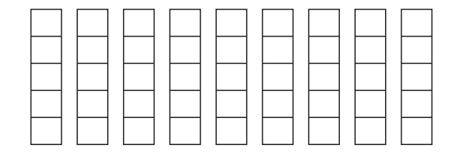
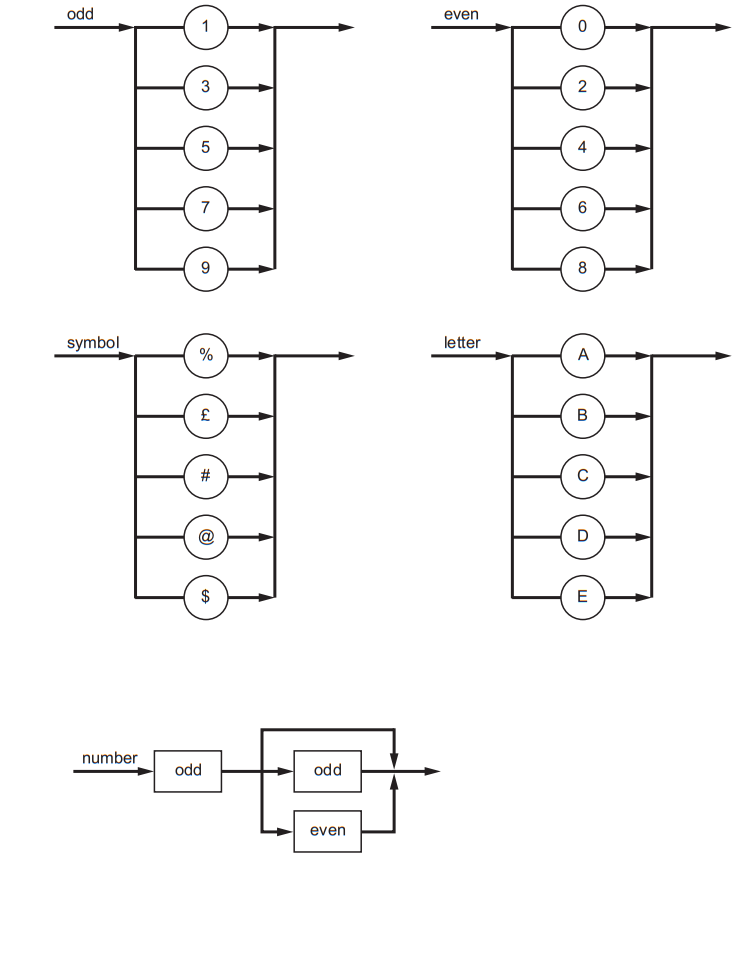
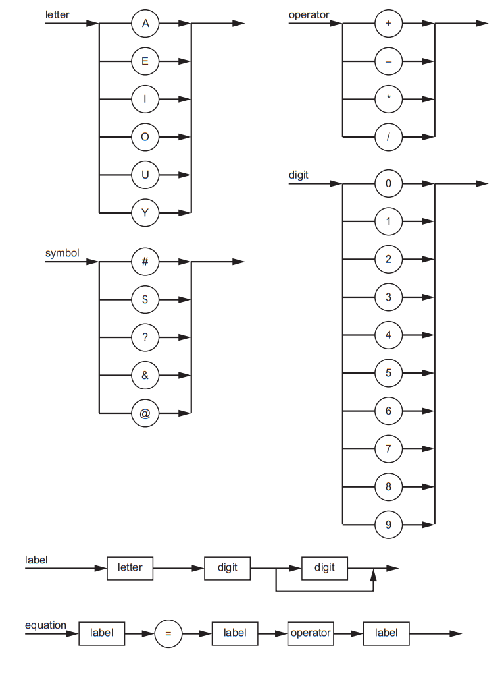

# Exam Questions — Translation Software
**16. System Software** · Cambridge (CIE) A-LEVEL computer-science (9618)
> Source: [https://www.savemyexams.com/a-level/computer-science/cie/19/topic-questions/](https://www.savemyexams.com/a-level/computer-science/cie/19/topic-questions/) · 18 questions across 1 sets

## Exam Questions (18 questions)

### Q1 — hard — 5 marks

**Q1** [5 marks]

A weather station sends its temperature readings to a computer as text. The Backus-Naur Form (BNF) for some parts of the text is shown.

The following rules are also needed.

- An integer contains one or more digits.
- A reading is an integer that may have one sign in front of it.
- A message contains one or more readings. When a message has more than one reading, a comma separates each reading from the next one.

For example, `25` and `12,-3,+40` are both valid messages.

Write the BNF for `<integer>`, `<reading>` and `<message>`.

### Q2 — medium — 3 marks

**Q2** [3 marks]

A parcel locker is opened with a code. The Backus-Naur Form (BNF) for some parts of the code is shown.

A new syntax rule, `<locker>`, is required. A locker code must begin with two letters, followed by one digit or one symbol, and end with one or two digits.

Write the BNF for `<locker>`.

### Q3 — hard — 4 marks

**Q3** [4 marks]

The Reverse Polish Notation (RPN) expression:

is to be evaluated when a = 40, b = 3, c = 2, d = 4 and e = 11.

Show the changing contents of the stack as the RPN expression is evaluated. Complete the table. Each column shows the stack after one more item has been read. Fill each column from the bottom row upwards.

| Item read | `a` | `b` | `c` | `d` | `+` | `*` | `-` | `e` | `/` |
|---|---|---|---|---|---|---|---|---|---|
|   |   |   |   |   |   |   |   |   |   |
|   |   |   |   |   |   |   |   |   |   |
|   |   |   |   |   |   |   |   |   |   |
| Bottom of stack |   |   |   |   |   |   |   |   |   |

### Q4 — hard — 4 marks

**Q4** [4 marks]

A program contains this statement.

The statement contains no errors. The program is compiled.

Describe what happens to this statement at each stage of compilation.

### Q5 — medium — 3 marks

**Q5** [3 marks]

A program contains this statement.

The statement contains an error. The program is compiled.

Identify the stage of compilation at which this error is reported, and explain why the error is not reported during lexical analysis.

### Q6 — easy — 2 marks

**Q6** [2 marks]

A game uses a short code to unlock each level. The Backus-Naur Form (BNF) for a code is shown.

State whether each of the following codes is valid or invalid for `<code>`. Give a reason for your choice in each case.

`C4%`

`B6@`

### Q7 — easy — 2 marks

**Q7** [2 marks]

The compilation of a program takes place in stages.

Name the stage of compilation described by each statement.

(i) The source code is converted from a sequence of characters into a sequence of tokens.

(1)

(ii) The program is changed to minimise its execution time and its memory requirement.

(1)

### Q8 — hard — 4 marks

**Q8** [4 marks]

A program is run using an interpreter. The line numbers are for reference only and are not part of the program. Variable declarations are not shown.

Line 07 contains a syntax error. There are no other errors in the program.

Describe what happens when the program is run using the interpreter.

### Q9 — medium — 3 marks

**Q9** [3 marks]

Write this Reverse Polish Notation (RPN) expression in infix form.

### Q10 — medium — 3 marks

**Q10** [3 marks]

A program that is run using an interpreter contains this loop.

A student makes this claim:

"The interpreter translates the statement inside the loop once. It stores the translated version and reuses it on each pass of the loop. When the program is run again next week, the stored version is used again."

Explain why the student's claim is wrong.

### Q11 — easy — 2 marks

**Q11** [2 marks]

A program written in a high-level language is run using an interpreter.

Tick (✓) **one** box in each row to show whether each statement about how the interpreter executes the program is true or false.

| Statement | True | False |
|---|---|---|
| The interpreter checks each statement for errors before it executes that statement. |   |   |
| The interpreter translates the whole program into an executable file before it executes any statement. |   |   |
| The statements inside a loop are interpreted again on every iteration of the loop. |   |   |
| After the program has been run once, it can be run again without being interpreted again. |   |   |

### Q12 — easy — 2 marks

**Q12** [2 marks]

Write this infix expression in Reverse Polish Notation (RPN).

### Q13 — medium — 9 marks

**Q13** [2 marks]

Write this infix expression in Reverse Polish Notation (RPN):

`(7 – 2 + 8) / (9 – 5)`

*Source: June 2024 9618/32 Q5A*

**Q13** [4 marks]

Evaluate this RPN expression:

`a d + a b + c - *`

when

`a = 6, b = 3, c = 7 `and `d = 9`

Show the changing contents of the stack as the RPN expression is evaluated.

*Source: June 2024 9618/32 Q5B*

**Q13** [3 marks]

Write this RPN expression in infix form:

`b a c - + d b + * c /`

*Source: June 2024 9618/32 Q5C*

### Q14 — medium — 9 marks

**Q14** [3 marks]

Write this Reverse Polish Notation (RPN) in infix form:

`5 2 + 9 3 - / 3 *`

*Source: June 2024 9618/31 Q5A*

**Q14** [2 marks]

Write this infix expression in RPN:

`((7 + 3) - (2 * 8)) / 6`

*Source: June 2024 9618/31 Q5B*

**Q14** [4 marks]

Evaluate this RPN expression:

`a b - c d + * e /`

when

`a = 17, b = 5, c = 7, d = 3 `and `e = 10`

Show the changing contents of the stack as the RPN expression is evaluated.

*Source: June 2024 9618/31 Q5C*

### Q15 — medium — 9 marks

**Q15** [2 marks]

Several syntax diagrams are shown.

State why each number is invalid for the given syntax diagrams.

`21`

Reason ..................................................

`123`

Reason  ..................................................

*Source: Nov 2024 9618/32 Q7A*

**Q15** [2 marks]

Complete the Backus‑Naur Form (BNF) for the given syntax diagrams

`<symbol> ::=`  ....................................

`<number> ::= `....................................

*Source: Nov 2024 9618/32 Q7B*

**Q15** [5 marks]

A new syntax rule, **code**, is required. It must begin with a letter, followed by one or two numbers, and end with a symbol.

(i) Draw a syntax diagram for **code**.

(3)

(ii) Write the BNF for **code**.

(2)

*Source: Nov 2024 9618/329618 Q7C*

### Q16 — medium — 9 marks

**Q16** [4 marks]

Several syntax diagrams are shown.

Complete the Backus-Naur Form (BNF) for the given syntax diagrams.

`<operator> ::=` ..................................................

`<label> ::= `........................................................

`<equation> ::=` ..................................................`equation`

*Source: Nov 2024 9618/31 Q10A*

**Q16** [5 marks]

A new syntax rule, **password**, is required. It must begin with a letter or a symbol, followed by a digit and end with one or two symbols.

(i) Draw a syntax diagram for **password**.

(3)

(ii) Write the BNF for **password**.

(2)

*Source: Nov 2024 9618/31 Q10B*

### Q17 — medium — 3 marks

**Q17** [3 marks]

Explain how an expression stored in RPN can be evaluated.

*Source: November 2023 9618/32 Q6B*

### Q18 — medium — 2 marks

**Q18** [2 marks]

Write the infix expression for this Reverse Polish Notation (RPN) expression:

` 5  2 – 5  4  +  *  9  /`

*Source: November 2023 9618/31 Q9AI*

