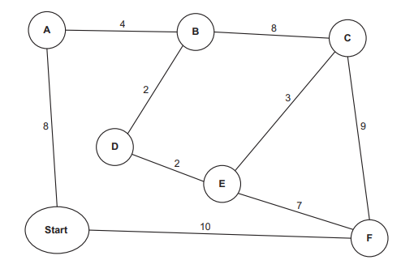

# Exam Questions — Artificial Intelligence (AI)
**18. Artificial Intelligence (AI)** · Cambridge (CIE) A-LEVEL computer-science (9618)
> Source: [https://www.savemyexams.com/a-level/computer-science/cie/19/topic-questions/](https://www.savemyexams.com/a-level/computer-science/cie/19/topic-questions/) · 21 questions across 1 sets

## Exam Questions (21 questions)

### Q1 — hard — 5 marks

**Q1** [5 marks]

A robot in a warehouse travels from the Dock to the Exit. The robot's software uses the A* algorithm.

The graph has eight nodes: Dock, A, B, C, D, E, F and Exit. The first table shows each pair of nodes that are joined in the graph, and the time in seconds to travel between them. Each route can be travelled in both directions.

| Nodes joined | Time (seconds) |
|---|---|
| Dock and A | 6 |
| Dock and B | 4 |
| Dock and C | 8 |
| A and E | 2 |
| A and F | 8 |
| B and D | 5 |
| C and D | 3 |
| C and Exit | 8 |
| D and Exit | 5 |
| E and F | 8 |
| F and Exit | 4 |

The second table shows the heuristic (h) for each node.

| Node | Heuristic (h) |
|---|---|
| Dock | 13 |
| A | 9 |
| B | 10 |
| C | 5 |
| D | 5 |
| E | 7 |
| F | 4 |
| Exit | 0 |

Calculate the path that takes the shortest time to travel from the Dock node to the Exit node, using the A* algorithm.

Show your working in the table provided. The first two rows have already been completed.

| Start node | Destination node | Cost from start node (g) | Heuristic (h) | Total (f = g + h) |
|---|---|---|---|---|
| Dock | Dock | 0 | 13 | 13 |
| Dock | A | 6 | 9 | 15 |
|   |   |   |   |   |
|   |   |   |   |   |
|   |   |   |   |   |
|   |   |   |   |   |
|   |   |   |   |   |
|   |   |   |   |   |
|   |   |   |   |   |
|   |   |   |   |   |

| Final path |   |
|---|---|

### Q2 — medium — 3 marks

**Q2** [3 marks]

A taxi company uses the A* algorithm to find the shortest route from Home to the Airport.

The graph has six nodes: Home, P, Q, R, S and Airport. The first table shows each pair of nodes that are joined in the graph, and the distance between them in kilometres. Each route can be travelled in both directions.

| Nodes joined | Distance (km) |
|---|---|
| Home and P | 5 |
| Home and Q | 9 |
| Home and S | 6 |
| P and R | 2 |
| P and Airport | 4 |
| Q and S | 2 |
| R and Airport | 4 |
| S and Airport | 4 |

The second table shows the heuristic (h) for each node.

| Node | Heuristic (h) |
|---|---|
| Home | 7 |
| P | 4 |
| Q | 4 |
| R | 4 |
| S | 2 |
| Airport | 0 |

The algorithm has started. The first four rows of the working table have been completed.

| Start node | Destination node | Cost from start node (g) | Heuristic (h) | Total (f = g + h) |
|---|---|---|---|---|
| Home | Home | 0 | 7 | 7 |
| Home | P | 5 | 4 | 9 |
| Home | Q | 9 | 4 | 13 |
| Home | S | 6 | 2 | 8 |
|   |   |   |   |   |
|   |   |   |   |   |

Calculate the values for the next **two** rows and write them in the table.

One of these rows has Airport as its Destination node. Explain why the algorithm does not stop at this point.

### Q3 — easy — 2 marks

**Q3** [2 marks]

A computer game uses the A* algorithm to find a route for a character from the Gate node to the Tower node.

The table shows the working after a row has been added for each of the three nodes joined to Gate.

| Start node | Destination node | Cost from start node (g) | Heuristic (h) | Total (f = g + h) |
|---|---|---|---|---|
| Gate | Gate | 0 | 9 | 9 |
| Gate | J | 3 | 9 |   |
| Gate | K | 5 | 5 |   |
| Gate | L | 2 | 10 |   |

Complete the Total (f = g + h) column.

State the node that will appear in the Start node column of the next row.

### Q4 — hard — 4 marks

**Q4** [4 marks]

A computer game contains a character that must find its way out of a maze. The character is controlled by a program that uses reinforcement learning.

The program is not given the route, and there is no data that shows the correct moves.

Explain how reinforcement learning allows the program to learn to reach the exit, and why supervised learning would not be suitable.

### Q5 — medium — 3 marks

**Q5** [3 marks]

A large public library has stored the records of every book loan for the last ten years. Each record contains the book, the date and the age of the borrower. Nobody at the library knows in advance what patterns the records contain.

The library wants to use machine learning to discover patterns in the loans that its staff have never noticed.

Explain why unsupervised learning is suitable for this task.

### Q6 — easy — 2 marks

**Q6** [2 marks]

Machine learning can be divided into categories.

Complete the table by writing the machine learning category that matches each description.

Choose from: supervised learning, unsupervised learning, reinforcement learning, deep learning.

Use each category **once**.

| Description | Machine learning category |
|---|---|
| Learns from data in which each input is given together with its known output |   |
| Learns by performing actions in an environment and receiving rewards or punishments |   |
| Is given only input data and finds unknown patterns in it, without being trained on the right output |   |
| Uses an artificial neural network with a large number of hidden layers |   |

### Q7 — hard — 4 marks

**Q7** [4 marks]

A company uses a machine learning system to make decisions from its data. The system is built on an artificial neural network. Each month the company gives the system more data, and its results become more accurate.

The developers now plan to increase the number of hidden layers in the network.

Explain how the artificial neural network helps this system to learn, and why increasing the number of hidden layers could improve its results.

### Q8 — medium — 3 marks

**Q8** [3 marks]

A company that installs security cameras has collected millions of images. The images are not labelled, so there is no record of who or what appears in each one.

The company wants a system that can identify faces in new images. The developers decide to use deep learning.

Outline **three** reasons why deep learning is suitable for this system.

### Q9 — easy — 2 marks

**Q9** [2 marks]

Complete the following statements about artificial neural networks and deep learning.

An artificial neural network is modelled on the human .......................... .

The nodes in an artificial neural network are organised into an input layer, one or more .......................... layers and an output layer.

.......................... are assigned to the connections between the nodes.

Deep learning is a specialised form of .......................... learning.

### Q10 — hard — 5 marks

**Q10** [5 marks]

A delivery company sends vans from its **Depot** to six shops, A to F.

The table lists every road that joins two places, and the time in minutes to drive along that road. Each road can be driven in both directions.

| Road | Time (minutes) |
|---|---|
| Depot to A | 7 |
| Depot to B | 12 |
| Depot to C | 3 |
| A to B | 11 |
| A to D | 9 |
| B to D | 3 |
| B to E | 5 |
| C to E | 1 |
| D to F | 12 |
| E to F | 2 |
| C to F | 4 |

Calculate the shortest time between the Depot and each of the shops using Dijkstra's algorithm.

Show your working **and** write your answers in the table.

| A | B | C | D | E | F |
|---|---|---|---|---|---|
|   |   |   |   |   |   |

### Q11 — medium — 3 marks

**Q11** [3 marks]

A delivery app uses Dijkstra's algorithm to find the shortest distance from **Start** to each of the other places, A to E.

The table lists every road that joins two places, and the length of the road in kilometres. Each road can be travelled in both directions.

| Road | Distance (km) |
|---|---|
| Start to A | 2 |
| Start to B | 5 |
| Start to C | 9 |
| A to C | 6 |
| A to D | 7 |
| B to C | 2 |
| B to D | 6 |
| C to E | 4 |
| D to E | 3 |

The algorithm has visited Start, and then A. This table shows the working at this point.

| Node | Shortest distance so far (km) | Visited |
|---|---|---|
| Start | 0 | Yes |
| A | 2 | Yes |
| B | 5 | No |
| C | 8 | No |
| D | 9 | No |
| E | ∞ | No |

Complete the table to show the working after the algorithm has visited the **next** node.

| Node | Shortest distance so far (km) | Visited |
|---|---|---|
| Start |   |   |
| A |   |   |
| B |   |   |
| C |   |   |
| D |   |   |
| E |   |   |

### Q12 — easy — 2 marks

**Q12** [2 marks]

A mapping app stores towns as nodes in a graph. Each road that joins two towns is labelled with its length in kilometres.

The app uses Dijkstra's algorithm on this graph.

Describe the purpose of Dijkstra's algorithm.

### Q13 — hard — 4 marks

**Q13** [4 marks]

A travel company is developing two Artificial Intelligence (AI) systems.

- **System 1** finds the cheapest way to fly between two cities, using the flights that the company offers between pairs of cities.
- **System 2** is an artificial neural network that learns to predict whether a flight will arrive late.

Explain how graphs can be used to aid AI in **each** system.

### Q14 — medium — 3 marks

**Q14** [3 marks]

An artificial neural network is being trained to recognise handwritten numbers.

Describe how back propagation of errors is used to improve the results produced by the network.

### Q15 — medium — 3 marks

**Q15** [3 marks]

A company uses an Artificial Intelligence (AI) system to plan routes for robots in a large warehouse. The warehouse has 20 storage points. Some pairs of storage points are joined directly by a path. The time taken to travel along each path is known.

Explain how a graph can be used to help the AI plan a route for a robot.

### Q16 — easy — 1 marks

**Q16** [1 mark]

An artificial neural network produces an output that contains errors. Information about these errors is transmitted back through the network so that the weights between the nodes can be adjusted.

Name this method used in machine learning.

### Q17 — easy — 2 marks

**Q17** [2 marks]

An Artificial Intelligence (AI) system stores information about a problem as a graph.

Describe the structure of a graph.

### Q18 — medium — 3 marks

**Q18** [3 marks]

Explain what is meant by **Reinforcement Learning **in relation to Artificial Intelligence.

*Source: June 2024 9618/32 Q11*

### Q19 — medium — 3 marks

**Q19** [3 marks]

Explain what is meant by **Deep Learning **in relation to Artificial Intelligence (AI).

*Source: June 2024 9618/31 Q9*

### Q20 — medium — 4 marks

**Q20** [4 marks]

Artificial neural networks have played a significant role in the development of machine learning.

Explain what is meant by the term **artificial neural network**.

*Source: November 2023 9618/31 Q12*

### Q21 — medium — 5 marks

**Q21** [5 marks]

Calculate the shortest distance between the Start and each of the destinations in the diagram using Dijkstra’s algorithm.

Show your working and write your answers in the table provided.

Working

Answers:

| **A** | **B** | **C** | **D** | **E** | **F** |
|---|---|---|---|---|---|
|   |   |   |   |   |   |

*Source: November 2023 9618/32 Q8A*

