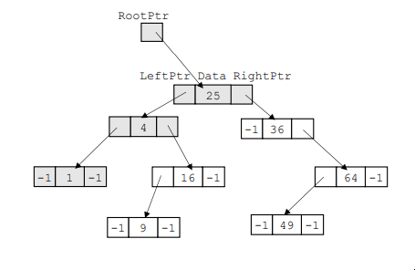
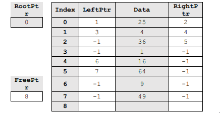
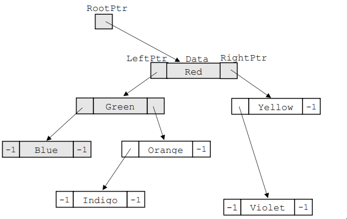
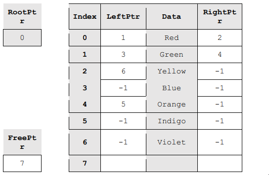
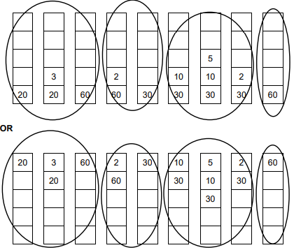
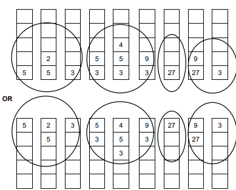

# Mark Schemes — Algorithms
**19. Computational thinking & Problem-solving** · Cambridge (CIE) A-LEVEL computer-science (9618)

## Exam Questions (40 questions)

### Q1
(a) Algorithm X is O(n), because the maximum number of items checked is equal to the number of items / increases by the same factor of 16 from row to row. **[1]**

Algorithm Y is O(log n). **[1]**

Each time the number of items is multiplied by 16, Algorithm Y checks only 4 more items. The number of checks increases linearly while the number of items increases exponentially. **[1]**

(b) **21** **[1]**

**[4 marks]**

> **[mark-scheme]**
> **1 mark** for Algorithm X is O(n) with a justification from the data: the number of checks equals the number of items // rises in proportion to the number of items // is multiplied by 16 when the number of items is multiplied by 16
> 
> **1 mark** for Algorithm Y is O(log n)
> 
> **1 mark** for a justification from the data for Algorithm Y: the number of checks increases by 4 each time the number of items is multiplied by 16 // the number of checks increases linearly as the number of items increases exponentially // the time taken increases logarithmically as the number of items increases
> 
> **1 mark** for (b): 21
> 
> Accept O(Log2 n) or O(log₂ n) for Algorithm Y
> 
> Do not accept O(n) for Algorithm X without a reason taken from the table
> 
> Do not accept 17 × 16 = 272 for (b). Multiplying the number of items by 16 adds 4 checks for Algorithm Y; it does not multiply the number of checks by 16

> **[exam-tip]**
> Look at how each column changes from one row to the next, not at the size of the numbers. The number of items is multiplied by 16 every row. Column X is also multiplied by 16, which is linear growth. Column Y goes up by 4 every row, which is how logarithmic growth appears in a table.
> 
> For part (b), continue the pattern rather than calculating a logarithm: 1 048 576 is one more row of the table, so Algorithm Y checks 17 + 4 = 21 items. Algorithm Y behaves like a binary search and Algorithm X like a linear search, but the question asks you to justify from the data, so quote the numbers.

### Q2
Algorithm A: O(n) **[1]**

Algorithm B: O(log n) **[1]**

Each time the `REPEAT` loop runs, Algorithm B discards the half of the remaining array that cannot contain `Target`. So doubling the number of items adds only one more iteration. **[1]**

**[3 marks]**

> **[mark-scheme]**
> **1 mark** for Algorithm A is O(n)
> 
> **1 mark** for Algorithm B is O(log n)
> 
> **1 mark** for the justification: the number of items still to be searched is halved on each iteration // the search area is repeatedly halved // the time taken increases logarithmically as the number of items increases // doubling the number of items adds only one iteration
> 
> Accept O(Log2 n) or O(log₂ n) for Algorithm B
> 
> Do not accept O(n) for Algorithm B. It contains one loop, but that loop does not run once for every item

> **[exam-tip]**
> Do not decide the Big O by counting loops. Algorithm B has one loop, just like Algorithm A, but it is not O(n). What matters is how many times the loop runs. Algorithm A visits every item once, so its time grows linearly with `N`. Algorithm B halves the part of the array still to be searched each time, so it runs only about 10 times for 1000 items.
> 
> You may recognise Algorithm B as a binary search. Naming it is not enough for the justification mark: say what happens to the search area on each iteration.

### Q3
(i) The time complexity or space complexity of the algorithm // how efficient the algorithm is **[1]**

(ii) The time taken increases linearly with the number of items. For example, if the number of items doubles, the maximum time taken doubles. **[1]**

**[2 marks]**

> **[mark-scheme]**
> **1 mark** for (i): the time complexity / space complexity of an algorithm // the efficiency of an algorithm // how the time or memory needed grows as the amount of data grows
> 
> **1 mark** for (ii): the time taken increases linearly / in direct proportion as the number of items increases
> 
> Do not accept for (i) "the exact time the algorithm takes, in seconds". Big O describes how the time grows with the number of items, not a measured time
> 
> Do not accept for (ii) "a linear search is slow". This does not describe how the time changes

> **[exam-tip]**
> For part (ii), use the word "linearly" or describe the link between the two quantities: twice as many items means up to twice as many checks. Words such as "slow" or "inefficient" do not show that you know what the notation means.
> 
> Remember that the `n` in O(n) stands for the number of data items. Big O never tells you the actual running time, because that also depends on the computer.

### Q4
Algorithm P evaluates the `IF` condition 499 + 498 + ... + 2 + 1 = **124 750** times. **[1]**

Algorithm Q evaluates the `IF` condition **500** times. **[1]**

Algorithm Q takes much less time. Even with the 1000 assignments needed to set every element of `Seen` to `FALSE`, it carries out far fewer steps than Algorithm P, which compares every ID with every other ID. **[1]**

Algorithm Q uses more memory, because it needs a second array of 1000 Boolean values. Algorithm P needs no extra array, only the two loop counters. **[1]**

**[4 marks]**

> **[mark-scheme]**
> **1 mark** for 124 750 for Algorithm P
> 
> **1 mark** for 500 for Algorithm Q
> 
> **1 mark** for Algorithm Q takes less time / carries out fewer steps // Algorithm P takes longer because each ID is compared with every other ID // the time taken by Algorithm P increases much faster as the number of IDs increases
> 
> **1 mark** for Algorithm Q uses more memory because of the extra array `Seen` (of 1000 elements) // Algorithm P uses less memory because it needs no extra array
> 
> Accept 124750 or 124,750 for Algorithm P
> 
> Do not accept 250 000 or 249 500 for Algorithm P. The inner loop starts at `I + 1`, so it runs 499 times when `I` is 1, 498 times when `I` is 2, and only once when `I` is 499
> 
> Do not accept 1500 for Algorithm Q. The loop that sets up `Seen` contains no `IF` condition
> 
> Do not accept "Algorithm Q uses less memory". It stores 1000 extra values that Algorithm P does not need

> **[exam-tip]**
> The common error is to multiply the two loop limits and write 500 × 500 or 499 × 500. Look at where the inner loop starts. Each pair of IDs is compared only once, so the counts are 499, 498, 497 and so on, down to 1.
> 
> A good comparison names both criteria and says which algorithm is better on each. Here there is a trade-off: Algorithm Q is much faster but needs more memory. Also notice why Algorithm Q is possible at all. It works only because every ID is known to be between 1 and 1000, so each ID can be used as an index into `Seen`.

### Q5
A binary search can only be used if the data in the array is sorted. **[1]**

This array is not sorted, and it changes after every search, so it would have to be sorted again before every binary search. **[1]**

A sort must look at every item at least once, so sorting the array takes at least as long as a linear search, which checks at most 800 items and needs no sorting. The binary search would not save any time. **[1]**

**[3 marks]**

> **[mark-scheme]**
> **1 mark** for a binary search requires the data to be sorted // a linear search does not require the data to be sorted
> 
> **1 mark** for the array would need to be sorted (again) before each search // because the data changes between searches
> 
> **1 mark** for the time taken to sort the array is greater than the time saved by using a binary search // sorting must look at every item at least once, and a linear search checks at most 800 items
> 
> Do not accept "a linear search is faster than a binary search". In general it is not. The linear search is more suitable here because of the time needed to sort the data first
> 
> Do not accept "a binary search cannot find an item that is not in the array". A binary search can report that an item is not found

> **[exam-tip]**
> Most students gain the first mark and stop. Stating that a binary search needs sorted data is not enough on its own. You must use the scenario: the data changes all the time and each version is searched only once, so the cost of sorting is paid again and again.
> 
> Do not claim that a linear search is simply faster. The question tells you that a binary search usually checks fewer items. Your answer must explain why that advantage is lost in this program.

### Q6
The time taken by each algorithm to complete the task **[1]**

The amount of memory used by each algorithm **[1]**

**[2 marks]**

> **[mark-scheme]**
> **1 mark** for the time taken to complete the task // the number of steps / comparisons / iterations the algorithm needs // time complexity
> 
> **1 mark** for the memory used // the amount of storage space the algorithm needs // space complexity
> 
> Do not accept two answers that both describe time, such as "speed" and "time taken". They are the same criterion and earn one mark
> 
> Do not accept the speed of the processor or the hardware used. That is a property of the computer, not of the algorithm

> **[exam-tip]**
> Many students write "speed" and "time taken" as their two criteria. Both describe how long the algorithm takes, so they earn one mark between them. Learn the pair that the syllabus gives: the time taken to complete the task and the memory used.
> 
> Keep your answer about the algorithm. The same algorithm runs faster on a faster computer, so "it depends on the processor" does not help you compare two algorithms.

### Q7
- Test whether `StackA` is full and output "Queue full" without adding the item **[1]**
- Loop while `StackA` is not empty **[1]**
- In the loop, pop each item from `StackA` and push it onto `StackB` **[1]**
- Push `NewItem` onto `StackB`, then pop every item from `StackB` and push it back onto `StackA` **[1]**
- In `Dequeue()`, test whether `StackA` is empty and, if so, output "Queue empty" and return an empty string **[1]**
- Otherwise pop the item from `StackA` and return it **[1]**

**[6 marks]**

> **[mark-scheme]**
> **1 mark** for testing `TopPointerA = MaxSize` and outputting "Queue full", with no item added in that case
> 
> **1 mark** for a loop that repeats while `StackA` is not empty, for example `WHILE TopPointerA > 0`
> 
> **1 mark** for popping from `StackA` and pushing onto `StackB` inside that loop
> 
> **1 mark** for pushing `NewItem` onto a stack and then a loop that moves every item from `StackB` back onto `StackA`
> 
> **1 mark** for `Dequeue()` testing whether `StackA` is empty and, if so, outputting "Queue empty" and returning an empty string
> 
> **1 mark** for otherwise returning the value popped from `StackA`
> 
> Accept `NewItem` pushed onto `StackA` instead of `StackB` after `StackA` has been emptied. The order is still correct after the items are moved back
> 
> Accept any equivalent loop condition, such as a test that the top pointer is not equal to 0, or a post-condition loop that is only entered when the stack is not empty
> 
> Accept the pop and the push in one statement, for example `CALL PushB(PopA())`
> 
> Accept `Dequeue` written without the empty brackets
> 
> Do not award the fourth mark if the items are left in `StackB`. The front of the queue must be back at the top of `StackA`, or the next `Dequeue()` removes the wrong item
> 
> Do not award the third mark if the loop also changes `TopPointerA` or `TopPointerB` directly, because the modules already update them and the pointers are then changed twice

> **[exam-tip]**
> Students often push the new item onto `StackA` straight away, as if `StackA` were a queue. It is a stack, so that puts the newest item on top, and it becomes the next item removed. The reason for the second stack is to reverse the order, add the item behind the others, then reverse it back.
> 
> Use the modules the question gives you. You do not need to write array code for the stacks, and you should not change `TopPointerA` or `TopPointerB` yourself. `PopA()` and `PushB()` already update them.

### Q8
| Stage | StackA (bottom to top) | StackB (bottom to top) |
|---|---|---|
| Before job 107 is added | 106, 105, 104 | empty |
| After step 1 | **empty** | **104, 105, 106** |
| After step 2 | **empty** | **104, 105, 106, 107** |
| After step 3 | **107, 106, 105, 104** | **empty** |

- After step 1, job 104 was popped first, so it is at the bottom of `StackB`. The order has been reversed **[1]**
- After step 2, job 107 is on top of `StackB` **[1]**
- After step 3, the order is reversed again, so job 107 is at the bottom of `StackA` and job 104 is still at the top, ready to be removed first **[1]**

**[3 marks]**

> **[mark-scheme]**
> **1 mark** for the "After step 1" row: `StackA` empty and `StackB` 104, 105, 106
> 
> **1 mark** for the "After step 2" row: `StackA` empty and `StackB` 104, 105, 106, 107
> 
> **1 mark** for the "After step 3" row: `StackA` 107, 106, 105, 104 and `StackB` empty
> 
> Each row must be fully correct in both columns to earn its mark
> 
> Follow through: award the step 2 mark if 107 is correctly added to the top of an incorrect `StackB` from step 1
> 
> Do not accept an item order written from top to bottom, for example 106, 105, 104 for `StackB` after step 1

> **[exam-tip]**
> The most common error is to copy the order across without reversing it. When you pop from one stack and push onto another, the first item popped (the top) becomes the first item pushed (the bottom). So every transfer reverses the order.
> 
> That double reversal is the whole reason two stacks are needed. The first transfer puts the rear of the queue on top, so the new item can be placed behind it. The second transfer puts the front of the queue back on top of `StackA`, so the next item removed is still job 104.

### Q9
A linked list is a dynamic data structure, so nodes can be added and removed as necessary and the queue can grow at lunchtime and shrink late at night **[1]**

A 1D array is a static data structure with a fixed size, so when the array is full no more orders can be added to the queue **[1]**

**[2 marks]**

> **[mark-scheme]**
> **1 mark** for a point about the linked list, from:
> 
> - a linked list is a dynamic data structure // is not restricted in size
> - nodes can be added or removed as necessary, so the queue can expand or contract as the number of orders changes
> - items are added and removed by changing pointers, instead of moving the data
> 
> **1 mark** for a point about the array, from:
> 
> - an array is a static data structure // is fixed in size
> - when the array is full, the queue cannot be extended any further // no more orders can be added
> 
> Accept for the array mark: the array must be declared for the busiest time, so most of its elements are unused when the queue is short
> 
> Do not accept "a linked list uses less memory". Each node also stores a pointer, so a linked list holding the same orders needs more memory, not less
> 
> Do not award both marks for two points about the linked list only. One mark must come from the array

> **[exam-tip]**
> "Justify the use of X instead of Y" is a two-sided question. Many students write two good points about the linked list and nothing about the array, and they score only 1 mark. Make one point about why the linked list suits the queue and one point about what goes wrong with the array.
> 
> Use the scenario. The question tells you the queue is sometimes empty and sometimes holds hundreds of orders. That is the clue: the size of the queue is not known in advance, and a dynamic structure copes with that while a static one does not.

### Q10
The model answer earns the marks as follows.

Checks `FreePtr` for -1 and outputs "Tree full" without adding the item **[1]**

Takes the record at `FreePtr` and moves `FreePtr` to that record's `LeftPtr`, before the record is overwritten **[1]**

Stores `NewItem` in `Data` and sets both pointers of the new record to -1 **[1]**

If the tree is empty, sets `RootPtr` to the new record **[1]**

Starts at `RootPtr` and moves left or right at each node, remembering the previous node, until a null pointer is reached **[1]**

Sets the left or the right pointer of the previous node, as appropriate, to the new record **[1]**

**[6 marks]**

> **[mark-scheme]**
> **1 mark** for checking whether `FreePtr` is -1 and, if so, outputting "Tree full" and not adding the item
> 
> **1 mark** for storing the index held in `FreePtr` and then updating `FreePtr` to `BinTree[FreePtr].LeftPtr`
> 
> **1 mark** for storing `NewItem` in the `Data` field and setting the new record's `LeftPtr` and `RightPtr` to -1
> 
> **1 mark** for setting `RootPtr` to the new record's index when `RootPtr` is -1
> 
> **1 mark** for a loop that starts at `RootPtr`, follows `LeftPtr` when the new item is smaller and `RightPtr` when it is larger, stops at a null pointer, and keeps the index of the previous node
> 
> **1 mark** for setting the correct pointer (`LeftPtr` or `RightPtr`) of the previous node to the new record's index
> 
> Accept a pre-condition loop (`WHILE`) in place of `REPEAT ... UNTIL`
> 
> Accept any identifiers for the local variables
> 
> Accept deciding left or right after the loop by comparing `NewItem` with the data in the previous node, instead of using a `BOOLEAN`
> 
> Accept an equivalent recursive solution that meets the same marking points
> 
> Do not award the second mark if the new record's `LeftPtr` is set to -1 before `FreePtr` is updated from it: the rest of the free list is lost

> **[exam-tip]**
> The order of the first few statements matters. The new record's `LeftPtr` is also the link to the next free record. Read it into `FreePtr` first, and only then set it to -1. If you do it the other way round, `FreePtr` becomes -1 and every other unused record is lost.
> 
> When the loop ends, the current pointer is -1, so it cannot tell you where to attach the new node. Keep a second pointer to the node you have just left. That node is the parent, and it is the one whose pointer you change. Also remember the empty tree: with no root there is no parent, so `RootPtr` itself must be set.

### Q11
30 goes left of 48, right of 25, then left of 36, so it becomes the left child of 36.

64 goes right of 48, left of 71, then right of 59, so it becomes the right child of 59.

| Index | LeftPtr | Data | RightPtr |
|---|---|---|---|
| 0 | 1 | 48 | 2 |
| 1 | 5 | 25 | 3 |
| 2 | 4 | 71 | -1 |
| 3 | **6** | 36 | -1 |
| 4 | -1 | 59 | **7** |
| 5 | -1 | 12 | -1 |
| 6 | **-1** | **30** | -1 |
| 7 | -1 | **64** | -1 |

Row 6 holds 30 with both pointers -1 **[1]**

Row 3 LeftPtr set to 6 **[1]**

Row 7 holds 64 with both pointers -1, and row 4 RightPtr set to 7 **[1]**

RootPtr = **0**

FreePtr = **-1** **[1]**

The cells in bold are the ones that change.

**[4 marks]**

> **[mark-scheme]**
> **1 mark** for row 6 correct: LeftPtr -1, Data 30, RightPtr -1
> 
> **1 mark** for row 3 LeftPtr changed to 6
> 
> **1 mark** for row 7 correct (LeftPtr -1, Data 64, RightPtr -1) **and** row 4 RightPtr changed to 7
> 
> **1 mark** for FreePtr = -1 **and** RootPtr = 0 **and** rows 0, 1, 2 and 5 unchanged
> 
> Do not accept row 6 with LeftPtr 7: that is the old free list link and must be replaced by a null pointer when the record joins the tree
> 
> Do not accept 8 for FreePtr: there is no record 8, and the free list ends at -1

> **[exam-tip]**
> Adding a node changes two records, not one. You fill in the new record, and you also change one pointer in its parent. Students often write 30 into row 6 and forget to point row 3 at it, so 30 can never be found.
> 
> Before you use a free record, read its `LeftPtr`. That value becomes the new `FreePtr`. Then overwrite the new record's `LeftPtr` with -1, because a new node is always a leaf.

### Q12
Nodes visited: **0, 2, 5** (Lima, Quito, Oslo) **[1]**

Value returned: **-1** (a null pointer, because Nairobi is not in the tree) **[1]**

**[2 marks]**

> **[mark-scheme]**
> **1 mark** for the indexes 0, 2, 5 in that order and no others
> 
> **1 mark** for -1 / null pointer as the value returned
> 
> Accept the data values Lima, Quito, Oslo in that order for the first mark
> 
> Do not accept any list that includes 1, 3 or 4, or that visits the nodes in row order: the search must follow the pointers
> 
> Do not accept 5 as the value returned: Oslo is the last node visited, not a match
> 
> Do not accept 6 as the value returned: that is the value of `FreePtr`, not the result of the search

> **[exam-tip]**
> The rows of the array are in the order the items were added, not the order of the tree. Do not read down the Data column. Start at the index held in `RootPtr` and use the pointers to jump from row to row.
> 
> At Oslo, Nairobi comes before Oslo, so the search takes the left pointer. That pointer is -1, which means the item is not in the tree. The search stops there and returns the null pointer. It does not return the last index it visited.

### Q13
**[6 marks]**

> **[mark-scheme]**
> **Max six from:**
> 
> - **MP1** Use of a `FOR` loop from 2 to 40 to take each value in turn
> - **MP2** Temporary storage of the finishing time being inserted
> - **MP3** Temporary storage of the matching runner ID
> - **MP4** Use of a `WHILE` loop with a correct exit condition: stops at the start of the array or when a time no greater than the stored time is found
> - **MP5** Moving both the time and the ID up one place inside the loop
> - **MP6** Correct updating of the position variable inside the loop
> - **MP7** Final insertion of both the stored time and the stored ID at the correct position
> 
> **[6 marks]**
> 
> Accept a `FOR` loop from 1 to 39 that inserts the value at position `Index + 1`, with the matching changes to the other statements.
> 
> Accept the `WHILE` condition written with `>=` in place of `>`. The array is still put into ascending order, although runners with equal times change places.
> 
> Do not award MP5 or MP7 if `RunnerID` is not moved in step with `FinishTime`. Each ID would then no longer match its finishing time.
> 
> Do not award MP1 or MP4 for an algorithm that makes repeated passes through the whole array, swapping adjacent pairs. That is a bubble sort, not an insertion sort.

> **[exam-tip]**
> The mark that students lose most often is the one for the second array. Every time a finishing time is stored, moved or inserted, the matching ID must be stored, moved or inserted in the same way. If you forget one of these lines, runners end up with the wrong times.
> 
> A second common error is to write over the value being inserted before it has been saved. Store both `FinishTime[Index]` and `RunnerID[Index]` in temporary variables before the `WHILE` loop starts, because the first move copies a value into that position.

### Q14
|   | Numbers[1] | Numbers[2] | Numbers[3] | Numbers[4] | Numbers[5] | Numbers[6] |
|---|---|---|---|---|---|---|
| Before the sort | 16 | 4 | 11 | 2 | 19 | 7 |
| Index = 2 | **4** | **16** | **11** | **2** | **19** | **7** |
| Index = 3 | **4** | **11** | **16** | **2** | **19** | **7** |
| Index = 4 | **2** | **4** | **11** | **16** | **19** | **7** |

Index = 2 **[1]**

Index = 3 **[1]**

Index = 4 **[1]**

**[3 marks]**

> **[mark-scheme]**
> **1 mark** for the row for Index = 2: 4, 16, 11, 2, 19, 7
> 
> **1 mark** for the row for Index = 3: 4, 11, 16, 2, 19, 7
> 
> **1 mark** for the row for Index = 4: 2, 4, 11, 16, 19, 7
> 
> Each row must be fully correct to gain the mark.
> 
> Follow through: if one row is wrong, you can still earn the mark for a later row that is correct for one iteration of the algorithm applied to your previous row.
> 
> Do not accept a row in which 19 or 7 has moved. The `FOR` loop has not reached `Numbers[5]` or `Numbers[6]` by the end of the iteration when `Index` is 4.

> **[exam-tip]**
> It is tempting to swap two neighbouring values and move on, as you would in a bubble sort. In an insertion sort the value in `Item` keeps moving left until it meets a smaller value or reaches `Numbers[1]`. When `Index` is 4, the 2 moves past 16, 11 and 4 in one iteration and goes straight to the front.
> 
> Remember that the values to the right of `Index` are untouched. Copy them across unchanged, and only change the part of the array from `Numbers[1]` to `Numbers[Index]`.

### Q15
Function header with parameter and return type **[1]**

Lower and upper bounds initialised to 1 and 200 **[1]**

Loop that stops when found or when the lower bound passes the upper bound **[1]**

Middle index calculated with DIV **[1]**

Lower bound moved to Mid + 1 or upper bound moved to Mid - 1 after the comparison **[1]**

Mid returned if found and -1 returned if not **[1]**

**[6 marks]**

> **[mark-scheme]**
> **Any six from:**
> 
> - function header with the parameter `Target : STRING` and `RETURNS INTEGER`, ending with `ENDFUNCTION`
> - initialising the lower bound to 1 **and** the upper bound to 200
> - a conditional loop that stops when the name is found **or** when the lower bound is greater than the upper bound
> - calculating the middle index using `DIV 2` inside the loop
> - comparing `Names[Mid]` with `Target` and setting a flag or returning when they are equal
> - if `Names[Mid]` is less than `Target`, setting the lower bound to `Mid + 1`
> - if `Names[Mid]` is greater than `Target`, setting the upper bound to `Mid - 1`
> - returning `Mid` if found **and** -1 if not found
> 
> **[6 marks]**
> 
> Accept `RETURN Mid` inside the loop when the names match, followed by `RETURN -1` after the loop
> 
> Accept a middle index calculated as `Lower + (Upper - Lower) DIV 2`, or with + 1 added before the `DIV`, provided it is used consistently
> 
> Accept a `REPEAT ... UNTIL` loop with an equivalent condition
> 
> Do not award the middle index mark for `(Lower + Upper) / 2`. The `/` operator gives a REAL value, which cannot be used as an array index
> 
> Do not award the bound marks for `Lower ← Mid` or `Upper ← Mid`. This can cause an infinite loop when the name is not in the array

> **[exam-tip]**
> The most common error is the loop condition. A loop that only tests `Found = FALSE` never ends when the name is not in the array. The search must also stop when `Lower` becomes greater than `Upper`, because there are then no elements left to check.
> 
> Use `DIV` for the middle index. An array index must be an integer, and in the Cambridge pseudocode `/` always gives a REAL result. Strings can be compared using the less than and greater than operators in the same way as numbers, which is what makes a binary search on names possible.

### Q16
The first value is treated as a sorted list of one item, and the sort starts with the second value. **[1]**

Each value in turn is compared with the values to its left. Every larger value is moved up one place, and the value is inserted into the gap that is left. **[1]**

**[2 marks]**

> **[mark-scheme]**
> **Any two from:**
> 
> - The first value is treated as sorted // the sort starts at the second value
> - The next value is taken and stored in a temporary variable
> - It is compared with each value to its left / in the sorted part, in turn
> - Each value that is larger is moved up / to the right one place
> - The value is inserted into the gap // when a smaller or equal value, or the start of the array, is reached
> - This is repeated for every value until the end of the array is reached
> 
> **[2 marks]**
> 
> Do not accept a description of comparing adjacent pairs and swapping them over a series of passes. That describes a bubble sort.

> **[exam-tip]**
> The most common way to lose both marks is to describe a bubble sort. An insertion sort does not make passes through the whole array. It takes one value at a time and inserts it into the correct place in the part of the array that is already sorted.
> 
> Use the word "inserted" or "inserts" in your answer. It shows the examiner that you know what makes this sort different.

### Q17
| Algorithm | Number of comparisons |
|---|---|
| A: bubble sort | **15** |
| B: insertion sort | **9** |

Algorithm A: 5 + 4 + 3 + 2 + 1 = 15 **[1]**

Algorithm B: 1 + 1 + 1 + 1 + 5 = 9 **[1]**

The values 3, 5, 6, 8 and 9 are already in order. In the insertion sort, each of 5, 6, 8 and 9 needs only one comparison, because the loop stops as soon as the value to its left is smaller. **[1]**

The bubble sort can move the 2 only one place towards the front in each pass, so it needs five passes, and each pass compares again pairs that are already in order. The insertion sort moves the 2 to the front in a single iteration. **[1]**

**[4 marks]**

> **[mark-scheme]**
> **1 mark** for 15 comparisons for Algorithm A
> 
> **1 mark** for 9 comparisons for Algorithm B
> 
> **1 mark** each for any two of these points, to a maximum of 2: in the insertion sort, a value already in the correct place needs only one comparison, because the `WHILE` loop stops as soon as a smaller value is found to its left; the insertion sort moves the 2 to its final position in one iteration of the `FOR` loop; the bubble sort moves the 2 only one place per pass, so five passes are needed; the bubble sort compares again pairs that are already in order in every pass
> 
> Do not accept 25 or 30 for Algorithm A. Those totals assume five comparisons in every pass, but `Boundary` is reduced by 1 after every pass, so each pass makes one comparison fewer than the pass before. The algorithm does start a sixth pass, but `Boundary` is then 0, so the `FOR` loop does not run and no comparison is made.
> 
> Do not accept 10 for Algorithm B. When `Pos` reaches 1 the 2 is at the front of the array, and there is no value to its left to compare it with.

> **[exam-tip]**
> Students often expect the bubble sort to be quick here because the data is almost in order. It is not. A small value near the end of the array moves only one place per pass in a bubble sort, so a single value in the wrong place can force the maximum number of passes.
> 
> When you explain a difference in performance, refer to the actual data in the question. "Insertion sort is more efficient" earns nothing on its own. Say what each algorithm does with this data: how far the 2 moves in each pass or iteration, and which comparisons are repeated.

### Q18
Binary search: the maximum number of comparisons increases by only one, from 10 to 11 **[1]**

This is because each comparison halves the part of the array still being searched, so doubling the number of items needs just one more comparison / the number of comparisons increases logarithmically **[1]**

Linear search: the maximum number of comparisons doubles, from 1000 to 2000, because every item may need to be checked / it increases linearly with the number of items **[1]**

**[3 marks]**

> **[mark-scheme]**
> **1 mark** for binary search: the maximum increases by one // increases from 10 to 11
> 
> **1 mark** for the reason: each comparison halves the search area // the time to search increases logarithmically as the number of items increases
> 
> **1 mark** for linear search: the maximum doubles // increases from 1000 to 2000 // increases linearly with the number of items
> 
> Accept O(log n) for binary search and O(n) for linear search only when the effect of doubling is also described
> 
> Do not accept "the binary search takes twice as long". Doubling the number of items adds only one comparison
> 
> Do not accept "the binary search stays the same". It needs one more comparison

> **[exam-tip]**
> Use the numbers in the question. Many answers only say "binary search is faster". This gains no marks here, because the question asks how the maximum number of comparisons changes when the array grows.
> 
> You can check the binary search figure without a calculator. 2 to the power 10 is 1024, which is more than 1000, so 10 comparisons are enough for 1000 items. 2 to the power 11 is 2048, which is more than 2000, so 11 comparisons are enough for 2000 items.

### Q19
**Final answer:** **36, 58, 47, 52**

36 (index 8), then 58 (index 12) **[1]**

then 47 (index 10), then 52 (index 11) **[1]**

**[2 marks]**

> **[mark-scheme]**
> **1 mark** for 36 then 58 as the first two values, in this order
> 
> **1 mark** for 47 then 52 as the third and fourth values, in this order, with no other values
> 
> Accept the index values 8, 12, 10, 11 in place of the array values
> 
> Do not accept 30 as the first value. (1 + 15) DIV 2 is 8, and `Scores[8]` is 36

> **[exam-tip]**
> Work with the indexes, not the values. Write down `Lower`, `Upper` and `Mid` for each pass: (1, 15, 8), then (9, 15, 12), then (9, 11, 10), then (11, 11, 11). Students who try to find the middle value by eye often pick the wrong element.
> 
> Remember the + 1 and - 1. After 36 is checked, the new lower bound is index 9, not index 8, because element 8 has already been compared. Leaving out the + 1 or - 1 gives a different sequence of values.

### Q20
Function header with parameter and return type **[1]**

Index initialised to 1 **[1]**

Loop that stops when found or after element 500 **[1]**

Comparison of `Readings[Index]` with `SearchValue` **[1]**

Index increased by 1 inside the loop **[1]**

Index returned if found and -1 returned if not **[1]**

**[6 marks]**

> **[mark-scheme]**
> **1 mark** for a function header with the parameter `SearchValue : INTEGER` and `RETURNS INTEGER`, ending with `ENDFUNCTION`
> 
> **1 mark** for initialising the index to 1 (the lower bound of the array)
> 
> **1 mark** for a conditional loop that stops when the value is found **or** after element 500 has been checked
> 
> **1 mark** for comparing `Readings[Index]` with `SearchValue` inside the loop
> 
> **1 mark** for increasing the index by 1 inside the loop
> 
> **1 mark** for returning the index of the match if found **and** -1 if not found
> 
> Accept a `REPEAT ... UNTIL` loop with an equivalent condition
> 
> Accept a `FOR` loop from 1 to 500 that contains `RETURN Index` inside the `IF`, followed by `RETURN -1` after the loop. `RETURN` ends the function immediately, so the search stops at the first match
> 
> Accept a separate result variable, set to -1 at the start and to the index when the match is found, that is returned at the end
> 
> Do not award the loop mark for a `FOR` loop that does not stop at the first match, because it can return the index of a later match
> 
> Do not award the return mark if the index returned is one more than the position of the match, for example when the index is increased after `Found` is set to TRUE and then returned without subtracting 1

> **[exam-tip]**
> Check that the loop stops when `Index` passes 500. If the loop runs once more, `Readings[501]` is accessed. This is outside the array bounds and causes a run-time error.
> 
> Many students increase `Index` on every pass, even on the pass where the match is found. The function then returns a position one too high. Either increase the index only when there is no match, as in the model answer, or return `Index - 1`.

### Q21
|   | Points[1] | Points[2] | Points[3] | Points[4] | Points[5] | Points[6] |
|---|---|---|---|---|---|---|
| Before the sort | 14 | 31 | 8 | 27 | 19 | 42 |
| After pass 1 | **31** | **14** | **27** | **19** | **42** | **8** |
| After pass 2 | **31** | **27** | **19** | **42** | **14** | **8** |
| After pass 3 | **31** | **27** | **42** | **19** | **14** | **8** |

After pass 1 **[1]**

After pass 2 **[1]**

After pass 3 **[1]**

**[3 marks]**

> **[mark-scheme]**
> **1 mark** for the row after pass 1: 31, 14, 27, 19, 42, 8
> 
> **1 mark** for the row after pass 2: 31, 27, 19, 42, 14, 8
> 
> **1 mark** for the row after pass 3: 31, 27, 42, 19, 14, 8
> 
> Each row must be fully correct to gain the mark.
> 
> Follow through: if one row is wrong, you can still earn the mark for a later row that is correct for one pass of the algorithm applied to your previous row.

> **[exam-tip]**
> The condition is `Points[J] < Points[J + 1]`, so two values are swapped when the first is smaller. This sort puts the smallest value at the end after pass 1, not the largest. If you have learned the ascending version by heart, you may move 42 to the end, which loses every mark.
> 
> A common error is to compare each value with the original array instead of with the array as it is at that moment. A value that has just been swapped into `Points[J + 1]` is the one compared next. In pass 1, once 31 and 14 have been swapped, the 8 moves right one place at a time past 27, 19 and 42, and ends the pass in `Points[6]`.

### Q22
**[6 marks]**

> **[mark-scheme]**
> **1 mark** for a function header with one `STRING` parameter and `RETURNS INTEGER`, closed with `ENDFUNCTION`
> 
> **1 mark** for starting the search at the index held in `FrontPointer`
> 
> **1 mark** for a loop that checks exactly `Length` items
> 
> **1 mark** for comparing the array element at the current index with the parameter and returning the position counter when they match
> 
> **1 mark** for moving the index on by 1 and setting it back to 1 when it goes past `MaxSize`
> 
> **1 mark** for returning -1 after all the items in the queue have been checked without a match
> 
> Accept a conditional loop, such as a `WHILE` loop that runs while the counter is less than or equal to `Length` and the name has not been found, with the counter increased inside the loop.
> 
> Accept `Index ← (Index MOD MaxSize) + 1` for the fifth mark.
> 
> Accept a `BOOLEAN` flag or a result variable set inside the loop and returned once after the loop, in place of `RETURN` inside the loop.
> 
> Accept the value 6 in place of `MaxSize`.
> 
> Do not accept a loop `FOR Index ← FrontPointer TO RearPointer`. When the queue has wrapped, as here, `FrontPointer` is greater than `RearPointer`, so the loop body is never executed and every search returns -1.
> 
> Do not accept a loop that checks all six array locations from index 1. It finds names that have already been removed, so `Position("Okoro")` would not return -1, and it returns the array index rather than the position in the queue.
> 
> Do not accept a solution that calls `Dequeue()` to reach each item. This removes the items and changes the queue, which the question does not allow.

> **[exam-tip]**
> Count the items, not the array locations. The loop must run `Length` times starting from `FrontPointer`, because that is the only part of the array that holds the queue. Students who loop from `FrontPointer` to `RearPointer` write code that works on a queue that has not wrapped and fails on this one, and the example in the question has been chosen to show that.
> 
> Keep two separate variables: one for the array index, which wraps back to 1, and one for the position in the queue, which counts 1, 2, 3 and so on. Returning the array index instead of the position is the other common way to lose the mark for the result.

### Q23
| Index | Codes[Index] | Found | OUTPUT |
|---|---|---|---|
| **1** | **"M4"** | **FALSE** |   |
| **2** | **"T9"** | **FALSE** |   |
| **3** | **"A2"** | **FALSE** |   |
| **4** | **"K7"** | **TRUE** | **Found at 4** |
|   |   |   |   |
|   |   |   |   |

Index column 1 to 4, stopping at 4 **[1]**

Codes[Index] column "M4", "T9", "A2", "K7" **[1]**

Found is FALSE for the first three passes and TRUE on the fourth **[1]**

OUTPUT is Found at 4, only once, after the loop ends **[1]**

**[4 marks]**

> **[mark-scheme]**
> **1 mark** for the Index column 1, 2, 3, 4 with no further values
> 
> **1 mark** for the Codes[Index] column "M4", "T9", "A2", "K7" in order
> 
> **1 mark** for Found FALSE, FALSE, FALSE, TRUE
> 
> **1 mark** for the output Found at 4 as the only output
> 
> Accept the initial `Found` value of FALSE shown in an extra first row, provided the rest of the table is correct
> 
> Accept the Codes[Index] values with or without quotation marks
> 
> Do not accept any values in rows 5 and 6. The loop ends as soon as `Found` is TRUE
> 
> Do not accept an output of Found at 5. `Index` is not increased again after the match

> **[exam-tip]**
> The most common error is to keep tracing to Index 6. The `UNTIL` condition is `Found OR Index = 6`, so the loop stops as soon as either part is TRUE. Once "K7" is matched on the fourth pass, `Found` is TRUE and the loop ends.
> 
> Watch where `Index` is increased. Here it happens at the start of each pass, before the comparison, so `Index` still holds 4 when the output is produced. In pseudocode that increases the index after the comparison, the position of the match is one less than the final index, which is why some algorithms output `Count - 1`.

### Q24
Number of passes: **1** **[1]**

Number of times the condition is evaluated: **7** **[1]**

**[2 marks]**

> **[mark-scheme]**
> **1 mark** for 1 pass
> 
> **1 mark** for 7
> 
> Do not accept 8 for the number of times the condition is evaluated. The `FOR` loop runs from 1 to `Boundary`, which is 7, because eight values form only seven adjacent pairs.
> 
> Do not accept 7 passes. The data is already in order, so no swap is made in the first pass, `NoSwaps` stays `TRUE` and the `REPEAT` loop ends.

> **[exam-tip]**
> Many students count 7 passes because the array has 8 values. That is how many passes a bubble sort without the `NoSwaps` flag would make. Here the flag is set to `TRUE` at the start of every pass and is only changed to `FALSE` when a swap is made. With data already in order, one pass is enough to prove it.
> 
> This is why the initial order of the data affects the performance of a sorting routine. Check the loop bounds carefully when counting comparisons: `J` stops at `Boundary`, not at 8, because the last comparison is between `Data[7]` and `Data[8]`.

### Q25
**[6 marks]**

> **[mark-scheme]**
> **1 mark** for checking whether `FreePtr` is `NullPtr` and outputting a message if it is
> 
> **1 mark** for storing `NewItem` in the `Data` field of the node that `FreePtr` points to
> 
> **1 mark** for moving `FreePtr` to the next free node, using the new node's `NextPointer` before that pointer is changed
> 
> **1 mark** for a loop that starts at `HeadPointer` and follows `NextPointer`, keeping a pointer to the previous node, and stops at the null pointer or at the first data item greater than `NewItem`
> 
> **1 mark** for inserting at the start: the new node points to the old first node, and `HeadPointer` is set to the new node
> 
> **1 mark** for inserting after the previous node: the new node points to the current node, and the previous node points to the new node
> 
> Accept `>=` in place of `>`, so that a duplicate name is placed before the existing one.
> 
> Accept `NullPtr` or 0 throughout.
> 
> Accept any other loop structure that meets the fourth marking point, provided it never reads a node when the pointer is the null pointer.
> 
> Do not accept the last mark if the previous node's pointer is changed first and then used to set the new node's pointer. The rest of the list is lost.

> **[exam-tip]**
> Order matters twice in this algorithm. Update `FreePtr` before you overwrite the new node's `NextPointer`, or the rest of the free list is lost. When you insert, set the new node's pointer first and change the previous node's pointer second.
> 
> Test your answer on an empty list and on an item that belongs first. In both cases the loop never moves `PrevPtr` away from the null pointer, so `HeadPointer` must change. Students who handle only the middle of the list lose this mark.
> 
> Avoid a loop condition such as `NowPtr <> NullPtr AND List[NowPtr].Data < NewItem`. When `NowPtr` reaches 0 the second test reads `List[0]`, which is outside the array bounds.

### Q26
| Operation | Value returned | FrontPointer | RearPointer | Length |
|---|---|---|---|---|
| CALL Enqueue("Job16") | no value returned | **5** | **1** | **2** |
| Dequeue() | **"Job15"** | **1** | **1** | **1** |
| Dequeue() | **"Job16"** | **1** | **0** | **0** |

Row 1 **[1]**

Row 2 **[1]**

Row 3 **[1]**

**[3 marks]**

> **[mark-scheme]**
> **1 mark** for row 1: `FrontPointer` = 5, `RearPointer` = 1, `Length` = 2
> 
> **1 mark** for row 2: `"Job15"` returned, `FrontPointer` = 1, `RearPointer` = 1, `Length` = 1
> 
> **1 mark** for row 3: `"Job16"` returned, `FrontPointer` = 1, `RearPointer` = 0, `Length` = 0
> 
> Accept the returned values written without quotation marks.
> 
> Do not accept `RearPointer` = 6 in row 1. `RearPointer` becomes 6 and is then set back to 1 before `"Job16"` is stored, because 6 is greater than `MaxSize`.
> 
> Do not accept `FrontPointer` = 6 in row 2. `Length` is 1 after the item is removed, so the `ELSE` branch runs and the front pointer wraps back to 1.
> 
> Do not accept `FrontPointer` = 2 and `RearPointer` = 1 in row 3. `Length` becomes 0, so `Initialise()` is called and resets both pointers.
> 
> Do not accept `"Job11"` in row 3. The array location at index 1 was overwritten with `"Job16"` in row 1.

> **[exam-tip]**
> Trace the code line by line. Do not work out the answer from what you think a queue should do. The last row is where most marks are lost: students move the front pointer on to 2, which is what happens to every other removal, and miss the call to `Initialise()` that runs when the queue becomes empty.
> 
> Removing an item does not delete it from the array. `"Job12"`, `"Job13"` and `"Job14"` stay in the array throughout, but they are never part of the queue in this trace. Only the pointers and `Length` decide which array locations hold the queue.

### Q27
(i) `FindItem(12)` returns **2** **[1]**

(ii) `FindItem(45)` returns **-1** **[1]**

**[2 marks]**

> **[mark-scheme]**
> **1 mark** for 2
> 
> **1 mark** for -1
> 
> Do not accept 4 for (i). The value 12 is also stored at index 4, but `RETURN` ends the function as soon as the first match is found at index 2
> 
> Do not accept 9 or "not found" for (ii). The function returns the integer -1

> **[exam-tip]**
> The value 12 appears twice on purpose. A linear search checks the elements in order from index 1, so it finds the first match and stops. When `RETURN` is executed inside the loop, the function ends immediately and no more elements are checked.
> 
> For (ii), read the last line of the function. The loop checks all 8 elements, finds no match, and then `RETURN -1` is executed. Students who write 9 have given the value of `Index` after the loop, which is not what the function returns.

### Q28
| Code | TopPointer | Stack[1] | Stack[2] | Stack[3] | OUTPUT |
|---|---|---|---|---|---|
|   | 0 |   |   |   |   |
| 'U' |   |   |   |   | **'-'** |
| 'A' | **1** | **'A'** |   |   |   |
| 'B' | **2** |   | **'B'** |   |   |
| 'U' | **1** |   |   |   | **'B'** |
| 'C' | **2** |   | **'C'** |   |   |
| 'D' | **3** |   |   | **'D'** |   |
| 'E' |   |   |   |   | **Full** |
| 'U' | **2** |   |   |   | **'D'** |

- First 'U': the stack is empty, so `TopPointer` stays 0 and `Pop()` returns '-' **[1]**
- `TopPointer` takes the values 1, 2, 1, 2, 3, then 2 at the final 'U' **[1]**
- 'A' is stored in `Stack[1]`; 'B' is stored in `Stack[2]` and later overwritten by 'C' **[1]**
- 'D' is stored in `Stack[3]` and stays there after the final pop **[1]**
- The pops output 'B' and 'D', and 'E' outputs "Full" with `TopPointer` unchanged at 3 **[1]**

**[5 marks]**

> **[mark-scheme]**
> **1 mark** for OUTPUT '-' in the first 'U' row, with `TopPointer` not changed from 0
> 
> **1 mark** for the `TopPointer` column: 1, 2, 1, 2, 3, (no change), 2
> 
> **1 mark** for 'A' in `Stack[1]`, and 'B' then 'C' in `Stack[2]`
> 
> **1 mark** for 'D' in `Stack[3]`, with no change to `Stack[3]` in the 'E' row or the final 'U' row
> 
> **1 mark** for OUTPUT 'B', Full and 'D' in the correct rows only
> 
> Accept the output values with or without quotation marks
> 
> Accept repeated values in unchanged cells, as long as every value is correct
> 
> Do not award the fourth mark if a new entry in the `Stack[3]` column shows 'D' being removed (for example "empty" or a dash) in the 'E' or final 'U' row. A blank cell there is correct, because it means no change. `Pop()` only moves the pointer; it does not remove the value from the array

> **[exam-tip]**
> Two rows catch students out. At the first 'U' the stack is empty, so the `IF` condition is `FALSE` and nothing changes except the output of '-'. At 'E' the stack is full, so `Push()` outputs "Full" and does not change `TopPointer` or the array. A common mistake is to write 4 for `TopPointer` in the 'E' row.
> 
> When you pop, only `TopPointer` changes. Do not rub out the popped value from the array column. It stays there until a later push overwrites it, which is exactly what happens to 'B' when 'C' is pushed.

### Q29
| Index | Data | NextPointer |
|---|---|---|
| 1 | Panda | 5 |
| 2 | Camel | 7 |
| 3 |   | 0 |
| 4 | Bear | 2 |
| 5 | Tiger | 0 |
| 6 |   | 3 |
| 7 | Eagle | **1** |
| 8 | Horse | **6** |

| HeadPointer | 4 |
|---|---|
| FreePtr | **8** |

The node before Horse (Eagle, index 7) now points to the node after Horse (Panda, index 1) **[1]**

The deleted node (index 8) becomes the first free node, so `FreePtr` is 8 and node 8 points to the old first free node, 6 **[1]**

`HeadPointer` and all other pointers are unchanged **[1]**

**[3 marks]**

> **[mark-scheme]**
> **1 mark** for `NextPointer` of index 7 is 1
> 
> **1 mark** for `FreePtr` is 8 **and** `NextPointer` of index 8 is 6
> 
> **1 mark** for `HeadPointer` is 4 **and** the other six `NextPointer` values unchanged: index 1 is 5, index 2 is 7, index 3 is 0, index 4 is 2, index 5 is 0, index 6 is 3
> 
> Do not accept 0 or 1 for `NextPointer` of index 8. With 0, nodes 6 and 3 are cut off from the free list and can never be used again. With 1, the free list runs into the linked list.

> **[exam-tip]**
> The pointer that removes Horse from the list is not in the Horse row. It is in the row of the node **before** Horse. Eagle must now skip Horse and point straight to Panda. Many students change the Horse row and leave Eagle pointing at 8, so Horse is still in the list.
> 
> A deleted node is not thrown away. It joins the free list so that its space can be reused. Adding it at the start takes two changes, made in this order: the deleted node points to the old first free node, then `FreePtr` points to the deleted node.

### Q30
Error 1: line 03 should be `TopPointer ← 0` **[1]**

Error 2: line 07 should be `IF TopPointer < MaxSize THEN` **[1]**

Error 3: lines 08 and 09 are in the wrong order. The pointer must be incremented before the item is stored **[1]**

**[3 marks]**

> **[mark-scheme]**
> **1 mark** for line 03 corrected to `TopPointer ← 0`
> 
> **1 mark** for line 07 corrected to `IF TopPointer < MaxSize THEN`
> 
> **1 mark** for lines 08 and 09 swapped, so that `TopPointer` is incremented before `NewItem` is stored
> 
> Accept `TopPointer ← BasePointer - 1` for line 03
> 
> Accept `IF TopPointer <= MaxSize - 1 THEN` for line 07
> 
> Accept line 08 changed to `Stack[TopPointer + 1] ← NewItem`, with line 09 left as it is, for the third mark
> 
> Each mark needs the line number and the correction. Do not accept a line number alone

> **[exam-tip]**
> The three errors only show up when you test the boundaries. Trace the first push: with line 08 before line 09, the item goes into `Stack[0]`, which is outside the array bounds. Then trace the push when `TopPointer` is 50: with `<=`, the test is `TRUE`, so the procedure tries to use `Stack[51]`.
> 
> Read the pointer description in the question before you correct anything. Here `TopPointer` points to the top item, not to the next free space, so it must start at 0 and the increment must come first.

### Q31
**[2 marks]**

> **[mark-scheme]**
> **1 mark** for a function header with no parameters and `RETURNS BOOLEAN`, closed with `ENDFUNCTION`
> 
> **1 mark** for returning `TRUE` when `Length` is equal to `MaxSize` and `FALSE` otherwise
> 
> Accept `RETURN Length = MaxSize` as a single line for the second mark.
> 
> Accept the value 6 in place of `MaxSize`, and `Length >= MaxSize` in place of `Length = MaxSize`.
> 
> Accept the result assigned to a `BOOLEAN` variable that is then returned.
> 
> Do not accept `RearPointer = MaxSize` as the test. The rear pointer can be at index 6 when items have already been removed from the front, for example with `FrontPointer` = 4, `RearPointer` = 6 and `Length` = 3, so the queue is not full.
> 
> Do not accept `FrontPointer = 1 AND RearPointer = MaxSize` as the test. A full queue can start at any index, for example `FrontPointer` = 3 and `RearPointer` = 2 with six items stored.

> **[exam-tip]**
> The common error is to test the rear pointer against the end of the array. That works for a queue that never wraps, but in this implementation the pointers keep moving round the array, so the position of the rear pointer does not tell you how many items are stored. Only `Length` does.
> 
> Always write the header in full. A function that returns a value needs `RETURNS` and a data type, and a missing `RETURNS BOOLEAN` loses a mark even when the test is correct.

### Q32
`TopPointer` = 3 **[1]**

The item at the top of the stack is "Suva" (stored in `Stack[3]`) **[1]**

Working:

- The first pop removes "Doha" and `TopPointer` goes from 4 to 3
- The second pop removes "Rome" and `TopPointer` goes from 3 to 2
- The push adds 1 to `TopPointer`, giving 3, then stores "Suva" in `Stack[3]`, overwriting "Rome"

**[2 marks]**

> **[mark-scheme]**
> **1 mark** for `TopPointer` = 3
> 
> **1 mark** for "Suva" as the item at the top of the stack
> 
> Accept "Suva" in `Stack[3]` / in index 3 for the second mark
> 
> Do not accept "Kyiv" as the top item. Index 5 is above `TopPointer`, so "Kyiv" is not part of the stack
> 
> Do not accept `TopPointer` = 6. The new item goes to the index after `TopPointer`, not to the first empty element of the array

> **[exam-tip]**
> The pointer decides what is in the stack, not the array. Many students see "Kyiv" in index 5, or the empty element at index 6, and use those. Popping only changes `TopPointer`. The old values stay in the array until a push overwrites them, so after these operations "Doha" is still in index 4 even though it is no longer on the stack.

### Q33
Accra, Cairo, Delhi, Lima, Oslo **[1]**

`FreePtr` is 3 **[1]**

**[2 marks]**

> **[mark-scheme]**
> **1 mark** for Accra, Cairo, Delhi, Lima, Oslo, all five in this order with no other items
> 
> **1 mark** for 3
> 
> Do not accept 8 for the second mark. Index 8 is the next row of the array, not the next node in the free list.
> 
> Do not accept 7 for the second mark. Node 7 is the node the new city is stored in, so it is no longer free.

> **[exam-tip]**
> Follow the pointers, not the row numbers. Start at the index held in `HeadPointer`, read the data there, then go to the index held in that node's `NextPointer`. Stop when you reach the null pointer.
> 
> The free list is a linked list too. A new item is stored in the first free node, which is node 7, and `FreePtr` then takes the value held in node 7's `NextPointer`. Many students give 8 because it is the next row down the table.

### Q34
**One **mark for each correctly completed line (Max 4)

`DECLARE Widgets : ARRAY[1:50000] OF STRING`

`DECLARE TopOfList : INTEGER`

`DECLARE EndOfList : INTEGER`

`DECLARE Count : INTEGER`

`DECLARE ToFind : STRING`

`DECLARE Found : BOOLEAN`

`DECLARE NotInList : BOOLEAN`

`TopOfList ← 1`

`EndOfList ← 50000`

`OUTPUT "Enter the name of the item you wish to find "`

`INPUT ToFind`

`Found ← FALSE`

`NotInList ← FALSE`

`Count ← TopOfList`

`WHILE Found = FALSE AND NotInList = FALSE   // Count <= EndOfList`

`    IF ToFind = Widgets[Count]  // Widgets[Count] = ToFind THEN`

`        Found ← TRUE`

`    ENDIF`

`    Count ← Count + 1`

`    IF Found = FALSE AND Count > EndOfList THEN`

`        NotInList ← TRUE`

`    ENDIF`

`ENDWHILE`

`IF Found = TRUE THEN`

`    OUTPUT "Item found at position ", Count - 1, " in array"`

`ELSE`

`    OUTPUT "Item not in array"`

`ENDIF`
Max 4

One mark per mark point (Max 3)

**MP1** Linear search sequentially checks each element of the array / list.
**MP2** … until the matching element is found, or the end of the array / list is reached.
**MP3** Binary search finds the mid-point of an array/list and determines which side contains the item to be found
**MP4** … it discards the half of the array/list not containing the search item // … it finds the position of a target value within an array / list by repeatedly halving the target search field.
**MP5** The binary search requires the elements to be sorted // The linear search does not require the elements to be sorted.
**MP6** The binary search will usually do many fewer comparisons of records/iterations against the target than a linear search before it finds its target.
**MP7** Linear search starts at the beginning of the array/list and binary search starts in the middle of the array/list.

**One mark per mark point (Max 2)**
**MP8** Big O for binary search is O (Log2 n)
**MP9** Big O for linear search is O (n)
**MP10** Big O notation is used to indicate the time / space complexity of an algorithm

### Q35
> **[mark-scheme]**
> One mark
> 
> The elements are sorted according to the compare function / in ascending / descending order.
One mark for each correctly completed line (Max 5)

`DECLARE Names : ARRAY[1:100000] OF STRING`

`DECLARE TopOfList : INTEGER`

`DECLARE EndOfList : INTEGER`

`DECLARE CurrentItem : INTEGER`

`DECLARE ToFind : STRING`

`DECLARE Found : BOOLEAN`

`DECLARE NotInList : BOOLEAN`

`TopOfList ← 1`

`EndOfList ← 100000`

`OUTPUT "Which name do you wish to find? "`

`INPUT ToFind`

`Found ← FALSE`

`NotInList ← FALSE`

`WHILE Found = FALSE AND NotInList = FALSE`

`    CurrentItem ← (TopOfList + EndOfList) DIV 2`

`    IF ToFind = Names[CurrentItem] THEN`

`        Found ← TRUE`

`    ELSE`

`        IF TopOfList >= EndOfList THEN`

`            NotInList ← TRUE`

`        ELSE`

`            IF ToFind > Names[CurrentItem] THEN`

`                TopOfList ← CurrentItem + 1`

`            ELSE`

`                EndOfList ← CurrentItem - 1`

`            ENDIF`

`        ENDIF`

`    ENDIF`

`ENDWHILE`

`IF Found = TRUE THEN`

`    OUTPUT "Item found at position ", CurrentItem, " in array"`

`ELSE`

`    OUTPUT "Item not in array"`

`ENDIF`
> **[mark-scheme]**
> One mark from
> **MP1** Big O for a binary search is **O(Log₂ n)**.
> **MP2** Big O notation is used to indicate the time/space complexity of an algorithm.
> 
> One mark from
> **MP3** The time taken to complete the search increases logarithmically as the number of search items increases linearly.
> **MP5** As the search field is repeatedly getting smaller, the number of comparisons made before the item is found, or the number of items runs out, is relatively small.

### Q36
> **[mark-scheme]**
> **One mark per mark point (Max 4)**
> **MP1** Five additional nodes with correct data values
> **MP2** Correct null pointers in all nodes (7) – no extra null pointers where the arrow points to the next node
> **MP3** Correct arrows to represent pointers joining parent nodes to child nodes – must come from the correct left or right pointer, not the middle
> **MP4** All nodes in correct order and no additional data in left/right pointer boxes.
> 
> 
> **[mark-scheme]**
> First eight rows of table (Max 3) 
> Three marks for all eight correct rows 
> Two marks for six or seven correct rows 
> One mark for three, four or five correct rows
> 
> Last row of table and FreePtr (Max 1) 
> One mark for correct FreePtr with last row of table completely blank
> 
> 
> **[mark-scheme]**
> One mark for any correct row (Max 4)
> 
> `FUNCTION SearchList(Item : INTEGER) RETURNS INTEGER`
> 
> `  NullPtr `$\leftarrow$` -1`
> 
> `  NowPtr `$\leftarrow$` RootPtr`
> 
> `  WHILE NowPtr <> NullPtr`
> 
> `    IF LinkList[NowPtr].Data < Item THEN`
> 
> `      NowPtr  `$\leftarrow$` LinkList[NowPtr].RightPtr`
> 
> `    ELSE`
> 
> `      IF LinkList[NowPtr].Data > Item THEN`
> 
> `        NowPtr  `$\leftarrow$   `LinkList[NowPtr].LeftPtr`
> 
> `      ELSE`
> 
> `        RETURN NowPtr`
> 
> `      ENDIF`
> 
> `    ENDIF`
> 
> `  ENDWHILE`
> 
> `  RETURN NullPtr`
> 
> `ENDFUNCTION`

### Q37
One mark per mark point (Max 4)

MP1  Four additional nodes with correct data values

MP2  Correct null pointers in all added nodes (6) with no extra null pointers where the arrow points to the next node

MP3  Correct arrows to represent pointers joining parent nodes to child nodes

MP4  All nodes in correct order and no extra data added to pointers.

**One** mark per mark point (**Max 4**)

MP1  Correct Red and Green rows

MP2  Correct Yellow and Blue rows

MP3  Correct Orange, Indigo and Violet rows

MP4  Correct FreePtr with blank row 7

**One **mark for any correct row (**Max 4**)

`FUNCTION SearchTree(Item : STRING) RETURNS INTEGER`

`    NowPtr`$\leftarrow$` RootPtr`

`    WHILE NowPtr <> -1`

`        IF BinTree[NowPtr].Data > Item THEN`

`            NowPtr `$\leftarrow$` BinTree[NowPtr].LeftPtr`

`        ELSE`

`            IF BinTree[NowPtr].Data < Item THEN`

`                NowPtr `$\leftarrow$` BinTree[NowPtr].RightPtr`

`            ELSE`

`                RETURN NowPtr`

`            ENDIF`

`        ENDIF`

`    ENDWHILE`

`    RETURN NowPtr`

`ENDFUNCTION`

### Q38
> **[mark-scheme]**
> **One **mark per ring **(Max 4)**.
> 
> 

### Q39
**One **mark per mark point **(Max 3) **

- MP1    Correct constant declaration
- MP2    Two correct variable declarations
- MP3    Correct array declaration Example answer: 
`CONSTANT Capacity = 25 `
`DECLARE BasePointer : INTEGER `
`DECLARE TopPointer : INTEGER `
`DECLARE Stack : ARRAY[1:25] OF REAL`
**One** mark for each correctly completed line **(Max 5) **

`// popping an item from the stack `
`FUNCTION Pop() `**RETURNS REAL **
`     DECLARE Item : REAL `
`     Item `$\leftarrow$` 0 `
`    `** IF TopPointer >=**` BasePointer THEN `
`         Item `$\leftarrow$** Stack[TopPointer] **
`         TopPointer `$\leftarrow$** TopPointer – 1 **
`     ELSE `
`        OUTPUT "The stack is empty – error" `
`     ENDIF `
`     `**RETURN Item **
`ENDFUNCTION`
> **[mark-scheme]**
> **One **mark per mark point **(Max 2) **
> 
> - MP1    A queue is a first in first out / FIFO data structure and a stack is a first in last out / FILO / LIFO data structure // Data is removed from a queue in the order it is received and removed from a stack in the reverse order to which it is received
> - MP2    Both ADTs can vary in size / are of indeterminate length
> - MP3    Data is popped and pushed (onto/from a stack) at the same end but it is enqueued and dequeued (to/from a queue) at different/opposite ends // a queue has two accessible ends and a stack has only one
> - MP4    A stack has only one moveable pointer whereas a queue has two.

### Q40
> **[mark-scheme]**
> **One** mark per ring **(Max 4)**
> 
> 
> **[mark-scheme]**
> **One** mark per mark point **(Max 3) **
> 
> - MP1    Evaluate the RPN expression from left to right
> - MP2    Push each element of the RPN expression onto the stack in order until an operator is reached
> - MP3    Pop the last two elements from the stack and apply the operator
> - MP4    Push the result of the operation onto the stack
> - MP5    Repeat the process until the whole expression is evaluated.
