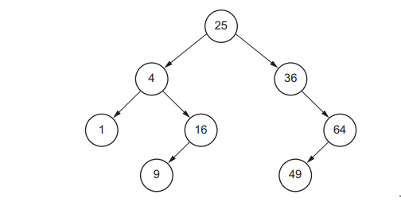
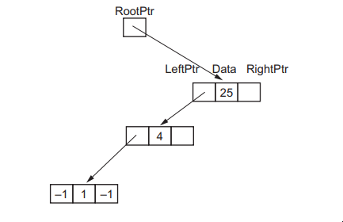
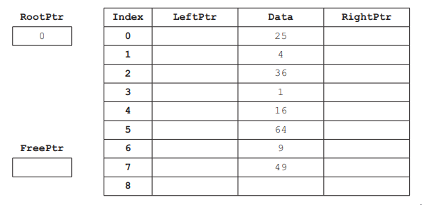
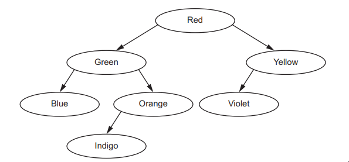
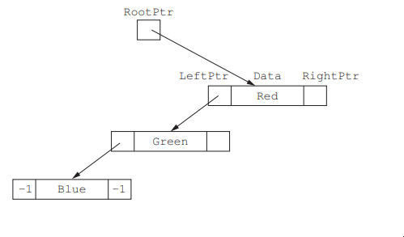
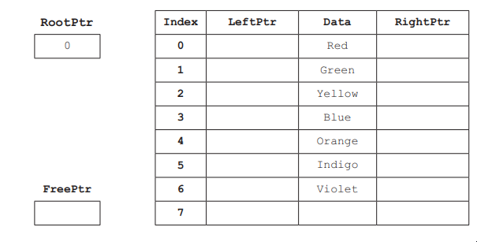
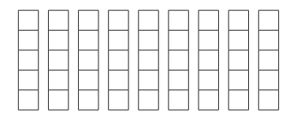
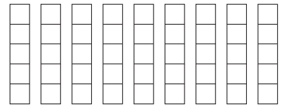

# Exam Questions — Algorithms
**19. Computational thinking & Problem-solving** · Cambridge (CIE) A-LEVEL computer-science (9618)
> Source: [https://www.savemyexams.com/a-level/computer-science/cie/19/topic-questions/](https://www.savemyexams.com/a-level/computer-science/cie/19/topic-questions/) · 40 questions across 1 sets

## Exam Questions (40 questions)

### Q1 — hard — 4 marks

**Q1** [4 marks]

A developer tests two search algorithms, X and Y, on arrays of different sizes. The table shows the maximum number of items each algorithm checks before it finds an item or decides that the item is not in the array.

| Number of items in the array | Algorithm X | Algorithm Y |
|---|---|---|
| 16 | 16 | 5 |
| 256 | 256 | 9 |
| 4096 | 4096 | 13 |
| 65536 | 65536 | 17 |

(a) Identify the Big O time complexity of each algorithm. Use the data in the table to justify each answer. [3]

(b) The number of items is increased to 1 048 576, which is 16 times the largest array in the table.

State the maximum number of items that Algorithm Y will check. [1]

### Q2 — medium — 3 marks

**Q2** [3 marks]

The 1D array `Heights` is declared as `ARRAY[1:N] OF INTEGER`. The values in `Heights` are in ascending order.

**Algorithm A** finds the total of all the values in `Heights`.

**Algorithm B** finds out whether the value `Target` is stored in `Heights`.

Identify the Big O time complexity of each algorithm. Justify your answer for Algorithm B.

### Q3 — easy — 2 marks

**Q3** [2 marks]

A linear search has a time complexity of O(n) in Big O notation.

(i) State what Big O notation is used to indicate about an algorithm.

(ii) State what O(n) shows about how the time taken by a linear search changes as the number of items in the array increases.

### Q4 — hard — 4 marks

**Q4** [4 marks]

The 1D array `IDs` is declared as:

Each element holds a student ID between 1 and 1000. A program must find out whether any ID is stored more than once. Two algorithms are being considered.

**Algorithm P**

**Algorithm Q**

Algorithm Q uses a second array, `Seen`, which is declared in its first line.

Compare the suitability of Algorithm P and Algorithm Q for this task, in terms of the time taken and the memory used.

Your answer must include the number of times the `IF` condition is evaluated by each algorithm.

### Q5 — medium — 3 marks

**Q5** [3 marks]

A delivery company stores the details of 800 parcels in a 1D array. The array is **not** sorted.

Parcels are added to the array and removed from it many times each minute, in no particular order. After each change, the program searches the array **once** to find one parcel ID.

A binary search usually checks far fewer items than a linear search.

Explain why a linear search is more suitable than a binary search for this program.

### Q6 — easy — 2 marks

**Q6** [2 marks]

Two different algorithms can perform the same task.

State **two** criteria that can be used to compare the two algorithms.

### Q7 — very_hard — 6 marks

**Q7** [6 marks]

A queue Abstract Data Type (ADT) of strings is implemented using two stacks. Each stack is a 1D array with its own top pointer. The global declarations are:

A stack is empty when its top pointer is 0. `StackA` holds the queue, with the item at the front of the queue at the top of `StackA`. `StackB` is empty except while a new item is being added.

These modules are already written:

- `PushA(NewItem : STRING)` pushes `NewItem` onto `StackA`
- `PopA() RETURNS STRING` removes and returns the item at the top of `StackA`
- `PushB(NewItem : STRING)` pushes `NewItem` onto `StackB`
- `PopB() RETURNS STRING` removes and returns the item at the top of `StackB`

`PopA()` and `PopB()` are only called when that stack is not empty.

Write pseudocode for:

- the procedure `Enqueue(NewItem : STRING)`, which outputs "Queue full" if `StackA` holds `MaxSize` items, and otherwise adds `NewItem` to the rear of the queue
- the function `Dequeue()`, which outputs "Queue empty" and returns an empty string if the queue is empty, and otherwise removes and returns the item at the front of the queue.

### Q8 — medium — 3 marks

**Q8** [3 marks]

A print server stores print jobs in a queue Abstract Data Type (ADT). The queue is implemented using two stacks, `StackA` and `StackB`.

- `StackA` holds the queue. The item at the front of the queue is at the top of `StackA`.
- `StackB` is empty except while a new item is being added.

To add a new item to the queue, these three steps are carried out in order:

1. Every item is popped from `StackA` and pushed onto `StackB`, until `StackA` is empty.
2. The new item is pushed onto `StackB`.
3. Every item is popped from `StackB` and pushed onto `StackA`, until `StackB` is empty.

The queue currently holds the print jobs 104, 105 and 106. Job 104 is at the front of the queue and job 106 is at the rear.

Job 107 is now added to the queue.

Complete the table to show the contents of each stack after each step. Write the items in each stack in order from the **bottom** of the stack to the **top**. Write "empty" for an empty stack.

| Stage | StackA (bottom to top) | StackB (bottom to top) |
|---|---|---|
| Before job 107 is added | 106, 105, 104 | empty |
| After step 1 |   |   |
| After step 2 |   |   |
| After step 3 |   |   |

### Q9 — easy — 2 marks

**Q9** [2 marks]

A food delivery company holds customer orders in a queue Abstract Data Type (ADT) until the kitchen is ready for them. The number of orders waiting changes a lot during the day. Late at night the queue is often empty, but at lunchtime several hundred orders can be waiting.

The queue can be implemented using a 1D array or using a linked list.

Justify the use of a linked list instead of a 1D array to implement this queue.

### Q10 — very_hard — 6 marks

**Q10** [6 marks]

A program stores integers in an ordered binary tree. The tree is implemented as a 1D array of records. No two items in the tree have the same value.

- `BinTree`, `RootPtr` and `FreePtr` are global.
- -1 is used to represent a null pointer. `RootPtr` is -1 when the tree is empty.
- `FreePtr` points to the first unused record. Unused records are linked together through their `LeftPtr` field. `FreePtr` is -1 when there are no unused records.
- An item that is smaller than the data in a node is stored in that node's left subtree. An item that is larger is stored in its right subtree.

Write pseudocode for the procedure `AddNode(NewItem : INTEGER)`.

The procedure must:

- output "Tree full" and add nothing if there are no unused records
- otherwise store `NewItem` in a record taken from the free list, and join that record to the tree as a leaf node in the correct position.

### Q11 — medium — 4 marks

**Q11** [4 marks]

An ordered binary tree stores integers. It is implemented as a 1D array of records, `BinTree`, with indexes 0 to 7. Each record contains a left pointer, the data and a right pointer.

- `RootPtr` points to the root node.
- `FreePtr` points to the first unused record. Unused records are linked together through their `LeftPtr` field.
- -1 is used to represent a null pointer.

A new item is always stored in the record pointed to by `FreePtr`. It is then joined to the tree as a new leaf node.

The table shows the contents of the array before any more items are added.

| Index | LeftPtr | Data | RightPtr |
|---|---|---|---|
| 0 | 1 | 48 | 2 |
| 1 | 5 | 25 | 3 |
| 2 | 4 | 71 | -1 |
| 3 | -1 | 36 | -1 |
| 4 | -1 | 59 | -1 |
| 5 | -1 | 12 | -1 |
| 6 | 7 |   | -1 |
| 7 | -1 |   | -1 |

RootPtr = 0 and FreePtr = 6

The integer 30 is added to the tree, and then the integer 64 is added.

Complete the table and the values of `RootPtr` and `FreePtr` to show the contents after both items have been added.

| Index | LeftPtr | Data | RightPtr |
|---|---|---|---|
| 0 |   | 48 |   |
| 1 |   | 25 |   |
| 2 |   | 71 |   |
| 3 |   | 36 |   |
| 4 |   | 59 |   |
| 5 |   | 12 |   |
| 6 |   |   |   |
| 7 |   |   |   |

RootPtr = ..........

FreePtr = ..........

### Q12 — easy — 2 marks

**Q12** [2 marks]

An ordered binary tree stores the names of cities in alphabetical order.

The tree is implemented as a 1D array of records, `BinTree`. Each record contains a left pointer, the data and a right pointer.

- `RootPtr` points to the root node.
- `FreePtr` points to the first unused record. Unused records are linked together through their `LeftPtr` field.
- -1 is used to represent a null pointer.

The table shows the contents of the array.

| Index | LeftPtr | Data | RightPtr |
|---|---|---|---|
| 0 | 1 | Lima | 2 |
| 1 | 3 | Cairo | 4 |
| 2 | 5 | Quito | -1 |
| 3 | -1 | Accra | -1 |
| 4 | -1 | Delhi | -1 |
| 5 | -1 | Oslo | -1 |
| 6 | 7 |   | -1 |
| 7 | -1 |   | -1 |

RootPtr = 0 and FreePtr = 6

The tree is searched for the city Nairobi. The search starts at the node pointed to by `RootPtr`. At each node it follows the left pointer if the item searched for comes before the data in that node, and the right pointer if it comes after. The search returns the index of the node if the item is found, or a null pointer if it is not found.

Identify the index of each node visited, in the order they are visited, and state the value returned by the search.

### Q13 — very_hard — 6 marks

**Q13** [6 marks]

A race organiser stores the results of 40 runners in two global 1D arrays:

- `RunnerID` is declared as `ARRAY[1:40] OF STRING` and holds the ID of each runner
- `FinishTime` is declared as `ARRAY[1:40] OF INTEGER` and holds the finishing time of each runner, in seconds.

The runner whose ID is in `RunnerID[N]` has the finishing time in `FinishTime[N]`.

Write pseudocode for a procedure `SortResults()` that uses an insertion sort to put `FinishTime` into ascending order. The IDs in `RunnerID` must be put into the same order, so that each ID stays with its finishing time.

### Q14 — medium — 3 marks

**Q14** [3 marks]

An insertion sort is used to put the six values in the 1D array `Numbers` into ascending order. `Numbers` is declared as `ARRAY[1:6] OF INTEGER`.

Complete the table to show the contents of `Numbers` at the end of the iterations of the `FOR` loop when `Index` is 2, 3 and 4.

|   | Numbers[1] | Numbers[2] | Numbers[3] | Numbers[4] | Numbers[5] | Numbers[6] |
|---|---|---|---|---|---|---|
| Before the sort | 16 | 4 | 11 | 2 | 19 | 7 |
| Index = 2 |   |   |   |   |   |   |
| Index = 3 |   |   |   |   |   |   |
| Index = 4 |   |   |   |   |   |   |

### Q15 — very_hard — 6 marks

**Q15** [6 marks]

A school stores the names of 200 students in a global 1D array `Names`.

The names are stored in ascending alphabetical order. Each name appears only once.

A function `BinarySearch()` is needed. It:

- takes a string parameter `Target`
- performs a binary search on `Names`
- returns the index of the element that matches `Target`
- returns -1 if `Target` is not in the array.

Write pseudocode for the function `BinarySearch()`.

### Q16 — easy — 2 marks

**Q16** [2 marks]

Describe how an insertion sort puts the values in a 1D array into ascending order.

### Q17 — hard — 4 marks

**Q17** [4 marks]

The 1D array `Values` is declared as `ARRAY[1:6] OF INTEGER`. Before sorting, it holds:

3, 5, 6, 8, 9, 2

The array is to be sorted into ascending order. Two algorithms are being compared.

**Algorithm A: bubble sort**

**Algorithm B: insertion sort**

A comparison is one check of whether a value in `Values` is greater than another value in `Values`. In Algorithm B, when `Pos > 1` is `FALSE`, assume that the rest of the `WHILE` condition is not checked.

Complete the table to show the number of comparisons each algorithm makes to sort this data. Then explain why Algorithm B makes fewer comparisons than Algorithm A for this data.

| Algorithm | Number of comparisons |
|---|---|
| A: bubble sort |   |
| B: insertion sort |   |

### Q18 — medium — 3 marks

**Q18** [3 marks]

A library system stores 1000 book titles in a 1D array, sorted into alphabetical order. The number of titles is going to increase to 2000.

When the array holds 1000 titles, a binary search makes at most 10 comparisons to find a title or to decide that it is not in the array.

Explain how increasing the number of titles to 2000 affects the maximum number of comparisons made by:

- a binary search
- a linear search.

### Q19 — easy — 2 marks

**Q19** [2 marks]

The 1D array `Scores` holds 15 integers in ascending order.

| Index | 1 | 2 | 3 | 4 | 5 | 6 | 7 | 8 | 9 | 10 | 11 | 12 | 13 | 14 | 15 |
|---|---|---|---|---|---|---|---|---|---|---|---|---|---|---|---|
| Value | 3 | 8 | 11 | 15 | 19 | 24 | 30 | 36 | 41 | 47 | 52 | 58 | 63 | 70 | 77 |

A binary search is used to find the value 52. The search starts with `Lower ← 1`, `Upper ← 15` and `Found ← FALSE`. On each pass it carries out these steps.

The search stops when `Found` is TRUE.

State, in order, each value in `Scores` that is compared with 52.

### Q20 — very_hard — 6 marks

**Q20** [6 marks]

A weather station stores 500 temperature readings in a global 1D array `Readings`.

The readings are **not** in any order. The same value may appear more than once.

A function `LinearSearch()` is needed. It:

- takes an integer parameter `SearchValue`
- performs a linear search on `Readings`
- stops searching as soon as `SearchValue` is found
- returns the index of the first element that matches `SearchValue`
- returns -1 if `SearchValue` is not in the array.

Write pseudocode for the function `LinearSearch()`.

### Q21 — medium — 3 marks

**Q21** [3 marks]

A bubble sort is used to put the six values in the 1D array `Points` into descending order. `Points` is declared as `ARRAY[1:6] OF INTEGER`.

Complete the table to show the contents of `Points` at the end of each of the first three passes.

|   | Points[1] | Points[2] | Points[3] | Points[4] | Points[5] | Points[6] |
|---|---|---|---|---|---|---|
| Before the sort | 14 | 31 | 8 | 27 | 19 | 42 |
| After pass 1 |   |   |   |   |   |   |
| After pass 2 |   |   |   |   |   |   |
| After pass 3 |   |   |   |   |   |   |

### Q22 — very_hard — 6 marks

**Q22** [6 marks]

A queue Abstract Data Type (ADT) stores the names of up to six customers. It is implemented using a 1D array and the global variables declared in this pseudocode.

The queue is organised as follows:

- `FrontPointer` points to the first item in the queue.
- `RearPointer` points to the last item in the queue.
- `Length` stores the number of items currently in the queue.
- When a pointer moves past index 6 it is set back to index 1, so array locations can be reused.
- Items that have been removed from the queue are not cleared from the array.

The current state of the queue is:

| Index | 1 | 2 | 3 | 4 | 5 | 6 |
|---|---|---|---|---|---|---|
| Queue | "Chen" | "Diaz" | "Okoro" | "Patel" | "Ahmed" | "Bello" |

`FrontPointer` = 5, `RearPointer` = 2 and `Length` = 4.

A function `Position()` takes a customer name as a parameter. It returns the position of that name in the queue, where the first item in the queue is position 1. If the name is not in the queue, the function returns -1. The function must not change the contents of the queue or the values of the three global variables.

For example, with the queue shown:

- `Position("Chen")` returns 3
- `Position("Okoro")` returns -1, because `"Okoro"` has already been removed from the queue.

Write the pseudocode for the function `Position()`.

### Q23 — medium — 4 marks

**Q23** [4 marks]

A program stores six product codes in the 1D array `Codes`.

| Index | 1 | 2 | 3 | 4 | 5 | 6 |
|---|---|---|---|---|---|---|
| Value | "M4" | "T9" | "A2" | "K7" | "B5" | "R1" |

This pseudocode performs a linear search for the value in `Target`.

Complete the trace table for the pseudocode when `Target` is "K7". Record the values at the end of each pass through the loop. You may not need all the rows.

| Index | Codes[Index] | Found | OUTPUT |
|---|---|---|---|
|   |   |   |   |
|   |   |   |   |
|   |   |   |   |
|   |   |   |   |
|   |   |   |   |
|   |   |   |   |

### Q24 — easy — 2 marks

**Q24** [2 marks]

A program uses a bubble sort to put the values in the 1D array `Data` into ascending order. `Data` is declared as `ARRAY[1:8] OF INTEGER`.

Before the sort starts, `Data` holds these eight values:

3, 7, 12, 15, 20, 26, 31, 40

State:

- the number of passes that the algorithm makes through `Data`
- the number of times the condition `Data[J] > Data[J + 1]` is evaluated.

### Q25 — very_hard — 6 marks

**Q25** [6 marks]

A program stores the names of cities in alphabetical order in a linked list. The linked list is implemented using a 1D array of records, declared as follows:

- `HeadPointer` stores the index of the first node in the linked list.
- `FreePtr` stores the index of the first node in the free list. Nodes that are not in use are joined together in the free list.
- A `NextPointer` value of `NullPtr` (0) shows that there are no further nodes in that list.
- When there are no free nodes, `FreePtr` is `NullPtr`.
- `List`, `HeadPointer` and `FreePtr` are global. The array and both pointers have already been initialised.

A procedure `InsertItem(NewItem : STRING)` adds a city name to the linked list. The procedure must:

- output a suitable message if there are no free nodes
- otherwise, take the first node from the free list and store `NewItem` in it
- insert the new node into the linked list so that the data items stay in alphabetical order. The new item may belong at the start, in the middle or at the end of the list, and the list may be empty.

Write pseudocode for the procedure `InsertItem()`.

### Q26 — medium — 3 marks

**Q26** [3 marks]

A queue Abstract Data Type (ADT) is implemented using a 1D array and three global variables.

The current contents of the array are:

| Index | 1 | 2 | 3 | 4 | 5 |
|---|---|---|---|---|---|
| Queue | "Job11" | "Job12" | "Job13" | "Job14" | "Job15" |

`FrontPointer` = 5, `RearPointer` = 5 and `Length` = 1.

These three operations are then carried out, in this order.

Complete the table to show the value returned by each operation and the values of the three variables after each operation has finished.

| Operation | Value returned | FrontPointer | RearPointer | Length |
|---|---|---|---|---|
| CALL Enqueue("Job16") | no value returned |   |   |   |
| Dequeue() |   |   |   |   |
| Dequeue() |   |   |   |   |

### Q27 — easy — 2 marks

**Q27** [2 marks]

The 1D array `Stock` is declared as:

It contains these values:

| Index | 1 | 2 | 3 | 4 | 5 | 6 | 7 | 8 |
|---|---|---|---|---|---|---|---|---|
| Value | 34 | 12 | 57 | 12 | 90 | 8 | 71 | 25 |

This function performs a linear search on `Stock`.

State the value returned by each of these function calls.

(i) `FindItem(12)`

(ii) `FindItem(45)`

### Q28 — hard — 5 marks

**Q28** [5 marks]

A stack of characters is implemented using a 1D array and two pointers.

The main program is run and these eight characters are input, in this order:

'U', 'A', 'B', 'U', 'C', 'D', 'E', 'U'

Complete the trace table. The first row shows the values before the loop starts. Record a value only when it changes.

| Code | TopPointer | Stack[1] | Stack[2] | Stack[3] | OUTPUT |
|---|---|---|---|---|---|
|   | 0 |   |   |   |   |
| 'U' |   |   |   |   |   |
| 'A' |   |   |   |   |   |
| 'B' |   |   |   |   |   |
| 'U' |   |   |   |   |   |
| 'C' |   |   |   |   |   |
| 'D' |   |   |   |   |   |
| 'E' |   |   |   |   |   |
| 'U' |   |   |   |   |   |

### Q29 — medium — 3 marks

**Q29** [3 marks]

A program stores the names of animals in alphabetical order in a linked list. The linked list is implemented using a 1D array of records, declared as follows:

- `HeadPointer` stores the index of the first node in the linked list.
- `FreePtr` stores the index of the first node in the free list. Nodes that are not in use are joined together in the free list.
- A `NextPointer` value of `NullPtr` (0) shows that there are no further nodes in that list.

The table shows the contents of the array. `HeadPointer` is 4 and `FreePtr` is 6.

| Index | Data | NextPointer |
|---|---|---|
| 1 | Panda | 5 |
| 2 | Camel | 7 |
| 3 |   | 0 |
| 4 | Bear | 2 |
| 5 | Tiger | 0 |
| 6 |   | 3 |
| 7 | Eagle | 8 |
| 8 | Horse | 1 |

The node containing Horse is deleted from the linked list. The deleted node is added to the **start** of the free list. The data item in the deleted node is not removed from the array.

Complete the table to show the values of `HeadPointer`, `FreePtr` and every `NextPointer` after the deletion.

| Index | Data | NextPointer |
|---|---|---|
| 1 | Panda |   |
| 2 | Camel |   |
| 3 |   |   |
| 4 | Bear |   |
| 5 | Tiger |   |
| 6 |   |   |
| 7 | Eagle |   |
| 8 | Horse |   |

| HeadPointer |   |
|---|---|
| FreePtr |   |

### Q30 — medium — 3 marks

**Q30** [3 marks]

A stack of integers is implemented using a 1D array and two pointers.

The pointer `BasePointer` points to the bottom of the stack. The pointer `TopPointer` points to the item currently at the top of the stack. When the stack is empty, `TopPointer` is one less than `BasePointer`.

A programmer has written this pseudocode to initialise the stack and to push an item onto it. The line numbers are not part of the pseudocode.

The pseudocode contains three errors.

Identify each error. For each error, give the line number or numbers and write the corrected pseudocode.

### Q31 — easy — 2 marks

**Q31** [2 marks]

A queue Abstract Data Type (ADT) stores up to six strings. It is implemented using a 1D array and the global variables declared in this pseudocode.

The queue is organised as follows:

- `FrontPointer` points to the first item in the queue.
- `RearPointer` points to the last item in the queue.
- `Length` stores the number of items currently in the queue.
- When a pointer moves past index 6 it is set back to index 1, so array locations can be reused.

Write the pseudocode for the function `IsFull()`.

The function returns `TRUE` if no more items can be added to the queue, and returns `FALSE` otherwise.

### Q32 — easy — 2 marks

**Q32** [2 marks]

A stack is implemented using a 1D array, `Stack`, declared as `ARRAY[1:6] OF STRING`, and two integer pointers.

- `BasePointer` points to the bottom of the stack.
- `TopPointer` points to the item currently at the top of the stack.

The table shows the current contents of the array and the values of the pointers.

| Index | Stack |
|---|---|
| 1 | "Lima" |
| 2 | "Oslo" |
| 3 | "Rome" |
| 4 | "Doha" |
| 5 | "Kyiv" |
| 6 |   |

`BasePointer` = 1 and `TopPointer` = 4

These three operations are carried out on the stack, in this order:

1. Pop an item.
2. Pop an item.
3. Push "Suva".

State the value of `TopPointer` and the item at the top of the stack after these three operations.

### Q33 — easy — 2 marks

**Q33** [2 marks]

A program stores the names of cities in alphabetical order in a linked list. The linked list is implemented using a 1D array of records, declared as follows:

- `HeadPointer` stores the index of the first node in the linked list.
- `FreePtr` stores the index of the first node in the free list. Nodes that are not in use are joined together in the free list.
- A `NextPointer` value of `NullPtr` (0) shows that there are no further nodes in that list.

The table shows the current contents of the array. `HeadPointer` is 5 and `FreePtr` is 7.

| Index | Data | NextPointer |
|---|---|---|
| 1 | Lima | 6 |
| 2 | Cairo | 4 |
| 3 |   | 8 |
| 4 | Delhi | 1 |
| 5 | Accra | 2 |
| 6 | Oslo | 0 |
| 7 |   | 3 |
| 8 |   | 0 |

Use the table to:

- write the data items in the order they are visited when the linked list is traversed from `HeadPointer`
- state the value of `FreePtr` after one new city name has been added to the linked list.

### Q34 — medium — 8 marks

**Q34** [4 marks]

Complete the pseudocode to find an item in a 1D array Widgets of type STRING, using a **linear **search.

`DECLARE Widgets : ARRAY[1:50000] OF STRING`

`DECLARE TopOfList : INTEGER`

`DECLARE EndOfList : INTEGER`

`DECLARE Count : INTEGER`

`DECLARE ToFind : STRING`

`DECLARE Found : BOOLEAN`

`DECLARE NotInList : BOOLEAN`

`TopOfList ← 1`

`EndOfList ← 50000`

`OUTPUT "Enter the name of the item you wish to find "`

`INPUT ToFind`

`Found ← FALSE`

`NotInList ← FALSE`

`Count ← TopOfList`

`WHILE Found = FALSE AND NotInList = FALSE`

`    IF Widgets[Count] = ToFind THEN`

`        Found ← TRUE`

`    ENDIF`

`    Count ← Count + 1`

`    IF Count > EndOfList THEN`

`        NotInList ← TRUE`

`    ENDIF`

`ENDWHILE`

`IF Found = TRUE THEN`

`    OUTPUT "Item found at position ", Count - 1, " in array"`

`ELSE`

`    OUTPUT "Item not in array"`

`ENDIF`

*Source: June 2024 9618/32 Q8A*

**Q34** [4 marks]

Compare the methods used by the linear and binary search algorithms to find an item in an array. Refer to Big O notation in your answer.

*Source: June 2024 9618/32 Q8B*

### Q35 — medium — 8 marks

**Q35** [1 mark]

State a condition that must be true for an array to be searchable for a binary search.

*Source: June 2024 9618/31 Q10A*

**Q35** [5 marks]

Complete the given pseudocode to find an item in a 1D array Names of type STRING using a binary search.

`DECLARE Names : ARRAY[1:100000] OF STRING`

`DECLARE TopOfList : INTEGER`

`DECLARE EndOfList : INTEGER`

`DECLARE CurrentItem : INTEGER`

`DECLARE ToFind : STRING`

`DECLARE Found : BOOLEAN`

`DECLARE NotInList : BOOLEAN`

`TopOfList ← 1`

`EndOfList ← 100000`

`OUTPUT "Which name do you wish to find? "`

`INPUT ToFind`

`...................................................................................................................................................`

`NotInList ← FALSE`

`WHILE ................................................ AND ................................................`

`  CurrentItem ← (TopOfList + EndOfList) DIV 2`

`  IF ........................................................................................................... THEN`

`    Found ← TRUE`

`  ELSE`

`    IF TopOfList >= EndOfList THEN`

`      ...........................................................................................................`

`    ELSE`

`      IF ToFind > Names[CurrentItem] THEN`

`        ...........................................................................................................`

`      ELSE`

`        EndOfList ← CurrentItem – 1`

`      ENDIF`

`    ENDIF`

`  ENDIF`

`ENDWHILE`

`IF Found = TRUE THEN`

`  OUTPUT "Item found at position ", CurrentItem, " in array"`

`ELSE`

`  OUTPUT "Item not in array"`

`ENDIF`

*Source: June 2024 9618/31 Q10B*

**Q35** [2 marks]

Describe the performance of a binary search in relation to the number of data items in the array being searched. Refer to Big O notation in your answer.

*Source: June 2024 9618/31 Q10C*

### Q36 — medium — 12 marks

**Q36** [4 marks]

This binary tree shows an ordered list of integers.

A linked list of nodes is used to store the data. Each node consists of a left pointer, the data and a right pointer.

−1 is used to represent a null pointer.

Complete this linked list to represent the given binary tree organisation.

*Source: Nov 2024 9618/32 Q11A*

**Q36** [4 marks]

A 2D array is used to store the nodes of the linked list in part (a). Complete the diagram using your answer for part (a)

*Source: Nov 2024 9618/32 Q11B*

**Q36** [4 marks]

The linked list in part (a) is implemented using a 1D array of records. Each record contains a left pointer, data and a right pointer.

The following pseudocode represents a function that searches for an element in the array of records LinkList. It returns the index of the record if the element is found, or it returns a null pointer if the element is not found.

Complete the pseudocode for the function.

`FUNCTION SearchList(Item : INTEGER) ........................................................................`

` NullPtr `$\leftarrow$` −1`

` .................................................................... RootPtr`

` WHILE NowPtr <> NullPtr`

`   IF LinkList[NowPtr].Data < Item THEN`

`     NowPtr  `$\leftarrow$` LinkList[NowPtr].RightPtr`

`   ELSE`

`     IF ..................................................................... THEN`

`       NowPtr  `$\leftarrow$`..............................................................................`

`     ELSE`

`       RETURN NowPtr`

`     ENDIF`

`   ENDIF`

` ENDWHILE`

` RETURN NullPtr`

`ENDFUNCTION`

*Source: Nov 2024 9618/32 Q11C*

### Q37 — medium — 9 marks

**Q37** [4 marks]

The following diagram shows an ordered binary tree.

A linked list of nodes is used to store the data. Each node consists of a left pointer, the data and a right pointer.

–1 is used to represent a null pointer.

Complete this linked list to represent the given binary tree.

*Source: Nov 2024 9618/31 Q11A*

**Q37** [4 marks]

A user-defined record structure is used to store the nodes of the linked list in part (a).

Complete the diagram, using your answer for part (a).

*Source: nov 2024 9618/31 Q11B*

**Q37** [1 mark]

The linked list in part (a) is implemented using a 1D array of records. Each record contains a left pointer, data and a right pointer.

The following pseudocode represents a function that searches for an element in the array of records BinTree. It returns the index of the record if the element is found, or it returns a null pointer if the element is not found.

Complete the pseudocode for the function.

`FUNCTION SearchTree(Item : STRING) ........................................................................`

`    NowPtr ......................................................................................................................... `

`    WHILE NowPtr <> -1`

`        IF ..................................................................................................................... THEN`

`            NowPtr  BinTree[NowPtr].LeftPtr`

`        ELSE`

`            IF BinTree[NowPtr].Data < Item THEN`

`                .................................................................................................................`

`            ELSE`

`                RETURN NowPtr`

`            ENDIF`

`        ENDIF`

`    ENDWHILE`

`    RETURN NowPtr`

`ENDFUNCTION`

*Source: Nov 2024 9618/31 Q11C*

### Q38 — medium — 4 marks

**Q38** [4 marks]

The Reverse Polish Notation (RPN) expression:

`    a   b  *   2   /   c   d   /    *`

is to be evaluated where` a = 20`, `b = 3`, `c = 10` and `d = 5`.

Show the changing contents of the following stack as the RPN expression is evaluated.

*Source: November 2023 9618/32 Q6A*

### Q39 — medium — 10 marks

**Q39** [3 marks]

A stack is to be set up using the information in the table.

| **Identifier** | **Data type** | **Description** |
|---|---|---|
| `BasePointer` | `INTEGER` | points to the bottom of the stack |
| `TopPointer` | `INTEGER` | points to the top of the stack |
| `Stack` | `REAL` | 1D array to implement the stack |

A constant, with identifier `Capacity`, limits the size of the stack to 25 items.

Write the** pseudocode** for the required declarations.

*Source: November 2023 9618/31 Q10A*

**Q39** [5 marks]

Complete the pseudocode function `Pop() `to pop an item from `Stack. `

`// popping an item from the stack `

`FUNCTION Pop()`...............................................................................

`        DECLARE Item : REAL `

`        Item`$\leftarrow$`0                                                                        ........................................BasePointer THEN `

`        Item`$\leftarrow$` ........................................`

`        TopPointer .................................................. `

`   ELSE `

`      OUTPUT "The stack is empty – error" `

`   ENDIF`

`   .........................................................................`

`ENDFUNCTION`

*Source: November 2023 9618/31 Q10B*

**Q39** [2 marks]

Compare and contrast the queue and stack Abstract Data Types (ADT).

*Source: November 2023 9618/31 Q10C*

### Q40 — medium — 7 marks

**Q40** [4 marks]

Show how the contents of the following stack will change as the RPN expression in part (a)(i) is evaluated.

*Source: November 2023 9618/31 Q9AII*

**Q40** [3 marks]

Explain how a stack can be used to evaluate RPN expressions.

*Source: November 2023 9618/31 Q9B*

