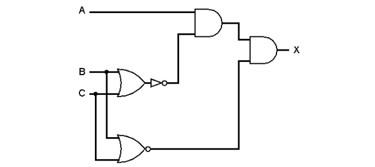
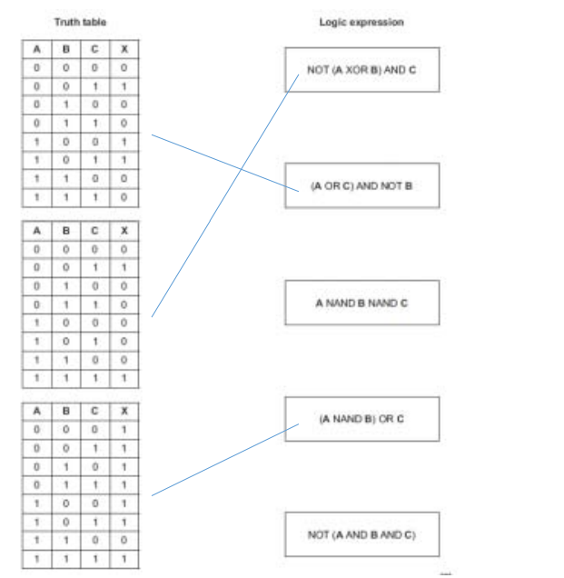
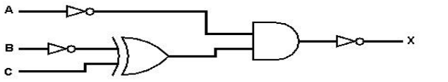
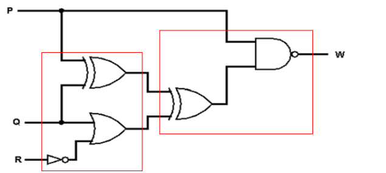

# Mark Schemes — Logic Gates & Logic Circuits
**3. Hardware** · Cambridge (CIE) A-LEVEL computer-science (9618)

## Exam Questions (30 questions)

### Q1
**Z** = ((**A** NAND **B**) AND (**B** XOR **C**)) NOR **A**

Gate 3 combines the outputs of gates 1 and 2, and gate 4 takes that output and **A**. **[1]** **[1]**

**Z** = 1 for **A** = 0, **B** = 0, **C** = 0 **[1]**

**Z** = 1 for **A** = 0, **B** = 1, **C** = 1 **[1]**

There are no other combinations.

**[4 marks]**

> **[mark-scheme]**
> **1 mark** for `(A NAND B) AND (B XOR C)` as the output of gate 3
> 
> **1 mark** for that term combined with `A` using `NOR` to give `Z`
> 
> **1 mark** for `A` = 0, `B` = 0, `C` = 0
> 
> **1 mark** for `A` = 0, `B` = 1, `C` = 1, with no other combination given
> 
> Accept `EOR` in place of `XOR` throughout
> 
> Accept `Z = A NOR ((A NAND B) AND (B XOR C))`, and accept the two inputs of any gate written in either order
> 
> Accept the simplified equivalent `Z = (B XOR C) NOR A` for both expression marks. It gives the same output column on all eight rows, because gate 4 forces `Z` = 0 whenever `A` = 1, and when `A` = 0 the `NAND` gate always gives 1
> 
> Do not accept a third combination. Only two of the eight rows give `Z` = 1
> 
> Do not accept `A` = 1 in any stated combination. Gate 4 is a `NOR` gate with `A` as one input, so `A` = 1 always forces `Z` = 0

> **[exam-tip]**
> Use the last gate to cut the work down before tracing anything. Gate 4 is a `NOR` gate, so `Z` = 1 needs both of its inputs to be 0, which means `A` = 0 and gate 3 = 0. That removes four of the eight rows straight away. With `A` = 0 the `NAND` gate always gives 1, so gate 3 simply follows `B XOR C`, and `Z` = 1 then needs `B` and `C` to be equal.

### Q2
| **A** | **B** | **C** | **G1** | **G2** | **Z** |
|---|---|---|---|---|---|
| 0 | 0 | 0 | **1** | **1** | **1** |
| 0 | 0 | 1 | **1** | **1** | **1** |
| 0 | 1 | 0 | **0** | **0** | **0** |
| 0 | 1 | 1 | **0** | **0** | **1** |
| 1 | 0 | 0 | **1** | **0** | **0** |
| 1 | 0 | 1 | **1** | **0** | **1** |
| 1 | 1 | 0 | **0** | **1** | **1** |
| 1 | 1 | 1 | **0** | **1** | **1** |

**[3 marks]**

> **[mark-scheme]**
> **1 mark** for column `G1` correct, reading down: 1, 1, 0, 0, 1, 1, 0, 0
> 
> **1 mark** for column `G2` correct, reading down: 1, 1, 0, 0, 0, 0, 1, 1
> 
> **1 mark** for column `Z` correct, reading down: 1, 1, 0, 1, 0, 1, 1, 1
> 
> Accept `EOR` in place of `XOR` in any working
> 
> Accept column `Z` correct for its mark even if a working column is wrong, provided `Z` matches the values above
> 
> Do not accept a `G2` column of 0, 0, 1, 1, 1, 1, 0, 0. That column is `A XOR B` with the `NOT` on `B` left out
> 
> Do not accept a `Z` column of 1, 1, 0, 0, 0, 0, 1, 1. That column repeats `G2` and ignores `C`, which must force `Z` to 1 on every row where `C` = 1

> **[exam-tip]**
> Trace the circuit gate by gate and fill a whole column before starting the next one, because each gate depends only on columns already written. A useful check at the end: gate 3 is an `OR` gate with `C` as one input, so every row where `C` = 1 must give `Z` = 1. There are four such rows, so a `Z` column with fewer than four 1s in it cannot be right.

### Q3
**X** = (**A** NOR **B**) AND **C**

Gate 1 gives `A NOR B`. **[1]**

Gate 2 takes that output and `C` into an `AND` gate, which gives the whole expression. **[1]**

**[2 marks]**

> **[mark-scheme]**
> **1 mark** for `A NOR B`
> 
> **1 mark** for that term combined with `C` using `AND`
> 
> Accept `X = C AND (A NOR B)`, and accept the expression written without brackets as long as the `NOR` is applied to `A` and `B` only
> 
> Accept `X = (NOT (A OR B)) AND C`, since `NOR` is an `OR` gate followed by an inversion
> 
> Do not accept `X = NOT ((A OR B) AND C)`. That inverts the output of the whole circuit rather than the output of gate 1
> 
> Do not accept `X = (A NOR B) NOR C`. Gate 2 is an `AND` gate, not a second `NOR` gate
> 
> Do not accept `X = (A NAND B) AND C`. `NAND` and `NOR` give different outputs on two of the four input pairs

> **[exam-tip]**
> Work through the circuit in gate order and write down the expression for each gate output before moving on. The trap here is the bracket: the inversion belongs to gate 1 only, so it wraps `A OR B` and nothing else. An answer that puts `NOT` in front of the whole expression describes a different circuit, one with an extra gate on the end.

### Q4
**X** = (**A** XOR **B**) AND **C**

The output is 1 on two rows only, and on both of them **C** = 1 and **A** and **B** hold different values. **[1]** **[1]**

| Gate | Type of gate | Input 1 | Input 2 | Output |
|---|---|---|---|---|
| 1 | **XOR** | **A** | **B** | **G1** |
| 2 | **AND** | **G1** | **C** | **X** |

**[4 marks]**

> **[mark-scheme]**
> **1 mark** for an expression that makes `A` and `B` differ, so `A XOR B`, or the pair of terms `(NOT A) AND B` and `A AND (NOT B)`
> 
> **1 mark** for that part combined with `C` using `AND`
> 
> **1 mark** for gate 1 being an `XOR` gate with inputs `A` and `B`
> 
> **1 mark** for gate 2 being an `AND` gate with inputs `G1` and `C`
> 
> Accept `EOR` in place of `XOR` throughout
> 
> Accept the sum of products form `X = ((NOT A) AND B AND C) OR (A AND (NOT B) AND C)` for both expression marks. It reproduces the same output column on all eight rows, although it needs seven gates to build
> 
> Accept the two inputs of any gate written in either column, and accept `C AND (A XOR B)` as the expression
> 
> Do not accept `X = (A OR B) AND C`. That gives 1 on the row `A` = 1, `B` = 1, `C` = 1 as well, where the table gives 0
> 
> Do not accept `X = A XOR B XOR C`. That gives 1 on four rows, not two
> 
> Do not accept a one gate circuit. Reading down, column `X` is 0, 0, 0, 1, 0, 1, 0, 0, and no single gate on this syllabus produces it

> **[exam-tip]**
> List the rows where the output is 1 before writing anything down. Here they are `A` = 0, `B` = 1, `C` = 1 and `A` = 1, `B` = 0, `C` = 1. Reading across both rows, `C` is 1 in each, and `A` and `B` are always different from each other, which is exactly `XOR`. Writing one `AND` term for each of the two rows and joining them with `OR` is also correct and earns full marks, but it takes seven gates to build instead of two, so spotting the `XOR` is worth the extra few seconds.

### Q5
| Gate | Type of gate | Input 1 | Input 2 | Output |
|---|---|---|---|---|
| 1 | **OR** | **A** | **B** | **G1** |
| 2 | **NOT** | **C** | **-** | **G2** |
| 3 | **AND** | **G1** | **G2** | **X** |

The circuit gives **X** = (**A** OR **B**) AND (NOT **C**).

**[3 marks]**

> **[mark-scheme]**
> **1 mark** for an `OR` gate with inputs `A` and `B`
> 
> **1 mark** for a `NOT` gate with input `C` and a dash in the Input 2 column
> 
> **1 mark** for gate 3 being an `AND` gate that takes the outputs of the other two gates
> 
> Accept the `OR` gate and the `NOT` gate written in either order, so `NOT C` as gate 1 and `A OR B` as gate 2 also earns both marks, provided gate 3 then takes `G1` and `G2`
> 
> Accept the two inputs of the `OR` and `AND` gates written in either column
> 
> Do not accept a `NOT` gate on `A` or on `B`. `X` is 1 on three of the four rows where `C` = 0, and the one row it is 0 on is the row where `A` and `B` are both 0, so neither input is inverted
> 
> Do not accept an `OR` gate for gate 3. `X` is 0 on every row where `C` = 1, and only an `AND` gate can force the output to 0 in that way

> **[exam-tip]**
> Start by looking for an input that fixes the output on its own. Here every row with `C` = 1 gives `X` = 0, which tells you at once that `NOT C` is fed into a final `AND` gate. That leaves only the four rows with `C` = 0 to explain, and reading `X` down those four rows gives 0, 1, 1, 1, which is `A OR B`.
> 
> This output column can also be produced by only two gates, as `(A NOR B) NOR C`. The question names the three gate types, so the three gate answer is the one required here.

### Q6
**X** = **A** AND (NOT **B**)

The output is 1 on one row only, the row where `A` = 1 and `B` = 0, so `A` is used unchanged and `B` is inverted. **[1]** **[1]**

**[2 marks]**

> **[mark-scheme]**
> **1 mark** for `A` used unchanged and joined to the rest of the expression by `AND`
> 
> **1 mark** for `NOT B`
> 
> Accept `X = A AND NOT B` written without brackets, and `X = (NOT B) AND A`
> 
> Accept `X = NOT A NOR B`, `X = A AND (A XOR B)`, `X = A XOR (A AND B)`, `X = (A OR B) XOR B` and `X = (A NAND B) AND A`. Each of these gives the same output column and uses two gates
> 
> Do not accept the name of a single gate. No single two-input gate on this syllabus produces this column, so at least two gates are needed
> 
> Do not accept `X = A AND B`. That gives 1 on the last row, not the third
> 
> Do not accept `X = A XOR B`. That gives 1 on two rows, not one

> **[exam-tip]**
> When exactly one row of a truth table gives an output of 1, write the expression straight from that row: an input that is 1 in that row goes in as it stands, an input that is 0 goes in with a `NOT` in front of it, and the two are joined by `AND`. Students often start by hunting for a single gate that fits, but only `AND` and `NOR` give a column with exactly one 1 in it, on the bottom row and the top row respectively. Here the 1 is on the third row, so a `NOT` is needed as well.

### Q7
| **A** | **B** | **C** | **P** | **Q** | **R** | **X** |
|---|---|---|---|---|---|---|
| 0 | 0 | 0 | **0** | **1** | **0** | **0** |
| 0 | 0 | 1 | **0** | **1** | **1** | **1** |
| 0 | 1 | 0 | **1** | **1** | **0** | **0** |
| 0 | 1 | 1 | **1** | **0** | **1** | **0** |
| 1 | 0 | 0 | **1** | **1** | **1** | **1** |
| 1 | 0 | 1 | **1** | **0** | **1** | **0** |
| 1 | 1 | 0 | **0** | **1** | **1** | **1** |
| 1 | 1 | 1 | **0** | **1** | **1** | **1** |

**[4 marks]**

> **[mark-scheme]**
> **1 mark** for column `P` correct, reading down: 0, 0, 1, 1, 1, 1, 0, 0
> 
> **1 mark** for column `Q` correct, reading down: 1, 1, 1, 0, 1, 0, 1, 1
> 
> **1 mark** for column `R` correct, reading down: 0, 1, 0, 1, 1, 1, 1, 1
> 
> **1 mark** for column `X` correct, reading down: 0, 1, 0, 0, 1, 0, 1, 1
> 
> Accept `EOR` in place of `XOR` anywhere in your working
> 
> Accept column `X` correct for its mark even if one of the working columns is wrong, provided `X` matches the values above
> 
> Do not accept a `P` column of 0, 0, 1, 1, 1, 1, 1, 1. That column is `A OR B` rather than `A XOR B`
> 
> Do not accept a `Q` column of 0, 0, 0, 1, 0, 1, 0, 0. That column is `P AND C` with the inversion left out
> 
> Do not accept an `X` column that repeats column `Q`. Column `R` is 0 on two rows and must pull `X` down to 0 there

> **[exam-tip]**
> Fill the table one whole column at a time rather than one whole row at a time. Working across a row means switching between four different gates on every line, and that is where sign errors creep in. Take `NAND` in two steps as well: write the `AND` value, then invert it, because writing `NAND` straight off is the single most common source of a wrong column here.

### Q8
| Gate | Type of gate | Input 1 | Input 2 | Output |
|---|---|---|---|---|
| 1 | **NAND** | **A** | **B** | **G1** |
| 2 | **NOT** | **C** | **-** | **G2** |
| 3 | **AND** | **G1** | **G2** | **Z** |

**[3 marks]**

> **[mark-scheme]**
> **1 mark** for a `NAND` gate with inputs `A` and `B`
> 
> **1 mark** for a `NOT` gate with input `C` and a dash in the Input 2 column
> 
> **1 mark** for gate 3 being an `AND` gate that takes the outputs of the other two gates
> 
> Accept the `NAND` gate and the `NOT` gate written in either order, so `NOT C` as gate 1 and `A NAND B` as gate 2 also earns both marks, provided gate 3 then takes `G1` and `G2`
> 
> Accept the two inputs of the `NAND` and `AND` gates written in either column
> 
> Do not accept an `AND` gate followed by a `NOT` gate in place of the `NAND` gate. That is two gates rather than one and leaves the circuit with four gates, not the three the question states
> 
> Do not accept a `NOT` gate applied to `Z` at the end. The `NOT` in the expression applies to `C` only
> 
> Do not accept `NOR` for gate 1. `A NAND B` gives 0 only when both inputs are 1, while `A NOR B` gives 1 only when both inputs are 0

> **[exam-tip]**
> Read an expression from the inside of the brackets outwards, because the gate inside a bracket is always earlier in the circuit than the operator that joins the brackets together. Here the two brackets are built first and the `AND` between them is the last gate. `NAND` is a single gate on this syllabus, so do not split it into an `AND` gate followed by a `NOT` gate.

### Q9
| **A** | **B** | **NOT A** | **X** |
|---|---|---|---|
| 0 | 0 | **1** | **1** |
| 0 | 1 | **1** | **1** |
| 1 | 0 | **0** | **0** |
| 1 | 1 | **0** | **1** |

**[2 marks]**

> **[mark-scheme]**
> **1 mark** for the `NOT A` column correct, reading down: 1, 1, 0, 0
> 
> **1 mark** for the `X` column correct, reading down: 1, 1, 0, 1
> 
> Accept the `X` column correct on its own for the second mark even if the working column is left empty
> 
> Do not accept an `X` column of 1, 1, 0, 0. That column is `NOT A` copied down instead of being combined with `B`
> 
> Do not accept an `X` column of 0, 1, 1, 1. That column is `A OR B`, with the `NOT` left out
> 
> Do not accept an `X` column of 1, 1, 1, 0. That column inverts `B` as well as `A`

> **[exam-tip]**
> Fill the working column for `NOT A` first and then read the `OR` across the two right hand columns, one row at a time. `OR` gives 0 only when both of its inputs are 0, and that happens on just one row here, so an `X` column with more than one 0 in it has gone wrong somewhere.

### Q10
| Gate | Type of gate | Input 1 | Input 2 | Output |
|---|---|---|---|---|
| 1 | **NOT** | **R** | **-** | **G1** |
| 2 | **AND** | **S** | **G1** | **G2** |
| 3 | **AND** | **G2** | **N** | **G3** |
| 4 | **OR** | **G3** | **M** | **V** |

The circuit gives **V** = (**S** AND (NOT **R**) AND **N**) OR **M**.

**[4 marks]**

> **[mark-scheme]**
> **1 mark** for gate 1 being a `NOT` gate with input `R`
> 
> **1 mark** for gate 2 being an `AND` gate combining two of `S`, `G1` and `N`
> 
> **1 mark** for gate 3 being an `AND` gate that takes `G2` and the remaining one of `S`, `G1` and `N`
> 
> **1 mark** for gate 4 being an `OR` gate that takes `G3` and `M`
> 
> Accept the two `AND` gates in either order, so gate 2 taking `S` and `N` and gate 3 taking `G2` and `G1` also earns both `AND` marks
> 
> Accept the two inputs of any gate written in either column, because `AND` and `OR` give the same output whichever way round their inputs are written
> 
> Do not accept a single `AND` gate with three inputs. On this syllabus every gate except `NOT` has exactly two inputs, so three values joined by `AND` need two `AND` gates
> 
> Do not accept gate 4 as an `AND` gate. `M` must open the valve on its own, and an `AND` gate would also require the three sensor conditions
> 
> Do not accept `S`, `N` or `M` being inverted. `R` is the only inverted input

> **[exam-tip]**
> Build the circuit in the order the sentence gives the conditions, and remember that a gate can take only two inputs. Three conditions joined by `AND` always need two `AND` gates, with the output of the first feeding the second. The word "also" in the second sentence is the clue that `M` joins the circuit through an `OR` gate right at the end, after everything else has been combined.

### Q11
| **G** | **B** | **M** | **S** |
|---|---|---|---|
| 0 | 0 | 0 | **0** |
| 0 | 0 | 1 | **0** |
| 0 | 1 | 0 | **0** |
| 0 | 1 | 1 | **0** |
| 1 | 0 | 0 | **0** |
| 1 | 0 | 1 | **1** |
| 1 | 1 | 0 | **1** |
| 1 | 1 | 1 | **1** |

The machine starts for **3** of the 8 input combinations. **[1]**

**[3 marks]**

> **[mark-scheme]**
> **1 mark** for the first four rows of column `S` correct, reading down: 0, 0, 0, 0
> 
> **1 mark** for the last four rows of column `S` correct, reading down: 0, 1, 1, 1
> 
> **1 mark** for the number 3
> 
> Accept the number written as "three" or as "3 out of 8"
> 
> Do not accept a column of 0, 1, 1, 1, 0, 1, 1, 1. That is `B OR M` on its own, with the guard condition left out
> 
> Do not accept a column of 0, 0, 0, 0, 0, 0, 0, 1. That treats the last condition as `B AND M` instead of `B OR M`
> 
> Do not accept the number 4. Four rows have `G` = 1, but the row `G` = 1, `B` = 0, `M` = 0 gives `S` = 0

> **[exam-tip]**
> Work the outer `AND` first. Every row with `G` = 0 must give `S` = 0, so the top four rows can be filled in at once and only the bottom four need any thought. The usual error is to read the sentence straight through and treat "and either ... or ..." as one long chain, which loses the bracket around `B OR M`.

### Q12
**P** = **M** AND (NOT **T**)

The sensor value `M` is used directly, because the pump runs when the soil is dry and `M` is 1 at that moment. **[1]**

The sensor value `T` is inverted, because the pump runs when the tank is **not** empty and `T` is 0 at that moment. **[1]**

**[2 marks]**

> **[mark-scheme]**
> **1 mark** for `M` joined to the rest of the expression by `AND`
> 
> **1 mark** for `NOT T`
> 
> Accept `P = M AND NOT T` written without the brackets
> 
> Accept `P = (NOT T) AND M`, because `AND` gives the same output whichever way round its two inputs are written
> 
> Do not accept `P = M AND T`. That expression turns the pump on only when the tank is empty, which is the opposite of the condition given
> 
> Do not accept `P = M OR (NOT T)`. That expression turns the pump on when the soil is wet, as long as the tank still holds water
> 
> Do not accept `P = NOT (M AND T)`. Inverting the whole expression is not the same as inverting `T` on its own

> **[exam-tip]**
> The words in a problem statement do not map one to one onto the gates. Here "not empty" is a `NOT` applied to the single sensor `T`, not a second sensor. Take each condition in turn and ask what binary value the named sensor holds when that condition is true: if the answer is 1 the input goes in unchanged, and if the answer is 0 it needs a `NOT`.

### Q13
| A | B | A AND B **[1]** | A XOR B **[1]** | A NAND B **[1]** |
|---|---|---|---|---|
| 0 | 0 | **0** | **0** | **1** |
| 0 | 1 | **0** | **1** | **1** |
| 1 | 0 | **0** | **1** | **1** |
| 1 | 1 | **1** | **0** | **0** |

The NAND gate gives an output of 1 for the greatest number of input combinations. It gives an output of 1 for 3 of the 4 combinations. **[1]**

**[4 marks]**

> **[mark-scheme]**
> **1 mark** for the `A AND B` column correct, reading down: 0, 0, 0, 1
> 
> **1 mark** for the `A XOR B` column correct, reading down: 0, 1, 1, 0
> 
> **1 mark** for the `A NAND B` column correct, reading down: 1, 1, 1, 0
> 
> **1 mark** for `NAND` together with the number 3
> 
> Accept the number written as "three" or as "3 out of 4"
> 
> Accept `EOR` in place of `XOR`
> 
> Do not accept `NAND` on its own, or the number 3 on its own. Both parts are needed for the mark
> 
> Do not accept an `A NAND B` column of 0, 0, 0, 1. That column is `A AND B` left un-inverted
> 
> Do not accept an `A XOR B` column of 0, 1, 1, 1. That column is `A OR B`

> **[exam-tip]**
> Build `NAND` by writing the `AND` column first and then inverting every one of the four values. The usual error is to invert only the bottom row, which leaves three of the four values wrong. When the table is finished, count the 1s in each output column as a check: a two-input gate on this syllabus gives an output of 1 for one, two or three of the four combinations, never for all four.

### Q14
Gate X is the NAND gate. **[1]**

Gate Y is the XOR gate. **[1]**

The two gates give different outputs when A = 0 and B = 0. Gate X gives 1 and gate Y gives 0. **[1]**

**[3 marks]**

> **[mark-scheme]**
> **1 mark** for `X` is `NAND`
> 
> **1 mark** for `Y` is `XOR`
> 
> **1 mark** for A = 0 and B = 0 // both inputs are 0 // the first row of the table
> 
> Accept `EOR` in place of `XOR`
> 
> Do not accept `NOR` for `X`. `NOR` gives an output of 1 for the first row only, but column `X` also gives 1 for the second and third rows
> 
> Do not accept `OR` for `Y`. `OR` gives an output of 1 for the last row, but column `Y` gives 0 there
> 
> Do not accept "when both inputs are the same" for the third mark. That description covers two rows, and in the last row the two gates give the same output as each other

> **[exam-tip]**
> Read each output column downwards as a pattern of four values, rather than trying to recognise a gate from a single row. Column X reads 1, 1, 1, 0, which is `NAND`, and column Y reads 0, 1, 1, 0, which is `XOR`. For the last part, compare the two columns row by row instead of reasoning about the gates in words, because only one row is different and a worded rule tends to catch more rows than it should.

### Q15
NOR gate:

| A | B | A NOR B |
|---|---|---|
| 0 | 0 | **1** |
| 0 | 1 | **0** |
| 1 | 0 | **0** |
| 1 | 1 | **0** |

**[1]**

NOT gate:

| A | NOT A |
|---|---|
| 0 | **1** |
| 1 | **0** |

**[1]**

**[2 marks]**

> **[mark-scheme]**
> **1 mark** for all four output values of the `NOR` table correct, reading down: 1, 0, 0, 0
> 
> **1 mark** for both output values of the `NOT` table correct, reading down: 1, 0
> 
> Do not accept a `NOR` output column of 1, 1, 1, 0. That column is the `NAND` gate
> 
> Do not accept a `NOR` output column of 0, 1, 1, 1. That column is the `OR` gate left un-inverted
> 
> Do not accept a second input column added to the `NOT` table. The `NOT` gate has one input only

> **[exam-tip]**
> `NOR` and `NAND` both begin with "N" and are easy to swap. They give the same output as each other in the first row and in the last row, so those rows cannot tell them apart. The two middle rows are what separate them: `NOR` gives 0 for both, `NAND` gives 1 for both. Build the `OR` column first and then invert every value, rather than trying to recall the finished `NOR` column.

### Q16
The AND gate. **[1]**

The AND gate gives an output of 1 when A = 1 and B = 1. **[1]**

The NOR gate. **[1]**

The NOR gate gives an output of 1 when A = 0 and B = 0. **[1]**

**[4 marks]**

> **[mark-scheme]**
> **1 mark** for `AND`
> 
> **1 mark** for A = 1 and B = 1 // both inputs are 1
> 
> **1 mark** for `NOR`
> 
> **1 mark** for A = 0 and B = 0 // both inputs are 0
> 
> Accept the two gates given in either order
> 
> Accept the input values shown as a row of a truth table instead of written out
> 
> Do not accept `XOR`. `XOR` gives an output of 1 for two of the four combinations
> 
> Do not accept `OR` or `NAND`. Each of these gives an output of 1 for three of the four combinations
> 
> Do not accept `NOT`. The `NOT` gate has one input only

> **[exam-tip]**
> The safe method is to write out the truth tables for all five two-input gates and count the 1s in each output column. `AND` has one, `NOR` has one, `XOR` has two, and `OR` and `NAND` have three each. The common wrong answer is `XOR`, because "exclusive" sounds like "one combination only", but `XOR` gives an output of 1 whenever the two inputs differ, which happens twice.

### Q17
The OR gate gives an output of 1 when at least one of its two inputs is 1, so its output is 0 only when both inputs are 0. **[1]**

The XOR gate gives an output of 1 only when the two inputs are different, so its output is 0 when both inputs are 0 and also when both inputs are 1. **[1]**

The two gates give the same output for three of the four input combinations. They differ for one combination only, when both inputs are 1: the OR gate gives 1 and the XOR gate gives 0. **[1]**

**[3 marks]**

> **[mark-scheme]**
> **1 mark** for the function of `OR`: the output is 1 when one or both inputs are 1 // the output is 0 only when both inputs are 0
> 
> **1 mark** for the function of `XOR`: the output is 1 only when the two inputs are different // the output is 0 when the two inputs are the same
> 
> **1 mark** for where the two gates differ: when both inputs are 1, `OR` gives an output of 1 and `XOR` gives an output of 0
> 
> Accept `EOR` in place of `XOR`
> 
> Accept a correct truth table for each gate in place of the two written descriptions, provided the row where the outputs differ is pointed out for the third mark
> 
> Do not accept "XOR means either but not both" on its own for the third mark, because it does not state the two outputs for that input combination
> 
> Do not accept "XOR is the opposite of OR". The two gates give the same output for three of the four input combinations

> **[exam-tip]**
> Students usually describe both gates correctly and then stop, which loses the third mark. The question asks how the function differs, so you must name the input combination where the outputs are not the same and give both outputs for it. Writing the two truth tables side by side makes that single row obvious.

### Q18
| Description of the gate | Logic gate |
|---|---|
| The output is 1 only when the two inputs are different. | **XOR** **[1]** |
| The output is 0 only when both inputs are 1. | **NAND** **[1]** |

**[2 marks]**

> **[mark-scheme]**
> **1 mark** for `XOR` in the first row
> 
> **1 mark** for `NAND` in the second row
> 
> Accept `EOR` in place of `XOR`, which is the alternative name given in the syllabus
> 
> Do not accept `OR` in the first row. `OR` also gives an output of 1 when both inputs are 1, so its output is not 1 only when the inputs are different
> 
> Do not accept `AND` in the second row. `AND` gives an output of 0 for three of the four input combinations, not for one

> **[exam-tip]**
> The word "only" carries the whole question. `OR` and `XOR` give the same output for three of the four input combinations, so a description such as "the output is 1 when an input is 1" does not separate them. Take each description, apply it to all four rows of the gate's truth table, and check that no other gate fits.

### Q19
> **[mark-scheme]**
> **One mark** for every shaded block of rows for column Z correct (**Max 3**)
> 
> | **A** | **B** | **C** | **D** | Z |
> |---|---|---|---|---|
> | 0 | 0 | 0 | 0 | 1 |
> | 0 | 0 | 0 | 1 | 0 |
> | 0 | 0 | 1 | 0 | 1  0  1  0 |
> | 0 | 0 | 1 | 1 |   |
> | 0 | 1 | 0 | 0 |   |
> | 0 | 1 | 0 | 1 |   |
> | 0 | 1 | 1 | 0 | 1 |
> | 0 | 1 | 1 | 1 | 0 |
> | 1 | 0 | 0 | 0 | 1 |
> | 1 | 0 | 0 | 1 | 0  1 |
> | 1 | 0 | 1 | 0 |   |
> | 1 | 0 | 1 | 1 | 0 |
> | 1 | 1 | 0 | 0 | 1 |
> | 1 | 1 | 0 | 1 | 0 |
> | 1 | 1 | 1 | 0 | 0  0 |
> | 1 | 1 | 1 | 1 |   |

### Q20
> **[mark-scheme]**
> **One **mark for working, all five columns P, Q, R, S and T
> 
> **One **mark for first four rows of column Z
> 
> **One **mark for second four rows of column Z
> 
> |   |   |   | **Working space** |   |   |   |   |   |
> |---|---|---|---|---|---|---|---|---|
> | **A** | **B** | **C** | **P** | **Q** | **R** | **S** | **T** | **Z** |
> | **0** | **0** | **0** | 1 | 1 | 1 | 1 | 1 | 0 |
> | **0** | **0** | **1** | 1 | 1 | 0 | 1 | 0 | 1 |
> | **0**  **0** | **1**  **1** | **0**  **1** | 1 | 0 | 1 | 1 | 0 | 1 |
> | 1 | 0 | 0 | 1 | 0 | 1 |   |   |   |
> | **1** | **0** | **0** | 0 | 1 | 1 | 0 | 0 | 0 |
> | **1** | **0** | **1** | 0 | 1 | 0 | 1 | 0 | 1 |
> | **1**  **1** | **1**  **1** | **0**  **1** | 0 | 0 | 1 | 1 | 0 | 1 |
> | 0 | 0 | 0 | 1 | 0 | 1 |   |   |   |

### Q21
> **[mark-scheme]**
> **One **mark for working, all four columns P, Q, R and S
> 
> **One **mark for first four rows of column Z
> 
> **One **mark for second four rows of column Z
> 
> |   |   |   | **Working space** |   |   |   |   |
> |---|---|---|---|---|---|---|---|
> | **A** | **B** | **C** | **P** | **Q** | **R** | **S** | **Z** |
> | 0 | 0 | 0 | 1 | 0 | 0 | 1 | 1 |
> | 0 | 0 | 1 | 1 | 0 | 0 | 1 | 1 |
> | 0 | 1 | 0 | 0 | 0 | 0 | 0 | 0 |
> | 0 | 1 | 1 | 0 | 0 | 0 | 0 | 0 |
> | 1 | 0 | 0 | 1 | 0 | 0 | 0 | 0 |
> | 1 | 0 | 1 | 1 | 0 | 1 | 0 | 1 |
> | 1 | 1 | 0 | 0 | 0 | 0 | 1 | 1 |
> | 1 | 1 | 1 | 0 | 1 | 0 | 1 | 1 |

### Q22
> **[mark-scheme]**
> **1 mark** for each set of highlighted rows
> 
> | **P** | **Q** | **R** | **Y** |
> |---|---|---|---|
> | 0 | 0 | 0 | 1 |
> | 0 | 0 | 1 | 1 |
> | 0 | 1 | 0 | 0 |
> | 0 | 1 | 1 | 1 |
> | **1** | **0** | **0** | **0** |
> | **1** | **0** | **1** | **0** |
> | **1** | **1** | **0** | **0** |
> | **1** | **1** | **1** | **0** |
> **[mark-scheme]**
> **1 mark** for P AND Q and NOT Q OR R
> 
> **1 mark** for NOT gate and AND gate and XOR gate
> 
> 

### Q23
> **[mark-scheme]**
> **1 mark** for each bullet point
> 
> - A NAND B
> - NOT(B XOR C)
> - Final NAND
> 
> X = A NAND B NAND (NOT(B XOR C))
> **[mark-scheme]**
> 1 mark for each set of rows (shaded)
> 
> | **A** | **B** | **C** | **X** |
> |---|---|---|---|
> | 0 | 0 | 0 | **0** |
> | 0 | 0 | 1 | **0** |
> | 0 | 1 | 0 | **1** |
> | 0 | 1 | 1 | **0** |
> | **1** | **0** | **0** | **1** |
> | **1** | **0** | **1** | **1** |
> | **1** | **1** | **0** | **1** |
> | **1** | **1** | **1** | **1** |

### Q24
> **[mark-scheme]**
> **1 mark** for each set of 4 rows (shaded)
> 
> | **A** | **B** | **C** | **X** |
> |---|---|---|---|
> | 0 | 0 | 0 | 1 |
> | 0 | 0 | 1 | 0 |
> | 0 | 1 | 0 | 0 |
> | 0 | 1 | 1 | 0 |
> | **1** | **0** | **0** | **1** |
> | **1** | **0** | **1** | **0** |
> | **1** | **1** | **0** | **1** |
> | **1** | **1** | **1** | **1** |
> **[mark-scheme]**
> **1 mark **for both AND gates
> 
> **1 mark** for NOT gate <u>and </u>OR gate <u>and </u>NOR gate
> 
> 

### Q25
> **[mark-scheme]**
> **1 mark** for each correct line:
> 
> 

### Q26
> **[mark-scheme]**
> **1 mark** for each correct answer:
> 
> *NAND*
> 
> - The output is 0 when both inputs are 1, otherwise the output is 1
> 
> *NOR*
> 
> - The output is 1 when both inputs are 0, otherwise the output is 0
> 
> *XOR*
> 
> - The output is 1 when one of the inputs is 1 and the other input is 0, otherwise the output is 0
> 
> *OR*
> 
> - The output is 0 when both inputs are 0, otherwise the output is 1
> **[mark-scheme]**
> **1 mark** for both AND gates with correct inputs
> 
> **1 mark** for correct OR and NOT gates with correct inputs and no superfluous gates:
> 
> 

### Q27
> **[mark-scheme]**
> **1 mark** for:
> 
> (A XOR B) NOR C
> **[mark-scheme]**
> **1 mark** for NOT B XOR C
> 
> **1 mark** for NOT A and final AND plus NOT
> 
> 

### Q28
> **[mark-scheme]**
> **1 mark** for:
> 
> Output is only 1 if one input is 1 and the other is 0 // Output is only 1 if both inputs are different // Output is only 0 if both inputs are the same
> **[mark-scheme]**
> **1 mark** each:
> 
> - ((**A** NOR **B**) AND (**A** OR **B**))
> - NAND (**B** AND **C**)
> 
> **X** = ((**A** NOR **B**) AND (**A** OR **B**)) NAND (**B** AND **C**)
> **[mark-scheme]**
> **1 mark** for NOT gate, 2 correct AND gates and the NAND gate
> 
> **1 mark** for OR gate and the final AND gate
> 
> 

### Q29
> **[mark-scheme]**
> **1 mark **for each shaded part.
> 
> | A | B | C | X |
> |---|---|---|---|
> | 0 | 0 | 0 | **1** |
> | 0 | 0 | 1 | **1** |
> | 0 | 1 | 0 | **1** |
> | 0 | 1 | 1 | **1** |
> | 1 | 0 | 0 | **1** |
> | 1 | 0 | 1 | **0** |
> | 1 | 1 | 0 | **1** |
> | 1 | 1 | 1 | **1** |
> **[mark-scheme]**
> **1 mark** for (P XOR Q) and (Q OR NOT R)
> 
> **1 mark** for second XOR gate and final NAND gate with appropriate inputs
> 
> 

### Q30
> **[mark-scheme]**
> **1 mark** for each correct expression
> 
> X =** E** AND **A** AND **C**
> 
> Y = **E** AND (**B** OR **C** OR **D**)
