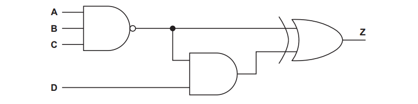
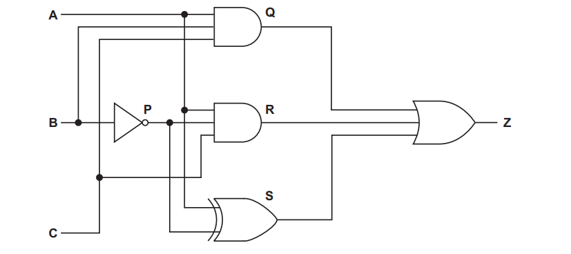
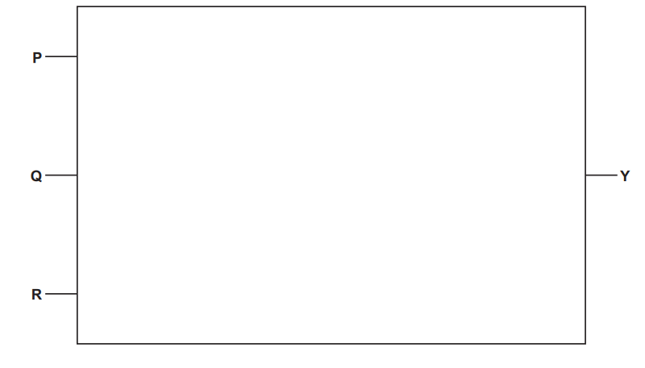
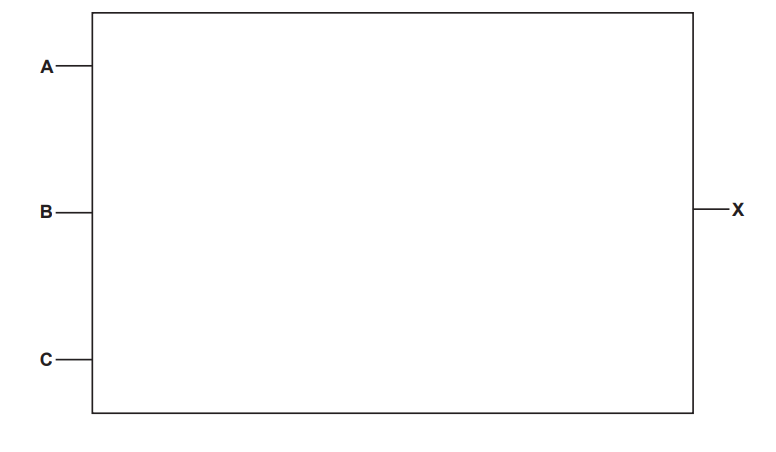
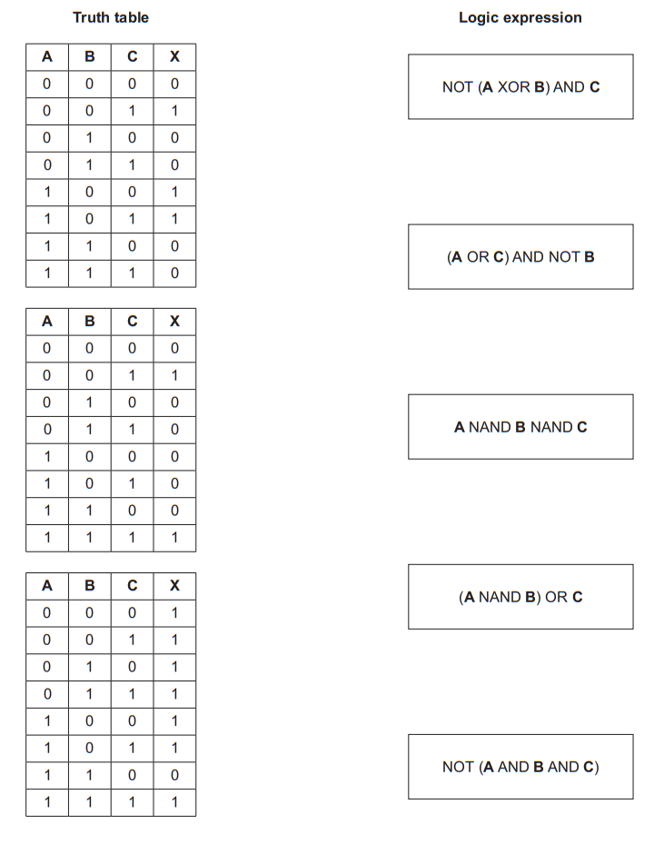
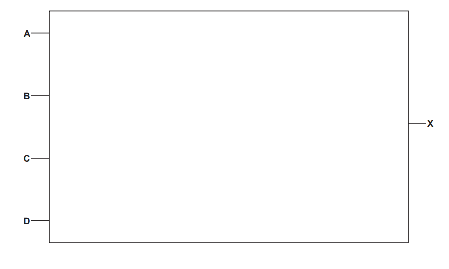
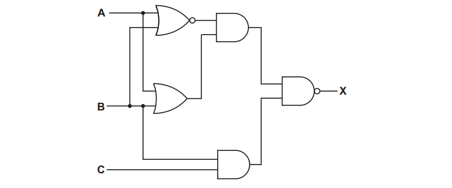
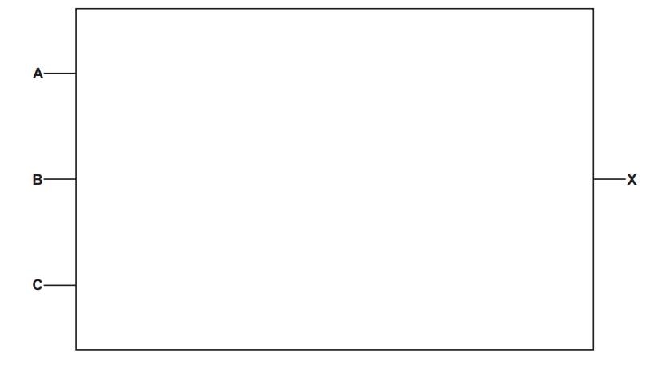

# Exam Questions — Logic Gates & Logic Circuits
**3. Hardware** · Cambridge (CIE) A-LEVEL computer-science (9618)
> Source: [https://www.savemyexams.com/a-level/computer-science/cie/19/topic-questions/](https://www.savemyexams.com/a-level/computer-science/cie/19/topic-questions/) · 30 questions across 1 sets

## Exam Questions (30 questions)

### Q1 — hard — 4 marks

**Q1** [4 marks]

The table describes a logic circuit with three inputs, **A**, **B** and **C**, and one output, **Z**.

| Gate | Type of gate | Input 1 | Input 2 | Output |
|---|---|---|---|---|
| 1 | NAND | A | B | G1 |
| 2 | XOR | B | C | G2 |
| 3 | AND | G1 | G2 | G3 |
| 4 | NOR | G3 | A | Z |

Write the logic expression for **Z**.

State every combination of input values for which **Z** = 1.

### Q2 — medium — 3 marks

**Q2** [3 marks]

The table describes a logic circuit with three inputs, **A**, **B** and **C**, and one output, **Z**.

| Gate | Type of gate | Input 1 | Input 2 | Output |
|---|---|---|---|---|
| 1 | NOT | B | - | G1 |
| 2 | XOR | A | G1 | G2 |
| 3 | OR | G2 | C | Z |

Complete the truth table for the circuit. Show your working in columns **G1** and **G2**.

| **A** | **B** | **C** | **G1** | **G2** | **Z** |
|---|---|---|---|---|---|
| 0 | 0 | 0 |   |   |   |
| 0 | 0 | 1 |   |   |   |
| 0 | 1 | 0 |   |   |   |
| 0 | 1 | 1 |   |   |   |
| 1 | 0 | 0 |   |   |   |
| 1 | 0 | 1 |   |   |   |
| 1 | 1 | 0 |   |   |   |
| 1 | 1 | 1 |   |   |   |

### Q3 — easy — 2 marks

**Q3** [2 marks]

The table describes a logic circuit with three inputs, **A**, **B** and **C**, and one output, **X**.

| Gate | Type of gate | Input 1 | Input 2 | Output |
|---|---|---|---|---|
| 1 | NOR | A | B | G1 |
| 2 | AND | G1 | C | X |

Write the logic expression for **X**.

### Q4 — hard — 4 marks

**Q4** [4 marks]

The truth table shows the output **X** of a logic circuit with three inputs, **A**, **B** and **C**.

| **A** | **B** | **C** | **X** |
|---|---|---|---|
| 0 | 0 | 0 | 0 |
| 0 | 0 | 1 | 0 |
| 0 | 1 | 0 | 0 |
| 0 | 1 | 1 | 1 |
| 1 | 0 | 0 | 0 |
| 1 | 0 | 1 | 1 |
| 1 | 1 | 0 | 0 |
| 1 | 1 | 1 | 0 |

Write the logic expression for **X**.

The circuit can be built from two gates. Complete the table to show that circuit.

| Gate | Type of gate | Input 1 | Input 2 | Output |
|---|---|---|---|---|
| 1 |   |   |   | **G1** |
| 2 |   |   |   | **X** |

### Q5 — medium — 3 marks

**Q5** [3 marks]

The truth table shows the output **X** of a logic circuit with three inputs, **A**, **B** and **C**.

| **A** | **B** | **C** | **X** |
|---|---|---|---|
| 0 | 0 | 0 | 0 |
| 0 | 0 | 1 | 0 |
| 0 | 1 | 0 | 1 |
| 0 | 1 | 1 | 0 |
| 1 | 0 | 0 | 1 |
| 1 | 0 | 1 | 0 |
| 1 | 1 | 0 | 1 |
| 1 | 1 | 1 | 0 |

The circuit is built from exactly three gates: one OR gate, one NOT gate and one AND gate. Gate 3 produces the output **X**.

Complete the table to show the circuit. Write a dash in the Input 2 column of the gate that has only one input.

| Gate | Type of gate | Input 1 | Input 2 | Output |
|---|---|---|---|---|
| 1 |   |   |   | **G1** |
| 2 |   |   |   | **G2** |
| 3 |   |   |   | **X** |

### Q6 — easy — 2 marks

**Q6** [2 marks]

The truth table shows the output **X** of a logic circuit with two inputs, **A** and **B**.

| **A** | **B** | **X** |
|---|---|---|
| 0 | 0 | 0 |
| 0 | 1 | 0 |
| 1 | 0 | 1 |
| 1 | 1 | 0 |

Write the logic expression for **X**.

### Q7 — hard — 4 marks

**Q7** [4 marks]

A logic circuit has three inputs, **A**, **B** and **C**, and one output, **X**.

**X** = ((**A** XOR **B**) NAND **C**) AND (**A** OR **C**)

The truth table has three working columns:

- **P** = **A** XOR **B**
- **Q** = **P** NAND **C**
- **R** = **A** OR **C**

Complete the truth table. Show your working in columns **P**, **Q** and **R**.

| **A** | **B** | **C** | **P** | **Q** | **R** | **X** |
|---|---|---|---|---|---|---|
| 0 | 0 | 0 |   |   |   |   |
| 0 | 0 | 1 |   |   |   |   |
| 0 | 1 | 0 |   |   |   |   |
| 0 | 1 | 1 |   |   |   |   |
| 1 | 0 | 0 |   |   |   |   |
| 1 | 0 | 1 |   |   |   |   |
| 1 | 1 | 0 |   |   |   |   |
| 1 | 1 | 1 |   |   |   |   |

### Q8 — medium — 3 marks

**Q8** [3 marks]

A logic circuit is built from this logic expression:

**Z** = (**A** NAND **B**) AND (NOT **C**)

The circuit uses three gates. Gate 3 produces the output **Z**.

Complete the table to show the circuit. Write a dash in the Input 2 column of any gate that has only one input.

| Gate | Type of gate | Input 1 | Input 2 | Output |
|---|---|---|---|---|
| 1 |   |   |   | **G1** |
| 2 |   |   |   | **G2** |
| 3 |   |   |   | **Z** |

### Q9 — easy — 2 marks

**Q9** [2 marks]

Complete the truth table for the logic expression:

**X** = (NOT **A**) OR **B**

| **A** | **B** | **NOT A** | **X** |
|---|---|---|---|
| 0 | 0 |   |   |
| 0 | 1 |   |   |
| 1 | 0 |   |   |
| 1 | 1 |   |   |

### Q10 — hard — 4 marks

**Q10** [4 marks]

A farm uses an automatic irrigation valve. Four inputs control the valve.

| Input | Binary value | Condition |
|---|---|---|
| **S** | 1 | The soil is dry |
| 0 | The soil is not dry |   |
| **R** | 1 | Rain is detected |
| 0 | Rain is not detected |   |
| **N** | 1 | It is night |
| 0 | It is day |   |
| **M** | 1 | The manual switch is on |
| 0 | The manual switch is off |   |

The valve opens (**V** = 1) when the soil is dry **and** rain is not detected **and** it is night.

The valve also opens whenever the manual switch is on, whatever the three sensors read.

The logic circuit for the valve uses four gates. Every gate except the NOT gate has two inputs. Gate 1 is the only NOT gate, and each gate may use the output of an earlier gate as one of its inputs.

Complete the table to show the circuit. Write a dash in the Input 2 column of the NOT gate.

| Gate | Type of gate | Input 1 | Input 2 | Output |
|---|---|---|---|---|
| 1 |   |   |   | **G1** |
| 2 |   |   |   | **G2** |
| 3 |   |   |   | **G3** |
| 4 |   |   |   | **V** |

### Q11 — medium — 3 marks

**Q11** [3 marks]

A cutting machine in a factory is controlled by three inputs.

| Input | Binary value | Condition |
|---|---|---|
| **G** | 1 | The safety guard is closed |
| 0 | The safety guard is open |   |
| **B** | 1 | The start button is pressed |
| 0 | The start button is not pressed |   |
| **M** | 1 | The automatic mode switch is on |
| 0 | The automatic mode switch is off |   |

The machine starts (**S** = 1) when the safety guard is closed **and** either the start button is pressed **or** the automatic mode switch is on.

Complete the truth table for the machine.

| **G** | **B** | **M** | **S** |
|---|---|---|---|
| 0 | 0 | 0 |   |
| 0 | 0 | 1 |   |
| 0 | 1 | 0 |   |
| 0 | 1 | 1 |   |
| 1 | 0 | 0 |   |
| 1 | 0 | 1 |   |
| 1 | 1 | 0 |   |
| 1 | 1 | 1 |   |

State the number of input combinations for which the machine starts.

### Q12 — easy — 2 marks

**Q12** [2 marks]

A greenhouse uses an automatic water pump.

Two sensors send binary values to the control system.

| Input | Binary value | Condition |
|---|---|---|
| **M** | 1 | The soil is dry |
| 0 | The soil is not dry |   |
| **T** | 1 | The water tank is empty |
| 0 | The water tank is not empty |   |

The pump turns on (**P** = 1) when the soil is dry **and** the water tank is not empty.

Write the logic expression for the pump.

### Q13 — hard — 4 marks

**Q13** [4 marks]

The truth table has one output column for each of three two-input logic gates.

Complete the truth table.

| A | B | A AND B | A XOR B | A NAND B |
|---|---|---|---|---|
| 0 | 0 |   |   |   |
| 0 | 1 |   |   |   |
| 1 | 0 |   |   |   |
| 1 | 1 |   |   |   |

Use your completed table to state which one of these three gates gives an output of 1 for the greatest number of input combinations. Give that number.

### Q14 — medium — 3 marks

**Q14** [3 marks]

The truth table shows the outputs of two different two-input logic gates, X and Y, for the same inputs A and B.

| A | B | X | Y |
|---|---|---|---|
| 0 | 0 | 1 | 0 |
| 0 | 1 | 1 | 1 |
| 1 | 0 | 1 | 1 |
| 1 | 1 | 0 | 0 |

Identify gate X and gate Y.

State the one combination of input values for which gate X and gate Y give different outputs.

### Q15 — easy — 2 marks

**Q15** [2 marks]

Complete the truth table for the NOR gate.

| A | B | A NOR B |
|---|---|---|
| 0 | 0 |   |
| 0 | 1 |   |
| 1 | 0 |   |
| 1 | 1 |   |

Complete the truth table for the NOT gate.

| A | NOT A |
|---|---|
| 0 |   |
| 1 |   |

### Q16 — hard — 4 marks

**Q16** [4 marks]

A logic gate with two inputs, A and B, can be given four different combinations of input values.

Two of the two-input logic gates in this syllabus give an output of 1 for exactly one of these four combinations.

Identify these two logic gates. For each gate, state the input values that give the output of 1.

### Q17 — medium — 3 marks

**Q17** [3 marks]

An XOR gate and an OR gate each have two inputs, A and B.

Explain how the function of the XOR gate differs from the function of the OR gate.

### Q18 — easy — 2 marks

**Q18** [2 marks]

Each logic gate below has two inputs.

Complete the table by writing the name of the logic gate that each description matches.

| Description of the gate | Logic gate |
|---|---|
| The output is 1 only when the two inputs are different. |   |
| The output is 0 only when both inputs are 1. |   |

### Q19 — medium — 3 marks

**Q19** [3 marks]

This diagram represents a logic circuit.

Complete the truth table for the given logic circuit.

| **A** | **B** | **C** | **D** | **Working space** | **Z** |
|---|---|---|---|---|---|
| 0 | 0 | 0 | 0 |   |   |
| 0 | 0 | 0 | 1 |   |   |
| 0 | 0 | 1 | 0 |   |   |
| 0 | 0 | 1 | 1 |   |   |
| 0 | 1 | 0 | 0 |   |   |
| 0 | 1 | 0 | 1 |   |   |
| 0 | 1 | 1 | 0 |   |   |
| 0 | 1 | 1 | 1 |   |   |
| 1 | 0 | 0 | 0 |   |   |
| 1 | 0 | 0 | 1 |   |   |
| 1 | 0 | 1 | 0 |   |   |
| 1 | 0 | 1 | 1 |   |   |
| 1 | 1 | 0 | 0 |   |   |
| 1 | 1 | 0 | 1 |   |   |
| 1 | 1 | 1 | 0 |   |   |
| 1 | 1 | 1 | 1 |   |   |

*Source: Nov 2023 9618/33 Q6A*

### Q20 — medium — 3 marks

**Q20** [3 marks]

The diagram shows a logic circuit.

Complete the truth table for the given logic circuit. Show your working.

|   |   |   | **Working space** |   |   |   |   |   |
|---|---|---|---|---|---|---|---|---|
| **A** | **B** | **C** | **P** | **Q** | **R** | **S** | **T** | **Z** |
| 0 | 0 | 0 |   |   |   |   |   |   |
| 0 | 0 | 1 |   |   |   |   |   |   |
| 0 | 1 | 0 |   |   |   |   |   |   |
| 0 | 1 | 1 |   |   |   |   |   |   |
| 1 | 0 | 0 |   |   |   |   |   |   |
| 1 | 0 | 1 |   |   |   |   |   |   |
| 1 | 1 | 0 |   |   |   |   |   |   |
| 1 | 1 | 1 |   |   |   |   |   |   |

*Source: June 2024 9618/32 Q6A*

### Q21 — medium — 3 marks

**Q21** [3 marks]

The diagram shows a logic circuit.

Complete the truth table for the given logic circuit. Show your working.

|   |   |   | **Working space** |   |   |   |   |
|---|---|---|---|---|---|---|---|
| **A** | **B** | **C** | **P** | **Q** | **R** | **S** | **Z** |
| 0 | 0 | 0 |   |   |   |   |   |
| 0 | 0 | 1 |   |   |   |   |   |
| 0 | 1 | 0 |   |   |   |   |   |
| 0 | 1 | 1 |   |   |   |   |   |
| 1 | 0 | 0 |   |   |   |   |   |
| 1 | 0 | 1 |   |   |   |   |   |
| 1 | 1 | 0 |   |   |   |   |   |
| 1 | 1 | 1 |   |   |   |   |   |

*Source: June 2024 9618/31 Q6A*

### Q22 — medium — 4 marks

**Q22** [2 marks]

Complete the truth table for the logic expression:

**Y** = ((**P** AND **Q**) XOR ((NOT **Q**) OR **R**)) AND NOT **P**

| **P** | **Q** | **R** | **Working space** | **Y** |
|---|---|---|---|---|
| 0 | 0 | 0 |   |   |
| 0 | 0 | 1 |   |   |
| 0 | 1 | 0 |   |   |
| 0 | 1 | 1 |   |   |
| 1 | 0 | 0 |   |   |
| 1 | 0 | 1 |   |   |
| 1 | 1 | 0 |   |   |
| 1 | 1 | 1 |   |   |

*Source: Nov 2023 9618/13 Q4A*

**Q22** [2 marks]

Draw a logic circuit for the logic expression:

**Y** = ((**P** AND **Q**) XOR ((NOT **Q**) OR **R**)) AND NOT **P**

*Source: Nov 2023 9618/13 Q4B*

### Q23 — medium — 5 marks

**Q23** [3 marks]

Write the Boolean expression that corresponds to the following logic circuit.

*Source: Nov 2023 9618/12 Q4A*

**Q23** [2 marks]

Complete the truth table for the logic expression:

**X** = **A** XOR (**B** AND (**A** NAND **B**) AND NOT **C**)

| **A** | **B** | **C** | **Working space** | **X** |
|---|---|---|---|---|
| 0 | 0 | 0 |   |   |
| 0 | 0 | 1 |   |   |
| 0 | 1 | 0 |   |   |
| 0 | 1 | 1 |   |   |
| 1 | 0 | 0 |   |   |
| 1 | 0 | 1 |   |   |
| 1 | 1 | 0 |   |   |
| 1 | 1 | 1 |   |   |

*Source: Nov 2023 9618/12 Q4B*

### Q24 — medium — 4 marks

**Q24** [2 marks]

Complete the truth table for the logic expression:

**X** = NOT (**A** NAND **B**) XOR (NOT** B** AND (**B** NOR **C**))

| A | B | C | Working space | X |
|---|---|---|---|---|
| 0 | 0 | 0 |   |   |
| 0 | 0 | 1 |   |   |
| 0 | 1 | 0 |   |   |
| 0 | 1 | 1 |   |   |
| 1 | 0 | 0 |   |   |
| 1 | 0 | 1 |   |   |
| 1 | 1 | 0 |   |   |
| 1 | 1 | 1 |   |   |

*Source: Nov 2023 9618/11 Q4A*

**Q24** [2 marks]

Draw a logic circuit for the logic expression:

**X** = (**A** AND NOT (**B** OR **C**)) AND (**B** NOR **C**)

*Source: Nov 2023 9618/11 Q4B*

### Q25 — medium — 3 marks

**Q25** [3 marks]

Each of the following truth tables has three inputs (**A**, **B** and** C**) and one output (**X**).

Draw **one **line to match each truth table with its logic expression.

*Source: June 2024 9618/13 Q6*

### Q26 — medium — 6 marks

**Q26** [4 marks]

Describe the operation of each of the following logic gates:

NAND .......................

NOR   ........................

XOR  .........................

OR  ..........................

*Source: June 2024 9618/12 Q1A*

**Q26** [2 marks]

Draw a logic circuit for this logic expression:

**X** = NOT ((**A **AND **B**) OR (**C** AND **D**))

*Source: June 2024 9618/12 Q1B*

### Q27 — medium — 3 marks

**Q27** [1 mark]

Tick (✓) **one **box to identify the correct logic statement for this truth table.

| A | B | C | X |
|---|---|---|---|
| 0 | 0 | 0 | 1 |
| 0 | 0 | 1 | 0 |
| 0 | 1 | 0 | 0 |
| 0 | 1 | 1 | 0 |
| 1 | 0 | 0 | 0 |
| 1 | 0 | 1 | 0 |
| 1 | 1 | 0 | 1 |
| 1 | 1 | 1 | 0 |

☐  NOT (**A** AND **B** AND **C**)

☐  (**A** XOR **B**) NOR **C**

☐  (**A** OR **B** OR **C**) NOR **C**

☐  NOT **A** AND NOT **B** AND NOT **C**

*Source: June 2024 9618/11 Q1A*

**Q27** [2 marks]

Draw a logic circuit for the logic expression:

**X** = NOT (NOT **A** AND (NOT **B** XOR **C**))

*Source: June 2024 9618/11 Q1B*

### Q28 — medium — 5 marks

**Q28** [1 mark]

Describe the operation of a 2-input XOR gate.

*Source: Nov 2024 9618/13 Q1A*

**Q28** [2 marks]

Write the logic expression for the following logic circuit.

*Source: Nov 2024 9618/13 Q1B*

**Q28** [2 marks]

Draw the logic circuit for the logic expression:

**X** = ((NOT **A** AND (**B** AND **C**)) OR (**B** NAND **C**)) AND NOT **A**

*Source: Nov 2024 9618/13 Q1C*

### Q29 — medium — 4 marks

**Q29** [2 marks]

Complete the truth table for the logic expression:

**X** = (**A** XOR **B**) NAND (**A** AND (**B** XOR **C**))

| A | B | C | Workspace | X |
|---|---|---|---|---|
| 0 | 0 | 0 |   |   |
| 0 | 0 | 1 |   |   |
| 0 | 1 | 0 |   |   |
| 0 | 1 | 1 |   |   |
| 1 | 0 | 0 |   |   |
| 1 | 0 | 1 |   |   |
| 1 | 1 | 0 |   |   |
| 1 | 1 | 1 |   |   |

*Source: Nov 2024 9618/12 Q1A*

**Q29** [2 marks]

Draw the logic circuit for the logic expression:

**W** = **P** NAND ((**Q** OR NOT **R**) XOR (**P** XOR **Q**))

*Source: Nov 2024 9618/12 Q1B*

### Q30 — medium — 2 marks

**Q30** [2 marks]

A security system has both a floodlight (very bright light) and an audio alarm.

The data from multiple sensors is analysed and used to:

- turn on the floodlight
- sound the audio alarm.

Sensors can be used to detect:

- if doors are open
- the external daylight level
- if people are detected within a set distance.

The floodlight (X) and audio alarm (Y) operate according to the following criteria:

| Parameter | Description of parameter | Binary value | Condition |
|---|---|---|---|
| **A** | External daylight level | 1 | Low |
| 0 | High |   |   |
| **B** | Front door | 1 | Open |
| 0 | Closed |   |   |
| **C** | Person is within 2 m | 1 | Detected |
| 0 | Not detected |   |   |
| **D** | Back door | 1 | Open |
| 0 | Closed |   |   |
| **E** | Security system | 1 | Switched on |
| 0 | Switched off |   |   |

The floodlight turns on (**X = 1**) if:

- the security system is switched on **and **
- the external daylight level is low **and **
- a person is detected within 2m.

The audio alarm turns on (**Y = 1**) if:

- the security system is switched on **and**
- one **or** more doors are open, or a person is detected within 2m.

Write logic expressions for the security system.

*Source: Nov 2024 9618/11 Q5B*

