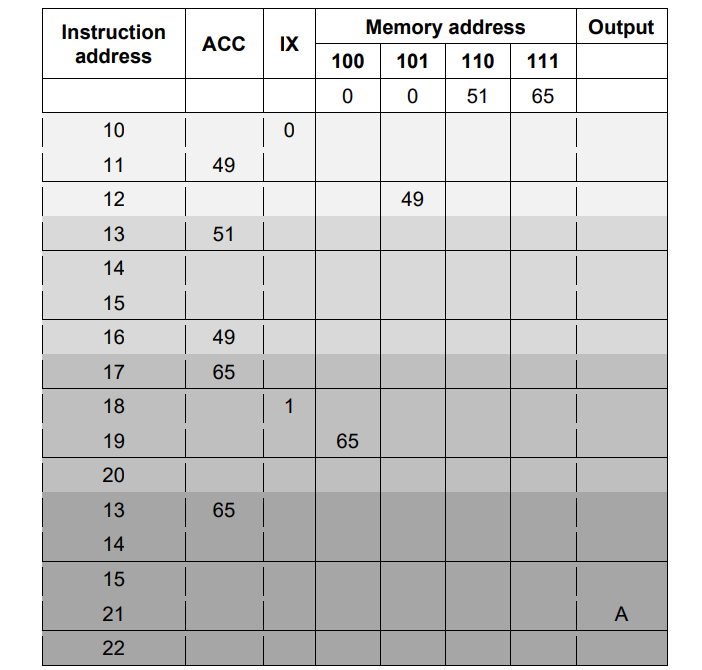

# Mark Schemes — Assembly Language
**4. Processor Fundamentals** · Cambridge (CIE) A-LEVEL computer-science (9618)

## Exam Questions (22 questions)

### Q1
| Pass through the loop | Content of the ACC after `LDX 150` | Character output during this pass | Content of the IX at the end of this pass |
|---|---|---|---|
| 1 | 72 | H | 1 |
| 2 | **73** | **I** | **2**  **[2]** |
| 3 | **33** | **!** | **3**  **[2]** |
| 4 | **0** | **none** | **3**  **[1]** |

On pass 4 the `LDX 150` instruction uses address 150 + 3 = 153, which holds 0. `CMP #0` is therefore true, so `JPE FINISH` transfers control to `END`. The `OUT` and `INC IX` instructions are not reached on that pass, so nothing is output and the IX stays at 3.

The characters output by the program, in order, are `H`, `I` and `!`.

**[5 marks]**

> **[mark-scheme]**
> **1 mark** for pass 2 ACC `73` and output `I`
> 
> **1 mark** for pass 2 IX `2`
> 
> **1 mark** for pass 3 ACC `33` and output `!`
> 
> **1 mark** for pass 3 IX `3`
> 
> **1 mark** for pass 4 showing ACC `0`, no character output and IX still `3`
> 
> Accept the ASCII value in place of the character, so `73` for `I` and `33` for the exclamation mark
> 
> Accept a dash, "none", "nothing" or an empty cell for the pass 4 output
> 
> Do not accept a fourth character on pass 4. `CMP #0` is true, so `JPE FINISH` jumps to `END` before `OUT` is reached
> 
> Do not accept `4` for the IX on pass 4, because `INC IX` is not executed on that pass
> 
> Do not accept a table that stops at pass 3. The loop is entered a fourth time and that pass is what ends the program

> **[exam-tip]**
> The value 0 at address 153 is a stop marker, not data. It is never printed. Its only job is to make `CMP #0` true so that the jump to `FINISH` happens.
> 
> Two mistakes are common. The first is stopping the trace after pass 3, because the message looks finished. The loop still runs one more time, and that pass is the one that ends the program. The second is adding 1 to the IX on the last pass out of habit. Follow the order of the instructions: the test comes before `OUT` and before `INC IX`, so on the pass that finds the stop marker neither of them happens.

### Q2
| Set number | Instructions | ACC content | IX content |
|---|---|---|---|
| 1 | `LDR #2` `LDX 73` | **8** | **2**  **[1]** |
| 2 | `LDI 73` | **6** | **3**  **[1]** |
| 3 | `LDD 72` `DEC ACC` | **18** | **3**  **[1]** |

Set 1: `LDR #2` puts the number 2 into the IX. `LDX 73` then uses address 73 + 2 = 75, and address 75 holds 8.

Set 2: `LDI 73` reads address 73, which holds 71, and then loads the contents of address 71, which is 6. The IX is not used, so it stays at 3.

Set 3: `LDD 72` loads 19 and `DEC ACC` subtracts 1, giving 18. The IX is not used, so it stays at 3.

**[3 marks]**

> **[mark-scheme]**
> **1 mark** for set 1: ACC `8` and IX `2`
> 
> **1 mark** for set 2: ACC `6` and IX `3`
> 
> **1 mark** for set 3: ACC `18` and IX `3`
> 
> Both cells in a row must be correct for that row to earn its mark
> 
> Do not accept `41` for the ACC in set 1, which comes from adding the original IX value of 3 instead of the 2 loaded by `LDR #2`
> 
> Do not accept `3` for the IX in set 1. `LDR #2` changes the IX before `LDX` uses it
> 
> Do not accept `71` for the ACC in set 2, which is the content of address 73 itself rather than the content of the address that 73 points to

> **[exam-tip]**
> Two things catch students out in this shape of question. The first is forgetting that `LDR` writes to the IX, not the ACC, so by the time `LDX 73` runs the index has already changed. Update the IX column before you work out the address.
> 
> The second is the difference between `LDD` and `LDI`. `LDD 73` would give you 71. `LDI 73` treats that 71 as another address and goes there for the data. Write the chain out as 73 gives 71, then 71 gives 6, and the second step will not get missed.

### Q3
| Program number | Code | ACC content |
|---|---|---|
| 1 | `LDD 62` `ADD #5` | **12**  **[1]** |
| 2 | `LDM #62` `SUB 61` | **53**  **[1]** |

Program 1: `LDD 62` copies the contents of address 62, which is 7, into the ACC. `ADD #5` adds the number 5, giving 12.

Program 2: `LDM #62` loads the number 62 itself into the ACC. `SUB 61` subtracts the contents of address 61, which is 9, giving 53.

**[2 marks]**

> **[mark-scheme]**
> **1 mark** for `12` in program 1
> 
> **1 mark** for `53` in program 2
> 
> Do not accept `7` for program 1, which ignores the `ADD #5` instruction
> 
> Do not accept `1` for program 2, which comes from reading `SUB 61` as subtracting the number 61 rather than the contents of address 61
> 
> Do not accept `-2` for program 2, which comes from reading `LDM #62` as loading the contents of address 62

> **[exam-tip]**
> Everything in this question turns on the hash symbol. `#62` is the number sixty-two. A bare `62` is address sixty-two, and what you use is whatever is stored there. Before you work anything out, go through the program and mark each operand as either a number or an address.
> 
> The trap in program 2 is that the same program uses both forms within two lines: `LDM #62` takes the number, `SUB 61` goes to memory. Students who read both operands the same way lose the mark.

### Q4
(i) `JPN` is a conditional instruction, so it jumps only when the result of the previous comparison was False. **[1]**

`CMP #10` at address 103 is the compare instruction that produces that True or False result, so without it there is no result for `JPN 100` to test. **[1]**

(ii) `JMP` is an unconditional instruction, so the jump back to address 100 is taken every time the processor reaches address 104. **[1]**

The program therefore repeats addresses 100 to 104 forever and never reaches `END` at address 105, so it never stops. **[1]**

`JMP` belongs to the unconditional and conditional instructions group. **[1]**

**[5 marks]**

> **[mark-scheme]**
> **1 mark** for (i) stating that `JPN` jumps only when a comparison gave False // that `JPN` is a conditional instruction
> 
> **1 mark** for (i) stating that `CMP #10` is the compare instruction that produces the True or False result `JPN` tests
> 
> **1 mark** for (ii) stating that `JMP` always jumps // that the jump no longer depends on the comparison
> 
> **1 mark** for (ii) stating that the program repeats forever // never reaches address 105 // never stops
> 
> **1 mark** for (ii) unconditional and conditional instructions
> 
> Accept for the group name in (ii): conditional and unconditional instructions // unconditional instruction(s).
> 
> Do not accept for (ii): "the program stops straight away". The jump is backwards, to address 100, so the program repeats instead of ending.
> 
> Do not accept for (ii): "the processor reports an error". Nothing in this instruction set detects a loop that never ends.

> **[exam-tip]**
> Read the instruction set wording closely. `JPE` and `JPN` are both defined as acting "following a compare instruction". That phrase is doing real work: a conditional jump has nothing to test until a `CMP` has set the result, so the two are always used as a pair.
> 
> `JMP`, `JPE` and `JPN` all sit in the same group. Do not split them into a jump group and a conditional group in an answer. The syllabus name covers all three: unconditional and conditional instructions.

### Q5
On the first pass the assembler reads the program one line at a time and records every label in a symbol table together with the address of the line that the label is on. **[1]**

The assembler reaches `JPE DONE` at address 42, but the label `DONE` is not defined until address 50, so at that moment its address is still unknown. This is a forward reference. **[1]**

The assembler therefore cannot produce the machine code for that instruction on the first pass, because the operand of a jump instruction has to be a memory address and that address is not yet available. **[1]**

By the end of the first pass the symbol table is complete and holds `AGAIN` as 41 and `DONE` as 50. On the second pass every label can be replaced by its address from the symbol table, so the object code can now be generated for every line. **[1]**

**[4 marks]**

> **[mark-scheme]**
> **1 mark** for the first pass building a symbol table of the labels and the addresses they stand for
> 
> **1 mark** for identifying that `DONE` is used at address 42 but not defined until address 50, so it is a forward reference
> 
> **1 mark** for stating that the address of `DONE` is not yet known at that point, so the operand cannot be filled in and no machine code can be generated for that instruction
> 
> **1 mark** for stating that the second pass can generate the object code because the symbol table is now complete, so every label can be replaced by its address
> 
> Accept `JPE DONE` in place of `DONE` for the forward-reference point
> 
> Accept a contrast with `JMP AGAIN` at address 49, where `AGAIN` has already been read and so could be resolved straight away, as support for the forward-reference point
> 
> Do not accept "two passes are needed because the program contains a loop". A loop that only jumps backwards would not on its own need a second pass
> 
> Do not accept "two passes are needed to check the program for errors" on its own, as this does not explain why one pass cannot produce the object code

> **[exam-tip]**
> The mark is for naming the instruction that cannot be assembled, not for describing the two passes in general. Point at `JPE DONE` and say why: the assembler has not read address 50 yet, so it does not know what number to put in the operand.
> 
> Compare it with `JMP AGAIN` at address 49. `AGAIN` was defined back at address 41, which the assembler has already read, so that jump on its own could be assembled in one pass. It is the jump forwards, not the loop, that forces the second pass.

### Q6
| Label | Address |
|---|---|
| **FULL** | **56**  **[1]** |
| **EMPTY** | **59**  **[1]** |
| **SOME** | **62**  **[1]** |

**[3 marks]**

> **[mark-scheme]**
> **1 mark** for `FULL` recorded with address `56`
> 
> **1 mark** for `EMPTY` recorded with address `59`
> 
> **1 mark** for `SOME` recorded with address `62`
> 
> Accept the three rows written in any order
> 
> Do not accept `300` as an entry in the symbol table. `300` is an absolute address written directly in the instruction, so the assembler has nothing to look up
> 
> Do not accept `#0`, `#250`, `#70`, `#69` or `#83` as entries. These operands are numbers, not labels
> 
> Do not accept the address of the instruction that refers to the label, for example `52` for `FULL`, or the address of the line after the label, for example `57` for `FULL`

> **[exam-tip]**
> Two errors cost marks here. The first is recording the address of the jump instruction instead of the address of the labelled line: the assembler stores where the label is defined, not where it is used. Read straight across the row that carries the label.
> 
> The second is treating every operand as a label. In this program `300` is an address the programmer typed in directly and `#250` is a number, so neither of them ever reaches the symbol table. Only names that appear in the Label column are entered.

### Q7
Group: arithmetic operations **[1]**

The instructions in this group change the value held in the Accumulator by carrying out a calculation on it, such as adding a number to it. **[1]**

Example: `ADD 100` **[1]**

**[3 marks]**

> **[mark-scheme]**
> **1 mark** for naming one instruction group other than data movement
> 
> **1 mark** for a description that matches the group named
> 
> **1 mark** for an example taken from the table that belongs to the group named, with a suitable operand where the instruction needs one
> 
> Accept any one of these four groups, with the matching description and example:
> 
> - Arithmetic operations. The instructions carry out a calculation on the value in the Accumulator, such as adding to it. Example: `ADD 100` or `INC ACC`
> - Compare instructions. The instructions compare the value in the Accumulator with another value and record whether the two are the same. Example: `CMP #5`
> - Unconditional and conditional instructions. The instructions change which instruction the processor carries out next, either every time or only when a previous compare gave a particular result. Example: `JMP 100` or `JPE 100`
> - Input and output of data. The instructions take a character in from the user, or send a character out to the screen. Example: `IN` or `OUT`
> 
> Do not accept data movement, which is given in the question.
> 
> Do not accept an example that does not belong to the group named, for example naming arithmetic operations and then giving `JPE 100`.
> 
> Do not accept `ADD`, `CMP`, `JMP` or `JPE` written with no operand.

> **[exam-tip]**
> Three separate things are being marked here: the name, the description and the example. Students who name a group and then stop lose two of the three marks.
> 
> Copy the example straight from the table and give it an operand. `JPE` on its own is not something the processor could carry out, but `JPE 100` is.

### Q8
First pass: to build the symbol table, which stores each label used in the program together with the memory address that the label stands for. **[1]**

Second pass: to generate the object code, replacing each label with the address held in the symbol table. **[1]**

**[2 marks]**

> **[mark-scheme]**
> **1 mark** for the first pass creating the symbol table of labels and the addresses they stand for
> 
> **1 mark** for the second pass generating the object code, replacing each label with its address from the symbol table
> 
> Accept "makes a list of the labels and their addresses" for the first pass
> 
> Accept "produces the machine code" or "produces the object program" for the second pass
> 
> Do not accept "the first pass translates the program into machine code", because no object code is produced until the second pass
> 
> Do not accept "the second pass builds the symbol table", because the symbol table is already complete before the second pass begins

> **[exam-tip]**
> The most common error here is swapping the two passes over, or saying that both passes produce machine code. Keep the order straight by asking what the assembler is still missing partway through the first pass: it has not read the whole program yet, so it cannot know where every label is. The first pass collects the addresses and the second pass uses them.

### Q9
(i) Input and output of data **[1]**

(ii) Arithmetic operations **[1]**

**[2 marks]**

> **[mark-scheme]**
> **1 mark** for (i) input and output of data
> 
> **1 mark** for (ii) arithmetic operations
> 
> Accept for (i): input and output
> 
> Do not accept for (i): input on its own, or output on its own. The group covers both directions, and one of those words names only half of it.
> 
> Do not accept for (ii): calculation, or maths. The syllabus name for this group is arithmetic operations.

> **[exam-tip]**
> Learn the five group names in the words the syllabus uses: data movement, input and output of data, arithmetic operations, unconditional and conditional instructions, and compare instructions.
> 
> A shortened answer such as "input" or "jump" is the commonest way marks are lost on this topic, because it names only part of the group.

### Q10
(i) 4 **[1]**

(ii) Each assembly language instruction is translated into exactly one machine code instruction. **[1]**

The program contains four assembly language instructions, so the translated program contains four machine code instructions. **[1]**

(iii) The opcode tells the processor which operation to carry out, which here is to add. **[1]**

The operand gives the value that the operation works with, which here is the number 4. **[1]**

**[5 marks]**

> **[mark-scheme]**
> **1 mark** for (i) 4
> 
> **1 mark** for (ii) stating that one assembly language instruction becomes exactly one machine code instruction
> 
> **1 mark** for (ii) applying that to the four instructions in this program
> 
> **1 mark** for (iii) the opcode identifies the operation the processor must carry out
> 
> **1 mark** for (iii) the operand supplies the value, or the address, that the operation uses
> 
> Accept for (iii): "the opcode says what to do" and "the operand says what to do it to", provided the answer is linked to `ADD #4`.
> 
> Do not accept for (i): any answer other than 4. `END` is an instruction in the instruction set and is translated in the same way as the other three lines.
> 
> Do not accept for (ii): "the assembler removes the spaces, so the program becomes shorter". Removing white space does not change how many instructions there are.

> **[exam-tip]**
> The commonest slip in part (i) is answering 3, because students forget that `END` counts. It is a real instruction with its own opcode and it is translated like every other line.
> 
> In part (ii), explain the count rather than the translator. Answers that describe what the assembler does step by step never say why the number of instructions is unchanged, and that one sentence is what earns the mark.

### Q11
In assembly language each instruction is written as a short letter code such as `LDD` or `ADD`, instead of as a pattern of binary digits. **[1]**

These short codes are much easier for a person to read, write and remember than the binary pattern that means the same thing. **[1]**

An address can also be written as a symbolic address, such as `TOTAL`, instead of as an absolute number, so the programmer does not have to remember which number belongs to which value. **[1]**

**[3 marks]**

> **[mark-scheme]**
> **Any three from:**
> 
> - Assembly language instructions are written as short letter codes such as `LDD`, `ADD` or `STO`, rather than as binary
> - Those codes are easier for a person to read, write and remember than the equivalent binary pattern
> - An address can be written as a symbolic address rather than as an absolute numeric address
> - A mistake is easier to find and correct, because the programmer can see which operation each line performs
> - The programmer does not have to work out the binary code for each operation, so fewer typing mistakes are made
> 
> **[3 marks]**
> 
> Accept "mnemonic" in place of "short letter code".
> 
> Do not accept "assembly language is a high-level language". Assembly language is a low-level language, closer to machine code than a high-level language is.
> 
> Do not accept "the assembly language program runs faster". Both versions contain the same instructions, so speed is not the reason the programmer finds it easier.

> **[exam-tip]**
> The command word "explain" needs a reason, not a list of features. Writing "assembly language uses `LDD` and `ADD`" states a feature. Adding "which a person can read and remember far more easily than a row of 0s and 1s" turns it into the reason the examiner is paying for.
> 
> Watch who the question is about. It asks why this is easier for the programmer, not for the processor. The processor still has to be given machine code, and the assembler is what produces it.

### Q12
(i) An assembler **[1]**

(ii) Machine code **[1]**

**[2 marks]**

> **[mark-scheme]**
> **1 mark** for (i) assembler
> 
> **1 mark** for (ii) machine code
> 
> Accept for (ii): object code
> 
> Do not accept for (i): compiler, or interpreter. Those translate a high-level language program, not an assembly language program.
> 
> Do not accept for (ii): binary on its own. Everything held in memory is binary, so this does not name the translated program.

> **[exam-tip]**
> Check which language the question names before you name the translator. Assembly language always means an assembler. Compiler and interpreter are the answers when the question says high-level language, and writing one of those here scores nothing.

### Q13
| Program number | Code | ACC contents |
|---|---|---|
| 1 | `LDX 201` | **45** **[1]** |
| 2 | `LDI 205` | **206** **[1]** |
| 3 | `LDR #1` `LDX 205` `ADD 201` | **48** **[1]** |
| 4 | `LDM #207` `LDI 207` | **204** **[1]** |

Program 1: the address used is 201 + IX, and IX holds 3, so the address is 204. Address 204 holds 45.

Program 2: address 205 holds 202, so 202 is the address to be used. Address 202 holds 206.

Program 3: `LDR #1` changes IX from 3 to 1, so the address used by `LDX 205` is 205 + 1 = 206. Address 206 holds 18. `ADD 201` then adds the contents of address 201, which is 30, giving 18 + 30 = 48.

Program 4: `LDM #207` loads the number 207 itself into the ACC, then `LDI 207` overwrites it. Address 207 holds 200, so 200 is the address to be used. Address 200 holds 204.

**[4 marks]**

> **[mark-scheme]**
> **1 mark** for 45 in program 1
> 
> **1 mark** for 206 in program 2
> 
> **1 mark** for 48 in program 3
> 
> **1 mark** for 204 in program 4
> 
> Award the mark for the final ACC value only. Working is not required
> 
> Do not accept 30 in program 1. That is the contents of address 201, which is what `LDD 201` would load, and `LDX` adds the Index Register before the memory location is read
> 
> Do not accept 202 in program 2. That is the contents of address 205, which is what `LDD 205` would load, and `LDI` uses that value as a second address
> 
> Do not accept 105 in program 3. That answer leaves IX at 3, which ignores `LDR #1`, and uses address 208 to give 75 + 30
> 
> Do not accept 18 in program 3, which omits the `ADD 201` step
> 
> Do not accept 207 or 200 in program 4. 207 ignores the second instruction, and 200 stops one step early by treating `LDI` as direct addressing

> **[exam-tip]**
> Two mistakes account for nearly every lost mark here. The first is treating `LDI` as though it were `LDD`. Indirect addressing needs two visits to memory: read the location named by the operand to get a second address, then read that second address to get the data. Write the intermediate address down rather than holding it in your head.
> 
> The second is forgetting that `LDR #n` changes the Index Register. Programs on this paper are written so that the Index Register is set part way through, and every later `LDX` must use the new value. Before you work out any `LDX`, check what IX holds at that exact moment.

### Q14
| Addressing mode | Instruction |
|---|---|
| Direct | **LDD 104** **[1]** |
| Indirect | **LDI 100** **[1]** |
| Indexed | **LDX 102** **[1]** |

Direct: address 104 holds 78, so the operand is that address itself.

Indirect: address 100 holds 104, and address 104 holds 78, so the operand is 100.

Indexed: the address used is the operand plus IX, and 102 + 2 = 104, so the operand is 102.

**[3 marks]**

> **[mark-scheme]**
> **1 mark** for `LDD 104` in the direct row
> 
> **1 mark** for `LDI 100` in the indirect row
> 
> **1 mark** for `LDX 102` in the indexed row
> 
> Each row has exactly one correct answer. Address 104 is the only address holding 78, address 100 is the only address holding 104, and 102 is the only operand that gives 104 once the Index Register value of 2 is added
> 
> Accept the opcode written in lower case, and accept extra spaces between the opcode and the operand
> 
> Do not accept `LDM #78`, which is immediate addressing and is not one of the three modes asked for
> 
> Do not accept `LDI 104`, which would use 78 as the second address, and address 78 is not shown
> 
> Do not accept `LDX 104`, which would use address 106, and address 106 is not shown
> 
> Do not accept `LDD 100`, which loads 104 rather than 78

> **[exam-tip]**
> This question runs the lookup backwards, which is where the marks go. For `LDI`, do not stop after one step. Ask which address holds 78, then ask which address holds that address, and the second answer is your operand.
> 
> For `LDX`, the Index Register is added before memory is read, never after, so subtract the Index Register value from the address you want in order to get the operand. A student who adds 2 instead of subtracting it writes `LDX 106` and scores nothing.

### Q15
| Description | Addressing mode |
|---|---|
| The address of the data is formed by adding the contents of the Index Register to the operand. | **Indexed** **[1]** |
| The operand gives an offset. This offset is added to a base address to form the address of the data, so the program still works if it is loaded at a different place in memory. | **Relative** **[1]** |

**[2 marks]**

> **[mark-scheme]**
> **1 mark** for Indexed in the first row
> 
> **1 mark** for Relative in the second row
> 
> Accept "indexed addressing" and "relative addressing"
> 
> Accept any capitalisation
> 
> Do not accept Direct or Immediate for either row, because in both of those modes nothing is added to the operand
> 
> Do not accept Indirect for either row, because indirect addressing follows the operand to a second address rather than adding to it
> 
> Do not accept Indexed in the second row, because indexed addressing adds the contents of the Index Register, not an offset from a base address

> **[exam-tip]**
> Learn the five modes by what happens to the operand, not by the sound of their names. In immediate addressing nothing happens, because the operand is the data. In direct addressing nothing is added, because the operand is already the address. Indirect addressing follows the operand to a second address. Indexed addressing adds the Index Register. Relative addressing adds an offset to a base address.
> 
> The two answers students swap most often are indirect and indexed. Both take a second step, but only indexed uses the Index Register, and only indirect reads a memory location to find out where the data is.

### Q16
> **[mark-scheme]**
> **1 mark** for each bullet point
> 
> - `IN `- Input **and **output of data
> - `ADD `- Arithmetic operations
> - `JPE `- Unconditional and conditional instructions
> - `CMI `- Compare instructions
> **[mark-scheme]**
> **1 mark** for each set of shaded rows
> 
> 

### Q17
> **[mark-scheme]**
> **1 mark** for:
> 
> - To create a symbol table
> **[mark-scheme]**
> (i) **1 mark **for each bullet point
> 
> - Data movement: e.g. LDR #50 // STO 201
> - Arithmetic operation: e.g. ADD 100 // INC IX
> - Conditional instruction: e.g. JPE 96
> 
> (ii)** 1 mark** for each bullet point (**max 2**)
> 
> Similarity:
> 
> - both load the contents of an address into the Accumulator
> 
> Difference:
> 
> - direct accesses the address given by the operand whereas indexed adds the contents of IX to the operand and accesses the data at that calculated address
> 
> (iii) **1 mark** for
> 
> - Indirect (addressing)
> - Relative (addressing)

### Q18
> **[mark-scheme]**
> **1 mark **for each correct answer:
> 
> | Program number | Instructions | ACC content |
> |---|---|---|
> | 1 | `LDM #50 ` `INC ACC ` `SUB #1` | **50** |
> | 2 | `LDI 51 ` `ADD 52` | **97** |
> | 3 | `LDR #2 ` `LDX 50 ` `DEC ACC` | **48** |
> | 4 | `LDD 52 ` `SUB 54 ` `INC ACC` | **44** |

### Q19
> **[mark-scheme]**
> **1 mark** for each correct answer:
> 
> | Program number | Instructions | ACC content |
> |---|---|---|
> | 1 | `LDI 15 ` `SUB #1` | **11** |
> | 2 | `LDD 14 ` `ADD 11` | **13** |
> | 3 | `LDM #11 ` `ADD #3 ` `SUB 16` | **2** |
> | 4 | `LDR #2` `LDX 14 ` `ADD #2` | **14** |

### Q20
> **[mark-scheme]**
> **1 mark **for each correct answer:
> 
> | Program number | Instructions | ACC content |
> |---|---|---|
> | 1 | `LDD 20` `ADD #2` | **4** |
> | 2 | `LDX 22` | **5** |
> | 3 | `LDI 25` `INC ACC ` `SUB 22` | **1** |
> | 4 | `LDD 19` `LDM #5` `LDM #25` | **25** |

### Q21
> **[mark-scheme]**
> **1 mark **each:
> 
> |   | Instructions | ACC content |
> |---|---|---|
> | 1 | `LDD 50 ` `ADD #4 ` `ADD 54` | **158** |
> | 2 | `LDI 53 ` `DEC ACC ` `ADD 56` | **99** |
> | 3 | `LDM #55 ` `SUB #5` | **50** |

### Q22
> **[mark-scheme]**
> **1 mark** for each correct content of the ACC (4) 
> **1 mark** for correct IX column
> 
> |   | Instructions | ACC content | IX content |
> |---|---|---|---|
> | 1 | `LDM #19` `DEC ACC` | **18** | **20** |
> | 2 | `LDD 23` `ADD 19` | **40** | **20** |
> | 3 | `LDI 25` `INC ACC` | **5** | **20** |
> | 4 | `LDR #21` `LDX 2` | **15** | **21** |
