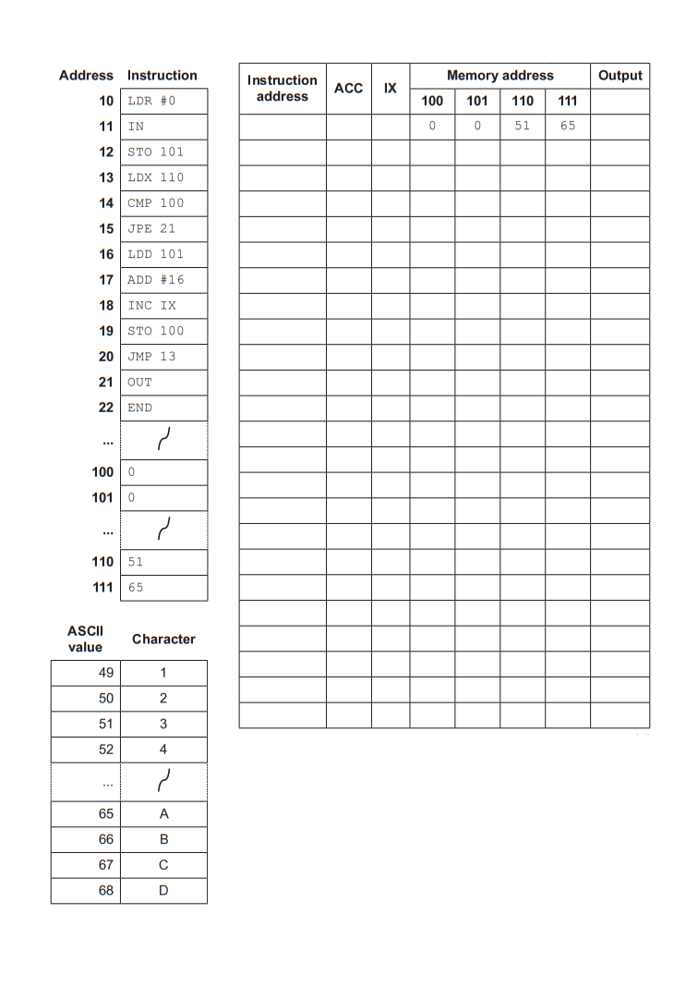

# Exam Questions — Assembly Language
**4. Processor Fundamentals** · Cambridge (CIE) A-LEVEL computer-science (9618)
> Source: [https://www.savemyexams.com/a-level/computer-science/cie/19/topic-questions/](https://www.savemyexams.com/a-level/computer-science/cie/19/topic-questions/) · 22 questions across 1 sets

## Exam Questions (22 questions)

### Q1 — hard — 5 marks

**Q1** [5 marks]

The table shows part of the instruction set for a processor. The processor has one general purpose register, the Accumulator (ACC), and an Index Register (IX).

| Opcode | Operand | Explanation |
|---|---|---|
| `LDR` | `#n` | Immediate addressing. Load the number n to IX |
| `LDX` | `address` | Indexed addressing. Form the address from the given address + the contents of the Index Register. Copy the contents of this calculated address to ACC |
| `CMP` | `#n` | Compare the contents of ACC with number n |
| `JPE` | `address` | Following a compare instruction, jump to the given address if the compare was True |
| `JMP` | `address` | Jump to the given address |
| `INC` | `register` | Add 1 to the contents of the register (ACC or IX) |
| `OUT` |   | Output to the screen the character whose ASCII value is stored in ACC |
| `END` |   | Return control to the operating system |

`address` can be an absolute or a symbolic address.

`#` denotes a denary number, for example `#123`.

The current contents of memory are shown. The value 0 at address 153 marks the end of the message.

| Address | Data |
|---|---|
| 150 | 72 |
| 151 | 73 |
| 152 | 33 |
| 153 | 0 |

The ASCII values used by the program are shown.

| ASCII value | Character |
|---|---|
| 72 | H |
| 73 | I |
| 33 | ! |

The program is shown.

| Label | Opcode | Operand |
|---|---|---|
|   | `LDR` | `#0` |
| LOOP | `LDX` | `150` |
|   | `CMP` | `#0` |
|   | `JPE` | `FINISH` |
|   | `OUT` |   |
|   | `INC` | `IX` |
|   | `JMP` | `LOOP` |
| FINISH | `END` |   |

The trace table records what happens on each pass through the loop. The first row has been completed for you.

Complete the trace table.

| Pass through the loop | Content of the ACC after `LDX 150` | Character output during this pass | Content of the IX at the end of this pass |
|---|---|---|---|
| 1 | 72 | H | 1 |
| 2 |   |   |   |
| 3 |   |   |   |
| 4 |   |   |   |

### Q2 — medium — 3 marks

**Q2** [3 marks]

The table shows part of the instruction set for a processor. The processor has two registers, the Accumulator (ACC) and the Index Register (IX).

| Opcode | Operand | Explanation |
|---|---|---|
| `LDD` | `address` | Direct addressing. Load the contents of the location at the given address to ACC |
| `LDI` | `address` | Indirect addressing. The address to be used is at the given address. Load the contents of this second address to ACC |
| `LDX` | `address` | Indexed addressing. Form the address from the given address + the contents of the Index Register. Copy the contents of this calculated address to ACC |
| `LDR` | `#n` | Immediate addressing. Load the number n to IX |
| `DEC` | `register` | Subtract 1 from the contents of the register (ACC or IX) |

`address` can be an absolute or a symbolic address.

`#` denotes a denary number, for example `#123`.

The current contents of memory are shown.

| Address | Data |
|---|---|
| 70 | 74 |
| 71 | 6 |
| 72 | 19 |
| 73 | 71 |
| 74 | 33 |
| 75 | 8 |
| 76 | 41 |

The current contents of the ACC and the IX are shown.

| Register | Content |
|---|---|
| ACC | 5 |
| IX | 3 |

The ACC and the IX are reset to these values before each set of instructions is run.

Complete the table by writing the content of the ACC and the content of the IX after each set of instructions has run.

| Set number | Instructions | ACC content | IX content |
|---|---|---|---|
| 1 | `LDR #2` `LDX 73` |   |   |
| 2 | `LDI 73` |   |   |
| 3 | `LDD 72` `DEC ACC` |   |   |

### Q3 — easy — 2 marks

**Q3** [2 marks]

The table shows part of the instruction set for a processor. The processor has one general purpose register, the Accumulator (ACC).

| Opcode | Operand | Explanation |
|---|---|---|
| `LDM` | `#n` | Immediate addressing. Load the number n to ACC |
| `LDD` | `address` | Direct addressing. Load the contents of the location at the given address to ACC |
| `ADD` | `#n` | Add the number n to the ACC |
| `SUB` | `address` | Subtract the contents of the given address from the ACC |

`address` can be an absolute or a symbolic address.

`#` denotes a denary number, for example `#123`.

The current contents of memory are shown.

| Address | Data |
|---|---|
| 60 | 12 |
| 61 | 9 |
| 62 | 7 |
| 63 | 25 |

The current content of the ACC is 4. The value 4 is reloaded into the ACC before each program is run.

Complete the table by writing the content of the ACC after each program has run.

| Program number | Code | ACC content |
|---|---|---|
| 1 | `LDD 62` `ADD #5` |   |
| 2 | `LDM #62` `SUB 61` |   |

### Q4 — hard — 5 marks

**Q4** [5 marks]

The table shows part of the instruction set for a processor. The processor has one general purpose register, the Accumulator (ACC).

| **Instruction** | **Explanation** |   |
|---|---|---|
| **Opcode** | **Operand** |   |
| `LDD` | `<address>` | Direct addressing. Load the contents of the location at the given address to ACC |
| `ADD` | `#n` | Add the denary number n to the ACC |
| `STO` | `<address>` | Store the contents of ACC at the given address |
| `CMP` | `#n` | Compare the contents of ACC with number n |
| `JPN` | `<address>` | Following a compare instruction, jump to the given address if the compare was False |
| `JMP` | `<address>` | Jump to the given address |
| `END` |   | Return control to the operating system |
| `<address>` can be an absolute or a symbolic address `#` denotes a denary number, e.g. `#123` |   |   |

A program is stored in memory at addresses 100 to 105. Address 200 holds the value 3 before the program starts.

(i) Explain why the instruction `JPN 100` at address 104 cannot do its job unless the instruction at address 103 is also present.

(ii) The instruction at address 104 is replaced by `JMP 100`. Describe the effect this change has when the program runs, and name the instruction group that `JMP` belongs to.

### Q5 — hard — 4 marks

**Q5** [4 marks]

A program written in assembly language divides the number stored at address 200 by the number stored at address 201, using repeated subtraction. It stores the result at address 202. The value at address 200 is an exact multiple of the value at address 201, and address 202 holds 0 before the program starts.

The program is stored in main memory starting at address 40. Each instruction is stored in one memory location.

| Address | Label | Instruction |
|---|---|---|
| 40 |   | `LDD 200` |
| 41 | AGAIN | `CMP #0` |
| 42 |   | `JPE DONE` |
| 43 |   | `SUB 201` |
| 44 |   | `STO 200` |
| 45 |   | `LDD 202` |
| 46 |   | `INC ACC` |
| 47 |   | `STO 202` |
| 48 |   | `LDD 200` |
| 49 |   | `JMP AGAIN` |
| 50 | DONE | `END` |

The program is translated by a two-pass assembler.

Explain why this program cannot be translated into object code in a single pass.

### Q6 — medium — 3 marks

**Q6** [3 marks]

A cinema has 250 seats. The memory location at address 300 holds the number of seats that are still free.

A program written in assembly language reads that number and outputs one character to describe the cinema: `F` if no seats are free, `E` if every seat is free, and `S` if some seats are free.

The program is stored in main memory starting at address 50. Each instruction is stored in one memory location.

| Address | Label | Instruction |
|---|---|---|
| 50 |   | `LDD 300` |
| 51 |   | `CMP #0` |
| 52 |   | `JPE FULL` |
| 53 |   | `CMP #250` |
| 54 |   | `JPE EMPTY` |
| 55 |   | `JMP SOME` |
| 56 | FULL | `LDM #70` |
| 57 |   | `OUT` |
| 58 |   | `END` |
| 59 | EMPTY | `LDM #69` |
| 60 |   | `OUT` |
| 61 |   | `END` |
| 62 | SOME | `LDM #83` |
| 63 |   | `OUT` |
| 64 |   | `END` |

A two-pass assembler translates this program. During the first pass the assembler builds a symbol table.

Complete the symbol table.

| Label | Address |
|---|---|
|   |   |
|   |   |
|   |   |

### Q7 — medium — 3 marks

**Q7** [3 marks]

The table shows part of the instruction set for a processor. The processor has one general purpose register, the Accumulator (ACC), and an Index Register (IX).

| **Instruction** | **Explanation** |   |
|---|---|---|
| **Opcode** | **Operand** |   |
| `LDD` | `<address>` | Direct addressing. Load the contents of the location at the given address to ACC |
| `STO` | `<address>` | Store the contents of ACC at the given address |
| `ADD` | `<address>` | Add the contents of the given address to the ACC |
| `INC` | `<register>` | Add 1 to the contents of the register (ACC or IX) |
| `CMP` | `#n` | Compare the contents of ACC with number n |
| `JMP` | `<address>` | Jump to the given address |
| `JPE` | `<address>` | Following a compare instruction, jump to the given address if the compare was True |
| `IN` |   | Key in a character and store its ASCII value in ACC |
| `OUT` |   | Output to the screen the character whose ASCII value is stored in ACC |
| `<address>` can be an absolute or a symbolic address `#` denotes a denary number, e.g. `#123` |   |   |

`LDD` and `STO` both belong to the data movement group.

Name one other instruction group, describe what the instructions in that group do, and give one example instruction from the table that belongs to it. Your example must include a suitable operand where the instruction needs one.

### Q8 — easy — 2 marks

**Q8** [2 marks]

A program written in assembly language is translated into machine code by a two-pass assembler.

State the purpose of the first pass and the purpose of the second pass.

### Q9 — easy — 2 marks

**Q9** [2 marks]

The instructions in a processor's instruction set are placed in groups. Each group contains instructions that carry out a similar kind of task.

The table shows four instructions from one processor's instruction set.

| **Instruction** | **Explanation** |   |
|---|---|---|
| **Opcode** | **Operand** |   |
| `IN` |   | Key in a character and store its ASCII value in ACC |
| `OUT` |   | Output to the screen the character whose ASCII value is stored in ACC |
| `ADD` | `#n` | Add the denary number n to the ACC |
| `SUB` | `#n` | Subtract the denary number n from the ACC |

(i) Name the instruction group that `IN` and `OUT` belong to.

(ii) Name the instruction group that `ADD` and `SUB` belong to.

### Q10 — hard — 5 marks

**Q10** [5 marks]

The table shows part of the instruction set for a processor. The processor has one general purpose register, the Accumulator (ACC).

| **Instruction** | **Explanation** |   |
|---|---|---|
| **Opcode** | **Operand** |   |
| `LDD` | `<address>` | Direct addressing. Load the contents of the location at the given address to ACC |
| `ADD` | `#n` | Add the denary number n to the ACC |
| `STO` | `<address>` | Store the contents of ACC at the given address |
| `END` |   | Return control to the operating system |
| `<address>` can be an absolute or a symbolic address `#` denotes a denary number, e.g. `#123` |   |   |

A programmer writes this assembly language program.

(i) The program is translated so that the processor can run it. State how many instructions the translated program contains.

(ii) Explain your answer to part (i).

(iii) In its translated form, `ADD #4` is one pattern of bits made up of an opcode and an operand. Describe what the processor does with each of these two parts.

### Q11 — medium — 3 marks

**Q11** [3 marks]

A processor can only run machine code. A programmer chooses to write a program in assembly language instead of writing the machine code directly.

Explain why writing the program in assembly language is easier for the programmer.

### Q12 — easy — 2 marks

**Q12** [2 marks]

A programmer writes a program in assembly language. The processor cannot run this program until it has been translated.

(i) State the name of the software that translates an assembly language program.

(ii) State the name given to the translated program that the processor runs.

### Q13 — hard — 4 marks

**Q13** [4 marks]

The table shows part of the instruction set for a processor. The processor has one general purpose register, the Accumulator (ACC), and an Index Register (IX).

| Opcode | Operand | Explanation |
|---|---|---|
| `LDM` | `#n` | Immediate addressing. Load the number n to ACC |
| `LDD` | `<address>` | Direct addressing. Load the contents of the location at the given address to ACC |
| `LDI` | `<address>` | Indirect addressing. The address to be used is at the given address. Load the contents of this second address to ACC |
| `LDX` | `<address>` | Indexed addressing. Form the address from `<address>` + the contents of the Index Register. Copy the contents of this calculated address to ACC |
| `LDR` | `#n` | Immediate addressing. Load the number n to IX |
| `ADD` | `<address>` | Add the contents of the given address to the ACC |

`<address>` can be an absolute or a symbolic address. `#` denotes a denary number, for example `#123`.

The current contents of main memory are:

| Address | Data |
|---|---|
| 200 | 204 |
| 201 | 30 |
| 202 | 206 |
| 203 | 201 |
| 204 | 45 |
| 205 | 202 |
| 206 | 18 |
| 207 | 200 |
| 208 | 75 |

Each program starts with ACC holding 0 and IX holding 3.

Complete the table by writing the contents of the ACC after each program has run.

| Program number | Code | ACC contents |
|---|---|---|
| 1 | `LDX 201` |   |
| 2 | `LDI 205` |   |
| 3 | `LDR #1` `LDX 205` `ADD 201` |   |
| 4 | `LDM #207` `LDI 207` |   |

### Q14 — medium — 3 marks

**Q14** [3 marks]

The table shows part of the instruction set for a processor. The processor has one general purpose register, the Accumulator (ACC), and an Index Register (IX).

| Opcode | Operand | Explanation |
|---|---|---|
| `LDM` | `#n` | Immediate addressing. Load the number n to ACC |
| `LDD` | `<address>` | Direct addressing. Load the contents of the location at the given address to ACC |
| `LDI` | `<address>` | Indirect addressing. The address to be used is at the given address. Load the contents of this second address to ACC |
| `LDX` | `<address>` | Indexed addressing. Form the address from `<address>` + the contents of the Index Register. Copy the contents of this calculated address to ACC |

`<address>` can be an absolute or a symbolic address. `#` denotes a denary number, for example `#123`.

The current contents of main memory are:

| Address | Data |
|---|---|
| 100 | 104 |
| 101 | 55 |
| 102 | 100 |
| 103 | 12 |
| 104 | 78 |
| 105 | 101 |

The Index Register (IX) holds the value 2.

Write the single instruction that loads the value 78 into the ACC using each of the addressing modes shown in the table below.

| Addressing mode | Instruction |
|---|---|
| Direct |   |
| Indirect |   |
| Indexed |   |

### Q15 — easy — 2 marks

**Q15** [2 marks]

Assembly language instructions can use different modes of addressing.

Complete the table by writing the name of the addressing mode that each description describes.

| Description | Addressing mode |
|---|---|
| The address of the data is formed by adding the contents of the Index Register to the operand. |   |
| The operand gives an offset. This offset is added to a base address to form the address of the data, so the program still works if it is loaded at a different place in memory. |   |

### Q16 — medium — 5 marks

**Q16** [4 marks]

The following table shows part of the instruction set for a processor. The processor has two registers, the Accumulator (ACC) and the Index Register (IX).

| **Instruction** | **Explanation** |   |
|---|---|---|
| Opcode | Operand |   |
| `LDD` | `<address>` | Direct addressing. Load the contents of the location at the given address to ACC |
| `LDX` | `<address>` | Indexed addressing. Form the address from <address> + the contents of the index register. Copy the contents of this calculated address to ACC |
| `LDR` | `#n` | Immediate addressing. Load the number n to IX |
| `STO` | `<address>` | Store the contents of ACC at the given address |
| `ADD` | `#n` | Add the denary number n to the ACC |
| `JMP` | `<address>` | Jump to the given address |
| `INC` | `<register>` | Add 1 to the contents of the register (ACC or IX) |
| `CMP` | `<address>` | Compare the contents of ACC with the contents of <address> |
| `CMI` | `<address>` | Indirect addressing. The address to be used is at the given address. Compare the contents of ACC with the contents of this second address |
| `JPE` | `<address>` | Following a compare instruction, jump to <address> if the compare was True |
| `IN` |   | Key in a character and store its ASCII value in ACC |
| `OUT` |   | Output to the screen the character whose ASCII value is stored in ACC |
| `END` |   | Return control to the operating system |
| <address> can be an absolute or a symbolic address # denotes a denary number, e.g. #123 |   |   |

The instructions in the processor’s instruction set can be grouped according to their function.

Identify the instruction group for each of the following opcodes.

`IN` .............................

`ADD `.........................

`JPE `...........................

`CMI` ...........................

*Source: Nov 2023 9618/12 Q9A*

**Q16** [1 mark]

The current contents of main memory and selected values from the ASCII character set are given on page 15.

Trace the program currently in memory using the trace table when the input is ‘1’.

*Source: Nov 2023 9618/12 Q9B*

### Q17 — medium — 7 marks

**Q17** [1 mark]

Identify the purpose of the first pass of a two-pass assembler.

*Source: Nov 2023 9618/11 Q8A*

**Q17** [6 marks]

The following table shows part of the instruction set for a processor. The processor has two registers, the Accumulator (ACC) and the Index Register (IX).

| Instruction | Explanation |   |
|---|---|---|
| Opcode | Operand |   |
| `LDR` | `#n` | Immediate addressing. Load the number n to IX |
| `STO` | `<address>` | Store contents of ACC at the given address |
| `ADD` | `<address>` | Add the contents of the given address to the ACC |
| `INC` | `<register>` | Add 1 to the contents of the register (ACC or IX) |
| `CMP` | `#n` | Compare the contents of ACC with number n |
| `JPE` | `<address>` | Following a compare instruction, jump to <address> if the compare was True |
| `OUT` |   | Output to the screen the character whose ASCII value is stored in ACC |
| <address> can be an absolute or symbolic address  # denotes a denary number, e.g. #123 |   |   |

(i) Give one example of an instruction that belongs to each of the following instruction groups.

Only use the instructions given in the table. Each instruction must have a suitable operand.

Data movement ...........................

Arithmetic operation ...................

Conditional instruction ................

(3)

(ii) The instruction` LDR #2` uses immediate addressing.

Give **one **similarity and **one **difference between direct addressing and indexed addressing.

(2)

(iii) Identify **one **other mode of addressing.

(1)

*Source: June 2024 9618/13 Q8B*

### Q18 — medium — 4 marks

**Q18** [4 marks]

The following table shows part of the instruction set for a processor. The processor has two registers: the Accumulator (ACC) and an Index Register (IX).

| **Instruction** | **Explanation** |   |
|---|---|---|
| **Opcode** | **Operand** |   |
| `LDM` | `#n` | Immediate addressing. Load the number n to ACC |
| `LDD` | `<address>` | Direct addressing. Load the contents of the location at the given address to ACC |
| `LDI` | `<address>` | Indirect addressing. The address to be used is at the given address. Load the contents of this second address to ACC |
| `LDX` | `<address>` | Indexed addressing. Form the address from <address> + the contents of the index register. Copy the contents of this calculated address to ACC |
| `LDR` | `#n` | Immediate addressing. Load the number n to IX |
| `ADD` | `#n/Bn/&n` | Add the number n to the ACC |
| `ADD` | `<address>` | Add the contents of the given address to the ACC |
| `SUB` | `#n/Bn/&n` | Subtract the number n from the ACC |
| `SUB` | `<address>` | Subtract the contents of the given address from the ACC |
| `INC` | `<register>` | Add 1 to the contents of the register (ACC or IX) |
| <address> can be an absolute or a symbolic address  # denotes a denary number, e.g. #123 B  denotes a binary number, e.g. B01001010  & denotes a hexadecimal number, e.g. &4A |   |   |

The current contents of memory are shown:

| Address | Data |
|---|---|
| **48** | 51 |
| **49** | 6 |
| **50** | 48 |
| **51** | 50 |
| **52** | 49 |
| **53** | 50 |
| **54** | 6 |

The current contents of the ACC and IX are shown:

| ACC | 2 |
|---|---|
| IX | 50 |

Complete the table by writing the content of the ACC after each program has run.

| Program number | Instructions | ACC content |
|---|---|---|
| 1 | `LDM #50 ` `INC ACC ` `SUB #1` |   |
| 2 | `LDI 51 ` `ADD 52` |   |
| 3 | `LDR #2 ` `LDX 50 ` `DEC ACC` |   |
| 4 | `LDD 52 ` `SUB 54 ` `INC ACC` |   |

*Source: June 2024 9618/13 Q3A*

### Q19 — medium — 4 marks

**Q19** [4 marks]

The following table shows part of the instruction set for a processor. The processor has two registers: the Accumulator (ACC) and an Index Register (IX).

| **Instruction** | **Explanation** |   |
|---|---|---|
| **Opcode** | **Operand** |   |
| `LDM` | `#n` | Immediate addressing. Load the number n to ACC |
| `LDD` | `<address>` | Direct addressing. Load the contents of the location at the given address to ACC |
| `LDI` | `<address>` | Indirect addressing. The address to be used is at the given address. Load the contents of this second address to ACC |
| `LDX` | `<address>` | Indexed addressing. Form the address from <address> + the contents of the index register. Copy the contents of this calculated address to ACC |
| `LDR` | `#n` | Immediate addressing. Load the number n to IX |
| `ADD` | `#n/Bn/&n` | Add the number n to the ACC |
| `ADD` | `<address>` | Add the contents of the given address to the ACC |
| `SUB` | `#n/Bn/&n` | Subtract the number n from the ACC |
| `SUB` | `<address>` | Subtract the contents of the given address from the ACC |
| `INC` | `<register>` | Add 1 to the contents of the register (ACC or IX) |
| <address> can be an absolute or a symbolic address  # denotes a denary number, e.g. #123 B  denotes a binary number, e.g. B01001010  & denotes a hexadecimal number, e.g. &4A |   |   |

The current contents of memory are shown:

| Address | Data |
|---|---|
| **10** | 1 |
| **11** | 3 |
| **12** | 5 |
| **13** | 11 |
| **14** | 10 |
| **15** | 16 |
| **16** | 12 |

The current contents of the ACC and IX are shown:

| ACC | 10 |
|---|---|
| IX | 0 |

Complete the table by writing the content of the ACC after each program has run.

| Program number | Instructions | ACC content |
|---|---|---|
| 1 | `LDI 15 ` `SUB #1` |   |
| 2 | `LDD 14 ` `ADD 11` |   |
| 3 | `LDM #11 ` `ADD #3 ` `SUB 16` |   |
| 4 | `LDR #2` `LDX 14 ` `ADD #2` |   |

*Source: June 2024 9618/12 Q5A*

### Q20 — medium — 4 marks

**Q20** [4 marks]

The following table shows part of the instruction set for a processor. The processor has two registers: the Accumulator (ACC) and an Index Register (IX).

| **Instruction** | **Explanation** |   |
|---|---|---|
| **Opcode** | **Operand** |   |
| `LDM` | `#n` | Immediate addressing. Load the number n to ACC |
| `LDD` | `<address>` | Direct addressing. Load the contents of the location at the given address to ACC |
| `LDI` | `<address>` | Indirect addressing. The address to be used is at the given address. Load the contents of this second address to ACC |
| `LDX` | `<address>` | Indexed addressing. Form the address from <address> + the contents of the index register. Copy the contents of this calculated address to ACC |
| `LDR` | `#n` | Immediate addressing. Load the number n to IX |
| `ADD` | `#n/Bn/&n` | Add the number n to the ACC |
| `ADD` | `<address>` | Add the contents of the given address to the ACC |
| `SUB` | `#n/Bn/&n` | Subtract the number n from the ACC |
| `SUB` | `<address>` | Subtract the contents of the given address from the ACC |
| `INC` | `<register>` | Add 1 to the contents of the register (ACC or IX) |
| <address> can be an absolute or a symbolic address  # denotes a denary number, e.g. #123 B  denotes a binary number, e.g. B01001010  & denotes a hexadecimal number, e.g. &4A |   |   |

The current contents of memory are shown:

| Address | Data |
|---|---|
| **19** | 24 |
| **20** | 2 |
| **21** | 1 |
| **22** | 3 |
| **23** | 5 |
| **24** | 4 |
| **25** | 22 |

The current contents of the ACC and IX are shown:

| ACC | 12 |
|---|---|
| IX | 1 |

Complete the table by writing the content of the ACC after each program has run.

| Program number | Instructions | ACC content |
|---|---|---|
| 1 | `LDD 20` `ADD #2` |   |
| 2 | `LDX 22` |   |
| 3 | `LDI 25` `INC ACC ` `SUB 22` |   |
| 4 | `LDD 19` `LDM #5` `LDM #25` |   |

*Source: June 2024 9618/11 Q4A*

### Q21 — medium — 3 marks

**Q21** [3 marks]

The following table shows part of the instruction set for a processor. The processor has two registers, the Accumulator (ACC) and the Index Register (IX).

| **Instruction** | **Explanation** |   |
|---|---|---|
| **Opcode** | **Operand** |   |
| `LDM` | `#n` | Immediate addressing. Load the number n to ACC |
| `LDD` | `<address>` | Direct addressing. Load the contents of the location at the given address to ACC |
| `LDI` | `<address>` | Indirect addressing. The address to be used is at the given address. Load the contents of this second address to ACC |
| `LDX` | `<address>` | Indexed addressing. Form the address from <address> + the contents of the index register. Copy the contents of this calculated address to ACC |
| `LDR` | `#n` | Immediate addressing. Load the number n to IX |
| `ADD` | `#n/Bn/&n` | Add the number n to the ACC |
| `ADD` | `<address>` | Add the contents of the given address to the ACC |
| `SUB` | `#n/Bn/&n` | Subtract the number n from the ACC |
| `SUB` | `<address>` | Subtract the contents of the given address from the ACC |
| `INC` | `<register>` | Add 1 to the contents of the register (ACC or IX) |
| `DEC` | `<register>` | Subtract 1 from the contents of the register (ACC or IX) |
| <address> can be an absolute or a symbolic address  # denotes a denary number, e.g. #123 B  denotes a binary number, e.g. B01001010  & denotes a hexadecimal number, e.g. &4A |   |   |

The current contents of memory are shown:

| Address | Data |
|---|---|
| **50** | 54 |
| **51** | 55 |
| **52** | 50 |
| **53** | 52 |
| **54** | 100 |
| **55** | 25 |
| **56** | 50 |

The current contents of the ACC and IX are shown:

| ACC | 50 |
|---|---|
| IX | 45 |

Complete the table by writing the content of the ACC after each program has run.

|   | Instructions | ACC content |
|---|---|---|
| 1 | `LDD 50 ` `ADD #4 ` `ADD 54` |   |
| 2 | `LDI 53 ` `DEC ACC ` `ADD 56` |   |
| 3 | `LDM #55 ` `SUB #5` |   |

*Source: Nov 2024 9618/13 Q7A*

### Q22 — medium — 5 marks

**Q22** [5 marks]

The following table shows part of the instruction set for a processor. The processor has two registers, the Accumulator (ACC) and the Index Register (IX).

| **Instruction** | **Explanation** |   |
|---|---|---|
| **Opcode** | **Operand** |   |
| `LDM` | `#n` | Immediate addressing. Load the number n to ACC |
| `LDD` | `<address>` | Direct addressing. Load the contents of the location at the given address to ACC |
| `LDI` | `<address>` | Indirect addressing. The address to be used is at the given address. Load the contents of this second address to ACC |
| `LDX` | `<address>` | Indexed addressing. Form the address from <address> + the contents of the index register. Copy the contents of this calculated address to ACC |
| `LDR` | `#n` | Immediate addressing. Load the number n to IX |
| `ADD` | `#n/Bn/&n` | Add the number n to the ACC |
| `ADD` | `<address>` | Add the contents of the given address to the ACC |
| `SUB` | `#n/Bn/&n` | Subtract the number n from the ACC |
| `SUB` | `<address>` | Subtract the contents of the given address from the ACC |
| `INC` | `<register>` | Add 1 to the contents of the register (ACC or IX) |
| `DEC` | `<register>` | Subtract 1 from the contents of the register (ACC or IX) |
| <address> can be an absolute or a symbolic address  # denotes a denary number, e.g. #123 B  denotes a binary number, e.g. B01001010  & denotes a hexadecimal number, e.g. &4A |   |   |

The current contents of memory are shown:

| Address | Data |
|---|---|
| `19` | `25` |
| `20` | `23` |
| `21` | `2` |
| `22` | `4` |
| `23` | `15` |
| `24` | `50` |
| `25` | `22` |

The current contents of the ACC and IX are shown:

| ACC | 50 |
|---|---|
| IX | 20 |

Complete the table by writing the content of the ACC and the IX after each set of instructions has run.

|   | Instructions | ACC content | IX content |
|---|---|---|---|
| 1 | `LDM #19` `DEC ACC` |   |   |
| 2 | `LDD 23` `ADD 19` |   |   |
| 3 | `LDI 25` `INC ACC` |   |   |
| 4 | `LDR #21` `LDX 2` |   |   |

*Source: Nov 2024 9618/12 Q8A*

