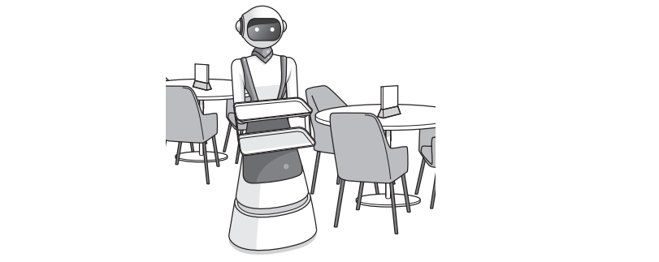

# Exam Questions — Operating Systems
**5. System Software** · Cambridge (CIE) A-LEVEL computer-science (9618)
> Source: [https://www.savemyexams.com/a-level/computer-science/cie/19/topic-questions/](https://www.savemyexams.com/a-level/computer-science/cie/19/topic-questions/) · 20 questions across 1 sets

## Exam Questions (20 questions)

### Q1 — hard — 6 marks

**Q1** [6 marks]

A computer has an Operating System (OS). A user reports three faults with the computer.

Complete the table. For each fault, write the name of the key management task that is not working correctly, and explain how the fault shows that this task has failed.

| Fault | Management task | Explanation |
|---|---|---|
| A document that the user saved yesterday cannot be found anywhere on the hard disk. |   |   |
| A different person used the computer and opened the user's private documents. No user name or password was asked for. |   |   |
| When a second program is started, the data of the first program becomes corrupted and the first program stops responding. |   |   |

### Q2 — medium — 3 marks

**Q2** [3 marks]

A computer in a public library is used by many different people. Each person has their own account on the computer.

Describe the security management tasks carried out by the Operating System (OS) on this computer.

### Q3 — easy — 2 marks

**Q3** [2 marks]

The table describes three key management tasks carried out by an Operating System (OS).

Complete the table by writing the name of the missing management task in each empty cell.

| Description of the task | Name of the management task |
|---|---|
| Divides secondary storage into file allocation units and maintains the directory structure. | File management |
| Allocates a block of RAM to each running program and stops one program from overwriting the data of another. |   |
| Checks the user name and the password before access to the computer is allowed. |   |

### Q4 — hard — 4 marks

**Q4** [4 marks]

A company makes two products.

**Product A** is a tablet computer. The user can install and run many different applications on it, and can store photographs and documents on it. Product A has an Operating System (OS).

**Product B** is a temperature controller. It is an embedded system. It reads a temperature sensor and switches a fan on or off. Its single program is stored in ROM. Product B does not have an Operating System.

Explain why Product A needs an Operating System but Product B does not.

### Q5 — hard — 4 marks

**Q5** [4 marks]

A software company writes three different programs. All three programs use the same set of library routines.

The company must choose one of two methods.

**Method A**: the library routines are included in each program when that program is compiled.

**Method B**: the library routines are supplied in one Dynamic Link Library (DLL) file that all three programs use.

Complete the table to describe the result of choosing Method B in each situation.

| Situation | Result of choosing Method B |
|---|---|
| The size of the executable file of each program |   |
| The number of copies of the library routines held in main memory while all three programs are running |   |
| Whether the three programs must be recompiled after an error in a library routine is corrected |   |
| Which of the three programs receive the correction |   |

### Q6 — medium — 3 marks

**Q6** [3 marks]

A user starts a word processor on a computer. The word processor is application software.

Explain why the word processor needs an Operating System (OS) in order to run.

### Q7 — medium — 3 marks

**Q7** [3 marks]

A developer writes a program that uses many routines from a program library.

The developer can either include the library routines in the program when it is compiled, or supply them separately in a Dynamic Link Library (DLL) file.

Explain the benefits of supplying the routines in a DLL file, in terms of the size of the executable file and the use of main memory.

### Q8 — easy — 2 marks

**Q8** [2 marks]

A company installs an Operating System (OS) on each of its new computers.

One purpose of the Operating System is to provide a user interface.

State **two other** purposes of the Operating System.

### Q9 — easy — 2 marks

**Q9** [2 marks]

Complete the description of a program library by writing the missing word in each gap.

A program library is a collection of subroutines that have already been written and ........................ , so a developer does not have to check that they work.

A developer can ........................ the library into their own program so that its subroutines can be called.

### Q10 — hard — 4 marks

**Q10** [4 marks]

A company stores its customer records on a computer. A technician has two tasks to complete.

**Task 1**

One hard disk in the computer is several years old. Some files stored on it can no longer be opened, and the Operating System reports errors when it reads certain areas of the disk. No copy of these files exists anywhere else.

**Task 2**

A folder of large report files must be sent to a client over a slow internet connection.

For each task, name the utility software the technician should use and describe how that software helps.

### Q11 — medium — 3 marks

**Q11** [3 marks]

A computer has been used for two years. During that time many files have been saved to and deleted from its hard disk. Files now take longer to load than they did when the computer was new.

The user runs the defragmentation software supplied with the Operating System.

Explain how defragmentation software reduces the time taken to load a file.

### Q12 — easy — 2 marks

**Q12** [2 marks]

An Operating System is supplied with utility software.

Complete the table by writing the name of the utility software that carries out each purpose.

| Purpose | Utility software |
|---|---|
| To prepare a new hard disk for use by setting up the file system |   |
| To reduce the size of a file so that it uses less storage space |   |

### Q13 — medium — 1 marks

**Q13** [1 mark]

The program makes use of complex statistical functions. The required functions are not built-in to the programming language and are too complicated for the programmer to write.

One solution would be to employ another programmer who has experience of writing these functions, as there is no time to train the existing programmer.

State **one other** way that these functions may be provided for inclusion in the program.

*Source: Nov 2023 9618/23 Q1C*

### Q14 — medium — 4 marks

**Q14** [1 mark]

A computer has an Operating System (OS).

State **one **purpose of the Operating System.

*Source: Nov 2023 9618/12 Q8A*

**Q14** [3 marks]

The Operating System has utility software.

The purpose of some utility software is to improve security.

Identify **one **example of utility software that is **not **intended to improve security.

Explain why this software is needed.

*Source: Nov 2023 9618/12 Q8B*

### Q15 — medium — 5 marks

**Q15** [5 marks]

Robots are used to serve food and drink to customers at a restaurant.

Program libraries were used when writing the robot’s software.

(i) State what is meant by a program library.

(1)

(ii) Some program libraries include Dynamic Link Library (DLL) files.

Describe the benefits of a programmer using a library with DLL files instead of using a library that does not include DLL files.

(4)

*Source: June 2024 9618/13 Q7E*

### Q16 — medium — 2 marks

**Q16** [2 marks]

The programmer uses program libraries when developing the program.

Describe **two **benefits to the programmer of using program libraries.

*Source: June 2024 9618/12 Q8C*

### Q17 — medium — 4 marks

**Q17** [4 marks]

A computer has an Operating System (OS).

Memory management and process management are two OS tasks.

Explain how memory management **and** process management support multi-tasking.

*Source: June 2024 9618/12 Q6*

### Q18 — medium — 3 marks

**Q18** [3 marks]

The programmers created a new program library whilst developing the program.

Describe the benefits to the programmers of creating a program library.

*Source: Nov 2024 9618/12 Q4B*

### Q19 — medium — 4 marks

**Q19** [4 marks]

The computer has an Operating System (OS). One of the key management tasks of the OS is process management.

Describe the process management tasks performed by an OS.

*Source: Nov 2024 9618/12 Q3C*

### Q20 — medium — 7 marks

**Q20** [4 marks]

A student uses a laptop to write a program that is saved as a text file.

The laptop has utility software and an Operating System (OS).

(i) Describe the file management tasks carried out by an OS.

(2)

(ii) Explain the need for back-up software.

(2)

*Source: Nov 2024 9618/11 Q4A*

**Q20** [3 marks]

The student used a program library when writing their program.

Explain the benefits to the student of using library files when writing a program.

*Source: Nov 2024 9618/11 Q4C*

