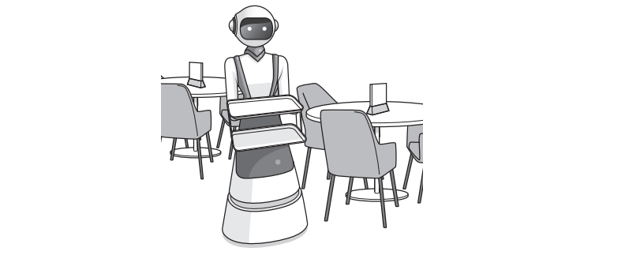

# Exam Questions — Data Integrity
**6. Security, privacy & data integrity** · Cambridge (CIE) A-LEVEL computer-science (9618)
> Source: [https://www.savemyexams.com/a-level/computer-science/cie/19/topic-questions/](https://www.savemyexams.com/a-level/computer-science/cie/19/topic-questions/) · 15 questions across 1 sets

## Exam Questions (15 questions)

### Q1 — hard — 5 marks

**Q1** [5 marks]

Two computers use a parity block check with **even parity** to detect errors during data transfer.

The sender divides the data into groups of seven bits. It counts the number of 1s in each group and appends a parity bit to the right of the group, so that each byte contains an even number of 1s.

Four bytes are then arranged in a grid, one byte per row. The columns are numbered 1 to 8 from the left, so column 8 holds the parity bits. The sender counts the number of 1s in each column and creates a parity byte in which each bit makes its column contain an even number of 1s. The parity byte is transmitted with the four data bytes.

The receiver receives the grid shown. Exactly one bit was changed during transmission.

|   | Column 1 | Column 2 | Column 3 | Column 4 | Column 5 | Column 6 | Column 7 | Column 8 |
|---|---|---|---|---|---|---|---|---|
| Byte 1 | 1 | 0 | 1 | 1 | 0 | 0 | 1 | 0 |
| Byte 2 | 0 | 1 | 1 | 0 | 1 | 0 | 0 | 1 |
| Byte 3 | 1 | 1 | 1 | 0 | 1 | 1 | 1 | 1 |
| Byte 4 | 0 | 1 | 0 | 1 | 1 | 0 | 1 | 0 |
| Parity byte | 0 | 1 | 1 | 0 | 0 | 1 | 1 | 0 |

Identify the position of the bit that was changed and write byte 3 as it should have been received.

Show how you worked out the position.

### Q2 — medium — 3 marks

**Q2** [3 marks]

A computer sends a block of five bytes to a printer. A checksum is transmitted with the block so that the printer can detect an error.

The checksum is calculated as follows.

1. Add together the denary values of the five bytes.
2. Divide the total by 256 and take the remainder. The remainder is the amount left over after integer division.
3. The remainder is the checksum.

The five bytes have the denary values 214, 97, 180, 63 and 145.

Calculate the checksum that is transmitted with this block, and state how the printer uses it.

### Q3 — easy — 2 marks

**Q3** [2 marks]

A hotel receptionist types a guest's passport number into a booking system, reading the number from the guest's passport.

Describe **two** methods of data verification that can be used when the passport number is entered.

### Q4 — hard — 4 marks

**Q4** [4 marks]

A publisher gives every book an eight-digit code. The first seven digits identify the book. The eighth digit is a check digit.

The check digit is calculated from the first seven digits as follows.

1. Multiply each of the seven digits by a weight. The left-hand digit has a weight of 8, the next digit a weight of 7, and so on down to a weight of 2 for the seventh digit.
2. Add the seven products together to give a total.
3. Divide the total by 11 and take the remainder. The remainder is the amount left over after integer division, so for example 30 divided by 11 leaves a remainder of 8.
4. Subtract the remainder from 11. The result is the check digit. If the result is 10 the check digit is written as X. If the result is 11 the check digit is 0.

The first seven digits of a new book code are 3140268.

Calculate the check digit for this code.

Show your working.

### Q5 — medium — 3 marks

**Q5** [3 marks]

An online college booking system asks a user to type a course code when making a booking.

The system carries out a presence check and an existence check on the course code.

Describe the difference between these two validation checks on this field.

### Q6 — easy — 2 marks

**Q6** [2 marks]

The table describes four validation checks that can be carried out on data entered into a system.

Complete the table by writing the name of the missing validation check in each empty cell.

| Description | Validation check |
|---|---|
| Checks that data has been entered and that the field has not been left empty | Presence check |
| Checks that a value falls between a stated lower boundary and a stated upper boundary |   |
| Checks that the data entered contains the correct number of characters | Length check |
| Checks that the data entered follows a stated pattern of letters and digits |   |

### Q7 — hard — 4 marks

**Q7** [4 marks]

A courier company has depots in several countries. At each depot, a member of staff types a parcel tracking number into a terminal. The terminal carries out a presence check, a length check and a format check on every tracking number.

The tracking numbers are then transmitted over a network to a central server, where they are stored.

Explain why the tracking numbers stored on the central server may still be incorrect.

### Q8 — medium — 3 marks

**Q8** [3 marks]

A delivery company stores a telephone number for each customer.

When a clerk adds a new customer, the software carries out a format check and a length check on the telephone number.

A clerk enters a telephone number that is a real telephone number, but it belongs to a different customer. The software accepts it.

Explain why the two validation checks did not detect this error, and state one method of data verification that would.

### Q9 — easy — 2 marks

**Q9** [2 marks]

A company stores customer data in a database.

Define the term **data validation** and the term **data verification**.

### Q10 — medium — 4 marks

**Q10** [4 marks]

A class of students are developing a program to send data between computers. Many computers are connected together to form a wired network. Serial ports are used to connect one computer to another.

Each computer:

- is assigned a unique three-digit ID
- has three ports, each identified by an integer value
- is connected to between one and three other computers.

Messages are sent between computers as a string of characters organised into fields as shown:

`<STX><DestinationID><SourceID><Data><ETX>`

| **Field number** | Field name | Description |
|---|---|---|
| **n/a** | `STX` | a single character marking the start of the message (ASCII value 02) |
| **1** | `DestinationID` | three numeric characters that identify the destination computer |
| **2** | `SourceID` | three numeric characters that identify the source computer |
| **3** | `Data` | a variable length string containing the data being sent (Minimum length is 1 character) |
| **n/a** | `ETX` | a single character marking the end of the message (ASCII value 03) |

For example, the following message contains the data "Hello Kevin" being sent from computer "101" to computer "232":

`<STX>"232101Hello Kevin"<ETX>`

Each computer will run a copy of the same program. Each program will contain a global variable, `MyID` of type string, that contains the unique ID of the computer in which the program is running.

The programmer has defined the first two program modules as follows:

| **Module** | Description |
|---|---|
| `Transmit()`  (already written) | - takes two parameters:    - a string containing a message   - an integer containing a port number - transmits the message using the given port |
| `SendFile()` | - takes three parameters:    - a string containing a text file name   - a string containing a Destination ID   - an integer containing a Port number - transmits the file one line at a time - transmits a final message with data string "****" |

One of the text files to be sent contains several blank lines (lines that do not contain any text).

(i) Explain why this is a problem.

(2)

(ii) Explain how the message format could be changed to allow a blank line to be sent.

(2)

*Source: Nov 2023 9618/21 Q8C*

### Q11 — medium — 2 marks

**Q11** [2 marks]

Data verification is one method of protecting the integrity of data.

Describe **one **other method of protecting the integrity of data.

*Source: Nov 2023 9618/13 Q8A*

### Q12 — medium — 4 marks

**Q12** [4 marks]

An example of a tutor ID is NK16C6.

An administrative officer enters the tutor ID into the `TUTOR `table.

Explain how data verification can be used when the tutor ID is entered.

*Source: Nov 2023 9618/13 Q3C*

### Q13 — medium — 4 marks

**Q13** [4 marks]

Robots are used to serve food and drink to customers at a restaurant.

The data from the robots is transmitted to a central computer using a wireless connection.

Complete the table by identifying **and **describing **two **methods of data verification that can be used during data transfer.

|   | Method | Description |
|---|---|---|
| 1 |   |   |
| 2 |   |   |

*Source: June 2024 9618/13 Q7F(I)*

### Q14 — medium — 3 marks

**Q14** [3 marks]

A company makes ice cream and sells it to shops.

The ice cream is made in batches: a large quantity of one type and flavour of ice cream that is then split into smaller quantities for sale.

The company’s owner has designed a relational database, ICECREAM, to store data about their ice cream and customers.

Some of the tables in the database are given. The database is not normalised.

`BATCH(BatchID, Type, Flavour, Size, SellingPrice, EndDate) CUSTOMER(CustomerID, CompanyName, EmailAddress, TelephoneNumber) SALE(SaleID, BatchID, CustomerID, Quantity, Date)`

A Database Management System (DBMS) supports data integrity.

Explain how a DBMS supports data integrity.

*Source: Nov 2024 9618/13 Q4E*

### Q15 — medium — 5 marks

**Q15** [5 marks]

A bank allows customers to access their accounts using an application that they can download onto a device such as a smartphone.

The bank wants to protect the integrity of its data while transferring the data to other banks. Parity check is one example of data verification.

Complete the description of parity check when Computer A is transmitting data to Computer B.

Computer A and Computer B agree on whether to use ............................... parity. Computer A divides the data into groups of ............................ . The number of 1s in each group is counted. If the agreed parity is ....................... and the group has an even number of 1s, a parity bit of 1 is appended, otherwise a parity bit of 0 is appended.

In a parity ............................ check the bytes are grouped together, for example in a grid. The number of 1s in each column (bit position) is counted. A bit is assigned to each column to make the column match the parity. These parity bits are transmitted with the data as a parity ................................. .

*Source: June 2024 9618/11 Q5B*

