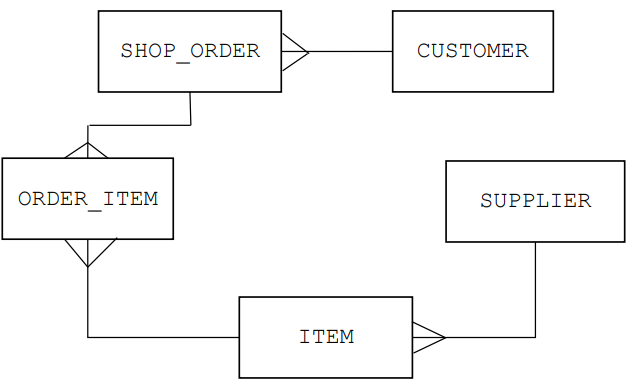
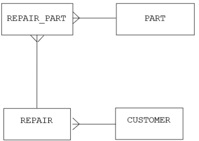

# Mark Schemes — Database Concepts
**8. Databases** · Cambridge (CIE) A-LEVEL computer-science (9618)

## Exam Questions (33 questions)

### Q1
`SCREENING` is not in 3NF. **[1]**

`FilmTitle` depends on `FilmID`, and `FilmID` is a non-key attribute, so this is a transitive dependency. **[1]**

The film data should be moved into a table of its own. **[1]**

`FILM(FilmID, FilmTitle)` with `FilmID` as the primary key **[1]**

`SCREENING(ScreeningID, FilmID, ScreenNumber, StartTime)` with `ScreeningID` as the primary key and `FilmID` kept as a foreign key that links to `FILM` **[1]**

`TICKET` does not change, because every attribute in it depends only on `TicketID`.

**[5 marks]**

> **[mark-scheme]**
> **1 mark** for identifying `SCREENING` as the table that is not in 3NF
> 
> **1 mark** for `FilmTitle` depending on the non-key attribute `FilmID` // naming this as a transitive dependency or a non-key dependency
> 
> **1 mark** for creating a separate film table with a suitable name
> 
> **1 mark** for `FILM(FilmID, FilmTitle)` with `FilmID` as the primary key
> 
> **1 mark** for `FilmTitle` removed from `SCREENING` and `FilmID` retained there as a foreign key
> 
> Accept any sensible name for the new table
> 
> Do not accept `FilmID` also removed from `SCREENING`, because the link between a screening and its film would then be lost
> 
> Do not accept `TICKET` named as the faulty table. `SeatCode` and `PricePaid` are recorded for each individual ticket, so both depend only on `TicketID`

> **[exam-tip]**
> When you split a transitive dependency out, the determining attribute stays behind as the foreign key and only the attributes it determines move. Here `FilmID` appears in both tables and `FilmTitle` appears in only one. Students who delete `FilmID` from `SCREENING` break the link and lose the last mark.

### Q2
`TutorRoom` depends on `TutorID`, because the room is decided by which tutor the student has. **[1]**

`TutorID` is not the primary key. It is a non-key attribute. **[1]**

`TutorRoom` therefore depends on another non-key attribute rather than only on `StudentID`. This is a transitive dependency, which is not allowed in 3NF. **[1]**

**[3 marks]**

> **[mark-scheme]**
> **1 mark** for identifying that `TutorRoom` depends on `TutorID`
> 
> **1 mark** for stating that `TutorID` is a non-key attribute // `TutorID` is not the primary key
> 
> **1 mark** for naming this as a transitive dependency // a non-key dependency, which 3NF does not allow
> 
> Accept the dependency written as a chain, `StudentID` to `TutorID` to `TutorRoom`
> 
> Do not accept "`TutorRoom` is repeated for students who have the same tutor" on its own, because that is the symptom rather than the reason
> 
> Do not accept "there is a partial dependency", because the primary key is a single attribute so a partial dependency is impossible

> **[exam-tip]**
> The examined wording is "explain why", so a bare statement that the table is not in 3NF earns nothing. Trace the chain out loud: the primary key gives you the tutor, and the tutor gives you the room. Any time you can say A gives you B and B gives you C, and B is not a key, you have found a transitive dependency.

### Q3
The table is in Second Normal Form (2NF), so there are no repeating groups and no partial dependencies. **[1]**

Every attribute depends only on the primary key and not on any other non-key attribute, so there are no transitive dependencies. **[1]**

**[2 marks]**

> **[mark-scheme]**
> **Any two from:**
> 
> - No repeating groups of attributes // all data is atomic
> - No partial key dependencies // every attribute is fully dependent on the whole primary key
> - No non-key dependencies // no transitive dependencies // no attribute depends on another non-key attribute
> 
> **[2 marks]**
> 
> Accept "the table is in 2NF" for one mark
> 
> Accept "all attributes are fully dependent on the primary key and on no other attribute" for the non-key dependencies point

> **[exam-tip]**
> Say "and on no other attribute". Students write "every attribute depends on the primary key" and stop, which is also true of a 2NF table, so it does not separate 3NF from 2NF. Make sure that extra clause is in your answer, because it is the only point that belongs to 3NF alone.

### Q4
`DELIVERY` is in 2NF. **[1]**

Its primary key is the single attribute `DeliveryID`, so the key has no separate parts and no attribute can depend on only part of it. A partial dependency is only possible when the primary key is a composite key. **[1]**

`STOCK` is not in 2NF. **[1]**

`WarehouseCity` depends only on `WarehouseID`, which is part of the composite primary key. This is a partial dependency. **[1]**

**[4 marks]**

> **[mark-scheme]**
> **1 mark** for stating that `DELIVERY` is in 2NF
> 
> **1 mark** for the reason: its primary key is a single attribute, so there is no part of the key for an attribute to depend on // a partial dependency requires a composite primary key
> 
> **1 mark** for stating that `STOCK` is not in 2NF
> 
> **1 mark** for the reason: `WarehouseCity` depends on `WarehouseID` only, which is part of the composite primary key, so this is a partial dependency
> 
> Accept "a table in 1NF whose primary key is a single attribute is automatically in 2NF"
> 
> Do not accept `DELIVERY` judged as not in 2NF because `DriverName` depends on `DriverID`. That is a transitive dependency, so it breaks 3NF, not 2NF
> 
> Do not accept `QuantityHeld` given as the faulty attribute in `STOCK`, because it depends on both `WarehouseID` and `PartID`

> **[exam-tip]**
> `DELIVERY` is designed to tempt you. `DriverName` really does sit in the wrong table, but the fault is a transitive dependency and this question asks about 2NF. Check the primary key first. If it is a single attribute and the table is in 1NF, it is in 2NF, and you can say so in one line.

### Q5
The primary key is a composite key made up of `RoomNumber` and `StayDate`. **[1]**

`RoomType` depends only on `RoomNumber`, because room 101 is a Double room whatever the date is. **[1]**

`RoomType` therefore depends on only part of the primary key. This is a partial dependency, which is not allowed in 2NF. **[1]**

**[3 marks]**

> **[mark-scheme]**
> **1 mark** for identifying that the primary key is a composite key of `RoomNumber` and `StayDate`
> 
> **1 mark** for `RoomType` depending only on `RoomNumber` // `RoomType` does not depend on `StayDate`
> 
> **1 mark** for naming this as a partial dependency, which 2NF does not allow
> 
> Accept the sample data used as evidence, for example that room 101 is Double on both dates
> 
> Do not accept `GuestID` given as the faulty attribute, because which guest is in a room does depend on both the room number and the date
> 
> Do not accept "`RoomType` is repeated" on its own, because repetition is the symptom and the partial dependency is the reason

> **[exam-tip]**
> Marks are given for the reason, not the symptom. Many students write only that Double appears twice, which earns nothing on its own. You must name the attribute, name the part of the key it depends on, and use the term partial dependency.

### Q6
The table is already in First Normal Form (1NF). **[1]**

Every non-key attribute is fully dependent on the whole primary key, so there are no partial dependencies. **[1]**

**[2 marks]**

> **[mark-scheme]**
> **1 mark** for the table being in 1NF // there are no repeating groups // all data is atomic
> 
> **1 mark** for every attribute being fully dependent on the whole primary key // there are no partial dependencies
> 
> Accept "no attribute depends on only part of a composite primary key"
> 
> Do not accept "there are no transitive dependencies", which is the extra condition for 3NF

> **[exam-tip]**
> Each normal form builds on the one before it, so a 2NF answer that never mentions 1NF is only half an answer. State the previous form first, then add the new condition. The second mark needs the words full dependency or partial dependency, not just "the fields depend on the key".

### Q7
| OrderID | OrderDate | ItemCode | Quantity |
|---|---|---|---|
| **5001** | **04/03/2025** | **K12** | **2** |
| **5001** | **04/03/2025** | **K19** | **1** |
| **5002** | **06/03/2025** | **K12** | **5** |
| **5003** | **07/03/2025** | **K07** | **1** |
| **5003** | **07/03/2025** | **K12** | **1** |
| **5003** | **07/03/2025** | **K19** | **3** |

Order 5001 becomes two records, with quantity 2 for `K12` and quantity 1 for `K19`. **[1]**

Order 5003 becomes three records, with quantity 1 for `K07`, quantity 1 for `K12` and quantity 3 for `K19`. **[1]**

`OrderDate` is repeated on every record that belongs to the same order. **[1]**

The primary key is the composite key `OrderID` and `ItemCode`. **[1]**

**[4 marks]**

> **[mark-scheme]**
> **1 mark** for order 5001 split into two records, `K12` with quantity 2 and `K19` with quantity 1
> 
> **1 mark** for order 5003 split into three records, `K07` with quantity 1, `K12` with quantity 1 and `K19` with quantity 3
> 
> **1 mark** for `OrderDate` correctly repeated on every record belonging to the same order
> 
> **1 mark** for a composite primary key of `OrderID` and `ItemCode`
> 
> Accept the six records written in any order
> 
> Do not accept `OrderID` alone as the primary key, because 5001 and 5003 now each appear on more than one record
> 
> Do not accept a quantity matched to the wrong item code

> **[exam-tip]**
> The trap here is the `Quantity` column. It is a second repeating group and it must stay lined up with `ItemCode`, so `K19` on order 5003 takes quantity 3, not 1. Split both columns together, one pair per record. Then remember that once `OrderID` repeats down the rows it can no longer be the primary key on its own.

### Q8
Referential integrity means that every value of a foreign key must match an existing primary key value in the related table. **[1]**

The first operation is refused, because there is no row in `TEAM` with a `TeamID` of `T99`, so the foreign key would point at data that does not exist. **[1]**

The second operation is refused while rows in `PLAYER` still hold a `TeamID` of `T04`. **[1]**

If the delete were allowed, those `PLAYER` rows would refer to a team that is no longer in the database. A cascade delete may be used instead, which removes the matching `PLAYER` rows at the same time. **[1]**

**[4 marks]**

> **[mark-scheme]**
> **1 mark** for: every foreign key value must match a primary key value in the related table // data that does not exist cannot be referenced
> 
> **1 mark** for: the new `PLAYER` row is rejected because `T99` is not a `TeamID` in `TEAM`
> 
> **1 mark** for: the delete is rejected while `PLAYER` rows still reference `T04`
> 
> **1 mark** for: otherwise those `PLAYER` rows would reference a team that does not exist // a cascade delete removes the matching `PLAYER` rows instead
> 
> Accept `cascading update/delete` (a change or deletion in one table is reflected in all related rows) as part of the meaning of referential integrity for the first mark.
> 
> Accept `cascading delete` as the credited outcome of the second operation, provided you say which rows are removed.
> 
> Accept `record` or `tuple` for `row`.
> 
> Do not accept `the database checks that the data is correct`. Referential integrity checks only that a foreign key value exists as a primary key value. Checking that a name or a date is sensible is validation, not referential integrity.

> **[exam-tip]**
> Referential integrity is a rule about **links**, not about values being sensible. It never checks that a player's name is spelled correctly. That is validation, and mixing the two is the commonest way to lose the first mark here.
> 
> Say the words `foreign key` and `primary key` in the same sentence every time you write about it, because that pairing is what the mark scheme looks for. Note too that the delete case has two credited outcomes: the delete is refused, or it cascades and takes the linked rows with it. Either earns the mark as long as you say which one you mean.

### Q9
`DeliveryDates` is a repeating group because one record holds more than one delivery date. **[1]**

The repeating group must be removed by storing one delivery date per record, so `CustomerID` and the customer's name are repeated on each of that customer's records. **[1]**

`CustomerName` is not atomic, so it should be split into `FirstName` and `LastName`. **[1]**

**[3 marks]**

> **[mark-scheme]**
> **Any three from:**
> 
> - Identify the repeating group ...
> - ... `DeliveryDates` holds more than one value in a single record
> - Remove the repeating group by storing one delivery date per record
> - Ensure every attribute is atomic ...
> - ... `CustomerName` should be split into `FirstName` and `LastName`
> - Identify a primary key for the table, which must now be the composite key `CustomerID` and `DeliveryDate`
> 
> **[3 marks]**
> 
> Accept `DeliveryDates` renamed to `DeliveryDate` once it holds a single value
> 
> Do not accept "delete the extra dates", because no data may be lost during normalisation
> 
> Do not accept "move the dates into a new table", because that step is not needed to reach 1NF and the question asks only about this table

> **[exam-tip]**
> Students often jump straight to a full 3NF design and start creating new tables. This question stops at 1NF, so stay in one table: repeat the customer data down the rows and give each delivery date its own record. Also check the name column. An examiner will look for the point that `CustomerName` holds two items of data and is therefore not atomic.

### Q10
The table contains no repeating groups of attributes, so every attribute in every record holds one single value. **[1]**

**[1 mark]**

> **[mark-scheme]**
> **1 mark** for either of the following
> 
> - There are no repeating groups of attributes
> - Every attribute contains a single value // all data is atomic
> 
> Accept "each field holds only one item of data"
> 
> Do not accept "there are no duplicate records", because 1NF is about repeating groups within a record, not about repeated rows
> 
> Do not accept "there are no partial dependencies", which is the condition for 2NF

> **[exam-tip]**
> The three normal forms are easy to mix up because the wording is similar. Tie each one to a single phrase and keep them separate: 1NF is repeating groups, 2NF is partial dependencies, 3NF is non-key dependencies. Writing the 2NF answer for a 1NF question is the most common way to lose this mark.

### Q11
Two candidate keys are `StudentID` and `NationalIDNumber`. **[1]**

A candidate key is an attribute, or the smallest set of attributes, whose value is different for every record, so it could be used as the primary key. A table can have several candidate keys. **[1]**

The primary key is the one candidate key that the designer chooses to identify each record. A table has exactly one primary key. **[1]**

**[3 marks]**

> **[mark-scheme]**
> **1 mark** for naming any two of: `StudentID`, `NationalIDNumber`, `EmailAddress`
> 
> **1 mark** for: a candidate key is a field or attribute, or the smallest set of fields, whose value is different for every record // no two tuples have the same value // it could be a primary key
> 
> **1 mark** for: the primary key is the candidate key that is chosen // a table can have several candidate keys but only one primary key
> 
> Accept `a field that could be a primary key but is not` for the second mark.
> 
> Accept `unique` for `different for every record`.
> 
> Do not accept `FirstName`, `LastName` or `DateOfBirth` as candidate keys. The question states that two students may share any of them, so none of them identifies a record uniquely.

> **[exam-tip]**
> Answers often say a candidate key is `a key that is not the primary key`. That is close, but it leaves out the part that earns the mark: its value must be different for every record, which is exactly what makes it a candidate in the first place.
> 
> Before naming any candidate key, find the sentence in the question that tells you which fields are unique. A field is only a candidate key when no two records can share its value, which is why a name never qualifies.

### Q12
`STUDENT(StudentNumber, FirstName, LastName, EmailAddress)` **[1]**

`COURSE(CourseCode, Language, Level, Fee)` **[1]**

`ENROLMENT(StudentNumber, CourseCode, EnrolDate, Grade)` **[1]**

The primary key of `STUDENT` is `StudentNumber` and the primary key of `COURSE` is `CourseCode`. **[1]**

The primary key of `ENROLMENT` is the composite key `StudentNumber` and `CourseCode`. Both of these are also foreign keys, linking to `STUDENT` and to `COURSE`. **[1]**

**[5 marks]**

> **[mark-scheme]**
> **Any five from:**
> 
> - A student table with `StudentNumber` as the primary key
> - ... containing `FirstName`, `LastName` and `EmailAddress`
> - A course table with `CourseCode` as the primary key
> - ... containing `Language`, `Level` and `Fee`
> - A linking table with a suitable name for the enrolments
> - ... containing `EnrolDate` and `Grade`
> - ... with a composite primary key of `StudentNumber` and `CourseCode`, or a new single primary key such as `EnrolmentID`
> - ... with `StudentNumber` and `CourseCode` both present as foreign keys
> 
> **[5 marks]**
> 
> Accept any sensible table names, for example `ENROLMENT`, `STUDENT_COURSE` or `REGISTRATION`
> 
> Do not accept `Grade` or `EnrolDate` stored in `STUDENT` or in `COURSE`, because both depend on the student and the course together
> 
> Do not accept a separate fee table keyed on `Level`, because the question states that two courses at the same level can have different fees, so `Fee` depends on `CourseCode` alone

> **[exam-tip]**
> Watch for the sentence that rules out a dependency you were about to invent. Students see `Level` and `Fee` in the same table and split the fee out into a table of its own, which loses a mark because the question says two courses at the same level can charge different fees. Read every line of the scenario before you decide what depends on what.

### Q13
Secondary key: an additional key, used as well as the primary key, to locate specific data. It is a candidate key that has not been chosen as the primary key. **[1]**

Foreign key: a field in one table that is linked to the primary key in another table. **[1]**

**[2 marks]**

> **[mark-scheme]**
> **1 mark** for secondary key: an additional or alternative key used as well as the primary key to locate specific data // a candidate key that has not been chosen as the primary key
> 
> **1 mark** for foreign key: a field in one table that is linked to a primary key in another table
> 
> Accept `used to search or sort the table on a field other than the primary key` for the secondary key mark.
> 
> Accept `attribute` for `field` throughout.
> 
> Do not accept `a key in another table` on its own for foreign key. The answer must say that it links to a primary key.

> **[exam-tip]**
> These are the two keys you are most likely to swap. A foreign key points **out** of its table, at the primary key of another table, and is how two tables are joined. A secondary key stays **inside** its own table and is there so the table can be searched quickly on a field that is not the primary key.
> 
> Use that as a check. If your answer for secondary key mentions a second table, you have described a foreign key and the mark is gone.

### Q14
`INSTRUCTOR(InstructorNumber, FirstName, LastName, MobileNumber)` **[1]**

`LESSON(LessonNumber, LessonDate, StartTime, InstructorNumber)` **[1]**

The primary key of `INSTRUCTOR` is `InstructorNumber` and the primary key of `LESSON` is `LessonNumber`. In `LESSON`, `InstructorNumber` is a foreign key that links to `INSTRUCTOR`. **[1]**

**[3 marks]**

> **[mark-scheme]**
> **1 mark** for an instructor table with `InstructorNumber` as the primary key, containing `FirstName`, `LastName` and `MobileNumber`
> 
> **1 mark** for a lesson table with `LessonNumber` as the primary key, containing `LessonDate` and `StartTime`
> 
> **1 mark** for `InstructorNumber` appearing in the lesson table as a foreign key
> 
> Accept any sensible table names
> 
> Accept `TelephoneNumber` or `Mobile` in place of `MobileNumber`
> 
> Do not accept the instructor's name or mobile number repeated inside the lesson table, because that data would then be stored more than once
> 
> Do not accept `LessonNumber` placed in the instructor table, because an instructor gives many lessons

> **[exam-tip]**
> The most common error here is putting the foreign key at the wrong end of a one-to-many relationship. The foreign key always goes in the table on the many side, so `InstructorNumber` goes into `LESSON`. If you put `LessonNumber` into `INSTRUCTOR` you can only ever record one lesson per instructor.

### Q15
Ravi Menon is given two different telephone numbers: `555 0192` for members `M101` and `M103`, but `555 0134` for member `M104`. **[1]**

The coach's telephone number is stored once for every member the coach trains, so it is stored many times. One copy has been changed and the others have not, so the table is now inconsistent. **[1]**

In the relational design the coach's name and telephone number are stored only once, in the table `COACH`. **[1]**

The table `MEMBER` holds only `CoachID`, a foreign key that links to `COACH`, so there is a single telephone number for each coach and it cannot be entered differently for two members. **[1]**

**[4 marks]**

> **[mark-scheme]**
> **1 mark** for identifying that Ravi Menon is given two different telephone numbers in the table
> 
> **1 mark** for: the coach's telephone number is stored more than once (data redundancy), so changing one copy leaves the others holding the old value
> 
> **1 mark** for: in the relational design each coach's details are stored once only, in the table `COACH`
> 
> **1 mark** for: `MEMBER` stores `CoachID` as a foreign key that links to `COACH`, so there is only one copy of the telephone number to change
> 
> Accept naming the row `M104`, or quoting the value `555 0134`, as identification of the fault.
> 
> Accept `data inconsistency` for the first mark only where the two differing values are also identified.
> 
> Do not accept `the telephone number is wrong`. The table does not say which of the two numbers is correct. The fault is that the table gives two different values for one coach.

> **[exam-tip]**
> Read the data before writing anything. The first mark is for naming the two values that disagree, not for writing the word inconsistency.
> 
> Keep the second half of the answer about **structure**. The relational design wins because the telephone number exists in exactly one place, so there is nothing to change twice. An answer that says a relational database is `better organised` or `more professional` earns nothing.

### Q16
`MEMBER_EVENT(MemberID, EventID, Position)` **[1]**

The primary key is the composite key `MemberID` and `EventID`. `MemberID` is a foreign key that links to `MEMBER` and `EventID` is a foreign key that links to `EVENT`. **[1]**

**[2 marks]**

> **[mark-scheme]**
> **1 mark** for a linking table with a suitable name that contains `MemberID` and `EventID`
> 
> **1 mark** for placing `Position` in that linking table and identifying the composite primary key `MemberID` and `EventID`
> 
> Accept any sensible table name, for example `ENTRY`, `RESULT` or `EVENT_MEMBER`
> 
> Accept a new single attribute such as `EntryID` as the primary key, provided `MemberID` and `EventID` are both still present as foreign keys
> 
> Do not accept `Position` placed in `MEMBER` or in `EVENT`, because a member has a different position in each event
> 
> Do not accept a design that adds `EventID` to `MEMBER`, because a member enters more than one event

> **[exam-tip]**
> Students usually remember to create the linking table but then leave `Position` out of it, or park it in `MEMBER`. Ask yourself which key the attribute actually depends on. `Position` is only meaningful once you know both the member and the event, so it belongs in the table whose primary key is both of them.

### Q17
| Statement | Flat file database | Relational database |
|---|---|---|
| All of the data is stored in a single table. | **✓** |   |
| Data is split between several tables that are linked by a foreign key. |   | **✓** |
| A user can be given a view that shows only some of the data. |   | **✓** |

**[3 marks]**

> **[mark-scheme]**
> **1 mark** for a tick in the Flat file database column for `All of the data is stored in a single table.`
> 
> **1 mark** for a tick in the Relational database column for `Data is split between several tables that are linked by a foreign key.`
> 
> **1 mark** for a tick in the Relational database column for `A user can be given a view that shows only some of the data.`
> 
> Do not award a mark for a row that has a tick in both columns.
> 
> Do not accept a cross or a written `yes` in place of a tick, unless you have marked no other box in that row.

> **[exam-tip]**
> The third row is the one that is missed. Views are a relational feature: because the data sits in linked tables, a user can be shown one table, or only a few fields, and nothing else. In a flat file there is a single table, so limiting what somebody sees is far harder.
> 
> One tick per row. A row ticked twice earns nothing, even when one of the two ticks is right.

### Q18
(i) A flat file database stores all of its data in a single table, with no links to any other table. **[1]**

(ii) The same data is stored many times, which is data redundancy. **[1]**

**[2 marks]**

> **[mark-scheme]**
> **1 mark** for: all of the data is held in one single table // there is only one table, so no tables are linked
> 
> **1 mark** for any one problem: data redundancy // data duplication; data inconsistency // poor data integrity; program-data dependence; complex queries are difficult; user views cannot easily be provided
> 
> Accept "one big table" for the first mark.
> 
> Do not accept "a database saved as a text file" for the first mark. The word flat describes the single-table structure, not the type of file the data is saved in.

> **[exam-tip]**
> Flat describes the shape of the data, not the file format. A flat file database can be a spreadsheet, a text file or one table inside database software. What makes it flat is that there is one table and nothing is linked to anything else.
> 
> Write "one single table" and the first mark is safe. Answers that only say "it is simple" or "it is stored in one place" are too vague to credit.

### Q19
There is program-data dependence. **[1]**

Adding the passenger count changes the structure of the journey record, so every program that reads the file has to be re-written before it will work again. **[1]**

Complex queries are difficult to carry out. **[1]**

No existing program answers the question about late journeys, so a new program has to be written for this one-off search. **[1]**

**[4 marks]**

> **[mark-scheme]**
> **1 mark** for naming program-data dependence // the programs depend on the structure of the data
> 
> **1 mark** for: a change to the record structure means the programs that access the file must be re-written
> 
> **1 mark** for naming that complex queries or searches are difficult
> 
> **1 mark** for: a new program has to be written for each new search or report
> 
> Accept `the software has to be changed whenever the file layout changes` for the second mark.
> 
> Accept `ad hoc query` or `one-off query` as a way of naming the third mark.
> 
> Do not accept `the file would get too big` or `the data would be lost`. Neither follows from adding a field or from running a one-off search.

> **[exam-tip]**
> Each pair of marks depends on the naming mark being about the right thing. Program-data dependence is about the **structure** of the file, not about the values in it. The programs break because the record layout changed, not because a number changed.
> 
> The query limitation is also easy to overstate. The one-off search is not impossible. The point is that somebody has to write a whole new program to do it, which is slow and expensive.

### Q20
The patient's telephone number is stored in two separate files, so the same data item is held more than once. **[1]**

The receptionist has changed the number in the appointments file only, so the treatments file still holds the old number. **[1]**

The two files now give different values for the same patient, so the clinic cannot tell which number is correct and the data can no longer be relied on. **[1]**

**[3 marks]**

> **[mark-scheme]**
> **1 mark** for the telephone number being stored in more than one file // data redundancy // data duplication
> 
> **1 mark** for the change being made in one file only, so the other file keeps the old value
> 
> **1 mark** for the two files now holding different values for the same patient // the data is no longer accurate // data integrity is lost
> 
> Accept "a nurse would ring the old number" for the third mark, because it states the consequence of the two files disagreeing.
> 
> Accept "cannot be trusted" for "cannot be relied on".
> 
> Do not accept "the receptionist made a mistake". The receptionist did exactly what was asked. The fault is the file-based design that holds the same number twice.

> **[exam-tip]**
> Most answers stop at "the data is duplicated". Duplication on its own is redundancy, not inconsistency. Inconsistency is what happens next: one copy is changed, the other is not, and the two copies now disagree.
> 
> Write all three steps every time. Stored twice, changed once, now different. An answer that skips the middle step almost always loses a mark.

### Q21
Data redundancy: a learner's name and telephone number are stored in the office file and again in each instructor's file. **[1]**

Data inconsistency: if a learner changes telephone number and only one file is updated, the files no longer agree. **[1]**

**[2 marks]**

> **[mark-scheme]**
> **Any two from:**
> 
> - Data redundancy // data duplication // the same data is stored more than once
> - Data inconsistency // poor data integrity // data changed in one file is not changed in the others
> - Program-data dependence // a change to the structure of a file means the programs that read it must be re-written
> - Complex queries are difficult // a new program has to be written for each new search
> - Lack of privacy // user views cannot easily be provided
> 
> **[2 marks]**
> 
> Accept `data duplication` for data redundancy, and `the same data is stored many times`.
> 
> Do not accept `data redundancy` and `data duplication` given as two separate answers. They are the same point written twice and earn one mark, not two.

> **[exam-tip]**
> Two answers that mean the same thing earn one mark between them. `Data redundancy` and `data duplication` are one point, and so are `data inconsistency` and `the files do not match`. Choose two limitations from different lines of the list.
> 
> It also pays to say where the duplicated data actually is in the scenario. A limitation written with the learner's telephone number in it is easier to credit than one copied straight from a textbook.

### Q22
| First entity | Relationship | Degree of relationship | Second entity |
|---|---|---|---|
| SPEAKER | gives | **one-to-many** | SESSION |
| ROOM | is used for | **one-to-many** | SESSION |
| DELEGATE | makes | **one-to-many** | **ATTENDANCE** |
| **ATTENDANCE** | is for | **many-to-one** | SESSION |

One speaker gives many sessions and each session has one speaker, so `SPEAKER` to `SESSION` is one-to-many. **[1]**

One room is used for many sessions and each session uses one room, so `ROOM` to `SESSION` is one-to-many. **[1]**

The many-to-many between `DELEGATE` and `SESSION` is replaced by a linking entity, `ATTENDANCE`, which holds one row for each session that a delegate attends. **[1]**

One delegate makes many `ATTENDANCE` rows, so that row is one-to-many, and many `ATTENDANCE` rows are for the same session, so read from left to right the last row is many-to-one. **[1]**

**[4 marks]**

> **[mark-scheme]**
> **1 mark** for `SPEAKER` to `SESSION` is one-to-many
> 
> **1 mark** for `ROOM` to `SESSION` is one-to-many
> 
> **1 mark** for the same suitably named linking entity written in both empty entity cells
> 
> **1 mark** for `DELEGATE` to the linking entity being one-to-many **and** the linking entity to `SESSION` being many-to-one
> 
> Accept any suitable name for the linking entity, for example `ATTENDANCE`, `BOOKING`, `SESSION_DELEGATE` or `DELEGATE_SESSION`
> 
> Accept `1:M` and `1 to many` for one-to-many, and `M:1` and `many to 1` for many-to-one
> 
> Do not accept many-to-many anywhere in the completed table. The design must not contain one, which is the reason the extra entity is added
> 
> Do not accept two different names in the two empty entity cells. Both cells name the same entity
> 
> Do not accept one-to-many in the final row. Many rows of the linking entity are for the same session, so from left to right the degree is many-to-one

> **[exam-tip]**
> A many-to-many relationship is not left in a finished design. It is replaced by a linking entity that sits between the two original entities, and it becomes two relationships: one-to-many from the first entity into the linking entity, and many-to-one from the linking entity into the second.
> 
> Two marks are commonly lost here. The first goes to students who invent two names, such as `BOOKING` in one cell and `ATTENDANCE` in the other, which describes six entities rather than five. The second goes to students who write one-to-many in the last row out of habit. Check the direction of every row by asking which side of it can appear many times.

### Q23
| First entity | Relationship | Degree of relationship | Second entity |
|---|---|---|---|
| COACH | leads | **one-to-many** | CLASS |
| COACH | has | **one-to-one** | COACH_LOGIN |
| MEMBER | books | **many-to-many** | CLASS |

A coach leads many classes, but each class has only one coach, so `COACH` to `CLASS` is one-to-many. **[1]**

A coach has one set of login details and a set of login details belongs to one coach, so `COACH` to `COACH_LOGIN` is one-to-one. **[1]**

A member books many classes and a class is booked by many members, so `MEMBER` to `CLASS` is many-to-many. **[1]**

**[3 marks]**

> **[mark-scheme]**
> **1 mark** for `COACH` to `CLASS` is one-to-many
> 
> **1 mark** for `COACH` to `COACH_LOGIN` is one-to-one
> 
> **1 mark** for `MEMBER` to `CLASS` is many-to-many
> 
> Accept `1:M`, `1:many` and `1 to many` for one-to-many
> 
> Accept `1:1` and `1 to 1` for one-to-one
> 
> Accept `M:M`, `M:N` and `many to many` for many-to-many
> 
> Do not accept one-to-many for `MEMBER` to `CLASS`. Both directions are many, because one class is booked by many members as well as one member booking many classes
> 
> Do not accept many-to-one for `COACH` to `CLASS`. Each row is read from left to right, and one coach leads many classes

> **[exam-tip]**
> The many-to-many is the row students lose. Reading only "a member books many classes" gives one-to-many, and the answer looks finished. You have to read the second sentence as well: a class is also booked by many members, and it is the two answers together that make the relationship many-to-many.
> 
> Watch the direction as well. Each row is read from left to right, so `COACH` to `CLASS` is one-to-many, not many-to-one. Writing the two halves in the wrong order describes a different relationship and does not earn the mark.

### Q24
| First entity | Relationship | Degree of relationship | Second entity |
|---|---|---|---|
| MEMBER | is given | **one-to-one** | MEMBER_CARD |
| MEMBER | makes | **one-to-many** | LOAN |

One member is given one card, and one card belongs to one member, so the first relationship is one-to-one. **[1]**

One member can make many loans, but each loan belongs to one member only, so the second relationship is one-to-many. **[1]**

**[2 marks]**

> **[mark-scheme]**
> **1 mark** for `MEMBER` to `MEMBER_CARD` is one-to-one
> 
> **1 mark** for `MEMBER` to `LOAN` is one-to-many
> 
> Accept `1:1` and `1 to 1` for one-to-one
> 
> Accept `1:M`, `1:many` and `1 to many` for one-to-many
> 
> Do not accept one-to-many for `MEMBER` to `MEMBER_CARD`. Each member is given exactly one card, so only one row of `MEMBER_CARD` can ever match a member
> 
> Do not accept many-to-many for `MEMBER` to `LOAN`. Each loan is made by one member only

> **[exam-tip]**
> Check every relationship in both directions before you write anything down. For the first row, ask "how many cards does one member have?" and then ask "how many members does one card belong to?" The relationship is only one-to-one when both answers are one.
> 
> Do not decide the answer from the table definitions alone. `MemberID` appears as a foreign key in `MEMBER_CARD` and in `LOAN`, so the two tables look the same in the definitions, yet the two relationships have different degrees. The sentences in the question are what tell you which is which.

### Q25
> **[mark-scheme]**
> **1 mark** for both 1:M relationships as follows:
> 
> 

### Q26
> **[mark-scheme]**
> **1 mark** for each term (**max 3**)
> 
> Entity:
> 
> - An object about which data can be stored
> 
> Primary key:
> 
> - The **unique** attribute / combination of attributes used to identify the **record / tuple **
> 
> Referential integrity:
> 
> - Makes sure that if data is changed in one place the change is reflected in all related records - cascading update/delete
> - Makes sure that data that does not exist cannot be referenced
> - Ensures that every foreign key has a **corresponding** primary key // A logical dependency of a foreign key on a primary key
> - Ensures that the data in the database is consistent / up to date
> - Prevents records from being added/deleted/modified incorrectly
> - Makes sure any queries return accurate and complete results
> **[mark-scheme]**
> **1 mark** for each bullet point (**max 4**)
> 
> - Identify repeating groups of attributes ...
> - ... Subject and SubjectCode
> - Ensure each field is atomic
> - ... StudentName should be split into e.g. FirstName and LastName
> - Identify the primary key for the table

### Q27
> **[mark-scheme]**
> **1 mark** for each correct relationship or relationships
> 
> - 1:M between CUSTOMER and SHOP_ORDER
> - 1:M between SUPPLIER and ITEM
> - 1:M between SHOP_ORDER and ORDER_ITEM **and** M:1 between ORDER_ITEM and ITEM
> 
> 
> **[mark-scheme]**
> **1 mark** for each bullet point **(max 3) **
> 
> - Reduced data **redundancy **
> - Improved data integrity / consistency / referential integrity
> - Allows for views / improved privacy
> - Allows for program-data independence
> - Complex queries can be executed

### Q28
> **[mark-scheme]**
> **1 mark** for:
> 
> many to 1 // there are many performances of each show
> **[mark-scheme]**
> **1 mark** each to **max 5**:
> 
> e.g.
> 
> - CUSTOMER table identified with suitable Primary Key and appropriate name
> - … and other suitable fields including name and email
> - BOOKING TABLE identified with suitable Primary Key and appropriate name
> - … that stores the Primary Key of the CUSTOMER table as a Foreign Key to join with CUSTOMER table
> - … and stores the Primary Key of the PERFORMANCE table as a Foreign Key to join with PERFORMANCE table
> - A linking table between Table 2 and SEAT with suitable Primary Key and appropriate name
> - … that includes the Primary Key of Table 2 as a Foreign Key to join with Table 2
> - … that stores the SeatID.

### Q29
> **[mark-scheme]**
> **1 mark** for:
> 
> 1-to-many
> **[mark-scheme]**
> **1 mark **each to **max 5**:
> 
> - STUDENT table identified with suitable Primary Key
> - A linking table between STUDENT and EXAM with suitable Primary Key and appropriate name
> - … that includes the Primary Key of the STUDENT table as a Foreign Key to join with STUDENT
> - ... and includes the Primary Key of the EXAM table as a Foreign Key to join with EXAM
> - A linking table between STUDENT and EXAM_QUESTION with suitable Primary Key and appropriate name
> - … that includes the Primary Key of Table 2 as a Foreign Key to join with Table 2
> - … that stores the ExamQuestionID and the mark for that question

### Q30
> **[mark-scheme]**
> **1 mark** each:
> 
> - User table with the username as the Primary Key
> - … containing at least email address, date of birth / age and rating
> - Quiz table with Quiz ID or date or file name as the Primary Key.
> - … containing at least the other field(s) not used as the PK
> - A joining table with an appropriate name including at least fields for user identification, quiz identification and score
> - … with an appropriate Primary Key
> - ... and Foreign Keys matching the Primary Keys of the other two tables
> 
> `USER(Username, Email, DateOfBirth, Rating) `
> `QUIZ(QuizID, Date, Filename)  `
> `USER_QUIZ(Username, QuizID, Score)`

### Q31
> **[mark-scheme]**
> **1 mark **each:
> 
> - Foreign key: `BatchID`, table `BATCH `
> - Foreign key: `CustomerID`, table `CUSTOMER`
> **[mark-scheme]**
> **1 mark **for each bullet point each (max 4)
> 
> e.g.
> 
> - Ice cream table with an appropriate name
> - … containing type, flavour, size, selling price
> - … with suitable primary key
> - … foreign key identified in BATCH that links to the primary key in `ICECREAM `
> 
> Example table definitions – not example answer:
> 
> `BATCH(BatchID, IceCreamID, EndDate) `
> `ICE_CREAM(IceCreamID, Type, Flavour, Size, SellingPrice)`
> **[mark-scheme]**
> **1 mark** for each definition
> 
> Entity:
> 
> - A real-life object that is represented as a table
> 
> Attribute:
> 
> - An item of data about an entity

### Q32
> **[mark-scheme]**
> **1 mark** each to **max 3 **
> 
> e.g.
> 
> - There is reduced data redundancy // less repeated data
> - … because each item of data is only stored once
> - Data consistency is maintained // Data integrity is improved
> - … changes in one table will automatically update in another
> - ... linked data cannot be entered differently in two tables
> - Program-data independence is ensured
> - … changes to the data do not require programs to be re-written // queries are not dependent on the structure of the data
> - Complex queries are easier to run
> - Different views can be provided
> - …. so users can only see specific aspects of the database
> - Multiple concurrent access is possible
> - ... through record locking
> **[mark-scheme]**
> **1 mark** each to **max 6**
> 
> - `CUSTOMER `to `JOB `is 1 to many
> - … implemented by Primary Key in `CUSTOMER` is Foreign Key in `JOB  `
> - `EMPLOYEE` to `LOGIN_DATA` is 1 to 1
> - … implemented by Primary Key in `EMPLOYEE `is Foreign Key in `LOGIN_DATA `
> - `JOB` to `JOB_EMPLOYEE` is 1 to many
> - … implemented by Primary Key in `JOB `is Foreign Key in `JOB_EMPLOYEE `
> - `EMPLOYEE` to `JOB_EMPLOYEE` is 1 to many
> - … implemented by Primary Key in `EMPLOYEE` is Foreign Key in `JOB_EMPLOYEE`

### Q33
> **[mark-scheme]**
> 1 mark for limitation and 2 marks for corresponding explanation
> 
> e.g.
> 
> Data redundancy // data duplication
> 
> - Separate linked tables are used
> - Data items are stored once so reduces data duplication / data redundancy
> 
> Data inconsistency / Poor data integrity
> 
> - Data changed once in one place will automatically update elsewhere
> - Linked data cannot be entered differently in two tables
> - Referential integrity can be enforced
> 
> The data structure used depends on the application
> 
> - Changes to the data structure are managed by the DBMS
> - … and queries are not dependent on the structure of the data
> - … and changes to the data do not require programs to be re-written
> **[mark-scheme]**
> **1 mark** for each correct relation
> 
> 
> **[mark-scheme]**
> **1 mark** for each correct definition
> 
> | **Database** **Term** | **Definition** |
> |---|---|
> | Referential integrity | All duplicate entries of data between tables are consistent // all foreign keys are matched to an appropriate primary key |
> | Candidate key | A field that could be a primary key but is not // an attribute or smallest set of attributes in a table where no tuple has the same value |
> | Tuple | A row / record in a table // one instance of an entity in a table |
