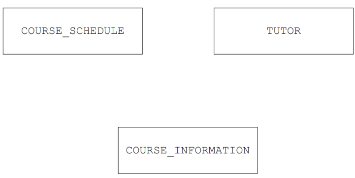
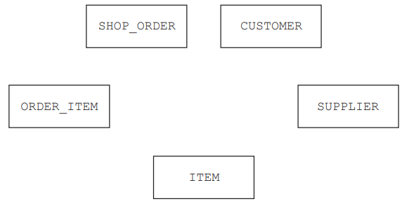
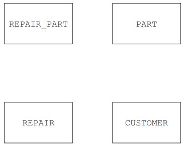

# Exam Questions — Database Concepts
**8. Databases** · Cambridge (CIE) A-LEVEL computer-science (9618)
> Source: [https://www.savemyexams.com/a-level/computer-science/cie/19/topic-questions/](https://www.savemyexams.com/a-level/computer-science/cie/19/topic-questions/) · 33 questions across 1 sets

## Exam Questions (33 questions)

### Q1 — hard — 5 marks

**Q1** [5 marks]

A cinema uses a database that contains the following two tables. Both tables are in Second Normal Form (2NF).

`SCREENING(ScreeningID, FilmID, FilmTitle, ScreenNumber, StartTime)`

`TICKET(TicketID, ScreeningID, SeatCode, PricePaid)`

The primary key of `SCREENING` is `ScreeningID` and the primary key of `TICKET` is `TicketID`. The price paid is recorded separately for every ticket sold.

Explain which one of these tables is not in Third Normal Form (3NF), and write a corrected design so that the whole database is in 3NF.

### Q2 — medium — 3 marks

**Q2** [3 marks]

A college database contains the following table, which is in Second Normal Form (2NF).

`STUDENT_RECORD(StudentID, FirstName, LastName, TutorID, TutorRoom)`

The primary key is `StudentID`. `TutorRoom` is the room in which a student's tutor teaches.

Explain why the table `STUDENT_RECORD` is not in Third Normal Form (3NF).

### Q3 — easy — 2 marks

**Q3** [2 marks]

A college stores data about its students and courses in a relational database. The database designer says that every table in the database is now in Third Normal Form (3NF).

Describe **two** characteristics that each of these tables must have.

### Q4 — hard — 4 marks

**Q4** [4 marks]

A logistics company uses a database that contains the following two tables. Both tables are in First Normal Form (1NF).

`DELIVERY(DeliveryID, DriverID, DriverName, DeliveryDate)`

The primary key of `DELIVERY` is `DeliveryID`.

`STOCK(WarehouseID, PartID, QuantityHeld, WarehouseCity)`

The primary key of `STOCK` is the composite key `WarehouseID` and `PartID`. `WarehouseCity` is the city in which the warehouse is located.

Explain, for each table, whether it is in Second Normal Form (2NF).

### Q5 — medium — 3 marks

**Q5** [3 marks]

A hotel database contains the following table, which is in First Normal Form (1NF).

`ROOM_STAY(RoomNumber, StayDate, RoomType, GuestID)`

The primary key is the composite key `RoomNumber` and `StayDate`.

Some sample data is shown.

| RoomNumber | StayDate | RoomType | GuestID |
|---|---|---|---|
| 101 | 12/05/2025 | Double | G88 |
| 101 | 13/05/2025 | Double | G88 |
| 205 | 12/05/2025 | Single | G91 |

Explain why the table `ROOM_STAY` is not in Second Normal Form (2NF).

### Q6 — easy — 2 marks

**Q6** [2 marks]

State the two conditions that a database table must meet to be in Second Normal Form (2NF).

### Q7 — hard — 4 marks

**Q7** [4 marks]

An online shop stores data about its orders in the following table. The table is not normalised.

| OrderID | OrderDate | ItemCode | Quantity |
|---|---|---|---|
| 5001 | 04/03/2025 | K12, K19 | 2, 1 |
| 5002 | 06/03/2025 | K12 | 5 |
| 5003 | 07/03/2025 | K07, K12, K19 | 1, 1, 3 |

Complete the table below to show the same data in First Normal Form (1NF).

| OrderID | OrderDate | ItemCode | Quantity |
|---|---|---|---|
| ................. | ................. | ................. | ................. |
| ................. | ................. | ................. | ................. |
| ................. | ................. | ................. | ................. |
| ................. | ................. | ................. | ................. |
| ................. | ................. | ................. | ................. |
| ................. | ................. | ................. | ................. |

State the primary key of the completed table.

### Q8 — hard — 4 marks

**Q8** [4 marks]

A sports league uses a relational database with these two tables:

`TEAM(TeamID, TeamName, HomeGround)`

`PLAYER(PlayerID, PlayerName, TeamID)`

`TeamID` in the table `PLAYER` is a foreign key that links to the primary key of the table `TEAM`.

The database enforces referential integrity.

A user attempts each of these two operations:

- add a new row to `PLAYER` with a `TeamID` of `T99`, when no row in `TEAM` has that `TeamID`
- delete the row in `TEAM` with a `TeamID` of `T04`, when rows in `PLAYER` still have a `TeamID` of `T04`

Explain what referential integrity means **and** how it deals with each of these two operations.

### Q9 — medium — 3 marks

**Q9** [3 marks]

A delivery company stores data in the following table. The table is not normalised.

| CustomerID | CustomerName | DeliveryDates |
|---|---|---|
| C101 | Ana Silva | 04/03/2025, 11/03/2025 |
| C102 | Wei Zhang | 06/03/2025 |
| C103 | Priya Nair | 05/03/2025, 12/03/2025, 19/03/2025 |

Explain how this table should be modified so that it is in First Normal Form (1NF).

### Q10 — easy — 1 marks

**Q10** [1 mark]

State what is meant by a database table being in First Normal Form (1NF).

### Q11 — medium — 3 marks

**Q11** [3 marks]

A college is designing a table `STUDENT` to store data about its students. The table has these fields:

`STUDENT(StudentID, NationalIDNumber, EmailAddress, FirstName, LastName, DateOfBirth)`

The college has **not** yet chosen a primary key for this table.

- Every student is given a `StudentID` that no other student has.
- Every student has a `NationalIDNumber` that no other person has.
- Every student has an `EmailAddress` that no other student has.
- Two students may share a `FirstName`, a `LastName` or a `DateOfBirth`.

Identify **two** candidate keys in the table `STUDENT` **and** explain the difference between a candidate key and a primary key.

### Q12 — hard — 5 marks

**Q12** [5 marks]

A language school wants a database to store data about its students, its courses and its enrolments.

- Each student has a student number, a first name, a last name and one email address.
- Each course has a course code, a language, a level and a fee. Two courses that teach the same language at the same level can have different fees.
- A student can enrol on many courses. A course can have many students.
- For each enrolment the school stores the date the student enrolled and the final grade.

Write a database design for this data. All tables must be in Third Normal Form (3NF).

Use the format `TableName(PrimaryKey, Field1, Field2, ...)` and state the primary key and any foreign keys in each table.

### Q13 — easy — 2 marks

**Q13** [2 marks]

State what is meant by each of the following terms in a relational database.

Secondary key ...............................................................................................................

.................................................................................................................................

Foreign key ....................................................................................................................

.................................................................................................................................

### Q14 — medium — 3 marks

**Q14** [3 marks]

A driving school stores data about its instructors and the lessons it gives.

- Each instructor has an instructor number, a first name, a last name and one mobile number.
- Each lesson has a lesson number, a date and a start time.
- Each lesson is given by exactly one instructor. An instructor gives many lessons.

Write a normalised database design for this data.

Use the format `TableName(PrimaryKey, Field1, Field2, ...)` and state the primary key and any foreign keys in each table.

### Q15 — hard — 4 marks

**Q15** [4 marks]

A swimming club stores all of its data in one flat file table, `MEMBER`.

| MemberID | MemberName | CoachName | CoachPhone |
|---|---|---|---|
| M101 | Amina Diallo | Ravi Menon | 555 0192 |
| M102 | Chen Wei | Sofia Marek | 555 0140 |
| M103 | Tomas Silva | Ravi Menon | 555 0192 |
| M104 | Priya Nair | Ravi Menon | 555 0134 |

The club replaces the flat file with a relational database that has these two tables:

`COACH(CoachID, CoachName, CoachPhone)`

`MEMBER(MemberID, MemberName, CoachID)`

Identify the fault in the flat file table **and** explain how the relational design prevents this type of fault.

### Q16 — easy — 2 marks

**Q16** [2 marks]

A sports club stores data about its members and the events it organises.

Two tables in the club's database are:

`MEMBER(MemberID, FirstName, LastName, DateJoined)`

`EVENT(EventID, EventName, EventDate)`

A member can enter many events. An event can be entered by many members. The club also records the position each member finished in each event.

Give the definition of the one additional table that is needed so that the design is normalised.

Use the format `TableName(PrimaryKey, Field1, Field2, ...)` and state the primary key and any foreign keys of your table.

### Q17 — medium — 3 marks

**Q17** [3 marks]

The table gives three statements about databases.

Complete the table by placing **one** tick in each row to show whether the statement is true of a flat file database or of a relational database.

| Statement | Flat file database | Relational database |
|---|---|---|
| All of the data is stored in a single table. |   |   |
| Data is split between several tables that are linked by a foreign key. |   |   |
| A user can be given a view that shows only some of the data. |   |   |

### Q18 — easy — 2 marks

**Q18** [2 marks]

A sports club stores all of its data in one flat file database.

(i) State what is meant by a flat file database.

.................................................................................................................................

(ii) State **one** problem that storing the data in this way causes for the club.

.................................................................................................................................

### Q19 — hard — 4 marks

**Q19** [4 marks]

A bus company stores data about its journeys using a file-based approach. Each journey is held in a data file as a record with a fixed structure. A separate program is used to produce each of the reports the company needs.

The company now wants to do both of the following:

- add a new data item to each journey record, to store the number of passengers carried
- answer a one-off question about how many journeys ran late on one particular day

Explain **two** further limitations of the file-based approach that these two requirements show.

Give the limitation and explain it in each case.

### Q20 — medium — 3 marks

**Q20** [3 marks]

A medical clinic stores its data using a file-based approach.

- The reception desk keeps an appointments file. It holds each patient's name, telephone number and appointment time.
- The nursing team keeps a separate treatments file. It also holds each patient's name and telephone number.

A patient tells the reception desk that they have a new telephone number. The receptionist changes the number in the appointments file.

Explain why the file-based approach has now caused data inconsistency.

### Q21 — easy — 2 marks

**Q21** [2 marks]

A driving school stores its data using a file-based approach.

The office keeps a file of learner details, including each learner's name and telephone number.

Each instructor keeps a separate file of the lessons they have taught. This file also holds each learner's name and telephone number.

Identify **two** limitations of storing the data in this way.

1 .............................................................................................................................

2 .............................................................................................................................

### Q22 — hard — 4 marks

**Q22** [4 marks]

A conference organiser uses a relational database to store data about the speakers, the sessions and the delegates who attend the conference.

- Each session is given by one speaker. A speaker can give many sessions.
- Each session takes place in one room. A room is used for many sessions.
- A delegate can attend many sessions. A session can be attended by many delegates.

The organiser wants a design in which **no** relationship is many-to-many, so one extra entity must be added.

Complete the entity-relationship (E-R) table for this design.

Read each row from left to right. Choose a suitable name for the entity that you add and write that same name in **both** empty entity cells.

| First entity | Relationship | Degree of relationship | Second entity |
|---|---|---|---|
| SPEAKER | gives | ................................ | SESSION |
| ROOM | is used for | ................................ | SESSION |
| DELEGATE | makes | ................................ | ................................ |
| ................................ | is for | ................................ | SESSION |

### Q23 — medium — 3 marks

**Q23** [3 marks]

A sports centre uses a relational database to store data about its coaches, its members and the fitness classes that it runs.

- Each fitness class is led by one coach. A coach can lead many fitness classes.
- Each coach has one set of login details for the computer system at the centre. Each set of login details belongs to one coach.
- A member can book many fitness classes. A fitness class can be booked by many members.

Complete the entity-relationship (E-R) table by writing the degree of each relationship.

| First entity | Relationship | Degree of relationship | Second entity |
|---|---|---|---|
| COACH | leads | ................................ | CLASS |
| COACH | has | ................................ | COACH_LOGIN |
| MEMBER | books | ................................ | CLASS |

### Q24 — easy — 2 marks

**Q24** [2 marks]

A college library uses a relational database to store data about its members and the books they borrow.

The database design includes these tables:

`MEMBER(MemberID, FirstName, LastName, YearGroup)`

`MEMBER_CARD(CardNumber, MemberID, DateIssued)`

`LOAN(LoanID, MemberID, BookCopyID, DateBorrowed)`

Each member is given exactly one library card. Each library card belongs to exactly one member.

A member can make many loans. Each loan is made by one member.

Complete the entity-relationship (E-R) table by writing the degree of each relationship.

| First entity | Relationship | Degree of relationship | Second entity |
|---|---|---|---|
| MEMBER | is given | ................................ | MEMBER_CARD |
| MEMBER | makes | ................................ | LOAN |

### Q25 — medium — 1 marks

**Q25** [1 mark]

The company uses a database, `COURSES`, to store data about the courses and their tutors.

Each course starts at different times of the year and may have a different tutor. The database has the following structure:

`COURSE_INFORMATION(CourseID, Description, Cost) `

`TUTOR(TutorID, TelephoneNumber, EmailAddress, TutorName) `

`COURSE_SCHEDULE(CourseID, DateStarted, TutorID) `

Complete the entity‑relationship (E‑R) diagram for the database `COURSES`.

*Source: November 2023 9618/13 Q3BI*

### Q26 — medium — 7 marks

**Q26** [3 marks]

State what is meant by the following terms in a relational database model.

Entity .......................................................................................................................

Primary key ..............................................................................................................

Referential integrity .............................................................................................

*Source: November 2023 9618/12 Q2A*

**Q26** [4 marks]

The following database table is not normalised.

| **StudentName** | **DateOfBirth** | **TutorGroup** | **Subject** | **SubjectCode** |
|---|---|---|---|---|
| Yuwei Chen | 01/09/2004 | SMH | English, Maths, Computer Science | EN, MA, CS |
| Claudia Raj | 23/02/2005 | JMB | Maths, Physics, Art | MA, PY, AR |
| Aamil Akram | 24/01/2005 | KMB | Art, Design, English language | AR, DE, EN |
| Areeba Faraz | 21/12/2004 | SMH | English language, Chemistry, Design | EN, CH, DE |

Explain how to modify the table to put it into First Normal Form (1NF).

*Source: November 2023 9618/12 Q2C*

### Q27 — medium — 6 marks

**Q27** [3 marks]

A shop manager has designed a relational database to store customer orders.

The database will have the following tables:

`CUSTOMER(CustomerID, FirstName, LastName, Town) `

`SHOP_ORDER(OrderNo, CustomerID, OrderDate) `

`SUPPLIER(SupplierID, EmailAddress, TelephoneNumber) `

`ITEM(ItemNumber, SupplierID, Description, Price) `

`ORDER_ITEM(ItemNumber, OrderNo, Quantity)`

Complete the entity-relationship (E-R) diagram for the relational database.

*Source: November 2023 9618/11 Q3A*

**Q27** [3 marks]

Identify three advantages of a relational database compared to a file-based approach.

*Source: November 2023 9618/11 Q3B*

### Q28 — medium — 6 marks

**Q28** [1 mark]

A theatre wants to use a database to store data about the shows that are scheduled, their customers and the seats that the customers have booked.

In the theatre:

- Each show can take place on multiple dates.
- Some dates can have more than one performance.
- There are multiple rows of seats.
- Each seat can be individually booked by its row letter and seat number, for example row E seat 2.

Part of the database design includes these tables:

`SHOW(ShowID, Title, Duration) `

`SEAT(SeatID, RowLetter, SeatNumber) `

`PERFORMANCE(PerformanceID, ShowID, ShowDate, StartTime) `

Identify the relationship between the tables `PERFORMANCE` and `SHOW`.

*Source: June 2024 9618/13 Q4A*

**Q28** [5 marks]

Customers give their first name, last name and email address when they are making a booking. One booking can include multiple seats.

Describe the additional tables that will need to be included in the database **and** explain how these tables will be linked within the database.

*Source: June 2024 9618/13 Q4D*

### Q29 — medium — 6 marks

**Q29** [1 mark]

An assessment board wants to store the marks students achieved in exams in a database named `RECORDS`.

Part of the database design includes these two tables:

`EXAM(ExamID, Subject, Level, TotalMarks) `

`EXAM_QUESTION(ExamQuestionID, ExamID, QuestionNumber, Question, MaxMark)`

Identify the relationship between `EXAM` and `EXAM_QUESTION`.

*Source: June 2024 9618/12 Q4A*

**Q29** [5 marks]

The database also needs to store data about the students, the exams the students have taken and the marks the students achieved in each question of each exam.

Describe the additional tables that will need to be included in the database **and** explain how all the tables in the database will be linked.

*Source: June 2024 9618/12 Q4D*

### Q30 — medium — 6 marks

**Q30** [6 marks]

A company is developing a website that will allow users to create an account and then play a quiz every day. The data about the users and the quizzes are stored in a database.

A user must select a unique username and enter a valid email address to create an account. All users must be over the age of 16. A new quiz is given to the users every day. Each quiz is stored in its own text file.

The database stores the filename of each quiz and the date it can be played. The user gets a score for each quiz they complete, which is stored in the database. The scores are used to give each user a rating, for example Gold.

Create a 3-table design for this database normalised to Third Normal Form (3NF).

Give your table design in the format:

`TableName(PrimaryKey, Field1, Field2, …)`

*Source: June 2024 9618/11 Q6A*

### Q31 — medium — 8 marks

**Q31** [2 marks]

A company makes ice cream and sells it to shops.

The ice cream is made in batches: a large quantity of one type and flavour of ice cream that is then split into smaller quantities for sale.

The company’s owner has designed a relational database, `ICECREAM`, to store data about their ice cream and customers.

Some of the tables in the database are given. The database is not normalised.

`BATCH(BatchID, Type, Flavour, Size, SellingPrice, EndDate) `

`CUSTOMER(CustomerID, CompanyName, EmailAddress, TelephoneNumber) `

`SALE(SaleID, BatchID, CustomerID, Quantity, Date)`

Identify **two** foreign keys in the table `SALE` **and** the table that each foreign key references.

Foreign key 1 ........................................................................................

Table name 1 .........................................................................................

Foreign key 2 ........................................................................................

Table name 2........................................................................................

*Source: November 2024 9618/13 Q4A*

**Q31** [4 marks]

The table `BATCH` is not normalised.

Normalise the database table `BATCH`.

Write the table definitions for your new tables.

Identify any primary and foreign keys in your tables.

Do **not** change or include the tables `CUSTOMER` and `SALE`.

*Source: November 2024 9618/13 Q4CII*

**Q31** [2 marks]

Complete the following table by defining each database term.

| **Database term** | **Definition** |
|---|---|
| Entity | ....................................................... |
| Attribute | ....................................................... |

*Source: November 2024 9618/13 Q4D*

### Q32 — medium — 9 marks

**Q32** [3 marks]

A company uses a relational database to store data about its customers, employees and the individual repair jobs that customers have booked.

Explain the benefits of using a relational database instead of a file-based approach.

*Source: November 2024 9618/12 Q6A*

**Q32** [6 marks]

The company decides which employees will work on each repair job. An employee can log into the database to access information about their repair jobs.

The database is normalised and includes these tables:

- ` CUSTOMER` stores personal data about each customer
- `EMPLOYEE `stores personal data about each employee
- `LOGIN_DATA` stores the username and password for each employee
- `JOB` stores the data about each repair job
- `JOB_EMPLOYEE `stores the employees that are working on each repair job.

Identify each relationship between the database tables **and** explain how each relationship can be implemented in the normalised database.

*Source: November 2024 9618/12 Q6B*

### Q33 — medium — 9 marks

**Q33** [3 marks]

A shop repairs electronic devices, for example mobile phones and tablet computers. The shop owner stores the data about the repairs using a file-based approach.

Give **one** limitation of using a file-based approach to store the data **and** explain how a relational database addresses this limitation.

Limitation.......................................................................................................

Explanation.....................................................................................................

*Source: November 2024 9618/11 Q2A*

**Q33** [3 marks]

The shop owner creates a relational database called `FIXIT`.

The database stores data about the customers and the devices for repair.

Some devices need new parts that are ordered from suppliers.

The database `FIXIT `is designed to include the following tables:

`PART(PartID, Description, Price, SupplierID) `

`CUSTOMER(CustomerID, FirstName, LastName, ContactNumber) `

`REPAIR(RepairNumber, StartDate, EndDate, CustomerID, Device) `

`REPAIR_PART(PartID, RepairNumber, Quantity)`

Complete the entity-relationship (E-R) diagram for the given tables.

*Source: November 2024 9618/11 Q2BI*

**Q33** [3 marks]

Complete the table by writing a definition for each of the database terms.

| **Term** | **Definition** |
|---|---|
| Referential integrity | ..................................................... |
| Candidate key | ...................................................... |
| Tuple | ........................................................ |

*Source: November 2024 9618/11 Q3C*

