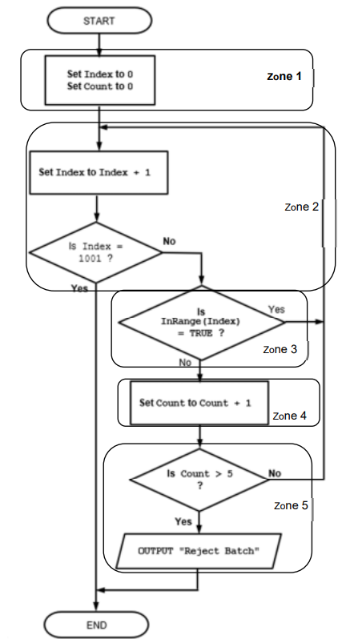
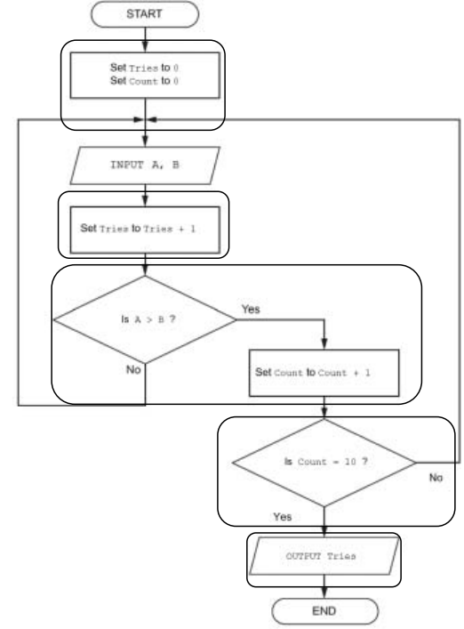

# Mark Schemes — Algorithms
**19. Computational thinking & Problem-solving** · Cambridge (CIE) A-LEVEL computer-science (9618)

## Exam Questions (38 questions)

### Q1
| Box | Symbol | Text in the box | Goes to |
|---|---|---|---|
| 1 | Oval (Start/End) | START | 2 |
| 2 | Parallelogram (Input/Output) | Input `Phrase` | 3 |
| 3 | Rectangle (Process) | Set `Count` to 0 | 4 |
| 4 | Rectangle (Process) | Set `Position` to 1 | 5 |
| 5 | Diamond (Decision) | Is `MID(Phrase, Position, 1) = " "` ? | Yes: 6 No: 7 |
| 6 | Rectangle (Process) | Add 1 to `Count` | 7 |
| 7 | Rectangle (Process) | Add 1 to `Position` | 8 |
| 8 | Diamond (Decision) | Is `Position > LENGTH(Phrase)` ? | Yes: 9 No: 5 |
| 9 | Parallelogram (Input/Output) | Output `Count + 1` | 10 |
| 10 | Oval (Start/End) | END |   |

Box 2 is the input, and box 3 sets the counter to zero. **[1]**

Box 4 sets the loop variable to its first value, 1, before the loop begins. **[1]**

Box 5 is the character test, with both branches labelled. **[1]**

Box 6 is on the `Yes` branch only, and both branches rejoin at box 7 where `Position` is increased. **[1]**

Box 8 ends the loop when every position has been examined, sending `No` back to box 5, and box 9 outputs one more than the number of spaces. **[1]**

**[5 marks]**

> **[mark-scheme]**
> **1 mark** for `Phrase` input in an input/output symbol and `Count` initialised to 0 in a process symbol
> 
> **1 mark** for `Position` initialised to 1 in a process symbol before the loop
> 
> **1 mark** for a decision symbol testing `MID(Phrase, Position, 1) = " "`, with its two exits labelled `Yes` and `No`
> 
> **1 mark** for adding 1 to `Count` on the `Yes` branch only, with both branches rejoining before `Position` is increased
> 
> **1 mark** for a decision symbol comparing `Position` with `LENGTH(Phrase)` whose `No` exit returns to the character test, and an output symbol after the loop
> 
> Accept `Count ← Count + 1` in place of `Add 1 to Count`, and the same for `Position`.
> 
> Accept the exit test written as `Is Position = LENGTH(Phrase) + 1 ?`.
> 
> Accept a pre-test placed between box 4 and the character test, for example `Is Position <= LENGTH(Phrase) ?` with `No` leading to the output, provided every position from 1 to `LENGTH(Phrase)` is examined exactly once.
> 
> Accept a process symbol holding `Words ← Count + 1` followed by an output symbol holding `Words`.
> 
> Do not accept `Output Count` in box 9; the number of words is one more than the number of spaces.
> 
> Do not accept `Add 1 to Count` placed where both branches pass through it, which would count every character rather than only the spaces.
> 
> Do not accept a decision symbol with only one exit arrow, or with its exits unlabelled.

> **[exam-tip]**
> A `FOR ... NEXT` loop always becomes three separate boxes in a flowchart: one to set the loop variable to its first value, one to increase it, and a decision to test it. Students who draw only the decision lose the initialisation mark every time.
> 
> Be careful where the two branches of the selection rejoin. `Add 1 to Count` must sit on the `Yes` path alone, and the `No` path must skip past it straight to the box that increases `Position`. If both paths run through the counting box you have written a character counter, not a word counter.

### Q2
**(i)** Add 1 to `Attempts` **[1]**

**(ii)** Is `Entered = CorrectCode` ? **[1]**

**(iii)** Is `Attempts = 3` ? **[1]**

**(iv)** 3 **[1]**

**[4 marks]**

> **[mark-scheme]**
> **1 mark** for (i) `Add 1 to Attempts`
> 
> **1 mark** for (ii) a question comparing `Entered` with `CorrectCode`
> 
> **1 mark** for (iii) a question testing whether `Attempts` has reached 3
> 
> **1 mark** for (iv) `3`
> 
> Accept `Attempts ← Attempts + 1` or `Attempts = Attempts + 1` for (i).
> 
> Accept `Is Entered the same as CorrectCode ?` and `Entered = CorrectCode ?` for (ii).
> 
> Accept `Is Attempts >= 3 ?` for (iii).
> 
> Accept `Box 3`, `back to box 3` or `Input Entered` for (iv).
> 
> Do not accept `Is Attempts = 4 ?` for (iii); the customer would be given a fourth attempt.
> 
> Do not accept `2` for (iv). Returning to box 2 would reset `Attempts` to 0 after every wrong code, so `Attempts` would never reach 3 and the customer could never be locked out.

> **[exam-tip]**
> Write the contents of a decision box as a question, not as an instruction. `Entered = CorrectCode` inside a diamond is a comparison, and the two arrows leaving it must be labelled `Yes` and `No`. Writing it as an assignment is the usual slip and it makes the diagram meaningless.
> 
> Check where the `No` arrow lands before you write the number. It has to return to the input box, not to the box that initialises the counter. Returning to box 2 resets `Attempts` to 0, so the lock-out can never happen.

### Q3
| Part of the algorithm | Flowchart symbol |
|---|---|
| `INPUT Mass` | Parallelogram (Input/Output) |
| `Volume ← Mass / Density` | **Rectangle (Process)** |
| `IF Volume > 500 THEN` | **Diamond (Decision)** |
| The beginning and the end of the algorithm | Oval (Start/End) |

An assignment works a value out inside the program, so it is a process. **[1]**

An `IF` statement asks a question that has exactly two answers, so it is a decision. **[1]**

**[2 marks]**

> **[mark-scheme]**
> **1 mark** for `Rectangle` or `Process` against `Volume ← Mass / Density`
> 
> **1 mark** for `Diamond` or `Decision` against `IF Volume > 500 THEN`
> 
> Accept either the shape name on its own or the purpose on its own. Cambridge mark schemes credit both forms and pair them in the same way, for example "output symbol / parallelogram".
> 
> Accept `process box` and `decision box`.
> 
> Do not accept `Parallelogram` for the assignment; the parallelogram is used only where data enters or leaves the program.
> 
> Do not accept `Rectangle` for the `IF` statement; a rectangle is left by one arrow and a decision must be left by two.

> **[exam-tip]**
> An input and an assignment look similar on the page, so ask where the value comes from. `INPUT Mass` takes a value from outside the program, which is a parallelogram. `Volume ← Mass / Density` works a value out inside the program, which is a rectangle.
> 
> Count the arrows leaving the box. Any box with two exits is a decision, and in the exam those two exits must be labelled `Yes` and `No`. Cambridge mark schemes state that the labels are needed, so a correct diamond with no labels still loses the mark.

### Q4
Box 2 becomes the initialisation of `RejectCount`. **[1]**

Box 3 becomes the first call to `ReadCard()`, which must happen before the loop so that box 4 has something to test. **[1]**

Box 4 is the loop condition. Because it is tested before any ticket is processed, it becomes a pre-condition loop. **[1]**

Box 5 becomes the selection statement, using the value returned by `IsValid()`. **[1]**

Boxes 6 and 7 become the two branches of that selection. **[1]**

Box 8 becomes the second call to `ReadCard()` inside the loop, and box 9 becomes the `OUTPUT` after `ENDWHILE`. **[1]**

**[6 marks]**

> **[mark-scheme]**
> **1 mark** for `RejectCount ← 0` before the loop
> 
> **1 mark** for `CardID ← ReadCard()` before the loop
> 
> **1 mark** for a conditional loop that continues while `CardID` is not `"CLOSE"`, correctly closed
> 
> **1 mark** for a selection statement inside the loop that uses `IsValid(CardID)`
> 
> **1 mark** for `CALL OpenGate()` in the TRUE branch and `RejectCount ← RejectCount + 1` in the FALSE branch
> 
> **1 mark** for `CardID ← ReadCard()` inside the loop and `OUTPUT RejectCount` after the loop
> 
> Accept an equivalent post-condition version, for example:
> 
> Accept `IF IsValid(CardID) THEN` without the `= TRUE`, since the function already returns a `BOOLEAN`.
> 
> Accept `CALL OpenGate` without the empty brackets.
> 
> Accept `NOT (CardID = "CLOSE")` in place of `CardID <> "CLOSE"`.
> 
> Do not accept a `FOR ... NEXT` loop; the number of passengers is not known before the session starts.
> 
> Do not accept `WHILE CardID = "CLOSE"`, which is the test inverted, so the loop body never runs.
> 
> Do not accept `Result ← OpenGate()`; `OpenGate()` is a procedure and returns no value to assign.

> **[exam-tip]**
> When a flowchart reads a value in two different places, that is deliberate. The first read sits above the loop condition so the condition has something to test, and the second sits at the bottom of the loop body so the next value is ready. Leaving the second one out is the classic error here, and it produces a loop that never ends.
> 
> Look at where the decision box sits relative to the work. Box 4 is reached before any ticket is processed, so this is a `WHILE ... ENDWHILE` loop. If the test had come after the work you would write `REPEAT ... UNTIL` instead, and the condition would be the opposite way round.

### Q5
Box 2 becomes the initialisation of `ZeroCount` before the loop. **[1]**

Boxes 3, 6 and 7 together are a counter that starts at 1 and ends after 20, so they become one count-controlled loop. **[1]**

Box 4 becomes the selection statement inside the loop. **[1]**

Box 5 becomes the increment of `ZeroCount`, and box 8 becomes the `OUTPUT` after the loop has finished. **[1]**

**[4 marks]**

> **[mark-scheme]**
> **1 mark** for initialising `ZeroCount` to 0 before the loop
> 
> **1 mark** for a loop that runs over index values 1 to 20 inclusive
> 
> **1 mark** for a selection statement testing `Reading[Index] = 0` inside the loop
> 
> **1 mark** for `ZeroCount ← ZeroCount + 1` in the TRUE branch and `OUTPUT ZeroCount` after the loop has ended
> 
> Accept a post-condition loop that gives the same 20 iterations, for example:
> 
> Accept `WHILE Index <= 20 ... ENDWHILE` with `Index` initialised to 1 and incremented inside the loop.
> 
> Accept `Reading[Index] = 0` written as `0 = Reading[Index]`.
> 
> Do not accept `FOR Index ← 0 TO 19` or `FOR Index ← 1 TO 19`; the array is `ARRAY[1:20]` and both versions miss element 20.
> 
> Do not accept `OUTPUT ZeroCount` placed inside the loop, which produces 20 outputs instead of one.

> **[exam-tip]**
> Find the counter first. A process box that sets a variable to 1, a second that adds 1 to it, and a decision box that compares it with an upper limit are three parts of one loop, not three separate steps. Once you spot that pattern, write `FOR ... NEXT` and everything between them drops into place.
> 
> The mark most often lost here is the boundary. `Index` is only increased after the element has been tested, so element 20 is tested and then `Index` becomes 21 and the loop stops. Reading the exit test as "stop at 20" and writing `TO 19` throws away the last reading.

### Q6
Step 1 becomes the `INPUT` statement and step 2 becomes the condition `Depth < 20`. **[1]**

Steps 2 and 3 become the two `OUTPUT` statements, placed in the correct branches and closed with `ENDIF`. **[1]**

**[2 marks]**

> **[mark-scheme]**
> **1 mark** for `INPUT Depth` followed by a selection statement testing `Depth < 20`
> 
> **1 mark** for `OUTPUT "Refill needed"` in the TRUE branch and `OUTPUT "Level OK"` in the FALSE branch, closed with `ENDIF`
> 
> Accept the test reversed with the branches swapped, for example `IF Depth >= 20 THEN OUTPUT "Level OK" ELSE OUTPUT "Refill needed" ENDIF`.
> 
> Accept `Depth <= 19` in place of `Depth < 20`, because `Depth` holds a whole number of centimetres.
> 
> Accept the messages without quotation marks.
> 
> Do not accept `Depth <= 20`, which outputs `"Refill needed"` when the depth is exactly 20.
> 
> Do not accept `READ Depth` or `GET Depth`; the keyword in the Cambridge Pseudocode Guide is `INPUT`.

> **[exam-tip]**
> The word "otherwise" in a structured English description is your signal to write `ELSE`. Students who miss it write a second, separate `IF` statement. That still works, but it costs time and it usually ends with one `ENDIF` missing.
> 
> Watch the boundary word. "Less than 20" is `< 20`, not `<= 20`. A tank exactly 20 cm deep must give `"Level OK"`, and changing the operator is the quickest way to lose a mark you had already earned.

### Q7
**[6 marks]**

> **[mark-scheme]**
> **1 mark** for declaring all variables used and initialising both counters to 0
> 
> **1 mark** for prompting for and inputting the first reading before the loop
> 
> **1 mark** for a conditional loop that ends when the value -999 is input
> 
> **1 mark** for a selection inside the loop that counts a reading above 30, and for counting the readings entered
> 
> **1 mark** for prompting for and inputting the next reading inside the loop
> 
> **1 mark** for a selection after the loop that outputs `"No readings entered"` when no readings were entered, and outputs the count otherwise
> 
> Accept a post-condition loop that tests the sentinel inside the body, for example:
> 
> Accept `ReadingCount` replaced by any method that records whether at least one reading was entered, such as a `BOOLEAN` flag.
> 
> Do not accept `IF Reading >= 30 THEN`. A reading of exactly 30 is not above 30 and must not be counted.
> 
> Do not accept a solution in which the value -999 is counted as a reading.
> 
> Do not accept a `FOR` loop. The number of readings is not known before the program runs, so a count-controlled loop cannot be used here.

> **[exam-tip]**
> A sentinel value is the value that tells the loop to stop, and it is never part of the data. Two marks go missing here again and again: counting -999 as a reading, and forgetting the second `INPUT` inside the loop, which leaves the condition unchanged for ever and gives an infinite loop.
> 
> Deal with the empty case after the loop, not inside it. Asking whether any readings were entered at all is a single test at the end, and the end is the only place where the answer is finally known.

### Q8
| Count | Value | Total | OUTPUT |
|---|---|---|---|
| 1 | 1 | 0 |   |
| 2 | 4 | 4 |   |
| 3 | 9 | 4 |   |
| 4 | 16 | 20 |   |
| 5 | 25 | 20 |   |
| 6 | 36 | 56 | 56 |

The `Value` column is correct. **[1]**

The `Total` column is correct. **[1]**

There are exactly six rows, with `Count` running from 1 to 6. **[1]**

The value 56 is output. **[1]**

**[4 marks]**

> **[mark-scheme]**
> **1 mark** for the `Value` column given as 1, 4, 9, 16, 25, 36
> 
> **1 mark** for the `Total` column given as 0, 4, 4, 20, 20, 56
> 
> **1 mark** for exactly six iterations, with `Count` taking the values 1 to 6 and no seventh row
> 
> **1 mark** for an output of 56
> 
> Accept a trace table with extra working columns, provided the four columns above are correct.
> 
> Accept a final row that also records `Count` as 7 after the increment, provided no seventh iteration is traced.
> 
> Do not accept a table that stops after five rows. The condition `UNTIL Count > 6` is tested after `Count ← Count + 1`, so the body does run with `Count` equal to 6.
> 
> Do not accept a final `Total` of 91. That is the sum of every square from 1 to 36 and ignores the `IF` statement.

> **[exam-tip]**
> The two errors that cost marks here are both about the loop boundary. `REPEAT` is a post-condition loop, so the body always runs at least once and the test happens at the bottom. `UNTIL Count > 6` therefore lets the body run with `Count` equal to 6 and stops only once `Count` has reached 7.
> 
> Fill the table one row at a time and never skip a row to save time. Write each new value down the moment a variable changes, and check the `IF` condition on every single row rather than assuming the pattern alternates.

### Q9
The iteration begins at line 5. **[1]**

The selection begins at line 6. **[1]**

**[2 marks]**

> **[mark-scheme]**
> **1 mark** for iteration begins at line 5
> 
> **1 mark** for selection begins at line 6
> 
> Accept the statement written out in place of the line number, so `FOR Index ← 2 TO 12` for the iteration and `IF Readings[Index] > Highest THEN` for the selection.
> 
> Do not accept line 9 for the iteration. `NEXT Index` closes the loop, it does not begin it.
> 
> Do not accept line 8 for the selection. `ENDIF` closes the selection.
> 
> Do not accept line 3 for either construct. `DECLARE Readings : ARRAY[1:12] OF INTEGER` declares a data structure, and an array is not one of the three basic constructs.

> **[exam-tip]**
> Students often give the line that holds the array, because an array stores many values and that feels like repetition. It is not. Iteration is the repeating of statements, and here the repeating is done by `FOR` and `NEXT`. The array is only where the data sits.
> 
> Look for the keyword that opens each construct, not the one that closes it. Lines 1 to 4 are an example of the third basic construct, sequence, because they simply run one after another.

### Q10
**[4 marks]**

> **[mark-scheme]**
> **1 mark** for statement 1 given as `INPUT JourneyLength`
> 
> **1 mark** for statement 2 given as `TotalMinutes ← (DepartHour * 60) + DepartMinute + JourneyLength`
> 
> **1 mark** for statement 3 given as `ArriveHour ← (TotalMinutes DIV 60) MOD 24`
> 
> **1 mark** for statement 4 outputting both `ArriveHour` and `ArriveMinute`
> 
> Accept statement 2 written without brackets, `TotalMinutes ← DepartHour * 60 + DepartMinute + JourneyLength`, because `*` is evaluated before `+`.
> 
> Accept `OUTPUT ArriveHour, ArriveMinute` with no message for statement 4.
> 
> Do not accept `ArriveHour ← TotalMinutes DIV 60` for statement 3. Without `MOD 24`, a bus departing at hour 23 minute 50 on a 25 minute journey gives an arrival hour of 24, which is not a valid hour on the 24-hour clock.
> 
> Do not accept `ArriveHour ← TotalMinutes / 60` for statement 3. The `/` operator returns a `REAL`, so a total of 925 minutes would give 15.4166 rather than 15.

> **[exam-tip]**
> `MOD 24` is the mark most often missed on this style of question. Read the worked example in the stem first. It is put there precisely because it is the case your algorithm has to survive, so test your own answer against it before you move on.
> 
> Remember what the two operators do. `DIV` gives the whole number of hours contained in the total, and `MOD` gives the minutes left over. Using `/` in place of `DIV` stores a fractional hour in an `INTEGER` variable and loses the mark.

### Q11
**[3 marks]**

> **[mark-scheme]**
> **1 mark** for declaring all three variables, with `Distance` and `TimeTaken` declared as `REAL`
> 
> **1 mark** for prompting for and inputting both the distance and the time taken
> 
> **1 mark** for calculating the average speed as the distance divided by the time, and outputting it
> 
> Accept all three variables declared in one statement, for example `DECLARE Distance, TimeTaken, AverageSpeed : REAL`.
> 
> Accept the calculation written inside the output statement, for example `OUTPUT "The average speed is ", Distance / TimeTaken`.
> 
> Accept any sensible prompt wording.
> 
> Do not accept `INTEGER` for `Distance` or `TimeTaken`. A journey of 12.5 kilometres could not then be stored.
> 
> Do not accept `AverageSpeed ← TimeTaken / Distance`. That gives hours per kilometre, not kilometres per hour.
> 
> Do not accept `AverageSpeed ← Distance DIV TimeTaken`.

> **[exam-tip]**
> The commonest lost mark here is the `DIV` operator used in place of `/`. In 9618 pseudocode `DIV` throws the fractional part away, so 150 `DIV` 4 gives 37 and not 37.5. Use `/` whenever the answer may have a fractional part, and declare the variable that stores it as `REAL`.
> 
> A prompt and an input are two separate statements. `INPUT Distance` on its own leaves the user staring at a blank screen, so write the `OUTPUT` prompt before it.

### Q12
| Variable name | Data type |
|---|---|
| `LockerNumber` | **INTEGER** |
| `ZoneLetter` | **CHAR** |
| `HourlyRate` | **REAL** |
| `IsAvailable` | **BOOLEAN** |
| `IssuedOn` | **DATE** |

**[5 marks]**

> **[mark-scheme]**
> **1 mark** for `INTEGER` for `LockerNumber`. `RAND()` returns a `REAL`, but `INT()` keeps only the whole-number part, so the value stored is a whole number from 1 to 200.
> 
> **1 mark** for `CHAR` for `ZoneLetter`. `CHR()` returns a single character, here `'A'` to `'D'`.
> 
> **1 mark** for `REAL` for `HourlyRate`. `1.25` has a fractional part.
> 
> **1 mark** for `BOOLEAN` for `IsAvailable`. The only values it holds are `TRUE` and `FALSE`.
> 
> **1 mark** for `DATE` for `IssuedOn`. `TODAY()` returns a value of type `DATE`.
> 
> Do not accept `REAL` for `LockerNumber`. `INT()` truncates the real value returned by `RAND()`.
> 
> Do not accept `INTEGER` for `HourlyRate`. `1.25` is not a whole number.
> 
> Do not accept `STRING` for `ZoneLetter`. The Insert states that `CHR()` returns a value of type `CHAR`.
> 
> Do not accept `STRING` for `IssuedOn`.

> **[exam-tip]**
> Work out the data type from what is assigned to the variable, not from what the name sounds like. `LockerNumber` could be anything until you look at the line: `INT()` settles it, because the result of `INT()` is always an `INTEGER` even though `RAND()` hands it a `REAL`.
> 
> Keep the Insert open for this kind of question. Every built-in function on it states the type it returns, and the two that decide this table are `CHR()`, which returns `CHAR`, and `TODAY()`, which returns `DATE`.

### Q13
| Stage | Pseudocode statement |
|---|---|
| Input | `INPUT NumberOfBottles` |
| Process | `TotalCost ← NumberOfBottles * PricePerBottle` [1] |
| Output | `OUTPUT "The total cost is ", TotalCost` [1] |

**[2 marks]**

> **[mark-scheme]**
> **1 mark** for the process stage given as `TotalCost ← NumberOfBottles * PricePerBottle`
> 
> **1 mark** for the output stage given as `OUTPUT "The total cost is ", TotalCost`
> 
> Accept `TotalCost ← NumberOfBottles * 0.75` for the process mark.
> 
> Accept `OUTPUT TotalCost` on its own for the output mark.
> 
> Do not accept `OUTPUT "Enter the number of bottles"` for the output stage. That statement is a prompt. It tells the user what to type in, so it belongs to the input stage.
> 
> Do not accept `DECLARE TotalCost : REAL` for the process stage. A declaration sets aside storage. It does not process any data.

> **[exam-tip]**
> Students often put the prompt line in the output row because the line starts with the keyword `OUTPUT`. Decide by what the statement is for, not by the keyword it starts with. A prompt is part of getting the input. The output stage is the statement that reports the result the program has worked out.

### Q14
| Example value | Explanation | Variable name | Data type |
|---|---|---|---|
| `"Okafor"` | The family name of the guest who made the booking | `GuestName` | **STRING** |
| `3` | The number of nights the guest will stay | `NumberOfNights` | **INTEGER** |
| `TRUE` | A value to indicate whether the guest has paid a deposit | `DepositPaid` | **BOOLEAN** |
| `89.50` | The price, in dollars, of one night in the room | `PricePerNight` | **REAL** |

**[4 marks]**

> **[mark-scheme]**
> **1 mark** for each row that has a meaningful variable name **and** the correct data type. Both parts of the row are needed for the mark.
> 
> Row 1: any meaningful name such as `GuestName`, `FamilyName`, `SurName`, with `STRING`
> 
> Row 2: any meaningful name such as `NumberOfNights`, `NumNights`, `NightsBooked`, with `INTEGER`
> 
> Row 3: any meaningful name such as `DepositPaid`, `HasPaidDeposit`, `DepositFlag`, with `BOOLEAN`
> 
> Row 4: any meaningful name such as `PricePerNight`, `NightlyRate`, `RoomPrice`, with `REAL`
> 
> Do not accept a name that does not say what the variable holds, for example `X`, `Temp`, `Data`, `Value1`.
> 
> Do not accept a variable name containing a space, because it would not be a valid identifier.
> 
> Do not accept `INTEGER` for row 4. `89.50` has a fractional part.
> 
> Do not accept `STRING` for row 2 or row 4. The program must be able to do arithmetic with both values.

> **[exam-tip]**
> Both halves of a row earn the single mark together. A perfect data type beside a name such as `A` scores nothing, and that is where most of the marks go on this question type.
> 
> Money is the classic trap. A price is `REAL`, not `INTEGER`, because it has a fractional part, and it is not a `STRING` just because a currency symbol is printed beside it on screen.

### Q15
| Variable name | Use of variable | Data type |
|---|---|---|
| `HireStart` | Stores the day, month and year on which the bicycle was taken from the station | **DATE** |
| `ReturnedLate` | Stores whether the bicycle was returned after the end of the hire period | **BOOLEAN** |

**[2 marks]**

> **[mark-scheme]**
> **1 mark** for `DATE` for `HireStart`
> 
> **1 mark** for `BOOLEAN` for `ReturnedLate`
> 
> Do not accept `STRING` for `HireStart`. A value held as a `STRING` cannot be passed to `DAY()`, `MONTH()` or `YEAR()`.
> 
> Do not accept `INTEGER` or `CHAR` for `ReturnedLate`. The only two values it can hold are `TRUE` and `FALSE`.

> **[exam-tip]**
> A value that has only two possible states is always `BOOLEAN`, even when the wording of the table says "yes or no". Students who write `STRING` here are thinking about how the value is displayed on screen, not how it is stored.
> 
> Any date the program needs to calculate with, such as working out how many days a bicycle was out, must be `DATE`.

### Q16
Step 1: Set a counter to 0 and set a running total to 0. **[1]**

Step 2: Prompt for and input one rainfall reading. **[1]**

Step 3: If the reading is greater than 20, add 1 to the counter. **[1]**

Step 4: Add the reading to the running total. **[1]**

Step 5: Repeat steps 2 to 4 until all 30 readings have been input. **[1]**

Step 6: Divide the running total by 30 to give the mean, then output the counter and the mean. **[1]**

**[6 marks]**

> **[mark-scheme]**
> **1 mark** for initialising both a counter and a running total to 0
> 
> **1 mark** for input one rainfall reading (prompt not required)
> 
> **1 mark** for a test of reading greater than 20 that adds 1 to the counter
> 
> **1 mark** for adding the reading to the running total
> 
> **1 mark** for repeating the input and processing steps 30 times / for all 30 readings
> 
> **1 mark** for calculating the mean as the total divided by 30 and outputting both the count and the mean
> 
> Accept the six steps in any order that still works, for example adding to the total before testing the reading.
> 
> Accept adding each reading to the total inside the same step as the input, provided the six marking points above are all present somewhere in the answer.
> 
> Do not accept storing all 30 readings and then stating "find the average" without saying that the total is divided by 30.
> 
> Do not accept a test of greater than or equal to 20. The question says greater than 20.
> 
> Do not accept an answer written as pseudocode statements.

> **[exam-tip]**
> The mark that disappears most often is the initialisation. If the counter and the total are never set to 0 before the loop, the algorithm has no defined starting point, and examiners look for that step first.
> 
> The other common loss is the repeat step. Describing what happens to one reading is not an algorithm for 30 readings, so say explicitly that the earlier steps are repeated 30 times.

### Q17
Step 1: Prompt the user for a temperature in degrees Celsius and input the value into a variable. **[1]**

Step 2: Multiply the Celsius value by 9, divide the result by 5, then add 32, and store the answer in a second variable. **[1]**

Step 3: Output the value of that second variable as the temperature in degrees Fahrenheit. **[1]**

**[3 marks]**

> **[mark-scheme]**
> **1 mark** for prompt for and input the Celsius value (input alone is enough; the prompt is not required)
> 
> **1 mark** for the complete calculation: multiply by 9, divide by 5, add 32, with the result stored
> 
> **1 mark** for output the converted value
> 
> Accept the calculation written as a formula, for example `Fahrenheit = Celsius * 9 / 5 + 32`.
> 
> Do not accept a partial calculation, for example multiply by 9 and add 32 with the division left out. The whole conversion is worth one mark and it must be complete.
> 
> Do not accept an answer written as pseudocode statements. The question asks for a description.

> **[exam-tip]**
> "Do not use pseudocode statements" means exactly that. Answering this style of question with `INPUT Celsius` is a common mistake every year, and it loses you marks. Write the step as a sentence instead.
> 
> Watch the order of the arithmetic. Adding 32 before dividing by 5 gives the wrong answer, and a description that leaves the order unclear will not be credited.

### Q18
An algorithm is a sequence of steps, or instructions, that are carried out in a defined order. **[1]**

The steps are a solution to a problem, so carrying them out completes the task. **[1]**

**[2 marks]**

> **[mark-scheme]**
> **1 mark** for a sequence / series / ordered set of (defined) steps or instructions
> 
> **1 mark** for that it is a solution to a problem / it completes a given task / it produces the required result
> 
> Accept "set of defined steps", "ordered list of instructions", "method" for the first point.
> 
> Do not accept "a computer program" on its own. The algorithm is the plan of steps; the program is that plan written in a programming language.
> 
> Do not accept "a flowchart" or "pseudocode" on its own. Those are ways of documenting an algorithm, not what an algorithm is.

> **[exam-tip]**
> The word that loses the first mark here is "program". Many students write that an algorithm is "a program that solves a problem". Cambridge keeps the two ideas apart: the algorithm comes first and is independent of any language, and the program is the algorithm coded up.
> 
> The second mark is the one most often left out. "A list of steps" on its own is only half an answer, because a list of steps could describe anything. Say what the steps are there to do.

### Q19
The highest so far is never given a starting value, so the comparison in Step 2 has no value to compare the first temperature with. **[1]**

There is no step that records which hour the temperature just input belongs to, so no count of the hours is kept. **[1]**

When a new highest temperature is found in Step 2, the hour is not stored, so the hour of the highest temperature is lost. **[1]**

Step 4 outputs the temperature only. There is no step that outputs the hour, so the required output is incomplete. **[1]**

**[4 marks]**

> **[mark-scheme]**
> **1 mark** for the highest so far not being initialised / given a starting value before Step 2 uses it
> 
> **1 mark** for there being no step that keeps track of which hour is being input, for example no counter that is set up and increased
> 
> **1 mark** for the hour of a new highest temperature not being stored when Step 2 replaces the highest so far
> 
> **1 mark** for the hour not being output in Step 4, so the output does not meet the requirement
> 
> Accept "set the highest so far to the first temperature input" as the first point, expressed as the missing step.
> 
> Accept "the hour is never saved" or "there is no variable for the hour of the highest" for the third point.
> 
> Do not accept "Step 3 repeats the wrong number of times", because repeating Steps 1 and 2 for all 24 temperatures is correct.
> 
> Do not accept "the temperatures are not stored in an array", because the task does not require the 24 temperatures to be kept.

> **[exam-tip]**
> Check a refinement against the requirement in the question, not against what the steps happen to do. Here the requirement asks for two outputs, the temperature and the hour, and the word "hour" does not appear anywhere in the student's steps. That is the fault students miss most often.
> 
> Any step that compares a variable must be preceded by a step that gives that variable a value. Look for a missing initialisation every time you see "the highest so far" or "the total so far" in a first list of steps.

### Q20
Step 2.1  Check that the email address contains exactly one `@` character. **[1]**

Step 2.2  Check that there is at least one character before the `@` character. **[1]**

Step 2.3  Check that the last four characters of the email address are `.com`. **[1]**

**[3 marks]**

> **[mark-scheme]**
> **1 mark** for a step that counts the `@` characters and checks there is exactly one
> 
> **1 mark** for a step that checks at least one character comes before the `@`
> 
> **1 mark** for a step that checks the last four characters are `.com`
> 
> Accept the three steps in any order.
> 
> Accept "check the email address ends with `.com`" for the third step.
> 
> Accept "check the `@` is not the first character" for the second step.
> 
> Do not accept "check that the email address is valid", because it repeats Step 2 and adds no detail.
> 
> Do not accept "check that the email address contains an `@`", because it does not test that there is exactly one.

> **[exam-tip]**
> A refinement step must add detail. Writing the original step again in different words is the most common way to score zero here, so check that each step you write could be coded without any further thinking.
> 
> The question states three separate rules, so it needs three separate steps. Students who write one step saying "check the three rules are met" get one mark at most, because that step still could not be programmed as it stands.

### Q21
Step 2  Input the price of one item. **[1]**

Step 6  Output the total cost. **[1]**

**[2 marks]**

> **[mark-scheme]**
> **1 mark** for Step 2: input the price of one item
> 
> **1 mark** for Step 6: output the total cost
> 
> Accept "read", "enter" or "prompt for" in place of "input", and "print", "display" or "show" in place of "output".
> 
> Accept "output the amount the customer must pay" or "output the final cost" for Step 6.
> 
> Do not accept "input the total cost" for Step 2, because the total cost is worked out in Step 3, not input.
> 
> Do not accept "output the number of items" or "output the price of one item" for Step 6, because neither is the result the program is required to produce.

> **[exam-tip]**
> The two steps students leave out most often in a refinement are the first input and the final output. Work through the given steps and ask what each one needs before it can run: Step 3 multiplies by the price of one item, so that price has to be input before Step 3.
> 
> Every step must be one instruction that could be turned into a single line of code. A step such as "work out and print the cost" is really two steps and will not earn the mark.

### Q22
> **[mark-scheme]**
> **MP1**   iteration / looping  
> **MP2**  naming all four modules correctly in the correct sequence // e.g. `Module-A` repeatedly calls `Sub-Y1`,then `SubY2` then `Sub-9`

### Q23
> **[mark-scheme]**
> 
> 
> **MP1**   Initialise `Min` to first value in `Data `**and** `MinIndex` to 1 
> **MP2**  Loop through 29 more values (or 30 values in total) 
> **MP3**  Compare element from `Data[]` with `Min`  
> **MP4**  Set new `Min` **AND** save `MinIndex` when element value `<` `Min` **in a loop**  
> **MP5  **Output `MinIndex`

### Q24
> **[mark-scheme]**
> Example Solution
> 
> 
> 
> **One** mark per point:
> 
> 1. Initialise `Total` to zero
> 2. Check for only **first** input of 27 **in a loop** then attempt to sum values
> 3. Loop until 0 input
> 4. Sum values **input** (after input of first 27)** in a loop**
> 5. Output `Total` after a reasonable attempt

### Q25
> **[mark-scheme]**
> **Max 5** marks
> 
> **MP1**    Set total to <u>zero</u> 
> **MP2**   Input a number 
> **MP3**   Check if number greater than 29 and less than 71 
> **MP4  ** … if check is true - add number to total 
> **MP5**   Repeat from step 2 99 times // for a total of 100 iterations 
> **MP6**   Output the total

### Q26
> **[mark-scheme]**
> Two mark for Statement of Problem:
> 
> 1. The functions will return the same value every time they are called
> 2. ... because `Label` / the parameter value does not change within the loop
> 
> Two marks for Solution:
> 
> 3.  Assign `FormatA(Label)` and `FormatB(Label)` to two (local) variables         <u>before</u> the loop
> 
> 4.  Use the (new) variables in place of the function calls / in the loop //       Replace the references to `FormatA()` and `FormatB()`in the `CASE` clauses with     the new variable names

### Q27
> **[mark-scheme]**
> 
> 
> One mark per zone

### Q28
> **[mark-scheme]**
> 
> 
> Mark points
> 
> 1. Condition for selecting one of the input numbers as largest value
> 2. … and assign to `Ans`
> 3. Condition for selecting largest number for all three number input and assigning to `Ans`
> 4. Average calculated using `Num1`, `Num2` and `Num3` and stored in a variable. Reject use of DIV
> 5. Output of `Ans` and average in output symbol / parallelogram
> **[mark-scheme]**
> Example solutions:
> 
> `Flag `$\leftarrow$` GetStat() `
> `WHILE Flag <> TRUE `
> `   FOR Port `$\leftarrow$` 1 TO 3 `
> `      CALL Reset(Port) `
>         `NEXT Port `
>         `Flag `$\leftarrow$` GetStat() `
> `ENDWHILE `
> 
> Alternative:
> 
> `REPEAT `
>         `Flag `$\leftarrow$` GetStat() `
>        `IF Flag <> TRUE THEN `
>                `FOR Port `$\leftarrow$` 1 TO 3 `
>                      `CALL Reset(Port) `
>               `NEXT Port `
>        `ENDIF `
> `UNTIL Flag = TRUE `
> 
> One mark per point:
> 
> 1. (Outer) conditional loop testing `Flag`
> 2. Correct assignment of `Flag` from `GetStat()` **in a loop**
> 3. (Inner) loop checking / counting port // Check if `Port` is different to 4
> 4. … loop for 3 iterations
> 5. a call to `Reset()`**in a loop**

### Q29
| **Pseudocode example** | **Selection** | **Iteration** | **Input/Output** |
|---|---|---|---|
| `FOR Index `$\leftarrow$`1 TO 10 ` `   Data[Index] `$\leftarrow$`0 ` `NEXT Index` |   | **✓** |   |
| `WRITEFILE ThisFile, "****"` |   |   | **✓** |
| `UNTIL Level > 25` |   | **✓** |   |
| `IF Mark > 74 THEN ` `   READFILE OldFile, Data` `ENDIF` | **✓** |   | **✓** |

One mark per row.
> **[mark-scheme]**
> 1 mark for stating a suitable way of documenting:
> 
> - <u>Identifier table </u>
> 1 mark for giving one piece of information that should be recorded. 
> examples include: 
> Explanation of what (each) variable is used for 
> The purpose of (each) variable 
> An example of data values stored // Initialisation value

### Q30
> **[mark-scheme]**
> (i)
> 
> One mark per item **and** justification
> 
> Item: mobile phone number 
> Justification: to send the text message
> 
> Item: name 
> Justification: to personalise the text message
> 
> Item: exercise interest 
> Justification: to determine whether this member would be interested
> 
> (ii)
> 
> Examples include:
> 
> - Add a member to a list of those interested in the new class
> - Remove the member from future SMS messages
> - Read/process Message
> - Identify who from
> 
> One mark for each.
> 
> **Max 2 marks**

### Q31
> **[mark-scheme]**
> ![Spreadsheet with columns titled Count, C, L, Index, Result, Data[1], Data[2], Data[3]. Rows have alphanumeric data and ASCII box outlines.](assets/011-spreadsheet-with-columns-titled-count-c-l-index-.png)
> 
> One mark per zone.

### Q32
> **[mark-scheme]**
> 
> 
> One mark per outlined region:
> 
> 1. Initialise both counts
> 2. Increment `Tries` every time a pair is input
> 3. Compare A > B **and** increment `Count `if TRUE
> 4. Test for Count = 10 (10th time A > B) – MUST include Yes / No labels
> 5. If so output `Tries`, otherwise loop

### Q33
> **[mark-scheme]**
> Loop Solution 
> Example solution:
> 
> `FUNCTION AdjustClock(ThisYear : INTEGER) RETURNS INTEGER`
> `   DECLARE ThisDayNumber, SundayCount : INTEGER `
> `   DECLARE ThisDate : DATE `
> 
> `   ThisDayNumber `$\leftarrow$` 0 `
>          `SundayCount `$\leftarrow$` 0 `
>          `REPEAT `
>                  `ThisDayNumber `$\leftarrow$` ThisDayNumber + 1 `
>                  `ThisDate `$\leftarrow$` SETDATE(ThisDayNumber, 3, ThisYear) `
>                  `IF DAYINDEX(ThisDate) = 1 THEN `
>                          `SundayCount `$\leftarrow$` SundayCount + 1 `
>                  `ENDIF `
>          `UNTIL SundayCount = 3 `
>         `RETURN ThisDayNumber `
> `ENDFUNCTION `
> 
> Mark as follows: 
> **MP1**    Function heading, parameter, ending and return type 
> **MP2   **Declare local integer variable that is used to create a date 
> **MP3**   Loop until 3rd Sunday found 
> **MP4**   Attempt to use both `SETDATE()`** and** `DAYINDEX()`** in a loop** 
> **MP5**   Correctly generate value of type `DATE` using `SETDATE()` **in a loop** 
> **MP6**   Test if value represents a Sunday using `DAYINDEX()` **in a loop** 
> **MP7**   Increment Sunday count **in a loop and** initialised correctly before loop 
> **MP8**   Return day number of **third **Sunday
> 
> **Max 7 marks **
> 
> Non-loop solution 
> Example solution:
> 
> `FUNCTION AdjustClock(ThisYear : INTEGER) RETURNS INTEGER `
> `   DECLARE FirstDayIndex: INTEGER `
> `   DECLARE ThisDate : DATE `
> 
> `   ThisDate `$\leftarrow$` SETDATE(1, 3, ThisYear) `
> `   FirstDayIndex `$\leftarrow$` DAYINDEX(ThisDate) `
> `   IF FirstDayIndex = 1 THEN `
> `      ThirdSunday `$\leftarrow$` FirstDayIndex + 14 //First day is Sunday `
>          `ELSE `
> `      ThirdSunday `$\leftarrow$` 23 – FirstDayIndex // Other days `
>         `ENDIF `
>         `RETURN ThirdSunday `
> `ENDFUNCTION`
> 
> Mark as follows: 
> **MP1**   Function heading, parameter, ending and return type 
> **MP2**   Declare local integer variable that is used to hold a day number 
> **MP4**   Attempt to use both `SETDATE()` **and** `DAYINDEX() `
> **MP5**   Correctly generate value of type `DATE` using `SETDATE()` for first of March / specific day in March 
> **MP6**   Test if date represents a Sunday / specific day using `DAYINDEX()` and calculate third Sunday // Correctly calculate third Sunday for a value returned by `DAYINDEX()`for one day 
> **MP7**   Calculate third Sunday for other six days 
> **MP8**   Return day number of **third **Sunday
> 
> **Max 7 marks**

### Q34
> **[mark-scheme]**
> One mark per highlighted part:
> 
> `FOR Index `$\leftarrow$ `1 TO` <u>**5**</u> 
>         `Lower `$\leftarrow$` GB[Index] - 2 `
>         `Upper `$\leftarrow$ <u>**GB[Index] + 2**</u> `// `<u>**Lower + 4**</u> 
>         `IF Mark` <u>**>= Lower**</u> `AND Mark` <u>**<= Upper**</u> `THEN` 
>  `//IF Mark` <u>**<= Upper **</u>`AND Mark` <u>**>= Lower**</u> `THEN `
>              `OUTPUT "Check this paper" `
> `   ENDIF `
> `NEXT Index`

### Q35
> **[mark-scheme]**
> `DECLARE Count, Total, NextNumber : INTEGER `
> 
> `Total `$\leftarrow$` 0 `
> `FOR  Count `$\leftarrow$` 1 TO 100 `
> `    OUTPUT "Input an integer value"`
> `    INPUT NextNumber `
> `    IF NextNumber > 0 THEN `
> `       Total `$\leftarrow$` Total + NextNumber `
> `    END IF `
> `NEXT Count `
> 
> `OUTPUT Total `
> 
> Mark as follows: 
> **MP1**     Declarations of all variables used 
> **MP2**    Loop for 100 iterations 
> **MP3**    Prompt **and** input a value **in a loop and **
> **MP4**    Test for value > 0 // >=1 **in a loop **
> **MP5**    Sum the Total **in a loop** 
> **MP6**    Output of Total after the **loop**
> 
> **Max 5 marks**

### Q36
> **[mark-scheme]**
> Example solution:
> 
> `PROCEDURE Special() `
> `   DECLARE Index : INTEGER `
> `   DECLARE Filling1, Filling2 : STRING `
> 
> `   REPEAT `
> `      Index `$\leftarrow$` INT(RAND(35)) + 1 `
> `   UNTIL Filling[Index] <> "" `
> 
> `   Filling1 `$\leftarrow$` Filling[Index] `
> 
> `   REPEAT `
> `      Index `$\leftarrow$` INT(RAND(35)) + 1 `
> `   UNTIL Filling[Index] <> "" AND Filling1 <> Filling[Index] `
> 
> `   Filling2 `$\leftarrow$` Filling[Index] `
> 
> `   REPEAT `
> `      Index`$\leftarrow$` INT(RAND(10) + 1) `
> `   UNTIL Bread[Index] <> "" `
> 
> `   OUTPUT "The daily special is ", Filling1, " and ", __ Filling2, "   on ", Bread[Index], " bread." `
> 
> `ENDPROCEDURE `
> 
> Mark as follows: 
> **MP1**   Loop for Filling 1, avoiding unused elements 
> **MP2**  Loop for Filling 2 avoiding unused elements 
> **MP3**  Check Filling 2 is different from Filling 1 – could correctly compare either the indices or the array contents
> 
> **MP4**   Loop for Bread, avoiding unused elements
> 
> **MP5**   Using `RAND(10)` /` RAND(35)` 
> **MP6**   Completely correct use of RAND() - including `INT()`and +1 in all cases
> 
> **MP7**   Correct output -** once only** – following a reasonable attempt at selection of filings and bread
> **[mark-scheme]**
> Answers include:
> 
> **MP1**    For each filling, create a list of <u>acceptable</u> / <u>incompatible</u> fillings/indexes 
> **MP2**   When selecting the second filling, (as well as checking for an unused element) <u>check</u> that the filling / index is / is not on the list
> 
> ALTERNATIVE: 
> **MP1**    Create a list of ‘good’ combinations 
> **MP2**   <u>Randomly select</u> from this list

### Q37
> **[mark-scheme]**
> Example solution:
> 
> `PROCEDURE Timer(Mins, Secs : INTEGER) `
> `   DECLARE WarningTick, EndTick : INTEGER `
> 
> `   EndTick `$\leftarrow$` Tick + 1000 * ((Mins * 60) + Secs) `
> `   WarningTick `$\leftarrow$` EndTick - (30 * 1000) `
> 
> `   REPEAT `
> `      //do nothing `
> `   UNTIL Tick = WarningTick `
> `   OUTPUT "30 seconds to go" `
> 
> `   REPEAT `
> `     //do nothing `
> `   UNTIL Tick = EndTick `
> 
> `   OUTPUT "The time is up!" `
> 
> `ENDPROCEDURE `
> 
> Mark as follows: 
> **MP1** Procedure heading **and** parameters **and** ending 
> **MP2** ‘Attempt’ to calculate ‘total time’/`EndTick` // ‘elapsed time’ // `WarningTick `
> **MP3** Correct calculation of `EndTick` **and** `WarningTick`
> 
> **MP4** **(Design mark) **
> 
> - Two separate loops – checking warning time then the final time, **OR** …
> - Single loop checking the final time with an IF statement to check for warning time, **OR** …
> - Single loop with two IF statements checking the warning time and final time
> 
> **MP5** Completely correct MP4 
> **MP6** Output both messages (must be meaningful and follow successful MP4)

### Q38
> **[mark-scheme]**
> Example answer:
> 
> So that the last three lines of the file are output in the correct **order **
> 
> A mark for mentioning one of:
> 
> - (Ensuring) the lines are **output in correct order**
> - Ordering the last <u>three </u>lines
> - Ordering the lines so they are in the same order as (they occur) <u>in the file </u>
> 
> **Max 1 marks**
