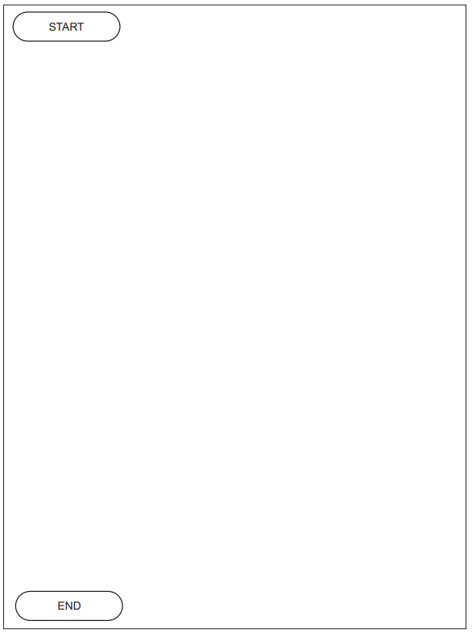
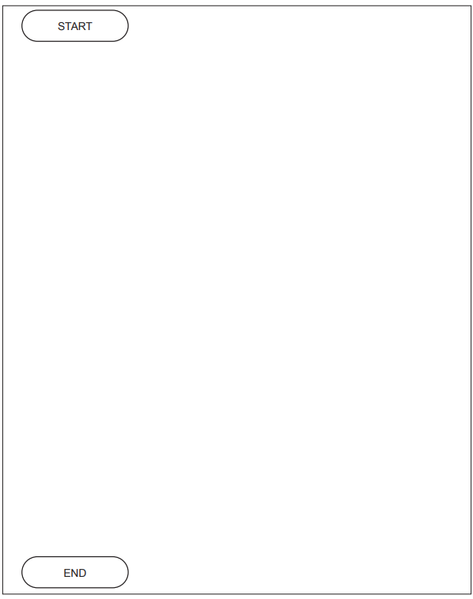
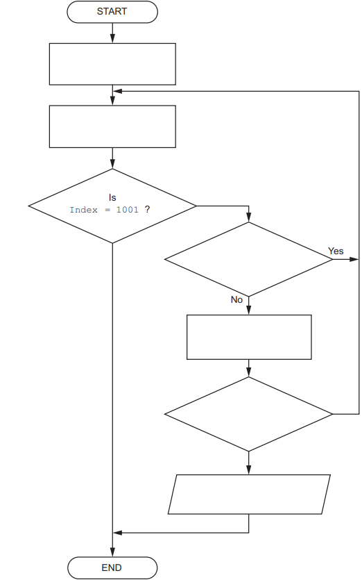
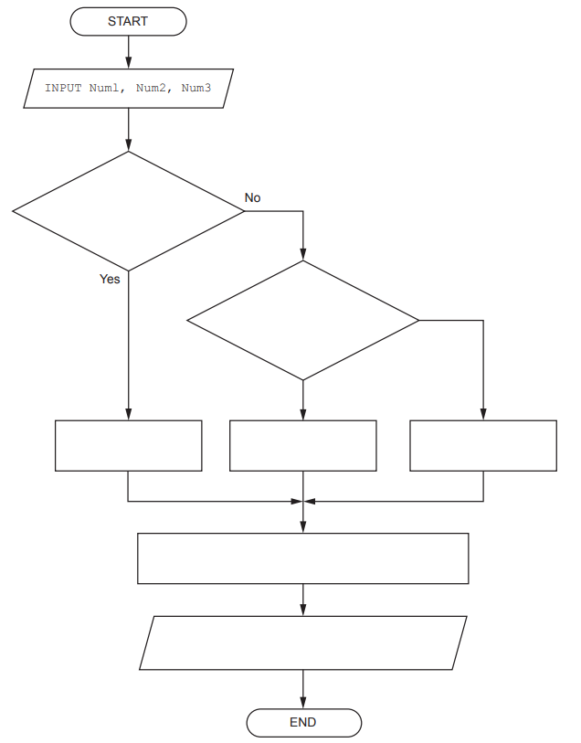
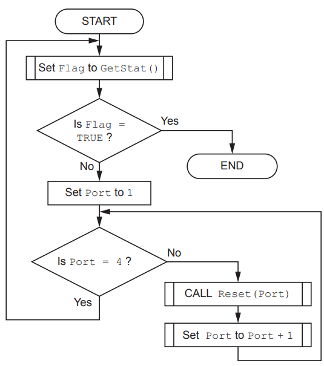

# Exam Questions — Algorithms
**19. Computational thinking & Problem-solving** · Cambridge (CIE) A-LEVEL computer-science (9618)
> Source: [https://www.savemyexams.com/a-level/computer-science/cie/19/topic-questions/](https://www.savemyexams.com/a-level/computer-science/cie/19/topic-questions/) · 38 questions across 1 sets

## Exam Questions (38 questions)

### Q1 — hard — 5 marks

**Q1** [5 marks]

A program counts the number of words in a phrase. Words are separated by exactly one space, and there is no space at the beginning or at the end of the phrase.

This algorithm is going to be redrawn as a program flowchart.

The table describes that flowchart. Each row is one symbol, and the "Goes to" column gives the number of the symbol the arrow leads to. The first row and the last row are given.

Complete the table for boxes 2 to 9.

| Box | Symbol | Text in the box | Goes to |
|---|---|---|---|
| 1 | Oval (Start/End) | START | 2 |
| 2 |   |   |   |
| 3 |   |   |   |
| 4 |   |   |   |
| 5 |   |   |   |
| 6 |   |   |   |
| 7 |   |   |   |
| 8 |   |   |   |
| 9 |   |   |   |
| 10 | Oval (Start/End) | END |   |

### Q2 — medium — 4 marks

**Q2** [4 marks]

A parcel locker asks a customer to enter a code. The correct code is already stored in `CorrectCode`.

An algorithm for the locker is described in structured English:

1. set `Attempts` to 0
2. input a code from the customer and assign it to `Entered`
3. add 1 to `Attempts`
4. if `Entered` is the same as `CorrectCode`, output `"Locker open"` and stop
5. if `Attempts` is now 3, output `"Locked out"` and stop
6. otherwise repeat from step 2

The algorithm has been drawn as a program flowchart. The table describes that flowchart. Each row is one symbol, and the "Goes to" column gives the number of the symbol the arrow leads to.

Complete the table by giving the four missing entries **(i)** to **(iv)**.

| Box | Symbol | Text in the box | Goes to |
|---|---|---|---|
| 1 | Oval (Start/End) | START | 2 |
| 2 | Rectangle (Process) | Set `Attempts` to 0 | 3 |
| 3 | Parallelogram (Input/Output) | Input `Entered` | 4 |
| 4 | Rectangle (Process) | **(i)** | 5 |
| 5 | Diamond (Decision) | **(ii)** | Yes: 6 No: 7 |
| 6 | Parallelogram (Input/Output) | Output `"Locker open"` | 9 |
| 7 | Diamond (Decision) | **(iii)** | Yes: 8 No: **(iv)** |
| 8 | Parallelogram (Input/Output) | Output `"Locked out"` | 9 |
| 9 | Oval (Start/End) | END |   |

### Q3 — easy — 2 marks

**Q3** [2 marks]

A program calculates the volume of a block of metal from its mass. `Density` already holds a value.

This algorithm is going to be redrawn as a program flowchart.

Complete the table by writing the name of the flowchart symbol used for each of the two missing rows. Two rows have been completed for you.

| Part of the algorithm | Flowchart symbol |
|---|---|
| `INPUT Mass` | Parallelogram (Input/Output) |
| `Volume ← Mass / Density` |   |
| `IF Volume > 500 THEN` |   |
| The beginning and the end of the algorithm | Oval (Start/End) |

### Q4 — very_hard — 6 marks

**Q4** [6 marks]

A ticket barrier at a railway station is controlled by a program. Three modules are already written:

| Module | Description |
|---|---|
| `ReadCard()` | A function that returns the identifier of the next ticket presented, as a `STRING`. It returns `"CLOSE"` when a member of staff ends the session. |
| `IsValid(CardID)` | A function that takes a ticket identifier and returns `TRUE` if the ticket is valid, or `FALSE` if it is not. |
| `OpenGate()` | A procedure that opens the barrier for one passenger. It returns no value. |

A program flowchart controls one session at the barrier. The table describes that flowchart. Each row is one symbol, and the "Goes to" column gives the number of the symbol the arrow leads to.

| Box | Symbol | Text in the box | Goes to |
|---|---|---|---|
| 1 | Oval (Start/End) | START | 2 |
| 2 | Rectangle (Process) | Set `RejectCount` to 0 | 3 |
| 3 | Rectangle (Process) | Set `CardID` to `ReadCard()` | 4 |
| 4 | Diamond (Decision) | Is `CardID = "CLOSE"` ? | Yes: 9 No: 5 |
| 5 | Diamond (Decision) | Is `IsValid(CardID) = TRUE` ? | Yes: 6 No: 7 |
| 6 | Rectangle (Process) | Call `OpenGate()` | 8 |
| 7 | Rectangle (Process) | Add 1 to `RejectCount` | 8 |
| 8 | Rectangle (Process) | Set `CardID` to `ReadCard()` | 4 |
| 9 | Parallelogram (Input/Output) | Output `RejectCount` | 10 |
| 10 | Oval (Start/End) | END |   |

Write pseudocode for the algorithm represented by this flowchart.

### Q5 — medium — 4 marks

**Q5** [4 marks]

A factory machine takes 20 readings from a pressure sensor. The readings are stored in a one-dimensional array `Reading`, declared as `ARRAY[1:20] OF INTEGER`.

A program flowchart counts how many of the readings are zero. The table describes that flowchart. Each row is one symbol in the flowchart, and the "Goes to" column gives the number of the symbol the arrow leads to.

| Box | Symbol | Text in the box | Goes to |
|---|---|---|---|
| 1 | Oval (Start/End) | START | 2 |
| 2 | Rectangle (Process) | Set `ZeroCount` to 0 | 3 |
| 3 | Rectangle (Process) | Set `Index` to 1 | 4 |
| 4 | Diamond (Decision) | Is `Reading[Index] = 0` ? | Yes: 5 No: 6 |
| 5 | Rectangle (Process) | Add 1 to `ZeroCount` | 6 |
| 6 | Rectangle (Process) | Add 1 to `Index` | 7 |
| 7 | Diamond (Decision) | Is `Index > 20` ? | Yes: 8 No: 4 |
| 8 | Parallelogram (Input/Output) | Output `ZeroCount` | 9 |
| 9 | Oval (Start/End) | END |   |

Write pseudocode for the algorithm represented by this flowchart.

### Q6 — easy — 2 marks

**Q6** [2 marks]

A water tank at a fish farm has a depth sensor. The depth is measured as a whole number of centimetres.

An algorithm for part of the monitoring program is described in structured English:

1. input the depth of the water in the tank and assign it to `Depth`
2. if `Depth` is less than 20, output the message `"Refill needed"`
3. otherwise, output the message `"Level OK"`

Write pseudocode for this algorithm.

### Q7 — very_hard — 6 marks

**Q7** [6 marks]

A weather station stores temperature readings that an operator types in.

A program will:

- repeatedly prompt for and input a temperature reading as a whole number
- stop inputting when the operator enters the value -999, which is not a reading
- count how many of the readings that were entered are above 30
- output the number of readings above 30 once the input has stopped
- output the message `"No readings entered"` instead if the operator enters -999 as the very first value.

Write pseudocode for the program.

You must declare all variables used and you must use a conditional loop.

### Q8 — medium — 4 marks

**Q8** [4 marks]

A program adds together the even square numbers from 1 x 1 up to 6 x 6.

Complete the trace table for this algorithm.

Each row shows the value of `Count` that is used in that iteration, and the values of `Value` and `Total` at the end of that iteration. Use one row for each iteration. The first row has been completed for you.

| Count | Value | Total | OUTPUT |
|---|---|---|---|
| 1 | 1 | 0 |   |
|   |   |   |   |
|   |   |   |   |
|   |   |   |   |
|   |   |   |   |
|   |   |   |   |

### Q9 — easy — 2 marks

**Q9** [2 marks]

A program finds the highest of 12 temperature readings that are already stored in an array.

The pseudocode is shown with line numbers.

Identify the line number at which the iteration begins and the line number at which the selection begins.

### Q10 — hard — 4 marks

**Q10** [4 marks]

A bus company needs a program that works out the time at which a bus will arrive.

The program will:

- prompt for and input the departure hour and the departure minute, using the 24-hour clock
- prompt for and input the length of the journey in whole minutes
- calculate the arrival hour and the arrival minute on the 24-hour clock
- output the arrival hour and the arrival minute.

A journey may continue past midnight. For example, a bus that departs at hour 23 minute 50 on a journey of 25 minutes arrives at hour 0 minute 15.

Four statements are missing from the pseudocode.

Complete the pseudocode by writing the four missing statements.

Assume that every input is valid.

### Q11 — medium — 3 marks

**Q11** [3 marks]

A cycling club records the journeys that its members make.

A program calculates the average speed of one journey.

The program will:

- prompt for and input the distance travelled in kilometres
- prompt for and input the time taken in hours
- calculate the average speed in kilometres per hour
- output the average speed with a suitable message.

A distance and a time may both include a fractional part, for example 12.5 kilometres in 0.75 hours.

Write pseudocode for the program.

You must declare all variables used. Assume the time taken is always greater than zero.

### Q12 — hard — 5 marks

**Q12** [5 marks]

A sports centre uses a program to issue a locker to a member.

The procedure `IssueLocker()` is written in pseudocode as follows. The declarations of its five local variables have been removed.

Complete the identifier table by writing the data type that each variable must be declared as.

| Variable name | Data type |
|---|---|
| `LockerNumber` |   |
| `ZoneLetter` |   |
| `HourlyRate` |   |
| `IsAvailable` |   |
| `IssuedOn` |   |

### Q13 — easy — 2 marks

**Q13** [2 marks]

A stall sells bottles of water. Each bottle costs 0.75 dollars.

A program calculates the total cost of the bottles that a customer buys.

Every algorithm has an input stage, a process stage and an output stage.

Complete the table by writing the pseudocode statement for the process stage and the pseudocode statement for the output stage.

| Stage | Pseudocode statement |
|---|---|
| Input | `INPUT NumberOfBottles` |
| Process |   |
| Output |   |

### Q14 — medium — 4 marks

**Q14** [4 marks]

A hotel uses a program to store the details of each room booking.

The following identifier table shows some of the data that will be stored for one booking.

Complete the identifier table by adding a meaningful variable name and an appropriate data type for each row.

| Example value | Explanation | Variable name | Data type |
|---|---|---|---|
| `"Okafor"` | The family name of the guest who made the booking |   |   |
| `3` | The number of nights the guest will stay |   |   |
| `TRUE` | A value to indicate whether the guest has paid a deposit |   |   |
| `89.50` | The price, in dollars, of one night in the room |   |   |

### Q15 — easy — 2 marks

**Q15** [2 marks]

A city bicycle hire scheme uses a program to record each hire.

Part of the identifier table for the program is shown.

Complete the table by writing an appropriate data type for each variable.

| Variable name | Use of variable | Data type |
|---|---|---|
| `HireStart` | Stores the day, month and year on which the bicycle was taken from the station |   |
| `ReturnedLate` | Stores whether the bicycle was returned after the end of the hire period |   |

### Q16 — hard — 6 marks

**Q16** [6 marks]

A research station records the rainfall, in millimetres, on each of the 30 days of one month.

A program is needed that will:

- input the 30 rainfall readings, one for each day
- count how many of the readings are greater than 20 millimetres
- calculate the mean (average) rainfall for the month
- output the count and the mean.

Describe the algorithm as a sequence of six steps.

Do not use pseudocode statements in your answer.

### Q17 — medium — 3 marks

**Q17** [3 marks]

A weather program must convert a temperature given in degrees Celsius into degrees Fahrenheit.

To convert the value, the Celsius value is multiplied by 9, the result is divided by 5, then 32 is added.

The program must input one Celsius value, convert it, and output the Fahrenheit value.

Describe the algorithm as a sequence of three steps.

Do not use pseudocode statements in your answer.

### Q18 — easy — 2 marks

**Q18** [2 marks]

A software company is developing a program that will work out the shortest route between two railway stations.

Before any program code is written, the designer produces an algorithm.

State what is meant by the term **algorithm**.

### Q19 — hard — 4 marks

**Q19** [4 marks]

A weather station records the temperature once every hour.

A program must:

- input the 24 temperatures recorded during one day, one at a time
- output the highest of these temperatures and the hour at which it was recorded.

A student applies stepwise refinement to the algorithm and produces these steps:

Step 1  Input a temperature.

Step 2  If the temperature is greater than the highest so far, replace the highest so far with this temperature.

Step 3  Repeat Steps 1 and 2 for all 24 temperatures.

Step 4  Output the highest so far.

Explain why these steps could not be used to produce a program that meets the requirement.

### Q20 — medium — 3 marks

**Q20** [3 marks]

A program stores the email addresses of new users.

The program must:

- input an email address
- check that the email address is valid
- store a valid email address in the next free element of a 1D array.

An email address is valid only if all three of these are true:

- it contains exactly one `@` character
- there is at least one character before the `@`
- its last four characters are `.com`

Stepwise refinement is applied to the algorithm. The first refinement is:

Step 1  Input the email address.

Step 2  Check that the email address is valid.

Step 3  If the email address is valid, store it in the array at the next free index.

Step 4  If the email address is not valid, output an error message.

Step 2 is not yet at a level of detail from which the task may be programmed.

Outline the three steps that Step 2 refines into.

Do **not** use pseudocode statements in your answer.

### Q21 — easy — 2 marks

**Q21** [2 marks]

A program is being written for a shop.

The program inputs the number of items a customer buys and the price of one item. It outputs the total cost. If the customer buys 10 items or more, the total cost is reduced by 5%.

Stepwise refinement is applied to this algorithm. Two of the steps are missing.

Complete the refinement by writing the two missing steps.

Do **not** use pseudocode statements in your answer.

Step 1  Input the number of items.

Step 2  ...................................................................................................

Step 3  Multiply the number of items by the price of one item to give the total cost.

Step 4  Check whether the number of items is 10 or more.

Step 5  If the check is true, reduce the total cost by 5%.

Step 6  ...................................................................................................

### Q22 — medium — 2 marks

**Q22** [2 marks]

A structure chart shows the modular structure of a program:

Explain the meaning of the curved arrow symbol which begins and ends at Module-A().

*Source: November 2023 9618/23 Q7A*

### Q23 — medium — 5 marks

**Q23** [5 marks]

`Data` is a 1D array of integers, containing 30 elements. All element values are unique.

An algorithm will output the index of the element with the smallest value.

Draw a program flowchart to represent the algorithm.

*Source: November 2023 9618/23 Q2A*

### Q24 — medium — 5 marks

**Q24** [5 marks]

An algorithm will:

1. input a sequence of integer values, one at a time
2. ignore all values until the value 27 is input, then sum the remaining values in the sequence
3. stop summing values when the value 0 is input and then output the sum of the values.

Draw a program flowchart to represent the algorithm.

*Source: November 2023 9618/22 Q2A*

### Q25 — medium — 5 marks

**Q25** [5 marks]

An algorithm is expressed as follows:

- input 100 numbers, one at a time
- keep a total of all numbers input that have a value between 30 and 70 inclusive and output this total after the last number has been input.

Outline, using stepwise refinement, the five steps for this algorithm which could be used to produce pseudocode.

Do **not** use pseudocode statements in your answer.

Step 1 .....................................................................................................................

Step 2 ....................................................................................................................

Step 3 ....................................................................................................................

Step 4 ....................................................................................................................

Step 5 ....................................................................................................................

*Source: November 2023 9618/21 Q2A*

### Q26 — medium — 4 marks

**Q26** [4 marks]

A program is being designed in pseudocode.

The program contains the following declaration:

`    DECLARE Data : ARRAY[1:1000] OF STRING `

A procedure `ArrayInitialise()` is written to initialise the values in the array:

`    PROCEDURE ArrayInitialise(Label : STRING) `
`       DECLARE `
`       Index : INTEGER Index`$\leftarrow$`1 `
`       WHILE Index <= 1000 `
`          CASE OF (Index MOD 2) `
`             0 : Data[Index]`$\leftarrow$`FormatA(Label) `
`                 Index`$\leftarrow$`Index + 1 `
`             1 : Data[Index]`$\leftarrow$`FormatB(Label) `
`                 Index`$\leftarrow$`Index + 1 `
`          ENDCASE `
`       ENDWHILE `
`    ENDPROCEDURE `

Functions `FormatA()` and `FormatB()` apply fixed format case changes to the parameter string.

The algorithm calls one of the functions `FormatA()` and `FormatB() `each time within the loop.

Explain why this is **not** efficient **and** suggest a more efficient solution.

*Source: June 2024 9618/23 Q5B*

### Q27 — medium — 5 marks

**Q27** [5 marks]

A module `InRange()` will:

- be called with an integer parameter representing an index value of a record in the `Batch` array
- check if the weight of the indexed component is within the acceptable range
- return `TRUE` if the weight is in the range and `FALSE` if it is **not**.

A module `BatchCheck()` will:

- iterate through a batch of 1000 component records
- call module `InRange() `to check each individual component record
- keep a count of the number of components that fail
- output a suitable warning message and immediately stop if the number of failed components exceeds 5.

Complete the program flowchart to represent the algorithm for module BatchCheck().

*Source: June 2024 9618/23 Q3B*

### Q28 — medium — 10 marks

**Q28** [5 marks]

A program is being developed.

An algorithm for part of the program will:

- input three numeric values and assign them to identifiers` Num1`, `Num2` and `Num3 `
- assign the largest value to variable `Ans`
- output a message giving the largest value and the average of the three numeric values.

Assume the values are all different and are input in no particular order.

Complete the program flowchart on page 5 to represent the algorithm.

*Source: June 2024 9618/22 Q2A*

**Q28** [5 marks]

A different part of the program contains an algorithm represented by the following program flowchart:

Write pseudocode for the algorithm.

*Source: June 2024 9618/22 Q2B*

### Q29 — medium — 6 marks

**Q29** [4 marks]

Refer to the** **[insert](https://cdn.savemyexams.com/uploads/2025/11/46562-9618_s24_in_22.pdf) for the list of pseudocode functions and operators.

The following table contains pseudocode examples.

Each example may contain statements that relate to one or more of the following:

- selection
- iteration (repetition)
- input/output.

Complete the table by placing **one or more** ticks (**✓**) in each row.

| **Pseudocode example** | **Selection** | **Iteration** | **Input/Output** |
|---|---|---|---|
| `FOR Index `$\leftarrow$`1 TO 10 ` `   Data[Index] `$\leftarrow$`0 ` `NEXT Index` |   |   |   |
| `WRITEFILE ThisFile, "****"` |   |   |   |
| `UNTIL Level > 25` |   |   |   |
| `IF Mark > 74 THEN ` `   READFILE OldFile, Data` `ENDIF` |   |   |   |

*Source: June 2024 9618/22 Q1A*

**Q29** [2 marks]

Program variables have data types as follows:

| **Variable** | **Data type** |
|---|---|
| `MyChar` | `CHAR` |
| `MyString` | `STRING` |
| `MyInt` | `INTEGER` |

The variables given in part** (b)** are chosen during the design stage of the program development life cycle.

The choices are to be documented to simplify program maintenance.

State a suitable way of documenting the variables **and** give **one** piece of information that should be recorded, in addition to the data type.

*Source: June 2024 9618/22 Q1C*

### Q30 — medium — 5 marks

**Q30** [5 marks]

A fitness club has a computerised membership system. The fitness club offers a number of different exercise classes.

The following information is stored for each club member: name, home address, email address, mobile phone number, date of birth and the exercise(s) they are interested in.

When an exercise class is planned, a new module will send personalised text messages to each member who has expressed an interest in that exercise. Members wishing to join the class send a text message back. Members may decide not to receive future text messages by replying with the message ‘STOP’.

(i) Identify **three** items of information that will be required by the new module. 
Justify your choices with reference to the given scenario.

Item 1 required .........................................................................................................

Justification .............................................................................................................

Item 2 required ........................................................................................................

Justification ............................................................................................................

Item 3 required .......................................................................................................

Justification ............................................................................................................

[3]

(ii) Identify **two** operations that would be required to process data when the new module receives a text message back from a member.

Operation 1 ...........................................................................................................

Operation 2 ............................................................................................................

[2]

*Source: June 2024 9618/21 Q7AII,AIII*

### Q31 — medium — 6 marks

**Q31** [6 marks]

A global 1D array of strings contains three elements which are assigned values as shown:

`Data[1] `$\leftarrow$`"aaaaaa" `
`Data[2] `$\leftarrow$`"bbbbbb" `
`Data[3] `$\leftarrow$`"cccccc" `

Procedure `Process()` manipulates the values in the array.

The procedure is written in pseudocode as follows:

`PROCEDURE Process(Format : STRING) `
`   DECLARE Count, Index, L : INTEGER `
`   DECLARE Result : STRING `
`   DECLARE C : CHAR `

`   Result`$\leftarrow$` "****" `

`   FOR Count 1 TO LENGTH(Format) STEP 2 `
`      C`$\leftarrow$` MID(Format, Count, 1) `
`      L`$\leftarrow$` STR_TO_NUM(MID(Format, Count + 1, 1)) `

`      Index `$\leftarrow$`(Count + 1) DIV 2 `

`      CASE OF C `
`         'X' : Result `$\leftarrow$`TO_UPPER(Data[Index]) `
`         'Y' : Result `$\leftarrow$`TO_LOWER(Data[Index]) `
`         'Z' : Result `$\leftarrow$` "**" & Data[Index] `
`      ENDCASE `

`      Data[Index] `$\leftarrow$`LEFT(Result, L) `
`   NEXT Count `

`ENDPROCEDURE`

Complete the trace table by dry running the procedure when it is called as follows:

`CALL Process("X3Y2W4")`

| **Count** | **C** | **L** | **Index** | **Result** | **Data[1]** | **Data[2]** | **Data[3]** |
|---|---|---|---|---|---|---|---|
|   |   |   |   |   |   |   |   |
|   |   |   |   |   |   |   |   |
|   |   |   |   |   |   |   |   |
|   |   |   |   |   |   |   |   |
|   |   |   |   |   |   |   |   |
|   |   |   |   |   |   |   |   |
|   |   |   |   |   |   |   |   |
|   |   |   |   |   |   |   |   |
|   |   |   |   |   |   |   |   |
|   |   |   |   |   |   |   |   |
|   |   |   |   |   |   |   |   |
|   |   |   |   |   |   |   |   |
|   |   |   |   |   |   |   |   |
|   |   |   |   |   |   |   |   |

*Source: June 2024 9618/21 Q5A*

### Q32 — medium — 5 marks

**Q32** [5 marks]

An algorithm has three steps. It will:

1. repeatedly input a pair of numeric values `A` and `B`
2. count the number of pairs that are input until `A` has been greater than `B` 10 times
3. output the number of pairs that were input.

Complete the program flowchart.

*Source: June 2024 9618/21 Q2A*

### Q33 — medium — 7 marks

**Q33** [7 marks]

In some countries, on the third Sunday in March, daylight saving time begins when clocks move forward by one hour.

A module `AdjustClock()` will take an integer parameter representing a year. The module will return an integer value representing the number of the day in March on which the clocks move forward.

For example, the following line of pseudocode would assign `DayNumber `the value 20:

`DayNumber`$\leftarrow$`AdjustClock(2022) `

Write pseudocode for the function `AdjustClock()`.

Date functions from the **insert** should be used in your solution.

*Source: November 2024 9618/23 Q6*

### Q34 — medium — 4 marks

**Q34** [4 marks]

An examination paper has a maximum of 75 marks. One of five pass grades (A to E) is assigned, depending on the mark obtained. The lowest mark for a given grade is known as the grade boundary.

A program is being written to process examination marks.

The five grade boundaries are stored in a global 1D array `GB` of type `INTEGER`, for example:

| **Index** | **Value** | **Comment** |
|---|---|---|
| 1 | `65` | The minimum mark for an A grade. |
| 2 | `57` | The minimum mark for a B grade. |
| 3 | `43` | The minimum mark for a C grade. |
| 4 | `35` | The minimum mark for a D grade. |
| 5 | `27` | The minimum mark for an E grade. |

Any paper that achieves a mark within 2 marks of a grade boundary must be checked. Using the given table, a paper with 45 marks would need to be checked.

The pseudocode algorithm to determine whether a paper should be checked is as shown. The mark for the paper is stored in variable `Mark`. Global variables Mark, Index, Upper and Lower are declared as integers.

Complete the pseudocode.

`FOR Index `$\leftarrow$` 1 TO ........................................... `

`    Lower `$\leftarrow$` GB[Index] - 2 `

`    Upper `$\leftarrow$` ....................................................... `

`    IF Mark ........................................... AND Mark ........................................... THEN `

`       OUTPUT "Check this paper" `

`    ENDIF `

` NEXT Index`

*Source: November 2024 9618/23 Q4A*

### Q35 — medium — 5 marks

**Q35** [5 marks]

An algorithm will:

1. prompt and input a sequence of 100 integer values, one at a time
2. sum the positive integers
3. output the result of the sum.

Write pseudocode for the algorithm.

Assume the value zero is neither positive nor negative.

You must declare all variables used in the algorithm.

*Source: November 2024 9618/23 Q2A*

### Q36 — medium — 9 marks

**Q36** [7 marks]

A shop sells sandwiches and snacks. The owner chooses a ‘daily special’ sandwich which is displayed on a board outside the shop. Each ‘daily special’ has two different fillings and is made with one type of bread.

The owner wants a program to randomly choose the ‘daily special’ sandwich.

The program designer decides to store the possible sandwich fillings in a 1D array of type string.

The array is declared in pseudocode as follows:

`   DECLARE Filling : ARRAY [1:35] OF STRING `

Each element contains the name of one filling.

An example of the first five elements is as follows:

| **Index** | **Element value** |
|---|---|
| 1 | `"Cheese"` |
| 2 | `"Onion"` |
| 3 | `"Salmon"` |
| 4 | `"Anchovies"` |
| 5 | `"Peanut Butter"` |

A second 1D array stores the possible bread used:

`     DECLARE Bread : ARRAY [1:10] OF STRING `

Each element contains the name of one type of bread.

An example of the first three elements is as follows:

| **Index ** | **Element value** |
|---|---|
| 1 | `"White"` |
| 2 | `"Brown"` |
| 3 | `"Pitta"` |

Both arrays may contain unused elements. The value of these will be an empty string and they may occur anywhere in each array.

A procedure `Special() `will output a message giving the ‘daily special’ sandwich made from **two** randomly selected different fillings and **one** randomly selected bread.

Unused array elements must** not** be used when creating the ‘daily special’ sandwich.

Using the above examples, the output could be:

`     "The daily special is Cheese and Onion on Brown bread."`

Complete the pseudocode for the procedure `Special()`.

Assume that both arrays are global.

`PROCEDURE Special()`

*Source: November 2024 9618/22 Q6A*

**Q36** [2 marks]

The owner decides that some combinations of fillings do not go well together. For example, anchovies and peanut butter.

Describe how the design could be changed to prevent certain combinations being selected.

*Source: November 2024 9618/22 Q6B*

### Q37 — medium — 6 marks

**Q37** [6 marks]

A global integer variable `Tick` is always incremented every millisecond (1000 times per second) regardless of the other programs running.

The value of `Tick` can be read by any program but the value should not be changed.

Assume that the value of `Tick` does not overflow.

As an example, the following pseudocode algorithm would output `"Goodbye" `40 seconds after outputting `"Hello"`.

`    DECLARE Start : INTEGER `

`    OUTPUT "Hello" `
`    Start Tick `

`    REPEAT `
`      //do nothing `
`    UNTIL Tick = Start + 40000 `

`    OUTPUT "Goodbye" `

A program is needed to help a user to time an event such as boiling an egg.

The time taken for the event is known as the elapsed time.

The program contains a procedure `Timer() `which will:

- take two integer values representing an elapsed time in minutes and seconds
- use the value of variable `Tick` to calculate the elapsed time
- output a warning message 30 seconds before the elapsed time is up
- output a final message when the total time has elapsed

For example, to set an alarm for 5 minutes and 45 seconds the program makes the following call:

`    CALL Timer(5, 45) `

When 5 minutes and 15 seconds have elapsed, the program will output:

`    "30 seconds to go" `

When 5 minutes and 45 seconds have elapsed, the program will output:

`    "The time is up!"`

Write pseudocode for the procedure `Timer()`.

*Source: November 2024 9618/22 Q4*

### Q38 — medium — 1 marks

**Q38** [1 mark]

An algorithm will output the **last** three lines from a text file `Result.txt`

The lines need to be output in the same order as they appear in the file.

Assume:

- Three variables` LineX`, `LineY` and `LineZ` will store the three lines. These are of type string and all three variables have been initialised to an empty string.
- The file exists and contains **at least** three lines.

The algorithm to output the lines is expressed in eight steps.

Complete the steps.

1. Open the file ...........................................................................

2. Loop until ...........................................................................

3. ........................................................................... and store in `ThisLine `

4. Assign `LineY `to `LineX`

5. Assign `LineZ` to `LineY`

6. Assign `ThisLine` to `LineZ`

7. After the loop, ...........................................................................

8. Output `LineX, LineY, LineZ`

Explain the purpose of steps 4, 5 and 6 in the algorithm from part **(a)**.

*Source: November 2024 9618/21 Q3B*

