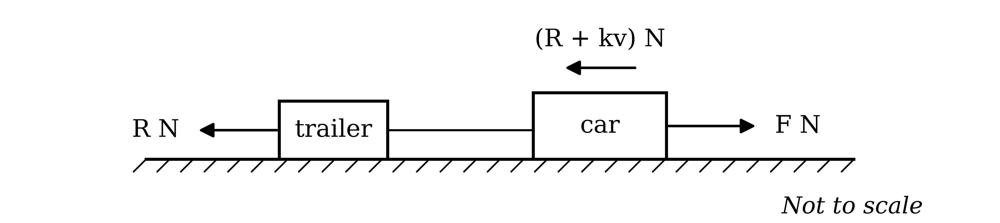

# Mark Schemes — Power
**Energy, Work & Power** · Cambridge (CIE) A-LEVEL maths (9709)

## Exam Questions (26 questions)

### Q1
(i)

The speed is constant, so the distance down the canyon is speed $\times$ time

$\text{Distance} = 100 \times 10 = 1000$

**[B1]**

Use loss in gravitational potential energy $= m g h$ with the loss of 1200000 J to find the vertical drop $h$ m

$200 \times 10 \times h = 1200000$

$h = 600$

**[M1]**

The vertical drop is the side opposite $α$ and the distance along the canyon is the hypotenuse

$\text{sin}  α = \frac{600}{1000}$

$\text{sin}  α = 0 . 6$

**[B1]**

(ii)

The unicorn works at 2.5 kW, which is 2500 W, for 10 seconds, so use work done $=$ power $\times$ time

$\text{Work done by unicorn} = 2500 \times 10 = 25000$

The speed is constant, so by the work-energy principle the work done against the resistances equals the loss in gravitational potential energy plus the work done by the unicorn

$\text{Work done against resistances} = 1200000 + 25000$

**[M1]**

**Final answer:** $\text{Work done against resistances} = 1225000$** J**

**[A1]**

> **[mark-scheme]**
> **B1**: Correct distance of 1000 m along the canyon.
> 
> **M1**: Correct use of loss in gravitational potential energy $= m g h$ with $g = 10$ and the loss converted to 1200000 J, to find the vertical drop.
> 
> **B1**: Correct working leading to the given result, $\text{sin}  α = 0 . 6$.
> 
> **M1**: Correct use of the work-energy principle with three terms: the loss in gravitational potential energy, the work done by the unicorn from power $\times$ time, and the work done against the resistances. Allow sign errors for this mark.
> 
> **A1**: Correct value of 1225000. Answers of 1225 kJ, or 1230 kJ with the unit stated, are also accepted.
(i)

Let the combined mass of the children be $m$ kg, so the total mass is `\left(200 + m\right)` kg

Resolve the weight along the slope, using $\text{sin}  α = 0 . 6$

`10\left(200 + m\right)\text{sin} \; \alpha = 10\left(200 + m\right) \times 0.6 = 1200 + 6m`

At the maximum speed the acceleration is zero, so the driving force balances the resistance and the component of the weight

$F = 500 + 1200 + 6 m$

Use $1000 P = F v$ with $v = 185$

`1000P = \left(500 + 1200 + 6m\right) \times 185`

**[M1]**

$1000 P = 314500 + 1110 m$

**[A1]**

At a speed of 100 $\text{m s}^{-1}$, apply Newton's second law up the slope to find the driving force

`F - \left(1700 + 6m\right) = 6\left(200 + m\right)`

$F = 2900 + 12 m$

Use $1000 P = F v$ with $v = 100$

`1000P = \left(2900 + 12m\right) \times 100`

**[M1]**

$1000 P = 290000 + 1200 m$

**[A1]**

Equate the two expressions for $1000 P$

$314500 + 1110 m = 290000 + 1200 m$

$90 m = 24500$

$m = 272 . 22 \dots$

**Final answer:** $m = 272$** kg (3 s.f.)**

**[A1]**

(ii)

Substitute the unrounded value of $m$ into $1000 P = 314500 + 1110 m$

$1000 P = 314500 + 1110 \times 272 . 22 \dots$

$P = 616 . 66 \dots$

**Final answer:** $P = 617$** (3 s.f.)**

**[A1]**

> **[mark-scheme]**
> **M1**: Correct use of zero acceleration at the maximum speed with the driving force equal to $500 + 1200 + 6 m$, and $1000 P = F v$ with $v = 185$. Allow sign errors and a sine and cosine mix for this mark only.
> 
> **A1**: Correct equation, $1000 P = 314500 + 1110 m$ or equivalent.
> 
> **M1**: Correct use of Newton's second law at a speed of 100 with four terms, and $1000 P = F v$ with $v = 100$. Allow sign errors for this mark.
> 
> **A1**: Correct equation, $1000 P = 290000 + 1200 m$ or equivalent.
> 
> **A1**: Answers which round to 272.
> 
> **A1**: Answers which round to 617. Follow through on the value of $m$.
> 
> The two answers are marked independently.

### Q2
(i)

Treat the car and trailer as a single body, so the force in the tow-bar cancels out

`\text{Total resistance} = R + \left(R + k v\right) = 2 R + k v`

At the greatest speed the acceleration is zero, so the driving force equals the total resistance. Use $P = F v$ with $P = 48840$ and $v = 30$

`48840 = \left(2 R + 30 k\right) \times 30`

**[M1]**

$2 R + 30 k = 1628$

**[A1]**

The speed of 14 $\text{m s}^{-1}$ is also constant, so use $P = F v$ with $P = 21000$

`21000 = \left(2 R + 14 k\right) \times 14`

**[M1]**

$2 R + 14 k = 1500$

**[A1]**

Subtract the second equation from the first to eliminate $R$

$16 k = 128$

$k = 8$

**[A1]**

(ii)

Substitute $k = 8$ into $2 R + 14 k = 1500$ to find $R$

$2 R + 112 = 1500$

$R = 694$

**Final answer:** $\text{Total resistance} = 1388 + 8 v$** N**

**[B1]**

> **[mark-scheme]**
> **M1**: Correct use of $P = F v$ at the greatest speed, with the driving force equal to the total resistance $2 R + 30 k$ and the power converted to 48840 W.
> 
> **A1**: Correct equation, $2 R + 30 k = 1628$ or equivalent.
> 
> **M1**: Correct use of $P = F v$ at the constant speed of 14, with the driving force equal to $2 R + 14 k$ and the power converted to 21000 W.
> 
> **A1**: Correct equation, $2 R + 14 k = 1500$ or equivalent.
> 
> **A1**: Correct value of $k = 8$.
> 
> **B1**: Correct total resistance $1388 + 8 v$.
Treat the car and trailer as a single body of mass $4 m$ kg on the slope

Use $P = F v$ with $P = 45300$ and $v = 12$

$45300 = F \times 12$

$F = 3775$

**[B1]**

Find the total resistance at $v = 12$

$1388 + 8 \times 12 = 1484$

Resolve the weight of the system along the slope

$40 m \text{sin}  α = 40 m \times \frac{1}{19} = \frac{40m}{19}$

Apply Newton's second law up the slope

$3775 - 1484 - \frac{40m}{19} = 4 m \times 1 . 1$

**[M1 A1]**

Collect the terms in $m$

`2291 = m\left(4.4 + \dfrac{40}{19}\right)`

$m = 352 . 176 \dots$

**[M1]**

The mass of the car is $3 m$

$3 m = 1056 . 52 \dots$

**Final answer:** $\text{Mass of car} = 1060$** kg (3 s.f.)**

**[A1]**

> **[mark-scheme]**
> **B1**: Correct driving force of 3775.
> 
> **M1**: Correct use of Newton's second law for the whole system up the slope with four terms: the driving force, the total resistance at $v = 12$, the component of the weight of mass $4 m$ and the mass times acceleration. Allow sign errors and a sine and cosine mix for this mark only. Follow through on the resistance from part (a).
> 
> **A1**: Correct equation.
> 
> **M1**: Correct method to solve for $m$.
> 
> **A1**: Answers which round to 1060 for the mass of the car. An answer of 352 is the mass of the trailer and does not earn this mark.

### Q3
Let the resistance be $k v$ N. At the maximum speed the acceleration is zero, so the driving force equals the resistance

$F = 36 k$

**[M1]**

Use $P = F v$ with the maximum power $P = 45000$ and $v = 36$

$45000 = 36 k \times 36$

**[M1]**

$1296 k = 45000$

$k = \frac{625}{18}$

**[A1]**

At a speed of 25 $\text{m s}^{-1}$, use $P = F v$ again to find the driving force

$45000 = F \times 25$

$F = 1800$

**[B1]**

Apply Newton's second law, with resistance $25 k = 25 \times \frac{625}{18}$

$1800 - 25 \times \frac{625}{18} = 800 a$

**[M1]**

$800 a = 931 . 944 \dots$

$a = 1 . 164930 \dots$

**Final answer:** $a = 1 . 16 \text{m s}^{-2}$** (3 s.f.)**

**[A1]**

> **[mark-scheme]**
> **M1**: Correct use of zero acceleration at the maximum speed, so that the driving force equals the resistance $36 k$. This can be implied by later working.
> 
> **M1**: Correct use of $P = F v$ at the maximum speed, with the power converted to 45000 W.
> 
> **A1**: Correct value of $k = \frac{625}{18}$, or 34.7 or better.
> 
> **B1**: Correct driving force of 1800 at a speed of 25.
> 
> **M1**: Correct use of Newton's second law at a speed of 25 with three terms: the driving force, the resistance $25 k$ and the mass times acceleration. Allow sign errors for this mark.
> 
> **A1**: Answers which round to 1.16.

### Q4
Let the driving forces of the cars moving up and down the road be $F_{1}$ N and $F_{2}$ N, and draw the forces on each car

Since $\text{cos}  θ = \frac{12}{13}$, the triangle has sides 5, 12 and 13, so $\text{sin}  θ = \frac{5}{13}$

$\text{sin}  θ = \frac{5}{13}$

**[B1]**

Resolve the weight of each car along the slope

$9500 \text{sin}  θ = 9500 \times \frac{5}{13} = \frac{47500}{13}$

Use $P = F v$ for each car

$3 P = 12 F_{1}$

$P = 36 F_{2}$

The first gives $P = 4 F_{1}$, so equate the two expressions for $P$

$4 F_{1} = 36 F_{2}$

$F_{1} = 9 F_{2}$

**[B1]**

Apply Newton's second law to the car moving up the road

$F_{1} - R - \frac{47500}{13} = 950 \times 1 . 2$

**[M1 A1]**

Apply Newton's second law to the car moving down the road

$F_{2} + \frac{47500}{13} - R = 950 \times 1 . 2$

**[M1 A1]**

Subtract the second equation from the first to eliminate $R$

$F_{1} - F_{2} - \frac{95000}{13} = 0$

Substitute $F_{1} = 9 F_{2}$

$8 F_{2} = \frac{95000}{13}$

$F_{2} = \frac{11875}{13}$

**[M1]**

Substitute back into the equation for the car moving down the road

$R = \frac{11875}{13} + \frac{47500}{13} - 1140$

$R = 3427 . 307 \dots$

**Final answer:** $R = 3430$** (3 s.f.)**

**[A1]**

> **[mark-scheme]**
> **B1**: Correct value of $\text{sin}  θ = \frac{5}{13}$.
> 
> **B1**: Correct relationship between the driving forces, $F_{1} = 9 F_{2}$, or equivalent expressions for both driving forces in terms of $P$.
> 
> **M1**: Correct use of Newton's second law for the car moving up the road with four terms. Allow sign errors and a sine and cosine mix for this mark only.
> 
> **A1**: Correct equation for the car moving up the road.
> 
> **M1**: Correct use of Newton's second law for the car moving down the road with four terms. Allow sign errors and a sine and cosine mix for this mark only.
> 
> **A1**: Correct equation for the car moving down the road.
> 
> **M1**: Correct method to eliminate $R$ and use the relationship between the driving forces, to find a driving force or $P$.
> 
> **A1**: Answers which round to 3430.

### Q5
Let the driving force on $A B$ be $F$ N and draw the forces on the ambulance

The resistance depends on the normal contact force, so first resolve perpendicular to the slope

$R = 45000 \text{cos}  5 ^{\circ}$

**[M1]**

The speed is constant, so the acceleration is zero. Resolve along the slope, taking down the slope as positive

$F + 45000 \text{sin}  5 ^{\circ} - 0 . 2 \times 45000 \text{cos}  5 ^{\circ} = 0$

**[M1]**

$F = 9000 \text{cos}  5 ^{\circ} - 45000 \text{sin}  5 ^{\circ}$

$F = 5043 . 74 \dots$

**Final answer:** $F = 5040$** N (3 s.f.)**

**[A1]**

> **[mark-scheme]**
> **M1**: Correct resolution perpendicular to the slope to find the normal contact force. Allow a sine and cosine mix for this mark only.
> 
> **M1**: Correct use of zero acceleration along the slope with three terms: the driving force, the component of the weight and the resistance $0 . 2 R$. Allow sign errors for this mark.
> 
> **A1**: Answers which round to 5040.
Let the driving force on $C D$ be $F$ N and draw the forces on the ambulance

Resolve perpendicular to the slope to find the normal contact force

$R = 45000 \text{cos}  1 ^{\circ}$

**[M1]**

The speed is constant, so resolve along the slope with zero acceleration, taking up the slope as positive

$F - 0 . 2 \times 45000 \text{cos}  1 ^{\circ} - 45000 \text{sin}  1 ^{\circ} = 0$

**[M1]**

$F = 9000 \text{cos}  1 ^{\circ} + 45000 \text{sin}  1 ^{\circ} = 9783 . 98 \dots$

**[A1]**

Use $P = F v$ with $v = 20$

$P = 9783 . 98 \dots \times 20$

**[M1]**

$P = 195679 . 7 \dots$

**Final answer:** $P = 196000$** W (3 s.f.)**

**[A1]**

> **[mark-scheme]**
> **M1**: Correct resolution perpendicular to the slope to find the normal contact force on $C D$. Allow a sine and cosine mix for this mark only.
> 
> **M1**: Correct use of zero acceleration along the slope with three terms: the driving force, the resistance $0 . 2 R$ and the component of the weight. Allow sign errors for this mark.
> 
> **A1**: Correct driving force, 9780 or better.
> 
> **M1**: Correct use of $P = F v$ with $v = 20$ and the driving force found.
> 
> **A1**: Answers which round to 196000. An answer of 196 kW is also accepted, with the unit kW stated.

### Q6
Let the tension in the rope be $T_{1}$ N on the first ramp and $T_{2}$ N on the second, and draw the forces on the crate on each ramp

![Two force diagrams for a crate of mass m kg. On the left, the crate is on a ramp inclined at 30 degrees with the tension T1 N acting up the ramp, the friction 3040 N acting down the ramp, the normal contact force perpendicular to the ramp and the weight 10m N vertically downwards. On the right, the crate is on a ramp inclined at 45 degrees with the tension T2 N acting up the ramp, the friction 1000 N acting down the ramp, the normal contact force perpendicular to the ramp and the weight 10m N vertically downwards](assets/009-two-force-diagrams-for-a-crate-of-mass-m-kg-on-t.png)

The speed on the first ramp is constant, so the acceleration is zero and the forces along the ramp balance

$T_{1} = 3040 + 10 m \text{sin}  30 ^{\circ} = 3040 + 5 m$

**[M1]**

The same applies on the second ramp

$T_{2} = 1000 + 10 m \text{sin}  45 ^{\circ} = 1000 + 5 \sqrt{2} m$

**[M1]**

The winch works at the same maximum power on both ramps, so use $P = F v$ for each ramp, where the force is the tension, and equate

$T_{1} v_{1} = T_{2} v_{2}$

Substitute $v_{2} = 1 . 05 v_{1}$ and divide by $v_{1}$

$T_{1} = 1 . 05 T_{2}$

**[B1]**

Substitute the two tensions

`3040 + 5m = 1.05\left(1000 + 5\sqrt{2}m\right)`

**[A1]**

Expand the bracket and collect the terms in $m$

$3040 + 5 m = 1050 + 5 . 25 \sqrt{2} m$

`1990 = \left(5.25\sqrt{2} - 5\right)m`

**[M1]**

$m = 820 . 746 \dots$

**Final answer:** $m = 821$** (3 s.f.)**

**[A1]**

> **[mark-scheme]**
> **M1**: Correct use of zero acceleration on the first ramp with three terms: the tension, the friction and the component of the weight. Allow sign errors and a sine and cosine mix for this mark only.
> 
> **M1**: Correct use of zero acceleration on the second ramp with three terms. Allow sign errors and a sine and cosine mix for this mark only.
> 
> **B1**: Correct use of equal power on both ramps with $v_{2} = 1 . 05 v_{1}$, giving $T_{1} = 1 . 05 T_{2}$ or equivalent.
> 
> **A1**: Correct equation in $m$ only.
> 
> **M1**: Correct method to collect the terms in $m$ and solve.
> 
> **A1**: Answers which round to 821.

### Q7
Treat the road train as a single body, so the forces in the couplings cancel out, and add the resistances

$\text{Total resistance} = 100 v + 3 \times 20 v = 160 v$

**[B1]**

At the maximum speed the acceleration is zero, so the driving force equals the total resistance at $v = 30$

$F = 160 \times 30 = 4800$

Use $P = F v$ with $v = 30$

$P = 4800 \times 30$

**[M1]**

**Final answer:** $P = 144000$** W**

**[A1]**

> **[mark-scheme]**
> **B1**: Correct total resistance of $160 v$ N for the whole road train.
> 
> **M1**: Correct use of $P = F v$ with the driving force equal to the total resistance at $v = 30$.
> 
> **A1**: Correct maximum power of 144000. An answer of 144 kW is also accepted, with the unit kW stated.
Let the total mass be $m$ kg and draw the forces on the road train as a single body

The engine works at its maximum power, so use $P = F v$ with $P = 144000$ and $v = 20$

$144000 = F \times 20$

$F = 7200$

**[B1]**

At the greatest speed the acceleration is zero, so resolve along the slope with the resistance $160 \times 20 = 3200$ N

$7200 - 3200 - 10 m \text{sin}  5 ^{\circ} = 0$

**[M1]**

$10 m \text{sin}  5 ^{\circ} = 4000$

$m = \frac{4000}{10\text{sin}5^{\circ}} = 4589 . 48 \dots$

**Final answer:** $m = 4590$** kg (3 s.f.)**

**[A1]**

> **[mark-scheme]**
> **B1**: Correct driving force of 7200. Follow through on the power from part (a).
> 
> **M1**: Correct use of zero acceleration along the slope with three terms: the driving force, the resistance of 3200 N and the component of the weight. Allow sign errors and a sine and cosine mix for this mark only.
> 
> **A1**: Answers which round to 4590.

### Q8
Let the driving force be $F$ N and draw the forces on the car

Resolve the weight parallel to the slope

$850 \times 10 \times \text{sin}  θ = 8500 \times \frac{1}{50} = 170$

Apply Newton's second law up the slope

*The speed is constant, so the acceleration is zero and the forces along the slope balance*

$F - R - 170 = 0$

**[B1]**

The engine works at 12.1 kW, which is 12100 W, so use $P = F v$ with $F = R + 170$

`12100 = \left(R + 170\right)v`

**[M1]**

Divide both sides by $v$, then subtract 170

$R + 170 = \frac{12100}{v}$

$R = \frac{12100}{v} - 170$

**[A1]**

> **[mark-scheme]**
> **B1**: A correct justification that the acceleration is zero because the speed is constant, leading to a three-term equation with the driving force, the resistance and the component of the weight, 170.
> 
> **M1**: Correct use of $P = F v$ with the power converted to 12100 W and the driving force $R + 170$.
> 
> **A1**: Correct working leading to the given result.
The car now moves down the slope, so the driving force and the component of the weight act down the slope and the resistance acts up the slope

The speed is again constant, so the forces along the slope balance

`F + 170 - \left(R + 300\right) = 0`

$F = R + 130$

The engine works at $P$ kW, which is $1000 P$ W, so use $P = F v$

`1000P = \left(R + 130\right)v`

**[M1]**

$R + 130 = \frac{1000P}{v}$

$R = \frac{1000P}{v} - 130$

**[A1]**

> **[mark-scheme]**
> **M1**: Correct equation for constant speed down the slope, with the driving force, the component of the weight and the new resistance, combined with $1000 P = F v$. Allow sign errors for this mark.
> 
> **A1**: Correct working leading to the given result, with the power converted from kilowatts to watts.
Substitute $P = 11 . 4$ into the result from part (b)

$R = \frac{11400}{v} - 130$

The car has the same speed $v$ and the same $R$ in both parts, so equate this to the result from part (a), $R = \frac{12100}{v} - 170$

$\frac{12100}{v} - 170 = \frac{11400}{v} - 130$

**[M1]**

Collect the terms in $v$ on one side

$\frac{700}{v} = 40$

**[A1]**

$v = 17 . 5$

**[A1]**

Substitute $v = 17 . 5$ back into the result from part (a)

$R = \frac{12100}{17.5} - 170$

**[M1]**

$R = 521 . 428 \dots$

**Final answer:** $R = 521$** (3 s.f.)**

**[A1]**

> **[mark-scheme]**
> **M1**: Equating the two expressions for $R$ with $P = 11 . 4$ substituted.
> 
> **A1**: Correct simplified equation, $\frac{700}{v} = 40$ or equivalent.
> 
> **A1**: Correct value of $v = 17 . 5$.
> 
> **M1**: Substitution of the value of $v$ into either expression for $R$.
> 
> **A1**: Answers which round to 521.
> 
> The two final answers are marked independently.

### Q9
The power is the same and the speed is 4 $\text{m s}^{-1}$ at both instants, so the driving force $F$ N is the same at both instants. Let the acceleration up the road be $a$$\text{m s}^{-2}$, so the acceleration on the flat is $2 a$$\text{m s}^{-2}$

Apply Newton's second law on the horizontal ground

$F = 65 \times 2 a = 130 a$

**[M1]**

Apply Newton's second law up the road

$F - 650 \text{sin}  1 . 5 ^{\circ} = 65 a$

**[M1]**

Substitute $F = 130 a$ to find $a$

$130 a - 650 \text{sin}  1 . 5 ^{\circ} = 65 a$

$65 a = 650 \text{sin}  1 . 5 ^{\circ}$

$a = 10 \text{sin}  1 . 5 ^{\circ}$

Substitute back to find the driving force

$F = 130 \times 10 \text{sin}  1 . 5 ^{\circ} = 1300 \text{sin}  1 . 5 ^{\circ}$

**[A1]**

Use $P = F v$ with $v = 4$

$P = 4 \times 1300 \text{sin}  1 . 5 ^{\circ} = 5200 \text{sin}  1 . 5 ^{\circ}$

**[M1]**

$P = 136 . 120 \dots$

**Final answer:** $P = 136$** (3 s.f.)**

**[A1]**

> **[mark-scheme]**
> **M1**: Correct use of Newton's second law on the horizontal ground, with an acceleration of $2 a$.
> 
> **M1**: Correct use of Newton's second law up the road with three terms: the driving force, the component of the weight and the mass times acceleration. Allow sign errors and a sine and cosine mix for this mark only.
> 
> **A1**: Correct driving force $1300 \text{sin}  1 . 5 ^{\circ}$, or 34.0 or better.
> 
> **M1**: Correct use of $P = F v$ with $v = 4$ and the driving force found.
> 
> **A1**: Answers which round to 136.

Use $P = F v$ with the exact power from part (a), $P = 5200 \text{sin}  1 . 5 ^{\circ}$, and $v = 2$

$F = \frac{5200\text{sin}1.5^{\circ}}{2} = 2600 \text{sin}  1 . 5 ^{\circ}$

**[B1]**

Apply Newton's second law up the road

$2600 \text{sin}  1 . 5 ^{\circ} - 650 \text{sin}  8 ^{\circ} = 65 a$

**[M1]**

$a = 40 \text{sin}  1 . 5 ^{\circ} - 10 \text{sin}  8 ^{\circ}$

$a = - 0 . 344653 \dots$

**Final answer:** $a = - 0 . 345 \text{m s}^{-2}$** (3 s.f.)**

**[A1]**

> **[mark-scheme]**
> **B1**: Correct driving force at a speed of 2, $2600 \text{sin}  1 . 5 ^{\circ}$ or 68.1 or better. Follow through on the power from part (a).
> 
> **M1**: Correct use of Newton's second law up the road with three terms. Allow sign errors and a sine and cosine mix for this mark only.
> 
> **A1**: Answers which round to −0.345. A deceleration of 0.345, with the direction stated, is also accepted.

### Q10
Treat the whole train as a single body, so the forces in the couplings cancel out

Add the resistances on the engine and the five carriages

$\text{Total resistance} = 2800 + 5 \times 500 = 5300$

**[B1]**

At maximum speed the acceleration is zero, so the driving force equals the total resistance. Use $P = F v$ with $v = 35$

$P = 5300 \times 35$

**[M1]**

**Final answer:** $P = 185500$** W**

**[A1]**

> **[mark-scheme]**
> **B1**: Correct total resistance of 5300 N.
> 
> **M1**: Correct use of $P = F v$ with the driving force equal to the total resistance and $v = 35$.
> 
> **A1**: Correct maximum power of 185500. Answers which round to 186000, or 185.5 kW or 186 kW with the unit stated, are also accepted.
Use $P = F v$ with the maximum power $P = 185500$ and $v = 20$

$185500 = F \times 20$

$F = 9275$

**[B1]**

Treat the train as one body with total mass $15000 + 5 \times 7000 = 50000$ kg, and apply Newton's second law

$9275 - 5300 = 50000 a$

**[M1]**

$a = \frac{3975}{50000}$

$a = 0 . 0795 \text{m s}^{-2}$

**[A1]**

> **[mark-scheme]**
> **B1**: Correct driving force of 9275. Follow through on the power from part (a).
> 
> **M1**: Correct use of Newton's second law for the whole train with three terms, using the total mass of 50000 kg and the total resistance. Allow sign errors for this mark.
> 
> **A1**: Correct acceleration of 0.0795.

### Q11
(i)

Let the driving force be $F$ N and draw the forces on the train on the slope

At the maximum speed the acceleration is zero, so resolve along the slope with the weight $90000 \times 10 = 900000$ N

$F - 2000 - 900000 \text{sin}  1 . 5 ^{\circ} = 0$

**[M1]**

$F = 2000 + 900000 \text{sin}  1 . 5 ^{\circ} = 25559 . 25 \dots$

Use $P = F v$ with $v = 20$

$P = 25559 . 25 \dots \times 20$

**[M1]**

$P = 511185 . 0 \dots$

**Final answer:** $P = 511000$** (3 s.f.)**

**[A1]**

(ii)

The driving force is unchanged at $25559 . 25 \dots$ N, and there is no weight component on the horizontal track, so apply Newton's second law

$25559 . 25 \dots - 2000 = 90000 a$

**[M1]**

$a = \frac{23559.25\dots}{90000} = 0 . 261769 \dots$

**Final answer:** $a = 0 . 262 \text{m s}^{-2}$** (3 s.f.)**

**[A1]**

> **[mark-scheme]**
> **M1**: Correct use of zero acceleration at the maximum speed, with three terms along the slope: the driving force, the resistance and the component of the weight. The weight must use $g = 10$. Allow sign errors and a sine and cosine mix for this mark only.
> 
> **M1**: Correct use of $P = F v$ with $v = 20$ and the driving force found.
> 
> **A1**: Answers which round to 511000. An answer of 511 kW is also accepted, with the unit kW stated.
> 
> **M1**: Correct use of Newton's second law on the horizontal track, using the same driving force and the resistance, with no weight component.
> 
> **A1**: Answers which round to 0.262.

### Q12
(i)

The speed is constant, so the acceleration is zero and the driving force equals the resistance of 40 N. Use $P = F v$ with $P = 150$

$150 = 40 v$

**[M1]**

$v = 3 . 75$

**[A1]**

(ii)

Rearrange power $= \frac{\text{work done}}{\text{time taken}}$ to give work done $=$ power $\times$ time, with 2 minutes as 120 seconds

$\text{Work done} = 150 \times 120$

**Final answer:** $\text{Work done} = 18000$** J**

**[B1]**

The driving force of 40 N does this work over the distance $A B$, so use work done $=$ force $\times$ distance

$18000 = 40 \times A B$

**[M1]**

**Final answer:** $A B = 450$** m**

**[A1]**

> **[mark-scheme]**
> **M1**: Correct use of $P = F v$ with the driving force equal to the resistance of 40 N.
> 
> **A1**: Correct value of $v = 3 . 75$.
> 
> **B1**: Correct work done of 18000, with 2 minutes converted to 120 seconds.
> 
> **M1**: Correct use of work done $=$ force $\times$ distance with a force of 40 N. Follow through on the work done. Using distance $=$ speed $\times$ time, 3.75 × 120, is also accepted for this mark.
> 
> **A1**: Correct distance of 450.
**Method 1**

Only the resistance does work between $B$ and $C$, so use the work-energy principle: the loss in kinetic energy equals the work done against the resistance

$\text{KE at} B = \frac{1}{2} \times 60 \times 3 . 75^{2} = 421 . 875$

$\text{Work done against resistance} = 40 \times 10 = 400$

**[M1]**

$\frac{1}{2} \times 60 \times v^{2} = 421 . 875 - 400$

**[M1]**

$30 v^{2} = 21 . 875$

$v = 0 . 853912 \dots$

**Final answer:** $v = 0 . 854 \text{m s}^{-1}$** (3 s.f.)**

**[A1]**

> **[mark-scheme]**
> **M1**: Correct kinetic energy at $B$ and work done against the resistance over 10 m.
> 
> **M1**: Correct use of the work-energy principle with three terms: the kinetic energy at $B$, the work done against the resistance and the kinetic energy at $C$. Allow sign errors for this mark.
> 
> **A1**: Answers which round to 0.854.

**Method 2**

With no driving force, the only horizontal force is the resistance. Apply Newton's second law, taking the direction of motion as positive

$- 40 = 60 a$

$a = - \frac{2}{3}$

**[M1]**

The acceleration is constant, so use $v^{2} = u^{2} + 2 a s$ with $u = 3 . 75$ and $s = 10$

`v^{2} = 3.75^{2} + 2 \times \left(-\dfrac{2}{3}\right) \times 10`

**[M1]**

$v^{2} = 0 . 729166 \dots$

$v = 0 . 853912 \dots$

**Final answer:** $v = 0 . 854 \text{m s}^{-1}$** (3 s.f.)**

**[A1]**

> **[mark-scheme]**
> **M1**: Correct use of Newton's second law with the resistance as the only horizontal force, giving a deceleration of $\frac{2}{3}$.
> 
> **M1**: Correct use of $v^{2} = u^{2} + 2 a s$ with $u = 3 . 75$, $s = 10$ and the acceleration found. Follow through on the value of $v$ from part (a).
> 
> **A1**: Answers which round to 0.854.
The skateboarder works at 200 W for 50 seconds, so use work done $=$ power $\times$ time

$\text{Work done by skateboarder} = 200 \times 50 = 10000$

**[B1]**

Let $C D = x$ m and apply the work-energy principle, with the speed at $D$ equal to 3.75 and the kinetic energy at $C$ equal to 21.875 J from part (b)

$10000 - 40 x = \frac{1}{2} \times 60 \times 3 . 75^{2} - 21 . 875$

**[M1]**

$10000 - 40 x = 400$

$40 x = 9600$

**Final answer:** $C D = 240$** m**

**[A1]**

> **[exam-tip]**
> The power is constant but the speed changes between $C$ and $D$, so the driving force $\frac{P}{v}$ is not constant. That rules out Newton's second law with a single driving force, which is why an energy method is needed here.

> **[mark-scheme]**
> **B1**: Correct work done by the skateboarder of 10000.
> 
> **M1**: Correct use of the work-energy principle with four terms: the work done by the skateboarder, the work done against the resistance, and the kinetic energies at $C$ and $D$. Allow sign errors for this mark. Follow through on the speeds from parts (a) and (b).
> 
> **A1**: Correct distance of 240.

### Q13
At the greatest speed the acceleration is zero, so the driving force equals the resistance, $8 k$ N. Use $P = F v$ with $P = 200$ and $v = 8$

$200 = 8 k \times 8$

**[M1]**

$64 k = 200$

$k = \frac{200}{64}$

$k = 3 . 125$

**[A1]**

> **[mark-scheme]**
> **M1**: Correct use of $P = F v$ with the driving force equal to the resistance $8 k$ at the greatest speed of 8.
> 
> **A1**: Correct working leading to the given value of $k$.
Let the greatest speed be $v$$\text{m s}^{-1}$ and draw the forces on the cyclist

At the greatest power use $P = F v$ to write the driving force in terms of $v$

$F = \frac{200}{v}$

**[B1]**

Resolve the weight along the slope

$1200 \text{sin}  α = 1200 \times 0 . 1 = 120$

At the greatest speed the acceleration is zero, so the forces along the slope balance

$\frac{200}{v} - 3 . 125 v - 120 = 0$

**[M1]**

Multiply every term by $8 v$ to clear the fraction and the decimal

$1600 - 25 v^{2} - 960 v = 0$

$25 v^{2} + 960 v - 1600 = 0$

Divide by 5, then factorise

$5 v^{2} + 192 v - 320 = 0$

$( 5 v - 8 ) ( v + 40 ) = 0$

**[M1]**

A speed cannot be negative, so reject $v = - 40$

$5 v - 8 = 0$

$v = 1 . 6 \text{m s}^{-1}$

**[A1]**

> **[mark-scheme]**
> **B1**: Correct driving force $\frac{200}{v}$.
> 
> **M1**: Correct use of zero acceleration along the slope with three terms: the driving force, the resistance $3 . 125 v$ and the component of the weight, 120. Allow sign errors and a sine and cosine mix for this mark only.
> 
> **M1**: Correct method to solve the resulting quadratic equation in $v$, by factorising or by the quadratic formula.
> 
> **A1**: Correct greatest speed of 1.6 only. The negative root must be rejected or ignored.

### Q14
The speed is constant, so the acceleration is zero and the driving force $F$ N equals the resistance

$F = 1200$

Use $P = F v$ with $v = 24$

$P = 1200 \times 24 = 28800$

**[M1]**

Divide by 1000 to convert watts to kilowatts

**Final answer:** $P = 28 . 8$** kW**

**[A1]**

> **[mark-scheme]**
> **M1**: Correct use of $P = F v$ with the driving force equal to the resistance of 1200 N and $v = 24$.
> 
> **A1**: Correct answer of 28.8 kW. The question asks for kW, so the unit must be stated; 28800 W on its own does not earn this mark.
At constant speed the driving force equals the resistance, so use $P = F v$ with $F = 1450$ and $P = 41200$

$41200 = 1450 v$

**[M1]**

$v = \frac{41200}{1450} = 28 . 413 \dots$

**Final answer:** $v = 28 . 4 \text{m s}^{-1}$** (3 s.f.)**

**[A1]**

> **[mark-scheme]**
> **M1**: Correct use of $P = F v$ with the driving force equal to 1450 and the power converted to 41200 W.
> 
> **A1**: Answers which round to 28.4.

### Q15
At its maximum speed the go-kart can go no faster, so it is not accelerating

$a = 0$

**[B1]**

With no acceleration the driving force $F$ N equals the resistance

$F = 410$

Use $P = F v$ with $P = 8000$

$8000 = 410 v$

**[M1]**

$v = \frac{8000}{410} = 19 . 512 \dots$

**Final answer:** $v = 19 . 5 \text{m s}^{-1}$** (3 s.f.)**

**[A1]**

> **[mark-scheme]**
> **B1**: Acceleration of zero at the maximum speed.
> 
> **M1**: Correct use of $P = F v$ with the driving force equal to the resistance of 410 N and the power converted to 8000 W.
> 
> **A1**: Answers which round to 19.5.
(i)

Use $P = F v$ with $v = 16$

$8000 = F \times 16$

**Final answer:** $F = 500$** N**

**[B1]**

(ii)

Apply Newton's second law in the direction of motion

$500 - 410 = 120 a$

**[M1]**

$120 a = 90$

$a = 0 . 75 \text{m s}^{-2}$

**[A1]**

> **[mark-scheme]**
> **B1**: Correct driving force of 500.
> 
> **M1**: Correct use of Newton's second law with three terms: the driving force, the resistance and the mass times acceleration. Allow sign errors for this mark. Follow through on the driving force.
> 
> **A1**: Correct acceleration of 0.75.

### Q16
Let the total mass be $m$ kg and the driving force be $F$ N, and draw the forces on the cyclist

Use $P = F v$ with $P = 300$ and $v = 2$

$300 = F \times 2$

$F = 150$

**[B1]**

Apply Newton's second law up the slope

$150 - 10 m \text{sin}  5 ^{\circ} = 0 . 5 m$

**[M1]**

Collect the terms in $m$

`150 = m\left(0.5 + 10\text{sin} \; 5°\right)`

$m = \frac{150}{0.5+10\text{sin}5^{\circ}} = 109 . 364 \dots$

**Final answer:** $m = 109$** kg (3 s.f.)**

**[A1]**

> **[mark-scheme]**
> **B1**: Correct driving force of 150 from $P = F v$.
> 
> **M1**: Correct use of Newton's second law up the slope with three terms: the driving force, the component of the weight and the mass times acceleration. Allow sign errors and a sine and cosine mix for this mark only.
> 
> **A1**: Answers which round to 109.
The cyclist now moves down the slope, so the driving force and the component of the weight both act down the slope

Use $P = F v$ with $P = 100$ and $v = 5$

$100 = F \times 5$

$F = 20$

**[B1]**

Apply Newton's second law down the slope, using the unrounded mass from part (a), $m = 109 . 364 \dots$

$20 + 109 . 364 \dots \times 10 \text{sin}  5 ^{\circ} = 109 . 364 \dots a$

**[M1]**

$a = 1 . 0544 \dots$

**Final answer:** $a = 1 . 05 \text{m s}^{-2}$** (3 s.f.)**

**[A1]**

> **[mark-scheme]**
> **B1**: Correct driving force of 20 from $P = F v$.
> 
> **M1**: Correct use of Newton's second law down the slope with three terms: the driving force, the component of the weight and the mass times acceleration. Allow sign errors and a sine and cosine mix for this mark only. Follow through on the mass from part (a).
> 
> **A1**: Answers which round to 1.05.

### Q17
At its maximum speed the bus is not accelerating, so the driving force $F$ N equals the resistance

$F = 2000$

Use $P = F v$ with $v = 30$

$P = 2000 \times 30$

**[M1]**

**Final answer:** $P = 60000$** W**

**[A1]**

> **[mark-scheme]**
> **M1**: Correct use of $P = F v$ with the driving force equal to the resistance of 2000 N and $v = 30$.
> 
> **A1**: Correct maximum power of 60000. An answer of 60 kW is also accepted, with the unit kW stated.
Use $P = F v$ with the maximum power $P = 60000$ and $v = 10$

$60000 = F \times 10$

$F = 6000$

**[B1]**

Apply Newton's second law in the direction of motion

$6000 - 2000 = 2400 a$

**[M1]**

$a = \frac{4000}{2400} = 1 . 666 \dots$

**Final answer:** $a = 1 . 67 \text{m s}^{-2}$** (3 s.f.)**

**[A1]**

> **[mark-scheme]**
> **B1**: Correct driving force of 6000. Follow through on the power from part (a).
> 
> **M1**: Correct use of Newton's second law with three terms: the driving force, the resistance and the mass times acceleration. Allow sign errors for this mark.
> 
> **A1**: Answers which round to 1.67. The exact value $\frac{5}{3}$ is also accepted.

### Q18
Let the driving force be $F$ N and apply Newton's second law

*The speed is constant, so the acceleration is zero and the resultant force on the motorcycle is zero*

$F - k v = 250 \times 0$

$F = k v$

**[B1]**

Use $P = F v$ with this driving force

$P = k v \times v$

**[M1]**

$P = k v^{2}$

**[B1]**

> **[mark-scheme]**
> **B1**: A correct justification that the acceleration is zero at constant speed, so that the driving force equals the resistance $k v$.
> 
> **M1**: Correct use of $P = F v$ with the driving force $k v$.
> 
> **B1**: Correct working leading to $P = k v^{2}$. As the result is given, the product $k v \times v$ must be seen.
The greatest speed is reached at constant speed with the engine at its greatest power, so use $P = k v^{2}$ from part (a) with $P = 30000$ and $v = 50$

$30000 = k \times 50^{2}$

**[M1]**

$k = \frac{30000}{2500}$

$k = 12$

**[A1]**

> **[mark-scheme]**
> **M1**: Correct use of $P = k v^{2}$ with $v = 50$ and the power converted to 30000 W.
> 
> **A1**: Correct value of 12.
The maximum speed at this power is reached at constant speed, so use $P = k v^{2}$ with $k = 12$ and $P = 12000$

$12000 = 12 v^{2}$

**[M1]**

$v^{2} = 1000$

$v = \sqrt{1000} = 31 . 622 \dots$

**Final answer:** $v = 31 . 6 \text{m s}^{-1}$** (3 s.f.)**

**[A1]**

> **[mark-scheme]**
> **M1**: Correct use of $P = k v^{2}$ with the value of $k$ from part (b) and the power converted to 12000 W.
> 
> **A1**: Answers which round to 31.6. The exact value $10 \sqrt{10}$ is also accepted.

### Q19
The rate of working is 81 kW, which is 81000 W, so use $P = F v$ with $v = 9$ to find the driving force $F$ N

$81000 = F \times 9$

$F = 9000$

**[B1]**

Apply Newton's second law in the direction of motion

$9000 - 1000 = 4000 a$

**[M1]**

$a = 2 \text{m s}^{-2}$

**[A1]**

> **[mark-scheme]**
> **B1**: Correct driving force of 9000, with the power converted to watts.
> 
> **M1**: Correct use of Newton's second law with three terms: the driving force, the resistance and the mass times acceleration. Allow sign errors for this mark.
> 
> **A1**: Correct acceleration of 2.
The acceleration is known, so first use Newton's second law to find the driving force at this instant

$F - 1000 = 4000 \times 1 . 2$

**[M1]**

$F = 5800$

Use $P = F v$ with $P = 81000$

$81000 = 5800 v$

**[M1]**

$v = \frac{81000}{5800} = 13 . 965 \dots$

**Final answer:** $v = 14 . 0$** (1 d.p.)**

**[A1]**

> **[mark-scheme]**
> **M1**: Correct use of Newton's second law with an acceleration of 1.2, three terms. Allow sign errors for this mark.
> 
> **M1**: Correct use of $P = F v$ with 81000 and the driving force found, to form an equation in $v$.
> 
> **A1**: Correct value of 14.0, given to 1 decimal place as the question requires.

### Q20
(i)

The van starts from rest and there is no resistance, so the work done by the driving force equals the gain in kinetic energy

$\text{Work done} = \frac{1}{2} \times 3000 \times 23^{2}$

**[M1]**

$\text{Work done} = 793500$

Use average power $= \frac{\text{work done}}{\text{time taken}}$

$P = \frac{793500}{20}$

**[M1]**

**Final answer:** $P = 39675$** W**

**[A1]**

(ii)

By the work-energy principle, the work done by the driving force now also covers the work done against the resistances

$\text{Work done} = 793500 + 90000 = 883500$

**[M1]**

$P = \frac{883500}{20}$

**Final answer:** $P = 44175$** W**

**[A1]**

> **[mark-scheme]**
> **M1**: Correct kinetic energy gained, $\frac{1}{2} \times 3000 \times 23^{2}$.
> 
> **M1**: Correct use of average power $= \frac{\text{work done}}{\text{time taken}}$ with a time of 20 seconds.
> 
> **A1**: Correct average power of 39675. Answers which round to 39700, or 39.7 kW with the unit stated, are also accepted.
> 
> **M1**: Correct work done by the driving force, adding 90000 to the kinetic energy gained. Follow through on the kinetic energy.
> 
> **A1**: Correct average power of 44175. Answers which round to 44200, or 44.2 kW with the unit stated, are also accepted.
> 
> A method using the constant acceleration of 1.15 $\text{m s}^{-2}$ to find the distance of 230 m and the driving force, then work done $=$ force $\times$ distance, earns the same marks.

### Q21
At its maximum speed the motorcycle is no longer accelerating, so the resultant force is zero and the driving force $F$ N balances the resistance

$F - 400 = 0$

$F = 400$

**[M1]**

Use $P = F v$ with $v = 60$

$P = 400 \times 60$

**[M1]**

**Final answer:** $P = 24000$** W**

**[A1]**

> **[mark-scheme]**
> **M1**: Correct use of zero acceleration at the maximum speed, so that the driving force equals the resistance of 400 N. This can be implied by later working.
> 
> **M1**: Correct use of $P = F v$ with the driving force and $v = 60$.
> 
> **A1**: Correct power of 24000. An answer of 24 kW is also accepted, with the unit kW stated.

### Q22
Power is the rate at which work is done, so use average power $= \frac{\text{work done}}{\text{time taken}}$

$P = \frac{75000}{10} = 7500$

**[M1]**

There are 1000 W in 1 kW, so divide by 1000 to convert to kilowatts

$7500 \div 1000 = 7 . 5$

**Final answer:** $P = 7 . 5$** kW**

**[A1]**

> **[mark-scheme]**
> **M1**: Correct use of average power $= \frac{\text{work done}}{\text{time taken}}$ with 75000 and 10.
> 
> **A1**: Correct answer of 7.5 kW. The question asks for kilowatts, so the unit kW must be stated; 7500 W on its own does not earn this mark.
Rearrange power $= \frac{\text{work done}}{\text{time taken}}$ to give work done $=$ power $\times$ time, with the time in seconds

$\text{Work done} = 7500 \times 60$

**[M1]**

**Final answer:** $\text{Work done} = 450000$** J**

**[A1]**

> **[mark-scheme]**
> **M1**: Correct use of work done $=$ power $\times$ time, with 1 minute converted to 60 seconds. Follow through on the power from part (a).
> 
> **A1**: Correct value of 450000. An answer of 450 kJ is also accepted, with the unit kJ stated.

### Q23
(i)

The driving force acts in the direction of motion, so use work done $=$ force $\times$ distance

$\text{Work done} = 1300 \times 100$

**Final answer:** $\text{Work done} = 130000$** J**

**[B1]**

(ii)

Power is the rate at which work is done, so divide the work done by the time taken

$P = \frac{130000}{25}$

**[M1]**

**Final answer:** $P = 5200$** W**

**[A1]**

> **[mark-scheme]**
> **B1**: Correct work done of 130000.
> 
> **M1**: Correct use of power $= \frac{\text{work done}}{\text{time taken}}$ with 25 seconds. Follow through on the work done.
> 
> **A1**: Correct power of 5200. An answer of 5.2 kW is also accepted, with the unit kW stated.
The speed is constant, so it is the distance divided by the time

$v = \frac{100}{25} = 4$

**[M1]**

Use $P = F v$ with the driving force $F = 1300$

$P = 1300 \times 4$

**[M1]**

**Final answer:** $P = 5200$** W**

**[A1]**

> **[exam-tip]**
> Both routes give the same power because they are the same calculation.
> 
> - Work done divided by time is force times distance divided by time,
> - and distance divided by time is the speed,
> - so $\frac{Fd}{t} = F v$.

> **[mark-scheme]**
> **M1**: Correct speed from distance divided by time. This can be implied by later working.
> 
> **M1**: Correct use of $P = F v$ with 1300 and the speed.
> 
> **A1**: Correct power of 5200.

### Q24
Use $g = 10$ to find the weight of the lorry

$W = 27000 \times 10 = 270000$

The lorry moves at constant speed, so its acceleration is zero

$a = 0$

**[B1 B1]**

> **[mark-scheme]**
> **B1**: Weight correctly labelled as 270000 N or 27000g N on the vertical arrow.
> 
> **B1**: Speed labelled as 12 $\text{m s}^{-1}$ and acceleration labelled as 0 $\text{m s}^{-2}$, both on the correct arrows. Units are not required.
Convert the rate of working from kilowatts to watts

$P = 462 \times 1000 = 462000$

Use $P = F v$ with $v = 12$

$462000 = F \times 12$

**[M1]**

$F = \frac{462000}{12}$

$F = 38500$

**[B1]**

> **[mark-scheme]**
> **M1**: Correct use of $P = F v$ with $P = 462000$ and $v = 12$. Using 462 without converting to watts does not earn this mark.
> 
> **B1**: Correct working leading to $F = 38500$. As the value is given, the division must be seen.
Use the completed force diagram from part (a)

The acceleration is zero, so the forces along the slope balance. Resolve parallel to the slope, taking up the slope as positive, with $F = 38500$

$38500 - R - 270000 \text{sin}  8 ^{\circ} = 0$

**[M1]**

$R = 38500 - 270000 \text{sin}  8 ^{\circ}$

$R = 923 . 262 \dots$

**Final answer:** $R = 923$** N (3 s.f.)**

**[A1]**

> **[mark-scheme]**
> **M1**: Correct use of Newton's second law parallel to the slope with zero acceleration, three terms: the driving force, the resistance and the component of the weight. Allow sign errors and a sine and cosine mix for this mark only.
> 
> **A1**: Answers which round to 923.

### Q25
The rate of working is 44 kW, which is 44000 W, so use $P = F v$ with $v = 11$

$44000 = F \times 11$

$F = 4000$

**[B1]**

Apply Newton's second law in the direction of motion, with resistance $R$ N

$4000 - R = 8000 \times 0 . 4$

**[M1]**

$4000 - R = 3200$

**Final answer:** $R = 800$** N**

**[A1]**

> **[mark-scheme]**
> **B1**: Correct driving force of 4000, from $P = F v$ with the power converted to watts.
> 
> **M1**: Correct use of Newton's second law with three terms: the driving force, the resistance and the mass times acceleration. Allow sign errors for this mark.
> 
> **A1**: Correct resistance of 800.
(i)

The acceleration is known, so first use Newton's second law to find the driving force at this instant

$F - 800 = 8000 \times 0 . 6$

**[M1]**

$F = 5600$

Now use $P = F v$ with $P = 44000$ to find the speed

$44000 = 5600 v$

**[M1]**

$v = \frac{44000}{5600} = 7 . 857 \dots$

**Final answer:** $v = 7 . 86 \text{m s}^{-1}$** (3 s.f.)**

**[A1]**

(ii)

The speed is known, so first use $P = F v$ to find the driving force at this instant

$44000 = F \times 20$

$F = 2200$

**[B1]**

Apply Newton's second law in the direction of motion

$2200 - 800 = 8000 a$

**[M1]**

$a = \frac{1400}{8000}$

$a = 0 . 175 \text{m s}^{-2}$

**[A1]**

> **[mark-scheme]**
> **M1**: Correct use of Newton's second law with an acceleration of 0.6, three terms. Allow sign errors for this mark. Follow through on the resistance from part (a).
> 
> **M1**: Correct use of $P = F v$ with 44000 and the driving force found, to form an equation in $v$.
> 
> **A1**: Answers which round to 7.86. The exact value $\frac{55}{7}$ is also accepted.
> 
> **B1**: Correct driving force of 2200 at a speed of 20.
> 
> **M1**: Correct use of Newton's second law with three terms, using the driving force at a speed of 20. Allow sign errors for this mark.
> 
> **A1**: Correct acceleration of 0.175.
Compare the results from part (b): an acceleration of 0.6 $\text{m s}^{-2}$ at a speed of 7.86 $\text{m s}^{-1}$, and an acceleration of 0.175 $\text{m s}^{-2}$ at a speed of 20 $\text{m s}^{-1}$

**Final answer:** **As the speed increases, the acceleration decreases**

**[B1]**

> **[exam-tip]**
> This happens because the driving force is $\frac{44000}{v}$, which gets smaller as the speed increases while the resistance stays at 800 N. The acceleration falls to zero when the driving force equals the resistance, which is at the maximum speed of 55 $\text{m s}^{-1}$.

> **[mark-scheme]**
> **B1**: A correct description that the acceleration decreases as the speed increases, or equivalently that the acceleration increases as the speed decreases.

### Q26
Let the driving force be $F$ N and the normal contact force be $R$ N, and use $g = 10$ for the weight

$W = 700 \times 10 = 7000$

The car moves down the slope, so the driving force acts down the slope and the resistance acts up the slope

**[B1 B1]**

> **[mark-scheme]**
> **B1**: All four forces shown in the correct directions: the weight vertically downwards, the normal contact force perpendicular to the slope, the driving force down the slope and the resistance up the slope.
> 
> **B1**: Forces correctly labelled, with the weight as 7000 N or 700g N and the resistance as 1300 N. Any letters may be used for the driving force and the normal contact force.
Use the force diagram from part (a)

The rate of working is 9 kW, which is 9000 W, so use $P = F v$ to write the driving force in terms of $v$

$F = \frac{9000}{v}$

**[B1]**

Apply Newton's second law along the slope, taking down the slope as positive

$F + 7000 \text{sin}  8 ^{\circ} - 1300 = 700 a$

**[M1]**

Substitute the expression for the driving force

$\frac{9000}{v} + 7000 \text{sin}  8 ^{\circ} - 1300 = 700 a$

Divide every term by 700

$a = \frac{9000}{700v} + \frac{7000\text{sin}8^{\circ}}{700} - \frac{1300}{700}$

$a = \frac{90}{7v} + 10 \text{sin}  8 ^{\circ} - \frac{13}{7}$

Write $\frac{13}{7}$ as $\frac{13v}{7v}$ so that the two fractions have the same denominator

$a = \frac{90}{7v} - \frac{13v}{7v} + 10 \text{sin}  8 ^{\circ}$

$a = \frac{90-13v}{7v} + 10 \text{sin}  8 ^{\circ}$

**[B1]**

> **[mark-scheme]**
> **B1**: Correct use of $P = F v$ to give the driving force as $\frac{9000}{v}$, with the power converted to watts.
> 
> **M1**: Correct use of Newton's second law along the slope, with four terms: the driving force, the component of the weight, the resistance and the mass times acceleration. Allow sign errors and a sine and cosine mix for this mark only.
> 
> **B1**: Correct working leading to the given result. As the result is given, the division by 700 and the combining of the fractions must be seen.
Substitute $v = 10$ into the result from part (b), $a = \frac{90-13v}{7v} + 10 \text{sin}  8 ^{\circ}$

$a = \frac{90-13\times10}{7\times10} + 10 \text{sin}  8 ^{\circ}$

**[M1]**

$a = - \frac{4}{7} + 10 \text{sin}  8 ^{\circ}$

$a = 0 . 820302 \dots$

**Final answer:** $a = 0 . 820 \text{m s}^{-2}$** (3 s.f.)**

**[A1]**

> **[mark-scheme]**
> **M1**: Correct substitution of $v = 10$ into the expression from part (b).
> 
> **A1**: Answers which round to 0.820.
