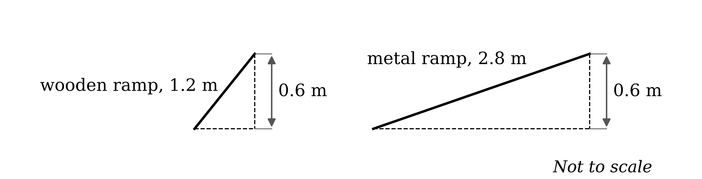
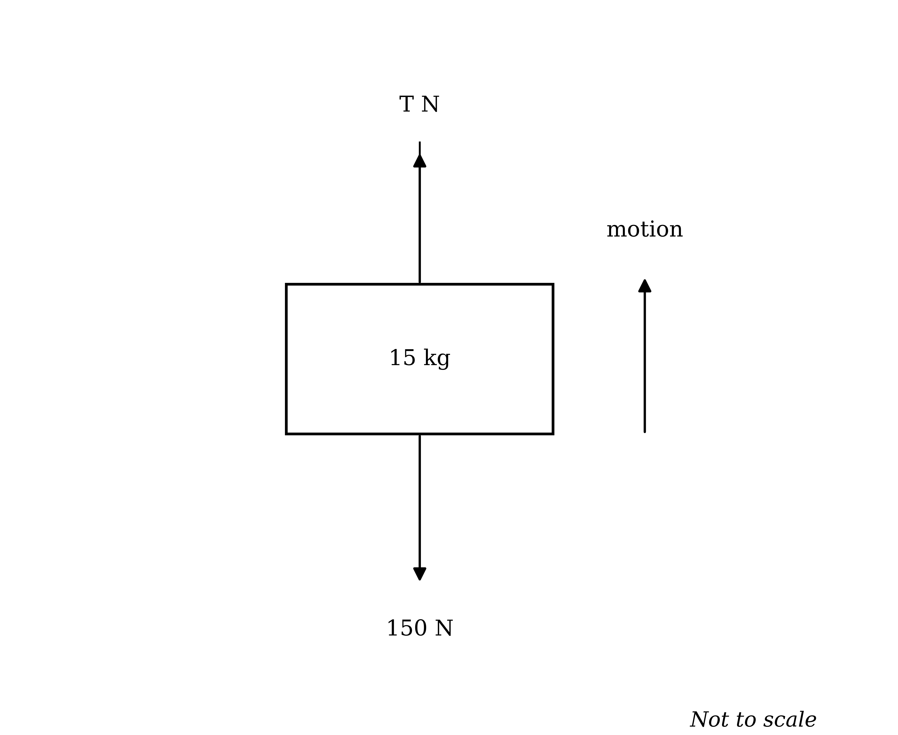

# Mark Schemes — Work & Energy
**Energy, Work & Power** · Cambridge (CIE) A-LEVEL maths (9709)

## Exam Questions (30 questions)

### Q1
The skydiver falls 100 m, so find the loss in gravitational potential energy using $m g h$

$\text{Loss in GPE} = 80 \times 10 \times 100 = 80000$

**[M1]**

Her speed goes from $v$ to $2 v$, so the gain in kinetic energy is the difference between the two values

`\text{Gain in KE} = \frac{1}{2}(80)\left(2v\right)^2 - \frac{1}{2}(80)v^2 = 120v^2`

**[M1]**

Air resistance is ignored, so mechanical energy is conserved and the two are equal

$120 v^{2} = 80000$

**[M1]**

**Final answer:** $v = 25 . 8$** (3 s.f.)**

**[A1]**

> **[mark-scheme]**
> **M1**: Correct use of $m g h$ with $m = 80$, $g = 10$ and $h = 100$. Using 4000 as the height does not earn this mark.
> 
> **M1**: Correct gain in kinetic energy as the difference between `\frac{1}{2}m\left(2v\right)^2` and $\frac{1}{2} m v^{2}$, giving $120 v^{2}$. Omitting the initial kinetic energy does not earn this mark.
> 
> **M1**: Correct use of conservation of mechanical energy, equating the two expressions.
> 
> **A1**: Answers which round to 25.8. A negative value is not accepted, since a speed was asked for.
The work done against the resistance is given in kilojoules, so convert it to joules before combining it with the other terms

$4 v \text{kJ} = 4000 v \text{J}$

**[M1]**

By the work-energy principle, the gain in kinetic energy is the loss in gravitational potential energy less the work done against the resistance

$120 v^{2} = 80000 - 4000 v$

**[M1]**

Collect all the terms on one side and divide through by 40

$3 v^{2} + 100 v - 2000 = 0$

**[M1]**

Solve the quadratic, rejecting the negative root because $v$ is a speed

$v = 14 . 065 \dots$* or *$v = - 47 . 398 \dots$

**Final answer:** $v = 14 . 1$** (3 s.f.)**

**[A1]**

> **[exam-tip]**
> The resistance is given in kilojoules while everything else is in joules, and that mismatch is the whole difficulty of this part. Convert $4 v$ kJ to $4000 v$ J before you write the energy equation, not afterwards.

> **[mark-scheme]**
> **M1**: Correct conversion of $4 v$ kJ to $4000 v$ J. Using $4 v$ directly in an equation whose other terms are in joules does not earn this mark.
> 
> **M1**: Correct use of the work-energy principle, with the gain in kinetic energy, the loss in gravitational potential energy and the work done against the resistance combined with the correct signs. Allow sign errors for this mark.
> 
> **M1**: Correct rearrangement to a three-term quadratic in $v$.
> 
> **A1**: Answers which round to 14.1, with the negative root rejected. Units are not required.

### Q2
Let $h$ be the vertical height of the slide. The gradients vary, so consider the overall energy change on each run rather than the forces at any one point

On the first run friction acts along the whole length $l$, so by the work-energy principle

$\frac{1}{2} ( 40 ) v_{1}^{2} = 40 g h - 30 l$

**[M1]**

$20 v_{1}^{2} = 400 h - 30 l$

**[A1]**

On the second run friction is negligible, so mechanical energy is conserved over the same height

$20 v_{2}^{2} = 400 h$

**[M1]**

The height is the same for both runs, so subtracting the first equation from the second removes it

`20\left(v_2^{\,2} - v_1^{\,2}\right) = 30l`

**[M1]**

Divide through by 20

$v_{2}^{2} - v_{1}^{2} = 1 . 5 l$

$k = 1 . 5$

**[B1]**

> **[mark-scheme]**
> **M1**: Correct use of the work-energy principle for the run with friction, with the gain in kinetic energy, the loss in gravitational potential energy and the work done against friction as $30 l$. Allow sign errors for this mark.
> 
> **A1**: Correct equation for the first run.
> 
> **M1**: Correct use of conservation of mechanical energy for the run with the mat, over the same height.
> 
> **M1**: Correct method subtracting the two equations to eliminate the height.
> 
> **B1**: The printed result reached from correct and complete working, with the value of $k$ stated as 1.5. The value of $k$ is required, since the question asks for it. Because the answer is given, the elimination of $h$ must be visible.
The run with the mat is frictionless, so its speed follows from the height alone

$20 v_{2}^{2} = 400 \times 25$

$v_{2}^{2} = 500$

**[M1]**

A 25% increase means $v_{2} = 1 . 25 v_{1}$, so square both sides to get the relationship between the squared speeds

$v_{2}^{2} = 1 . 5625 v_{1}^{2}   \Rightarrow   v_{1}^{2} = \frac{500}{1.5625} = 320$

**[M1]**

Substitute both squared speeds into the result from part (a)

$500 - 320 = 1 . 5 l$

**[M1]**

**Final answer:** $l = 120$** m**

**[A1]**

> **[mark-scheme]**
> **M1**: Correct value of $v_{2}^{2}$ from the frictionless run, using the vertical height of 25 m.
> 
> **M1**: Correct use of $v_{2} = 1 . 25 v_{1}$, squared to give $v_{2}^{2} = 1 . 5625 v_{1}^{2}$. Using $v_{2}^{2} = 1 . 25 v_{1}^{2}$ does not earn this mark.
> 
> **M1**: Correct substitution of both squared speeds into the result from part (a).
> 
> **A1**: Correct value of 120. Units are not required.

### Q3
Sketch the two ramps, which rise through the same height

The mixer starts and finishes at rest, so there is no change in kinetic energy. The energy Jason must supply is the gain in gravitational potential energy plus the work done against friction

Both ramps lift the mixer through the same height of 0.6 m, so the gain in potential energy is the same for each and cannot be what separates them

$\text{Gain in GPE} = 120 \times 10 \times 0 . 6 = 720$

**[B1]**

For a ramp of length $L$ at angle $θ$, friction is $μ \times 120 g \text{cos}  θ$ and it acts over the length $L$, so the work done against it is $μ \times 1200 \times L \text{cos}  θ$

$\text{Work done against friction} = 1200 μ L \text{cos}  θ$

**[M1]**

Now $L \text{cos}  θ$ is the horizontal distance covered by the ramp, which is found from the ramp length and the 0.6 m rise

$L \text{cos}  θ = \sqrt{L^{2}-0.6^{2}}$

**[M1]**

For the wooden ramp, with $L = 1 . 2$ and coefficient $μ$

$\text{Work done against friction} = 1200 μ \sqrt{1.2^{2}-0.6^{2}} = 1247 . 07 \dots μ$

**[A1]**

For the metal ramp, with $L = 2 . 8$ and coefficient $\frac{1}{2} μ$

$\text{Work done against friction} = 1200 \times \frac{1}{2} μ \times \sqrt{2.8^{2}-0.6^{2}} = 1640 . 97 \dots μ$

**[A1]**

Compare the two ramps, remembering that the gain in potential energy is the same for both

*The metal ramp is more than twice as long, and halving the coefficient does not make up for that, so it needs more work against friction*

**Final answer:** **The metal ramp requires more energy, so less energy is needed for the wooden ramp**

**[B1]**

> **[exam-tip]**
> You never need either angle in this question. The combination $L \text{cos}  θ$ that appears in the work done against friction is just the horizontal distance the mixer travels, and you can get that straight from Pythagoras.

> **[mark-scheme]**
> **B1**: Correct gain in gravitational potential energy of 720 J, identified as the same for both ramps.
> 
> **M1**: Correct expression for the work done against friction on a ramp, with $μ$ times the normal contact force $120 g \text{cos}  θ$ multiplied by the ramp length.
> 
> **M1**: Correct method for the horizontal distance, either as $\sqrt{L^{2}-0.6^{2}}$ or by finding the angle from $\text{sin}  θ = \frac{0.6}{L}$ and using $L \text{cos}  θ$.
> 
> **A1**: Correct work done against friction on the wooden ramp, $1247 μ$ or better.
> 
> **A1**: Correct work done against friction on the metal ramp, $1641 μ$ or better, with the coefficient halved. Failing to halve the coefficient does not earn this mark.
> 
> **B1**: A clear comparison of the two totals and the correct conclusion. Because the result is given, both friction values must be present and the comparison must be explicit.
The work Jason does supplies the gain in gravitational potential energy and the work done against friction, with no kinetic energy left over

`1850 equals 720 plus open parentheses 1247.07 horizontal ellipsis close parentheses mu`

**[M1 A1]**

Subtract the potential energy term and divide

$μ = \frac{1130}{1247.07\dots}$

**[M1]**

**Final answer:** $μ = 0 . 906$** (3 s.f.)**

**[A1]**

> **[mark-scheme]**
> **M1**: Correct use of the work-energy principle, with the work done by Jason equal to the gain in gravitational potential energy plus the work done against friction, and no change in kinetic energy.
> 
> **A1**: Correct equation, with 720 and the wooden ramp's friction expression from part (a).
> 
> **M1**: Correct rearrangement to make the coefficient the subject.
> 
> **A1**: Answers which round to 0.906.
Use the metal ramp's friction expression from part (a) with the coefficient found in part (b), then add the same gain in potential energy

$\text{Energy for the metal ramp} = 720 + 1640 . 97 \dots \times 0 . 906119 \dots = 2206 . 9 \dots$

**[M1]**

Subtract the 1850 J already known for the wooden ramp

**Final answer:** $\text{Difference} = 357$** J (3 s.f.)**

**[A1]**

> **[mark-scheme]**
> **M1**: Correct total energy for the metal ramp, using the coefficient from part (b) halved and the metal ramp's friction expression, plus the 720 J.
> 
> **A1**: Answers which round to 357. The unrounded coefficient must be used. Follow through on an incorrect coefficient from part (b).

### Q4
(i)

The rope pulls the sledge up the slope, so the tension acts along the rope at 30° to the direction of motion

The hill is smooth, so there is no friction. The remaining forces are the normal contact force perpendicular to the slope and the weight vertically downwards

**[B1 B1]**

(ii)

The rope is at 30° to the direction of motion, so only the component $120 \text{cos}  30 ^{\circ}$ acts along the slope. Multiply it by the 15 m travelled

$\text{Work done by the tension} = 120 \text{cos}  30 ^{\circ} \times 15 = 1558 . 845 \dots$

**[M1]**

**Final answer:** $\text{Work done by the tension} = 1560$** J (3 s.f.)**

**[A1]**

> **[mark-scheme]**
> **B1**: The tension marked on the diagram, acting along the rope at 30° to the direction of motion, with the angle shown.
> 
> **B1**: The normal contact force marked perpendicular to the slope and the weight marked vertically downwards. A frictional force does not earn this mark, since the hill is smooth.
> 
> **M1**: Correct component of the tension along the slope, $120 \text{cos}  30 ^{\circ}$, multiplied by 15. Resolving against the 10° instead does not earn this mark, because the 30° is measured from the direction of motion.
> 
> **A1**: Answers which round to 1560. Accept 1558.8 or better.
Use the formula for kinetic energy, $\text{KE} = \frac{1}{2} m v^{2}$, with the given energy and speed

$\frac{1}{2} \times m \times 4^{2} = 440$

**[M1]**

**Final answer:** $m = 55$** kg**

**[A1]**

> **[mark-scheme]**
> **M1**: Correct use of $\frac{1}{2} m v^{2}$ with $v = 4$, set equal to 440.
> 
> **A1**: Correct value of 55. Units are not required.
The sledge travels the same 15 m back down the line of greatest slope, so find the vertical height it drops through

$h = 15 \text{sin}  10 ^{\circ}$

**[M1]**

The hill is smooth and the sledge is released from rest, so mechanical energy is conserved and the gain in kinetic energy equals the loss in gravitational potential energy

$\frac{1}{2} m v^{2} = m g \times 15 \text{sin}  10 ^{\circ}$

**[M1]**

The mass appears on both sides, so it cancels out

$v^{2} = 2 \times 10 \times 15 \text{sin}  10 ^{\circ} = 52 . 094 \dots$

**Final answer:** $v = 7 . 22 \text{m s}^{-1}$** (3 s.f.)**

**[A1]**

> **[mark-scheme]**
> **M1**: Correct vertical height, resolved as $15 \text{sin}  10 ^{\circ}$. Using 15 as the height does not earn this mark. Allow a sine and cosine mix for this mark only.
> 
> **M1**: Correct use of conservation of mechanical energy, equating the gain in kinetic energy to the loss in gravitational potential energy, with the sledge starting from rest at $B$.
> 
> **A1**: Answers which round to 7.22. A negative value is not accepted, since a speed was asked for.
Conservation of mechanical energy credits the whole drop in potential energy to kinetic energy, so nothing must be resisting the sledge

**Final answer:** **There is no air resistance acting on the sledge**

**[B1]**

Treating the sledge and children as a single particle means every part of the system moves with the same speed, so no energy goes anywhere else

**Final answer:** **The sledge and the two children can be modelled as a single particle**

**[B1]**

> **[mark-scheme]**
> **B1**: One valid assumption which the energy method depends on. Accept air resistance being negligible, or no resistance to motion.
> 
> **B1**: A second, different valid assumption. Accept the system being modelled as a particle, the children not moving relative to the sledge, or the sledge remaining in contact with the slope throughout. Repeating the first assumption in different words does not earn this mark. The hill being smooth is given in the question and is not an assumption the student has made.

### Q5
Sketch the fall, marking the distance fallen to each beep

The balloon falls from rest, so at any point the kinetic energy gained equals the gravitational potential energy lost. The mass appears on both sides and cancels out

Let $h_{1}$ be the distance fallen when the first beep sounds, where the speed is $x$

$\frac{1}{2} x^{2} = g h_{1}   \Rightarrow   h_{1} = \frac{x^{2}}{2g}$

**[M1]**

The second beep sounds when the speed is $2 x$, so repeat with that speed

`\frac{1}{2}\left(2x\right)^2 = gh_2 \;\;\Rightarrow\;\; h_2 = \dfrac{2x^2}{g}`

**[M1]**

The distance between the beeps is the difference between the two distances fallen

$h_{2} - h_{1} = \frac{2x^{2}}{g} - \frac{x^{2}}{2g}$

**[M1]**

$\text{Distance between the beeps} = \frac{3x^{2}}{2g}$

**[A1]**

> **[mark-scheme]**
> **M1**: Correct use of conservation of mechanical energy for the first beep, equating $\frac{1}{2} m x^{2}$ to $m g h_{1}$, with the mass cancelled or carried.
> 
> **M1**: Correct corresponding equation for the second beep, with the speed $2 x$ squared correctly to give $4 x^{2}$. Using $2 x^{2}$ does not earn this mark.
> 
> **M1**: Correct method subtracting the two distances.
> 
> **A1**: Correct expression $\frac{3x^{2}}{2g}$. Accept any equivalent form.
(i)

The 30 m is measured from the drop point, so it is the distance fallen when the second beep sounds, which is $h_{2}$

$\frac{2x^{2}}{g} = 30$

**[M1]**

Substitute $g = 10$

$x^{2} = 150$

**[A1]**

**Final answer:** $x = 12 . 2$** (3 s.f.)**

**[A1]**

(ii)

The distance before the first beep is $h_{1}$, so use the expression from part (a) with the value of $x^{2}$ just found

$h_{1} = \frac{x^{2}}{2g} = \frac{150}{20}$

**[M1]**

**Final answer:** $h_{1} = 7 . 5$** m**

**[A1]**

> **[mark-scheme]**
> **M1**: Correct identification of the 30 m as the distance fallen to the second beep, equated to $\frac{2x^{2}}{g}$. Equating 30 to the answer to part (a) does not earn this mark, because that is the gap between the beeps rather than the distance from the drop point.
> 
> **A1**: Correct value of 150 for $x^{2}$.
> 
> **A1**: Answers which round to 12.2. Accept the exact form $5 \sqrt{6}$.
> 
> **M1**: Correct method for the distance to the first beep, using $\frac{x^{2}}{2g}$ or equivalent. Subtracting the answer to part (a) from 30 is equally acceptable.
> 
> **A1**: Correct value of 7.5. Units are not required.
Conservation of mechanical energy credits the whole loss in potential energy to kinetic energy, so nothing must be resisting the fall

**Final answer:** **There is no air resistance acting on the balloon**

**[B1]**

Treating the balloon as a particle means all of its mass falls through the same distance, so no energy goes into anything else

**Final answer:** **The balloon can be modelled as a particle**

**[B1]**

> **[mark-scheme]**
> **B1**: One valid assumption which the energy method depends on. Accept air resistance being negligible, or no resistance to motion.
> 
> **B1**: A second, different valid assumption. Accept the balloon being modelled as a particle, the balloon not changing shape or losing water as it falls, or the value of $g$ being constant over the fall. Repeating the first assumption in different words does not earn this mark.

### Q6
Let the combined mass be $m$ kg and draw a force diagram for the car on the slope

The resistance is given in terms of the normal contact force, so find that first by resolving perpendicular to the slope

Since $\text{sin}  α = \frac{3}{5}$, the triangle is a 3-4-5 triangle and $\text{cos}  α = \frac{4}{5}$ exactly

$R = 10 m \text{cos}  α = 10 m \times \frac{4}{5} = 8 m$

**[M1]**

Now write the resistance in terms of $m$

$\text{Resistance} = 0 . 115 \times 8 m = 0 . 92 m$

**[A1]**

The car travels at constant speed, so there is no acceleration and the driving force balances both the resistance and the component of the weight along the slope

$\text{Driving force} = 10 m \text{sin}  α + 0 . 92 m = 10 m \times \frac{3}{5} + 0 . 92 m$

**[M1]**

$\text{Driving force} = 6 . 92 m$

**[A1]**

The distance is 1 km, so convert it to metres and use work done $=$ force $\times$ distance

$6 . 92 m \times 1000 = 5250000$

**[M1]**

$m = 758 . 6705 \dots$

**Final answer:** $m = 759$** kg (3 s.f.)**

**[A1]**

> **[mark-scheme]**
> **M1**: Correct resolution perpendicular to the slope to find the normal contact force, with $\text{cos}  α = \frac{4}{5}$. Allow a sine and cosine mix for this mark only.
> 
> **A1**: Correct resistance in terms of the mass, $0 . 92 m$. Using $0 . 115$ times the weight instead of the normal contact force does not earn this mark.
> 
> **M1**: Correct use of constant speed, with the driving force equal to the sum of the resistance and the component of the weight along the slope, all three terms present. Allow sign errors for this mark.
> 
> **A1**: Correct driving force in terms of the mass, $6 . 92 m$.
> 
> **M1**: Correct use of work done $=$ force $\times$ distance, with the distance converted to 1000 m and the work converted to 5250000 J. Using 1 or 5250 does not earn this mark.
> 
> **A1**: Answers which round to 759.
The braking force is not constant, so it cannot be used in Newton's second law. Work with energy instead, where only the total work done matters

The car comes to rest, so it loses the whole of its kinetic energy

$\text{Loss in KE} = \frac{1}{2} ( 758 . 6705 \dots ) ( 12^{2} ) = 54624 . 2 \dots$

**[M1]**

The car is still moving up the hill, so it also gains gravitational potential energy over a distance $d$ along the slope

$\text{Gain in GPE} = 758 . 6705 \dots \times 10 \times d \text{sin}  α = 758 . 6705 \dots \times 10 \times \frac{3}{5} d$

**[M1]**

By the work-energy principle, the kinetic energy lost supplies both the gain in potential energy and the work done against the resistance and brakes

$54624 . 2 \dots = 21400 + 4552 . 02 \dots d$

**[M1]**

**Final answer:** $d = 7 . 30$** m (3 s.f.)**

**[A1]**

> **[exam-tip]**
> The phrase "cannot be assumed to be constant" rules out Newton's second law and the constant-acceleration formulae, because there is no single value of the braking force to use. Energy methods only need the total work done, which the question gives you.

> **[mark-scheme]**
> **M1**: Correct loss in kinetic energy, using the mass from part (a) and $v = 12$, with the final speed taken as zero. Follow through on the mass.
> 
> **M1**: Correct gain in gravitational potential energy, with the vertical height resolved as $d \text{sin}  α = \frac{3}{5} d$. Using $d$ as the height does not earn this mark.
> 
> **M1**: Correct use of the work-energy principle, combining the loss in kinetic energy, the gain in gravitational potential energy and the 21400 J with the correct signs. Allow sign errors for this mark.
> 
> **A1**: Answers which round to 7.30. The unrounded mass from part (a) must be used.

### Q7
The string is inextensible, so when $B$ falls 1.3 m, $A$ moves 1.3 m up the plane. $B$ loses potential energy while $A$ gains it, so the net loss is the difference

$A$ moves along the slope, so its rise is the resolved vertical height

$\text{Rise of} A = 1 . 3 \text{sin}  α = 1 . 3 \times 0 . 6 = 0 . 78$

**[M1]**

Now write the net loss in terms of $m$

$\text{Net loss in GPE} = 3 m ( 10 ) ( 1 . 3 ) - m ( 10 ) ( 0 . 78 )$

**[M1]**

$31 . 2 m = 12 . 48$

**[A1]**

$m = 0 . 4$

**[A1]**

> **[mark-scheme]**
> **M1**: Correct rise of $A$, resolved as $1 . 3 \text{sin}  α$. Using 1.3 as the rise does not earn this mark.
> 
> **M1**: Correct net loss in gravitational potential energy, with the gain by $A$ subtracted from the loss by $B$, using masses $m$ and $3 m$. Allow sign errors for this mark.
> 
> **A1**: Correct equation $31 . 2 m = 12 . 48$ or equivalent.
> 
> **A1**: Correct value of 0.4.

(i)

Let $v$ be the speed when $B$ hits the ground and $F$ the frictional force. The string is inextensible, so both loads always move at the same speed and the kinetic energy uses the combined mass $4 m = 1 . 6$ kg

For the whole 1.3 m of motion, the work-energy principle gives

$12 . 48 - \frac{1}{2} ( 1 . 6 ) v^{2} = 1 . 3 F$

**[M1]**

When $B$ is 1 m above the ground the loads have moved 0.3 m, so repeat the calculation over that shorter distance, where the speed is $v - 2$. First find how far $A$ rises as it moves 0.3 m up the slope

$\text{Rise of} A = 0 . 3 \text{sin}  α = 0 . 3 \times 0 . 6 = 0 . 18$

Now find the net loss in gravitational potential energy over the 0.3 m, with $m = 0 . 4$

$\text{Net loss in GPE} = 3 ( 0 . 4 ) ( 10 ) ( 0 . 3 ) - 0 . 4 ( 10 ) ( 0 . 18 ) = 2 . 88$

`2.88 - \frac{1}{2}(1.6)\left(v - 2\right)^2 = 0.3F`

**[M1]**

Eliminate $F$ by scaling the first equation by 3 and the second by 13, then subtracting

`10.4\left(v - 2\right)^2 - 2.4v^2 = 0`

**[M1]**

$8 v^{2} - 41 . 6 v + 41 . 6 = 0$

Solve the quadratic

$v = 3 . 848 \dots$* or *$v = 1 . 351 \dots$

The earlier speed is $v - 2$, which must be positive, so $v$ has to be greater than 2 and the smaller root is rejected

**Final answer:** $v = 3 . 85 \text{m s}^{-1}$** (3 s.f.)**

**[A1]**

(ii)

Substitute the unrounded speed back into the equation for the whole 1.3 m

`1.3F = 12.48 - 0.8\left(3.848…\right)^2 = 0.62816…`

**[M1]**

**Final answer:** $F = 0 . 483$** N (3 s.f.)**

**[A1]**

> **[exam-tip]**
> Two unknowns need two equations, and the second one comes from applying the same work-energy argument over a shorter stretch of the motion. The friction term scales with the distance travelled, which is what lets you eliminate it.

> **[mark-scheme]**
> **M1**: Correct work-energy equation over the full 1.3 m, with the net loss in gravitational potential energy of 12.48 J, the gain in kinetic energy using the combined mass of 1.6 kg, and the work done against friction as $1 . 3 F$. Allow sign errors for this mark.
> 
> **M1**: Correct second work-energy equation over 0.3 m, with the net loss in gravitational potential energy recomputed as 2.88 J and the speed written as $v - 2$.
> 
> **M1**: Correct elimination of $F$ between the two equations, reaching a quadratic in $v$.
> 
> **A1**: Answers which round to 3.85, with the smaller root rejected.
> 
> **M1**: Correct substitution of the speed back into either equation to find the frictional force.
> 
> **A1**: Answers which round to 0.483. The unrounded speed must be used.

### Q8
Convert the mass to kilograms

$140  \text{g} = 0 . 14  \text{kg}$

The table is horizontal, so there is no change in gravitational potential energy and friction accounts for the whole loss in kinetic energy

`\text{Loss in KE} = \frac{1}{2} \times 0 . 14 \times \left(2 . 2^{2} - 1 . 8^{2}\right) = 0 . 112`

**[M1]**

That energy is the work done against friction over the 1.5 m, so divide to find the frictional force

$F = \frac{0.112}{1.5} = 0 . 0746666 \dots$

**[M1]**

The surface is horizontal, so the normal contact force is the whole weight. Divide the frictional force by it to find the coefficient

$μ = \frac{0.0746666\dots}{0.14\times10}$

**Final answer:** $μ = 0 . 0533$** (3 s.f.)**

**[A1]**

> **[mark-scheme]**
> **M1**: Correct loss in kinetic energy, with both speeds used. Using the mass as 140 in place of 0.14 is an error in units, which does not lose this mark.
> 
> **M1**: Correct method for the frictional force, dividing the loss in kinetic energy by the distance of 1.5 m.
> 
> **A1**: Answers which round to 0.0533. The unrounded frictional force must be used, and the same value of the mass must be used in the kinetic energy and in the normal contact force. The mass cancels, so using 140 consistently in both also gives 0.0533.
The ball is brought to rest, so the cushion must absorb the whole of its kinetic energy

$\text{KE} = \frac{1}{2} \times 0 . 14 \times 8^{2} = 4 . 48$

**[M1]**

The resistive force is constant, so use work done $=$ force $\times$ distance and solve for the distance the ball penetrates

$4 . 48 = 1300 \times d$

**[M1]**

$d = 0 . 00344615 \dots  \text{m}$

The answer is asked for in centimetres, so multiply by 100

**Final answer:** $d = 0 . 345$** cm (3 s.f.)**

**[A1]**

> **[mark-scheme]**
> **M1**: Correct kinetic energy of the ball, with $v = 8$. Using the mass as 140 in place of 0.14 is an error in units, which does not lose this mark.
> 
> **M1**: Correct use of work done $=$ force $\times$ distance, equating the kinetic energy to $1300 d$.
> 
> **A1**: Answers which round to 0.345 cm. An answer of 0.00345 m without the conversion to centimetres does not earn this mark, because the question asks for centimetres.

### Q9
A diagram of the two phases makes clear that the forces differ between them

The normal contact force is not the same on the two sections, so find each one separately. On the slope the weight is resolved perpendicular to it, while on the flat the whole weight is supported

$R_{1} = 0 . 6 g \text{cos}  17 ^{\circ}$

$R_{2} = 0 . 6 g$

**[M1]**

Friction is $μ R$ on each section, so add the work done against it over the 25 m and the 14 m

$\text{Work done against friction} = 25 μ ( 0 . 6 g \text{cos}  17 ^{\circ} ) + 14 μ ( 0 . 6 g )$

**[M1]**

The package falls through a vertical height of $25 \text{sin}  17 ^{\circ}$, so find the loss in gravitational potential energy

$\text{Loss in GPE} = 0 . 6 g ( 25 \text{sin}  17 ^{\circ} )$

**[M1]**

The package starts and finishes at rest, so there is no change in kinetic energy overall and friction has removed the whole of the potential energy

$15 μ g \text{cos}  17 ^{\circ} + 8 . 4 μ g = 15 g \text{sin}  17 ^{\circ}$

**[M1]**

Every term contains $0 . 6 g$, so the mass and $g$ cancel out

$μ = \frac{15\text{sin}17^{\circ}}{15\text{cos}17^{\circ}+8.4} = 0 . 192818 \dots$

**Final answer:** $μ = 0 . 193$** (3 s.f.)**

**[A1]**

> **[mark-scheme]**
> **M1**: Both normal contact forces found correctly, $0 . 6 g \text{cos}  17 ^{\circ}$ on the slope and $0 . 6 g$ on the horizontal section. Using the same value on both sections does not earn this mark.
> 
> **M1**: Correct total work done against friction, with $μ R$ multiplied by the correct distance on each of the two sections and the results added.
> 
> **M1**: Correct loss in gravitational potential energy, with the vertical height resolved as $25 \text{sin}  17 ^{\circ}$. Using 25 as the height does not earn this mark.
> 
> **M1**: Correct use of the work-energy principle, equating the work done against friction to the loss in gravitational potential energy, with the change in kinetic energy taken as zero.
> 
> **A1**: Answers which round to 0.193.
The package speeds up all the way down the slope and slows down along the flat, so it is moving fastest at the foot of the slope

Apply the work-energy principle over the slope alone, where the package starts from rest

$\frac{1}{2} ( 0 . 6 ) v^{2} = 0 . 6 ( 10 ) ( 25 \text{sin}  17 ^{\circ} ) - 0 . 192818 \dots ( 0 . 6 ) ( 10 ) ( 25 \text{cos}  17 ^{\circ} )$

**[M1]**

$v^{2} = 53 . 989 \dots$

**Final answer:** $v = 7 . 35 \text{m s}^{-1}$** (3 s.f.)**

**[A1]**

> **[mark-scheme]**
> **M1**: Correct use of the work-energy principle over the slope only, with the loss in gravitational potential energy, the work done against friction on the slope and the gain in kinetic energy. Applying it over the whole journey does not earn this mark, since the package is at rest at the end. Resolving forces and using $v^{2} = u^{2} + 2 a s$ over the slope is equally acceptable.
> 
> **A1**: Answers which round to 7.35. The unrounded coefficient of friction must be used. A negative value is not accepted, since a speed was asked for.

### Q10
The acceleration is constant, and the distance, time and acceleration are all known, so use $s = u t + \frac{1}{2} a t^{2}$ with $s = 7$, $t = 2$ and $a = 2$

$7 = 2 u + \frac{1}{2} \times 2 \times 2^{2}$

$u = 1 . 5 \text{m s}^{-1}$

**[B1]**

Now use $v = u + a t$ over the same 2 seconds to reach the second marker

$v = 1 . 5 + 2 \times 2$

$v = 5 . 5 \text{m s}^{-1}$

**[B1]**

> **[mark-scheme]**
> **B1**: The printed speed of 1.5 reached from correct working, with $s = u t + \frac{1}{2} a t^{2}$ and the values 7, 2 and 2 substituted. Because the answer is given, the substitution must be visible.
> 
> **B1**: Correct second speed of 5.5. Accept any correct method, including $v^{2} = u^{2} + 2 a s$ or the average-velocity route.
> 
> The two answers are marked independently.
(i)

The frictional force is constant and acts along the slope, so use work done $=$ force $\times$ distance over the 7 m between the markers

$84 = F \times 7$

**[M1]**

**Final answer:** $F = 12$** N**

**[A1]**

(ii)

A diagram makes the directions unambiguous before any equation is written

The box is accelerating, so apply Newton's second law along the slope, taking the direction of motion as positive. The weight has component $4 g \text{sin}  α$ down the slope and friction acts up it

$4 \times 10 \times \text{sin}  α - 12 = 4 \times 2$

**[M1]**

$\text{sin}  α = 0 . 5$

$α = 30$

**[A1]**

(iii)

Only the component of the weight along the slope does work, and the box moves 7 m in that direction

$\text{Work done by gravity} = ( 4 \times 10 \times \text{sin}  30 ^{\circ} ) \times 7$

**Final answer:** $\text{Work done by gravity} = 140$** J**

**[B1]**

> **[exam-tip]**
> You can check the last two answers against each other for free. Gravity puts 140 J in and friction takes 84 J out, so the box should gain $140 - 84 = 56$ J of kinetic energy. Sure enough, $\frac{1}{2} ( 4 ) ( 5 . 5^{2} - 1 . 5^{2} ) = 56$ J, which confirms the angle and the frictional force in one line.

> **[mark-scheme]**
> **M1**: Correct use of work done $=$ force $\times$ distance, with 84 J and the distance of 7 m.
> 
> **A1**: Correct value of 12.
> 
> **M1**: Correct use of Newton's second law along the slope, with all three relevant terms present. Allow sign errors, and allow a sine and cosine mix, for this mark only.
> 
> **A1**: Correct value of 30. Answers which round to 30.0 are acceptable.
> 
> **B1**: Correct value of 140, from the component of the weight along the slope multiplied by 7. Follow through on an incorrect angle. Units are not required.

### Q11
(i)

The diver falls 20 m, so find the loss in gravitational potential energy using $m g h$

$\text{Loss in GPE} = 50 \times 10 \times 20 = 10000$

**[M1]**

Her speed goes from $v$ to $3 v$, so find the gain in kinetic energy as the difference of the two values

`\text{Gain in KE} = \frac{1}{2}(50)\left(3v\right)^2 - \frac{1}{2}(50)v^2 = 200v^2`

**[M1]**

Air resistance is ignored, so mechanical energy is conserved and the two are equal

$200 v^{2} = 10000$

**[M1]**

**Final answer:** $v = 7 . 07$** (3 s.f.)**

**[A1]**

(ii)

With air resistance ignored, the weight is the only force acting, so the diver is in free fall and her acceleration is $g$

**Final answer:** $a = 10 \text{m s}^{-2}$** downwards**

**[B1]**

> **[mark-scheme]**
> **M1**: Correct use of $m g h$ with $m = 50$, $g = 10$ and $h = 20$. Carrying the mass as $m$ throughout is acceptable.
> 
> **M1**: Correct gain in kinetic energy as the difference between `\frac{1}{2}m\left(3v\right)^2` and $\frac{1}{2} m v^{2}$. Omitting the initial kinetic energy does not earn this mark.
> 
> **M1**: Correct use of conservation of mechanical energy, equating the two expressions.
> 
> **A1**: Answers which round to 7.07. Accept the exact form $\sqrt{50}$ or $5 \sqrt{2}$.
> 
> **B1**: Correct acceleration of 10, with the downward direction indicated. Accept $g$.
The acceleration is smaller than $g$, so a resistance force must be acting upwards. Apply Newton's second law vertically, taking downwards as positive, with the weight and the resistance as the two forces

$50 \times 10 - R = 50 \times 9 . 6$

**[M1]**

**Final answer:** $R = 20$** N**

**[A1]**

> **[mark-scheme]**
> **M1**: Correct use of Newton's second law vertically with all three relevant terms present: the weight, the resistance and the mass times acceleration. Allow sign errors for this mark.
> 
> **A1**: Correct value of 20. A negative value does not earn this mark, since a magnitude was asked for. Units are not required.

### Q12
(i)

The 8 m is measured along the slope, so resolve it to find the vertical height gained

$h = 8 \text{sin}  15 ^{\circ}$

**[M1]**

Use work done against gravity $= m g h$ with $m = 9$ and $g = 10$

$\text{Work done against gravity} = 9 \times 10 \times 8 \text{sin}  15 ^{\circ} = 186 . 3497 \dots$

**[M1]**

**Final answer:** $\text{Work done against gravity} = 186$** J (3 s.f.)**

**[A1]**

(ii)

Friction is constant and acts along the slope over the whole 8 m

**Final answer:** $\text{Work done against friction} = 15 \times 8 = 120$** J**

**[B1]**

(iii)

Sketch the push and resolve it along the slope and perpendicular to the slope

The lawnmower moves along the slope, so only the component along the slope, $80 \text{cos}  60 ^{\circ}$, does work. The perpendicular component does no work, because there is no motion in that direction

$\text{Work done by the 80 N force} = 80 \text{cos}  60 ^{\circ} \times 8$

**[M1]**

**Final answer:** $\text{Work done by the 80 N force} = 320$** J**

**[A1]**

> **[exam-tip]**
> Check carefully which line each angle is measured from. The 60° here is measured from the slope, not from the horizontal, so the useful component of the push is $80 \text{cos}  60 ^{\circ}$ and the 15° plays no part in sub-part (iii) at all.

> **[mark-scheme]**
> **M1**: Correct vertical height, resolved as $8 \text{sin}  15 ^{\circ}$. Using 8 as the height does not earn this mark. Allow a sine and cosine mix for this mark only.
> 
> **M1**: Correct use of $m g h$ with $m = 9$ and $g = 10$.
> 
> **A1**: Answers which round to 186.
> 
> **B1**: Correct value of 120.
> 
> **M1**: Correct component of the 80 N force along the slope, $80 \text{cos}  60 ^{\circ}$, multiplied by 8. Resolving against the 15° instead does not earn this mark, because the angle is measured from the slope.
> 
> **A1**: Correct value of 320.
By the work-energy principle, the gain in kinetic energy is the work done by the push less the work done against gravity and against friction

$\frac{1}{2} \times 9 \times v^{2} = 320 - 186 . 3497 \dots - 120$

**[M1]**

The lawnmower starts from rest, so this is the whole of its kinetic energy

$4 . 5 v^{2} = 13 . 6502 \dots$

**[M1]**

**Final answer:** $v = 1 . 74 \text{m s}^{-1}$** (3 s.f.)**

**[A1]**

> **[mark-scheme]**
> **M1**: Correct use of the work-energy principle, with all three work terms from part (a) combined with the correct signs and equated to the gain in kinetic energy. Allow sign errors for this mark.
> 
> **M1**: Correct kinetic energy expression $\frac{1}{2} ( 9 ) v^{2}$, with the initial speed taken as zero.
> 
> **A1**: Answers which round to 1.74. The unrounded work done against gravity must be used; using the rounded 186 gives 1.76 and does not earn this mark. Follow through on incorrect values from part (a).

### Q13
The load starts from rest, so the gain in kinetic energy is the whole of the final kinetic energy

$\text{Gain in KE} = \frac{1}{2} \times 250 \times 1 . 2^{2}$

**[M1]**

$\text{Gain in KE} = 180$

The tension is the only force doing work apart from gravity, so by the work-energy principle the work it does supplies both the gain in potential energy and the gain in kinetic energy

$\text{Work done by the tension} = 10000 + 180$

**[M1]**

**Final answer:** $\text{Work done by the tension} = 10180$** J**

**[A1]**

The tension acts over the height the load rises, which is not given directly, so recover it from the gain in gravitational potential energy using $m g h$ with $g = 10$

$250 \times 10 \times h = 10000$

$h = 4$

**[M1]**

The cable is light and the pulley smooth, so the tension is constant along the cable. Use work done $=$ force $\times$ distance over that height

$10180 = T \times 4$

**[M1]**

**Final answer:** $T = 2545$** N**

**[A1]**

> **[mark-scheme]**
> **M1**: Correct use of $\frac{1}{2} m v^{2}$ with $m = 250$ and $v = 1 . 2$, with the initial speed taken as zero.
> 
> **M1**: Correct use of the work-energy principle, adding the gain in kinetic energy to the gain in gravitational potential energy of 10000 J. Working in kilojoules throughout is acceptable.
> 
> **A1**: Correct value of 10180. Accept 10.18 kJ.
> 
> **M1**: Correct method for the height, using $m g h = 10000$ with $m = 250$ and $g = 10$.
> 
> **M1**: Correct use of work done $=$ force $\times$ distance, with the work done by the tension and the height found.
> 
> **A1**: Correct value of 2545. Units are not required.

### Q14
The velocity is constant, so there is no acceleration in any direction and the forces balance both horizontally and vertically

Horizontally, the air resistance must match the driving force

$\text{Air resistance} = 2000 \text{N}$

Vertically, the lift must match the weight, which is $150 \times 10$

$\text{Lift} = 1500 \text{N}$

**[B1 B1]**

> **[mark-scheme]**
> **B1**: All four forces marked on the diagram in the correct directions: driving force forwards, air resistance backwards, lift upwards and weight downwards.
> 
> **B1**: Both magnitudes correct, with the air resistance 2000 N and the lift 1500 N, obtained from the velocity being constant. Accept $150 g$ for the lift.
The velocity is constant, so find the distance travelled from speed $\times$ time

$\text{Distance} = 200 \times 10 = 2000 \text{m}$

The driving force acts along the direction of motion over that distance, so use work done $=$ force $\times$ distance

**Final answer:** $\text{Work done by the driving force} = 4 \times 10^{6}$** J**

**[B1]**

Air resistance has the same magnitude but acts backwards, so it does the same amount of work against the motion

**Final answer:** $\text{Work done against air resistance} = 4 \times 10^{6}$** J**

**[B1]**

The lift and the weight are both vertical while the displacement is horizontal, so in $W = F d \text{cos}  θ$ the angle is 90° and the cosine is zero

$\text{Work done by the lift} = 0$

$\text{Work done by the weight} = 0$

**[B1]**

> **[mark-scheme]**
> **B1**: Correct work done by the driving force, $4 \times 10^{6}$ J, using a distance of 2000 m. Accept 4000000.
> 
> **B1**: Correct work done against air resistance, $4 \times 10^{6}$ J. Accept a negative value if the sign convention is stated.
> 
> **B1**: Both the lift and the weight identified as doing zero work. Both are needed for this mark, since they rest on the same reason.
The spaceship slows from 200 $\text{m s}^{-1}$ to 150 $\text{m s}^{-1}$, so find the change in kinetic energy

`\text{Change in KE} = \frac{1}{2} \times 150 \times \left(150^2 - 200^2\right)`

**[M1]**

$\text{Change in KE} = - 1312500$

**[A1]**

The flight is still horizontal, so there is no change in gravitational potential energy. By the work-energy principle, the work done by the driving force less the work done against the resistance is the change in kinetic energy

$1800 d - 1852500 = - 1312500$

**[M1]**

**Final answer:** $d = 300$** m**

**[A1]**

> **[mark-scheme]**
> **M1**: Correct use of $\frac{1}{2} m v^{2} - \frac{1}{2} m u^{2}$ with $m = 150$, $v = 150$ and $u = 200$.
> 
> **A1**: Correct value of $- 1312500$. Accept 1312500 described as a loss.
> 
> **M1**: Correct use of the work-energy principle, with the work done by the 1800 N driving force over a distance $d$, the 1852500 J of work done against the resistance, and the change in kinetic energy, combined with the correct signs. Allow sign errors for this mark.
> 
> **A1**: Correct value of 300. Units are not required.

### Q15
The surface is horizontal, so there is no change in gravitational potential energy and the only change in mechanical energy is the change in kinetic energy

By the work-energy principle, the work done by the force equals that change

$\text{Work done} = \frac{1}{2} m v^{2} - \frac{1}{2} m u^{2}$

**[M1]**

Take out the common factor of $\frac{1}{2} m$

`\text{Work done} = \frac{1}{2} m \left(v^{2} - u^{2}\right)`

**[B1]**

> **[mark-scheme]**
> **M1**: Correct use of the work-energy principle, writing the work done as the difference between the final and initial kinetic energies.
> 
> **B1**: The printed result reached from correct and complete working, with the factorisation shown. Because the answer is given, the difference of the two kinetic energies must be visible before the factorised form.
(i)

The force is constant and acts along the direction of motion over 20 m, so use work done $=$ force $\times$ distance with the work done from part (a)

$250 = F \times 20$

**[M1]**

**Final answer:** $F = 12 . 5$** N**

**[A1]**

(ii)

This is the only force acting along the direction of motion, so it is the resultant force. Apply Newton's second law

$12 . 5 = m a$

$a = \frac{12.5}{m}$

**[B1]**

> **[mark-scheme]**
> **M1**: Correct use of work done $=$ force $\times$ distance, with the gain in kinetic energy of 250 J and the distance of 20 m.
> 
> **A1**: Correct value of 12.5. Units are not required.
> 
> **B1**: Correct expression for the acceleration. Accept $\frac{12.5}{m}$ or $\frac{25}{2m}$. Follow through on an incorrect force from sub-part (i).

### Q16
Nothing resists the motion, so mechanical energy is conserved between $P$ and $Q$ and the gain in kinetic energy equals the loss in gravitational potential energy

$\frac{1}{2} m v^{2} - \frac{1}{2} m ( 2^{2} ) = m g \times 4$

**[M1]**

Every term has a factor of $m$, so divide through by $m$ and substitute $g = 10$

$v^{2} = 4 + 2 \times 10 \times 4 = 84$

**[M1]**

**Final answer:** $v = 9 . 17 \text{m s}^{-1}$** (3 s.f.)**

**[A1]**

> **[exam-tip]**
> The mass of the skateboarder is not given in this part, and it does not need to be, because it appears in every energy term and cancels out.

> **[mark-scheme]**
> **M1**: Correct use of conservation of mechanical energy, equating the gain in kinetic energy to the loss in gravitational potential energy. Allow the mass to be carried as $m$ throughout.
> 
> **M1**: Correct substitution of $g = 10$ and the height of 4 m, with the initial speed of 2 included.
> 
> **A1**: Answers which round to 9.17. Accept the exact form $\sqrt{84}$ or $2 \sqrt{21}$. A negative value is not accepted, since a speed was asked for.
The mass is now known, so find the loss in gravitational potential energy from $m g h$ with $m = 60$ and $g = 10$

$\text{Loss in GPE} = 60 \times 10 \times 4 = 2400$

The 333 J is the mechanical energy lost, so it is the shortfall between that and the gain in kinetic energy

$2400 - \frac{1}{2} ( 60 ) ( v^{2} - 2^{2} ) = 333$

**[M1]**

Rearrange to isolate the bracket

$30 ( v^{2} - 4 ) = 2067$

**[M1]**

Divide by 30, then add 4

$v^{2} = 72 . 9$

**Final answer:** $v = 8 . 54 \text{m s}^{-1}$** (3 s.f.)**

**[A1]**

> **[mark-scheme]**
> **M1**: Correct use of the work-energy principle, with the loss in gravitational potential energy, the gain in kinetic energy and the 333 J combined with the correct signs. Allow sign errors for this mark.
> 
> **M1**: Correct rearrangement to an equation in $v^{2}$, with the initial speed of 2 retained.
> 
> **A1**: Answers which round to 8.54. A negative value is not accepted, since a speed was asked for.

### Q17
The course has varying gradients, so consider the overall energy change between the top and the bottom rather than the forces at any one point

The team falls through a vertical height of 35 m, so use loss in gravitational potential energy $= m g h$ with $g = 10$

$\text{Loss in GPE} = 100 \times 10 \times 35 = 35000$

**[M1]**

Friction acts along the whole 400 m of the course, so use work done $=$ force $\times$ distance with that length

$\text{Work done against friction} = 8 \times 400 = 3200$

**[M1]**

By the work-energy principle, the kinetic energy gained is what is left of the potential energy after friction has taken its share

$\frac{1}{2} \times 100 \times v^{2} = 35000 - 3200$

**[M1]**

The team starts from rest, so this is the whole of the final kinetic energy

$v^{2} = 636$

**[A1]**

**Final answer:** $v = 25 . 2 \text{m s}^{-1}$** (3 s.f.)**

**[A1]**

> **[exam-tip]**
> The question gives you two lengths and they are not interchangeable. The 35 m is the vertical drop, so it is the one that goes into $m g h$; the 400 m is the distance the sled actually slides, so it is the one that goes into the work done against friction. Putting them the wrong way round is the most common way to lose every mark here.

> **[mark-scheme]**
> **M1**: Correct use of $m g h$ with $m = 100$, $g = 10$ and the vertical height of 35 m. Using 400 as the height does not earn this mark.
> 
> **M1**: Correct use of work done $=$ force $\times$ distance, with the frictional force of 8 N and the course length of 400 m. Using 35 as the distance does not earn this mark.
> 
> **M1**: Correct use of the work-energy principle, equating the gain in kinetic energy to the loss in gravitational potential energy less the work done against friction. Allow sign errors for this mark.
> 
> **A1**: Correct value of 636 for the square of the speed.
> 
> **A1**: Answers which round to 25.2. A negative value is not accepted, since a speed was asked for.

### Q18
(i)

The road pushes up on the bus at right angles to it, and the weight acts vertically downwards

The bus is slowing down, so the braking force acts backwards, opposing the motion

**[B1 B1]**

(ii)

The bus comes to rest, so the whole of its kinetic energy is lost. Use $\text{KE} = \frac{1}{2} m v^{2}$ with $m = 9000$ and $v = 15$

$\text{Decrease in KE} = \frac{1}{2} \times 9000 \times 15^{2}$

**[M1]**

$\text{Decrease in KE} = 1012500$

The printed value is in kilojoules, so divide by 1000

**Final answer:** $\text{Decrease in KE} = 1012 . 5$** kJ**

**[B1]**

(iii)

The resultant force is the only force doing work along the road, so by the work-energy principle the work it does over 38 m equals the kinetic energy lost

$F \times 38 = 1012500$

**[M1]**

**Final answer:** $F = 26600$** N (3 s.f.)**

**[A1]**

> **[mark-scheme]**
> **B1**: The normal contact force marked vertically upwards and the weight marked vertically downwards.
> 
> **B1**: The braking force marked, acting horizontally backwards and opposing the motion. A driving force acting forwards does not earn this mark, since the bus is braking.
> 
> **M1**: Correct use of $\frac{1}{2} m v^{2}$ with $m = 9000$ and $v = 15$.
> 
> **B1**: The printed result reached from exact working, including the conversion from 1012500 J to 1012.5 kJ. Because the answer is given, the substitution must be visible.
> 
> **M1**: Correct use of the work-energy principle, equating the work done by the resultant force over 38 m to the kinetic energy lost.
> 
> **A1**: Answers which round to 26600. Accept 26644 or 26645.
(i)

The bus starts from rest and reaches the same speed as before, so by the work-energy principle the net work done over the 300 m equals the kinetic energy found in part (a)

$( D - 206 ) \times 300 = 1012500$

**[M1]**

Divide by 300, then add 206

$D - 206 = 3375$

**Final answer:** $D = 3581$** N**

**[A1]**

(ii)

Multiplying the force by the distance is only valid if the force does not change over that distance

**Final answer:** **The driving force is constant throughout the 300 m**

**[B1]**

> **[mark-scheme]**
> **M1**: Correct use of the work-energy principle, with the driving force and the resisting force combined, multiplied by 300 and equated to a kinetic energy of 1012500 J. Allow sign errors for this mark. Follow through on part (a).
> 
> **A1**: Correct value of 3581. Units are not required.
> 
> **B1**: A valid assumption about the driving force. Accept that it is constant, or that it does not vary over the 300 m.

### Q19
Use the formula for kinetic energy, $\text{KE} = \frac{1}{2} m v^{2}$, with $v = 10$

**Final answer:** $\text{KE} = 50 m$** J**

**[B1]**

> **[mark-scheme]**
> **B1**: Correct expression. Accept $50 m$ or $\frac{1}{2} \times m \times 10^{2}$. Units are not required.
The loss in kinetic energy is the starting value from part (a) minus the kinetic energy at the lower speed, so set that difference equal to $42 m$

$50 m - \frac{1}{2} m u^{2} = 42 m$

**[M1]**

Every term has a factor of $m$, so divide through by $m$ and solve for $u$

$\frac{1}{2} u^{2} = 8$

$u = 4$

**[A1]**

> **[mark-scheme]**
> **M1**: Correct equation formed by equating the difference in kinetic energies to $42 m$. Follow through on the expression from part (a).
> 
> **A1**: Correct value of 4. A negative value is not accepted, since $u$ is a speed.
(i)

The brakes are the only thing removing energy, so by the work-energy principle the work they do equals the loss in kinetic energy

$42 m = 3360$

**[M1]**

**Final answer:** $m = 80$** kg**

**[A1]**

(ii)

The work-energy step credits the whole energy loss to the brakes, so nothing else can be taking energy from the cyclist

**Final answer:** **There is no air resistance or other resistance to motion**

**[B1]**

> **[mark-scheme]**
> **M1**: Correct use of the work-energy principle, equating the work done by the brakes to the loss in kinetic energy of $42 m$.
> 
> **A1**: Correct value of 80. Units are not required.
> 
> **B1**: A valid assumption which the energy method depends on. Accept air resistance being negligible, no other resistance to motion, or that the brakes are the only force doing work. Modelling the cyclist as a particle alone does not earn this mark.

### Q20
The rope pulls the boat forwards, so the tension acts along the rope at $θ$° to the direction of motion

The resistance to motion opposes the boat, so it acts horizontally backwards

The water pushes up on the boat and the weight acts vertically downwards

**[B1 B1]**

> **[mark-scheme]**
> **B1**: The tension marked on the diagram, acting along the rope at $θ$° to the direction of motion, with the angle shown.
> 
> **B1**: The resistance of 750 N marked, acting horizontally backwards. The vertical forces should also be present, but the mark is for the resistance.
> 
> Marks are for which forces are shown and in which directions, not for the neatness of the diagram.
The resistance is constant and acts along the line of motion, so use work done $=$ force $\times$ distance over the 5 m travelled

$\text{Work done against the resistance} = 750 \times 5$

**[M1]**

**Final answer:** $\text{Work done against the resistance} = 3750$** J**

**[A1]**

> **[mark-scheme]**
> **M1**: Correct use of work done $=$ force $\times$ distance, with the resistance of 750 N and the distance of 5 m.
> 
> **A1**: Correct value of 3750. Units are not required.
(i)

The boat moves with constant velocity, so the forces along the direction of motion balance and only the component of the tension opposes the resistance

$T \text{cos}  10 ^{\circ} = 750$

**[M1]**

**Final answer:** $T = 762$** N (3 s.f.)**

**[A1]**

(ii)

The speed is still constant, so the same balance applies with the new angle

$T = \frac{750}{\text{cos}30^{\circ}} = 866 . 0254 \dots$

**[M1]**

Subtract the unrounded tension from sub-part (i) to find the increase

**Final answer:** $\text{Increase in tension} = 104$** N (3 s.f.)**

**[A1]**

> **[mark-scheme]**
> **M1**: Correct resolution along the direction of motion, equating the component of the tension to the resistance of 750 N. Allow a sine and cosine mix for this mark only.
> 
> **A1**: Answers which round to 762. Accept 761.6 or better.
> 
> **M1**: Correct method for the new tension, resolving at 30° and equating to 750 N.
> 
> **A1**: Answers which round to 104. The unrounded tension from sub-part (i) must be used in the subtraction. Follow through on an incorrect value from sub-part (i).

### Q21
(i)

Sketch the slope, marking the 400 m along it and the vertical drop $h$

The 400 m is measured along the slope, so first resolve it to find the vertical drop

$h = 400 \text{sin}  20 ^{\circ}$

**[M1]**

Use loss in gravitational potential energy $= m g h$ with $m = 880$ and $g = 10$

$\text{Loss in GPE} = 880 \times 10 \times 400 \text{sin}  20 ^{\circ} = 1203910 . 9 \dots$

**Final answer:** $\text{Loss in GPE} = 1 . 20 \times 10^{6}$** J (3 s.f.)**

**[A1]**

(ii)

The car speeds up from 12 $\text{m s}^{-1}$ to 18 $\text{m s}^{-1}$, so use the difference of the two kinetic energies

$\text{Gain in KE} = \frac{1}{2} \times 880 \times ( 18^{2} - 12^{2} )$

**[M1]**

**Final answer:** $\text{Gain in KE} = 79200$** J**

**[A1]**

> **[mark-scheme]**
> **M1**: Correct use of $m g h$ with the vertical height resolved as $400 \text{sin}  20 ^{\circ}$. Using 400 as the height does not earn this mark. Allow a sine and cosine mix for this mark only.
> 
> **A1**: Answers which round to 1.20 × 10⁶. Accept 1204000, 1203911 or 1200000.
> 
> **M1**: Correct use of $\frac{1}{2} m v^{2} - \frac{1}{2} m u^{2}$ with $m = 880$, $v = 18$ and $u = 12$.
> 
> **A1**: Correct value of 79200. Units are not required.
If gravity were the only force doing work, all of the potential energy lost would appear as kinetic energy, so compare the two values from part (a)

*The loss in gravitational potential energy, about 1.20 × 10⁶ J, is far greater than the gain in kinetic energy of 79200 J*

**[M1]**

*The missing energy must have been removed by another force doing work on the car*

**Final answer:** **Yes, a resistance to motion did work on the car**

**[A1]**

> **[mark-scheme]**
> **M1**: A comparison of the loss in gravitational potential energy with the gain in kinetic energy, observing that they are not equal. Simply asserting that resistance is present, with no comparison, does not earn this mark.
> 
> **A1**: The correct conclusion that another force did work on the car, identified as a resistance to motion, friction or air resistance. Follow through on the values from part (a).

### Q22
(i)

The frictional force is constant and acts along the slope, so use work done $=$ force $\times$ distance over the 20 m length of the ramp

$1500 = μ R \times 20$

**[M1]**

**Final answer:** $μ R = 75$** N**

**[A1]**

(ii)

The crate stays on the ramp, so the forces perpendicular to the slope balance. The weight has component $50 g \text{cos}  40 ^{\circ}$ in that direction

$R = 50 \times 10 \times \text{cos}  40 ^{\circ}$

**[M1]**

**Final answer:** $R = 383$** N (3 s.f.)**

**[A1]**

(iii)

The frictional force from part (i) is $μ R$, so divide it by the normal contact force. Use the unrounded value of $R$

$μ = \frac{75}{383.0222\dots}$

**Final answer:** $μ = 0 . 20$** (2 d.p.)**

**[A1]**

> **[mark-scheme]**
> **M1**: Correct use of work done $=$ force $\times$ distance, with the frictional force $μ R$ and the distance of 20 m, set equal to 1500.
> 
> **A1**: Correct value of 75.
> 
> **M1**: Correct resolution perpendicular to the slope, giving $R = 50 g \text{cos}  40 ^{\circ}$. Allow a sine and cosine mix for this mark only.
> 
> **A1**: Answers which round to 383.
> 
> **A1**: Correct value of 0.20 to 2 decimal places. The unrounded value of $R$ must be used; dividing by 383 is premature rounding. Answers which round to 0.196 before the final rounding are acceptable. Follow through on incorrect values from the earlier sub-parts.
Resolve the weight along the slope, where it has component $50 g \text{sin}  40 ^{\circ}$, and leave it exact as the question asks

$\text{Component of the weight} = 500 \text{sin}  40 ^{\circ}$

**[M1]**

This component opposes the motion over the whole 20 m of the ramp, so multiply it by that distance

**Final answer:** $\text{Work done against gravity} = 6430$** J (3 s.f.)**

**[A1]**

> **[mark-scheme]**
> **M1**: Correct exact component of the weight parallel to the slope, $500 \text{sin}  40 ^{\circ}$ or $50 g \text{sin}  40 ^{\circ}$, multiplied by 20.
> 
> **A1**: Answers which round to 6430. Accept 6427.9 or better.
The cable pulls along the direction of motion, so use work done $=$ force $\times$ distance once more

$\text{Work done by the cable} = 400 \times 20 = 8000$

Friction and gravity both act against the motion, so subtract the work done against each of them

$\text{Net work done} = 8000 - 1500 - 6427 . 876 \dots$

**[M1]**

**Final answer:** $\text{Net work done} = 72 . 1$** J (3 s.f.)**

**[A1]**

> **[mark-scheme]**
> **M1**: Correct method combining the work done by the 400 N force with the work done against friction and the work done against gravity, with the correct signs. Finding the net force parallel to the slope and multiplying by 20 is equally acceptable.
> 
> **A1**: Answers which round to 72.1. The unrounded work done against gravity must be used. Follow through on the answer to part (b).

### Q23
(i)

The brick falls through a vertical height of 3 m, so use loss in gravitational potential energy $= m g h$ with $g = 10$

$\text{Loss in GPE} = 5 \times 10 \times 3$

**[M1]**

**Final answer:** $\text{Loss in GPE} = 150$** J**

**[A1]**

(ii)

The brick starts at rest, so its kinetic energy on hitting the ground is given by $\text{KE} = \frac{1}{2} m v^{2}$ with $m = 5$

**Final answer:** $\text{KE} = 2 . 5 v^{2}$** J**

**[B1]**

(iii)

Mechanical energy is conserved, so the kinetic energy gained equals the gravitational potential energy lost

$2 . 5 v^{2} = 150$

**[M1]**

**Final answer:** $v = 7 . 75$** (3 s.f.)**

**[A1]**

(iv)

Conservation of mechanical energy holds only when gravity is the sole force doing work, so nothing must be resisting the brick's motion

**Final answer:** **Air resistance is negligible**

**[B1]**

> **[mark-scheme]**
> **M1**: Correct use of $m g h$ with $m = 5$, $g = 10$ and $h = 3$.
> 
> **A1**: Correct value of 150.
> 
> **B1**: Correct expression for the kinetic energy. Accept $2 . 5 v^{2}$ or $\frac{1}{2} \times 5 \times v^{2}$.
> 
> **M1**: Correct method equating the kinetic energy gained to the gravitational potential energy lost. Follow through on the answers to the earlier sub-parts.
> 
> **A1**: Answers which round to 7.75. Accept the exact form $\sqrt{60}$ or $2 \sqrt{15}$.
> 
> **B1**: A valid assumption which the energy method depends on. Accept air resistance being negligible, or no resistance to motion, or no forces other than gravity acting. Do not accept the brick being modelled as a particle, since that alone does not justify conservation of mechanical energy.

### Q24
The rope is the only thing attached to the bucket, so it exerts a tension acting vertically upwards along the rope

The bucket has mass 15 kg, so its weight acts vertically downwards and has magnitude $15 \times 10 = 150$ N

**[B1 B1]**

> **[mark-scheme]**
> **B1**: The tension marked on the diagram, acting vertically upwards along the rope.
> 
> **B1**: The weight marked, acting vertically downwards. Accept 150 N, $15 g$ N or "weight".
> 
> Marks are for which forces are shown and in which directions, not for the neatness of the diagram. No other forces should be present.
(i)

The bucket moves with constant speed, so there is no acceleration and the tension balances the weight

**Final answer:** $T = 150$** N**

**[B1]**

(ii)

The tension is constant and acts along the direction of motion, so use work done $=$ force $\times$ distance moved in the direction of the force, over the 8 m depth of the well

$\text{Work done} = 150 \times 8$

**[M1]**

**Final answer:** $\text{Work done} = 1200$** J**

**[A1]**

> **[mark-scheme]**
> **B1**: Correct tension of 150 N, obtained by balancing the tension against the weight. Accept $15 g$.
> 
> **M1**: Correct use of work done $=$ force $\times$ distance, with a tension and the distance of 8 m.
> 
> **A1**: Correct value of 1200. Units are not required.
The bucket rises 8 m at constant speed, so it gains no kinetic energy and all of the work done by the rope becomes gravitational potential energy

**Final answer:** $\text{Gain in gravitational potential energy} = 1200$** J**

**[B1]**

> **[mark-scheme]**
> **B1**: Correct value of 1200. Accept the answer written down from part (b), or calculated directly as $15 \times 10 \times 8$. Units are not required.

### Q25
The 7 N force is inclined at 40° to the horizontal, so resolve it along the direction of motion

$7 \text{cos}  40 ^{\circ}$

**[B1]**

> **[mark-scheme]**
> **B1**: Correct horizontal component. Accept $7 \text{cos}  40 ^{\circ}$ or 5.36 N, or any answer which rounds to 5.36.
(i)

Only the component of the force along the direction of motion does work, so multiply the horizontal component by the distance moved

$\text{Work done} = ( 7 \text{cos}  40 ^{\circ} ) \times 3$

**[M1]**

The question asks for an exact expression, so leave the cosine unevaluated

**Final answer:** $\text{Work done} = 21 \text{cos}  40 ^{\circ}$** J**

**[A1]**

(ii)

The toy moves at constant speed, so the resultant force is zero and the friction balances the horizontal component of the 7 N force

$F = 7 \text{cos}  40 ^{\circ}$

**[M1]**

The frictional force is constant over the same 3 metres, so the work done against friction takes the same value as the work done by the force

**Final answer:** $\text{Work done against friction} = 16 . 1$** J (1 d.p.)**

**[A1]**

> **[mark-scheme]**
> **M1**: Correct use of work done $=$ component of the force along the motion $\times$ distance, with the component of the 7 N force and the distance of 3 m.
> 
> **A1**: Correct exact expression, $21 \text{cos}  40 ^{\circ}$. An unevaluated equivalent such as $3 \times 7 \text{cos}  40 ^{\circ}$ is acceptable. A decimal answer alone does not earn this mark, because an exact expression was asked for.
> 
> **M1**: Correct use of constant speed to equate the frictional force to the horizontal component of the 7 N force.
> 
> **A1**: Answers which round to 16.1. Units are not required.

### Q26
The box moves with constant speed, so its velocity is not changing

$a = 0$

**[B1]**

There is no acceleration, so the resultant force is zero and the two horizontal forces balance

$F = 5$

**[B1]**

> **[mark-scheme]**
> **B1**: Correct value of the acceleration. Constant speed means the acceleration is zero.
> 
> **B1**: Correct value of $F$. Accept 5 or 5 N.
> 
> The two values are marked independently.
The frictional force is constant and acts along the line of motion, so use work done $=$ force $\times$ distance moved in the direction of the force

$\text{Work done against friction} = 5 \times 4$

**[M1]**

**Final answer:** $\text{Work done against friction} = 20$** J**

**[A1]**

> **[mark-scheme]**
> **M1**: Correct use of work done $=$ force $\times$ distance, with the frictional force of 5 N and the distance of 4 m.
> 
> **A1**: Correct value of 20. Units are not required, but if a unit is given it must be the joule.

### Q27
(i)

The 5 m travelled along the slope is the hypotenuse of a right-angled triangle whose angle with the horizontal is 25°, so the vertical height is the opposite side

**Final answer:** $h = 5 \text{sin} 25$**° m**

**[B1]**

(ii)

Working against gravity means working against the weight, so use work done $=$ force $\times$ distance moved in the direction of the force, with the weight $20 g$ and the vertical height from part (i)

$\text{Work done against gravity} = 20 \times 10 \times 5 \text{sin} 25$*°*

**[M1]**

**Final answer:** $\text{Work done against gravity} = 423$** J (3 s.f.)**

**[A1]**

(iii)

The crate rises through the same vertical height against the same weight, so the gain in gravitational potential energy is the work done against gravity

**Final answer:** $\text{Gain in gravitational potential energy} = 423$** J (3 s.f.)**

**[B1]**

> **[mark-scheme]**
> **B1**: Correct exact height, $5 \text{sin} 25$°. An unevaluated equivalent is required, since an exact answer was asked for.
> 
> **M1**: Correct use of work done against gravity $= m g h$, with $m = 20$, $g = 10$ and a vertical height. Using the distance along the slope in place of the vertical height does not earn this mark.
> 
> **A1**: Answers which round to 423.
> 
> **B1**: Correct gain in gravitational potential energy. The value may simply be quoted from part (ii). Units are not required anywhere in this part.
(i)

The crate stays on the ramp, so there is no acceleration perpendicular to the slope and the forces in that direction balance. Resolve the weight perpendicular to the slope, where it has component $20 g \text{cos} 25$°

$R = 20 \times 10 \times \text{cos} 25$*°*

**[M1]**

**Final answer:** $R = 181$** N (3 s.f.)**

**[A1]**

(ii)

The frictional force is $0 . 2 R$ and it acts along the slope, so use work done $=$ force $\times$ distance with the 5 m travelled along the slope. Keep the unrounded value of $R$

`\text{Work done against friction} = \left(0 . 2 \times 181 . 2615 \ldots\right) \times 5`

**[M1]**

**Final answer:** $\text{Work done against friction} = 181$** J (3 s.f.)**

**[A1]**

> **[exam-tip]**
> The work done against friction here comes out numerically equal to the normal contact force, which looks like a mistake but is not. It happens because the coefficient of friction multiplied by the distance is $0 . 2 \times 5 = 1$, so the two values agree here only by coincidence.

> **[mark-scheme]**
> **M1**: Correct resolution perpendicular to the slope, with the weight resolved as $20 g \text{cos} 25$°. Allow a sine and cosine mix for this mark only.
> 
> **A1**: Answers which round to 181.
> 
> **M1**: Correct use of work done $=$ frictional force $\times$ distance along the slope, with a friction of $0 . 2 R$ and a distance of 5 m. Follow through on the value of $R$.
> 
> **A1**: Answers which round to 181. The unrounded value of $R$ must be used; rounding $R$ to 181 before multiplying is premature rounding and does not earn this mark.

### Q28
The horse starts from rest, so the increase in kinetic energy is the whole of the final kinetic energy. Use the formula for kinetic energy, $\text{KE} = \frac{1}{2} m v^{2}$, with $v = 5$

$\text{Increase in KE} = \frac{1}{2} \times m \times 5^{2}$

**[M1]**

**Final answer:** $\text{Increase in KE} = 12 . 5 m$** J**

**[A1]**

> **[mark-scheme]**
> **M1**: Correct use of $\frac{1}{2} m v^{2}$ with $v = 5$. Subtracting an initial kinetic energy of zero is acceptable but not required.
> 
> **A1**: Correct expression. Accept $12 . 5 m$, $\frac{25m}{2}$ or any equivalent form. Units are not required.
Set the expression from part (a) equal to the given increase in kinetic energy

$12 . 5 m = 7500$

**[M1]**

Divide by 12.5 to find the mass

**Final answer:** $m = 600$** kg**

**[A1]**

> **[mark-scheme]**
> **M1**: Correct equation formed by setting the expression from part (a) equal to 7500. Follow through on an incorrect expression from part (a).
> 
> **A1**: Correct value of 600. Units are not required.

### Q29
(i)

The mass is given in grams, so convert it to kilograms

$250 \text{g} = 0 . 25 \text{kg}$

The toy sinks through the full depth of the pool, so use loss in gravitational potential energy $= m g h$ with $g = 10$

$\text{Loss in GPE} = 0 . 25 \times 10 \times 1 . 2$

**[M1]**

**Final answer:** $\text{Loss in GPE} = 3$** J**

**[A1]**

(ii)

The toy starts at rest, so the gain in kinetic energy is the whole of the final kinetic energy $\frac{1}{2} m v^{2}$

$\text{Gain in KE} = \frac{1}{2} \times 0 . 25 \times 0 . 4^{2}$

**Final answer:** $\text{Gain in KE} = 0 . 02$** J**

**[B1]**

(iii)

The work-energy principle says the loss in total mechanical energy is the work done against the resistive force, so subtract the kinetic energy gained from the potential energy lost

$\text{Work done against the resistive force} = 3 - 0 . 02$

**[M1]**

**Final answer:** $\text{Work done against the resistive force} = 2 . 98$** J**

**[A1]**

(iv)

The resistive force is constant and acts over the full 1.2 m, so use work done $=$ force $\times$ distance and solve for the force

$2 . 98 = F \times 1 . 2$

**Final answer:** $F = 2 . 48$** N (3 s.f.)**

**[B1]**

> **[mark-scheme]**
> **M1**: Correct use of $m g h$ with the mass converted to 0.25 kg, $g = 10$ and $h = 1 . 2$. Using 250 does not earn this mark.
> 
> **A1**: Correct value of 3.
> 
> **B1**: Correct value of 0.02.
> 
> **M1**: Correct use of the work-energy principle, subtracting the gain in kinetic energy from the loss in gravitational potential energy. Follow through on the earlier sub-parts.
> 
> **A1**: Correct value of 2.98.
> 
> **B1**: Answers which round to 2.48, obtained by dividing the work done by 1.2. Follow through on the answer to sub-part (iii). Units are not required.

### Q30
(i)

The thickness is given in centimetres, so convert it to metres before using it

$0 . 2 \text{cm} = 0 . 002 \text{m}$

The resistive force is constant and acts along the line of motion, so use work done $=$ force $\times$ distance

$\text{Work done} = 1000 \times 0 . 002$

**[M1]**

**Final answer:** $\text{Work done} = 2$** J**

**[A1]**

(ii)

The mass is given in grams, so convert it to kilograms

$80 \text{g} = 0 . 08 \text{kg}$

Use the formula for kinetic energy, $\text{KE} = \frac{1}{2} m v^{2}$, with the speed at which the stone hits the leaf

$\text{KE} = \frac{1}{2} \times 0 . 08 \times 30^{2}$

**[M1]**

**Final answer:** $\text{KE} = 36$** J**

**[A1]**

(iii)

The resistive force does 2 J of work against the stone, so the stone leaves the leaf with that much less kinetic energy

$\text{KE on emerging} = 36 - 2 = 34$

**[M1]**

Set this equal to $\frac{1}{2} m v^{2}$ and solve for the speed

$\frac{1}{2} \times 0 . 08 \times v^{2} = 34$

$v^{2} = 850$

**Final answer:** $v = 29 . 2 \text{m s}^{-1}$** (3 s.f.)**

**[A1]**

> **[mark-scheme]**
> **M1**: Correct use of work done $=$ force $\times$ distance, with the thickness converted to 0.002 m. Using 0.2 does not earn this mark.
> 
> **A1**: Correct value of 2.
> 
> **M1**: Correct use of $\frac{1}{2} m v^{2}$ with the mass converted to 0.08 kg and $v = 30$. Using 80 does not earn this mark.
> 
> **A1**: Correct value of 36.
> 
> **M1**: Correct method subtracting the work done against the resistive force from the initial kinetic energy, then equating the result to $\frac{1}{2} m v^{2}$.
> 
> **A1**: Answers which round to 29.2. Follow through on incorrect values from the earlier sub-parts. Units are not required.
The loss in gravitational potential energy is $m g h$, so substitute the mass in kilograms and $g = 10$, then solve for the height

$0 . 08 \times 10 \times h = 8$

**[M1]**

**Final answer:** $h = 10$** m**

**[A1]**

> **[mark-scheme]**
> **M1**: Correct use of $m g h$ with $m = 0 . 08$ and $g = 10$, set equal to 8.
> 
> **A1**: Correct value of 10. Units are not required.
