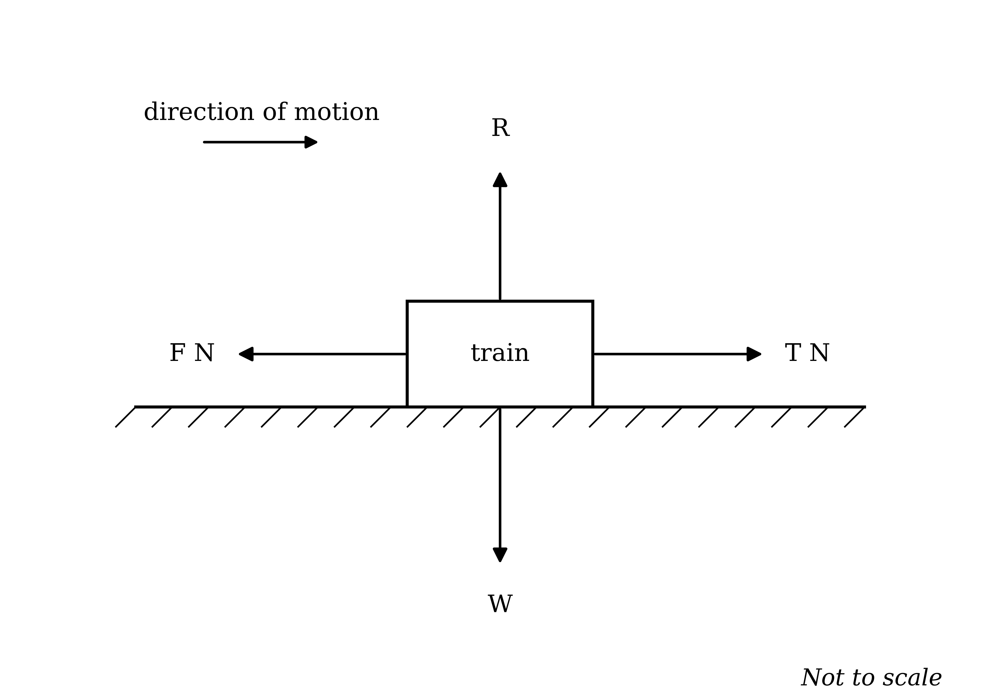
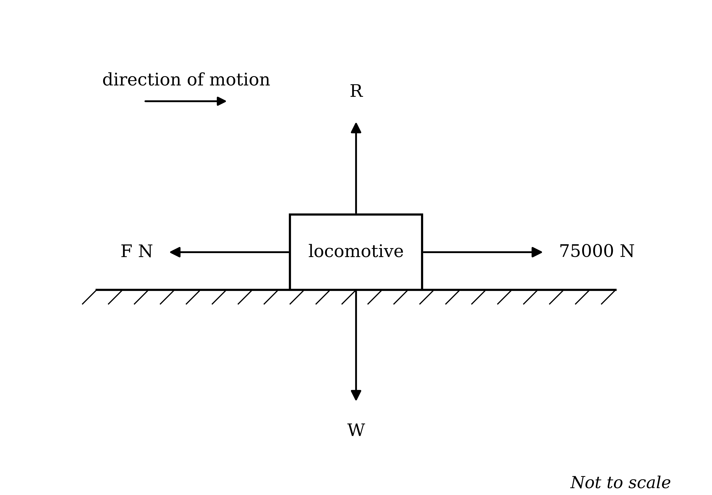

# Mark Schemes — Forces
**Forces & Equilibrium** · Cambridge (CIE) A-LEVEL maths (9709)

## Exam Questions (24 questions)

### Q1
The avocado is lying motionless on the table, so it is at rest

**Final answer:** **By Newton's First Law of Motion, an object at rest stays at rest unless a resultant force acts on it**

**[B1]**

The avocado stays at rest on the table, so there can be no resultant force acting on it

**Final answer:** **The resultant force acting on the avocado is 0 N**

**[B1]**

> **[mark-scheme]**
> **B1:** Newton's First Law of Motion stated or clearly described: an object at rest remains at rest unless a resultant force acts on it. Any wording carrying that meaning is acceptable, and the law does not have to be named.
> 
> **B1:** The resultant force stated as zero. Units are not required.

### Q2
(i)

The car moves along a horizontal road, so it has no vertical acceleration and the vertical forces balance

The normal reaction must therefore balance the weight

**Final answer:** **The normal reaction is 12000 N acting vertically upwards**

**[B1]**

(ii)

Modelled as a particle, the car has four forces acting on it: its weight, the normal reaction, the driving force and the resistance

**[B1 B1 B1]**

> **[mark-scheme]**
> **B1:** The normal reaction stated as 12000 N vertically upwards.
> 
> **B1:** The weight of 12000 N and the normal reaction of 12000 N shown, both vertical and in opposite directions.
> 
> **B1:** The driving force of 8500 N shown forwards and the resistance of 1000 N shown backwards.
> 
> **B1:** All four forces drawn as labelled arrows, with each label giving either the magnitude or the name of the force.
> 
> The diagram is marked on the force set and the directions, not on neatness, and the arrows need not be drawn to scale. A diagram showing the direction of motion as well is acceptable but not required. Accept the forces labelled by name (weight, normal reaction, driving force, resistance) with or without the magnitudes.
The normal reaction and the weight are equal and opposite, so the vertical forces balance and contribute nothing to the resultant

The resultant is therefore horizontal, and is the difference between the driving force and the resistance

$8500 - 1000 = 7500$

**Final answer:** **The resultant force is 7500 N in the direction of the car's motion**

**[M1 A1]**

> **[mark-scheme]**
> **M1:** Subtracting the resistance from the driving force, with both relevant terms included. Sign errors are condoned for this mark.
> 
> **A1:** 7500 N in the direction of motion. Both the magnitude and the direction are needed, and the direction may be given in words ("forwards", "in the direction of motion") or shown on a diagram. Units are not required.

### Q3
The ball moves with constant velocity, so it is not accelerating

**Final answer:** **By Newton's First Law of Motion, the forces acting on the ball must be balanced**

**[B1]**

The tension acts vertically upwards and the weight vertically downwards, so the two must be equal

$T = 24500$

**[B1]**

> **[mark-scheme]**
> **B1:** A statement that the velocity is constant, so there is no acceleration and the forces are balanced. Reference to Newton's First Law is acceptable but not required, and "the resultant force is zero" earns this mark.
> 
> **B1:** $T = 24500$. Units are not required.
The weight is unchanged, so the upward force is now larger than the downward force

$T = 24500 + 3000 = 27500$

**Final answer:** **There is now a resultant force of 3000 N acting vertically upwards**

**[B1]**

By Newton's First Law of Motion the ball can no longer continue at constant velocity, because the forces on it are no longer balanced

**Final answer:** **The ball continues to move upwards, but its speed increases**

**[B1]**

> **[mark-scheme]**
> **B1:** Recognition that the forces are no longer balanced, with a resultant force of 3000 N vertically upwards. Accept "the tension is now greater than the weight" without the value of the resultant.
> 
> **B1:** A description of the motion: the ball continues upwards and speeds up (accelerates upwards). Accept "it accelerates", and accept the reasoning shown as the increase in tension exceeding the weight. A value for the acceleration is not required, as it is not asked for.

### Q4
(i)

The resultant force is zero, so the force acting upwards must equal the force acting downwards

$P = 12$

**[B1]**

(ii)

The two vertical forces are both 7 N, so they already balance and give no information about $P$

The horizontal forces must therefore balance each other

$P = 13$

**[B1]**

> **[mark-scheme]**
> **B1:** $P = 12$ in part (i).
> 
> **B1:** $P = 13$ in part (ii). Full credit for the correct value however it is reached, whether by balancing the horizontal forces or by writing an equation such as $P - 13 = 0$ from a chosen positive direction. No credit is lost for not commenting on the vertical forces.
> 
> Units are not required in either answer.

### Q5
The book is at rest on the table, so it is not accelerating

**Final answer:** **By Newton's First Law of Motion, the forces acting on the book must be balanced**

**[B1]**

The only downward force on the book is its weight

**Final answer:** **The weight is a force of 25 N acting vertically downwards**

**[B1]**

The normal reaction is the only upward force, so it must balance the weight exactly

**Final answer:** **The normal reaction is a force of 25 N acting vertically upwards**

**[B1]**

> **[mark-scheme]**
> **B1:** A statement that the book is at rest (or not accelerating) and that the forces are therefore balanced. Reference to Newton's First Law is acceptable but not required.
> 
> **B1:** The weight identified as 25 N acting vertically downwards.
> 
> **B1:** The normal reaction stated as 25 N vertically upwards. Both the magnitude and the direction are needed for this mark, and the direction may be stated in words or shown on a diagram. Units are not required.

### Q6
The particle is in equilibrium, so the forces balance in every direction

Balancing the horizontal forces, the force to the right equals the force to the left

$P + 8 Q = 21$

Now balance the vertical forces

$3 P - 2 Q = 11$

**[M1 A1]**

Multiply the vertical equation by 4, so that the terms in $Q$ will cancel

$12 P - 8 Q = 44$

Add this to the horizontal equation

$13 P = 65$

$P = 5$

**[A1]**

Substitute $P = 5$ into the horizontal equation

$5 + 8 Q = 21$

$8 Q = 16$

$Q = 2$

**[A1]**

> **[mark-scheme]**
> **M1:** Balancing the forces in two perpendicular directions to form two equations, with all the relevant terms included in each. Sign errors are condoned for this mark.
> 
> **A1:** Both equations correct: $P + 8 Q = 21$ and $3 P - 2 Q = 11$, or equivalent rearrangements.
> 
> **A1:** $P = 5$.
> 
> **A1:** $Q = 2$.
> 
> Any correct method of solving the simultaneous equations is acceptable, whether elimination in either variable or substitution. Units are not required.

### Q7
(i)

The whole stack is in equilibrium, so the table must support the total weight of all $n$ books

Each book weighs 12 N, so the total weight of the stack is

$12 n$

The normal reaction is the only upward force on the stack, so it must balance this total weight

$12 n$

**[M1 A1]**

(ii)

Set the expression from part (i) equal to the given normal reaction

$12 n = 96$

$n = 8$

**[B1]**

(iii)

The table pushes up on the bottom book with a force of 96 N, and by Newton's Third Law the book pushes back on the table with a force of equal magnitude in the opposite direction

**Final answer:** **The force exerted on the table by the bottom book is 96 N acting vertically downwards**

**[B1]**

**Final answer:** **This follows from Newton's Third Law of Motion**

**[B1]**

> **[mark-scheme]**
> **M1:** Recognising that the table supports the whole stack, so the total weight is $12 \times n$. Award for the product seen, however it is written.
> 
> **A1:** The normal reaction given as $12 n$ N.
> 
> **B1:** $n = 8$, following correctly from part (i). Follow through from an incorrect expression in part (i).
> 
> **B1:** The force on the table given as 96 N acting vertically downwards. Both the magnitude and the direction are needed. An answer of 96 N upwards scores zero for this mark, as it repeats the force on the book rather than the force on the table.
> 
> **B1:** Newton's Third Law named. Accept "the third law", or a statement of it in words such as "every action has an equal and opposite reaction", provided it is clearly offered as the justifying law.
> 
> Units are not required in parts (i) and (ii).

### Q8
(i)

The particle moves with constant velocity, so the forces balance in every direction

The two horizontal forces are both 9 N, so they already balance and give no information about $P$

Balancing the vertical forces

$P + 7 = 1 - 2 P$

**[M1]**

Collect the terms in $P$ on one side

$3 P = - 6$

$P = - 2$

**[A1]**

(ii)

Here the two vertical forces are both 13 N, so this time it is the horizontal forces that determine $P$

There are two forces acting to the right, so their sum must balance the single force acting to the left

`11 + \left(2 P - 3\right) = 16 + P`

$2 P + 8 = 16 + P$

$P = 8$

**[B1]**

> **[exam-tip]**
> A negative value for $P$ is not a mistake. $P$ is just an unknown number inside a force expression, not a force itself. Substituting $P = - 2$ gives forces of 5 N up and 5 N down, both perfectly sensible. Check your answer by substituting it back into the diagram rather than assuming a negative value means you have gone wrong.

> **[mark-scheme]**
> **M1:** In part (i), balancing the two vertical forces to form an equation in $P$, with both relevant terms included. Sign errors are condoned for this mark, and an equation written as `\left(P + 7\right) - \left(1 - 2 P\right) = 0` from a chosen positive direction is equally acceptable.
> 
> **A1:** $P = - 2$. The negative value is correct and must not be penalised.
> 
> **B1:** $P = 8$ in part (ii). Both right-hand forces must be included; using only one of them scores zero for this mark.
> 
> Units are not required in either answer.

### Q9
The platform moves with constant speed in a straight line, so it is not accelerating and the forces on it balance

Both cables pull upwards with tension $T$, so the total upward force $2 T$ must balance the weight

$2 T = 21000$

**[M1]**

$T = 10500$

**[A1]**

> **[mark-scheme]**
> **M1:** Forming an equation for the vertical equilibrium of the platform with all three forces included, the tension in each cable and the weight, such as $2 T = 21000$.
> 
> **A1:** $T = 10500$. Units are not required.
> 
> An equation using the tension in only one cable, such as $T = 21000$, does not earn the method mark.
The tension is unchanged, so the total upward force is still $2 T = 21000$ N, but the total weight now includes the workers

$21000 + 1600 = 22600$

The downward force now exceeds the upward force

$22600 - 21000 = 1600$

**Final answer:** **There is now a resultant force of 1600 N acting vertically downwards**

**[B1]**

The platform is still travelling upwards at the moment the workers land, so this resultant acts against the direction of motion

**Final answer:** **Immediately afterwards the platform continues to move upwards, but its speed decreases**

**[B1]**

The resultant force does not change, so the platform keeps slowing until its upward velocity reaches zero, and then continues to be pulled downwards

**Final answer:** **The platform then momentarily comes to rest, after which it begins to move downwards with increasing speed**

**[B1]**

> **[mark-scheme]**
> **B1:** Recognition that the weight now exceeds the total tension, giving a resultant of 1600 N vertically downwards. Accept the comparison made without the value.
> 
> **B1:** Immediately after the workers land, the platform continues upwards but slows down. Accept "it decelerates".
> 
> **B1:** In the longer term, the upward velocity falls to zero and the platform then moves downwards, speeding up. Both stages are needed for this mark.
> 
> A response stating that the platform moves downwards immediately does not earn the second mark. The resultant force is downwards at once, but the platform's velocity is still upwards. Values for the acceleration and the time taken are not required, as neither is asked for.

### Q10
(i)

The tourist stands at rest in a lift moving at constant speed, so he is not accelerating and the forces on him balance

The normal reaction therefore balances the combined weight of the tourist and his backpack

$1598 = 1246 + W$

**[M1]**

$W = 1598 - 1246$

$W = 352$

**[A1]**

(ii)

The lift would still be moving at a constant speed in a straight line, so the tourist would still not be accelerating and the forces on him would still balance

**Final answer:** **It would make no difference, and the weight of the backpack would still be 352 N**

**[B1]**

What matters is that the velocity is constant, not the direction in which the lift travels

> **[mark-scheme]**
> **M1:** Forming an equation for the equilibrium of the tourist and backpack, with all the relevant terms included, for example $1598 = 1246 + W$. Sign errors are condoned for this mark.
> 
> **A1:** The weight of the backpack given as 352 N. Units are not required.
> 
> **B1:** A statement that it would make no difference, with the reason that the speed is still constant so the forces still balance. The verdict alone, without the reason, does not earn this mark.
> 
> A response arguing that the normal reaction would be smaller when travelling downwards scores no marks in part (ii).

### Q11
The train moves along a horizontal track, so it has no vertical acceleration and the vertical forces balance

No weight is given, so label the weight $W$ and the normal reaction $R$, which are equal and opposite, even though neither value is known

Modelled as a particle, the train has four forces acting on it: its weight, the normal reaction, the driving force and the resistance

**[B1 B1 B1]**

> **[mark-scheme]**
> **B1:** The weight shown acting vertically downwards and the normal reaction shown acting vertically upwards. Accept any sensible labels, including $W$ and $R$.
> 
> **B1:** The driving force of $T$ N shown forwards.
> 
> **B1:** The resistance of $F$ N shown backwards.
> 
> The diagram is marked on the force set and the directions, not on neatness. Full credit is available without numerical values for the vertical forces, since none are given.
The train's speed is increasing in the direction of motion, so the resultant force acts forwards

*The driving force is therefore the larger of the two, so T is the larger force and F is the smaller*

**[B1]**

The vertical forces balance, so the resultant is the difference between the two horizontal forces

$T - F = 4200$

Nine times the smaller force equals twice the larger force

$9 F = 2 T$

**[M1]**

Rearrange the second equation to make $T$ the subject

$T = \frac{9}{2} F$

Substitute into the first equation

$\frac{9}{2} F - F = 4200$

$\frac{7}{2} F = 4200$

$F = 1200$

Substitute back to find $T$

$T = \frac{9}{2} \times 1200$

$T = 5400$

**[A1]**

> **[mark-scheme]**
> **B1:** Identifying $T$ as the larger force and $F$ as the smaller, justified by the speed increasing in the direction of motion. This must be established before the ratio condition can be used correctly.
> 
> **M1:** Forming both equations: the resultant as the difference of the two forces, such as $T - F = 4200$, and the ratio condition written as nine times one force equal to twice the other. Sign errors are condoned for this mark.
> 
> **A1:** $F = 1200$ and $T = 5400$. Both values are needed.
> 
> A response which takes $F$ as the larger force obtains $9 T = 2 F$ and reaches negative values; it can score the M1, but not the B1 or the A1. Units are not required.

### Q12
The particle is in equilibrium, so the forces balance in each of the two perpendicular directions

$F_{1} = F_{2}$

$F_{3} = F_{4}$

**[B1]**

The first given relation connects $F_{4}$ and $F_{2}$, so use the pairings above to rewrite it in terms of $F_{3}$ and $F_{1}$

$5 F_{4} = 9 F_{2}$

$5 F_{3} = 9 F_{1}$

$F_{3} = \frac{9}{5} F_{1}$

**[M1]**

Substitute this into the second given relation, so that only $F_{1}$ remains

`3F_1 + 5\left(\dfrac{9}{5}F_1\right) = 450`

$3 F_{1} + 9 F_{1} = 450$

$12 F_{1} = 450$

**Final answer:** $F_{1} = F_{2} =$** 37.5**

**[A1]**

Now use the relation between $F_{3}$ and $F_{1}$

$F_{3} = \frac{9}{5} \times 37 . 5$

**Final answer:** $F_{3} = F_{4} =$** 67.5**

**[A1]**

> **[mark-scheme]**
> **B1:** Both equilibrium relations stated: $F_{1} = F_{2}$ and $F_{3} = F_{4}$.
> 
> **M1:** Using those relations to rewrite one of the given equations so that it connects $F_{3}$ and $F_{1}$ (or $F_{4}$ and $F_{2}$), reducing the problem to a single unknown. Award for the substitution attempted, however it is arranged.
> 
> **A1:** $F_{1} = F_{2} = 37 . 5$.
> 
> **A1:** $F_{3} = F_{4} = 67 . 5$.
> 
> Both members of each pair must be given for the accuracy marks; stating only $F_{1}$ without $F_{2}$, or only $F_{3}$ without $F_{4}$, does not earn the mark. Any equivalent route reaching the same values is acceptable. Units are not required.

### Q13
The pallet moves with constant speed in a straight line, so it is not accelerating and the forces on it balance, even though it is moving downwards

Both ropes pull upwards with tension $T$, so the total upward force $2 T$ must balance the weight

$2 T = 17000$

**[M1]**

$T = 8500$

**[A1]**

> **[mark-scheme]**
> **M1:** Forming an equation for the vertical equilibrium of the pallet with all three forces included, the tension in each rope and the weight, such as $2 T = 17000$.
> 
> **A1:** $T = 8500$. Units are not required.
> 
> An equation using the tension in only one rope, such as $T = 17000$, does not earn the method mark.
Each of the two ropes now pulls 500 N harder, so the total upward force increases by twice this amount

$2 \times 500 = 1000$

**Final answer:** **There is now a resultant force of 1000 N acting vertically upwards**

**[B1]**

The pallet is moving downwards, so this resultant force acts against the direction of motion

**Final answer:** **The pallet continues to move downwards, but its speed decreases**

**[B1]**

> **[mark-scheme]**
> **B1:** Recognition that the total upward force increases by $2 \times 500 = 1000$, giving a resultant of 1000 N vertically upwards.
> 
> **B1:** A description of the motion: the pallet continues downwards but slows down. Accept "it decelerates". A value for the deceleration is not required, as it is not asked for.
> 
> A response stating that the pallet immediately moves upwards scores this second mark only if it is clear that the *acceleration*, not the motion, is upwards. The resultant force is upwards, but the pallet is still travelling downwards immediately after the change.
> 
> An answer using a resultant of 500 N, forgetting that both ropes change, may still earn the second mark if the description of the motion follows correctly from it.

### Q14
(i)

The two vertical forces are both 5 N, so they already balance and give no information about $P$

The particle is in equilibrium, so the horizontal forces must balance each other

$3 + P = 8$

$P = 5$

**[B1]**

(ii)

For a particle to be in equilibrium, the forces must balance in every direction, so consider the vertical direction first

The vertical forces in diagram B are 12 N upwards and 7 N downwards, and neither of them depends on $P$

$12 \neq 7$

**[B1]**

So whatever value $P$ takes, the vertical forces leave a resultant

$12 - 7 = 5$

**Final answer:** **There is always a resultant force of 5 N vertically upwards, so the particle cannot be in equilibrium for any value of P**

**[B1]**

> **[mark-scheme]**
> **B1:** $P = 5$ in part (i).
> 
> **B1:** In part (ii), identifying that the vertical forces are 12 N and 7 N and that neither involves $P$. Accept this shown as an attempt to balance them vertically, reaching a contradiction.
> 
> **B1:** Concluding that the vertical forces can never balance, so the particle can never be in equilibrium. The conclusion must be stated. Accept the resultant given as 5 N upwards, or simply the observation that $12 \neq 7$ for all $P$.
> 
> Balancing the horizontal forces in diagram B to obtain $P = 4$ is not incorrect, but earns nothing on its own; the marks in part (ii) are for the vertical argument. A response which finds $P = 4$ and concludes that the particle *is* in equilibrium scores no marks in part (ii).

### Q15
In both poses the practitioner is motionless, so he is not accelerating

**Final answer:** **By Newton's First Law of Motion, the forces acting on him must be balanced in both poses**

**[B1]**

His weight is 686 N in both poses, and the total normal reaction is the only upward force, so it must balance that weight each time

**Final answer:** **The total normal reaction is 686 N acting vertically upwards in both poses**

**[B1]**

**Final answer:** **There is no difference between the two total normal reaction forces**

**[B1]**

Lifting one leg changes only how the total reaction is shared between the feet, not the total itself. With one foot on the ground, that single foot now carries the whole 686 N

> **[mark-scheme]**
> **B1:** A statement that the practitioner is motionless (or not accelerating) in both poses, so the forces are balanced.
> 
> **B1:** The total normal reaction identified as 686 N, equal to the weight, in both poses.
> 
> **B1:** An explicit statement that there is no difference between the two. Accept "they are the same" or "the difference is zero".
> 
> The final mark requires the comparison to be stated, not merely implied by giving 686 N twice. A response arguing that the reaction halves, or doubles, because of the change in the number of feet scores the first mark only.

### Q16
The locomotive moves along a horizontal track, so it has no vertical acceleration and the vertical forces balance

No weight is given, so label the weight $W$ and the normal reaction $R$, which are equal and opposite, even though neither value is known

Modelled as a particle, the locomotive has four forces acting on it: its weight, the normal reaction, the driving force and the resistance

**[B1 B1 B1]**

> **[mark-scheme]**
> **B1:** The weight shown acting vertically downwards and the normal reaction shown acting vertically upwards. Accept any sensible labels, including $W$ and $R$, or "weight" and "normal reaction".
> 
> **B1:** The driving force of 75000 N shown forwards.
> 
> **B1:** The resistance of $F$ N shown backwards.
> 
> The diagram is marked on the force set and the directions, not on neatness, and the arrows need not be drawn to scale. Full credit is available without numerical values for the vertical forces, since none are given. A diagram showing the direction of motion as well is acceptable but not required. Omitting the vertical forces entirely loses the first mark.
The weight and the normal reaction are equal and opposite, so the vertical forces contribute nothing to the resultant

The resultant is therefore horizontal, and is the difference between the driving force and the resistance

$75000 - F = 71800$

**[M1]**

Rearrange to find $F$

$F = 75000 - 71800$

$F = 3200$

**[A1]**

> **[mark-scheme]**
> **M1:** Forming an equation for the horizontal resultant with both relevant terms included, such as $75000 - F = 71800$. Sign errors are condoned for this mark.
> 
> **A1:** $F = 3200$. Units are not required.

### Q17
The pallet is moving at a constant speed in a straight line, so its velocity is not changing and it is not accelerating

**Final answer:** **The student is not correct**

**[B1]**

**Final answer:** **By Newton's First Law of Motion, a body moving with constant velocity has no resultant force acting on it, so the resultant force on the pallet is zero**

**[B1]**

The student's error is to assume that motion in a direction requires a force in that direction

**Final answer:** **A resultant force is needed to change a body's velocity, not to keep it moving, so the upward motion does not require an upward resultant force**

**[B1]**

> **[mark-scheme]**
> **B1:** A clear statement that the student is not correct.
> 
> **B1:** The resultant force identified as zero, justified by the pallet moving with constant velocity (or not accelerating). Reference to Newton's First Law is acceptable but not required.
> 
> **B1:** An explanation that a resultant force changes a body's velocity rather than maintaining its motion; or, equivalently, that the tension and the weight are balanced even while the pallet moves. Accept any wording carrying this meaning.
> 
> A response which only states that the resultant force is zero, without addressing why the upward motion does not imply an upward force, scores the first two marks.

### Q18
The particle moves with constant velocity, so it is not accelerating and the forces on it balance in every direction, exactly as they would if it were at rest

Balancing the vertical forces

$P + 3 Q = 11 Q - 2 P$

$3 P - 8 Q = 0$

Balancing the horizontal forces

$2 P + 13 = 15 Q - 2 P$

$4 P - 15 Q = - 13$

**[M1 A1]**

Multiply the vertical equation by 4 and the horizontal equation by 3, so that the terms in $P$ will match

$12 P - 32 Q = 0$

$12 P - 45 Q = - 39$

Subtract the second of these from the first

$13 Q = 39$

$Q = 3$

**[A1]**

Substitute $Q = 3$ into $3 P - 8 Q = 0$

$3 P = 24$

$P = 8$

**[A1]**

> **[mark-scheme]**
> **M1:** Balancing the forces in two perpendicular directions to form two equations, with all the relevant terms included in each. Sign errors are condoned for this mark.
> 
> **A1:** Both equations correct: $3 P - 8 Q = 0$ and $4 P - 15 Q = - 13$, or equivalent unsimplified forms.
> 
> **A1:** $Q = 3$.
> 
> **A1:** $P = 8$.
> 
> Any correct method of solving the simultaneous equations is acceptable, whether elimination in either variable or substitution. Recognition that constant velocity gives the same condition as rest is implied by forming the equations and is not separately credited. Units are not required.

### Q19
The barbell is held stationary, so it is not accelerating

**Final answer:** **By Newton's First Law of Motion, the forces acting on the barbell must be balanced**

**[B1]**

Since the forces balance, they have no overall effect on the barbell

**Final answer:** **The resultant force acting on the barbell is 0 N**

**[B1]**

> **[mark-scheme]**
> **B1:** A statement that the barbell is stationary (or not accelerating) and that the forces on it are therefore balanced. Reference to Newton's First Law is acceptable but not required.
> 
> **B1:** The resultant force stated as zero. Units are not required.

### Q20
(i)

The two horizontal forces are both 13 N, so they already balance and give no information about $P$

The particle is stationary, so the vertical forces must balance each other

$P = 6$

**[B1]**

(ii)

Here the two vertical forces are both 15 N, so this time it is the horizontal forces that determine $P$

Balancing the horizontal forces

$21 + P = 49 - 3 P$

**[M1]**

Collect the terms in $P$ on one side

$4 P = 28$

$P = 7$

**[A1]**

> **[mark-scheme]**
> **B1:** $P = 6$ in part (i).
> 
> **M1:** In part (ii), balancing the two horizontal forces to form an equation in $P$, with both relevant terms included. Sign errors are condoned for this mark, and an equation written as `\left(21 + P\right) - \left(49 - 3 P\right) = 0` from a chosen positive direction is equally acceptable.
> 
> **A1:** $P = 7$.
> 
> Units are not required in either answer.

### Q21
The truck moves along a horizontal road, so it has no vertical acceleration and the vertical forces balance

The normal reaction must therefore be equal to the weight, 27000 N

Modelled as a particle, the truck has four forces acting on it: its weight, the normal reaction, the driving force and the resistance

**[B1 B1 B1]**

> **[mark-scheme]**
> **B1:** The weight of 27000 N shown acting vertically downwards and the normal reaction shown acting vertically upwards.
> 
> **B1:** The normal reaction given as 27000 N, equal to the weight.
> 
> **B1:** The driving force of 13500 N shown forwards and the resistance of 1700 N shown backwards.
> 
> The diagram is marked on the force set and the directions, not on neatness, and the arrows need not be drawn to scale. Accept the forces labelled by name (weight, normal reaction, driving force, resistance) as well as by magnitude. A diagram showing the direction of motion as well is acceptable but not required.
The normal reaction and the weight are equal and opposite, so the vertical forces balance and contribute nothing to the resultant

The resultant is therefore horizontal, and is the difference between the driving force and the resistance

$13500 - 1700 = 11800$

**Final answer:** **The resultant force is 11800 N in the direction of the truck's motion**

**[M1 A1]**

> **[mark-scheme]**
> **M1:** Subtracting the resistance from the driving force, with both relevant terms included. Sign errors are condoned for this mark.
> 
> **A1:** 11800 N in the direction of motion. Both the magnitude and the direction are needed, and the direction may be given in words or shown on a diagram. Units are not required.

### Q22
The pallet moves with constant speed in a straight line, so it is not accelerating and the forces on it balance

Both cables pull upwards with tension $T$, so the total upward force $2 T$ must balance the weight

$2 T = 22000$

**[M1]**

$T = 11000$

**[A1]**

> **[mark-scheme]**
> **M1:** Forming an equation for the vertical equilibrium of the pallet with all three forces included, the tension in each cable and the weight, such as $2 T = 22000$.
> 
> **A1:** $T = 11000$. Units are not required.
> 
> An equation using the tension in only one cable, such as $T = 22000$, does not earn the method mark.
Each of the two cables now pulls 1000 N harder, so the total upward force increases by twice this amount

$2 \times 1000 = 2000$

**Final answer:** **There is now a resultant force of 2000 N acting vertically upwards**

**[B1]**

By Newton's First Law of Motion the pallet can no longer continue at constant speed, because the forces on it are no longer balanced

**Final answer:** **The pallet continues to move upwards, but its speed increases**

**[B1]**

> **[mark-scheme]**
> **B1:** Recognition that the total upward force increases by $2 \times 1000 = 2000$, giving a resultant of 2000 N vertically upwards. Accept "the total tension is now greater than the weight" with the doubling shown.
> 
> **B1:** A description of the motion: the pallet continues upwards and speeds up. Accept "it accelerates upwards". A value for the acceleration is not required, as it is not asked for.
> 
> An answer using a resultant of 1000 N, forgetting that both cables change, may still earn the second mark if the description of the motion follows correctly from it.

### Q23
Both acrobats are motionless, so neither is accelerating

**Final answer:** **By Newton's First Law of Motion, the forces acting on them must be balanced**

**[B1]**

The floor supports both acrobats, so the total downward force on it is the sum of the two weights

$735 + 495 = 1230$

**Final answer:** **The total weight supported is 1230 N acting vertically downwards**

**[B1]**

The normal reaction is the only upward force, so it must balance this total weight

**Final answer:** **The total normal reaction is 1230 N acting vertically upwards**

**[B1]**

> **[mark-scheme]**
> **B1:** A statement that the acrobats are at rest (or not accelerating) and that the forces are therefore balanced.
> 
> **B1:** The total downward force found as $735 + 495 = 1230$. Award this mark for adding both weights, however the sum is described.
> 
> **B1:** The total normal reaction stated as 1230 N acting vertically upwards. Both the magnitude and the direction are needed, and the direction may be stated in words or shown on a diagram. Units are not required.
> 
> A response giving 735 N, using only the lower acrobat's weight, scores the first mark only.

### Q24
The particle is in equilibrium, so the forces balance in every direction

Balancing the vertical forces, the force upwards equals the force downwards

$P + Q = 7$

Now balance the horizontal forces

$Q + 7 = 3 Q - 5 P$

Rearrange this second equation so that the unknowns are on the same side

$5 P - 2 Q = - 7$

**[M1 A1]**

Multiply the vertical equation by 2, so that the terms in $Q$ will cancel

$2 P + 2 Q = 14$

Add this to the rearranged horizontal equation

$7 P = 7$

$P = 1$

**[A1]**

Substitute $P = 1$ into the vertical equation

$1 + Q = 7$

$Q = 6$

**[A1]**

> **[mark-scheme]**
> **M1:** Balancing the forces in two perpendicular directions to form two equations, with all the relevant terms included in each. Sign errors are condoned for this mark.
> 
> **A1:** Both equations correct: $P + Q = 7$ and $Q + 7 = 3 Q - 5 P$, or equivalent rearrangements.
> 
> **A1:** $P = 1$.
> 
> **A1:** $Q = 6$.
> 
> Any correct method of solving the simultaneous equations is acceptable, whether elimination in either variable or substitution. Units are not required.
