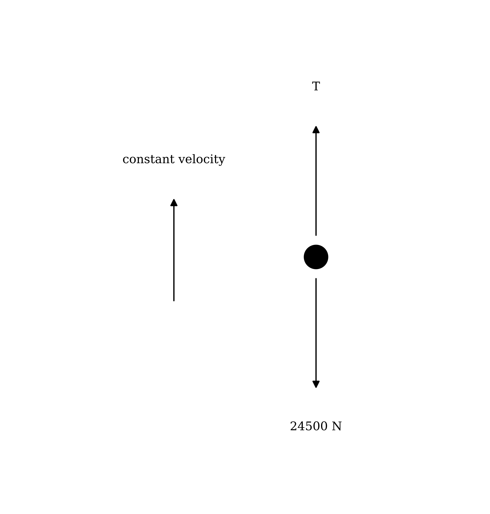
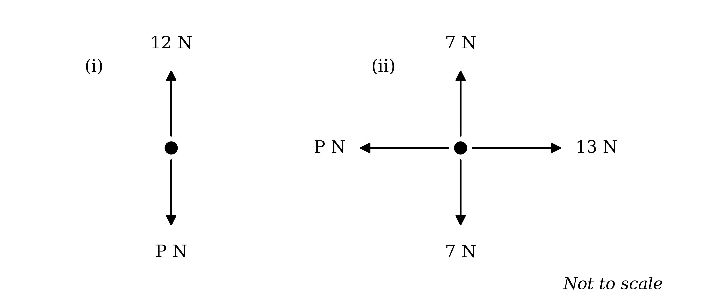
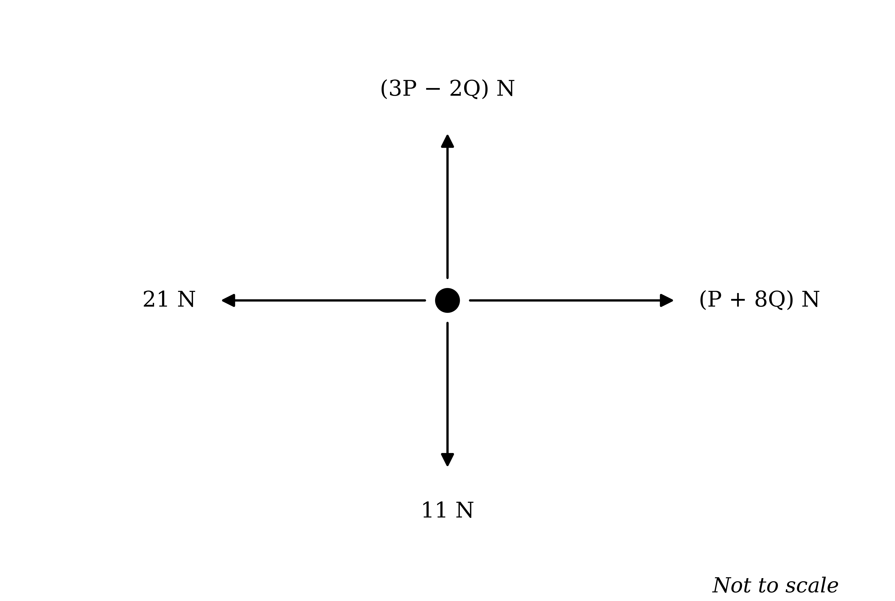
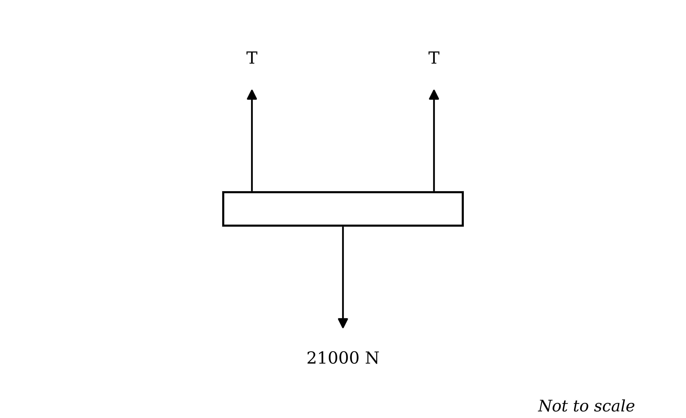
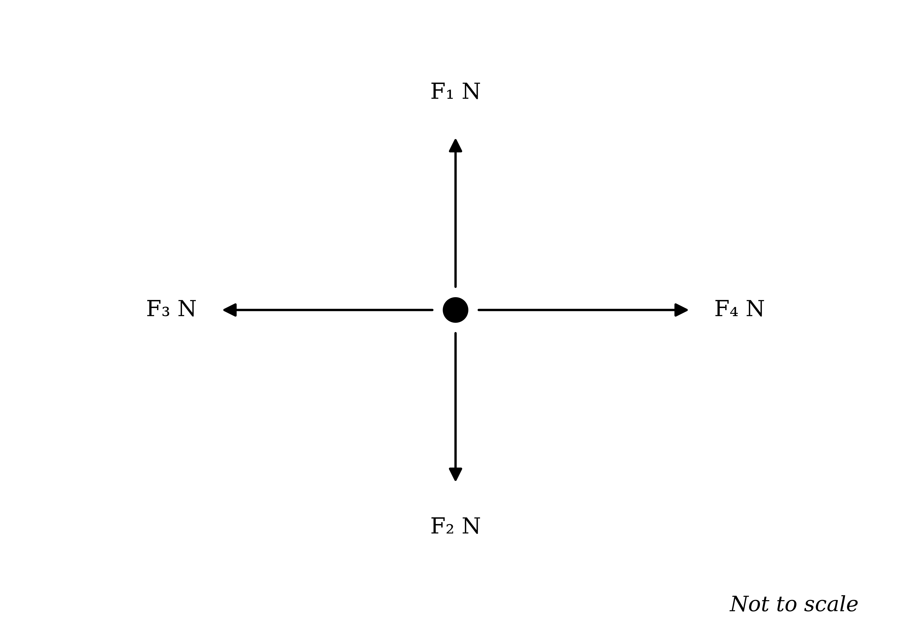
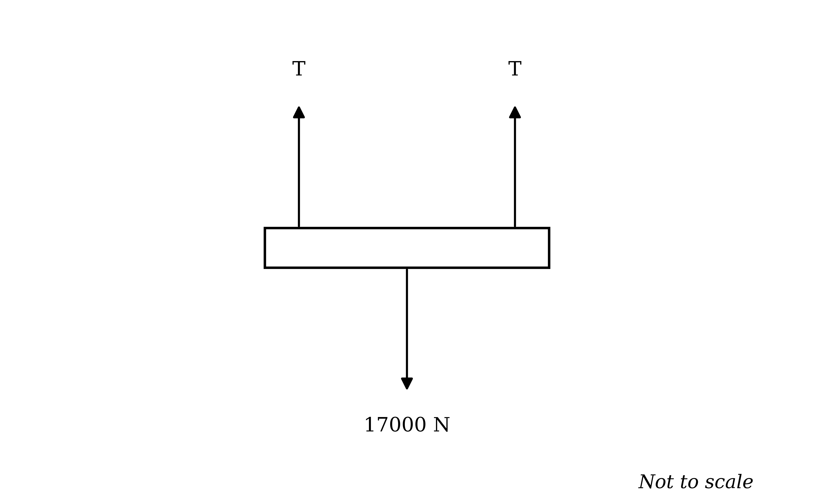
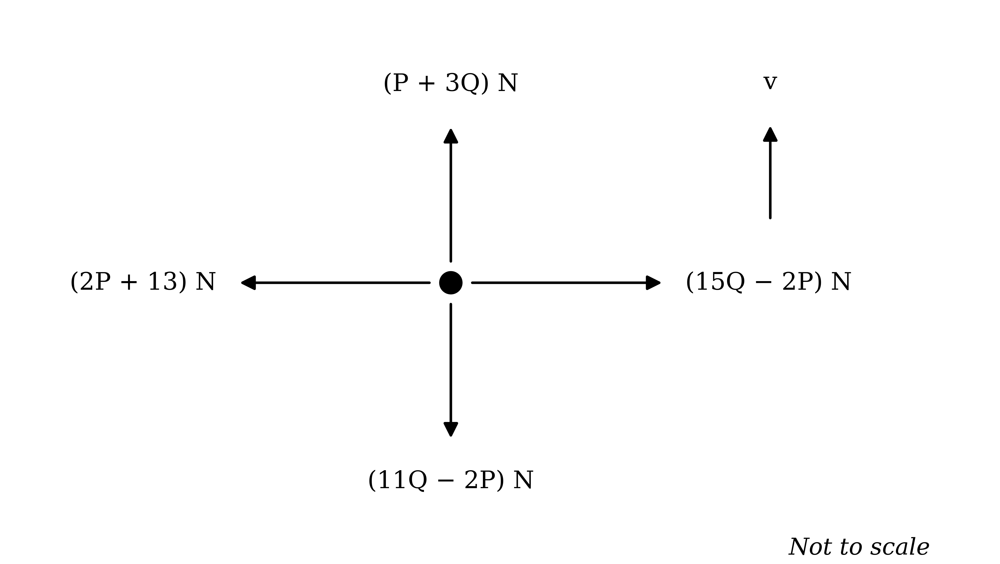
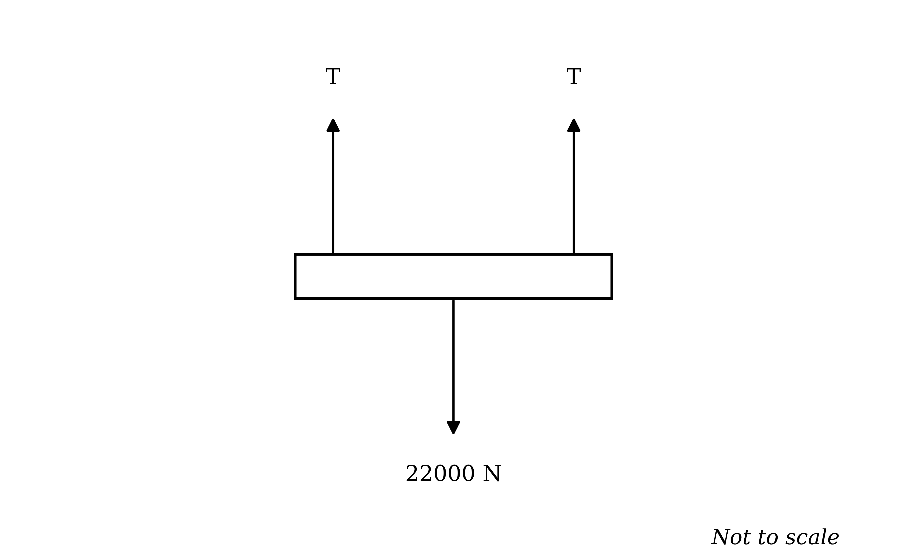
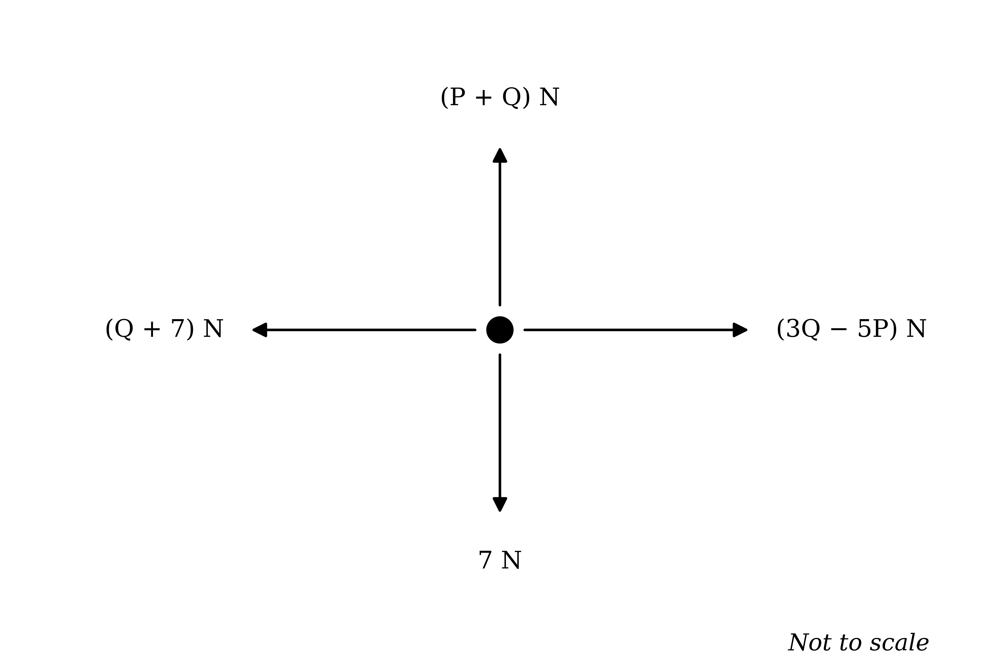

# Exam Questions — Forces
**Forces & Equilibrium** · Cambridge (CIE) A-LEVEL maths (9709)
> Source: [https://www.savemyexams.com/a-level/maths/cie/20/mechanics/topic-questions/](https://www.savemyexams.com/a-level/maths/cie/20/mechanics/topic-questions/) · 24 questions across 1 sets

## Exam Questions (24 questions)

### Q1 — easy — 2 marks

**Q1** [2 marks]

An avocado of mass 170 g lies at rest on a horizontal table.

State, with a reason, the resultant force acting on the avocado.

### Q2 — easy — 6 marks

**Q2** [4 marks]

A car of weight 12000 N is moving along a horizontal straight road. The car's engine provides a forward driving force of 8500 N. The total resistance to the car's motion is modelled as a constant force of 1000 N. All other forces acting on the car may be ignored.

(i) Write down the magnitude and direction of the normal reaction force exerted on the car by the road.

(ii) The car is modelled as a particle. Draw a diagram showing the forces acting on the car.

**Q2** [2 marks]

Find the magnitude and direction of the resultant force acting on the car.

### Q3 — easy — 4 marks

**Q3** [2 marks]

A large steel wrecking ball of weight 24500 N is being lifted by a crane. The tension in the lifting cable is *T* N. Other than the weight of the ball and the tension in the cable, all other forces acting on the ball may be ignored.

The wrecking ball moves vertically upwards with constant velocity.

Find the value of *T*, explaining your reasoning.

**Q3** [2 marks]

The tension in the cable is now increased by 3000 N.

Describe the resulting motion of the wrecking ball, explaining the physical reasoning behind your answer.

### Q4 — easy — 2 marks

**Q4** [2 marks]

Each of the diagrams below shows the forces acting on a particle. In each case the resultant force on the particle is zero.

Find the value of *P* in each case.

### Q5 — easy — 3 marks

**Q5** [3 marks]

A large maths textbook of weight 25 N is at rest on a horizontal table.

State, with a reason, the magnitude and direction of the normal reaction force acting on the book.

### Q6 — medium — 4 marks

**Q6** [4 marks]

The diagram shows the four forces acting on a particle which is in equilibrium.

Find the values of *P* and *Q*.

### Q7 — hard — 5 marks

**Q7** [5 marks]

A stack of *n* identical books, each of weight 12 N, rests on a horizontal table. The stack is in equilibrium.

(i) Find, in terms of *n*, the magnitude of the normal reaction exerted by the table on the bottom book of the stack.

(ii) The normal reaction exerted by the table on the bottom book is 96 N. Find the value of *n*.

(iii) State the magnitude and direction of the force exerted on the table by the bottom book, and name the law which justifies your answer.

### Q8 — medium — 3 marks

**Q8** [3 marks]

Each of the diagrams below shows the forces acting on a particle. In each case the particle is moving with constant velocity *v*.

Find the value of *P* in each case.

### Q9 — very_hard — 5 marks

**Q9** [2 marks]

In a slate quarry, a load of slates is being raised to the surface for processing. The total weight of the slates and the platform on which they rest is 21000 N. To keep the platform level as it is raised, the tension in each of the two lifting cables is the same, *T* N. Other than the weight of the platform and slates and the tension in the cables, all other forces acting on the platform may be ignored.

The platform moves vertically upwards with a constant speed of 0.25 $\text{m s}^{-1}$.

Find the value of *T*.

**Q9** [3 marks]

As the platform passes one of the levels in the quarry, two workers of combined weight 1600 N jump onto the centre of the slow-moving platform, hoping to catch a ride to the surface at the end of their shift.

The tension in each cable stays the same, and the platform remains level.

Describe the resulting motion of the platform after the workers jump onto it, considering both the time immediately afterwards and the longer term. Explain the physical reasoning behind your answer.

### Q10 — hard — 3 marks

**Q10** [3 marks]

A tourist of weight 1246 N is riding in a lift to the top of a tall building. He is wearing a backpack, and is standing at rest on the horizontal floor of the lift. The lift is moving vertically upwards at a constant speed of 6.1 $\text{m s}^{-1}$.

The total normal reaction exerted on the tourist by the floor of the lift is 1598 N.

(i) Find the weight of the backpack.

(ii) State, with a reason, what difference it would make to your answer if the lift were instead moving vertically downwards at a constant speed of 6.1 $\text{m s}^{-1}$.

### Q11 — hard — 6 marks

**Q11** [3 marks]

A monorail train is moving along a horizontal straight track. The train's engine provides a forward driving force of *T* N. The total resistance to the train's motion is modelled as a constant force of *F* N.

The train is modelled as a particle. Draw a diagram showing the forces acting on the train.

**Q11** [3 marks]

It is given that

- the train's speed is increasing in its direction of motion
- the resultant force acting on the train is 4200 N
- of *T* and *F*, nine times the magnitude of the smaller force is equal to twice the magnitude of the larger force

Find the values of *T* and *F*.

### Q12 — hard — 4 marks

**Q12** [4 marks]

The diagram shows the four forces acting on a particle which is in equilibrium.

Given that $5 F_{4} = 9 F_{2}$ and $3 F_{1} + 5 F_{3} = 450$, find the values of $F_{1}$, $F_{2}$, $F_{3}$ and $F_{4}$.

### Q13 — hard — 4 marks

**Q13** [2 marks]

A pallet of large cheeses is being lowered into a cave for storage. The total weight of the pallet and cheeses is 17000 N. To keep the pallet level as it is lowered, the tension in each of the two support ropes is the same, *T* N. Other than the weight of the pallet and cheeses and the tension in the ropes, all other forces acting on the pallet may be ignored.

The pallet moves vertically downwards with constant speed.

Find the value of *T*.

**Q13** [2 marks]

The tension in each rope is now increased by 500 N.

Describe the resulting motion of the pallet immediately after the change in tension, explaining the physical reasoning behind your answer.

### Q14 — hard — 3 marks

**Q14** [3 marks]

The diagrams below show the forces acting on two particles.

(i) The particle in diagram A is in equilibrium. Find the value of *P*.

(ii) Show that the particle in diagram B cannot be in equilibrium, whatever the value of *P*.

### Q15 — hard — 3 marks

**Q15** [3 marks]

A yoga practitioner of weight 686 N stands motionless on a horizontal floor with both feet on the ground. He then changes to a new pose in which one leg is lifted into the air, so that he is standing motionless with only one foot on the ground.

State, with a reason, the difference between the total normal reaction exerted by the floor on the practitioner when he has both feet on the ground and the total normal reaction when he has only one foot on the ground.

### Q16 — medium — 5 marks

**Q16** [3 marks]

A train locomotive is moving along a horizontal straight track. The locomotive's engine provides a forward driving force of 75000 N. The total resistance to the locomotive's motion is modelled as a constant force of *F* N. The locomotive is not pulling any carriages.

The locomotive is modelled as a particle. Draw a diagram showing the forces acting on the locomotive.

**Q16** [2 marks]

The resultant force acting on the locomotive is 71800 N in the direction of its motion.

Find the value of *F*.

### Q17 — hard — 3 marks

**Q17** [3 marks]

A pallet of bricks is being raised vertically by a crane at a constant speed of 0.5 $\text{m s}^{-1}$.

A student claims that, because the pallet is moving upwards, the resultant force acting on the pallet must also act upwards.

State whether the student is correct, and explain your answer fully.

### Q18 — medium — 4 marks

**Q18** [4 marks]

The diagram shows the four forces acting on a particle which is moving with constant velocity *v*.

Find the values of *P* and *Q*.

### Q19 — easy — 2 marks

**Q19** [2 marks]

During a weightlifting competition, a competitor lifts a barbell of mass 135 kg and holds it stationary above her head with her elbows locked.

State, with a reason, the resultant force acting on the barbell while it is being held stationary.

### Q20 — medium — 3 marks

**Q20** [3 marks]

Each of the diagrams below shows the forces acting on a particle. In each case the particle is stationary.

Find the value of *P* in each case.

### Q21 — easy — 5 marks

**Q21** [3 marks]

A truck of total weight 27000 N is moving along a horizontal straight road. The truck's engine provides a forward driving force of 13500 N. The total resistance to the truck's motion is modelled as a constant force of 1700 N. All other forces acting on the truck may be ignored.

The truck is modelled as a particle. Draw a diagram showing the forces acting on the truck.

**Q21** [2 marks]

Find the magnitude and direction of the resultant force acting on the truck.

### Q22 — medium — 4 marks

**Q22** [2 marks]

On a building site, a pallet of stone blocks is being raised by a crane. The total weight of the pallet and blocks is 22000 N. To keep the pallet level as it is raised, the tension in each of the two lifting cables is the same, *T* N. Other than the weight of the pallet and blocks and the tension in the cables, all other forces acting on the pallet may be ignored.

The pallet moves vertically upwards with constant speed.

Find the value of *T*.

**Q22** [2 marks]

The tension in each cable is now increased by 1000 N.

Describe the resulting motion of the pallet, explaining the physical reasoning behind your answer.

### Q23 — medium — 3 marks

**Q23** [3 marks]

As part of an acrobatics display, an acrobat of weight 735 N stands motionless on a horizontal floor. A second acrobat, of weight 495 N, stands motionless on the first acrobat's shoulders.

State, with a reason, the magnitude and direction of the total normal reaction exerted by the floor on the first acrobat.

### Q24 — medium — 4 marks

**Q24** [4 marks]

The diagram shows the four forces acting on a particle which is in equilibrium.

Find the values of *P* and *Q*.
