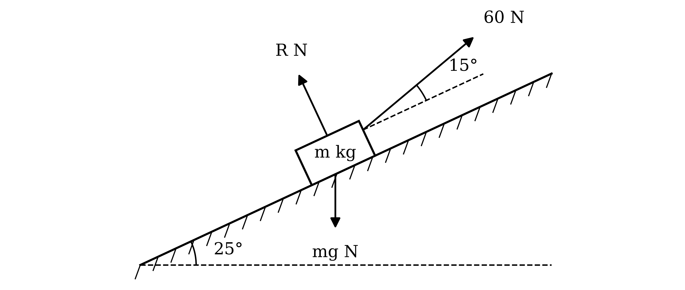
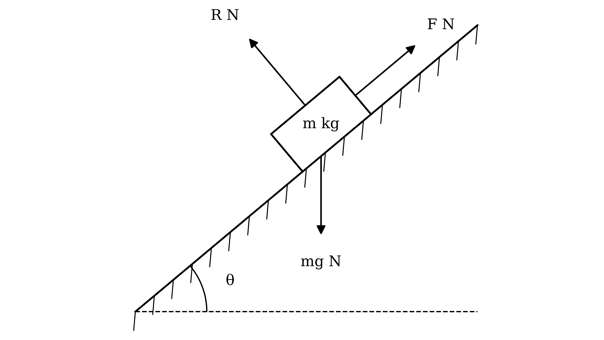
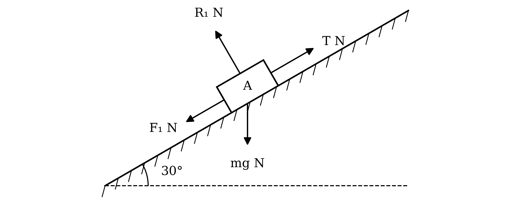
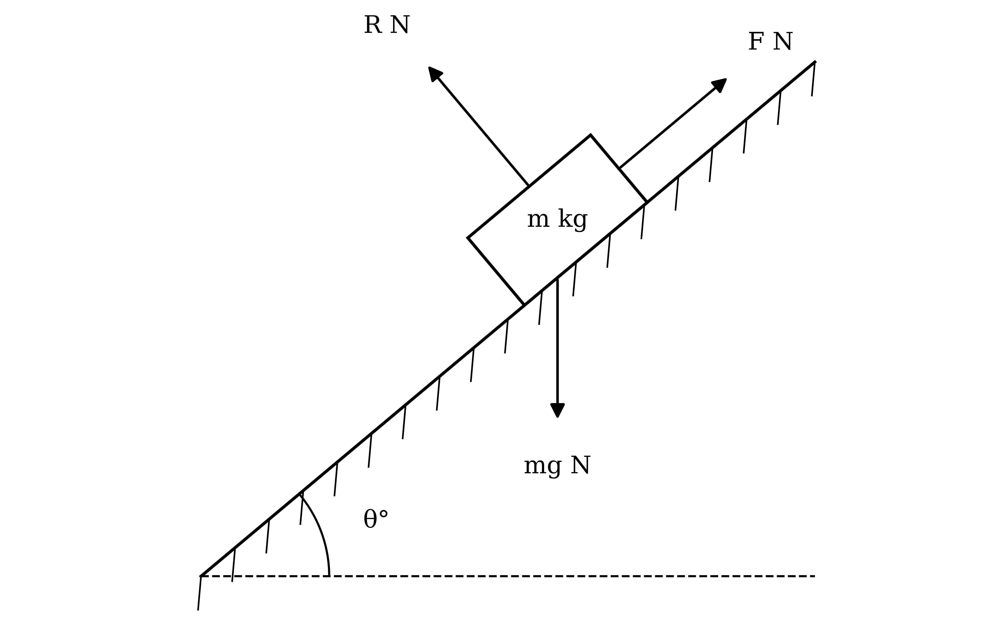
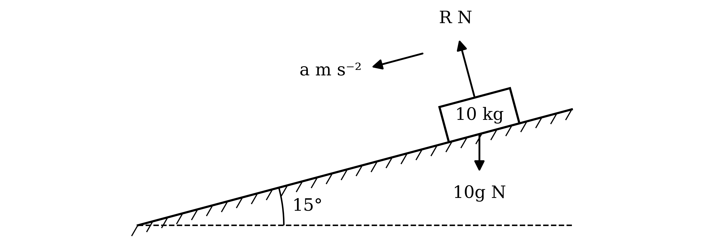
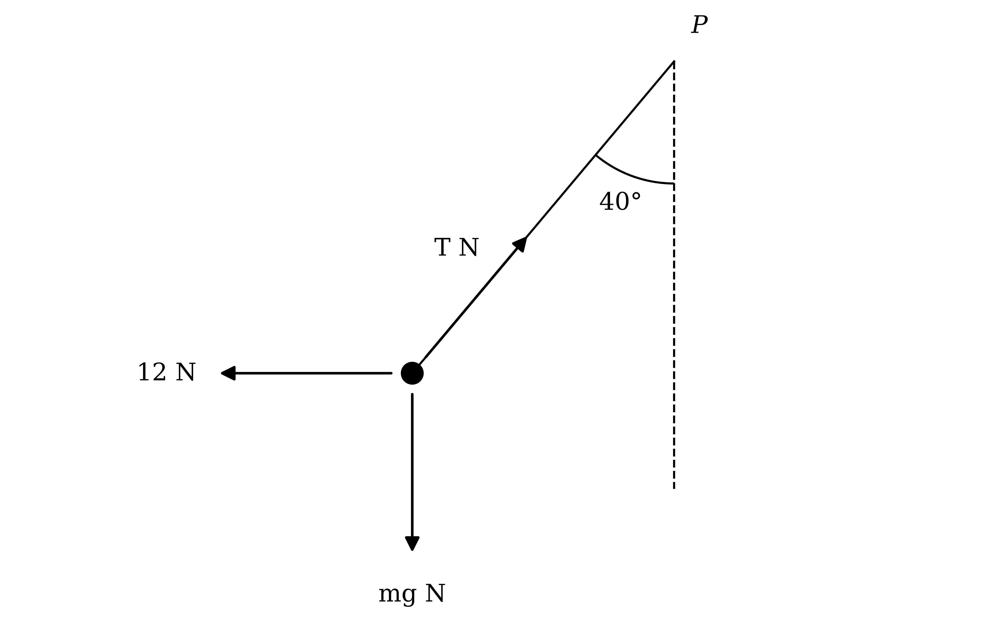
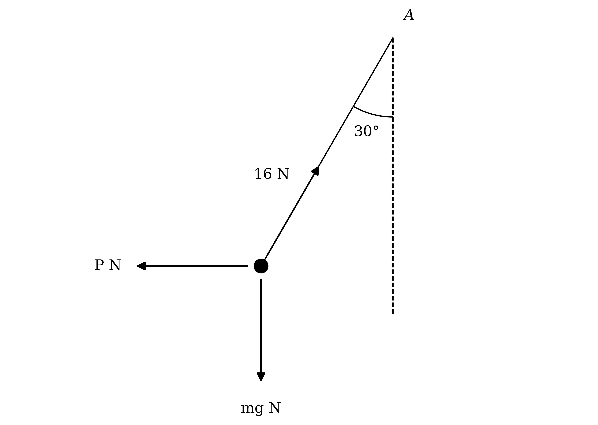
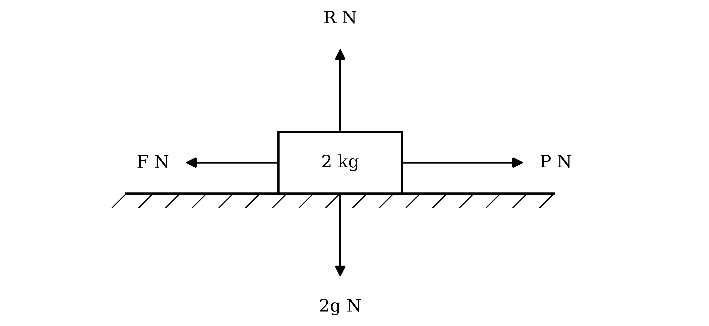
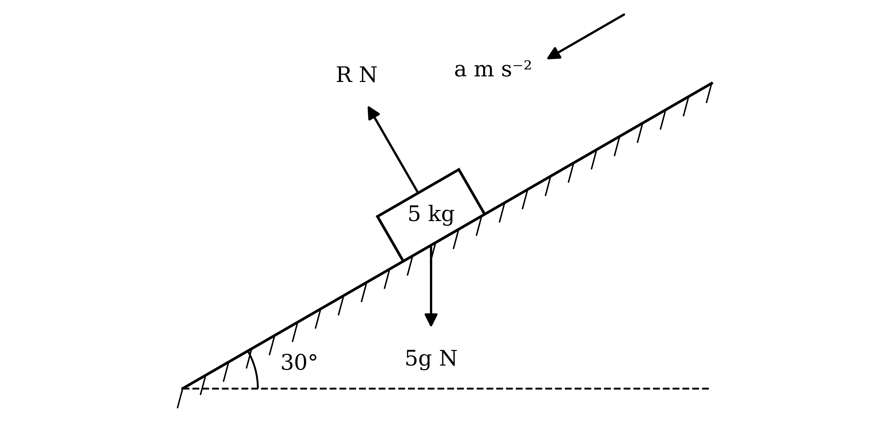

# Mark Schemes — Resolving Forces, Inclined Planes & Friction
**Forces & Equilibrium** · Cambridge (CIE) A-LEVEL maths (9709)

## Exam Questions (36 questions)

### Q1
(i)

The particle moves up the plane, so friction acts down the plane

Resolve perpendicular to the plane, then use $F = μ R$ since the particle is moving

$R = m g \text{cos}  θ$

$F = μ m g \text{cos}  θ$

**[M1]**

Take up the plane as positive and apply Newton's second law

$- μ m g \text{cos}  θ - m g \text{sin}  θ = m a$

**[M1]**

Divide through by $m$

$a = - g ( \text{sin}  θ + μ \text{cos}  θ )$

**[A1]**

Use $v = u + a t$ with $v = 0$ at time $t_{1}$

$0 = u - g ( \text{sin}  θ + μ \text{cos}  θ ) t_{1}$

**[M1]**

$t_{1} = \frac{u}{g(\text{sin}θ+μ\text{cos}θ)}$

**[B1]**

(ii)

Use $v^{2} = u^{2} + 2 a s$ with $v = 0$

$0 = u^{2} - 2 g ( \text{sin}  θ + μ \text{cos}  θ ) s$

**[M1]**

$s = \frac{u^{2}}{2g(\text{sin}θ+μ\text{cos}θ)}$

**[B1]**

> **[mark-scheme]**
> **M1**: Resolving perpendicular to the plane and use of $F = μ R$, with $R$ a component of $m g$. Allow a sine and cosine mix for this mark only.
> 
> **M1**: Correct use of Newton's second law along the plane, with all three relevant terms. Allow sign errors and a sine and cosine mix for this mark only.
> 
> **A1**: $a = - g ( \text{sin}  θ + μ \text{cos}  θ )$, or a deceleration of $g ( \text{sin}  θ + μ \text{cos}  θ )$.
> 
> **M1**: Correct use of $v = u + a t$ with $v = 0$ and the acceleration found.
> 
> **B1**: The printed expression for $t_{1}$, from correct working.
> 
> **M1**: Correct use of $v^{2} = u^{2} + 2 a s$ with $v = 0$ and the acceleration found. Using $s = \frac{1}{2} ( u + v ) t$ with $t_{1}$ is equally acceptable.
> 
> **B1**: The printed expression for $s$, from correct working.
> 
> Because the results are given, every step must be seen.
The particle now moves down the plane, so friction acts up the plane

Take down the plane as positive and apply Newton's second law. The normal contact force is unchanged, so friction is still $μ m g \text{cos}  θ$

$m g \text{sin}  θ - μ m g \text{cos}  θ = m a_{2}$

**[M1]**

$a_{2} = g ( \text{sin}  θ - μ \text{cos}  θ )$

**[A1]**

The particle starts from rest and travels the same distance $s$ back down. Use $s = u t + \frac{1}{2} a t^{2}$ with $u = 0$

$s = \frac{1}{2} a_{2} t_{2}^{2}$

**[M1]**

Substitute the expression for $s$ from part (a) and $a_{2}$, then make $t_{2}$ the subject

$t_{2}^{2} = \frac{2s}{a_{2}} = \frac{u^{2}}{g^{2}(\text{sin}θ+μ\text{cos}θ)(\text{sin}θ-μ\text{cos}θ)}$

Multiply out the brackets in the denominator, which are a difference of two squares

$( \text{sin}  θ + μ \text{cos}  θ ) ( \text{sin}  θ - μ \text{cos}  θ ) = \text{sin}^{2}  θ - μ^{2} \text{cos}^{2}  θ$

Take the positive square root

$t_{2} = \frac{u}{g\sqrt{\text{sin}^{2}θ-μ^{2}\text{cos}^{2}θ}}$

**[A1]**

> **[exam-tip]**
> The particle only slides back down if the component of the weight down the plane is greater than the maximum friction, that is if $μ < \text{tan}  θ$. That is exactly the condition for $\text{sin}^{2}  θ - μ^{2} \text{cos}^{2}  θ$ to be positive, so the square root in your answer is only defined when the question makes sense.

> **[mark-scheme]**
> **M1**: Correct use of Newton's second law down the plane, with friction now acting up the plane and all three relevant terms. Allow sign errors and a sine and cosine mix for this mark only.
> 
> **A1**: $a_{2} = g ( \text{sin}  θ - μ \text{cos}  θ )$.
> 
> **M1**: Correct use of $s = \frac{1}{2} a t^{2}$ from rest, with the expression for $s$ from part (a).
> 
> **A1**: A correct expression for $t_{2}$ in terms of $u$, $g$, $μ$ and $θ$ only. The unsimplified $\sqrt{\frac{u^{2}}{g^{2}(\text{sin}θ+μ\text{cos}θ)(\text{sin}θ-μ\text{cos}θ)}}$ is accepted.

### Q2
Take down as positive. The 37 N and 68 N forces have downward components and the 29 N force acts upwards

$68 \text{sin}  θ ^{\circ} + 37 \text{sin}  27 ^{\circ} - 29 = 44 . 8$

**[M1 A1]**

Make $\text{sin}  θ ^{\circ}$ the subject

$\text{sin}  θ ^{\circ} = \frac{73.8-37\text{sin}27^{\circ}}{68} = 0 . 83826 \dots$

**[M1]**

**Final answer:** $θ = 57 . 0$** (1 d.p.)**

**[A1]**

> **[mark-scheme]**
> **M1**: Resolving vertically, with all four terms. Allow sign errors and a sine and cosine mix for this mark only.
> 
> **A1**: Correct equation.
> 
> **M1**: Rearranging to make $\text{sin}  θ ^{\circ}$ the subject, and use of inverse sine.
> 
> **A1**: Any answer which rounds to 57.0.

### Q3
The horizontal components of the two tensions cancel. Each tension has an upward component $T \text{cos}  θ ^{\circ}$

$\text{Resultant upward force} = 2 T \text{cos}  θ ^{\circ} - W$

**[M1 A1]**

The load starts to rise from rest only if the resultant upward force is positive

$2 T \text{cos}  θ ^{\circ} - W > 0$

$W < 2 T \text{cos}  θ ^{\circ}$

**[A1]**

> **[mark-scheme]**
> **M1**: Resolving vertically, with the vertical components of both tensions and the weight. Allow a sine and cosine mix for this mark only.
> 
> **A1**: Resultant upward force $2 T \text{cos}  θ ^{\circ} - W$, or equivalent.
> 
> **A1**: $W < 2 T \text{cos}  θ ^{\circ}$, or equivalent. The inequality must be strict.
Substitute $θ = 45$ into the condition from part (a), using $\text{cos}  45 ^{\circ} = \frac{\sqrt{2}}{2}$

$W < 2 T \times \frac{\sqrt{2}}{2} = \sqrt{2} T$

**[M1]**

Divide by $\sqrt{2}$

$T > \frac{W}{\sqrt{2}}$

**[A1]**

> **[mark-scheme]**
> **M1**: Substituting $θ = 45$ into the condition from part (a), or into a fresh vertical resolution.
> 
> **A1**: $T > \frac{W}{\sqrt{2}}$. Equivalent forms such as $T > \frac{\sqrt{2}}{2} W$ or $T > 0 . 707 W$ are accepted. The inequality must be strict.

### Q4
The particle is about to slip up the plane, so friction acts down the plane and is limiting

Resolve perpendicular to the plane. The 6 N force pushes into the plane, so its component adds to the normal contact force

$R = 0 . 5 g \text{cos}  35 ^{\circ} + 6 \text{sin}  θ ^{\circ}$

**[M1]**

Friction is limiting

$F = 0 . 4 ( 0 . 5 g \text{cos}  35 ^{\circ} + 6 \text{sin}  θ ^{\circ} )$

**[M1]**

Resolve along the plane. Friction and the component of the weight act down the plane

$6 \text{cos}  θ ^{\circ} = 0 . 4 ( 0 . 5 g \text{cos}  35 ^{\circ} + 6 \text{sin}  θ ^{\circ} ) + 0 . 5 g \text{sin}  35 ^{\circ}$

**[M1]**

Use $g = 10$ and collect the terms in $θ$ on the left-hand side

$6 \text{cos}  θ ^{\circ} - 2 . 4 \text{sin}  θ ^{\circ} = 2 \text{cos}  35 ^{\circ} + 5 \text{sin}  35 ^{\circ} = 4 . 5061 \dots$

**[A1]**

Use the given identity

$\frac{6\sqrt{29}}{5} \text{cos} ( θ ^{\circ} + \text{tan}^{-1}  0 . 4 ) = 4 . 5061 \dots$

$\text{cos} ( θ ^{\circ} + 21 . 801 \dots ^{\circ} ) = 0 . 69731 \dots$

**[M1]**

$θ + 21 . 801 \dots = 45 . 788 \dots$

**Final answer:** $θ = 24 . 0$** (1 d.p.)**

**[A1]**

> **[mark-scheme]**
> **M1**: Resolving perpendicular to the plane, with all three relevant terms. Allow sign errors and a sine and cosine mix for this mark only.
> 
> **M1**: Use of $F = μ R$ with the normal contact force from resolving, including the component of the 6 N force.
> 
> **M1**: Resolving along the plane, with all three relevant terms. Allow sign errors and a sine and cosine mix for this mark only.
> 
> **A1**: Correct equation in the form $6 \text{cos}  θ ^{\circ} - 2 . 4 \text{sin}  θ ^{\circ} = 4 . 506$, or equivalent.
> 
> **M1**: Use of the given identity to reach an equation in $\text{cos} ( θ ^{\circ} + \text{tan}^{-1}  0 . 4 )$ and use of inverse cosine.
> 
> **A1**: Any answer which rounds to 24.0.

### Q5
The component of the 60 N force along the plane is $60 \text{cos}  15 ^{\circ}$

Take up the plane as positive and apply Newton's second law

$60 \text{cos}  15 ^{\circ} - m g \text{sin}  25 ^{\circ} = 0 . 3 m$

**[M1 A1]**

Use $g = 10$ and collect the terms in $m$

$m ( 0 . 3 + 10 \text{sin}  25 ^{\circ} ) = 60 \text{cos}  15 ^{\circ}$

$m = \frac{57.955\dots}{4.5261\dots}$

**Final answer:** $m = 12 . 8$** (3 s.f.)**

**[A1]**

> **[mark-scheme]**
> **M1**: Correct use of Newton's second law along the plane, with all three relevant terms. Allow sign errors and a sine and cosine mix for this mark only.
> 
> **A1**: Correct equation.
> 
> **A1**: Any answer which rounds to 12.8.
The particle does not move perpendicular to the plane. The 60 N force has a component $60 \text{sin}  15 ^{\circ}$ away from the plane

$R + 60 \text{sin}  15 ^{\circ} = m g \text{cos}  25 ^{\circ}$

**[M1 A1]**

Use $g = 10$ and the unrounded mass

$R = 12 . 804 \dots \times 10 \text{cos}  25 ^{\circ} - 60 \text{sin}  15 ^{\circ} = 116 . 04 \dots - 15 . 529 \dots$

**Final answer:** $R = 101$** N (3 s.f.)**

**[A1]**

> **[mark-scheme]**
> **M1**: Resolving perpendicular to the plane, with all three relevant terms. Allow sign errors and a sine and cosine mix for this mark only.
> 
> **A1**: Correct equation, following through from the mass found in part (a).
> 
> **A1**: Any answer which rounds to 101.

### Q6
The ring is smooth, so the tension $T$ N is the same in both parts of the string

Each part of the string makes the same angle with the vertical at the ring as it does at its fixed point, because the dashed vertical through the ring is parallel to $A C$

Resolve horizontally. Both tensions have components towards the line $A C$

$T \text{sin}  35 ^{\circ} + T \text{sin}  55 ^{\circ} = 3$

**[M1]**

$T = \frac{3}{\text{sin}35^{\circ}+\text{sin}55^{\circ}} = 2 . 1540 \dots$

**[A1]**

Resolve vertically. The tension in $A B$ pulls upwards; the tension in $B C$ and the weight pull downwards

$T \text{cos}  35 ^{\circ} = T \text{cos}  55 ^{\circ} + m g$

**[M1 A1]**

Use $g = 10$ and the unrounded value of $T$

$10 m = 2 . 1540 \dots ( \text{cos}  35 ^{\circ} - \text{cos}  55 ^{\circ} ) = 0 . 52898 \dots$

**[M1]**

**Final answer:** $m = 0 . 0529$** (3 s.f.)**

**[A1]**

> **[mark-scheme]**
> **M1**: Resolving horizontally, with the same tension in both parts of the string and all three terms. Allow a sine and cosine mix for this mark only.
> 
> **A1**: $T$, or any value which rounds to 2.15.
> 
> **M1**: Resolving vertically, with all three terms. Allow sign errors and a sine and cosine mix for this mark only.
> 
> **A1**: Correct vertical equation.
> 
> **M1**: Substituting the value of $T$ to find $m$.
> 
> **A1**: Any answer which rounds to 0.0529.
> 
> Treating the two tensions as different unknowns does not earn the first M1, because the ring is smooth.

### Q7
In both cases the object would slide down the plane without friction, so friction acts up the plane. Let the mass of the object be $m$ kg

When the angle is $θ_{1}$, resolve perpendicular to and along the plane

$R = m g \text{cos}  θ_{1}$

$F = m g \text{sin}  θ_{1}$

**[M1]**

The object is at rest, so friction can be at most $μ R$

`mg\text{sin} \; \theta_{1} \leqslant \mu mg\text{cos} \; \theta_{1}`

**[M1]**

Divide by $m g \text{cos}  θ_{1}$, which is positive

`\text{tan} \; \theta_{1} \leqslant \mu`

**[A1]**

When the angle is $θ_{2}$, the object slides, so friction takes its maximum value $μ m g \text{cos}  θ_{2}$. It accelerates down the plane, so the component of the weight down the plane is greater than the friction

$m g \text{sin}  θ_{2} > μ m g \text{cos}  θ_{2}$

**[M1]**

Divide by $m g \text{cos}  θ_{2}$, which is positive because $θ_{2} < 90 ^{\circ}$

$μ < \text{tan}  θ_{2}$

**[A1]**

Combine the two results

`\text{tan} \; \theta_{1} \leqslant \mu < \text{tan} \; \theta_{2}`

**[B1]**

> **[mark-scheme]**
> **M1**: Resolving perpendicular to and along the plane for the first case. Allow a sine and cosine mix for this mark only.
> 
> **M1**: Use of `F \leqslant \mu R` in the first case. Using $F = μ R$ here does not earn this mark.
> 
> **A1**: `\text{tan} \; \theta_{1} \leqslant \mu`, with a non-strict inequality.
> 
> **M1**: Correct condition for sliding in the second case: the component of the weight down the plane greater than $μ R$, or a positive acceleration from Newton's second law with $F = μ R$.
> 
> **A1**: $μ < \text{tan}  θ_{2}$, with a strict inequality.
> 
> **B1**: The printed result, combining both cases. Because the result is given, both inequalities must be correct.

### Q8
From a right-angled triangle with opposite 2 and adjacent 7, the hypotenuse is $\sqrt{2^{2}+7^{2}} = \sqrt{53}$

$\text{sin}  θ = \frac{2}{\sqrt{53}}$

$\text{cos}  θ = \frac{7}{\sqrt{53}}$

**[B1]**

Find the acceleration using $v = u + a t$ with $u = 0$, $v = 1 . 35$ and $t = 4$

$1 . 35 = 0 + 4 a$

**[M1]**

$a = 0 . 3375$

**[A1]**

The particle slides down the plane, so friction acts up the plane

Resolve perpendicular to the plane, then use $F = μ R$ since the particle is moving

$F = μ \times 0 . 8 g \text{cos}  θ = μ \times 8 \times \frac{7}{\sqrt{53}}$

**[M1]**

Take down the plane as positive and apply Newton's second law

$0 . 8 g \text{sin}  θ - F = 0 . 8 a$

**[M1]**

Substitute $g = 10$, the exact trigonometric values and $a = 0 . 3375$

$8 \times \frac{2}{\sqrt{53}} - μ \times 8 \times \frac{7}{\sqrt{53}} = 0 . 8 \times 0 . 3375$

**[A1]**

$μ = \frac{16/\sqrt{53}-0.27}{56/\sqrt{53}}$

**Final answer:** $μ = 0 . 251$** (3 s.f.)**

**[A1]**

> **[mark-scheme]**
> **B1**: Both $\text{sin}  θ = \frac{2}{\sqrt{53}}$ and $\text{cos}  θ = \frac{7}{\sqrt{53}}$, or the angle used to full accuracy ($θ = 15 . 945 \dots ^{\circ}$).
> 
> **M1**: Correct use of $v = u + a t$ with $u = 0$, $v = 1 . 35$ and $t = 4$.
> 
> **A1**: $a = 0 . 3375$.
> 
> **M1**: Use of $F = μ R$ with $R$ a component of $0 . 8 g$. Allow a sine and cosine mix for this mark only.
> 
> **M1**: Correct use of Newton's second law along the plane, with all three relevant terms. Allow sign errors and a sine and cosine mix for this mark only.
> 
> **A1**: Correct equation.
> 
> **A1**: Any answer which rounds to 0.251.

### Q9
The particle is in equilibrium, so resolve horizontally and vertically

$F \text{cos}  θ = 40$

$F \text{sin}  θ = 26 . 5$

**[M1]**

Square and add the two equations, using $\text{sin}^{2}  θ + \text{cos}^{2}  θ = 1$

$F^{2} = 40^{2} + 26 . 5^{2} = 2302 . 25$

**Final answer:** $F = 48 . 0$** (3 s.f.)**

**[A1]**

Divide the second equation by the first

$\text{tan}  θ = \frac{26.5}{40}$

**[M1]**

**Final answer:** $θ = 33 . 5$**° (1 d.p.)**

**[A1]**

> **[mark-scheme]**
> **M1**: Resolving horizontally and vertically to give both equations. Allow a sine and cosine mix for this mark only.
> 
> **A1**: Any answer which rounds to 48.0.
> 
> **M1**: Use of $\text{tan}  θ = \frac{26.5}{40}$, or an equivalent trigonometric equation in $θ$ using the value of $F$.
> 
> **A1**: Any answer which rounds to 33.5.
> 
> The two answers are marked independently.

### Q10
The horizontal 50 N force has a component up the plane and a component into the plane

![Force diagram for a block of mass 12 kg on a smooth plane inclined at 20° to the horizontal. A horizontal force of 50 N pushes the block from the left, the normal contact force R N acts perpendicular to the plane and the weight 12g N acts vertically downwards. The acceleration a m s⁻² is up the plane. Dashed lines from the tail of the 50 N arrow form a right-angled triangle with it, showing its components perpendicular to the plane and along the plane, and the angle between the arrow and the along-plane component is marked 20°](assets/015-force-diagram-for-a-block-of-mass-12-kg-on-a-smo.png)

Take up the plane as positive and apply Newton's second law. The component of the 50 N force along the plane is $50 \text{cos}  20 ^{\circ}$

$50 \text{cos}  20 ^{\circ} - 12 g \text{sin}  20 ^{\circ} = 12 a$

**[M1 A1]**

Use $g = 10$

$46 . 984 \dots - 41 . 042 \dots = 12 a$

**Final answer:** $a = 0 . 495 \text{m s}^{-2}$** (3 s.f.)**

**[A1]**

> **[mark-scheme]**
> **M1**: Correct use of Newton's second law along the plane, with all three relevant terms. Allow sign errors and a sine and cosine mix for this mark only.
> 
> **A1**: Correct equation.
> 
> **A1**: Any answer which rounds to 0.495.
The particle does not move perpendicular to the plane. Both the weight and the 50 N force have components into the plane, which the normal contact force balances

$R = 12 g \text{cos}  20 ^{\circ} + 50 \text{sin}  20 ^{\circ}$

**[M1 A1]**

Use $g = 10$

$R = 112 . 76 \dots + 17 . 101 \dots$

**Final answer:** $R = 130$** N (3 s.f.)**

**[A1]**

> **[mark-scheme]**
> **M1**: Resolving perpendicular to the plane, with all three relevant terms. Allow sign errors and a sine and cosine mix for this mark only.
> 
> **A1**: Correct equation.
> 
> **A1**: Any answer which rounds to 130.

### Q11
The particle moves up the plane, so friction acts down the plane

**Method 1**

Resolve perpendicular to the plane, then use $F = μ R$ since the particle is moving

$R = 2 g \text{cos}  20 ^{\circ}$

$F = 0 . 2 \times 20 \text{cos}  20 ^{\circ} = 3 . 7587 \dots$

**[M1]**

Take up the plane as positive and apply Newton's second law

$- F - 2 g \text{sin}  20 ^{\circ} = 2 a$

**[M1 A1]**

$a = - \frac{3.7587\dots+6.8404\dots}{2} = - 5 . 2995 \dots$

**[A1]**

Use $v^{2} = u^{2} + 2 a s$ with $v = 0$ and $s = 4 . 85$

$0 = u^{2} - 2 \times 5 . 2995 \dots \times 4 . 85$

**[M1]**

$u^{2} = 51 . 405 \dots$

**[A1]**

**Final answer:** $u = 7 . 17$** (3 s.f.)**

**[A1]**

> **[mark-scheme]**
> **M1**: Use of $F = μ R$ with $R$ a component of $2 g$ ($R = 2 g$ does not earn this mark). Allow a sine and cosine mix for this mark only.
> 
> **M1**: Correct use of Newton's second law along the plane, with all three relevant terms. Allow sign errors and a sine and cosine mix for this mark only.
> 
> **A1**: Correct equation.
> 
> **A1**: Acceleration $- 5 . 30$, or a deceleration of 5.30, or any value which rounds to these.
> 
> **M1**: Correct use of $v^{2} = u^{2} + 2 a s$ with $v = 0$, $s = 4 . 85$ and the acceleration found.
> 
> **A1**: $u^{2}$, or any value which rounds to 51.4.
> 
> **A1**: Any answer which rounds to 7.17.

**Method 2**

Resolve perpendicular to the plane, then use $F = μ R$ since the particle is moving

$R = 2 g \text{cos}  20 ^{\circ}$

$F = 0 . 2 \times 20 \text{cos}  20 ^{\circ} = 3 . 7587 \dots$

**[M1]**

Find the work done against friction over the 4.85 m

$\text{Work done against friction} = 3 . 7587 \dots \times 4 . 85 = 18 . 230 \dots$

**[A1]**

The particle rises a vertical height of $4 . 85 \text{sin}  20 ^{\circ}$, so find the gain in potential energy

$\text{Gain in potential energy} = 2 \times 10 \times 4 . 85 \text{sin}  20 ^{\circ} = 33 . 175 \dots$

**[M1 A1]**

By the work-energy principle, the loss in kinetic energy equals the gain in potential energy plus the work done against friction

$\frac{1}{2} \times 2 \times u^{2} = 33 . 175 \dots + 18 . 230 \dots$

**[M1 A1]**

**Final answer:** $u = 7 . 17$** (3 s.f.)**

**[A1]**

> **[mark-scheme]**
> **M1**: Use of $F = μ R$ with $R$ a component of $2 g$ ($R = 2 g$ does not earn this mark). Allow a sine and cosine mix for this mark only.
> 
> **A1**: Work done against friction, or any value which rounds to 18.2.
> 
> **M1**: Use of $m g h$ for the gain in potential energy, with $h = 4 . 85 \text{sin}  20 ^{\circ}$. Allow a sine and cosine mix for this mark only.
> 
> **A1**: Gain in potential energy, or any value which rounds to 33.2.
> 
> **M1**: Work-energy equation with all three relevant terms (kinetic energy, potential energy and work done against friction). Allow sign errors for this mark only.
> 
> **A1**: Correct equation.
> 
> **A1**: Any answer which rounds to 7.17.

### Q12
Let the tension in the other string be $T$ N. Three forces act on the particle

Each string makes the same angle with the horizontal at the particle as it does at its fixed point, because the two horizontal lines are parallel

The particle is in equilibrium, so the horizontal components of the tensions balance

$T \text{cos}  25 ^{\circ} = 56 \text{cos}  70 ^{\circ}$

**[M1 A1]**

$T = 21 . 133 \dots$

**[A1]**

The vertical forces also balance: both tensions have upward components

$T \text{sin}  25 ^{\circ} + 56 \text{sin}  70 ^{\circ} = m g$

**[M1 A1]**

Use $g = 10$ and the unrounded value of $T$

$10 m = 8 . 9312 \dots + 52 . 622 \dots = 61 . 554 \dots$

**Final answer:** $m = 6 . 16$** (3 s.f.)**

**[A1]**

> **[mark-scheme]**
> **M1**: Resolving horizontally, with the horizontal components of both tensions. Allow a sine and cosine mix for this mark only.
> 
> **A1**: Correct horizontal equation.
> 
> **A1**: $T$, or any value which rounds to 21.1.
> 
> **M1**: Resolving vertically, with all three forces. Allow sign errors and a sine and cosine mix for this mark only.
> 
> **A1**: Correct vertical equation.
> 
> **A1**: Any answer which rounds to 6.16.

### Q13
$A$ moves up its plane, so $F_{1}$ acts down the 30° plane. $B$ moves down its plane, so $F_{2}$ acts up the 70° plane

Each particle is moving, so friction takes its maximum value on each

$F_{1} = 0 . 15 m g \text{cos}  30 ^{\circ}$

$F_{2} = 0 . 15 m g \text{cos}  70 ^{\circ}$

**[M1]**

For $A$, take up its plane as positive and apply Newton's second law

$T - m g \text{sin}  30 ^{\circ} - 0 . 15 m g \text{cos}  30 ^{\circ} = m a$

**[M1 A1]**

For $B$, take down its plane as positive

$m g \text{sin}  70 ^{\circ} - T - 0 . 15 m g \text{cos}  70 ^{\circ} = m a$

**[M1 A1]**

Add the two equations to eliminate $T$, then divide by $m$ and use $g = 10$

$10 ( \text{sin}  70 ^{\circ} - \text{sin}  30 ^{\circ} - 0 . 15 \text{cos}  30 ^{\circ} - 0 . 15 \text{cos}  70 ^{\circ} ) = 2 a$

**Final answer:** $a = 1 . 29 \text{m s}^{-2}$** (3 s.f.)**

**[A1]**

> **[mark-scheme]**
> **M1**: Use of $F = μ R$ for either particle, with $R$ a component of $m g$. Allow a sine and cosine mix for this mark only.
> 
> **M1**: Correct use of Newton's second law for $A$ along its plane, with all four relevant terms. Allow sign errors and a sine and cosine mix for this mark only.
> 
> **A1**: Correct equation for $A$.
> 
> **M1**: Correct use of Newton's second law for $B$ along its plane, with all four relevant terms. Allow sign errors and a sine and cosine mix for this mark only.
> 
> **A1**: Correct equation for $B$.
> 
> **A1**: Any answer which rounds to 1.29.
> 
> Applying Newton's second law to the whole system in place of either single-particle equation is equally acceptable. Units are not required.
$B$ falls a vertical height of 0.75 m down the 70° plane, so find the distance it moves along the plane. $A$ moves the same distance up its plane

$s_{1} = \frac{0.75}{\text{sin}70^{\circ}} = 0 . 79813 \dots$

**[M1 A1]**

Use $v^{2} = u^{2} + 2 a s$ with $u = 0$ and $a = 1 . 2924 \dots$ to find the speed of $B$ as it reaches the ground

$v^{2} = 2 \times 1 . 2924 \dots \times 0 . 79813 \dots = 2 . 0630 \dots$

**[M1]**

The string is inextensible, so $A$ and $B$ always move with the same speed. At the instant $B$ reaches the ground, $A$ is moving up its plane at this same speed

$v_{A}^{2} = 2 . 0630 \dots$

Once $B$ is on the ground the string is slack, so there is no tension. $A$ is still moving up its plane, so friction still acts down the plane

Take up the plane as positive and apply Newton's second law to $A$

$- m g \text{sin}  30 ^{\circ} - 0 . 15 m g \text{cos}  30 ^{\circ} = m a$

**[M1]**

$a = - 10 ( \text{sin}  30 ^{\circ} + 0 . 15 \text{cos}  30 ^{\circ} ) = - 6 . 2990 \dots$

**[A1]**

Use $v^{2} = u^{2} + 2 a s$ with $v = 0$ and $u^{2} = 2 . 0630 \dots$ to find how much further $A$ travels

$0 = 2 . 0630 \dots - 2 \times 6 . 2990 \dots \times s_{2}$

$s_{2} = 0 . 16376 \dots$

**[M1]**

Add the two distances

$s_{1} + s_{2} = 0 . 79813 \dots + 0 . 16376 \dots$

**Final answer:** $\text{Total distance} = 0 . 962 \text{m}$** (3 s.f.)**

**[A1]**

> **[mark-scheme]**
> **M1**: Use of trigonometry to convert the vertical height of 0.75 m into a distance along the 70° plane.
> 
> **A1**: $s_{1}$, or any value which rounds to 0.798.
> 
> **M1**: Correct use of $v^{2} = u^{2} + 2 a s$ with $u = 0$, the acceleration from part (a) and $s_{1}$.
> 
> **M1**: Correct use of Newton's second law for $A$ with no tension, with the weight component and friction. Allow sign errors and a sine and cosine mix for this mark only.
> 
> **A1**: Deceleration, or any value which rounds to 6.30.
> 
> **M1**: Correct use of $v^{2} = u^{2} + 2 a s$ with a final speed of zero, to find the further distance.
> 
> **A1**: Any answer which rounds to 0.962.
> 
> Finding the further distance with a work-energy equation for $A$ is equally acceptable for the fourth and sixth marks.

### Q14
The particle would slide down the plane without friction, so friction acts up the plane

Resolve perpendicular to the plane

$R = m g \text{cos}  θ ^{\circ}$

**[M1]**

The particle is at rest, so the forces along the plane balance

$F = m g \text{sin}  θ ^{\circ}$

**[M1]**

Friction can be at most $μ R$, so `F \leqslant \mu R`

`mg\text{sin} \; \theta° \leqslant \mu mg\text{cos} \; \theta°`

**[M1]**

Divide both sides by $m g \text{cos}  θ ^{\circ}$, which is positive because $θ < 90$

`\mu \geqslant \text{tan} \; \theta°`

**[A1]**

For $45 < θ < 90$, $\text{tan}  θ ^{\circ} > \text{tan}  45 ^{\circ} = 1$

`\mu \geqslant \text{tan} \; \theta° > 1`

$μ > 1$

**[B1]**

> **[exam-tip]**
> The particle is at rest, not necessarily on the point of slipping, so friction satisfies `F \leqslant \mu R` rather than $F = μ R$. Writing $F = μ R$ would only show that $μ = \text{tan}  θ ^{\circ}$ in the limiting case, and the question needs the result for every angle in the range.

> **[mark-scheme]**
> **M1**: Resolving perpendicular to the plane, with $R$ a component of $m g$. Allow a sine and cosine mix for this mark only.
> 
> **M1**: Resolving along the plane, with friction equal to the component of the weight along the plane.
> 
> **M1**: Use of `F \leqslant \mu R`. Using $F = μ R$ in place of the inequality does not earn this mark.
> 
> **A1**: `\mu \geqslant \text{tan} \; \theta°`, or equivalent.
> 
> **B1**: The printed result, from $\text{tan}  θ ^{\circ} > 1$ for $45 < θ < 90$. Because the result is given, this step must be stated.

### Q15
The push has a downward component, which adds to the normal contact force

Resolve vertically

$R = 0 . 9 g + P \text{sin}  40 ^{\circ}$

**[M1 A1]**

Resolve horizontally. The particle is about to move, so friction is limiting and $F = μ R$

$P \text{cos}  40 ^{\circ} = 0 . 3 ( 0 . 9 g + P \text{sin}  40 ^{\circ} )$

**[M1 M1]**

Use $g = 10$ and collect the terms in $P$

$P ( \text{cos}  40 ^{\circ} - 0 . 3 \text{sin}  40 ^{\circ} ) = 2 . 7$

**[A1]**

$P = \frac{2.7}{0.57320\dots}$

**Final answer:** $P = 4 . 71$** (3 s.f.)**

**[A1]**

> **[mark-scheme]**
> **M1**: Resolving vertically with all three forces. Allow sign errors and a sine and cosine mix for this mark only.
> 
> **A1**: $R = 0 . 9 g + P \text{sin}  40 ^{\circ}$, or equivalent.
> 
> **M1**: Resolving horizontally, with the horizontal component of $P$ and the friction. Allow a sine and cosine mix for this mark only.
> 
> **M1**: Use of $F = μ R$, with $R$ including the component of $P$.
> 
> **A1**: Correct equation in $P$ only.
> 
> **A1**: Any answer which rounds to 4.71.

### Q16
Find the acceleration from the motion of $B$. Use $s = u t + \frac{1}{2} a t^{2}$ with $u = 0$, $s = 1 . 82$ and $t = 3$

$1 . 82 = \frac{1}{2} a \times 3^{2}$

**[M1]**

$a = \frac{91}{225} = 0 . 40444 \dots$

**[A1]**

$A$ moves up the plane, so friction on $A$ acts down the plane

Resolve perpendicular to the plane for $A$, then use $F = μ R$ since $A$ is moving

$F = μ \times 2 . 7 g \text{cos}  25 ^{\circ}$

**[M1]**

For $A$, take up the plane as positive and apply Newton's second law

$T - 2 . 7 g \text{sin}  25 ^{\circ} - 2 . 7 μ g \text{cos}  25 ^{\circ} = 2 . 7 a$

**[M1 A1]**

For $B$, take downwards as positive

$2 . 2 g - T = 2 . 2 a$

**[M1 A1]**

Add the two equations to eliminate $T$, and use $g = 10$ and the exact value of $a$

$22 - 27 \text{sin}  25 ^{\circ} - 27 μ \text{cos}  25 ^{\circ} = 4 . 9 \times \frac{91}{225}$

$24 . 470 \dots μ = 8 . 6075 \dots$

**Final answer:** $μ = 0 . 352$** (3 s.f.)**

**[A1]**

> **[mark-scheme]**
> **M1**: Correct use of $s = u t + \frac{1}{2} a t^{2}$ with $u = 0$, $s = 1 . 82$ and $t = 3$.
> 
> **A1**: $a = \frac{91}{225}$, or any value which rounds to 0.404.
> 
> **M1**: Use of $F = μ R$ with $R$ a component of $2 . 7 g$.
> 
> **M1**: Correct use of Newton's second law for $A$ along the plane, with all four relevant terms. Allow sign errors and a sine and cosine mix for this mark only.
> 
> **A1**: Correct equation for $A$.
> 
> **M1**: Correct use of Newton's second law for $B$, with all three relevant terms. Allow sign errors for this mark only.
> 
> **A1**: Correct equation for $B$.
> 
> **A1**: Any answer which rounds to 0.352.
> 
> Applying Newton's second law to the whole system in place of either single-particle equation is equally acceptable. A value of $a$ rounded to 0.404 before substitution still leads to 0.352.

### Q17
Both angled forces are measured from the vertical, so their horizontal components use sine. Take right as positive

$35 \text{sin}  55 ^{\circ} + 25 \text{sin}  25 ^{\circ} - 17$

**[M1]**

$= 28 . 670 \dots + 10 . 565 \dots - 17 = 22 . 235 \dots$

**Final answer:** $\text{Horizontal resultant} = 22 . 2$** N to the right (3 s.f.)**

**[A1]**

Their vertical components use cosine. Take up as positive

$35 \text{cos}  55 ^{\circ} - 25 \text{cos}  25 ^{\circ}$

**[M1]**

$= 20 . 075 \dots - 22 . 657 \dots = - 2 . 5825 \dots$

The negative sign shows the vertical resultant acts downwards

**Final answer:** $\text{Vertical resultant} = 2 . 58$** N downwards (3 s.f.)**

**[A1]**

> **[mark-scheme]**
> **M1**: Resolving horizontally, with all three horizontal forces. Allow sign errors and a sine and cosine mix for this mark only.
> 
> **A1**: 22.2 N to the right, or any answer which rounds to 22.2 with its direction stated.
> 
> **M1**: Resolving vertically, with both vertical components. Allow sign errors and a sine and cosine mix for this mark only.
> 
> **A1**: 2.58 N downwards, or any answer which rounds to 2.58 with its direction stated. A bare 2.58 with no direction, or $- 2 . 58$ with no positive direction stated, does not earn this mark.
> 
> Units are not required.

### Q18
The particle slides down the plane, so friction acts up the plane

Resolve perpendicular to the plane

$R = 15 g \text{cos}  25 ^{\circ}$

**[M1]**

The particle is moving, so friction takes its maximum value

$F = 0 . 3 \times 150 \text{cos}  25 ^{\circ}$

**[M1]**

**Final answer:** $F = 40 . 8$** N (3 s.f.)**

**[A1]**

> **[mark-scheme]**
> **M1**: Resolving perpendicular to the plane, with $R$ a component of $15 g$. Allow a sine and cosine mix for this mark only.
> 
> **M1**: Use of $F = μ R$ with the normal contact force from resolving.
> 
> **A1**: Any answer which rounds to 40.8.
Take down the plane as positive and apply Newton's second law

$15 g \text{sin}  25 ^{\circ} - F = 15 a$

**[M1]**

Use $g = 10$ and the unrounded friction

$63 . 392 \dots - 40 . 783 \dots = 15 a$

**[A1]**

**Final answer:** $a = 1 . 51 \text{m s}^{-2}$** (3 s.f.)**

**[A1]**

> **[mark-scheme]**
> **M1**: Correct use of Newton's second law along the plane, with all three relevant terms. Allow sign errors and a sine and cosine mix for this mark only.
> 
> **A1**: Correct equation, following through from the friction found in part (a).
> 
> **A1**: Any answer which rounds to 1.51.

### Q19
Take right as positive. The horizontal component of the 20 N force, $20 \text{cos}  50 ^{\circ}$, acts to the left

$19 - 20 \text{cos}  50 ^{\circ} = 19 - 12 . 855 \dots$

**[M1]**

**Final answer:** $\text{Horizontal resultant} = 6 . 14$** N to the right (3 s.f.)**

**[A1]**

Take up as positive. The vertical component of the 20 N force, $20 \text{sin}  50 ^{\circ}$, acts upwards

$20 \text{sin}  50 ^{\circ} - 10 = 15 . 320 \dots - 10$

**[M1]**

**Final answer:** $\text{Vertical resultant} = 5 . 32$** N upwards (3 s.f.)**

**[A1]**

> **[mark-scheme]**
> **M1**: Resolving horizontally, with both horizontal forces. Allow sign errors and a sine and cosine mix for this mark only.
> 
> **A1**: 6.14 N to the right, or any answer which rounds to 6.14 with its direction stated.
> 
> **M1**: Resolving vertically, with both vertical forces. Allow sign errors and a sine and cosine mix for this mark only.
> 
> **A1**: 5.32 N upwards, or any answer which rounds to 5.32 with its direction stated.
> 
> A signed answer is accepted in place of a direction in words, provided the positive direction is stated. Units are not required.

### Q20
The particle moves up the plane, so friction acts down the plane

Resolve perpendicular to the plane

$R = 3 g \text{cos}  25 ^{\circ}$

**[M1]**

The particle is moving, so friction takes its maximum value

$F = 0 . 27 \times 3 g \text{cos}  25 ^{\circ}$

Take up the plane as positive and apply Newton's second law

$- 0 . 27 \times 3 g \text{cos}  25 ^{\circ} - 3 g \text{sin}  25 ^{\circ} = 3 a$

**[M1 A1]**

Divide through by 3

$a = - ( \text{sin}  25 ^{\circ} + 0 . 27 \text{cos}  25 ^{\circ} ) g$

The acceleration is negative, so the particle slows down at this rate

$\text{Deceleration} = ( \text{sin}  25 ^{\circ} + 0 . 27 \text{cos}  25 ^{\circ} ) g \text{m s}^{-2}$

**[B1]**

> **[mark-scheme]**
> **M1**: Resolving perpendicular to the plane, with $R$ a component of $3 g$. Allow a sine and cosine mix for this mark only.
> 
> **M1**: Correct use of Newton's second law along the plane, with all three relevant terms and $F = 0 . 27 R$. Allow sign errors and a sine and cosine mix for this mark only.
> 
> **A1**: Correct equation.
> 
> **B1**: The printed deceleration, reached from correct working with g kept as a letter. Because the result is given, every step must be seen and no decimal approximation may be used.
Use $v^{2} = u^{2} + 2 a s$ with $v = 0$, $s = 1 . 91$ and the acceleration from part (a), which is negative because the particle is slowing down

$0 = u^{2} - 2 ( \text{sin}  25 ^{\circ} + 0 . 27 \text{cos}  25 ^{\circ} ) g \times 1 . 91$

**[M1]**

Use $g = 10$

$u^{2} = 2 \times 6 . 6732 \dots \times 1 . 91 = 25 . 491 \dots$

**[A1]**

**Final answer:** $u = 5 . 05$** (3 s.f.)**

**[A1]**

> **[mark-scheme]**
> **M1**: Correct use of $v^{2} = u^{2} + 2 a s$ with $v = 0$, $s = 1 . 91$ and the deceleration from part (a).
> 
> **A1**: Correct value of $u^{2}$, or a correct equation with $g = 10$.
> 
> **A1**: Any answer which rounds to 5.05.
> 
> A work-energy equation, with the loss of kinetic energy equal to the gain in potential energy plus the work done against friction over 1.91 m, reaching the same value is equally acceptable.

### Q21
$A$ moves up the plane, so friction on $A$ acts down the plane

Resolve perpendicular to the plane for $A$, then use $F = μ R$ since $A$ is moving

$R = 4 g \text{cos}  35 ^{\circ}$

$F = 0 . 15 \times 40 \text{cos}  35 ^{\circ} = 4 . 9149 \dots$

**[M1]**

For $A$, take up the plane as positive and apply Newton's second law

$T - 4 g \text{sin}  35 ^{\circ} - F = 4 a$

**[M1 A1]**

For $B$, take downwards as positive

$3 g - T = 3 a$

**[M1 A1]**

Add the two equations to eliminate $T$, and use $g = 10$

$30 - 40 \text{sin}  35 ^{\circ} - 4 . 9149 \dots = 7 a$

**Final answer:** $a = 0 . 306 \text{m s}^{-2}$** (3 s.f.)**

**[A1]**

Substitute the unrounded $a = 0 . 30600 \dots$ into $3 g - T = 3 a$

$T = 30 - 3 \times 0 . 30600 \dots$

**Final answer:** $T = 29 . 1$** N (3 s.f.)**

**[A1]**

> **[mark-scheme]**
> **M1**: Use of $F = μ R$ with $R$ a component of $4 g$. Allow a sine and cosine mix for this mark only.
> 
> **M1**: Correct use of Newton's second law for $A$ along the plane, with all four relevant terms. Allow sign errors and a sine and cosine mix for this mark only.
> 
> **A1**: Correct equation for $A$.
> 
> **M1**: Correct use of Newton's second law for $B$, with all three relevant terms. Allow sign errors for this mark only.
> 
> **A1**: Correct equation for $B$.
> 
> **A1**: Any answer which rounds to 0.306.
> 
> **A1**: Any answer which rounds to 29.1. Follow through on the value of $a$.
> 
> Applying Newton's second law to the whole system in place of either single-particle equation is equally acceptable. Units are not required.
While $B$ falls, $A$ moves up the plane from rest with $a = 0 . 30600 \dots$ for 3.2 s. Use $s = u t + \frac{1}{2} a t^{2}$

$s_{1} = \frac{1}{2} \times 0 . 30600 \dots \times 3 . 2^{2} = 1 . 5667 \dots$

**[M1]**

Use $v = u + a t$ to find the speed of $B$ as it reaches the ground

$v = 0 . 30600 \dots \times 3 . 2 = 0 . 97921 \dots$

**[M1]**

The string is inextensible, so $A$ and $B$ always move with the same speed. At the instant $B$ reaches the ground, $A$ is moving up the plane at this same speed

$v_{A} = 0 . 97921 \dots \text{m s}^{-1}$

Once $B$ is on the ground the string is slack, so there is no tension. $A$ is still moving up the plane, so friction still acts down the plane

Take up the plane as positive and apply Newton's second law to $A$

$- 4 g \text{sin}  35 ^{\circ} - 0 . 15 \times 4 g \text{cos}  35 ^{\circ} = 4 a$

**[M1]**

$a = - 10 ( \text{sin}  35 ^{\circ} + 0 . 15 \text{cos}  35 ^{\circ} ) = - 6 . 9644 \dots$

**[A1]**

Use $v^{2} = u^{2} + 2 a s$ with $v = 0$ and $u = 0 . 97921 \dots$ to find how much further $A$ travels

$0 = 0 . 97921 \dots^{2} - 2 \times 6 . 9644 \dots \times s_{2}$

$s_{2} = 0 . 068839 \dots$

**[M1]**

Add the two distances

$s_{1} + s_{2} = 1 . 5667 \dots + 0 . 068839 \dots$

**Final answer:** $\text{Total distance} = 1 . 64 \text{m}$** (3 s.f.)**

**[A1]**

> **[mark-scheme]**
> **M1**: Correct use of $s = u t + \frac{1}{2} a t^{2}$ with $u = 0$, $t = 3 . 2$ and the acceleration from part (a).
> 
> **M1**: Correct use of $v = u + a t$ to find the speed of $B$ as it reaches the ground, which is also the speed of $A$.
> 
> **M1**: Correct use of Newton's second law for $A$ with no tension, with the weight component and friction. Allow sign errors and a sine and cosine mix for this mark only.
> 
> **A1**: Deceleration, or any value which rounds to 6.96.
> 
> **M1**: Correct use of $v^{2} = u^{2} + 2 a s$ with a final speed of zero, to find the further distance.
> 
> **A1**: Any answer which rounds to 1.64.
> 
> Finding the further distance with a work-energy equation, with the loss of kinetic energy of $A$ equal to its gain in potential energy plus the work done against friction, is equally acceptable for the third and fifth marks.

### Q22
The upward component of the 45 N force, $45 \text{sin}  20 ^{\circ}$, reduces the normal contact force

The particle does not move vertically, so resolve vertically

$R + 45 \text{sin}  20 ^{\circ} = 7 g$

**[M1]**

Use $g = 10$

$R = 70 - 45 \text{sin}  20 ^{\circ} = 54 . 609 \dots$

**[A1]**

The particle is moving, so friction takes its maximum value

$F = μ R = 0 . 4 \times 54 . 609 \dots$

**[M1]**

**Final answer:** $F = 21 . 8$** N (3 s.f.)**

**[A1]**

> **[mark-scheme]**
> **M1**: Resolving vertically with all three forces. Allow sign errors and a sine and cosine mix for this mark only.
> 
> **A1**: $R = 70 - 45 \text{sin}  20 ^{\circ}$, or any value which rounds to 54.6.
> 
> **M1**: Use of $F = μ R$ with the normal contact force from resolving, which must include a component of the 45 N force.
> 
> **A1**: Any answer which rounds to 21.8.
Take the direction of motion as positive and apply Newton's second law horizontally

$45 \text{cos}  20 ^{\circ} - F = 7 a$

**[M1]**

Substitute the unrounded friction

$42 . 286 \dots - 21 . 843 \dots = 7 a$

**[A1]**

**Final answer:** $a = 2 . 92 \text{m s}^{-2}$** (3 s.f.)**

**[A1]**

> **[mark-scheme]**
> **M1**: Correct use of Newton's second law horizontally, with all three relevant terms (the horizontal component of the 45 N force, the friction and $7 a$). Allow sign errors and a sine and cosine mix for this mark only.
> 
> **A1**: Correct equation, following through from the friction found in part (a).
> 
> **A1**: Any answer which rounds to 2.92.

### Q23
The particle slides down the plane, so friction acts up the plane

Resolve perpendicular to the plane, then use $F = μ R$ since the particle is moving

$R = 3 g \text{cos}  15 ^{\circ} = 30 \text{cos}  15 ^{\circ}$

$F = 0 . 2 \times 30 \text{cos}  15 ^{\circ} = 5 . 7955 \dots$

**[M1]**

Take down the plane as positive and apply Newton's second law

$3 g \text{sin}  15 ^{\circ} - F = 3 a$

**[M1]**

$30 \text{sin}  15 ^{\circ} - 5 . 7955 \dots = 3 a$

$a = 0 . 65633 \dots$

**[A1]**

Use $s = u t + \frac{1}{2} a t^{2}$ with $u = 0$ and $t = 3$

$s = 0 + \frac{1}{2} \times 0 . 65633 \dots \times 3^{2}$

**[M1]**

**Final answer:** $s = 2 . 95 \text{m}$** (3 s.f.)**

**[A1]**

> **[exam-tip]**
> If your acceleration had come out negative, the particle would not slide at all, because friction would be strong enough to hold it. A positive value here confirms that the component of the weight down the plane is greater than the maximum friction.

> **[mark-scheme]**
> **M1**: Use of $F = μ R$ with $R$ a component of $3 g$ ($R = 3 g$ does not earn this mark). Allow a sine and cosine mix for this mark only.
> 
> **M1**: Correct use of Newton's second law along the plane, with all three relevant terms. Allow sign errors and a sine and cosine mix for this mark only.
> 
> **A1**: Acceleration, or any value which rounds to 0.656.
> 
> **M1**: Correct use of $s = u t + \frac{1}{2} a t^{2}$ with $u = 0$, $t = 3$ and the acceleration found.
> 
> **A1**: Any answer which rounds to 2.95.

### Q24
Draw a force diagram for each object. $A$ accelerates downwards and $B$ accelerates towards the pulley

$B$ does not move vertically, so $R = 5 g = 50$. $B$ is moving, so friction takes its maximum value

$F = 0 . 35 \times 50 = 17 . 5$

**[B1]**

For $B$, take the direction towards the pulley as positive and apply Newton's second law

$T - 17 . 5 = 5 a$

**[M1]**

For $A$, take downwards as positive

$4 g - T = 4 a$

**[A1]**

Add the two equations to eliminate $T$, and use $g = 10$

$40 - 17 . 5 = 9 a$

**[M1]**

$a = 2 . 5 \text{m s}^{-2}$

**[A1]**

Substitute $a = 2 . 5$ into $4 g - T = 4 a$

$T = 40 - 4 \times 2 . 5$

**Final answer:** $T = 30$** N**

**[A1]**

> **[mark-scheme]**
> **B1**: Friction 17.5, from $F = 0 . 35 \times 5 g$.
> 
> **M1**: Correct use of Newton's second law for either object, with all three of its terms. Allow sign errors for this mark.
> 
> **A1**: Both equations correct, $T - 17 . 5 = 5 a$ and $4 g - T = 4 a$, or equivalent.
> 
> **M1**: Solving the two equations to find $a$ (for example by adding them).
> 
> **A1**: $a = 2 . 5$.
> 
> **A1**: $T = 30$. Follow through on the value of $a$.
> 
> Applying Newton's second law to the whole system, $4 g - 17 . 5 = 9 a$, is equally acceptable for finding $a$. Units are not required.

### Q25
The plane is smooth, so the only forces are the weight and the normal contact force

Take down the plane as positive and apply Newton's second law

$10 g \text{sin}  15 ^{\circ} = 10 a$

**[M1]**

Use $g = 10$

$a = 10 \text{sin}  15 ^{\circ}$

**Final answer:** $a = 2 . 59 \text{m s}^{-2}$** (3 s.f.)**

**[A1]**

> **[mark-scheme]**
> **M1**: Correct use of Newton's second law along the plane, with the weight resolved along the plane. Allow a sine and cosine mix for this mark only.
> 
> **A1**: Any answer which rounds to 2.59.
The forces perpendicular to the plane balance

$R = 10 g \text{cos}  15 ^{\circ}$

**[M1]**

Use $g = 10$

$R = 100 \text{cos}  15 ^{\circ}$

**Final answer:** $R = 96 . 6$** N (3 s.f.)**

**[A1]**

> **[mark-scheme]**
> **M1**: Resolving perpendicular to the plane, with $R$ equal to the component of the weight perpendicular to the plane. Allow a sine and cosine mix for this mark only.
> 
> **A1**: Any answer which rounds to 96.6.

### Q26
Three forces act on the particle: the tension along the string towards $P$, the 12 N force and the weight

The particle is in equilibrium, so the horizontal forces balance. The horizontal component of the tension is opposite the 40° angle

$T \text{sin}  40 ^{\circ} = 12$

**[M1]**

$T = \frac{12}{\text{sin}40^{\circ}} = 18 . 668 \dots$

**Final answer:** $T = 18 . 7$** N (3 s.f.)**

**[A1]**

The vertical forces also balance

$T \text{cos}  40 ^{\circ} = m g$

**[M1]**

Use $g = 10$ and the unrounded value of $T$

$10 m = 18 . 668 \dots \times \text{cos}  40 ^{\circ} = 14 . 301 \dots$

**[A1]**

**Final answer:** $m = 1 . 43$** (3 s.f.)**

**[A1]**

> **[mark-scheme]**
> **M1**: Resolving horizontally, with the component of the tension and the 12 N force. Allow a sine and cosine mix for this mark only.
> 
> **A1**: Any answer which rounds to 18.7.
> 
> **M1**: Resolving vertically, with the component of the tension and the weight. Allow a sine and cosine mix for this mark only.
> 
> **A1**: Correct vertical equation with $g = 10$, for example $10 m = 18 . 67 \text{cos}  40 ^{\circ}$.
> 
> **A1**: Any answer which rounds to 1.43.
> 
> Dividing the two equations to give $\text{tan}  40 ^{\circ} = \frac{12}{10m}$ is an equally valid way to find $m$, and earns the same marks for the vertical equation and $m$.

### Q27
The particle is about to slip up the plane, so friction acts down the plane, and it is limiting

Resolve perpendicular to the plane

$R = 0 . 7 g \text{cos}  35 ^{\circ}$

**[M1]**

Use $g = 10$

$R = 7 \text{cos}  35 ^{\circ} = 5 . 7340 \dots$

**[A1]**

Friction is limiting, so $F = μ R$

$F = 0 . 35 \times 5 . 7340 \dots = 2 . 0069 \dots$

**[M1]**

Resolve along the plane. Friction and the component of the weight both act down the plane

$P = F + 0 . 7 g \text{sin}  35 ^{\circ}$

**[M1]**

$P = 2 . 0069 \dots + 7 \text{sin}  35 ^{\circ}$

**[A1]**

**Final answer:** $P = 6 . 02$** (3 s.f.)**

**[A1]**

> **[mark-scheme]**
> **M1**: Resolving perpendicular to the plane, with $R$ a component of $0 . 7 g$. Allow a sine and cosine mix for this mark only.
> 
> **A1**: $R = 7 \text{cos}  35 ^{\circ}$, or any value which rounds to 5.73.
> 
> **M1**: Use of $F = μ R$ with the normal contact force from resolving.
> 
> **M1**: Resolving along the plane, with all three relevant terms ($P$, the friction and the component of the weight). Allow sign errors and a sine and cosine mix for this mark only.
> 
> **A1**: Correct equation, with friction acting down the plane.
> 
> **A1**: Any answer which rounds to 6.02.

### Q28
Find the horizontal component of the $20 \sqrt{3}$ N force, which acts to the right

$20 \sqrt{3} \text{cos}  60 ^{\circ} = 20 \sqrt{3} \times \frac{1}{2} = 10 \sqrt{3}$

Find the horizontal component of the 20 N force, which acts to the left

$20 \text{cos}  30 ^{\circ} = 20 \times \frac{\sqrt{3}}{2} = 10 \sqrt{3}$

**[M1 A1]**

The $F$ N force has no horizontal component. Take right as positive

$10 \sqrt{3} - 10 \sqrt{3} = 0$

**Final answer:** **The resultant force in the horizontal direction is zero**

**[B1]**

> **[mark-scheme]**
> **M1**: Resolving both angled forces horizontally. Allow a sine and cosine mix for this mark only.
> 
> **A1**: Both horizontal components correct, each $10 \sqrt{3}$ or equivalent.
> 
> **B1**: The two components shown to cancel, with a conclusion. Because the result is given, exact values must be seen: a decimal comparison such as $17 . 3 - 17 . 3$ alone does not earn this mark.
The particle is in equilibrium, so the vertical forces balance. Both angled forces have upward components

$F = 20 \sqrt{3} \text{sin}  60 ^{\circ} + 20 \text{sin}  30 ^{\circ}$

**[M1]**

Use the exact values $\text{sin}  60 ^{\circ} = \frac{\sqrt{3}}{2}$ and $\text{sin}  30 ^{\circ} = \frac{1}{2}$

$F = 20 \sqrt{3} \times \frac{\sqrt{3}}{2} + 20 \times \frac{1}{2} = 30 + 10$

**[A1]**

$F = 40$

**[A1]**

> **[mark-scheme]**
> **M1**: Resolving vertically with all three forces. Allow sign errors and a sine and cosine mix for this mark only.
> 
> **A1**: Correct vertical components, 30 and 10, or a correct unsimplified equation.
> 
> **A1**: $F = 40$.

### Q29
The horizontal component is adjacent to the 40° angle, so use cosine

$\text{Horizontal component} = 17 \text{cos}  40 ^{\circ}$

**Final answer:** $\text{Horizontal component} = 13 . 0$** N to the right (3 s.f.)**

**[B1]**

The vertical component is opposite the 40° angle, so use sine

$\text{Vertical component} = 17 \text{sin}  40 ^{\circ}$

**Final answer:** $\text{Vertical component} = 10 . 9$** N downwards (3 s.f.)**

**[B1]**

> **[mark-scheme]**
> **B1**: Horizontal component $17 \text{cos}  40 ^{\circ}$, or answers which round to 13.0.
> 
> **B1**: Vertical component $17 \text{sin}  40 ^{\circ}$, or answers which round to 10.9.
> 
> The two components are marked independently. Directions and units are not required for these marks.
Horizontally, the 14 N force acts to the left and the horizontal component of the 17 N force acts to the right. Take left as positive

$14 - 17 \text{cos}  40 ^{\circ} = 14 - 13 . 0227 \dots$

**Final answer:** $\text{Horizontal resultant} = 0 . 977$** N to the left (3 s.f.)**

**[B1]**

Vertically, the 8 N force acts upwards and the vertical component of the 17 N force acts downwards. Take down as positive

$17 \text{sin}  40 ^{\circ} - 8 = 10 . 9273 \dots - 8$

**Final answer:** $\text{Vertical resultant} = 2 . 93$** N downwards (3 s.f.)**

**[B1]**

> **[mark-scheme]**
> **B1**: Horizontal resultant 0.977 N to the left, or any answer which rounds to 0.977 with its direction stated as to the left.
> 
> **B1**: Vertical resultant 2.93 N downwards, or any answer which rounds to 2.93 with its direction stated as downwards.
> 
> A signed answer is accepted in place of a direction in words, provided the positive direction is stated. The two answers are marked independently. Units are not required.

### Q30
The force $m g$ N acts vertically downwards on a particle of mass $m$ kg

**Final answer:** **It is the weight of the particle**

**[B1]**

> **[mark-scheme]**
> **B1**: The weight of the particle. Accept "the force of gravity on the particle" or "the gravitational force exerted by the Earth on the particle".
The tension acts along the string, towards $A$

The angle is measured from the vertical, so the horizontal component is opposite the 30° angle

$\text{Horizontal component} = 16 \text{sin}  30 ^{\circ}$

**Final answer:** $\text{Horizontal component} = 8$** N**

**[B1]**

The vertical component is adjacent to the 30° angle

$\text{Vertical component} = 16 \text{cos}  30 ^{\circ}$

**Final answer:** $\text{Vertical component} = 13 . 9$** N (3 s.f.)**

**[B1]**

> **[mark-scheme]**
> **B1**: Horizontal component 8.
> 
> **B1**: Vertical component $16 \text{cos}  30 ^{\circ}$, or answers which round to 13.9. The exact value $8 \sqrt{3}$ is also accepted.
> 
> The two components are marked independently. Units are not required.
The particle is in equilibrium, so the horizontal forces balance

$P = 16 \text{sin}  30 ^{\circ}$

$P = 8$

**[B1]**

The vertical forces also balance

$m g = 16 \text{cos}  30 ^{\circ}$

Use $g = 10$

$10 m = 13 . 856 \dots$

**Final answer:** $m = 1 . 39$** (3 s.f.)**

**[B1]**

> **[mark-scheme]**
> **B1**: $P = 8$.
> 
> **B1**: $m = 1 . 39$, or any answer which rounds to 1.39. The exact value $\frac{4\sqrt{3}}{5}$ is also accepted.
> 
> The two values are marked independently, and follow through from the components found in part (b).

### Q31
The horizontal component is adjacent to the 50° angle, so use cosine

$\text{Horizontal component} = 30 \text{cos}  50 ^{\circ}$

**Final answer:** $\text{Horizontal component} = 19 . 3$** N to the left (3 s.f.)**

**[B1]**

The vertical component is opposite the 50° angle, so use sine

$\text{Vertical component} = 30 \text{sin}  50 ^{\circ}$

**Final answer:** $\text{Vertical component} = 23 . 0$** N upwards (3 s.f.)**

**[B1]**

> **[mark-scheme]**
> **B1**: Horizontal component $30 \text{cos}  50 ^{\circ}$, or answers which round to 19.3.
> 
> **B1**: Vertical component $30 \text{sin}  50 ^{\circ}$, or answers which round to 23.0.
> 
> The two components are marked independently. Directions and units are not required for these marks.
The particle is in equilibrium, so the horizontal forces balance

$P = 30 \text{cos}  50 ^{\circ}$

**Final answer:** $P = 19 . 3$** (3 s.f.)**

**[B1]**

The vertical forces also balance

$Q = 30 \text{sin}  50 ^{\circ}$

**Final answer:** $Q = 23 . 0$** (3 s.f.)**

**[B1]**

> **[mark-scheme]**
> **B1**: $P = 19 . 3$, or any answer which rounds to 19.3.
> 
> **B1**: $Q = 23 . 0$, or any answer which rounds to 23.0.
> 
> The two values are marked independently, and follow through from the components found in part (a).

### Q32
While the particle moves up the plane, friction acts down the plane, opposing the motion

The particle does not move perpendicular to the plane, so resolve in that direction

$R = 5 g \text{cos}  30 ^{\circ}$

**[M1]**

The particle is moving, so friction takes its maximum value, $F = μ R$

$F = 0 . 3 \times 50 \text{cos}  30 ^{\circ} = 12 . 990 \dots$

**Final answer:** $F = 13 . 0$** N (3 s.f.)**

**[A1]**

**Final answer:** **Friction acts down the plane**

**[B1]**

> **[mark-scheme]**
> **M1**: Resolving perpendicular to the plane to find $R$, which must be a component of $5 g$ (using $R = 5 g$ does not earn this mark). Allow a sine and cosine mix for this mark only.
> 
> **A1**: Any answer which rounds to 13.0. The exact value $\frac{15\sqrt{3}}{2}$ is also accepted.
> 
> **B1**: Direction stated as down the plane, or shown on a diagram.
Take up the plane as positive. Both friction and the component of the weight along the plane act down the plane. Apply Newton's second law

$- F - 5 g \text{sin}  30 ^{\circ} = 5 a$

**[M1]**

Substitute $F = 12 . 990 \dots$ and $g = 10$

$- 12 . 990 \dots - 25 = 5 a$

**[A1]**

$a = - 7 . 5980 \dots$

The negative sign shows the acceleration is down the plane, so the particle is slowing down

**Final answer:** $\text{Deceleration} = 7 . 60 \text{m s}^{-2}$** (3 s.f.)**

**[A1]**

> **[mark-scheme]**
> **M1**: Correct use of Newton's second law along the plane, with all three relevant terms (friction, the component of the weight and $5 a$). Allow sign errors and a sine and cosine mix for this mark only.
> 
> **A1**: Correct equation, for example $- 12 . 99 - 25 = 5 a$.
> 
> **A1**: Deceleration 7.60, or any answer which rounds to 7.60. An acceleration of $- 7 . 60$ with up the plane stated as positive is also accepted.
The normal contact force is unchanged, so the magnitude of the friction is unchanged. It now opposes motion down the plane

**Final answer:** $F = 13 . 0$** N (3 s.f.)**

**[B1]**

**Final answer:** **Friction acts up the plane**

**[B1]**

> **[mark-scheme]**
> **B1**: Magnitude 13.0, or the same value as found in part (a).
> 
> **B1**: Direction stated as up the plane, or shown on a diagram.
> 
> The two answers are marked independently.
Take down the plane as positive. The component of the weight acts down the plane and friction acts up it. Apply Newton's second law

$5 g \text{sin}  30 ^{\circ} - F = 5 a$

**[M1]**

Substitute $F = 12 . 990 \dots$ and $g = 10$

$25 - 12 . 990 \dots = 5 a$

**[A1]**

**Final answer:** $a = 2 . 40 \text{m s}^{-2}$** down the plane (3 s.f.)**

**[A1]**

> **[mark-scheme]**
> **M1**: Correct use of Newton's second law along the plane, with all three relevant terms. Allow sign errors and a sine and cosine mix for this mark only.
> 
> **A1**: Correct equation, for example $25 - 12 . 99 = 5 a$.
> 
> **A1**: Any answer which rounds to 2.40. The direction does not need to be stated.

### Q33
The horizontal component is adjacent to the 30° angle, so use cosine

$\text{Horizontal component} = 16 \text{cos}  30 ^{\circ}$

**Final answer:** $\text{Horizontal component} = 13 . 9$** N (3 s.f.)**

**[B1]**

The vertical component is opposite the 30° angle, so use sine

$\text{Vertical component} = 16 \text{sin}  30 ^{\circ}$

**Final answer:** $\text{Vertical component} = 8$** N**

**[B1]**

> **[mark-scheme]**
> **B1**: Horizontal component $16 \text{cos}  30 ^{\circ}$, or answers which round to 13.9. The exact value $8 \sqrt{3}$ is also accepted.
> 
> **B1**: Vertical component 8.
> 
> The two components are marked independently. Units are not required.
This time the angle is measured from the vertical, so the horizontal component is opposite the 20° angle

$\text{Horizontal component} = 8 . 5 \text{sin}  20 ^{\circ}$

**Final answer:** $\text{Horizontal component} = 2 . 91$** N (3 s.f.)**

**[B1]**

The vertical component is adjacent to the 20° angle

$\text{Vertical component} = 8 . 5 \text{cos}  20 ^{\circ}$

**Final answer:** $\text{Vertical component} = 7 . 99$** N (3 s.f.)**

**[B1]**

> **[mark-scheme]**
> **B1**: Horizontal component $8 . 5 \text{sin}  20 ^{\circ}$, or answers which round to 2.91.
> 
> **B1**: Vertical component $8 . 5 \text{cos}  20 ^{\circ}$, or answers which round to 7.99.
> 
> The two components are marked independently. Units are not required.

### Q34
Friction acts against the direction the block is about to move in

The vertical forces balance

$R = 2 g = 20$

The block is on the point of moving, so friction is limiting

$F = μ R = 0 . 4 \times 20 = 8$

**[M1]**

The horizontal forces balance

$P = F$

**[M1]**

$P = 8$

**[A1]**

> **[mark-scheme]**
> **M1**: Use of $F = μ R$ with $R = 2 g$.
> 
> **M1**: Resolving horizontally, with $P$ equal to the friction.
> 
> **A1**: $P = 8$.
The force pushes the block into the surface, so its vertical component adds to the normal contact force

Resolve vertically

$R = 6 g + P \text{sin}  40 ^{\circ}$

**[M1]**

The block is on the point of moving, so friction is limiting

$F = 0 . 3 ( 6 g + P \text{sin}  40 ^{\circ} )$

**[M1]**

Resolve horizontally

$P \text{cos}  40 ^{\circ} = 0 . 3 ( 60 + P \text{sin}  40 ^{\circ} )$

**[M1]**

Collect the terms in $P$

$P ( \text{cos}  40 ^{\circ} - 0 . 3 \text{sin}  40 ^{\circ} ) = 18$

**Final answer:** $P = 31 . 4$** (3 s.f.)**

**[A1]**

> **[mark-scheme]**
> **M1**: Resolving vertically with all three forces to find $R$. Allow a sine and cosine mix for this mark only.
> 
> **M1**: Use of $F = μ R$ with the normal contact force from resolving vertically, which must include a component of $P$.
> 
> **M1**: Resolving horizontally, with the horizontal component of $P$ equal to the friction. Allow a sine and cosine mix for this mark only.
> 
> **A1**: Any answer which rounds to 31.4.

### Q35
The plane is smooth, so there is no friction. The only forces are the weight and the normal contact force

The normal contact force has no component along the plane, so take down the plane as positive and apply Newton's second law

$5 g \text{sin}  30 ^{\circ} = 5 a$

**[M1]**

Use $g = 10$

$50 \times 0 . 5 = 5 a$

$a = 5 \text{m s}^{-2}$

**[A1]**

> **[mark-scheme]**
> **M1**: Correct use of Newton's second law along the plane, with the weight resolved along the plane. Allow a sine and cosine mix for this mark only.
> 
> **A1**: $a = 5$.
The particle stays on the plane, so the forces perpendicular to the plane balance

$R = 5 g \text{cos}  30 ^{\circ}$

**[M1]**

Use $g = 10$

$R = 50 \text{cos}  30 ^{\circ}$

**Final answer:** $R = 43 . 3$** N (3 s.f.)**

**[A1]**

> **[mark-scheme]**
> **M1**: Resolving perpendicular to the plane, with $R$ equal to the component of the weight perpendicular to the plane. Allow a sine and cosine mix for this mark only.
> 
> **A1**: Any answer which rounds to 43.3. The exact value $25 \sqrt{3}$ is also accepted.

### Q36
The vertical forces balance, so find the normal contact force and then the maximum possible friction

$R = 5 g = 50$

$μ R = 0 . 3 \times 50 = 15$

**[M1 A1]**

The applied force of 13 N is less than the maximum friction of 15 N, so friction is not at its limit and it balances the applied force

$13 < 15$

**Final answer:** **The block remains at rest, with **$F = 13$

**[A1]**

> **[exam-tip]**
> Do not write $F = μ R$ straight away. The value $μ R$ is only the maximum friction the surface can provide, and friction reaches it only when the block is moving or about to move. Compare the applied force with $μ R$ first.

> **[mark-scheme]**
> **M1**: Use of $F = μ R$ with $R = 5 g$ to find the maximum friction.
> 
> **A1**: Maximum friction 15.
> 
> **A1**: The block remains at rest and $F = 13$, from a comparison of 13 with 15.
The vertical forces balance, so find the normal contact force and then the maximum possible friction

$R = 3 g = 30$

$μ R = 0 . 4 \times 30 = 12$

**[M1 A1]**

Compare the applied force with the maximum friction

$10 < 12$

**Final answer:** **The block remains at rest, with **$F=10$

**[A1]**

> **[mark-scheme]**
> **M1**: Use of $F = μ R$ with $R = 3 g$ to find the maximum friction.
> 
> **A1**: Maximum friction 12.
> 
> **A1**: The block remains at rest and $F = 10$, from a comparison of 10 with 12.
The vertical forces balance, and the 12 N force pushes the block into the surface

$R = 7 g + 12 = 82$

$μ R = 0 . 2 \times 82 = 16 . 4$

**[M1 A1]**

Compare the applied force with the maximum friction

$16 < 16 . 4$

**Final answer:** **The block remains at rest, with **$F = 16$

**[A1]**

> **[mark-scheme]**
> **M1**: Resolving vertically with all three forces, $R = 7 g + 12$, and use of $F = μ R$ to find the maximum friction.
> 
> **A1**: Maximum friction 16.4.
> 
> **A1**: The block remains at rest and $F = 16$, from a comparison of 16 with 16.4.
The vertical component of the 30 N force, $30 \text{sin}  30 ^{\circ}$, acts upwards, so resolve vertically to find $R$

$R + 30 \text{sin}  30 ^{\circ} = 10 g$

$R = 100 - 15 = 85$

**[M1]**

Find the maximum possible friction

$μ R = 0 . 25 \times 85 = 21 . 25$

**[A1]**

The horizontal component of the 30 N force pulls the block to the right

$30 \text{cos}  30 ^{\circ} = 25 . 980 \dots$

**[B1]**

This is greater than the maximum friction, so friction cannot hold the block and takes its maximum value

$25 . 980 \dots > 21 . 25$

**Final answer:** **The block begins to move, with **$F = 21 . 25$

**[A1]**

> **[mark-scheme]**
> **M1**: Resolving vertically with all three forces to find $R$. Allow a sine and cosine mix for this mark only.
> 
> **A1**: Maximum friction 21.25, or an answer which rounds to 21.3.
> 
> **B1**: Horizontal component $30 \text{cos}  30 ^{\circ}$, or answers which round to 26.0.
> 
> **A1**: The block begins to move and $F = 21 . 25$, from a comparison of the horizontal component with the maximum friction. An answer which rounds to 21.3 is accepted.
