# Exam Questions — Resolving Forces, Inclined Planes & Friction
**Forces & Equilibrium** · Cambridge (CIE) A-LEVEL maths (9709)
> Source: [https://www.savemyexams.com/a-level/maths/cie/20/mechanics/topic-questions/](https://www.savemyexams.com/a-level/maths/cie/20/mechanics/topic-questions/) · 36 questions across 1 sets

## Exam Questions (36 questions)

### Q1 — very_hard — 11 marks

**Q1** [7 marks]

A particle of mass $m$ kg is projected with speed $u$$\text{m s}^{-1}$ up a line of greatest slope of a rough plane inclined at an angle $θ$ to the horizontal. The coefficient of friction between the particle and the plane is $μ$. The particle comes to instantaneous rest after $t_{1}$ seconds, having moved a distance $s$ metres up the plane.

Show that

(i) $t_{1} = \frac{u}{g(\text{sin}θ+μ\text{cos}θ)}$

(ii) $s = \frac{u^{2}}{2g(\text{sin}θ+μ\text{cos}θ)}$

**Q1** [4 marks]

After coming to instantaneous rest, the particle slides back down the plane and returns to its starting point $t_{2}$ seconds later.

Find an expression for $t_{2}$ in terms of $u$, $g$, $μ$ and $θ$.

### Q2 — medium — 4 marks

**Q2** [4 marks]

Three forces, of magnitudes 29 N, 37 N and 68 N, act on a particle, as shown in the diagram.

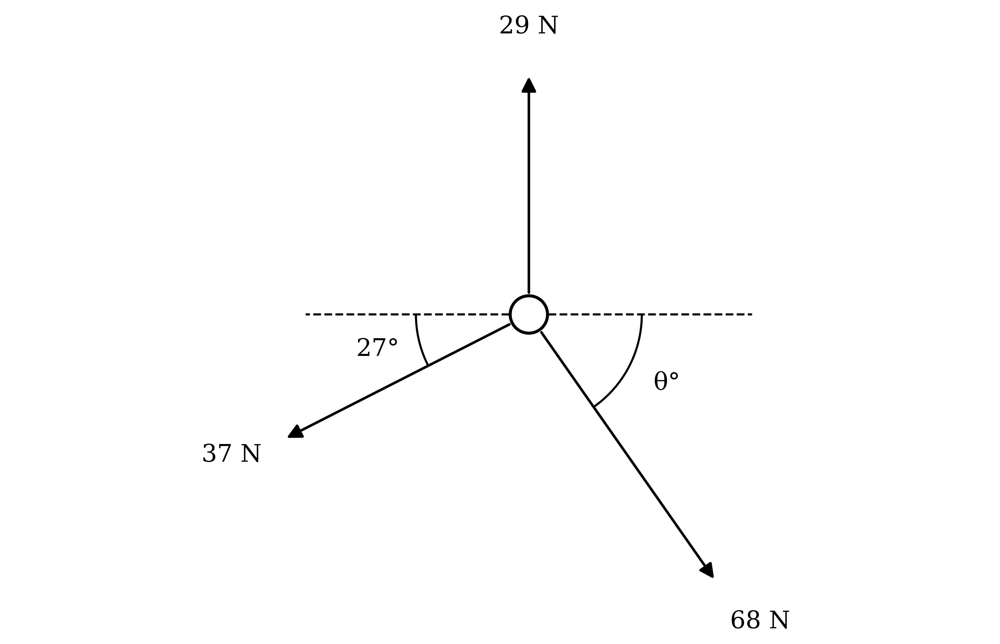

The resultant force on the particle in the vertical direction is 44.8 N downwards. Find the value of $θ$.

### Q3 — hard — 5 marks

**Q3** [3 marks]

In a warehouse, a load of weight $W$ N is lifted by two light cables. The tension in each cable is $T$ N, and each cable makes an angle of $θ ^{\circ}$ with the vertical, as shown in the diagram. The only forces acting on the load are its weight and the tensions in the two cables.

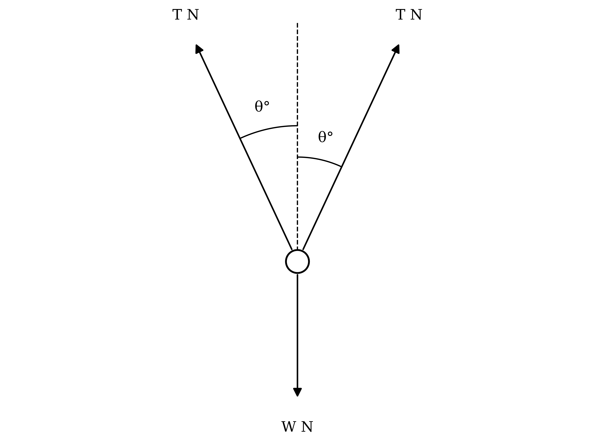

The load is initially at rest. Find an inequality in terms of $T$ and $θ$ that $W$ must satisfy if the load is to be lifted.

**Q3** [2 marks]

Given that the load is still accelerating upwards when $θ = 45$, find an inequality in terms of $W$ that $T$ must satisfy.

### Q4 — very_hard — 6 marks

**Q4** [6 marks]

A particle of mass 0.5 kg is on a rough plane inclined at 35° to the horizontal. A force of magnitude 6 N acts on the particle, towards the plane, at an angle of $θ ^{\circ}$ to a line of greatest slope, as shown in the diagram. The force acts in the vertical plane containing the line of greatest slope. The coefficient of friction between the particle and the plane is 0.4, and the particle is about to slip up the plane.

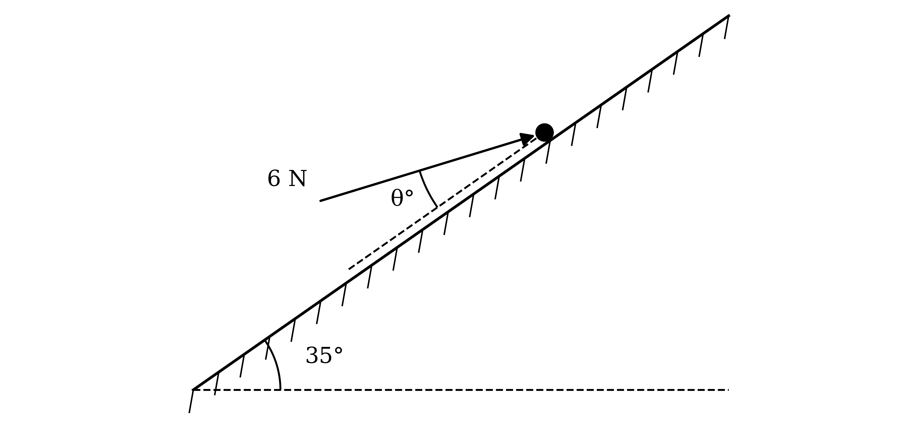

You may use without proof the identity:

$6 \text{cos}  θ ^{\circ} - 2 . 4 \text{sin}  θ ^{\circ} \equiv \frac{6\sqrt{29}}{5} \text{cos} ( θ ^{\circ} + \text{tan}^{-1}  0 . 4 )$

Find the value of $θ$.

### Q5 — hard — 6 marks

**Q5** [3 marks]

A particle of mass $m$ kg is pulled up a line of greatest slope of a smooth plane inclined at 25° to the horizontal by a force of magnitude 60 N. The force acts at an angle of 15° above the line of greatest slope, in the vertical plane containing it, as shown in the diagram. The particle accelerates up the plane at 0.3 $\text{m s}^{-2}$.

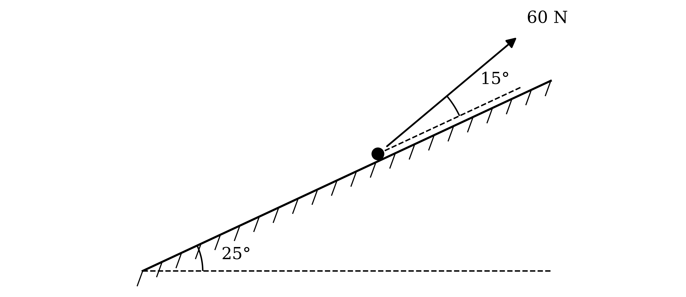

Find the value of $m$.

**Q5** [3 marks]

Find the magnitude of the normal contact force exerted by the plane on the particle.

### Q6 — hard — 6 marks

**Q6** [6 marks]

A small smooth ring $B$ of mass $m$ kg is threaded on a light inextensible string. The ends of the string are attached to fixed points $A$ and $C$, where $A$ is vertically above $C$. The ring is held in equilibrium by a horizontal force of magnitude 3 N, with the parts $A B$ and $B C$ of the string making angles of 35° and 55° respectively with the vertical, as shown in the diagram.

Find the value of $m$.

### Q7 — very_hard — 6 marks

**Q7** [6 marks]

A small object is placed on a rough plane whose angle of inclination to the horizontal can be adjusted. The coefficient of friction between the object and the plane is $μ$.

When the plane is inclined at an angle $θ_{1}$ to the horizontal, the object is released from rest and remains at rest. When the plane is inclined at a larger angle $θ_{2}$ to the horizontal, where $θ_{2} < 90 ^{\circ}$, the object is released from rest and slides down the plane.

Show that `\text{tan} \; \theta_{1} \leqslant \mu < \text{tan} \; \theta_{2}`.

### Q8 — hard — 7 marks

**Q8** [7 marks]

A particle of mass 0.8 kg is released from rest on a rough plane inclined at an angle $θ$ to the horizontal, where $\text{tan}  θ = \frac{2}{7}$. The particle slides down a line of greatest slope, and 4 s after it is released its speed is 1.35 $\text{m s}^{-1}$.

Find the coefficient of friction between the particle and the plane.

### Q9 — hard — 4 marks

**Q9** [4 marks]

Three forces, of magnitudes $F$ N, 40 N and 26.5 N, act on a particle, as shown in the diagram.

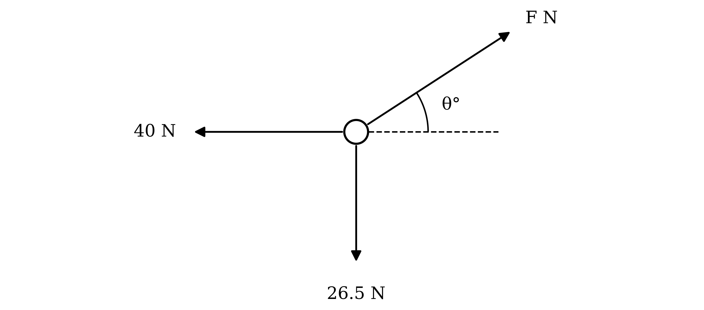

Given that the particle is in equilibrium, find the value of $F$ and the value of $θ$.

### Q10 — hard — 6 marks

**Q10** [3 marks]

A particle of mass 12 kg is pushed up a line of greatest slope of a smooth plane inclined at 20° to the horizontal by a horizontal force of magnitude 50 N. The line of action of the force is in the vertical plane containing the line of greatest slope, as shown in the diagram.

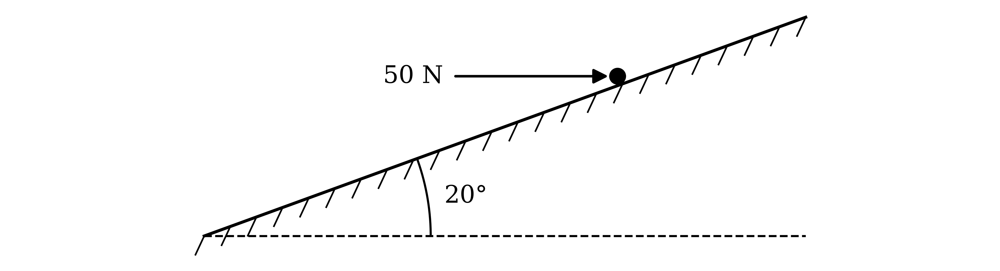

Find the acceleration of the particle.

**Q10** [3 marks]

Find the magnitude of the normal contact force exerted by the plane on the particle.

### Q11 — hard — 7 marks

**Q11** [7 marks]

A particle of mass 2 kg is projected with speed $u$$\text{m s}^{-1}$ up a line of greatest slope of a rough plane inclined at 20° to the horizontal. The coefficient of friction between the particle and the plane is 0.2. The particle comes to instantaneous rest after moving 4.85 m up the plane.

Find the value of $u$.

### Q12 — hard — 6 marks

**Q12** [6 marks]

A particle of mass $m$ kg is attached to two light inextensible strings, whose other ends are attached to two fixed points at the same horizontal level. The particle hangs in equilibrium with the strings inclined at 25° and 70° to the horizontal, as shown in the diagram.

The tension in the string inclined at 70° to the horizontal is 56 N. Find the value of $m$.

### Q13 — very_hard — 13 marks

**Q13** [6 marks]

Two particles $A$ and $B$, each of mass $m$ kg, are attached to the ends of a light inextensible string. $A$ rests on a rough plane inclined at 30° to the horizontal and $B$ rests on a rough plane inclined at 70° to the horizontal. The planes meet at a ridge, where a small smooth pulley is fixed. The string passes over the pulley, and each part of the string lies along a line of greatest slope of its plane, as shown in the diagram. The coefficient of friction between each particle and its plane is 0.15.

The system is released from rest with the string taut and with $B$ at a height of 0.75 m above the ground. $B$ moves down its plane.

Find the acceleration of the particles while $B$ is moving.

**Q13** [7 marks]

When $B$ reaches the ground it does not rebound. $A$ does not reach the pulley.

Find the total distance travelled by $A$ from the instant the system is released until $A$ first comes to instantaneous rest.

### Q14 — hard — 5 marks

**Q14** [5 marks]

A particle of mass $m$ kg is released from rest on a rough plane inclined at $θ ^{\circ}$ to the horizontal, where $45 < θ < 90$. The coefficient of friction between the particle and the plane is $μ$.

Given that the particle remains at rest, show that $μ > 1$.

### Q15 — medium — 6 marks

**Q15** [6 marks]

A particle of mass 0.9 kg is at rest on a rough horizontal plane. A force of magnitude $P$ N acts on the particle, directed downwards at an angle of 40° below the horizontal, as shown in the diagram. The coefficient of friction between the particle and the plane is 0.3.

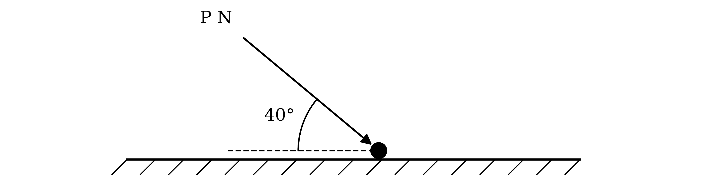

Given that the particle is about to move, find the value of $P$.

### Q16 — hard — 8 marks

**Q16** [8 marks]

Two particles $A$ and $B$, of masses 2.7 kg and 2.2 kg respectively, are attached to the ends of a light inextensible string. Particle $A$ is held at rest on a rough plane inclined at 25° to the horizontal. The string passes over a small smooth pulley fixed at the top of the plane, and $B$ hangs vertically below the pulley, as shown in the diagram. The part of the string between $A$ and the pulley is parallel to a line of greatest slope of the plane. The coefficient of friction between $A$ and the plane is $μ$.

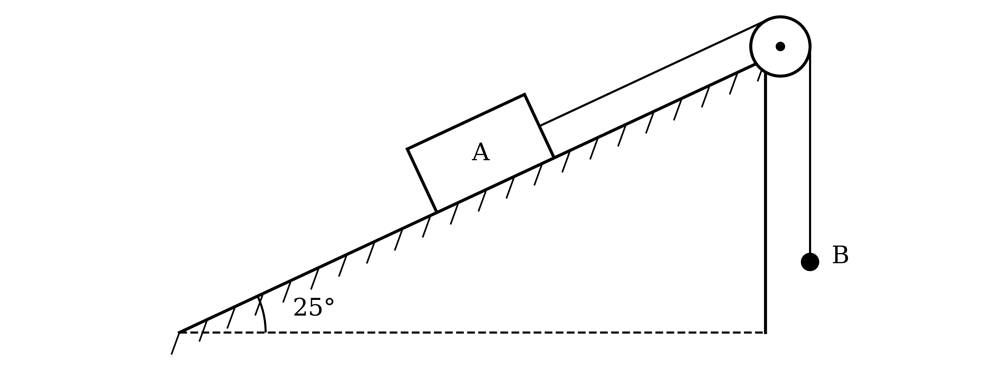

The system is released from rest with the string taut. Given that $B$ descends 1.82 m in the first 3 s after it is released, find the value of $μ$.

### Q17 — medium — 4 marks

**Q17** [4 marks]

Three forces, of magnitudes 35 N, 17 N and 25 N, act on a particle, as shown in the diagram.

Find the resultant force on the particle in the horizontal direction and in the vertical direction, stating the direction of each.

### Q18 — medium — 6 marks

**Q18** [3 marks]

A particle of mass 15 kg slides down a line of greatest slope of a rough plane inclined at 25° to the horizontal. The coefficient of friction between the particle and the plane is 0.3.

Find the magnitude of the frictional force acting on the particle.

**Q18** [3 marks]

Hence find the acceleration of the particle.

### Q19 — medium — 4 marks

**Q19** [4 marks]

Three forces, of magnitudes 20 N, 19 N and 10 N, act on a particle, as shown in the diagram.

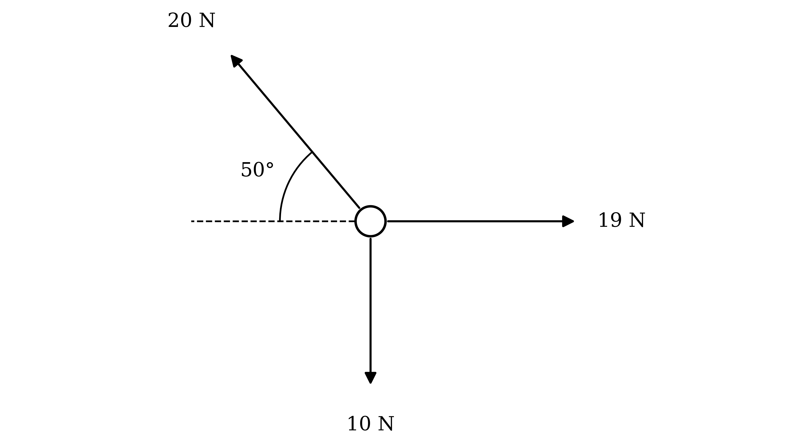

Find the resultant force on the particle in the horizontal direction and in the vertical direction, stating the direction of each.

### Q20 — medium — 7 marks

**Q20** [4 marks]

A particle of mass 3 kg is projected with speed $u$$\text{m s}^{-1}$ up a line of greatest slope of a rough plane inclined at 25° to the horizontal. The coefficient of friction between the particle and the plane is 0.27. The particle comes to instantaneous rest after moving 1.91 m up the plane.

Show that the deceleration of the particle while it moves up the plane is $( \text{sin}  25 ^{\circ} + 0 . 27 \text{cos}  25 ^{\circ} ) g$$\text{m s}^{-2}$.

**Q20** [3 marks]

Hence find the value of $u$.

### Q21 — hard — 13 marks

**Q21** [7 marks]

Two particles $A$ and $B$, of masses 4 kg and 3 kg respectively, are attached to the ends of a light inextensible string. Particle $A$ is held at rest on a rough plane inclined at 35° to the horizontal. The string passes over a small smooth pulley fixed at the top of the plane, and $B$ hangs vertically below the pulley, as shown in the diagram. The part of the string between $A$ and the pulley is parallel to a line of greatest slope of the plane. The coefficient of friction between $A$ and the plane is 0.15.

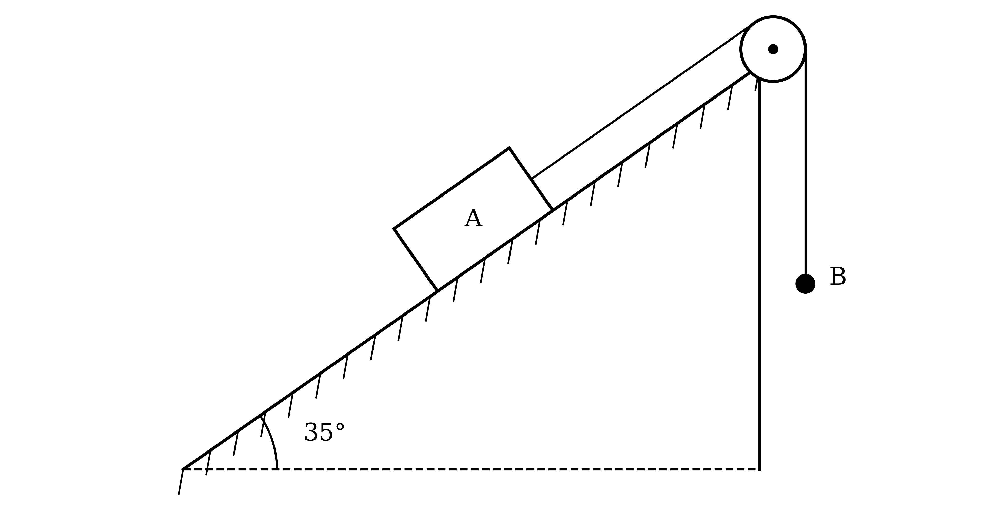

The system is released from rest with the string taut, and $B$ moves downwards.

Find the acceleration of the system and the tension in the string.

**Q21** [6 marks]

$B$ reaches the ground 3.2 s after the system is released, and does not rebound. Particle $A$ does not reach the pulley.

Find the total distance travelled by $A$ from the instant the system is released until $A$ first comes to instantaneous rest.

### Q22 — medium — 7 marks

**Q22** [4 marks]

A particle of mass 7 kg is pulled along a rough horizontal plane by a force of magnitude 45 N acting at an angle of 20° above the horizontal, as shown in the diagram. The coefficient of friction between the particle and the plane is 0.4. The particle moves to the right.

Find the magnitude of the frictional force acting on the particle.

**Q22** [3 marks]

Hence find the acceleration of the particle.

### Q23 — medium — 5 marks

**Q23** [5 marks]

A particle of mass 3 kg is released from rest on a rough plane inclined at 15° to the horizontal. The coefficient of friction between the particle and the plane is 0.2.

Find the distance the particle travels in the first 3 s after it is released.

### Q24 — medium — 6 marks

**Q24** [6 marks]

A block $B$ of mass 5 kg rests on a rough horizontal table. It is attached to one end of a light inextensible string, which passes over a small smooth pulley fixed at the edge of the table. A particle $A$ of mass 4 kg is attached to the other end of the string and hangs vertically, as shown in the diagram. The string between $B$ and the pulley is horizontal, and the coefficient of friction between $B$ and the table is 0.35.

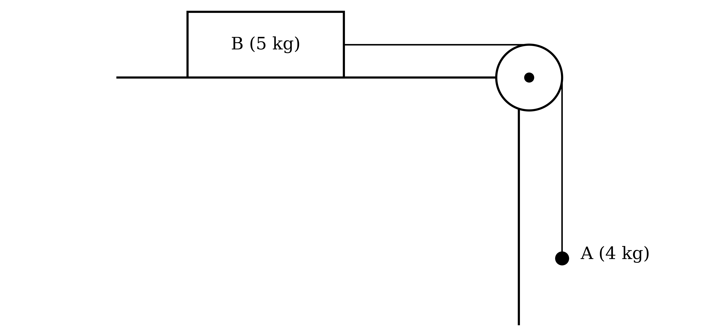

The system is released from rest with the string taut.

Find the acceleration of the system and the tension in the string.

### Q25 — easy — 4 marks

**Q25** [2 marks]

A particle of mass 10 kg slides down a line of greatest slope of a smooth plane inclined at 15° to the horizontal.

Find the acceleration of the particle.

**Q25** [2 marks]

Find the normal contact force exerted by the plane on the particle.

### Q26 — medium — 5 marks

**Q26** [5 marks]

A particle of mass $m$ kg is attached to one end of a light inextensible string. The other end of the string is attached to a fixed point $P$. A horizontal force of magnitude 12 N acts on the particle, which is in equilibrium with the string inclined at 40° to the vertical, as shown in the diagram.

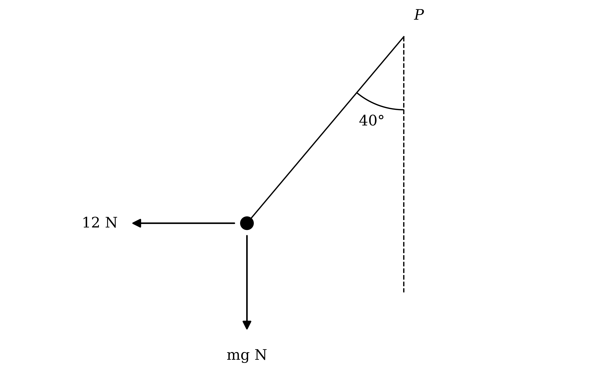

Find the tension in the string and the value of $m$.

### Q27 — medium — 6 marks

**Q27** [6 marks]

A particle of mass 0.7 kg is on a rough plane inclined at 35° to the horizontal. The particle is held in equilibrium by a force of magnitude $P$ N acting up a line of greatest slope of the plane, as shown in the diagram. The coefficient of friction between the particle and the plane is 0.35, and the particle is about to slip up the plane.

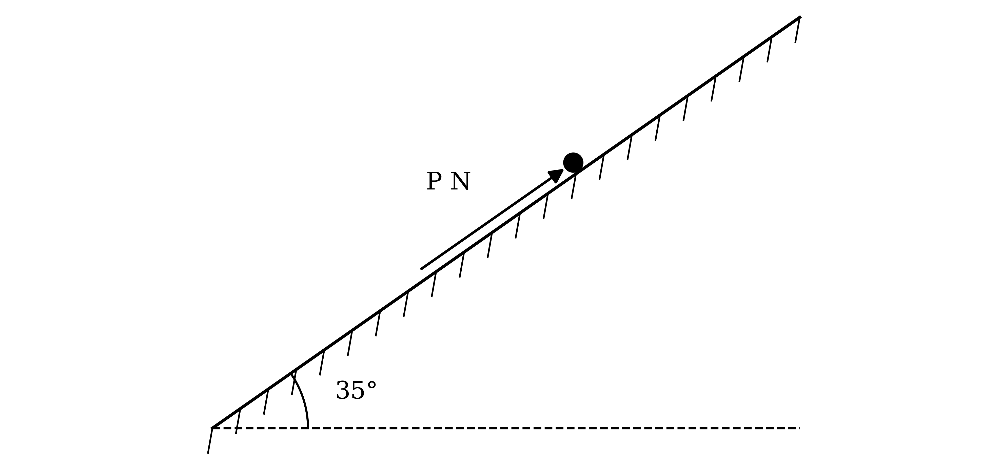

Find the value of $P$.

### Q28 — medium — 6 marks

**Q28** [3 marks]

Three forces, of magnitudes $20 \sqrt{3}$ N, 20 N and $F$ N, act on a particle, as shown in the diagram.

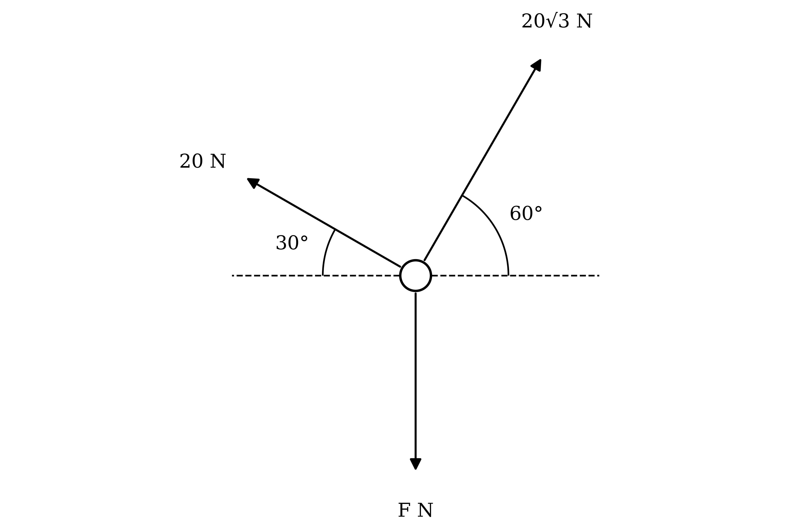

Show that the resultant force on the particle in the horizontal direction is zero.

**Q28** [3 marks]

Given that the particle is in equilibrium, find the value of $F$.

### Q29 — easy — 4 marks

**Q29** [2 marks]

Three forces, of magnitudes 8 N, 14 N and 17 N, act on a particle, as shown in the diagram.

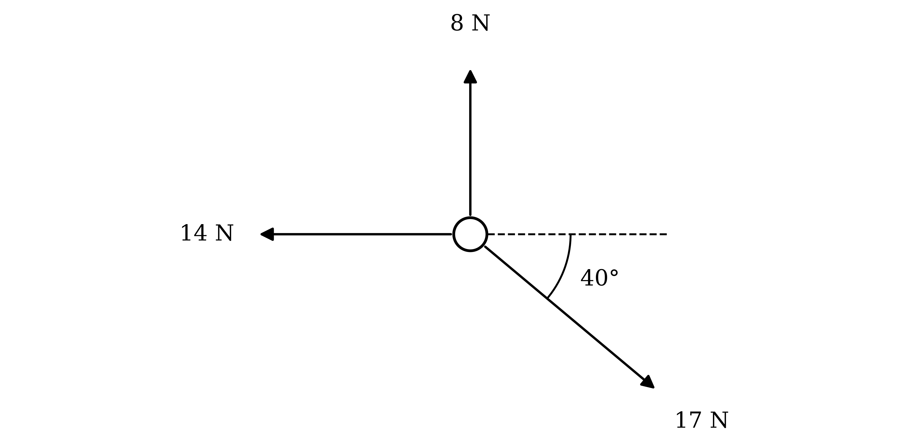

Find the horizontal and vertical components of the 17 N force.

**Q29** [2 marks]

Hence find the resultant force on the particle in the horizontal direction and in the vertical direction, stating the direction of each.

### Q30 — easy — 5 marks

**Q30** [1 mark]

A particle of mass $m$ kg is attached to one end of a light inextensible string. The other end of the string is attached to a fixed point $A$. A horizontal force of magnitude $P$ N acts on the particle, which is in equilibrium with the string inclined at 30° to the vertical, as shown in the diagram.

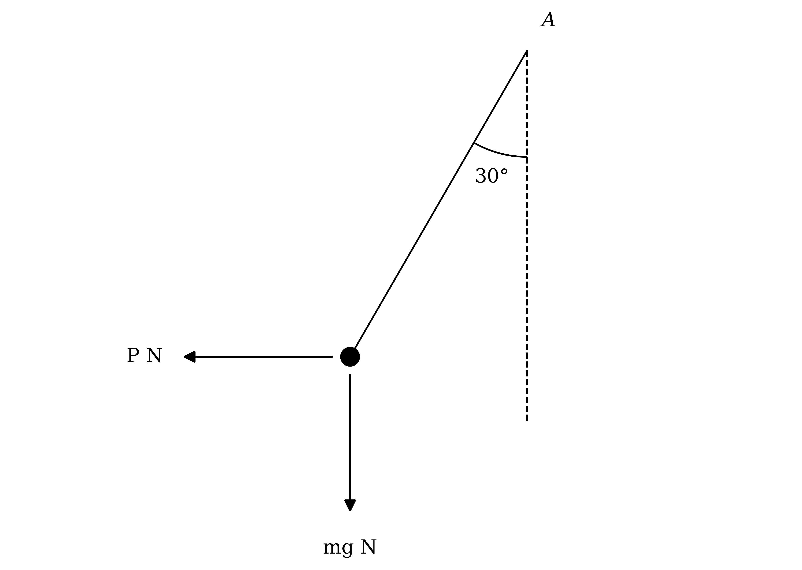

State what the force of magnitude $m g$ N represents.

**Q30** [2 marks]

The tension in the string is 16 N.

Find the horizontal and vertical components of the tension.

**Q30** [2 marks]

Hence find the values of $P$ and $m$.

### Q31 — easy — 4 marks

**Q31** [2 marks]

Three forces, of magnitudes 30 N, $P$ N and $Q$ N, act on a particle, as shown in the diagram.

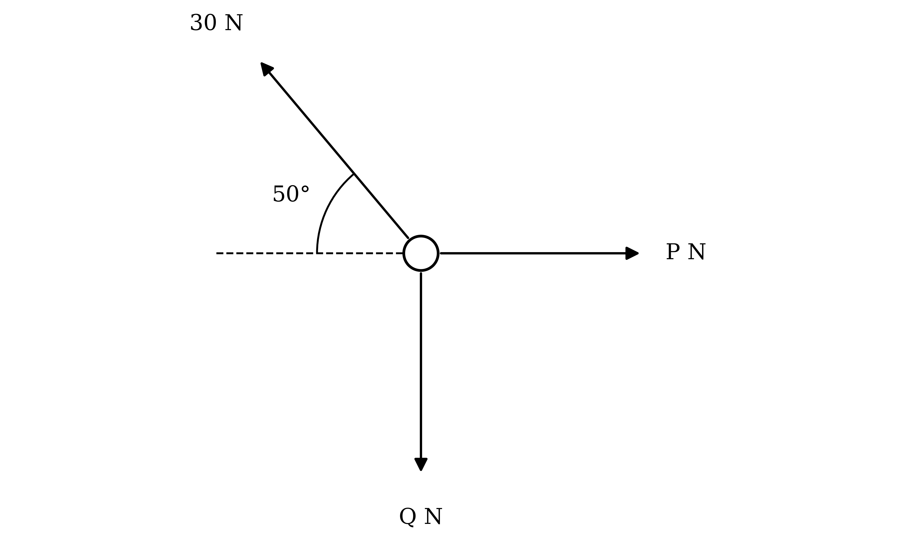

Find the horizontal and vertical components of the 30 N force.

**Q31** [2 marks]

Given that the particle is in equilibrium, find the values of $P$ and $Q$.

### Q32 — easy — 11 marks

**Q32** [3 marks]

A particle of mass 5 kg is projected up a line of greatest slope of a rough plane inclined at 30° to the horizontal. The coefficient of friction between the particle and the plane is 0.3. The particle comes to instantaneous rest and then slides back down the plane.

Find the magnitude of the frictional force acting on the particle while it moves up the plane, and state its direction.

**Q32** [3 marks]

Find the deceleration of the particle while it moves up the plane.

**Q32** [2 marks]

State the magnitude and direction of the frictional force acting on the particle while it slides back down the plane.

**Q32** [3 marks]

Find the acceleration of the particle while it slides down the plane.

### Q33 — easy — 4 marks

**Q33** [2 marks]

The diagram shows a force of magnitude 16 N acting at an angle of 30° above the horizontal.

Find the horizontal and vertical components of the force.

**Q33** [2 marks]

The diagram shows a force of magnitude 8.5 N acting at an angle of 20° to the vertical.

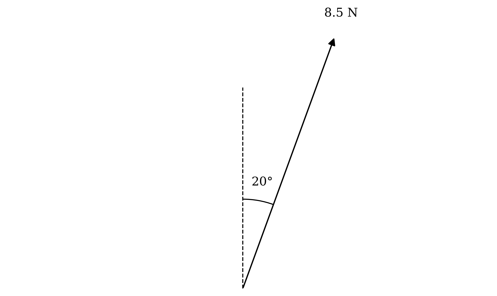

Find the horizontal and vertical components of the force.

### Q34 — medium — 7 marks

**Q34** [3 marks]

In each part of this question, a block rests on a rough horizontal surface and is on the point of moving under the action of a force of magnitude $P$ N.

In this part, the block has mass 2 kg, the force acts horizontally, and the coefficient of friction between the block and the surface is 0.4.

Find the value of $P$.

**Q34** [4 marks]

In this part, the block has mass 6 kg and the coefficient of friction between the block and the surface is 0.3. The force of magnitude $P$ N pushes on the block at an angle of 40° below the horizontal, as shown in the diagram, and the block is on the point of moving.

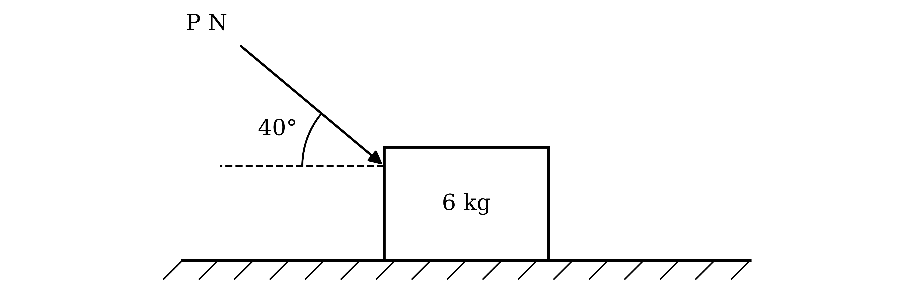

Find the value of $P$.

### Q35 — easy — 4 marks

**Q35** [2 marks]

A particle of mass 5 kg slides down a line of greatest slope of a smooth plane inclined at 30° to the horizontal.

Find the acceleration of the particle.

**Q35** [2 marks]

Find the normal contact force exerted by the plane on the particle.

### Q36 — easy — 13 marks

**Q36** [3 marks]

In each part of this question, a block is initially at rest on a rough horizontal surface. The diagram in each part shows all the forces acting on the block, where $R$ N is the normal contact force and $F$ N is the frictional force.

In this part, the block has mass 5 kg and the coefficient of friction between the block and the surface is 0.3. A horizontal force of magnitude 13 N acts on the block, as shown in the diagram.

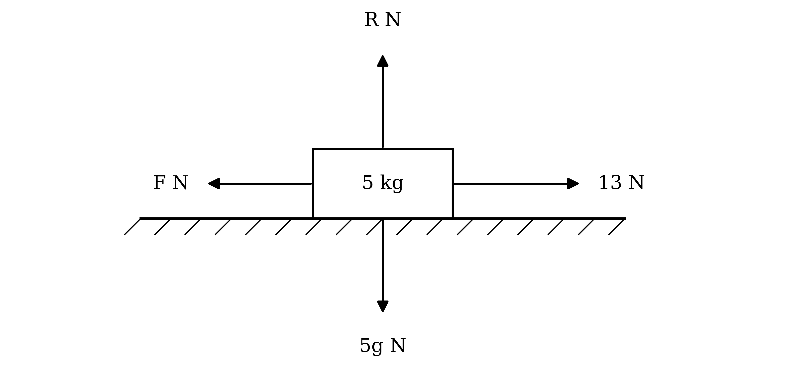

Find the value of $F$ and determine whether the block remains at rest or begins to move.

**Q36** [3 marks]

In this part, a block of mass 3 kg is initially at rest, and the coefficient of friction between the block and the surface is 0.4. A horizontal force of magnitude 10 N acts on the block, as shown in the diagram.

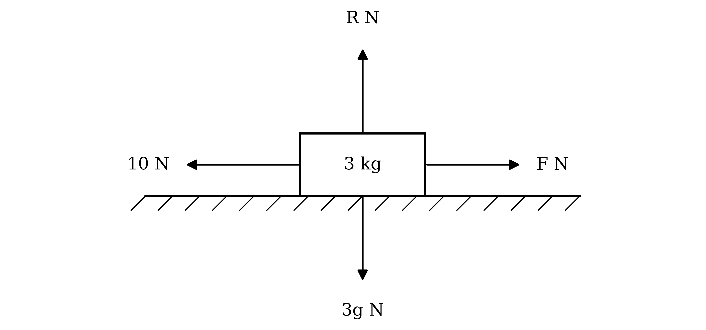

Find the value of $F$ and determine whether the block remains at rest or begins to move.

**Q36** [3 marks]

In this part, a block of mass 7 kg is initially at rest, and the coefficient of friction between the block and the surface is 0.2. A horizontal force of magnitude 16 N and a downward vertical force of magnitude 12 N act on the block, as shown in the diagram.

Find the value of $F$ and determine whether the block remains at rest or begins to move.

**Q36** [4 marks]

In this part, a block of mass 10 kg is initially at rest, and the coefficient of friction between the block and the surface is 0.25. A force of magnitude 30 N acts on the block at an angle of 30° above the horizontal, as shown in the diagram.

Find the value of $F$ and determine whether the block remains at rest or begins to move.
