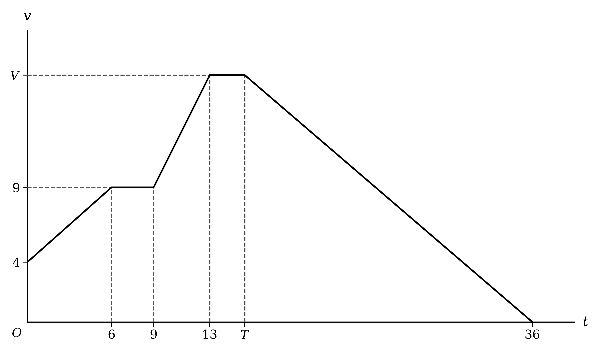
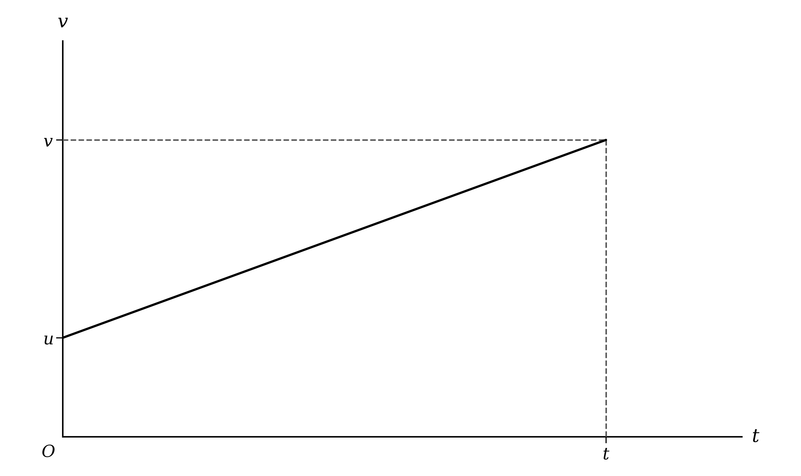
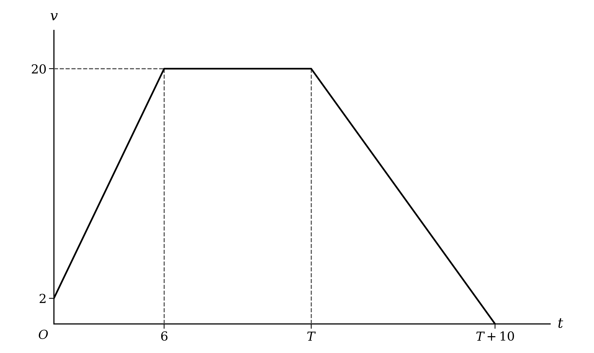

# Exam Questions — Constant Acceleration
**Kinematics (Straight Line Motion)** · Cambridge (CIE) A-LEVEL maths (9709)
> Source: [https://www.savemyexams.com/a-level/maths/cie/20/mechanics/topic-questions/](https://www.savemyexams.com/a-level/maths/cie/20/mechanics/topic-questions/) · 35 questions across 1 sets

## Exam Questions (35 questions)

### Q1 — medium — 7 marks

**Q1** [7 marks]

Two particles, *A* and *B*, move along parallel straight lines. The diagram shows the velocity-time graphs for their motion, with *A* shown by the solid line and *B* by the dotted line. Velocity is measured in metres per second and time in seconds.

The particles have equal velocities at times $T_{1}$ and $T_{2}$ seconds, where $4 < T_{1} < 12$ and $15 < T_{2} < 21$.

Find $T_{1}$ and $T_{2}$, giving your answers correct to 3 significant figures.

### Q2 — easy — 2 marks

**Q2** [2 marks]

A stone is projected vertically downwards with speed 0.3 $\text{m s}^{-1}$ from the top of a cliff. The stone hits the sea below 3.2 seconds later.

Find the height of the cliff above the sea.

### Q3 — hard — 7 marks

**Q3** [4 marks]

A firework is projected vertically upwards with speed 38.5 $\text{m s}^{-1}$ from the top of a building of height 135 m.

Find the length of time for which the firework is more than 150 m above the ground.

**Q3** [3 marks]

The firework explodes 2 seconds after reaching its greatest height.

Find the height above the ground at which the firework explodes.

### Q4 — hard — 7 marks

**Q4** [7 marks]

Two trains leave station *O* from rest at the same instant and move in opposite directions along a straight track.

The first train moves with constant acceleration 0.15 $\text{m s}^{-2}$.

The second train moves with constant acceleration 0.24 $\text{m s}^{-2}$ for 210 seconds until it passes a signal. It then decelerates uniformly and comes to rest at station *X* 60 seconds later. After waiting at *X* for 2 minutes, the second train leaves *X* from rest and moves back towards *O* with constant acceleration 0.08 $\text{m s}^{-2}$.

Find the distance between the two trains 10 minutes after they leave *O*.

### Q5 — medium — 6 marks

**Q5** [6 marks]

A car travels along a straight horizontal road. The car passes a point *A* with speed 17.2 $\text{m s}^{-1}$ and accelerates uniformly at 0.4 $\text{m s}^{-2}$ until it reaches a point *B*, where *AB* = 0.8 km. At *B* the car begins to decelerate uniformly at 2.75 $\text{m s}^{-2}$ until it comes to rest.

Find the total time from the instant the car passes *A* to the instant it comes to rest. Give your answer correct to 1 decimal place.

### Q6 — very_hard — 10 marks

**Q6** [6 marks]

A ball is projected vertically upwards from horizontal ground with speed 29.3 $\text{m s}^{-1}$. At the same instant, a second ball is projected vertically downwards with speed 8.2 $\text{m s}^{-1}$ from a point 150 m directly above the first ball. The balls collide.

Find the time at which the balls collide and the height above the ground at which the collision occurs.

**Q6** [4 marks]

(i) Find the speed of each ball when they collide.

(ii) Show that both balls are moving downwards when they collide.

### Q7 — medium — 5 marks

**Q7** [5 marks]

Two stations, *A* and *B*, are 8.2 km apart on a straight track. A train leaves *A* from rest and moves towards *B* with constant acceleration 0.2 $\text{m s}^{-2}$. At the same instant, a second train leaves *B* from rest and moves towards *A* along a parallel track with constant acceleration 0.16 $\text{m s}^{-2}$. The trains are modelled as particles.

Find the distance from *A* at which the trains pass each other.

### Q8 — hard — 4 marks

**Q8** [4 marks]

A particle is projected vertically upwards from horizontal ground with speed 35.6 $\text{m s}^{-1}$.

Find the length of time for which the particle is at least 15 m above the ground.

### Q9 — hard — 4 marks

**Q9** [4 marks]

A ball is projected vertically upwards from horizontal ground. The ball hits the ground 1.6 seconds after reaching its greatest height.

Find the greatest height reached by the ball and the speed of projection.

### Q10 — medium — 4 marks

**Q10** [4 marks]

A car travels along a straight horizontal road. The car passes a point *A* with speed 21 $\text{m s}^{-1}$ and accelerates uniformly at 0.2 $\text{m s}^{-2}$ until it reaches a point *B*, where *AB* = 1.5 km. At *B* the car begins to decelerate uniformly at 3.1 $\text{m s}^{-2}$ until it comes to rest.

Find the distance the car travels while it is decelerating.

### Q11 — medium — 7 marks

**Q11** [4 marks]

In a crash test, a car starts from rest and moves along a straight horizontal track with constant acceleration until it hits a wall. The length of track available is 0.8 km.

In one test the car has constant acceleration 1.6 $\text{m s}^{-2}$.

Find the greatest possible speed, in $\text{km h}^{-1}$, with which the car can hit the wall.

**Q11** [3 marks]

The acceleration used in a test is normally 1.2 $\text{m s}^{-2}$, but it can be increased or decreased by up to 40%.

Determine whether it is possible to crash test a car at a speed of 200 $\text{km h}^{-1}$.

### Q12 — medium — 6 marks

**Q12** [6 marks]

The diagram shows the velocity-time graph for a particle moving in a straight line. Velocity is measured in metres per second and time in seconds.

The particle travels 150 m from time *T* to time 36, and 309 m in total.

Find the values of *T* and *V*.

### Q13 — hard — 7 marks

**Q13** [5 marks]

A train leaves a station from rest and moves along a straight track with constant acceleration 0.12 $\text{m s}^{-2}$. 40 seconds later, a second train leaves the same station from rest and moves along the same track in the same direction with constant acceleration 0.2 $\text{m s}^{-2}$.

Find the time after the second train leaves the station at which it catches up with the first train. Give your answer correct to 3 significant figures.

**Q13** [2 marks]

Find the distance, in kilometres, that each train has travelled when the second train catches up with the first. Give your answer correct to 3 significant figures.

### Q14 — easy — 4 marks

**Q14** [4 marks]

Use the constant acceleration equations

$v = u + a t$ and $s = u t + \frac{1}{2} a t^{2}$

to show that

$v^{2} = u^{2} + 2 a s$

### Q15 — medium — 8 marks

**Q15** [5 marks]

A train leaves station *O* from rest and moves along a straight track with constant acceleration 0.2 $\text{m s}^{-2}$. After 125 seconds the train passes a signal. The train then decelerates uniformly and comes to rest at station *X* 75 seconds later.

Find the distance *OX*.

**Q15** [3 marks]

The train then leaves *X* from rest and moves back along the same track, in the opposite direction, with constant acceleration 0.1 $\text{m s}^{-2}$. The train passes through *O* without stopping. 300 seconds after leaving *X*, the train passes a signal 850 m before station *Y*. The train then decelerates uniformly and comes to rest at *Y*.

Find the distance *OY*.

### Q16 — easy — 3 marks

**Q16** [3 marks]

A particle moves in a straight line. The diagram shows the velocity-time graph for the particle from time 0 to time *t* seconds. The velocity of the particle is *u* $\text{m s}^{-1}$ at time 0 and *v* $\text{m s}^{-1}$ at time *t* seconds.

(i) Explain how the graph shows that the acceleration of the particle is constant.

(ii) Show that the displacement of the particle from its position at time 0 is given by

$s = \frac{1}{2} t ( u + v )$

### Q17 — easy — 6 marks

**Q17** [3 marks]

A particle is projected vertically upwards from horizontal ground with speed *u* $\text{m s}^{-1}$. 6 seconds after it is projected, the particle is moving upwards with speed 1.2 $\text{m s}^{-1}$.

Find the value of *u*.

**Q17** [3 marks]

Find the displacement of the particle from its point of projection 10 seconds after it is projected.

### Q18 — medium — 6 marks

**Q18** [2 marks]

The diagram shows the velocity-time graph for a particle moving in a straight line. Velocity is measured in metres per second and time in seconds.

Find the acceleration of the particle during the first 6 seconds.

**Q18** [2 marks]

Find the displacement of the particle during the last 10 seconds of its motion.

**Q18** [2 marks]

The particle travels 280 m while its acceleration is zero.

Find the value of *T*.

### Q19 — medium — 5 marks

**Q19** [5 marks]

A train leaves station *O* from rest and moves along a straight track with constant acceleration 0.12 $\text{m s}^{-2}$. After 190 seconds the train passes a signal. The train then decelerates uniformly at 0.18 $\text{m s}^{-2}$ until it comes to rest at station *X*.

Find the distance *OX*.

### Q20 — medium — 5 marks

**Q20** [3 marks]

Train *A* leaves a station from rest and moves along a straight track with constant acceleration. 35 seconds later, train *B* leaves the same station from rest and moves along a parallel track in the same direction with constant acceleration 1.4 $\text{m s}^{-2}$. Train *B* passes train *A* 85 seconds after train *A* leaves the station.

Find the distance each train has travelled when train *B* passes train *A*.

**Q20** [2 marks]

Find the acceleration of train *A*.

### Q21 — easy — 2 marks

**Q21** [2 marks]

A car travels along a straight horizontal road. The car passes a point *A* with speed 21 $\text{m s}^{-1}$ and immediately decelerates at a constant rate, coming to rest 260 m beyond *A*.

Find the deceleration of the car.

### Q22 — easy — 6 marks

**Q22** [2 marks]

In a crash test, a car starts from rest and moves along a straight horizontal track with constant acceleration 1.5 $\text{m s}^{-2}$ until it hits a wall. The length of track available is 750 m.

Find the greatest possible speed with which the car can hit the wall.

**Q22** [4 marks]

In a different test, the car hits the wall with speed 27 $\text{m s}^{-1}$.

(i) Find the distance from the wall at which the car started.

(ii) Find the time taken for the car to reach the wall.

### Q23 — medium — 4 marks

**Q23** [4 marks]

A ball is projected vertically upwards from horizontal ground with speed 5.8 $\text{m s}^{-1}$.

Find the greatest height reached by the ball and the time taken to reach this height.

### Q24 — easy — 2 marks

**Q24** [2 marks]

A particle passes through a fixed point *O* with velocity 7.3 $\text{m s}^{-1}$. It moves in a straight line with constant deceleration 0.32 $\text{m s}^{-2}$.

Find the velocity of the particle when it is first 23 m from *O*. Give your answer correct to 3 significant figures.

### Q25 — easy — 3 marks

**Q25** [3 marks]

A particle moves in a straight line with constant acceleration 0.8 $\text{m s}^{-2}$. In 8 seconds the particle travels 30 m.

Find the velocity of the particle at the end of the 8 seconds.

### Q26 — easy — 3 marks

**Q26** [3 marks]

A ball is projected vertically upwards from the top of a tall building. 6 seconds after it is projected, the ball is 124.38 m below its point of projection.

Find the speed with which the ball is projected.

### Q27 — easy — 3 marks

**Q27** [3 marks]

A particle is projected vertically upwards from horizontal ground. 2.4 seconds after it is projected, the particle is 8.5 m above the ground.

Find the speed of projection of the particle. Give your answer correct to 3 significant figures.

### Q28 — easy — 2 marks

**Q28** [2 marks]

A particle *P* moves in a straight line with constant acceleration. *P* starts from rest, and 4.5 seconds later its velocity is 10.35 $\text{m s}^{-1}$.

Find the acceleration of *P*.

### Q29 — medium — 4 marks

**Q29** [4 marks]

A particle moves in a straight line with constant acceleration 1.5 $\text{m s}^{-2}$ and does not change its direction of motion. After travelling 52.44 m, the particle has velocity 12.6 $\text{m s}^{-1}$.

Find the time taken for the particle to travel this distance.

### Q30 — easy — 2 marks

**Q30** [2 marks]

A particle moves in a straight line with constant acceleration. It starts from rest and reaches a velocity of 7.75 $\text{m s}^{-1}$ in 3.2 seconds.

Find the displacement of the particle during this time.

### Q31 — easy — 3 marks

**Q31** [3 marks]

A particle moves in a straight line with constant acceleration. In one minute the particle travels 1932 m, and at the end of this minute its velocity is 42.7 $\text{m s}^{-1}$.

Find the acceleration of the particle.

### Q32 — easy — 2 marks

**Q32** [2 marks]

A stone is released from rest at the top of a cliff and falls vertically. At the instant when the speed of the stone is 18.8 $\text{m s}^{-1}$, it has not yet reached the sea below.

Find the distance the stone has fallen at this instant. Give your answer correct to 3 significant figures.

### Q33 — easy — 2 marks

**Q33** [2 marks]

A particle passes through a fixed point *O* with velocity 5.3 $\text{m s}^{-1}$. It moves in a straight line with a constant acceleration of 2 $\text{m s}^{-2}$ in the opposite direction to its initial motion.

Find the distance of the particle from *O* 7.6 seconds after it passes through *O*.

### Q34 — easy — 3 marks

**Q34** [3 marks]

A particle moves in a straight line with constant acceleration. It travels 30.75 m in 8.2 seconds, and at the end of this time its velocity is 7.5 $\text{m s}^{-1}$.

Show that the particle was initially at rest.

### Q35 — easy — 2 marks

**Q35** [2 marks]

A ball is released from rest at the top of a tall building and falls vertically.

Find the time taken for the speed of the ball to reach 58.8 $\text{m s}^{-1}$.
