# Mark Schemes — Kinematics Graphs
**Kinematics (Straight Line Motion)** · Cambridge (CIE) A-LEVEL maths (9709)

## Exam Questions (37 questions)

### Q1
(i)

Read up from $t = 3$ to the graph and across to the velocity axis

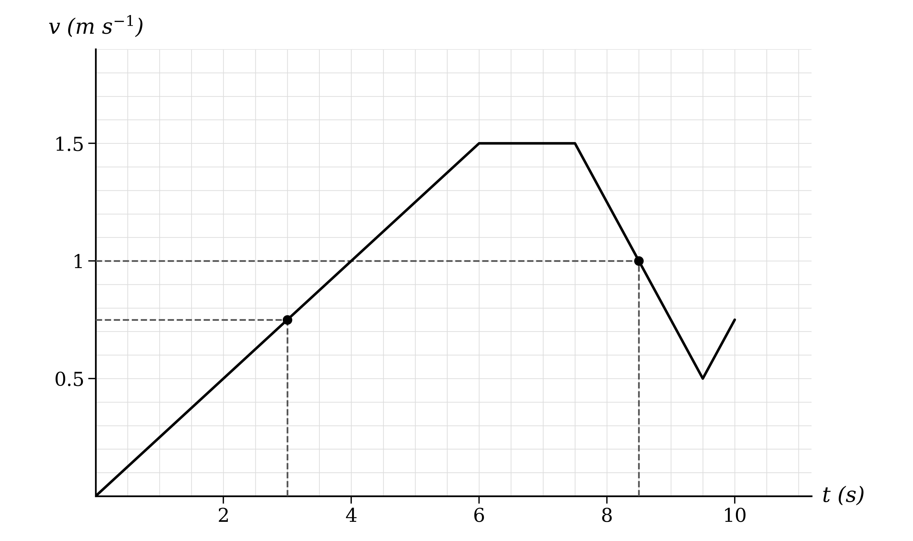

$0 . 75 \text{m s}^{-1}$

**[B1]**

(ii)

Read the graph at $t = 8 . 5$ in the same way

$1 \text{m s}^{-1}$

**[B1]**

(iii)

The velocity is constant where the graph is horizontal

**Final answer:** **From 6 seconds to 7.5 seconds**

**[B1]**

> **[mark-scheme]**
> **B1**: Correct velocity of 0.75 m s⁻¹ read from the graph at 3 seconds.
> 
> **B1**: Correct speed of 1 m s⁻¹ read from the graph at 8.5 seconds. The velocity is positive here, so the speed and the velocity have the same value.
> 
> **B1**: Correct period from 6 to 7.5 seconds, identified from the horizontal section of the graph. Accept an answer given as a duration of 1.5 seconds provided the two times are stated.
The displacement is the area under the velocity-time graph, which for the first 6 seconds is a triangle of base 6 and height 1.5

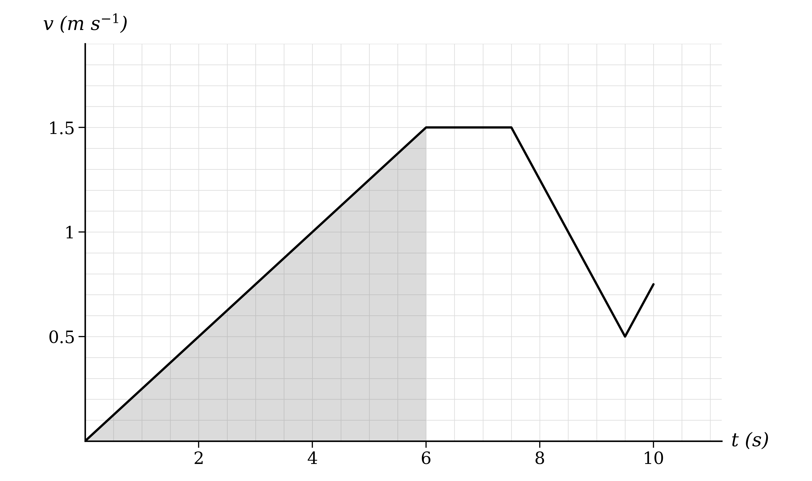

$s = \frac{1}{2} \times 6 \times 1 . 5$

**[M1]**

$s = 4 . 5 \text{m}$

**[A1]**

> **[mark-scheme]**
> **M1**: Correct method for the area under the graph between 0 and 6 seconds, using the area of a triangle with base 6 and height 1.5.
> 
> **A1**: Correct displacement of 4.5 m. Units are not required.
The acceleration is the gradient of a velocity-time graph, so use $a = \frac{\text{change in velocity}}{\text{change in time}}$ over the final section

$a = \frac{0.75-0.5}{10-9.5}$

**[M1]**

$a = 0 . 5 \text{m s}^{-2}$

**[A1]**

> **[mark-scheme]**
> **M1**: Correct method for the gradient of the final section, using the change in velocity divided by the change in time. Accept the use of $v = u + a t$ with the correct values.
> 
> **A1**: Correct acceleration of 0.5 m s⁻². Units are not required.

### Q2
The acceleration is the gradient of a velocity-time graph, and the particle starts from rest

$\frac{V}{T} = 4$

$V = 4 T$

**[B1]**

The displacement is the area under the graph, which is a triangle of base *T* and height *V*

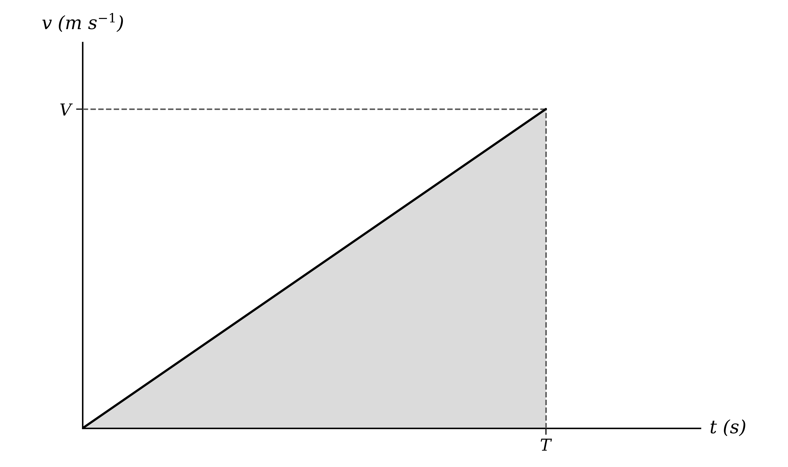

$\frac{1}{2} V T = 18$

$V T = 36$

**[M1]**

Substitute $V = 4 T$ into the second equation to eliminate *V*

$4 T^{2} = 36$

$T^{2} = 9$

Only the positive root is possible, because *T* is a time

$T = 3$

**[A1]**

Substitute back to find *V*

$V = 4 \times 3$

$V = 12$

**[A1]**

> **[mark-scheme]**
> **B1**: Correct relationship $V = 4 T$, obtained from the gradient of the graph.
> 
> **M1**: Correct method for the displacement as the area of the triangle, leading to $V T = 36$ or equivalent.
> 
> **A1**: Correct value $T = 3$. The negative root must be rejected, since *T* is a time.
> 
> **A1**: Correct value $V = 12$.

### Q3
The speed is the magnitude of the gradient of a displacement-time graph. For the first section the particle covers 4 m in *T* seconds

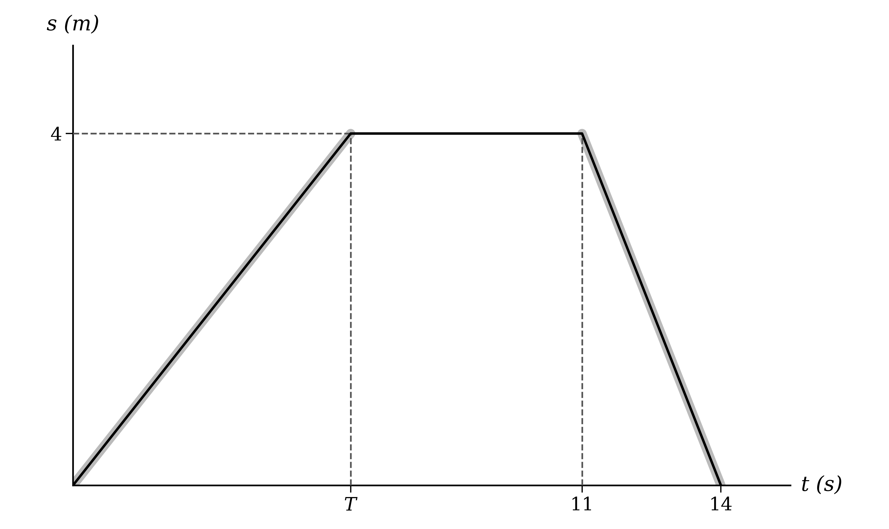

$\text{speed} = \frac{4}{T}$

**[B1]**

The last 3 seconds run from 11 to 14 seconds, over which the particle covers 4 m back to its starting position

$\text{speed} = \frac{4}{3}$

**[B1]**

The first speed is half the second, so equate the two

$\frac{4}{T} = \frac{1}{2} \times \frac{4}{3}$

**[M1]**

$\frac{4}{T} = \frac{2}{3}$

$T = 6$

**[A1]**

> **[mark-scheme]**
> **B1**: Correct expression $\frac{4}{T}$ for the speed during the first section.
> 
> **B1**: Correct value $\frac{4}{3}$ for the speed during the last 3 seconds. The value must be positive, since a speed is being compared; using the signed gradient of $- \frac{4}{3}$ leads to a negative value of *T* and does not score the final mark.
> 
> **M1**: Correct equation formed by setting the first speed equal to half the second. Accept the equivalent form obtained by setting the second speed equal to twice the first.
> 
> **A1**: Correct value $T = 6$.

### Q4
(i)

To find the displacement after 3 seconds, read up from $t = 3$ to the graph and across to the displacement axis

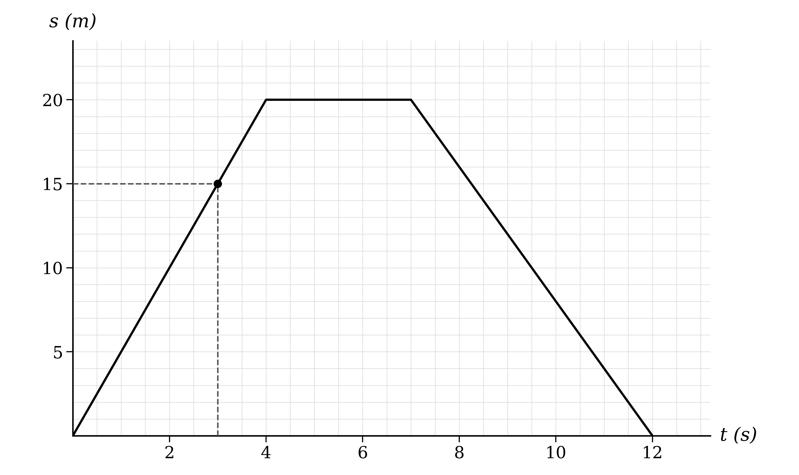

$15 \text{m}$

**[B1]**

(ii)

The particle is stationary while its displacement is not changing, which is where the graph is horizontal

$7 - 4 = 3$

$3 \text{seconds}$

**[B1]**

(iii)

The velocity is the gradient of a displacement-time graph, so use $\text{velocity} = \frac{\text{change in displacement}}{\text{change in time}}$ over the last 5 seconds

$v = \frac{0-20}{12-7}$

**[M1]**

$v = - 4 \text{m s}^{-1}$

**[A1]**

> **[mark-scheme]**
> **B1**: Correct displacement of 15 m, read from the graph at 3 seconds.
> 
> **B1**: Correct duration of 3 seconds, from the horizontal section of the graph between 4 and 7 seconds.
> 
> **M1**: Correct method for the gradient of the final section, using the change in displacement divided by the change in time. Allow this mark for a correct gradient calculation using any two points on that section.
> 
> **A1**: Correct velocity of −4 m s⁻¹. The negative sign is required, because the question asks for a velocity rather than a speed. Units are not required.

### Q5
(i)

The acceleration is the gradient of a velocity-time graph, so use $v = u + a t$ with $u = 0$, $a = 5$ and $t = 4$ to find the velocity reached

$v = 5 \times 4 = 20$

**[B1]**

The particle then holds this velocity for 8 seconds, so the graph is horizontal until $t = 12$, and returns to the time axis at $t = 15$

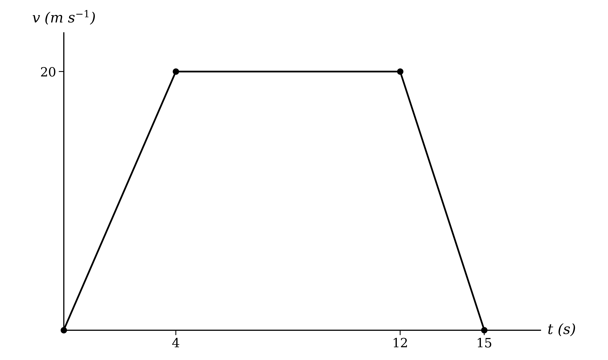

**[B1 B1]**

(ii)

The displacement is the area under the velocity-time graph, which is a trapezium with parallel sides 15 and 8, and height 20

$s = \frac{15+8}{2} \times 20$

**[M1]**

$s = \frac{23}{2} \times 20$

$s = 230 \text{m}$

**[A1 A1]**

> **[mark-scheme]**
> **B1**: Correct maximum velocity of 20 m s⁻¹, seen on the graph or in working.
> 
> **B1**: Correct shape, starting at the origin, rising to a maximum, horizontal, then falling to the time axis.
> 
> **B1**: Fully correct graph with the times 4, 12 and 15 seconds correctly marked.
> 
> **M1**: Correct method for the total area under the graph. Accept the trapezium formula, or the sum of a triangle, a rectangle and a triangle.
> 
> **A1**: Correct unsimplified expression for the area.
> 
> **A1**: Correct displacement of 230 m. Units are not required.

### Q6
(i)

Read the value of the graph at $t = 0$

$2 \text{m s}^{-1}$

**[B1]**

(ii)

At $t = 13$ the velocity is $- 4 \text{m s}^{-1}$, and the speed is the magnitude of the velocity

$4 \text{m s}^{-1}$

**[B1]**

(iii)

The particle is instantaneously at rest where the graph crosses the time axis, rather than where it rests along it

$11 \text{seconds}$

**[B1]**

> **[mark-scheme]**
> **B1**: Correct initial speed of 2 m s⁻¹.
> 
> **B1**: Correct speed of 4 m s⁻¹. A speed was asked for, so the answer must be positive; −4 does not score.
> 
> **B1**: Correct time of 11 seconds, where the graph crosses the time axis. The interval from 6 to 9 seconds does not score, since the particle is at rest throughout that interval rather than instantaneously.
(i)

The acceleration is the gradient of a velocity-time graph, so use $a = \frac{\text{change in velocity}}{\text{change in time}}$

$a = \frac{6-2}{4}$

**[M1]**

$a = 1 \text{m s}^{-2}$

**[A1]**

(ii)

The displacement is the area under the graph, which splits into a trapezium for $0 \leq t \leq 4$ and a triangle for $4 \leq t \leq 6$

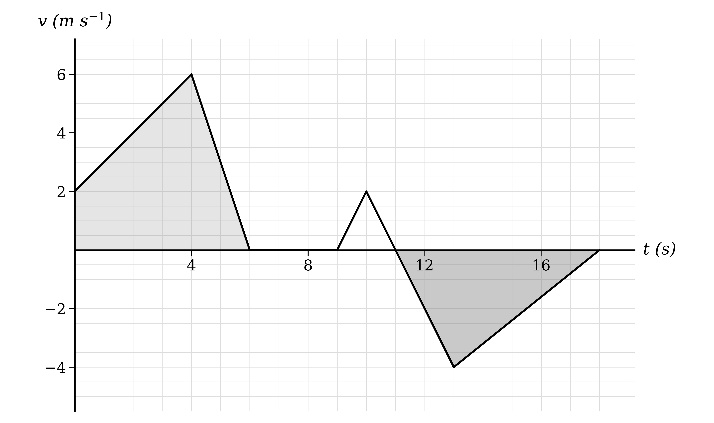

$s = \frac{1}{2} ( 6 + 2 ) \times 4 + \frac{1}{2} ( 2 \times 6 )$

**[M1]**

$s = 16 + 6$

$s = 22 \text{m}$

**[A1]**

(iii)

The last 7 seconds run from $t = 11$ to $t = 18$, entirely below the time axis, so this area is negative

$s = \frac{1}{2} \times 7 \times ( - 4 )$

**[M1]**

$s = - 14 \text{m}$

**[A1]**

> **[mark-scheme]**
> **M1**: Correct method for the gradient of the first section, using the change in velocity divided by the change in time. Accept the use of $v = u + a t$ with $u = 2$ and $v = 6$.
> 
> **A1**: Correct acceleration of 1 m s⁻².
> 
> **M1**: Correct method for the total area under the graph for the first 6 seconds, using a trapezium and a triangle, or any equivalent correct split.
> 
> **A1**: Correct displacement of 22 m.
> 
> **M1**: Correct method for the area of the triangle between 11 and 18 seconds, taken as negative because the graph lies below the time axis.
> 
> **A1**: Correct displacement of −14 m. The negative sign is required, because a displacement was asked for rather than a distance.

### Q7
Each stage has a constant velocity, so the graph is a series of straight lines joining the displacements given

The marble reaches 9 cm at $t = 3$, then returns to zero at $t = 5$

**[B1]**

A negative displacement is on the opposite side of the starting position, so the graph goes below the time axis to −6 cm at $t = 6$

**[B1]**

The marble is back at its initial position half a second later, at $t = 6 . 5$

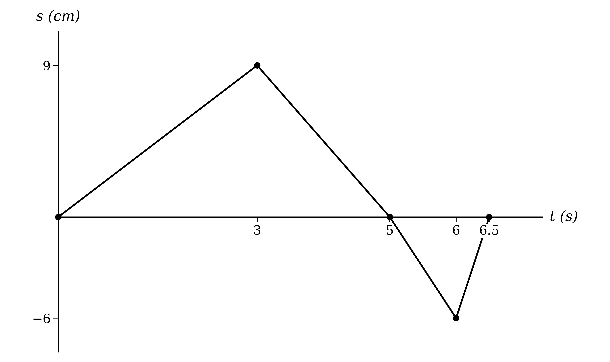

**[B1]**

> **[mark-scheme]**
> **B1**: Correct first two sections, a straight line from the origin to 9 cm at 3 seconds and a straight line returning to zero displacement at 5 seconds.
> 
> **B1**: Correct third section, a straight line continuing below the time axis to a displacement of −6 cm at 6 seconds.
> 
> **B1**: Correct final section, a straight line returning to zero displacement at 6.5 seconds. All sections must be straight, with the times correctly marked.

### Q8
(i)

The greatest distance from *O* is the height of the tallest peak

$20 \text{m}$

**[B1]**

(ii)

The third run is the third peak, so read off the time at its highest point

$16 \text{seconds}$

**[B1]**

> **[mark-scheme]**
> **B1**: Correct greatest distance of 20 m, read from the highest peak of the graph.
> 
> **B1**: Correct time of 16 seconds, read from the highest point of the third peak.
Distance counts the outward and return journeys of every run, so the total distance is twice the sum of the four peak displacements

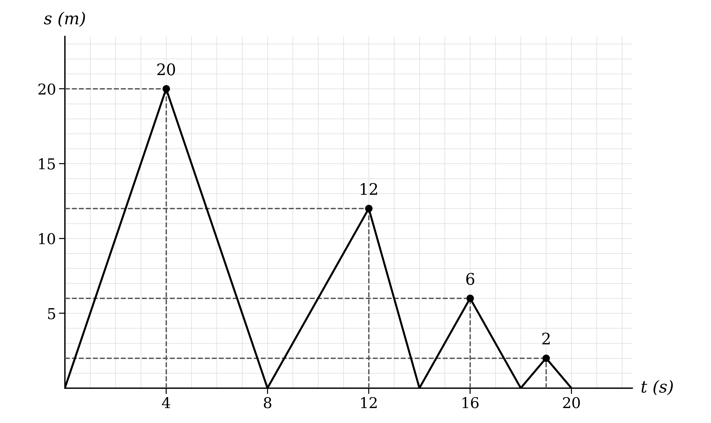

$\text{total distance} = 2 ( 20 + 12 + 6 + 2 )$

**[M1]**

$\text{total distance} = 80$

**[A1]**

The four runs are complete at $t = 20$, so use $\text{average speed} = \frac{\text{total distance}}{\text{total time}}$

$\text{average speed} = \frac{80}{20}$

**[M1]**

$4 \text{m s}^{-1}$

**[A1]**

> **[exam-tip]**
> The participant ends where they started, so the total displacement over the four runs is zero and the average velocity is zero. Average speed uses distance, which counts every metre travelled in both directions, so it is the doubling of the four peaks that makes this question work.

> **[mark-scheme]**
> **M1**: Correct method for the total distance, doubling the sum of the four peak displacements to account for both the outward and the return journey of each run.
> 
> **A1**: Correct total distance of 80 m.
> 
> **M1**: Correct method for the average speed, dividing the total distance by the total time of 20 seconds.
> 
> **A1**: Correct average speed of 4 m s⁻¹. Units are not required.

### Q9
The first section is a triangle whose area is the 9 m displacement, so use $\text{area} = \frac{1}{2} \times \text{base} \times \text{height}$ to find the velocity at *A*

$\frac{1}{2} ( 6 \times v ) = 9$

$v = 3$

**[B1]**

The deceleration lasts 4 seconds and ends at $2 \text{m s}^{-1}$, so *B* is at $t = 6 + 4 = 10$

**[B1]**

The particle then travels 12 m at a constant $2 \text{m s}^{-1}$, so use $\text{time} = \frac{\text{distance}}{\text{speed}}$ to place *C*

$\frac{12}{2} = 6$

$t = 10 + 6 = 16$

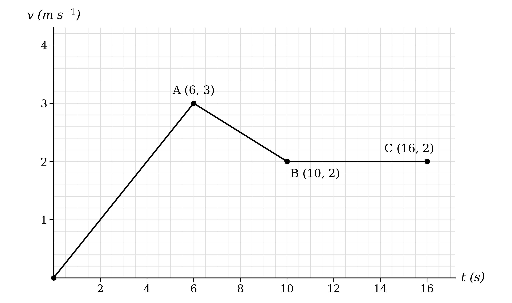

**[B1]**

The total displacement is the area under the whole graph, made up of a triangle, a trapezium and a rectangle

$s = 9 + \frac{1}{2} ( 2 + 3 ) \times 4 + 12$

**[M1]**

$s = 9 + 10 + 12$

$s = 31 \text{m}$

**[B1]**

> **[mark-scheme]**
> **B1**: Correct velocity of 3 m s⁻¹ at *A*, obtained by equating the area of the first triangle to the given displacement of 9 m.
> 
> **B1**: Correct coordinates for *B*, at 10 seconds and 2 m s⁻¹.
> 
> **B1**: Correct coordinates for *C*, at 16 seconds and 2 m s⁻¹, with a fully correct graph drawn through all three points.
> 
> **M1**: Correct method for the total area under the graph, using all three sections. Accept any equivalent correct split of the region.
> 
> **B1**: The given result of 31 m is reached from complete working, with the value of each of the three areas visible.

### Q10
Each stage has a constant velocity, so each section is a straight line. To place the first corner, use $\text{displacement} = \text{velocity} \times \text{time}$

$s = 3 \times 5 = 15$

**[B1]**

The particle is stationary for the next 6 seconds, so the graph is horizontal from $t = 5$ to $t = 11$

The particle returns to its initial position, a distance of 15 m, so use $\text{time} = \frac{\text{distance}}{\text{speed}}$

$\frac{15}{6} = 2 . 5$

**[M1]**

The motion therefore ends at $11 + 2 . 5 = 13 . 5$ seconds

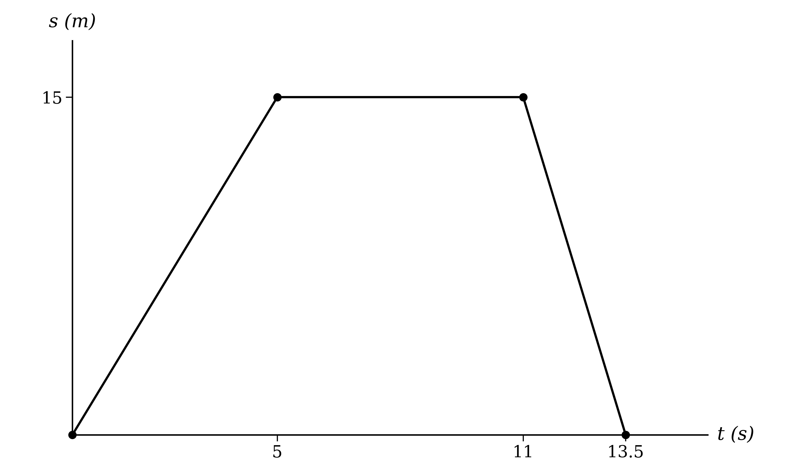

**[A1]**

> **[mark-scheme]**
> **B1**: Correct first section, a straight line from the origin reaching a displacement of 15 m at 5 seconds.
> 
> **M1**: Correct method for the duration of the final section, dividing the displacement to be covered by the speed.
> 
> **A1**: Fully correct graph, with the horizontal section from 5 to 11 seconds and a straight line returning to zero displacement at 13.5 seconds. Follow through from an incorrect first section, provided the shape is right.

### Q11
The acceleration is the gradient of a velocity-time graph, so use $v = u + a t$ with $u = 0$ to find the velocity reached

$v = 2 \times 3 = 6$

**[B1]**

The time at constant speed is not given, so find it from $\text{time} = \frac{\text{distance}}{\text{speed}}$

$\frac{24}{6} = 4$

**[M1]**

The constant-speed stage ends at $t = 7$

The velocity then falls from 6 to −2 at $1 \text{m s}^{-2}$, so divide the change in velocity by that rate

$\frac{6-(-2)}{1} = 8$

This stage ends at $t = 15$, and the velocity reaches zero 6 seconds into it, at $t = 13$

The cable car then comes to rest 5 seconds later, at $t = 20$

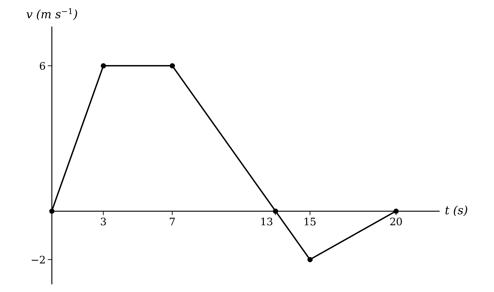

**[A1]**

> **[mark-scheme]**
> **B1**: Correct maximum velocity of 6 m s⁻¹, seen on the graph or in working.
> 
> **M1**: Correct method for the duration of the constant-speed stage, dividing the distance of 24 m by the speed.
> 
> **A1**: Fully correct graph with straight sections, crossing the time axis at 13 seconds, reaching −2 m s⁻¹ at 15 seconds and returning to zero at 20 seconds.
The distance is the total area between the graph and the time axis, counting the region below the axis as positive

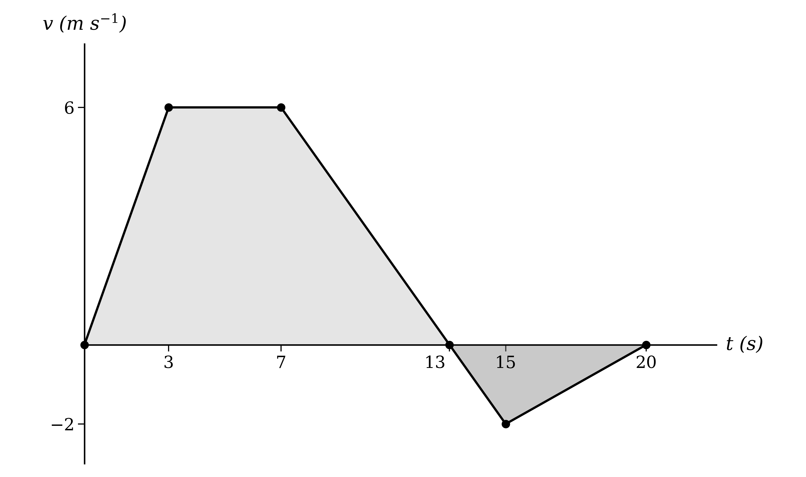

The region above the axis is a trapezium with parallel sides 13 and 4 and height 6. The region below is a triangle of base 7 and height 2

$\text{distance} = \frac{1}{2} ( 13 + 4 ) ( 6 ) + \frac{1}{2} ( 7 ) ( 2 )$

**[M1]**

$\text{distance} = 51 + 7$

$58 \text{m}$

**[A1]**

> **[mark-scheme]**
> **M1**: Correct method for the total distance, adding the area above the time axis and the area below it as positive values. Follow through from the graph in part (a).
> 
> **A1**: Correct total distance of 58 m.
The width of the river depends on where the cable car finishes, not on how far it travels. For the displacement, the region below the time axis counts as negative

$s = 51 - 7 = 44$

**[B1]**

**Final answer:** **The cable car finishes 44 m from where it started, on the other side of the river, so the river can be at most 44 m wide**

**[B1]**

> **[mark-scheme]**
> **B1**: Correct displacement of 44 m, subtracting the area below the time axis from the area above it.
> 
> **B1**: A correct explanation that 44 m is the straight-line distance between the start and the finish, which lie on either side of the river, so the river can be no wider than this. Accept any equivalent wording. A response based on the total distance of 58 m does not score, because the cable car travels back over part of its route.

### Q12
(i)

Distance counts movement in both directions as positive. The particle starts 3 m from *O*, rises to 11 m, and at $t = 10$ is back down to 5 m

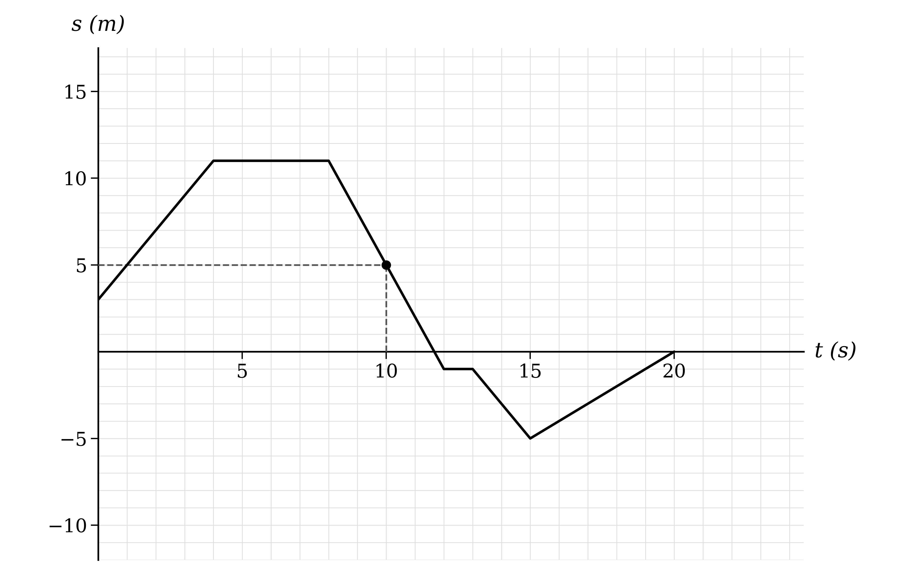

$\text{distance} = ( 11 - 3 ) + ( 11 - 5 )$

**[M1]**

$14 \text{m}$

**[A1]**

(ii)

Over 20 seconds the particle moves 8 m out to 11 m, 12 m back to −1 m, 4 m further to −5 m, then 5 m back to 0

$\text{total distance} = 8 + 12 + 4 + 5$

$\text{total distance} = 29$

**[M1]**

Divide the total distance by the total time

$\text{average speed} = \frac{29}{20}$

$1 . 45 \text{m s}^{-1}$

**[A1]**

> **[mark-scheme]**
> **M1**: Correct method for the distance in the first 10 seconds, adding the distance up to 11 m and the distance back down to 5 m. The displacement at 10 seconds must be read as 5 m.
> 
> **A1**: Correct distance of 14 m. An answer of 5 or 2, from the displacement alone, does not score.
> 
> **M1**: Correct method for the total distance over 20 seconds, adding the magnitudes of all four moving sections.
> 
> **A1**: Correct average speed of 1.45 m s⁻¹.

### Q13
The ball hits a cushion whenever its velocity changes sign instantaneously

$0 . 8 \text{seconds}$

**[B1]**

$3 . 2 \text{seconds}$

**[B1]**

Between the two cushions the ball travels the full length of the table, which is the area between the graph and the time axis from 0.8 to 3.2 seconds

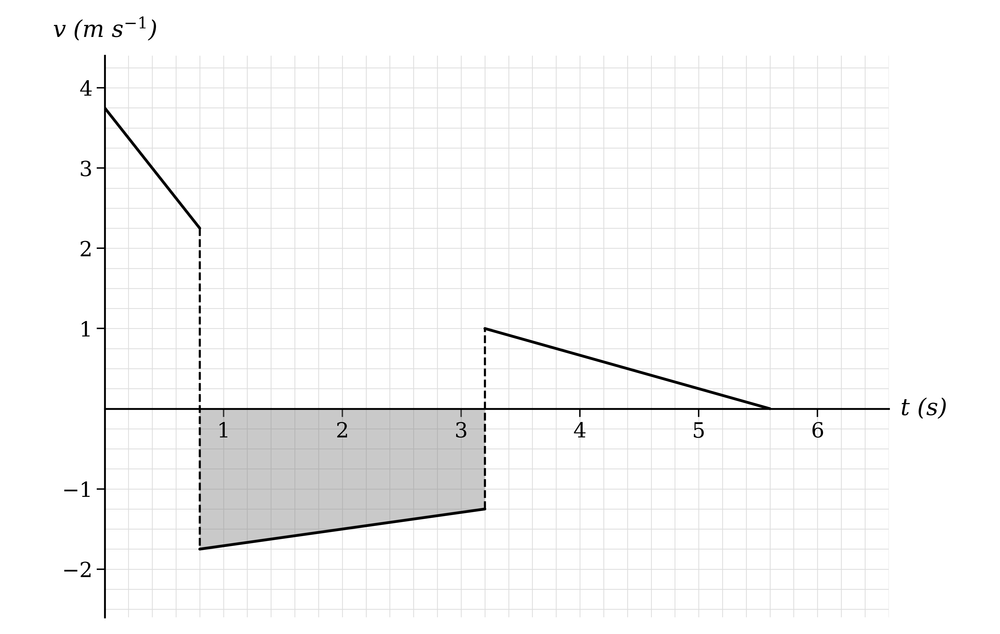

That region is a trapezium with parallel sides 1.75 and 1.25, and width $3 . 2 - 0 . 8 = 2 . 4$

$\text{length} = \frac{1}{2} ( 1 . 75 + 1 . 25 ) ( 2 . 4 )$

**[M1]**

$3 . 6 \text{m}$

**[A1]**

> **[mark-scheme]**
> **B1**: Correct time of 0.8 seconds.
> 
> **B1**: Correct time of 3.2 seconds.
> 
> **M1**: Correct method for the area between the graph and the time axis from 0.8 to 3.2 seconds, treated as a positive length.
> 
> **A1**: Correct length of 3.6 m. The ball is modelled as a particle, so the distance between the cushions is the length of the table.
The ball comes to rest where it was struck if its final displacement is zero. Areas above the time axis count as positive and the area below it as negative

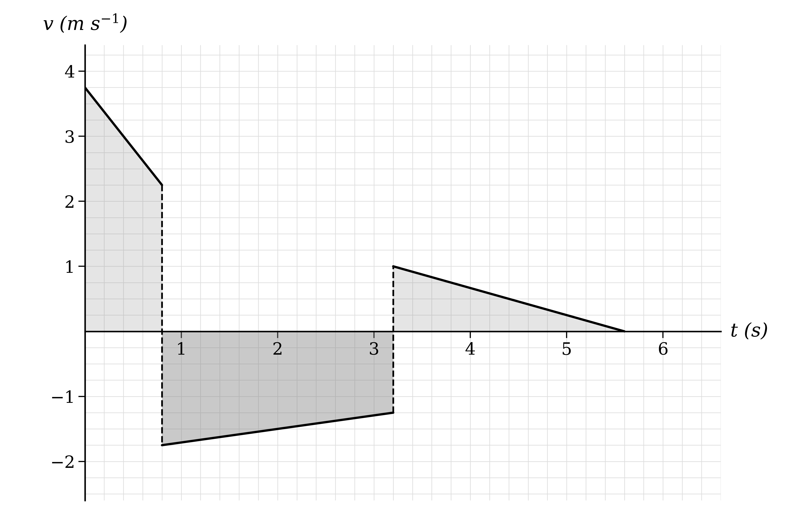

$s = \frac{1}{2} ( 3 . 75 + 2 . 25 ) ( 0 . 8 ) - 3 . 6 + \frac{1}{2} ( 5 . 6 - 3 . 2 ) ( 1 )$

**[M1]**

$s = 2 . 4 - 3 . 6 + 1 . 2$

**[A1]**

$s = 0$

**Final answer:** **The final displacement is zero, so the ball comes to rest at the point from which it was struck**

**[B1]**

> **[mark-scheme]**
> **M1**: Correct method for the final displacement, adding the areas above the time axis and subtracting the area below it.
> 
> **A1**: Correct areas of 2.4 and 1.2 for the two regions above the time axis. Follow through the middle area from part (a).
> 
> **B1**: A correct conclusion from a final displacement of exactly zero. Because the result is given, all three areas must be seen.

### Q14
(i)

Particle *P* only moves downwards, so its displacement is never positive. Particle *Q* moves upwards first, so its curve rises above the time axis before falling

**[B1]**

(ii)

Both particles reach the sea where the curves end, 64 m below the starting point

$64 \text{m}$

**[B1]**

(iii)

Only *Q* has a positive displacement, from $t = 0$ to $t = 4$, and that is half of its journey time

$2 \times 4$

$8 \text{seconds}$

**[B1]**

> **[mark-scheme]**
> **B1**: Both curves correctly labelled, *Q* on the curve that rises above the time axis and *P* on the curve that only falls.
> 
> **B1**: Correct height of 64 m.
> 
> **B1**: Correct time of 8 seconds.
The average velocity is the total displacement divided by the total time

*Both particles start at the top of the cliff and finish in the sea, so they have the same displacement of −64 m*

**[B1]**

*They start together and reach the sea at the same time, so they take the same time*

**Final answer:** **Equal displacements over equal times give equal average velocities**

**[B1]**

> **[mark-scheme]**
> **B1**: A correct statement that both particles have the same displacement, since they start and finish at the same points.
> 
> **B1**: A correct statement that both take the same time, with the conclusion that their average velocities are therefore equal. Accept any equivalent wording. A response that computes either average velocity does not score this mark, since the question asks for an explanation without calculation.
The curve for *Q* crosses the time axis at $t = 0$ and $t = 4$, so $B = 4$

*Q* reaches the sea at $t = 8$ with $s = - 64$. Substitute into $s = A t ( 4 - t )$

$- 64 = 8 A ( 4 - 8 )$

**[M1]**

$- 64 = - 32 A$

$A = 2$

**[A1]**

The curve is symmetrical, so its maximum is halfway between the zeros at 0 and 4

$t = \frac{0+4}{2}$

$2 \text{seconds}$

**[B1]**

Substitute $t = 2$ into $s = 2 t ( 4 - t )$

$s = 2 ( 2 ) ( 4 - 2 ) = 8$

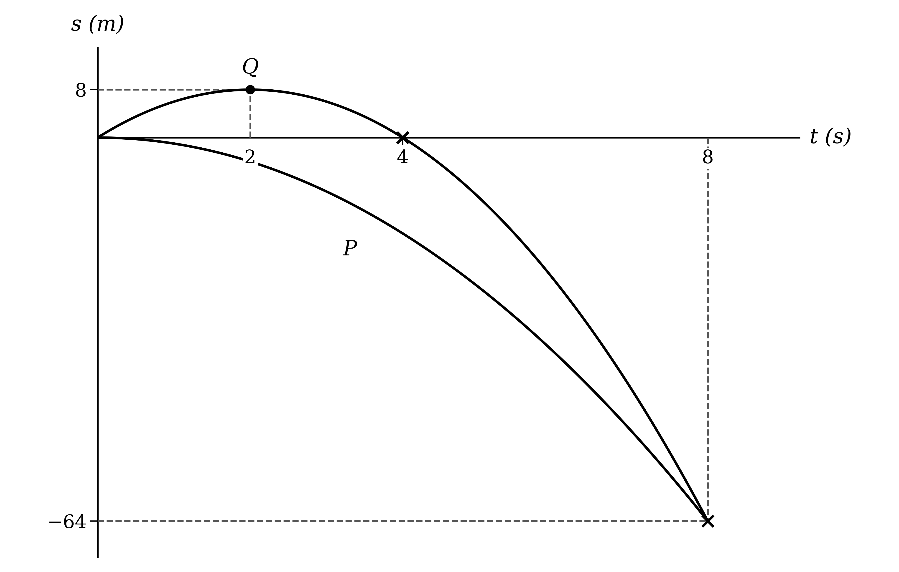

The sea is 64 m below the starting point

$64 + 8$

$72 \text{m}$

**[A1]**

> **[mark-scheme]**
> **M1**: Correct method for *A*, substituting $t = 8$ and $s = - 64$ with $B = 4$ read from the zero at $t = 4$.
> 
> **A1**: Correct values $A = 2$ and $B = 4$.
> 
> **B1**: Correct time of 2 seconds, from the symmetry of the curve or from $\frac{\text{d}s}{\text{d}t} = 0$.
> 
> **A1**: Correct greatest height of 72 m above the sea, adding the height of the cliff to the greatest displacement of 8 m.

### Q15
Each car begins to decelerate the moment it crosses the finish line, so both cars have covered the same distance by then: car *A* at 4.5 seconds and car *B* at 5.1 seconds

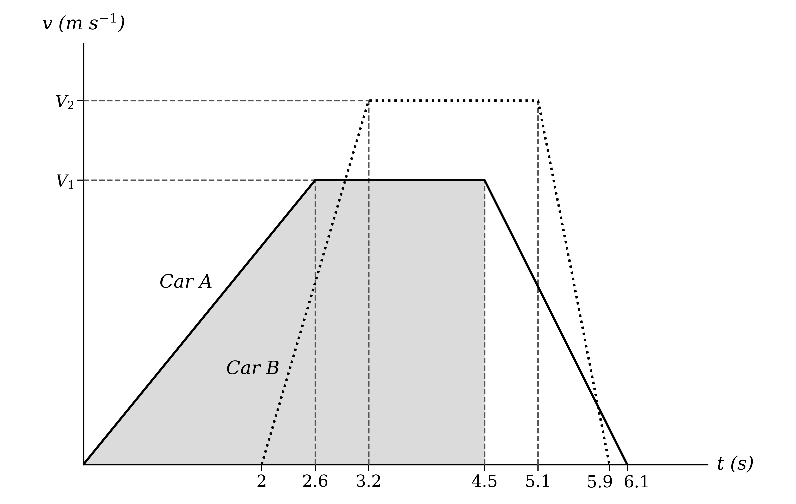

For car *A* the area is a trapezium with parallel sides 4.5 and $4 . 5 - 2 . 6 = 1 . 9$, and height $V_{1}$

$\frac{1}{2} ( 4 . 5 + 1 . 9 ) V_{1} = 3 . 2 V_{1}$

**[M1]**

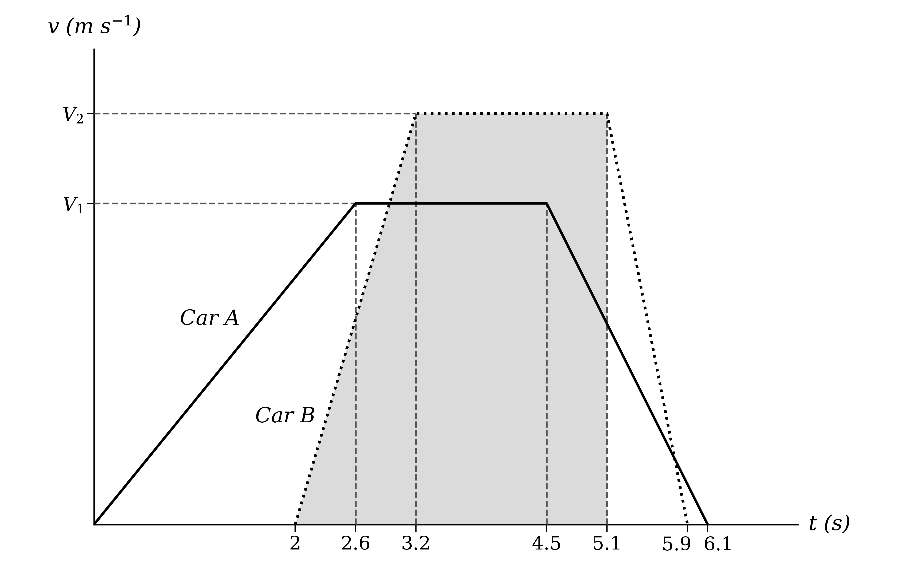

For car *B* the area is a trapezium with parallel sides $5 . 1 - 2 = 3 . 1$ and $5 . 1 - 3 . 2 = 1 . 9$, and height $V_{2}$

$\frac{1}{2} ( 3 . 1 + 1 . 9 ) V_{2} = 2 . 5 V_{2}$

**[M1]**

The two distances are equal

$2 . 5 V_{2} = 3 . 2 V_{1}$

$V_{2} = 1 . 28 V_{1}$

**[B1]**

> **[mark-scheme]**
> **M1**: Correct method for the area under car *A*'s graph up to 4.5 seconds, as a trapezium or as a triangle and a rectangle.
> 
> **M1**: Correct method for the area under car *B*'s graph from 2 to 5.1 seconds. The base must start at 2 seconds.
> 
> **B1**: The given result reached by equating the two distances, with both simplified areas seen.
Each car covers the 400 m up to the moment it begins to decelerate, so each area from part (a) equals 400

$3 . 2 V_{1} = 400$

$V_{1} = 125$

**[B1]**

$2 . 5 V_{2} = 400$

$V_{2} = 160$

**[B1]**

> **[mark-scheme]**
> **B1**: Correct value $V_{1} = 125$.
> 
> **B1**: Correct value $V_{2} = 160$. Also accept $1 . 28 \times 125$.
Car *B*'s accelerating section crosses car *A*'s graph where car *A* is already travelling at a constant $125 \text{m s}^{-1}$

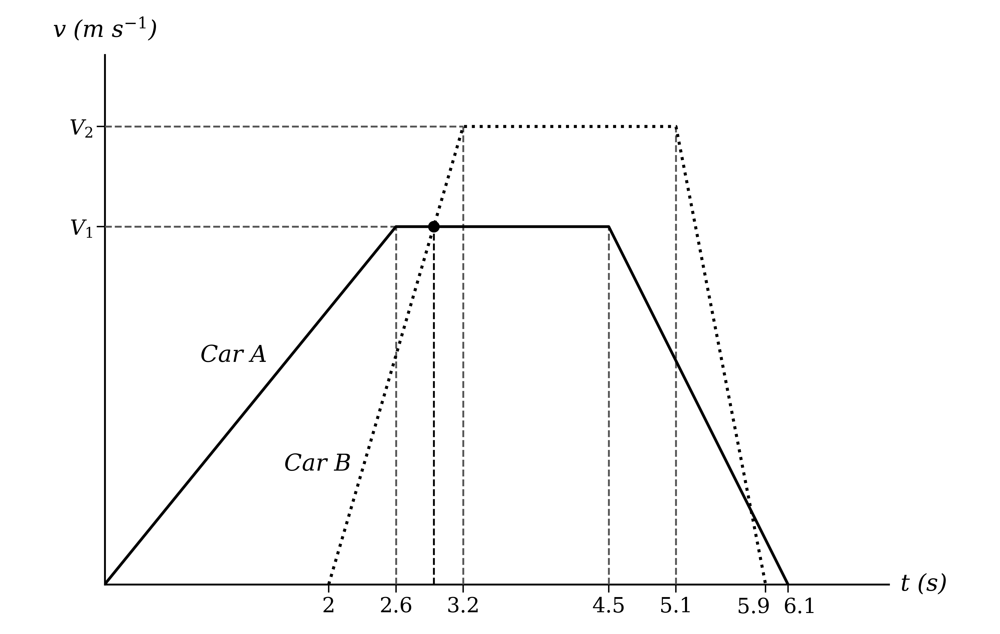

Car *B* accelerates from rest at $t = 2$ to $160 \text{m s}^{-1}$ at $t = 3 . 2$

$a = \frac{160}{3.2-2} = \frac{400}{3}$

**[M1]**

So the velocity of car *B*, *t* seconds after the start of the race, is

$v = \frac{400}{3} ( t - 2 )$

**[M1]**

Set this equal to the constant velocity of car *A*

$\frac{400}{3} ( t - 2 ) = 125$

**[M1]**

$t - 2 = 0 . 9375$

$t = 2 . 94 \text{seconds}$

**[A1]**

*This is after 2.6 seconds, so car A is already at its constant velocity at this time*

> **[mark-scheme]**
> **M1**: Correct method for the acceleration of car *B*, using its change in velocity over 1.2 seconds.
> 
> **M1**: Correct expression for the velocity of car *B* at time *t*, allowing for its 2-second delay. Accept $v = u + a t$ with a time of $t - 2$.
> 
> **M1**: Setting the velocity of car *B* equal to 125 and solving.
> 
> **A1**: Correct time. Accept $\frac{47}{16}$ or answers which round to 2.94. An answer of 2.9 alone does not score, since it is not given to 3 significant figures.

### Q16
The distance is the area under the velocity-time graph. Start with the two constant velocities, using $v = u + a t$ with $u = 0$

$v = 2 \times 4 = 8$

**[B1]**

Reducing the velocity by a quarter leaves three quarters of it

$\frac{3}{4} \times 8 = 6$

**[B1]**

The times are a mix of seconds and minutes, so convert the minutes into seconds

$16 \times 60 = 960$

$13 . 5 \times 60 = 810$

**[B1]**

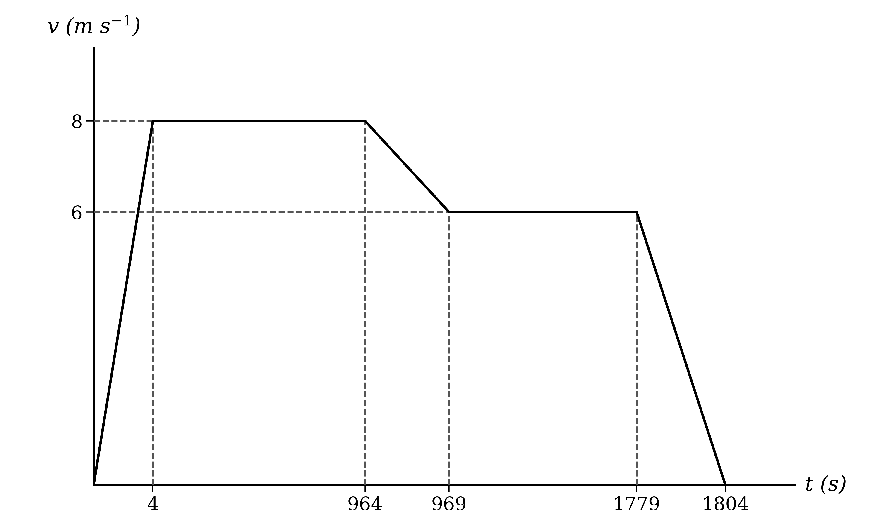

The area splits into a triangle, a rectangle, a trapezium, a rectangle and a triangle

$\text{distance} = \frac{1}{2} ( 4 ) ( 8 ) + ( 960 ) ( 8 ) + \frac{1}{2} ( 8 + 6 ) ( 5 ) + ( 810 ) ( 6 ) + \frac{1}{2} ( 25 ) ( 6 )$

**[M1]**

$\text{distance} = 16 + 7680 + 35 + 4860 + 75$

**[A1]**

$\text{distance} = 12666$

**Final answer:** **The scooter travels 12 666 m, which is 12.666 km, so it travels more than 12.6 km**

**[B1]**

The total time is the sum of the five stages, in seconds

$\text{time} = 4 + 960 + 5 + 810 + 25 = 1804$

**[M1]**

$1804 \text{seconds} = 30 \text{minutes} 4 \text{seconds}$

**Final answer:** **The battery lasts 30 minutes 4 seconds, which is approximately half an hour**

**[B1]**

> **[mark-scheme]**
> **B1**: Correct constant velocity of 8 m s⁻¹.
> 
> **B1**: Correct reduced velocity of 6 m s⁻¹.
> 
> **B1**: Correct conversions of 16 minutes and 13.5 minutes to 960 seconds and 810 seconds.
> 
> **M1**: Correct method for the total area under the graph, using all five sections with times in seconds.
> 
> **A1**: Correct areas of 16, 7680, 35, 4860 and 75 for the five sections, or a correct equivalent split.
> 
> **B1**: A correct conclusion that 12 666 m is more than 12.6 km.
> 
> **M1**: Correct method for the total time, adding all five stages in consistent units.
> 
> **B1**: A correct conclusion that 1804 seconds, or 30 minutes 4 seconds, is approximately half an hour.

### Q17
The velocity is the gradient of the displacement-time graph. The fastest part is the steepest section, from *A* to *B*, and the slowest is the shallowest, from *C* to *D*

$v_{AB} = \frac{35000-5000}{1250-250} = 30$

**[M1]**

$v_{CD} = \frac{40000-37500}{2000-1500} = 5$

**[A1]**

$30 - 5$

$25 \text{m s}^{-1}$

**[A1]**

> **[mark-scheme]**
> **M1**: Correct method for the gradient of a section, using the change in displacement divided by the change in time, with values read correctly from the graph.
> 
> **A1**: Correct velocities of 30 m s⁻¹ for the fastest section and 5 m s⁻¹ for the slowest. Also award this mark for all four gradients (20, 30, 10 and 5) with the greatest and least selected.
> 
> **A1**: Correct difference of 25 m s⁻¹.
5 km is 5000 m. The ferry is more than 5000 m from *O* once it passes *A*, and more than 5000 m from *D*, at 40 000 m, until it reaches *B* at 35 000 m

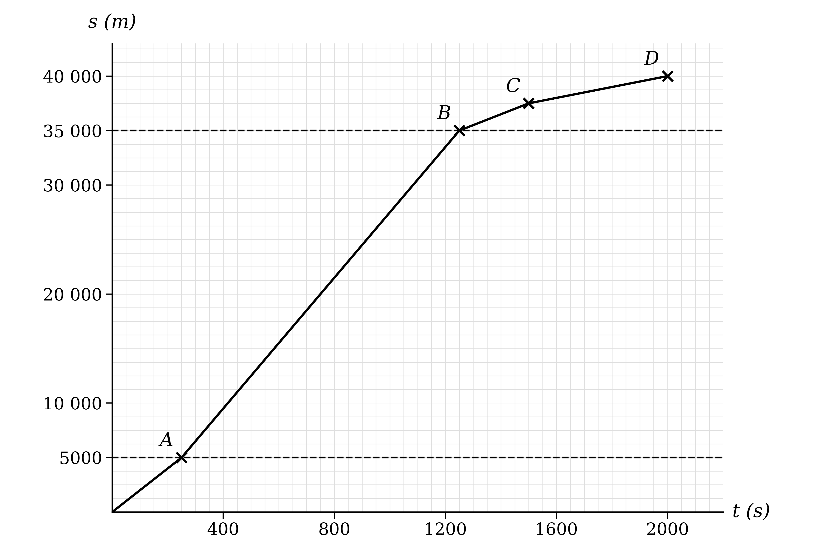

So only the section from *A* to *B* can be sped up. It covers 30 000 m, which currently takes 1000 seconds, so at the maximum speed it takes

$\text{time} = \frac{30000}{45} = \frac{2000}{3}$

**[M1]**

The reduction is the difference between the current and the new times

$1000 - \frac{2000}{3} = \frac{1000}{3} = 333 . 3 \dots$

**[M1]**

$333 \text{seconds}$

**[A1]**

> **[mark-scheme]**
> **M1**: Correct identification of the section from *A* to *B* as the only part more than 5 km from both ports, and a correct method for its time at 45 m s⁻¹.
> 
> **M1**: Correct method for the reduction, subtracting the new time from the current 1000 seconds.
> 
> **A1**: Correct reduction of 333 seconds, to the nearest second.

### Q18
Work backwards from the final position. The last part lasts 10 seconds at $- 1 \text{m s}^{-1}$

$- 1 \times 10 = - 10$

So at the end of the second part the displacement of the robot is

$4 + 10 = 14$

**[B1]**

The first two parts take the robot to 14 m at an average velocity of $0 . 7 \text{m s}^{-1}$, so together they last

$\frac{14}{0.7} = 20$

**[B1]**

Let the first part last *t* seconds, so the second part lasts $20 - t$ seconds. The displacements of the two parts add up to 14

$- 0 . 5 t + 1 . 5 ( 20 - t ) = 14$

**[M1]**

$- 0 . 5 t + 30 - 1 . 5 t = 14$

$2 t = 16$

$t = 8$

The first part therefore ends at $t = 8$ with displacement

$- 0 . 5 \times 8 = - 4$

**[A1]**

The second part ends at $t = 20$ with displacement 14, and the last part ends at $t = 30$ with displacement 4. Plot the points and join them with straight lines

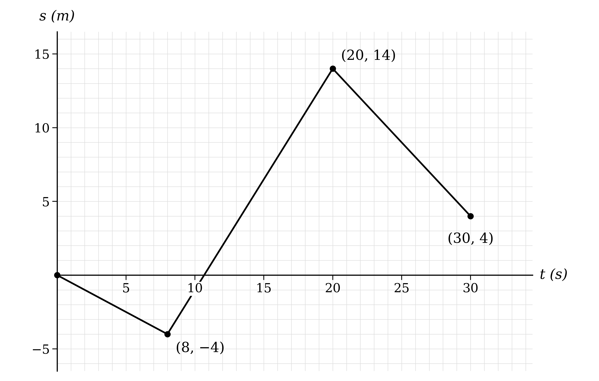

$( 8 ,  - 4 )$

$( 20 ,  14 )$

$( 30 ,  4 )$

**[B1 B1]**

> **[mark-scheme]**
> **B1**: Correct displacement of 14 m at the end of the second part, found by working back from the final displacement.
> 
> **B1**: Correct total time of 20 seconds for the first two parts, from the average velocity.
> 
> **M1**: Correct equation for the displacement over the first two parts, in one unknown time or as a pair of simultaneous equations.
> 
> **A1**: Correct values $t = 8$ and a displacement of −4 m at the end of the first part.
> 
> **B1**: Correct graph of three straight sections through (0, 0), (8, −4), (20, 14) and (30, 4), plotted accurately on the grid.
> 
> **B1**: All three coordinates (8, −4), (20, 14) and (30, 4) labelled on the graph.

### Q19
Each stage has a constant velocity, so the graph is a series of straight lines. Take the halfway line as zero displacement

The camera reaches −38 m after 4 seconds

**[B1]**

It then moves from −38 m to 17 m, a distance of $38 + 17 = 55$ m, at $5 \text{m s}^{-1}$, so use $\text{time} = \frac{\text{distance}}{\text{speed}}$

$\frac{55}{5} = 11$

**[M1]**

The camera therefore reaches 17 m at $t = 15$ and stays there until $t = 21$

Over the final 9 seconds its displacement changes by $- 3 \times 9 = - 27$, so it finishes at

$s = 17 - 27 = - 10$

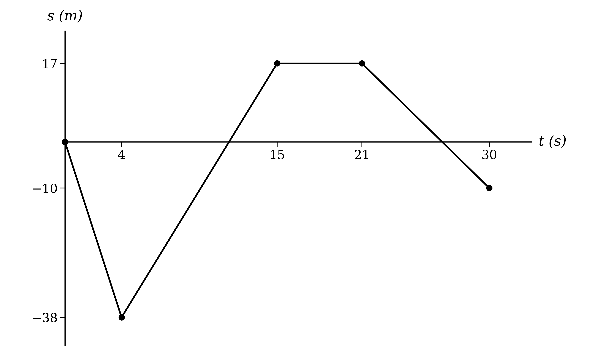

**[A1]**

> **[mark-scheme]**
> **B1**: Correct first section, a straight line from the origin down to −38 m at 4 seconds.
> 
> **M1**: Correct method for the duration of the second section, dividing the distance of 55 m by the speed of 5 m s⁻¹.
> 
> **A1**: Fully correct graph with straight sections through 17 m at 15 seconds, horizontal until 21 seconds, and ending at −10 m at 30 seconds.

The average velocity is the total displacement divided by the total time. The camera finishes 10 m on the negative side of the halfway line after 30 seconds

$\text{average velocity} = \frac{-10}{30}$

**[M1]**

$- 0 . 333 \text{m s}^{-1}$

**[A1]**

> **[mark-scheme]**
> **M1**: Correct method for the average velocity, dividing the final displacement by the total time. Follow through from the final displacement and time in part (a).
> 
> **A1**: Correct average velocity. Accept $- \frac{1}{3}$ or answers which round to −0.333, or 0.333 m s⁻¹ with its direction stated as towards the side of the halfway line where the camera finishes. An answer of 0.333 with no sign or direction does not score, because a velocity was asked for.

### Q20
The distance is the area under the velocity-time graph. The time is in minutes, so divide the area by 60 at the end to convert to hours

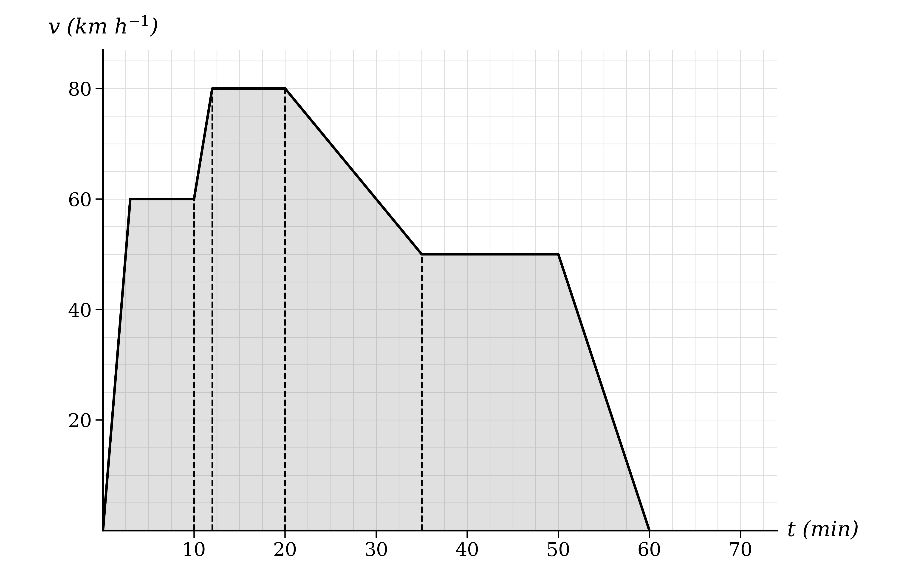

Split the area at 10, 12, 20 and 35 minutes into four trapezia and a rectangle

$\text{area} = \frac{1}{2} ( 10 + 7 ) ( 60 ) + \frac{1}{2} ( 60 + 80 ) ( 2 ) + ( 8 ) ( 80 ) + \frac{1}{2} ( 80 + 50 ) ( 15 ) + \frac{1}{2} ( 25 + 15 ) ( 50 )$

**[M1]**

$\text{area} = 510 + 140 + 640 + 975 + 1000$

$\text{area} = 3265$

$\text{distance} = \frac{3265}{60}$

**[M1]**

$54 . 4 \text{km}$

**[A1]**

> **[mark-scheme]**
> **M1**: Correct method for the total area under the graph. Accept any correct split into triangles, rectangles and trapezia.
> 
> **M1**: Correct conversion of the time units, dividing an area in km h⁻¹ × minutes by 60, or converting every time to hours before finding the area.
> 
> **A1**: Correct distance. Accept $\frac{653}{12}$ or answers which round to 54.4.
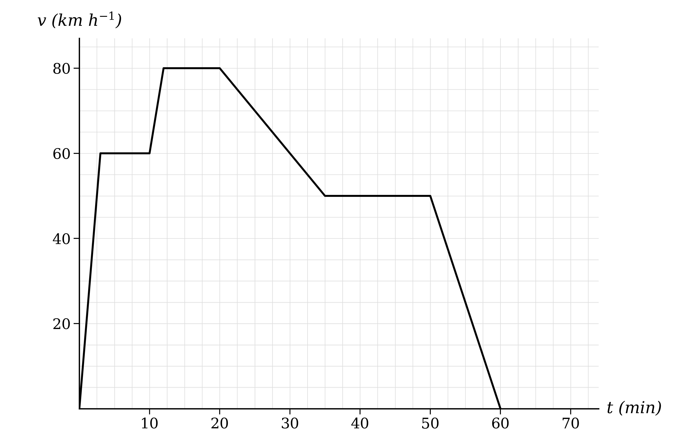

The magnitude of the acceleration is the steepness of the graph. Compare the four sloping sections, in km h⁻¹ per minute

$\frac{60-0}{3-0} = 20$

$\frac{80-60}{12-10} = 10$

$\frac{50-80}{35-20} = - 2$

$\frac{0-50}{60-50} = - 5$

**[M1]**

The first section is the steepest. Convert its change in velocity to metres per second and its 3 minutes to 180 seconds

$60 \text{km h}^{-1} = \frac{60\times1000}{3600} = \frac{50}{3} \text{m s}^{-1}$

**[M1]**

$a = \frac{50}{3} \div 180$

$0 . 0926 \text{m s}^{-2}$

**[A1]**

> **[mark-scheme]**
> **M1**: Correct method identifying the steepest section as the one from 0 to 3 minutes, by comparing gradients or by clear selection from the graph.
> 
> **M1**: Correct conversion of both units for that section, km h⁻¹ to m s⁻¹ and minutes to seconds.
> 
> **A1**: Correct acceleration. Accept $\frac{5}{54}$ or answers which round to 0.0926.

### Q21
(i)

Each car begins to decelerate the moment it crosses the finish line. Car *A*'s velocity rises right up to the moment it starts to fall

**Final answer:** **Car A**

**[B1]**

(ii)

The acceleration is the gradient of car *A*'s first section, which reaches $\frac{500}{3} \text{m s}^{-1}$ at 4.8 seconds

`|a| = \dfrac{500}{3} \div 4.8`

**[M1]**

`|a| = \dfrac{625}{18}`

`|a| = 34.7\text{ m s}^{-2}`

**[A1]**

> **[mark-scheme]**
> **B1**: Car *A*. A bare answer scores.
> 
> **M1**: Correct method for the gradient of the accelerating section of car *A*'s graph.
> 
> **A1**: Correct magnitude. Accept $\frac{625}{18}$ or answers which round to 34.7.
Car *B* covers the 400 m before it begins to decelerate at 5.6 seconds, so the area under its graph up to that time is 400

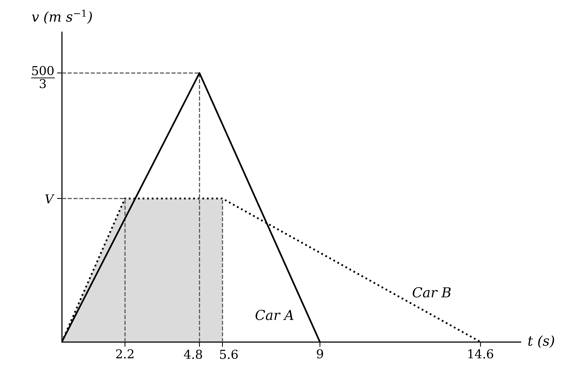

That area is a trapezium of height *V*, with parallel sides 5.6 and $5 . 6 - 2 . 2 = 3 . 4$

$\frac{1}{2} ( 5 . 6 + 3 . 4 ) V = 400$

**[M1]**

$4 . 5 V = 400$

**[A1]**

$V = 88 . 9$

**[A1]**

> **[mark-scheme]**
> **M1**: Correct method for the area under car *B*'s graph up to 5.6 seconds, equated to 400. Accept a triangle and a rectangle in place of the trapezium.
> 
> **A1**: Correct simplified equation $4 . 5 V = 400$ or equivalent.
> 
> **A1**: Correct value. Accept $\frac{800}{9}$ or answers which round to 88.9.
Car *B* decelerates from *V* to rest between 5.6 and 14.6 seconds, so the distance covered while decelerating is the area of a triangle of height *V*

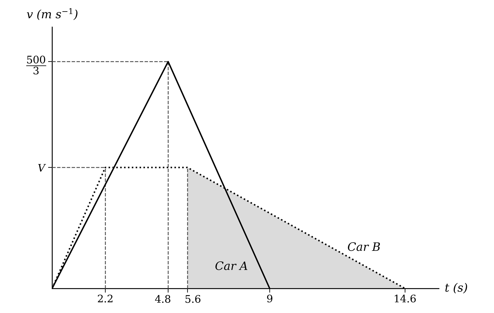

$\text{distance} = \frac{1}{2} ( 14 . 6 - 5 . 6 ) \times \frac{800}{9}$

**[M1]**

$\text{distance} = 400$

**[A1]**

Car *B* covered 400 m before it began to decelerate, so its total distance is

$400 + 400 = 800$

**Final answer:** **Car B covered 400 m of its 800 m while decelerating, which is half of its total distance**

**[B1]**

> **[mark-scheme]**
> **M1**: Correct method for the area of the triangle under car *B*'s graph from 5.6 to 14.6 seconds, using the value of *V* from part (b).
> 
> **A1**: Correct distance of 400 m while decelerating. Accept a value which rounds to 400 from the use of 88.9.
> 
> **B1**: A correct conclusion comparing the 400 m while decelerating with the total distance of 800 m. Because the result is given, the working must be shown.

### Q22
The displacement is the area above the time axis minus the area below it, and both regions are triangles

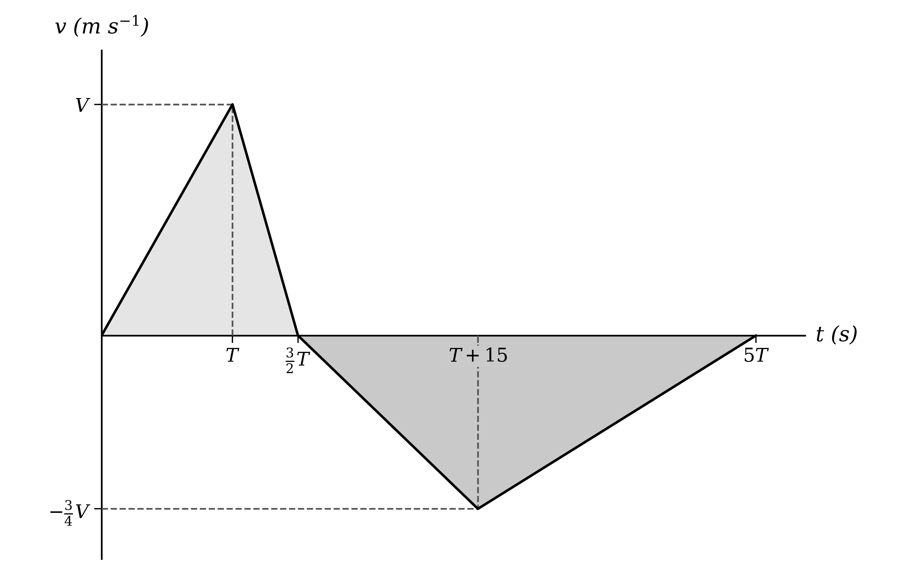

The triangle above the axis has base $\frac{3}{2} T$ and height *V*. The triangle below has base $5 T - \frac{3}{2} T = \frac{7}{2} T$ and height $\frac{3}{4} V$

`\dfrac{1}{2}\left(\dfrac{3}{2}T\right)V - \dfrac{1}{2}\left(\dfrac{7}{2}T\right)\left(\dfrac{3}{4}V\right) = -27`

**[M1]**

$\frac{3}{4} T V - \frac{21}{16} T V = - 27$

$- \frac{9}{16} T V = - 27$

$T V = 48$

**[A1]**

The magnitude of the acceleration is the steepness of each section

The steepest section runs from *T* to $\frac{3}{2} T$, where the velocity falls from *V* to 0 in $0 . 5 T$ seconds

$\frac{V}{0.5T} = 1 . 5$

**[M1]**

$V = 0 . 75 T$

Substitute this into $T V = 48$

$0 . 75 T^{2} = 48$

**[M1]**

$T^{2} = 64$

*T* is a time, so take the positive root

$T = 8$

**[A1]**

Substitute back to find *V*

$V = 0 . 75 \times 8$

$V = 6$

**[A1]**

> **[exam-tip]**
> The graph is only a sketch, so check that the section you took as steepest really is. With $T = 8$ and $V = 6$ the four sections have gradients of magnitude 0.75, 1.5, 0.409 and 0.265, so the greatest acceleration is indeed on the section from *T* to $\frac{3}{2} T$.

> **[mark-scheme]**
> **M1**: Correct method for the final displacement, the area of the triangle above the axis minus the area of the triangle below it, equated to −27. Accept the equivalent equation with both signs reversed, equated to 27.
> 
> **A1**: Correct simplified equation $T V = 48$ or equivalent.
> 
> **M1**: Correct equation from the gradient of the steepest section, equated to 1.5.
> 
> **M1**: Correct method for solving the two equations simultaneously, substituting to form an equation in one unknown.
> 
> **A1**: Correct value $T = 8$. The negative root must be rejected, since *T* is a time.
> 
> **A1**: Correct value $V = 6$.

### Q23
The curve is symmetrical and crosses the time axis at $t = 0$ and $t = 4$, so its maximum is halfway between them

$t = \frac{0+4}{2} = 2$

**[M1]**

Substitute $t = 2$ into the equation for *s*

$s = 2 ( 2 ) ( 4 - 2 ) = 8$

**[A1]**

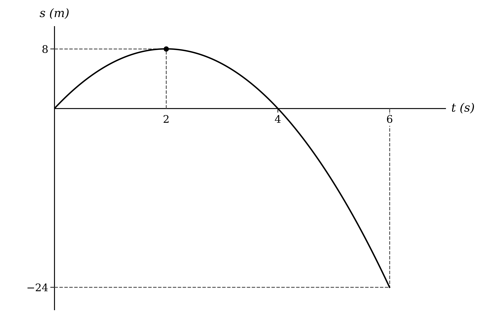

The graph ends at $s = - 24$ when the particle reaches the sea, so the sea is 24 m below the starting point

$24 + 8$

$32 \text{m}$

**[B1]**

> **[mark-scheme]**
> **M1**: Correct method for the time of the maximum, using the symmetry of the curve between its zeros at 0 and 4. Accept the use of $\frac{\text{d}s}{\text{d}t} = 0$.
> 
> **A1**: Correct greatest displacement of 8 m above the starting point.
> 
> **B1**: Correct height of 32 m above the sea, adding the depth of the sea below the starting point. Follow through from an incorrect greatest displacement.
The average velocity is the total displacement divided by the total time. The particle ends 24 m below its starting point after 6 seconds

$\text{average velocity} = \frac{-24}{6}$

**[M1]**

$- 4 \text{m s}^{-1}$

**[A1]**

> **[mark-scheme]**
> **M1**: Correct method for the average velocity, dividing the final displacement by the total time of 6 seconds.
> 
> **A1**: Correct average velocity of −4 m s⁻¹, or 4 m s⁻¹ with its direction stated as downwards. An answer of 4 with no sign or direction does not score, because a velocity was asked for.
The average speed is the total distance divided by the total time. The particle moves 8 m up to its highest point, 8 m back down to its starting point, then a further 24 m down to the sea

$\text{total distance} = 8 + 8 + 24$

**[M1]**

$\text{total distance} = 40$

**[A1]**

Divide by the total time of 6 seconds

$\text{average speed} = \frac{40}{6}$

**[M1]**

$6 . 67 \text{m s}^{-1}$

**[A1]**

> **[mark-scheme]**
> **M1**: Correct method for the total distance, counting the upward and downward movement separately, using the greatest displacement from part (a).
> 
> **A1**: Correct total distance of 40 m.
> 
> **M1**: Correct method for the average speed, dividing the total distance by the total time of 6 seconds. Dividing the displacement of 24 m by 6 does not score.
> 
> **A1**: Correct average speed. Accept $\frac{20}{3}$ or answers which round to 6.67.

### Q24
(i)

The ball reverses direction at the cushion, so the velocity changes sign instantaneously

$0 . 6 \text{seconds}$

**[B1]**

(ii)

The speed is the magnitude of the velocity, so it falls from 3 to 1.5

$\frac{3-1.5}{3} \times 100$

`50\%`

**[B1]**

> **[mark-scheme]**
> **B1**: Correct time of 0.6 seconds, identified from the instantaneous change of sign in the velocity.
> 
> **B1**: Correct reduction of 50%. A reduction worked out from a velocity of 3 to a velocity of −1.5 does not score, since the speeds are being compared.
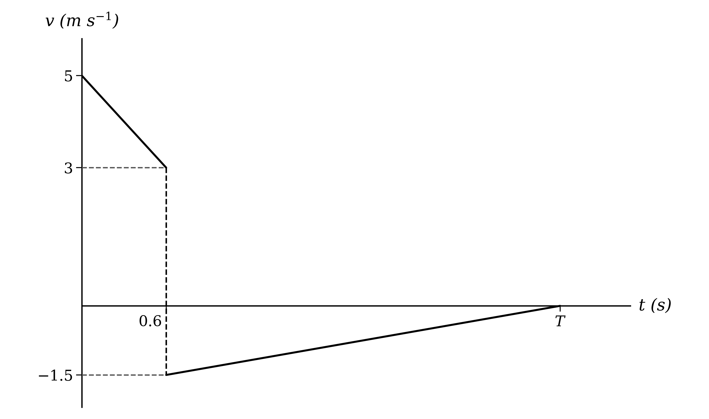

(i)

The acceleration is the gradient of the velocity-time graph, and a magnitude is asked for

`|a| = \left|\dfrac{3 - 5}{0.6}\right| = \dfrac{10}{3}`

**[M1]**

`|a| = 3.33\text{ m s}^{-2}`

**[A1]**

(ii)

After the cushion the velocity rises from −1.5 at $t = 0 . 6$ to 0 at $t = T$. This gradient is positive, because *T* is greater than 0.6

$a = \frac{0-(-1.5)}{T-0.6}$

$a = \frac{1.5}{T-0.6}$

Multiply the numerator and the denominator by 10 to clear the decimals

`|a| = \dfrac{15}{10T - 6}\text{ m s}^{-2}`

**[B1]**

> **[mark-scheme]**
> **M1**: Correct method for the gradient of the section before the cushion, using the change in velocity divided by the change in time.
> 
> **A1**: Correct magnitude. Accept $\frac{10}{3}$ or answers which round to 3.33. Accept −3.33 provided the magnitude is then stated.
> 
> **B1**: The given result reached from the correct gradient $\frac{1.5}{T-0.6}$, with the multiplication by 10 shown.
The displacement is the area above the time axis minus the area below it

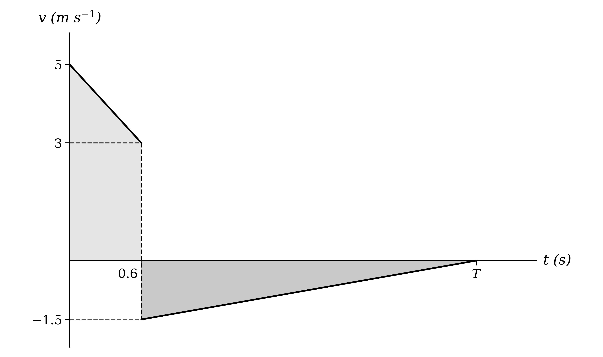

The area before the cushion is a trapezium with parallel sides 5 and 3 and width 0.6

$\frac{1}{2} ( 5 + 3 ) \times 0 . 6 = 2 . 4$

The area after the cushion is a triangle of base $T - 0 . 6$ and height 1.5, below the axis

$2 . 4 - \frac{1}{2} ( T - 0 . 6 ) ( 1 . 5 ) = 0 . 3$

**[M1]**

$0 . 75 ( T - 0 . 6 ) = 2 . 1$

$T - 0 . 6 = 2 . 8$

$T = 3 . 4$

**[A1]**

The total distance counts both areas as positive

$\text{distance} = 2 . 4 + \frac{1}{2} ( 3 . 4 - 0 . 6 ) ( 1 . 5 )$

**[M1]**

$\text{distance} = 2 . 4 + 2 . 1$

$4 . 5 \text{m}$

**[A1]**

> **[mark-scheme]**
> **M1**: Correct method for the displacement, the area of the trapezium minus the area of the triangle, equated to 0.3.
> 
> **A1**: Correct value $T = 3 . 4$.
> 
> **M1**: Correct method for the total distance, adding the two areas as positive values. Accept $2 . 4 + ( 2 . 4 - 0 . 3 )$. Follow through from an incorrect value of *T*.
> 
> **A1**: Correct total distance of 4.5 m.

### Q25
The acceleration is the gradient of a velocity-time graph, so use $v = u + a t$ with $u = 0$ to find the velocity reached

$v = 1 . 2 \times 5 = 6$

**[B1]**

The time at constant speed is not given, so find it from $\text{time} = \frac{\text{distance}}{\text{speed}}$

$\frac{42}{6} = 7$

**[M1]**

The constant-speed stage therefore ends at $t = 12$

The velocity then falls from 6 to 1.5 at a rate of $0 . 5 \text{m s}^{-2}$, so divide the change in velocity by that rate

$\frac{6-1.5}{0.5} = 9$

**[M1]**

This stage ends at $t = 21$, and the cable car then travels at $1 . 5 \text{m s}^{-1}$ until $t = 26$

It comes to rest 6 seconds later, at $t = 32$

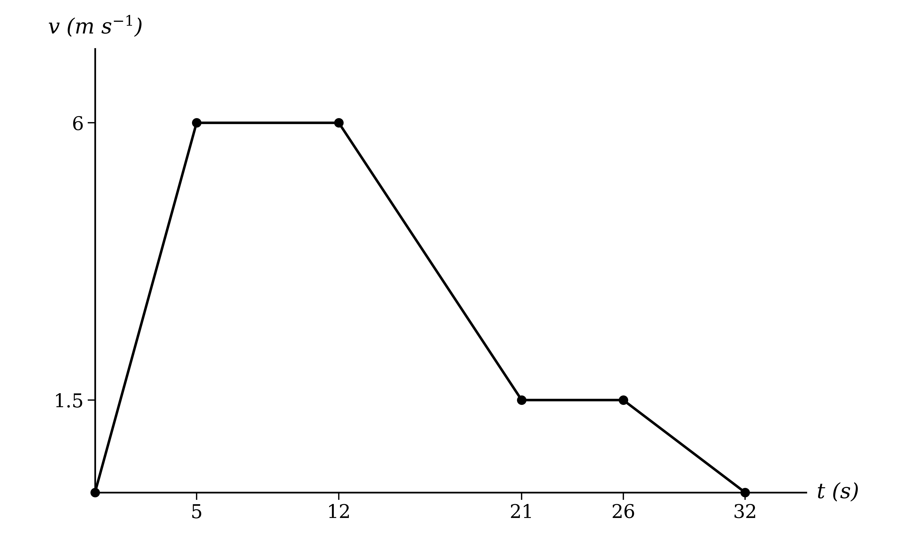

**[A1]**

> **[mark-scheme]**
> **B1**: Correct maximum velocity of 6 m s⁻¹, seen on the graph or in working.
> 
> **M1**: Correct method for the duration of the constant-speed stage, dividing the distance of 42 m by the speed.
> 
> **M1**: Correct method for the duration of the third stage, dividing the change in velocity by 0.5.
> 
> **A1**: Fully correct graph with five straight sections, the velocities 6 and 1.5, and the times 5, 12, 21, 26 and 32 seconds correctly marked. Follow through from an incorrect maximum velocity, provided the shape is right.

### Q26
The velocity is the gradient of the displacement-time graph, so the fastest part of the journey is the steepest section, from *A* to *B*

$v = \frac{26000-6000}{1200-400}$

**[M1]**

$v = \frac{20000}{800}$

$v = 25 \text{m s}^{-1}$

**[A1]**

> **[mark-scheme]**
> **M1**: Correct method for the gradient of the section from *A* to *B*, using the change in displacement divided by the change in time, with values read correctly from the graph. Also award this mark for finding the gradients of all three sections and selecting the greatest.
> 
> **A1**: Correct velocity of 25 m s⁻¹.
The whole saving must come from the section from *A* to *B*, which currently takes 800 seconds. Convert the 5 minutes into seconds and subtract

$800 - 5 \times 60 = 500$

**[M1]**

The distance from *A* to *B* is unchanged, so the new velocity is that distance divided by the new time

$v = \frac{20000}{500} = 40$

**[M1]**

The increase is the difference between the new and the original velocities

$40 - 25$

$15 \text{m s}^{-1}$

**[A1]**

> **[mark-scheme]**
> **M1**: Correct method for the new time for the section from *A* to *B*, subtracting 300 seconds from 800 seconds. The conversion of 5 minutes to seconds must be seen or implied.
> 
> **M1**: Correct method for the new velocity, dividing the distance of 20 000 m by the new time.
> 
> **A1**: Correct increase of 15 m s⁻¹. Follow through from the velocity found in part (a).

### Q27
Each stage has a constant velocity, so the graph is a series of straight lines. Take the halfway line as zero displacement

The camera reaches 35 m after 5 seconds and stays there until $t = 8$

**[B1]**

The camera returns 35 m to the halfway line at $10 \text{m s}^{-1}$, so use $\text{time} = \frac{\text{distance}}{\text{speed}}$

$\frac{35}{10} = 3 . 5$

**[M1]**

The camera is therefore back at the halfway line at $t = 8 + 3 . 5 = 11 . 5$

By then it has travelled 70 m, so the final stage covers the rest of the 80 m

$80 - 70 = 10$

$\frac{10}{2.5} = 4$

**[M1]**

The final stage lasts 4 seconds in the negative direction, so the motion ends at

$t = 11 . 5 + 4 = 15 . 5$

$s = - 2 . 5 \times 4 = - 10$

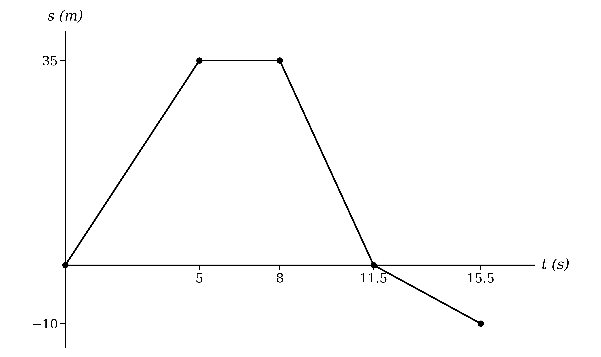

**[A1]**

> **[mark-scheme]**
> **B1**: Correct first two sections, a straight line from the origin to 35 m at 5 seconds, then horizontal until 8 seconds.
> 
> **M1**: Correct method for the duration of the return to the halfway line, dividing the 35 m by the speed of 10 m s⁻¹.
> 
> **M1**: Correct method for the duration of the final section, dividing the remaining distance of 10 m by the speed of 2.5 m s⁻¹.
> 
> **A1**: Fully correct graph with straight sections, reaching zero displacement at 11.5 seconds and ending at −10 m at 15.5 seconds.
The camera is more than 20 m from the halfway line only around its furthest point of 35 m. On the far side it never gets more than 10 m away

On the first stage the camera moves at $\frac{35}{5} = 7 \text{m s}^{-1}$, so it passes 20 m when

$t = \frac{20}{7}$

**[M1]**

On the return it leaves 35 m at $t = 8$ at $10 \text{m s}^{-1}$, so it is back at 20 m after covering 15 m

$t = 8 + \frac{15}{10} = 9 . 5$

**[M1]**

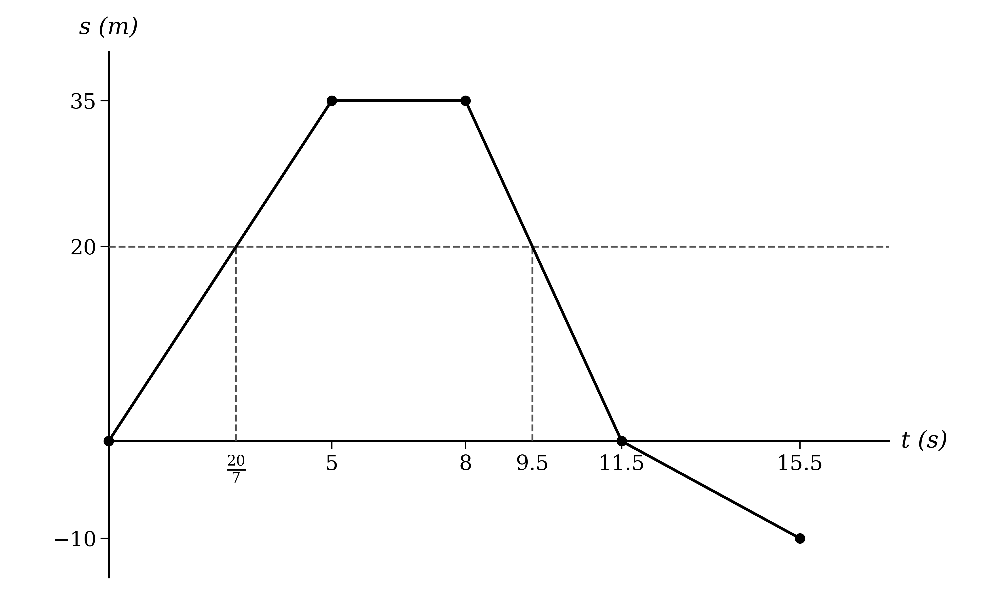

The length of time is the difference between these two times

$9 . 5 - \frac{20}{7}$

$6 . 64 \text{seconds}$

**[A1]**

> **[mark-scheme]**
> **M1**: Correct method for the time at which the camera first reaches 20 m, using its velocity of 7 m s⁻¹ on the first stage.
> 
> **M1**: Correct method for the time at which the camera passes 20 m on its return, from the 15 m covered at 10 m s⁻¹ after 8 seconds.
> 
> **A1**: Correct length of time. Accept $\frac{93}{14}$ or answers which round to 6.64.

### Q28
(i)

The particle reaches the sea where the graph ends

$8 \text{seconds}$

**[B1]**

(ii)

The particle starts at the top of the cliff, so the cliff height is the depth of the final point below the start

$32 \text{m}$

**[B1]**

(iii)

The displacement is zero where the curve crosses the time axis

$4 \text{seconds}$

**[B1]**

> **[mark-scheme]**
> **B1**: Correct time of 8 seconds, read from the right-hand end of the curve.
> 
> **B1**: Correct height of 32 m. The value is read as a positive height, although the displacement at that point is −32 m.
> 
> **B1**: Correct time of 4 seconds, where the curve crosses the time axis.
(i)

The highest point is the maximum of the curve

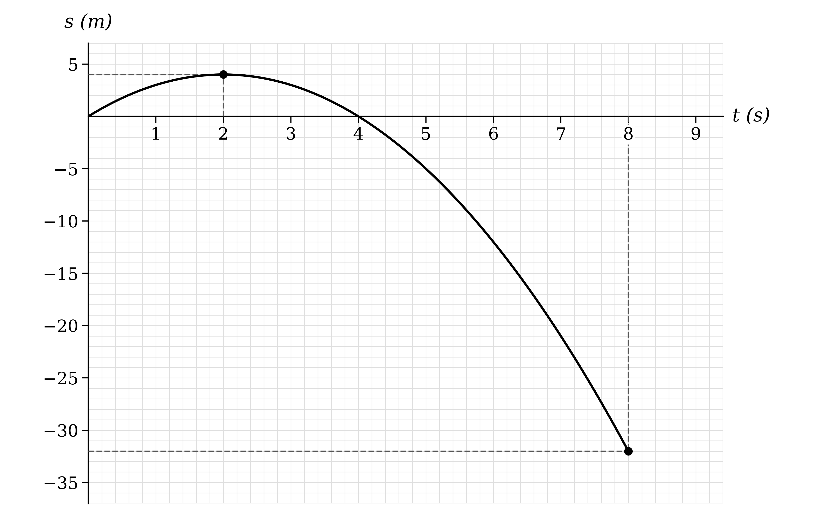

$2 \text{seconds}$

**[B1]**

$4 \text{m}$

**[B1]**

(ii)

The sea is 32 m below the starting point, so add that to the height above the start

$32 + 4$

$36 \text{m}$

**[B1]**

> **[mark-scheme]**
> **B1**: Correct time of 2 seconds, read from the maximum point of the curve.
> 
> **B1**: Correct greatest height of 4 m above the starting point.
> 
> **B1**: Correct greatest height of 36 m above the sea, obtained by adding the height of the cliff to the greatest height above the starting point. Follow through from an incorrect cliff height in part (a).

### Q29
(i)

The ball reverses direction at the cushion, so the velocity changes sign instantaneously

$0 . 8 \text{seconds}$

**[B1]**

(ii)

The speed is the magnitude of the velocity, so it falls from 2 to 1

$1 \text{m s}^{-1}$

**[B1]**

> **[mark-scheme]**
> **B1**: Correct time of 0.8 seconds, identified from the instantaneous change of sign in the velocity.
> 
> **B1**: Correct reduction of 1 m s⁻¹, from a speed of 2 m s⁻¹ before the cushion to 1 m s⁻¹ after it. A reduction of 3, from 2 to −1, does not score, since a speed rather than a velocity is being compared.
(i)

The acceleration is the gradient of the velocity-time graph, and a magnitude is asked for

`|a| = \left|\dfrac{2 - 4}{0.8}\right|`

**[M1]**

`|a| = 2.5\text{ m s}^{-2}`

**[A1]**

(ii)

After the cushion the velocity is negative and rising towards zero, so its magnitude is falling

**Final answer:** **The velocity is negative, so as it increases towards zero the speed of the ball decreases**

**[B1]**

> **[mark-scheme]**
> **M1**: Correct method for the gradient of the section before the cushion, using the change in velocity divided by the change in time.
> 
> **A1**: Correct magnitude of 2.5 m s⁻². Accept −2.5 provided the magnitude is then stated.
> 
> **B1**: A correct explanation making clear that the velocity after the cushion is negative, so that an increase in velocity corresponds to a decrease in speed. Accept any equivalent wording referring to the ball moving in the negative direction and slowing as its velocity rises towards zero.
(i)

The distance is the total area between the graph and the time axis, taking both regions as positive

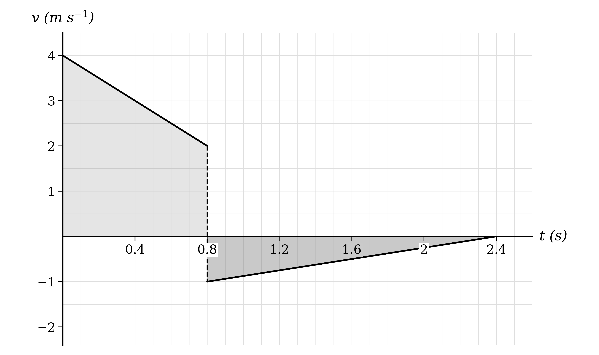

$\text{distance} = \frac{1}{2} ( 4 + 2 ) ( 0 . 8 ) + \frac{1}{2} ( 1 . 6 ) ( 1 )$

**[M1]**

$\text{distance} = 2 . 4 + 0 . 8$

$3 . 2 \text{m}$

**[A1]**

(ii)

The displacement is signed, so the area below the time axis counts as negative

$s = 2 . 4 - 0 . 8$

**[M1]**

$s = 1 . 6 \text{m}$

**[A1]**

> **[mark-scheme]**
> **M1**: Correct method for both areas, using a trapezium before the cushion and a triangle after it.
> 
> **A1**: Correct total distance of 3.2 m.
> 
> **M1**: Correct method for the displacement, subtracting the area below the time axis from the area above it.
> 
> **A1**: Correct displacement of 1.6 m.

### Q30
(i)

The ferry travels in one direction throughout, so the distance equals the displacement at *B*. Convert from metres to kilometres

$35000 \div 1000$

$35 \text{km}$

**[B1]**

(ii)

The velocity is the gradient of the displacement-time graph between the two points

$v = \frac{35000-15000}{1800-1000} = \frac{20000}{800}$

**[M1]**

$v = 25 \text{m s}^{-1}$

**[A1]**

> **[mark-scheme]**
> **B1**: Correct distance of 35 km. The conversion from metres must be carried out; 35 000 alone does not score, since the answer was asked for in kilometres.
> 
> **M1**: Correct method for the gradient between *A* and *B*, using the change in displacement divided by the change in time, with values read correctly from the graph.
> 
> **A1**: Correct velocity of 25 m s⁻¹.
The average velocity is the total displacement divided by the total time, so convert the 25 minutes into seconds first

$\text{average velocity} = \frac{35000}{25\times60} = \frac{35000}{1500}$

**[M1]**

$23 . 3 \text{m s}^{-1}$

**[A1]**

> **[mark-scheme]**
> **M1**: Correct method for the average velocity, dividing the total displacement by the total time, with the time converted to seconds.
> 
> **A1**: Correct value. Accept answers which round to 23.3, or the exact value $\frac{70}{3}$.

### Q31
(i)

Read up from $t = 2$ to the graph and across to the displacement axis

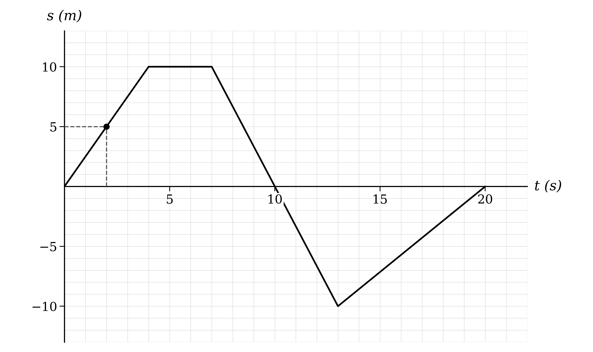

$5 \text{m}$

**[B1]**

(ii)

The particle has moved in one direction only up to $t = 4$, so the distance travelled equals the displacement

$10 \text{m}$

**[B1]**

> **[mark-scheme]**
> **B1**: Correct displacement of 5 m, read from the graph at 2 seconds.
> 
> **B1**: Correct distance of 10 m. The particle has not changed direction, so the distance and the displacement are equal here.
Both come from the gradient of the displacement-time graph, so use $\frac{\text{change in displacement}}{\text{change in time}}$

$v = \frac{0-(-10)}{20-13} = \frac{10}{7}$

**[M1]**

$v = 1 . 43 \text{m s}^{-1}$

**[A1]**

A speed is asked for, so take the magnitude of the gradient over the next section

`\text{speed} = \left|\dfrac{0 - 10}{10 - 7}\right| = \dfrac{10}{3}`

$\text{speed} = 3 . 33 \text{m s}^{-1}$

**[A1]**

> **[mark-scheme]**
> **M1**: Correct method for a gradient of the displacement-time graph, using the change in displacement divided by the change in time. This mark is available for either section.
> 
> **A1**: Correct velocity between 13 and 20 seconds. Accept $\frac{10}{7}$ or answers which round to 1.43.
> 
> **A1**: Correct speed between 7 and 10 seconds. Accept $\frac{10}{3}$ or answers which round to 3.33. The answer must be positive, because a speed was asked for; −3.33 does not score.
The particle changes direction twice, so add the distance covered on each section

$\text{distance} = 10 + 20 + 10$

**[M1]**

$40 \text{m}$

**[A1]**

> **[exam-tip]**
> The particle finishes where it started, so its total displacement over the 20 seconds is zero while the distance travelled is 40 m. Whenever a displacement-time graph crosses back on itself, check whether the question wants distance or displacement before you add anything up.

> **[mark-scheme]**
> **M1**: Correct method for the total distance, adding the magnitude of the displacement change on each of the three sections. Allow one slip in a single section.
> 
> **A1**: Correct total distance of 40 m.

### Q32
The acceleration is the gradient of a velocity-time graph, so use $v = u + a t$ with $u = 0$ to find the velocity reached

$v = 3 \times 5 = 15$

**[B1]**

The time at constant speed is not given, so find it from $\text{time} = \frac{\text{distance}}{\text{speed}}$

$\frac{45}{15} = 3$

**[M1]**

The constant-speed stage therefore ends at $t = 8$, and the cable car comes to rest 10 seconds after that, at $t = 18$

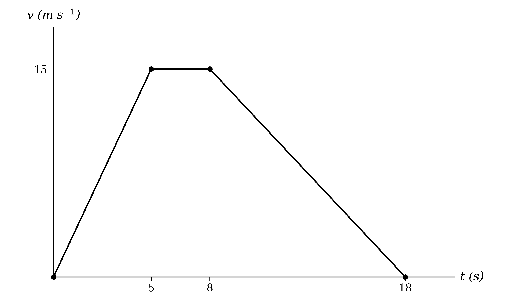

**[A1]**

> **[mark-scheme]**
> **B1**: Correct maximum velocity of 15 m s⁻¹, seen on the graph or in working.
> 
> **M1**: Correct method for the duration of the constant-speed stage, dividing the distance covered by the speed.
> 
> **A1**: Fully correct graph, with the three straight sections and the times 5, 8 and 18 seconds correctly marked. Follow through from an incorrect maximum velocity, provided the shape is right.

### Q33
(i)

The acceleration is the gradient of the velocity-time graph, and the aircraft starts from rest

$\frac{V}{T} = 5$

$V = 5 T$

**[B1]**

(ii)

The runway used is the area under the graph. Convert the distance to metres first, so that it matches the velocity units

$1 . 68 \text{km} = 1680 \text{m}$

The region is a trapezium with parallel sides $2 T$ and $( T + 10 ) - T = 10$, and height *V*, so use $\text{area} = \frac{1}{2} ( a + b ) h$

`\dfrac{1}{2}\left(2T + 10\right)V = 1680`

**[M1]**

Divide the bracket by 2

$V ( T + 5 ) = 1680$

**[B1]**

> **[mark-scheme]**
> **B1**: Correct derivation of $V = 5 T$ from the gradient of the first section, with the gradient expression seen.
> 
> **M1**: Correct method for the area of the trapezium, with the two parallel sides identified as $2 T$ and 10, and equated to 1680.
> 
> **B1**: The given result is reached from complete working. The conversion of 1.68 km to 1680 m must be visible, and the simplification from $\frac{1}{2} ( 2 T + 10 ) V$ to $V ( T + 5 )$ must be shown.
Substitute $V = 5 T$ into the second equation to eliminate *V*

$5 T ( T + 5 ) = 1680$

$T^{2} + 5 T - 336 = 0$

**[M1]**

Factorise

$( T + 21 ) ( T - 16 ) = 0$

Only the positive root is possible, because *T* is a time

$T = 16$

**[A1]**

Substitute back into $V = 5 T$

$V = 5 \times 16$

$V = 80$

**[A1]**

> **[mark-scheme]**
> **M1**: Correct method for eliminating one unknown between the two equations, leading to a correct three-term quadratic.
> 
> **A1**: Correct value $T = 16$. The negative root must be rejected, since *T* is a time.
> 
> **A1**: Correct value $V = 80$.

### Q34
(i)

Each car begins to decelerate the moment it crosses the finish line, so the car that turns first is the winner

**Final answer:** **Car B won the race**

**[B1]**

(ii)

Read the height of the horizontal section of car *A*'s graph

$120 \text{m s}^{-1}$

**[B1]**

(iii)

The acceleration is the gradient of the velocity-time graph, and car *B* reaches $150 \text{m s}^{-1}$ in 3 seconds

`|a| = \left|\dfrac{150 - 0}{3 - 0}\right|`

**[M1]**

`|a| = 50\text{ m s}^{-2}`

**[A1]**

> **[mark-scheme]**
> **B1**: Car *B*, identified because it begins to decelerate first, at 3.5 seconds against 3.75 seconds for car *A*. A bare answer of car *B* scores.
> 
> **B1**: Correct top speed of 120 m s⁻¹ for car *A*.
> 
> **M1**: Correct method for the gradient of the accelerating section of car *B*'s graph.
> 
> **A1**: Correct magnitude of 50 m s⁻².
The distance covered before decelerating is the area under each car's graph up to the moment it begins to slow, made up of a triangle and a rectangle

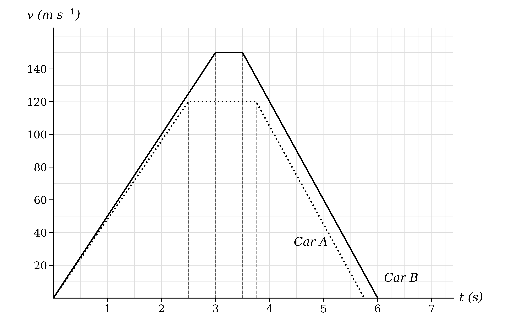

For car *A*, which reaches $120 \text{m s}^{-1}$ at 2.5 seconds and turns at 3.75 seconds

$\frac{1}{2} ( 2 . 5 ) ( 120 ) + ( 3 . 75 - 2 . 5 ) ( 120 ) = 150 + 150$

**[M1 A1]**

For car *B*, which reaches $150 \text{m s}^{-1}$ at 3 seconds and turns at 3.5 seconds

$\frac{1}{2} ( 3 ) ( 150 ) + ( 3 . 5 - 3 ) ( 150 ) = 225 + 75$

**Final answer:** **Both cars covered 300 m before decelerating**

**[A1]**

> **[mark-scheme]**
> **M1**: Correct method for the area under one car's graph up to the moment it begins to decelerate, using a triangle and a rectangle.
> 
> **A1**: Correct value of 300 m for car *A*, with both areas visible.
> 
> **A1**: Correct value of 300 m for car *B*, with both areas visible, and a conclusion stating that both cars covered the 300 m. Because the result is given, the working for each car must be shown.
The deceleration is the gradient of each car's final section, and the two sections are drawn parallel

**Final answer:** **The two deceleration sections are parallel, so they have the same gradient**

**[B1]**

> **[mark-scheme]**
> **B1**: A correct explanation referring to the two final sections being parallel, and therefore having equal gradients. Accept any equivalent wording. A response that computes either gradient does not score, since the question asks for an explanation without calculation.

### Q35
Each stage has a constant velocity, so the graph is a series of straight lines. Take the halfway line as zero displacement

The camera reaches 24 m after 6 seconds

**[B1]**

It then returns to the halfway line over the next 12 seconds, so the graph reaches zero at $t = 18$

**[B1]**

For the final 6 seconds the displacement changes by $- 3 \times 6 = - 18$, taking the camera to the far side of the halfway line

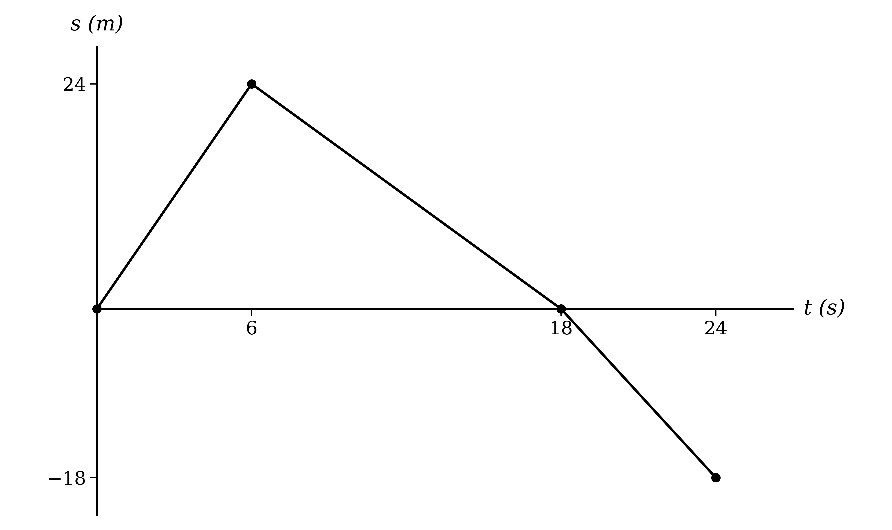

**[B1]**

> **[mark-scheme]**
> **B1**: Correct first section, a straight line from the origin reaching 24 m at 6 seconds.
> 
> **B1**: Correct second section, a straight line returning to zero displacement at 18 seconds.
> 
> **B1**: Correct final section, a straight line continuing below the time axis to −18 m at 24 seconds. All sections must be straight, with the times correctly marked.
(i)

The displacement is signed, and the camera finishes on the far side of the halfway line

$- 18 \text{m}$

**[B1]**

(ii)

Distance has no direction, so take the magnitude of the displacement

$18 \text{m}$

**[B1]**

> **[mark-scheme]**
> **B1**: Correct final displacement of −18 m. The negative sign is required, since a displacement was asked for.
> 
> **B1**: Correct distance of 18 m, positive.

### Q36
The displacement is the area under the velocity-time graph, which for the first 10 seconds is a triangle

$s = \frac{1}{2} \times 10 \times 20$

**[M1]**

$s = 100 \text{m}$

**[A1]**

> **[mark-scheme]**
> **M1**: Correct method for the area of the triangle between 0 and 10 seconds.
> 
> **A1**: Correct displacement of 100 m.
Between 10 and 40 seconds the train travels at a constant $20 \text{m s}^{-1}$, so this section of the area is a rectangle

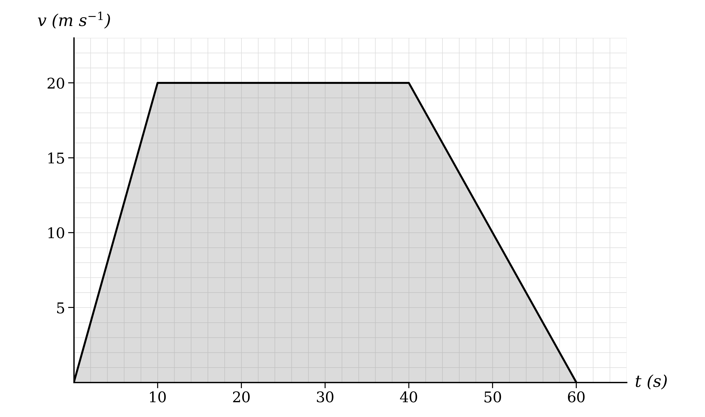

$( 40 - 10 ) \times 20 = 600$

**[M1 A1]**

The distance between the stations is the total area under the graph, so add the first triangle, the rectangle and the final triangle

$\text{distance} = 100 + 600 + \frac{1}{2} \times 20 \times 20$

**[M1]**

$\text{distance} = 100 + 600 + 200$

$900 \text{m}$

**[A1]**

> **[mark-scheme]**
> **M1**: Correct method for the area of the rectangle between 10 and 40 seconds.
> 
> **A1**: Correct distance of 600 m for that section.
> 
> **M1**: Correct method for the total area under the graph. Accept the sum of the three sections, or the trapezium formula applied to the whole region.
> 
> **A1**: Correct distance of 900 m.
The acceleration is the gradient of the velocity-time graph, and a deceleration is quoted as a positive quantity

`a = \left|\dfrac{0 - 20}{20}\right|`

**[M1]**

$1 \text{m s}^{-2}$

**[A1]**

> **[mark-scheme]**
> **M1**: Correct method for the gradient of the final section, using the change in velocity divided by the change in time. Accept the use of $v = u + a t$.
> 
> **A1**: Correct deceleration of 1 m s⁻². Accept an acceleration of −1 m s⁻² provided it is clearly described as a deceleration of 1 m s⁻².

### Q37
Each stage has a constant velocity, so every section is a straight line. For the first stage use $\text{displacement} = \text{velocity} \times \text{time}$

$- 0 . 2 \times 15 = - 3$

**[B1]**

The second stage covers a change of 12 m, so find its duration from $\text{time} = \frac{\text{distance}}{\text{speed}}$

$\frac{12}{0.8} = 15$

**[M1]**

The second stage therefore ends at $t = 30$, and the lawnmower is then stationary until $t = 32$

**[A1]**

For the final stage the displacement changes by $- 0 . 5 \times 8 = - 4$, finishing at $s = 5$ when $t = 40$

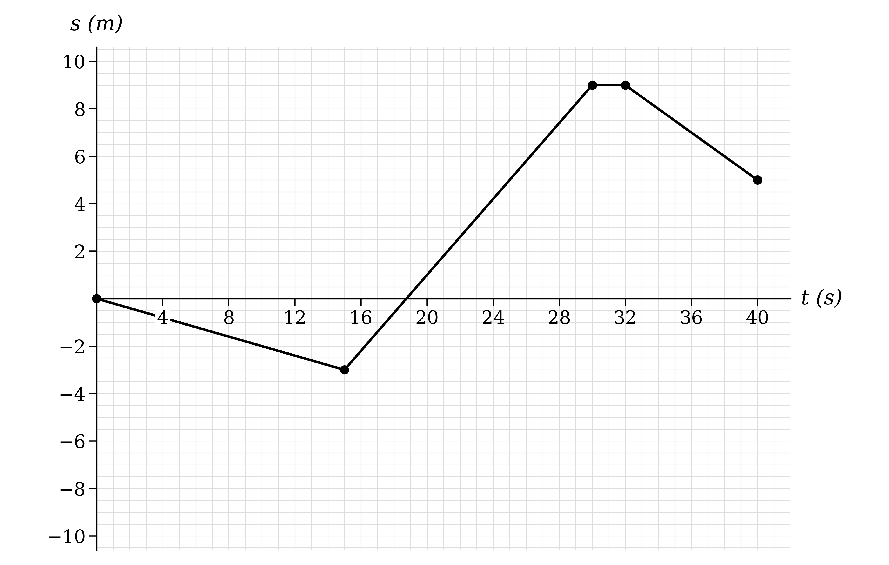

**[B1]**

> **[mark-scheme]**
> **B1**: Correct first section, a straight line from the origin to −3 m at 15 seconds.
> 
> **M1**: Correct method for the duration of the second stage, dividing the 12 m change in displacement by the speed of 0.8 m s⁻¹.
> 
> **A1**: Correct second and third sections, a straight line reaching 9 m at 30 seconds followed by a horizontal section to 32 seconds.
> 
> **B1**: Correct final section, a straight line falling to 5 m at 40 seconds.
(i)

The test ends at the right-hand end of the graph

$40 \text{seconds}$

**[B1]**

(ii)

Read the displacement at $t = 40$

$5 \text{m}$

**[B1]**

(iii)

The lawnmower changes direction twice, so add the distance covered on each moving section

$\text{distance} = 3 + 12 + 4$

**[M1]**

$19 \text{m}$

**[A1]**

> **[mark-scheme]**
> **B1**: Correct total time of 40 seconds.
> 
> **B1**: Correct final displacement of 5 m.
> 
> **M1**: Correct method for the distance, adding the magnitude of the displacement change on each of the three moving sections. Follow through from an incorrect graph in part (a).
> 
> **A1**: Correct distance of 19 m.
