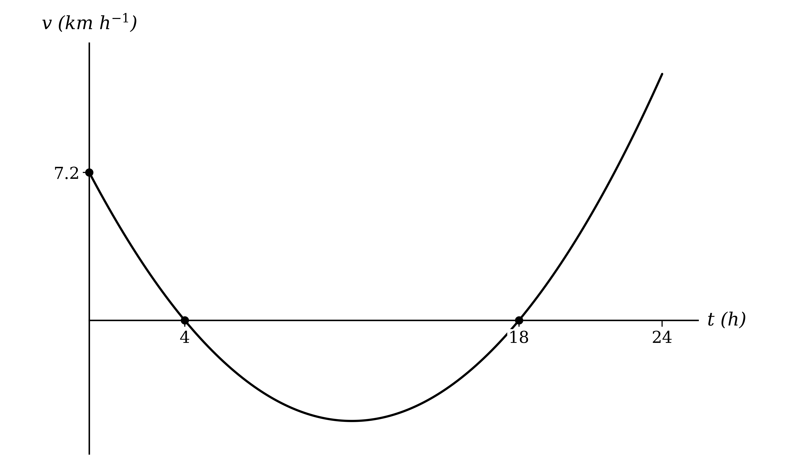
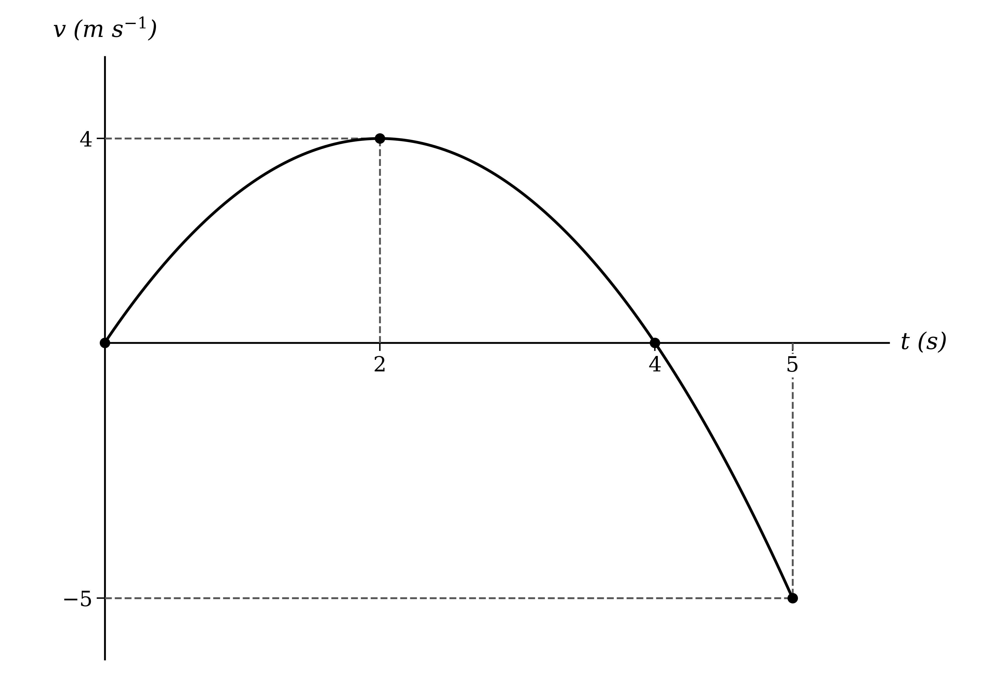
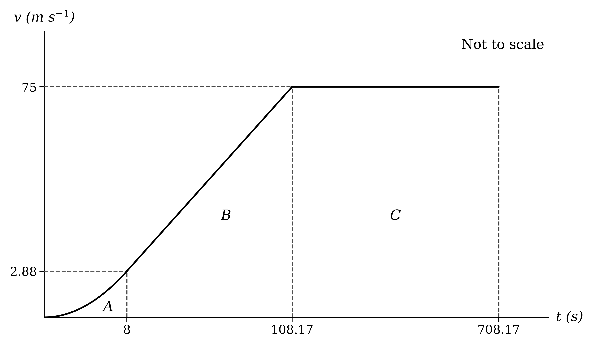
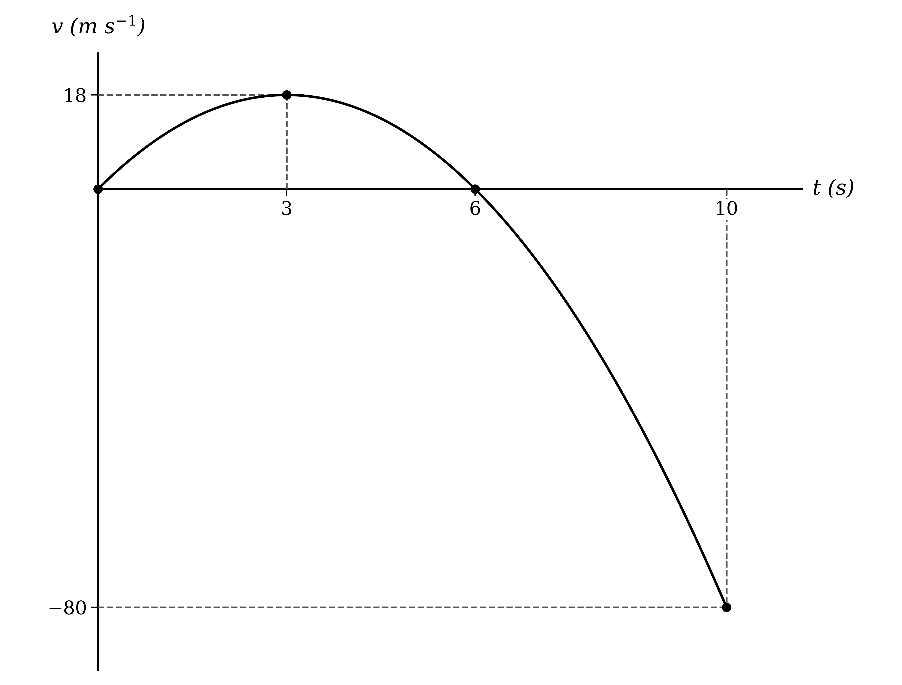

# Mark Schemes — Variable Acceleration
**Kinematics (Straight Line Motion)** · Cambridge (CIE) A-LEVEL maths (9709)

## Exam Questions (29 questions)

### Q1
The particle is at rest when its velocity is zero

$t^{\frac{3}{2}} - 6 t + 9 t^{\frac{1}{2}} = 0$

Take out the common factor $t^{\frac{1}{2}}$

`t^{\frac{1}{2}}\left(t - 6t^{\frac{1}{2}} + 9\right) = 0`

**[M1]**

The bracket is a quadratic in $t^{\frac{1}{2}}$ and a perfect square

`t^{\frac{1}{2}}\left(t^{\frac{1}{2}} - 3\right)^{2} = 0`

**[M1]**

$t^{\frac{1}{2}} = 0$* or *$t^{\frac{1}{2}} = 3$

**Final answer:** $t = 0$** and **$t = 9$

**[A1]**

> **[exam-tip]**
> Because `\left(t^{\frac{1}{2}} - 3\right)^{2}` is never negative, the velocity touches zero at $t = 9$ without changing sign. The particle stops for an instant but does not reverse its direction.

> **[mark-scheme]**
> **M1**: Setting $v = 0$ and taking out a factor of $t^{\frac{1}{2}}$.
> 
> **M1**: Solving the remaining quadratic in $t^{\frac{1}{2}}$, by factorising, by substitution or by any other valid method.
> 
> **A1**: Both values, $t = 0$ and $t = 9$.
Differentiate the velocity to find the acceleration

$a = \frac{\text{d}v}{\text{d}t}$

$a = \frac{3}{2} t^{\frac{1}{2}} - 6 + \frac{9}{2} t^{-\frac{1}{2}}$

**[M1]**

The acceleration is negative when

$\frac{3}{2} t^{\frac{1}{2}} - 6 + \frac{9}{2} t^{-\frac{1}{2}} < 0$

Multiply through by $2 t^{\frac{1}{2}}$, which is positive for $t > 0$, so the inequality sign is unchanged

$3 t - 12 t^{\frac{1}{2}} + 9 < 0$

Divide through by 3

$t - 4 t^{\frac{1}{2}} + 3 < 0$

Factorise as a quadratic in $t^{\frac{1}{2}}$

`\left(t^{\frac{1}{2}} - 1\right)\left(t^{\frac{1}{2}} - 3\right) < 0`

**[M1]**

The product is negative between the roots

$1 < t^{\frac{1}{2}} < 3$

Square each part

$1 < t < 9$

**[A1]**

> **[mark-scheme]**
> **M1**: Differentiation of $v$ with respect to $t$, with the power of at least one term decreased by 1.
> 
> **M1**: Forming $a < 0$ (or $a = 0$) and reducing it to a quadratic in $t^{\frac{1}{2}}$, for example by multiplying through by $2 t^{\frac{1}{2}}$, and finding the critical values.
> 
> **A1**: Correct set of values $1 < t < 9$. Condone $1 \leq t \leq 9$ and accept any equivalent form.

### Q2
Integrate the acceleration to find the velocity

`v = \int \dfrac{1}{5}(t - 11) \; \text{d}t`

`v = \dfrac{1}{5}\left(\dfrac{1}{2}t^{2} - 11t\right) + c`

**[M1]**

Take out a factor of $\frac{1}{2}$ from the bracket

`v = \dfrac{1}{10}\left(t^{2} - 22t\right) + c`

**[A1]**

Integrate the velocity to find the displacement

`s = \dfrac{1}{10}\left(\dfrac{1}{3}t^{3} - 11t^{2}\right) + ct + d`

`s = \dfrac{1}{30}\left(t^{3} - 33t^{2}\right) + ct + d`

**[M1]**

The particle starts at $O$, so $s = 0$ when $t = 0$

$d = 0$

The particle is back at $O$ when $t = 24$

`\dfrac{1}{30}\left(\left(24\right)^{3} - 33\left(24\right)^{2}\right) + 24c = 0`

**[M1]**

$\frac{1}{30} ( 13824 - 19008 ) + 24 c = 0$

$- \frac{864}{5} + 24 c = 0$

$c = \frac{36}{5}$

Write $c$ with a denominator of 10 so it can go inside the bracket

`v = \dfrac{1}{10}\left(t^{2} - 22t\right) + \dfrac{72}{10}`

`v = \dfrac{1}{10}\left(t^{2} - 22t + 72\right)`

$k = 72$

**[A1]**

> **[mark-scheme]**
> **M1**: Integration of the acceleration with respect to $t$, with the power of at least one term increased by 1.
> 
> **A1**: Correct velocity `\dfrac{1}{10}\left(t^{2} - 22t\right) + c`, including a constant.
> 
> **M1**: Integration of the velocity, including a term $c t$ from the constant.
> 
> **M1**: Using $s = 0$ at both $t = 0$ and $t = 24$ to form an equation for $c$.
> 
> **A1**: Correct $k = 72$, reaching the printed form of $v$ from exact working. Because the form of the answer is given, the value of the constant must be shown to come from $s ( 24 ) = 0$.
Factorise the velocity from part (a) to find when the particle is at rest

$v = \frac{1}{10} ( t - 4 ) ( t - 18 )$

**[M1]**

Sketch the velocity-time graph to see where the particle changes direction

Using $c = \frac{36}{5}$ and $d = 0$ from part (a), the displacement is

`s = \dfrac{1}{30}\left(t^{3} - 33t^{2} + 216t\right)`

Find the displacement at each reversal time, $t = 4$ and $t = 18$

$s ( 4 ) = \frac{1}{30} ( 64 - 528 + 864 ) = \frac{40}{3}$

$s ( 18 ) = \frac{1}{30} ( 5832 - 10692 + 3888 ) = - \frac{162}{5}$

**[M1 A1]**

The distance for each stage is the size of the change in displacement

`\dfrac{40}{3} + \left(\dfrac{40}{3} + \dfrac{162}{5}\right) + \dfrac{162}{5}`

$= \frac{40}{3} + \frac{686}{15} + \frac{162}{5}$

$\text{Total distance} = \frac{1372}{15} \text{km}$

**[A1]**

> **[mark-scheme]**
> **M1**: Factorising the velocity, or otherwise solving $v = 0$, to find the rest times 4 and 18.
> 
> **M1**: Splitting the motion at the rest times and finding the displacement at each, or the definite integral of $v$ for each stage.
> 
> **A1**: Correct displacements $\frac{40}{3}$ and $- \frac{162}{5}$, or correct stage distances $\frac{40}{3}$, $\frac{686}{15}$ and $\frac{162}{5}$.
> 
> **A1**: Correct exact total $\frac{1372}{15}$. A decimal answer such as 91.5 does not score this mark, since an exact value is asked for.

### Q3
Integrate the acceleration to find the velocity

`v = \int \left(6 + \frac{1}{2} t - \frac{1}{2} t^{2}\right) \text{d} t`

$v = 6 t + \frac{1}{4} t^{2} - \frac{1}{6} t^{3} + c$

**[M1]**

The rocket starts from rest, so $v = 0$ when $t = 0$

$c = 0$

Integrate the velocity to find the height

`s = \int \left(6 t + \frac{1}{4} t^{2} - \frac{1}{6} t^{3}\right) \text{d} t`

$s = 3 t^{2} + \frac{1}{12} t^{3} - \frac{1}{24} t^{4} + k$

**[M1]**

The rocket starts at ground level, so $s = 0$ when $t = 0$

$k = 0$

$s = 3 t^{2} + \frac{1}{12} t^{3} - \frac{1}{24} t^{4}$

**[A1]**

The rocket lands when $s = 0$ again, so take out the factor $t^{2}$

`t^{2} \left(3 + \frac{1}{12} t - \frac{1}{24} t^{2}\right) = 0`

Since $t \neq 0$, the bracket is zero

$3 + \frac{1}{12} t - \frac{1}{24} t^{2} = 0$

Multiply through by $- 24$

$t^{2} - 2 t - 72 = 0$

Use the quadratic formula

`t = \frac{2 \pm \sqrt{\left(- 2\right)^{2} - 4 \left(1\right) \left(- 72\right)}}{2}`

$t = 1 \pm \sqrt{73}$

Time cannot be negative, so take the positive root

$t = 9 . 5440 \dots$

**Final answer:** $t = 9 . 54$** seconds (3 s.f.)**

**[A1]**

> **[mark-scheme]**
> **M1**: Integration of the acceleration with respect to $t$, with the power of at least one term increased by 1.
> 
> **M1**: Integration of the velocity with respect to $t$.
> 
> **A1**: Correct height $s = 3 t^{2} + \frac{1}{12} t^{3} - \frac{1}{24} t^{4}$, with both constants shown to be zero or correctly omitted.
> 
> **A1**: Answers which round to 9.54, from solving $s = 0$ with $t \neq 0$ and the negative root rejected.
The greatest height is where $v = 0$, so take out the factor $t$ from the velocity in part (a), $v = 6 t + \frac{1}{4} t^{2} - \frac{1}{6} t^{3}$

`t \left(6 + \frac{1}{4} t - \frac{1}{6} t^{2}\right) = 0`

Since $t \neq 0$, the bracket is zero

$6 + \frac{1}{4} t - \frac{1}{6} t^{2} = 0$

Multiply through by $- 12$

$2 t^{2} - 3 t - 72 = 0$

`t = \frac{3 \pm \sqrt{\left(- 3\right)^{2} - 4 \left(2\right) \left(- 72\right)}}{2 \left(2\right)}`

$t = \frac{3\pm\sqrt{585}}{4}$

Take the positive root

$t = 6 . 7966 \dots$

**[M1]**

Substitute the unrounded value into the height from part (a), $s = 3 t^{2} + \frac{1}{12} t^{3} - \frac{1}{24} t^{4}$

`s = 3 \left(6 . 7966 \ldots\right)^{2} + \frac{1}{12} \left(6 . 7966 \ldots\right)^{3} - \frac{1}{24} \left(6 . 7966 \ldots\right)^{4}`

$s = 75 . 833 \dots$

**[M1]**

The rocket falls the same distance back down, so double the greatest height

$2 \times 75 . 833 \dots = 151 . 66 \dots$

**Final answer:** $\text{Total distance} = 152  \text{m}$** (3 s.f.)**

**[A1]**

> **[mark-scheme]**
> **M1**: Setting the velocity equal to zero and solving to find the time of the greatest height.
> 
> **M1**: Substitution of the time into the expression for $s$ to find the greatest height.
> 
> **A1**: Answers which round to 152. A value of 75.8, the greatest height alone, does not score this mark.

### Q4
There is no instantaneous change in velocity at $t = 12$, so the first expression equals 12 when $t = 12$

`k\left(\left(12\right)^{3} - 20\left(12\right)^{2} + 100(12)\right) = 12`

$k ( 1728 - 2880 + 1200 ) = 12$

$48 k = 12$

$k = 0 . 25$

**[B1]**

> **[mark-scheme]**
> **B1**: Setting the first expression equal to 12 at $t = 12$ and reaching $k = 0 . 25$ with the evaluation $48 k = 12$ seen. Because the answer is given, substituting $k = 0 . 25$ to show that $v = 12$ must be accompanied by a statement that the two expressions agree at $t = 12$.
With $k = 0 . 25$, differentiate the velocity to find where it is stationary

`\dfrac{\text{d}v}{\text{d}t} = 0.25\left(3t^{2} - 40t + 100\right)`

**[M1]**

Set the derivative equal to zero

$3 t^{2} - 40 t + 100 = 0$

Factorise

$( 3 t - 10 ) ( t - 10 ) = 0$

**[M1]**

$t = \frac{10}{3}$* or *$t = 10$

**[A1]**

Find the velocity at each stationary value

`v\left(\dfrac{10}{3}\right) = 0.25\left(\left(\dfrac{10}{3}\right)^{3} - 20\left(\dfrac{10}{3}\right)^{2} + 100\left(\dfrac{10}{3}\right)\right) = \dfrac{1000}{27}`

`v(10) = 0.25\left(\left(10\right)^{3} - 20\left(10\right)^{2} + 100(10)\right) = 0`

The end values are $v ( 0 ) = 0$ and $v ( 12 ) = 12$, so the greatest velocity is at $t = \frac{10}{3}$

**Final answer:** $\text{Maximum velocity} = \frac{1000}{27} = 37 . 0 \text{m s}^{-1}$** (3 s.f.)**

**[A1]**

The velocity is zero at $t = 10$, which lies in $0 < t < 12$

$t = 10$

**[B1]**

> **[mark-scheme]**
> **M1**: Differentiation of $v$ with respect to $t$, with the power of at least one term decreased by 1.
> 
> **M1**: Setting the derivative equal to zero and solving the quadratic.
> 
> **A1**: Both values, $t = \frac{10}{3}$ and $t = 10$.
> 
> **A1**: Correct maximum velocity of $\frac{1000}{27}$. Accept answers which round to 37.0.
> 
> **B1**: Correct value $t = 10$. Accept this found directly by writing `v = 0.25t\left(t - 10\right)^{2}` and setting $v = 0$.

### Q5
Apart from $t = 0$, the car is at $S$ only if the bracket is zero

$2 t^{2} - 4 t + 3 = 0$

Find the discriminant of this quadratic

`b^{2} - 4ac = \left(-4\right)^{2} - 4(2)(3)`

$= 16 - 24 = - 8$

**[M1]**

*The discriminant is negative, so the quadratic has no real roots*

**Final answer:** **The displacement is zero only when t = 0, so the car never returns to S**

**[B1]**

> **[mark-scheme]**
> **M1**: Setting $s = 0$ and considering the discriminant of $2 t^{2} - 4 t + 3$, or completing the square to give `2\left(t - 1\right)^{2} + 1`.
> 
> **B1**: A conclusion that there are no real roots other than $t = 0$, so the car never returns to $S$.
Expand the brackets so that each term is a power of $t$

$s = 0 . 8 t^{3} - 1 . 6 t^{2} + 1 . 2 t$

Differentiate to find the velocity

$v = 2 . 4 t^{2} - 3 . 2 t + 1 . 2$

**[M1]**

Differentiate again to find the acceleration

$a = 4 . 8 t - 3 . 2$

**[M1]**

Find where the acceleration is negative

$4 . 8 t - 3 . 2 < 0$

$t < \frac{2}{3}$

**[A1]**

Decelerating means the speed is decreasing, so check the sign of the velocity using its discriminant

`\left(-3.2\right)^{2} - 4(2.4)(1.2) = 10.24 - 11.52 = -1.28`

*The discriminant is negative and the coefficient of t² is positive, so v > 0 for all t*

**Final answer:** **For the first 2/3 seconds the velocity is positive and the acceleration is negative, so the car is decelerating**

**[B1]**

> **[mark-scheme]**
> **M1**: Differentiation of $s$ to find the velocity, with the power of at least one term decreased by 1.
> 
> **M1**: Differentiation of the velocity to find the acceleration.
> 
> **A1**: Correct inequality $t < \frac{2}{3}$ from $4 . 8 t - 3 . 2 < 0$. Condone $t \leq \frac{2}{3}$.
> 
> **B1**: A complete argument that the velocity is positive throughout, for example by its discriminant or by completing the square, with a conclusion that the car is decelerating because the velocity and acceleration have opposite signs. Showing only that $a < 0$ does not earn this mark.

### Q6
Average velocity is the change in displacement divided by the time, with $s ( 0 ) = 0$

$\frac{s(10)-s(0)}{10} = \frac{5}{12}$

$\frac{10^{q}}{10p} = \frac{5}{12}$

$\frac{10^{q}}{p} = \frac{25}{6}$

**[M1]**

Differentiate $s$ to find the velocity

$v = \frac{q}{p} t^{q-1}$

**[M1]**

Average acceleration is the change in velocity divided by the time, with $v ( 0 ) = 0$ since $q > 1$

$\frac{v(10)-v(0)}{10} = \frac{1}{6}$

$\frac{q\times10^{q-1}}{10p} = \frac{1}{6}$

$\frac{q\times10^{q-1}}{p} = \frac{5}{3}$

**[M1]**

Divide this equation by the first one, so that $p$ cancels

$\frac{q\times10^{q-1}}{10^{q}} = \frac{5}{3} \div \frac{25}{6}$

$\frac{q}{10} = \frac{2}{5}$

**[M1]**

$q = 4$

**[A1]**

Substitute $q = 4$ into the first equation

$\frac{10^{4}}{p} = \frac{25}{6}$

$p = \frac{6\times10000}{25}$

$p = 2400$

**[A1]**

Write the displacement with $p = 2400$ and $q = 4$

$s = \frac{1}{2400} t^{4}$

Differentiate twice to find the acceleration

$v = \frac{4}{2400} t^{3} = \frac{1}{600} t^{3}$

$a = \frac{3}{600} t^{2}$

**[M1]**

$a = \frac{1}{200} t^{2}$

**[A1]**

> **[mark-scheme]**
> **M1**: Forming an equation from the average velocity, using the displacement at $t = 10$ divided by 10.
> 
> **M1**: Differentiation of $s$ to give a velocity of the form $\frac{q}{p} t^{q-1}$.
> 
> **M1**: Forming an equation from the average acceleration, using the velocity at $t = 10$ divided by 10.
> 
> **M1**: Eliminating $p$ between the two equations, for example by division, to obtain an equation in $q$ only.
> 
> **A1**: Correct value $q = 4$.
> 
> **A1**: Correct value $p = 2400$.
> 
> **M1**: Differentiation of the displacement twice, or of the velocity once.
> 
> **A1**: Correct acceleration $a = \frac{1}{200} t^{2}$. Accept equivalent forms such as $\frac{t^{2}}{200}$ or $0 . 005 t^{2}$.

### Q7
The cheese comes to rest when $a = - 9$

$9 - t = - 9$

$A = 18$

**[B1]**

For $0 \leq t \leq 15$, integrate the acceleration

`v = \int 0.2t \; \text{d}t`

$v = 0 . 1 t^{2} + c$

The cheese starts from rest, so $v = 0$ when $t = 0$

$c = 0$

$v = 0 . 1 t^{2}$

The velocity is positive, so the distance for this phase is the integral of $v$

`\int_{0}^{15} 0.1t^{2} \; \text{d}t = \left[\dfrac{t^{3}}{30}\right]_{0}^{15}`

**[M1]**

Substitute the limits

`= \dfrac{\left(15\right)^{3}}{30} - 0 \\ = 112.5`

**[A1]**

The velocity at $t = 15$ carries into the second phase

`v(15) = 0.1\left(15\right)^{2} = 22.5`

For $15 < t \leq 18$, integrate the new acceleration

`v = \int (9 - t) \; \text{d}t`

$v = 9 t - \frac{1}{2} t^{2} + c$

Use $v = 22 . 5$ when $t = 15$ to find $c$

`22.5 = 9(15) - \dfrac{1}{2}\left(15\right)^{2} + c`

**[M1]**

$22 . 5 = 135 - 112 . 5 + c$

$c = 0$

$v = 9 t - \frac{1}{2} t^{2}$

**[A1]**

Check that the cheese is at rest at $t = 18$

$v ( 18 ) = 162 - 162 = 0$

The velocity `v = t\left(9 - \dfrac{1}{2}t\right)` is positive for $15 < t < 18$, so integrate it for the distance

`\int_{15}^{18} \left(9t - \dfrac{1}{2}t^{2}\right) \; \text{d}t = \left[\dfrac{9}{2}t^{2} - \dfrac{1}{6}t^{3}\right]_{15}^{18}`

**[M1]**

Substitute the limits

$= ( 1458 - 972 ) - ( 1012 . 5 - 562 . 5 ) \, = 486 - 450 \, = 36$

Add the distances for the two phases

$112 . 5 + 36$

$\text{Total distance} = 148 . 5 \text{m}$

**[A1]**

> **[mark-scheme]**
> **B1**: Correct value $A = 18$.
> 
> **M1**: Integration of the first-phase acceleration, then integration of the velocity between 0 and 15.
> 
> **A1**: Correct distance of 112.5 for the first phase.
> 
> **M1**: Integration of $9 - t$ and use of the velocity at $t = 15$, or $v = 0$ at $t = 18$, to find the constant.
> 
> **A1**: Correct second-phase velocity $v = 9 t - \frac{1}{2} t^{2}$. The constant is fixed by a condition at $t = 15$ (or $t = 18$), not at the start of the motion, so it must be shown to be zero; omitting it does not earn this mark.
> 
> **M1**: Integration of the second-phase velocity between 15 and the value of $A$ found.
> 
> **A1**: Correct total distance of 148.5. Accept answers which round to 149.

### Q8
Integrate the acceleration to find the velocity

`v = \int (12t - 12t^{2} + 10) \; \text{d}t`

$v = 6 t^{2} - 4 t^{3} + 10 t + c$

**[M1]**

Integrate again, where $c$ integrates to $c t$ and a new constant $d$ appears

`s = \int (6t^{2} - 4t^{3} + 10t + c) \; \text{d}t`

$s = \frac{6t^{3}}{3} - \frac{4t^{4}}{4} + \frac{10t^{2}}{2} + c t + d$

**[M1]**

Simplify each coefficient

$s = 2 t^{3} - t^{4} + 5 t^{2} + c t + d$

**[B1]**

> **[mark-scheme]**
> **M1**: Integration of the acceleration with respect to $t$, with the power of at least one term increased by 1.
> 
> **M1**: Integration of the velocity with respect to $t$, with the power of at least one term increased by 1 and the constant integrated to $c t$.
> 
> **B1**: The printed result reached from correct working with both constants present. Because the answer is given, the unsimplified coefficients or an equivalent step must be seen.
$P$ starts from rest, so $v = 0$ when $t = 0$

`0 = 6\left(0\right)^{2} - 4\left(0\right)^{3} + 10(0) + c`

$P$ starts at $O$, so $s = 0$ when $t = 0$

`0 = 2\left(0\right)^{3} - \left(0\right)^{4} + 5\left(0\right)^{2} + c(0) + d`

$c = 0 ,  d = 0$

**[B1]**

Substitute $t = 5$ into $s = 2 t^{3} - t^{4} + 5 t^{2}$

`s = 2\left(5\right)^{3} - \left(5\right)^{4} + 5\left(5\right)^{2}`

$s = 250 - 625 + 125$

**Final answer:** $s = - 250$** m**

**[B1]**

> **[mark-scheme]**
> **B1**: Both $c = 0$ and $d = 0$.
> 
> **B1**: Correct displacement of −250. Accept 250 m with its direction stated as on the negative side of $O$. A bare 250 does not score.

### Q9
Set the velocity equal to 1

$0 . 2 t^{2} - 0 . 1 t = 1$

Multiply by 10 to clear the decimals

$2 t^{2} - t = 10$

Rearrange to equal zero

$2 t^{2} - t - 10 = 0$

Factorise

$( 2 t - 5 ) ( t + 2 ) = 0$

**[M1]**

Since $t \geq 0$, the root $t = - 2$ is rejected, so

$2 t - 5 = 0$

$t = 2 . 5$

**[A1]**

> **[mark-scheme]**
> **M1**: Setting the velocity equal to 1 and solving the resulting quadratic equation by any valid method.
> 
> **A1**: Correct time of 2.5 only. The negative root must be rejected or ignored.
Differentiate the velocity to find the acceleration

$a = \frac{\text{d}v}{\text{d}t}$

$a = 0 . 4 t - 0 . 1$

**[M1]**

Substitute $t = 6$

$a = 0 . 4 ( 6 ) - 0 . 1$

$a = 2 . 3 \text{m s}^{-2}$

**[A1]**

> **[mark-scheme]**
> **M1**: Differentiation of $v$ with respect to $t$, with the power of at least one term decreased by 1.
> 
> **A1**: Correct acceleration of 2.3. Units are not required.

### Q10
Set the acceleration equal to 10

$6 t - 2 = 10$

$t = 2$

**[B1]**
Integrate the acceleration to find the velocity

`v = \int (6t - 2) \; \text{d}t`

$v = 3 t^{2} - 2 t + c$

**[M1]**

Substitute $v = 68$ and $t = 5$ to find $c$

`68 = 3\left(5\right)^{2} - 2(5) + c`

$68 = 75 - 10 + c$

$68 = 65 + c$

$c = 3$

**[M1]**

So the velocity is given by

$v = 3 t^{2} - 2 t + 3$

Substitute $t = 8$

`v = 3\left(8\right)^{2} - 2(8) + 3`

$v = 179 \text{m s}^{-1}$

**[A1]**

> **[mark-scheme]**
> **M1**: Integration of the acceleration with respect to $t$, with the power of at least one term increased by 1.
> 
> **M1**: Substitution of $t = 5$ and $v = 68$ into an expression for $v$ that includes a constant of integration, to find the constant.
> 
> **A1**: Correct velocity of 179. Units are not required.

### Q11
Substitute $t = 12$ into the expression for the displacement

`s = 3\left(12\right)^{2} + 4(12)`

**Final answer:** $s = 480$** m**

**[B1]**
Differentiate the displacement to find the velocity

$v = \frac{\text{d}s}{\text{d}t}$

$v = 6 t + 4$

**[M1]**

Substitute $t = 8$

$v = 6 ( 8 ) + 4$

$v = 52 \text{m s}^{-1}$

**[A1]**

> **[mark-scheme]**
> **M1**: Differentiation of $s$ with respect to $t$, with the power of at least one term decreased by 1.
> 
> **A1**: Correct velocity of 52. Units are not required.

### Q12
(i)

The particle is at rest when its velocity is zero

$4 t - t^{2} = 0$

Factorise

$t ( 4 - t ) = 0$

**[M1]**

**Final answer:** $t = 0$** and **$t = 4$

**[A1]**

(ii)

By symmetry, the maximum is halfway between the roots, at $t = 2$

`v = 4(2) - \left(2\right)^{2} = 4`

Find the velocity at the end of the interval, $t = 5$

`v = 4(5) - \left(5\right)^{2} = -5`

**[B1 B1]**

> **[mark-scheme]**
> **M1**: Setting $v = 0$ and factorising, or otherwise solving the quadratic equation.
> 
> **A1**: Both values, $t = 0$ and $t = 4$.
> 
> **B1**: A downward-opening parabola starting at the origin and crossing the $t$-axis at $t = 4$.
> 
> **B1**: The maximum at $( 2 ,  4 )$ and the end point at $( 5 ,  - 5 )$ shown, with the graph below the $t$-axis for $4 < t \leq 5$.
(i)

The velocity is not negative for $0 \leq t \leq 4$, so the distance travelled is the integral of the velocity between these times

`\int_{0}^{4} (4t - t^{2}) \; \text{d}t = \left[2t^{2} - \dfrac{t^{3}}{3}\right]_{0}^{4}`

**[M1]**

Substitute the limits

`= \left(2\left(4\right)^{2} - \dfrac{\left(4\right)^{3}}{3}\right) - \left(2\left(0\right)^{2} - \dfrac{\left(0\right)^{3}}{3}\right) \\ = 32 - \dfrac{64}{3}`

$\text{Distance} = \frac{32}{3} \text{m}$

**[B1]**

(ii)

Integrate the velocity between $t = 4$ and $t = 5$

`\int_{4}^{5} (4t - t^{2}) \; \text{d}t = \left[2t^{2} - \dfrac{t^{3}}{3}\right]_{4}^{5}`

Substitute the limits

`= \left(2\left(5\right)^{2} - \dfrac{\left(5\right)^{3}}{3}\right) - \left(2\left(4\right)^{2} - \dfrac{\left(4\right)^{3}}{3}\right) \\ = \dfrac{25}{3} - \dfrac{32}{3} \\ = -\dfrac{7}{3}`

**[M1]**

The particle is moving in the negative direction, so take the magnitude

$\text{Distance} = \frac{7}{3} \text{m}$

**[A1]**

> **[mark-scheme]**
> **M1**: Integration of $v$, with the power of at least one term increased by 1, and the limits 0 and 4 used.
> 
> **B1**: The printed result reached from correct working. Because the answer is given, the substitution of the limits must be seen.
> 
> **M1**: Correct use of the limits 4 and 5 in the integral.
> 
> **A1**: Correct distance of $\frac{7}{3}$. Accept answers which round to 2.33. A value of $- \frac{7}{3}$ left as the answer does not score, since a distance is asked for.
(i)

Add the distances travelled in the two stages of the motion

$\frac{32}{3} + \frac{7}{3}$

$\text{Total distance} = 13 \text{m}$

**[B1]**

(ii)

The particle moves $\frac{32}{3}$ m forwards and then $\frac{7}{3}$ m back towards its starting point

$\frac{32}{3} - \frac{7}{3}$

**[M1]**

$\text{Displacement} = \frac{25}{3} \text{m}$

**[A1]**

> **[mark-scheme]**
> **B1**: Correct total distance of 13, following through from part (b).
> 
> **M1**: Subtracting the distance travelled in the negative direction from the distance travelled in the positive direction, or evaluating `\int_{0}^{5} (4t - t^{2}) \; \text{d}t`.
> 
> **A1**: Correct displacement of $\frac{25}{3}$. Accept answers which round to 8.33.

### Q13
(i)

Substitute $t = 0$ into the first expression for the velocity

$v = ( 0 - 4 ) ( 0 + 1 )$

$v = - 4$

Speed is the magnitude of the velocity

$\text{Initial speed} = 4 \text{m s}^{-1}$

**[B1]**

(ii)

For $t > 6$ the velocity is constant, so it is not changing

$a = 0 \text{m s}^{-2}$

**[B1]**

> **[mark-scheme]**
> **B1**: Correct initial speed of 4. A value of −4 does not score, since a speed is asked for.
> 
> **B1**: Correct acceleration of 0.
$t = 5$ lies in $0 \leq t \leq 6$, so expand the first expression

$v = t^{2} - 3 t - 4$

Differentiate the velocity to find the acceleration

$a = \frac{\text{d}v}{\text{d}t}$

$a = 2 t - 3$

**[M1]**

Substitute $t = 5$

$a = 2 ( 5 ) - 3$

$a = 7 \text{m s}^{-2}$

**[A1]**

> **[mark-scheme]**
> **M1**: Differentiation of $v = ( t - 4 ) ( t + 1 )$ with respect to $t$, with the power of at least one term decreased by 1. The product rule is also acceptable.
> 
> **A1**: Correct acceleration of 7. Units are not required.
Integrate the velocity to find the displacement, using the expanded form from part (b), $v = t^{2} - 3 t - 4$

`s = \int (t^{2} - 3t - 4) \; \text{d}t`

$s = \frac{t^{3}}{3} - \frac{3t^{2}}{2} - 4 t + c$

**[M1 A1]**

Displacement is measured from the initial position, so $s = 0$ when $t = 0$

`0 = \dfrac{\left(0\right)^{3}}{3} - \dfrac{3\left(0\right)^{2}}{2} - 4(0) + c`

$c = 0$

Write the displacement with $c = 0$

$s = \frac{1}{3} t^{3} - \frac{3}{2} t^{2} - 4 t$

**[B1]**

> **[mark-scheme]**
> **M1**: Integration of the velocity with respect to $t$, with the power of at least one term increased by 1.
> 
> **A1**: Correct integral $\frac{t^{3}}{3} - \frac{3t^{2}}{2} - 4 t$, with or without a constant.
> 
> **B1**: The constant of integration shown to be zero from $s = 0$ when $t = 0$, leading to the printed result. Because the answer is given, the working must be seen.

### Q14
The particle is at rest when its velocity is zero

$8 t^{3} - 6 t^{2} = 0$

Factorise

$2 t^{2} ( 4 t - 3 ) = 0$

**[M1]**

Since $t \neq 0$, $2 t^{2} \neq 0$, therefore

$4 t - 3 = 0$

$t = \frac{3}{4}$

**[A1]**

> **[mark-scheme]**
> **M1**: Setting $v = 0$ and factorising, or otherwise solving the cubic equation.
> 
> **A1**: Correct value of $\frac{3}{4}$. Accept 0.75.
Integrate the velocity to find the displacement

`s = \int (8t^{3} - 6t^{2}) \; \text{d}t`

$s = 2 t^{4} - 2 t^{3} + c$

**[M1]**

The particle starts at $O$, so $s = 0$ when $t = 0$

`0 = 2\left(0\right)^{4} - 2\left(0\right)^{3} + c`

$c = 0$

So the displacement from $O$ is given by

$s = 2 t^{4} - 2 t^{3}$

**[A1]**

The particle is at $O$ when the displacement is zero

$2 t^{4} - 2 t^{3} = 0$

Factorise

$2 t^{3} ( t - 1 ) = 0$

Since $t \neq 0$, $2 t^{3} \neq 0$, therefore

$t - 1 = 0$

$t = 1$

**[A1]**

> **[mark-scheme]**
> **M1**: Integration of the velocity with respect to $t$, with the power of at least one term increased by 1.
> 
> **A1**: Correct displacement $s = 2 t^{4} - 2 t^{3}$, with the constant of integration shown to be zero or correctly omitted.
> 
> **A1**: Correct value of 1.

### Q15
Integrate the acceleration to find the velocity

`v = \int \left(6 - 15t^{-\frac{1}{2}}\right) \; \text{d}t`

Increase each power by 1 and divide by the new power

$v = 6 t - \frac{15t^{\frac{1}{2}}}{\frac{1}{2}} + c$

**[M1]**

$v = 6 t - 30 t^{\frac{1}{2}} + c$

The velocity is 36 when $t = 0$

`36 = 6(0) - 30\left(0\right)^{\frac{1}{2}} + c`

$c = 36$

$v = 6 t - 30 t^{\frac{1}{2}} + 36$

**[A1]**

The particle is at rest when $v = 0$, so divide through by 6

$t - 5 t^{\frac{1}{2}} + 6 = 0$

Since `t = \left(t^{\frac{1}{2}}\right)^{2}`, this is a quadratic in $t^{\frac{1}{2}}$, so factorise

`\left(t^{\frac{1}{2}} - 2\right)\left(t^{\frac{1}{2}} - 3\right) = 0`

**[M1]**

$t^{\frac{1}{2}} = 2$* or *$t^{\frac{1}{2}} = 3$

Square each value

**Final answer:** $t = 4$** and **$t = 9$

**[A1]**

> **[mark-scheme]**
> **M1**: Integration of the acceleration with respect to $t$, with the power of at least one term increased by 1.
> 
> **A1**: Correct velocity $v = 6 t - 30 t^{\frac{1}{2}} + 36$, including the constant from the initial velocity.
> 
> **M1**: Setting the velocity equal to zero and solving as a quadratic in $t^{\frac{1}{2}}$, by factorising, by substitution or by any other valid method.
> 
> **A1**: Both values, $t = 4$ and $t = 9$.
Integrate the velocity from part (a), $v = 6 t - 30 t^{\frac{1}{2}} + 36$, to find the displacement

`s = \int \left(6t - 30t^{\frac{1}{2}} + 36\right) \; \text{d}t`

$s = 3 t^{2} - \frac{30t^{\frac{3}{2}}}{\frac{3}{2}} + 36 t + k$

**[M1]**

The particle is at $O$, so $s = 0$ when $t = 0$

$k = 0$

Simplify the middle coefficient

$s = 3 t^{2} - 20 t^{\frac{3}{2}} + 36 t$

**[A1]**

The particle changes direction at the rest times $t = 4$ and $t = 9$, so find its displacement at each of these times and at $t = 16$

`s(4) = 3\left(4\right)^{2} - 20\left(4\right)^{\frac{3}{2}} + 36(4) \\ = 48 - 160 + 144 \\ = 32`

**[M1]**

`s(9) = 3\left(9\right)^{2} - 20\left(9\right)^{\frac{3}{2}} + 36(9) \\ = 243 - 540 + 324 \\ = 27`

`s(16) = 3\left(16\right)^{2} - 20\left(16\right)^{\frac{3}{2}} + 36(16) \\ = 768 - 1280 + 576 \\ = 64`

**[A1]**

Add the size of the change in displacement for each stage

$32 + ( 32 - 27 ) + ( 64 - 27 )$

$= 32 + 5 + 37$

$\text{Total distance} = 74 \text{m}$

**[A1]**

> **[exam-tip]**
> Because the particle only changes direction at the rest times, you do not need three separate definite integrals: once you have $s$ as a function of $t$, the distance for each stage is just the difference between the displacements at its ends.

> **[mark-scheme]**
> **M1**: Integration of the velocity with respect to $t$, with the power of at least one term increased by 1.
> 
> **A1**: Correct displacement $s = 3 t^{2} - 20 t^{\frac{3}{2}} + 36 t$, with the constant shown to be zero or correctly omitted.
> 
> **M1**: Splitting the motion at the rest times and finding the displacement, or the definite integral of $v$, for each stage.
> 
> **A1**: Correct displacements of 32, 27 and 64, or correct stage distances of 32, 5 and 37.
> 
> **A1**: Correct total distance of 74. Evaluating the displacement at $t = 16$ alone, 64, gives the displacement rather than the distance and does not score this mark.

### Q16
The particle is at rest when its velocity is zero

$t - 4 t^{\frac{1}{2}} + 3 = 0$

Since `t = \left(t^{\frac{1}{2}}\right)^{2}`, this is a quadratic in $t^{\frac{1}{2}}$

`\left(t^{\frac{1}{2}}\right)^{2} - 4t^{\frac{1}{2}} + 3 = 0`

Factorise

`\left(t^{\frac{1}{2}} - 1\right)\left(t^{\frac{1}{2}} - 3\right) = 0`

**[M1]**

$t^{\frac{1}{2}} = 1$* or *$t^{\frac{1}{2}} = 3$

Square each value

**Final answer:** $t = 1$** and **$t = 9$

**[A1]**

> **[mark-scheme]**
> **M1**: Setting $v = 0$ and solving as a quadratic in $t^{\frac{1}{2}}$, by factorising, by substitution or by any other valid method.
> 
> **A1**: Both values, $t = 1$ and $t = 9$.
Check the sign of the velocity between the two rest times by substituting $t = 4$

`v = 4 - 4\left(4\right)^{\frac{1}{2}} + 3 = -1`

The velocity is negative for $1 < t < 9$, so integrate it between these times

`\int_{1}^{9} \left(t - 4t^{\frac{1}{2}} + 3\right) \; \text{d}t = \left[\dfrac{t^{2}}{2} - \dfrac{4t^{\frac{3}{2}}}{\frac{3}{2}} + 3t\right]_{1}^{9}`

**[M1]**

Simplify the middle coefficient

`= \left[\dfrac{t^{2}}{2} - \dfrac{8}{3}t^{\frac{3}{2}} + 3t\right]_{1}^{9}`

**[A1]**

Substitute the limits, using $9^{\frac{3}{2}} = 27$

`= \left(\dfrac{81}{2} - \dfrac{8}{3}(27) + 27\right) - \left(\dfrac{1}{2} - \dfrac{8}{3} + 3\right) \\ = -\dfrac{9}{2} - \dfrac{5}{6} \\ = -\dfrac{16}{3}`

The particle is moving in the negative direction, so take the magnitude

$\text{Distance} = \frac{16}{3} \text{m}$

**[A1]**

> **[mark-scheme]**
> **M1**: Integration of $v$, with the power of at least one term increased by 1, and the limits 1 and 9 used.
> 
> **A1**: Correct integral $\frac{t^{2}}{2} - \frac{8}{3} t^{\frac{3}{2}} + 3 t$.
> 
> **A1**: Correct distance of $\frac{16}{3}$. Accept answers which round to 5.33. A value of $- \frac{16}{3}$ left as the answer does not score, since a distance is asked for.

### Q17
(i)

The distance between the trees is the area under the graph up to $t = 16$, so first integrate the velocity for the curved section

`\int_{0}^{4} 5t^{\frac{1}{2}} \; \text{d}t = \left[\dfrac{5t^{\frac{3}{2}}}{\frac{3}{2}}\right]_{0}^{4}`

**[M1]**

`= \left[\dfrac{10}{3}t^{\frac{3}{2}}\right]_{0}^{4}`

Substitute the limits, using $4^{\frac{3}{2}} = 8$

$= \frac{10}{3} ( 8 ) - 0 \, = \frac{80}{3}$

**[A1]**

For $4 \leq t \leq 16$ the velocity is constant, so the area is a rectangle

$( 16 - 4 ) \times 10 = 120$

**[M1]**

Add the two areas

$\frac{80}{3} + 120 = \frac{440}{3} = 146 . 666 \dots$

**Final answer:** $\text{Distance between the trees} = 147 \text{m}$** (3 s.f.)**

**[A1]**

(ii)

After the rebound, the distance travelled is the area of the triangle from $t = 16$ to $t = 20$

$\frac{1}{2} \times ( 20 - 16 ) \times 4$

$\text{Distance from the second tree} = 8 \text{m}$

**[B1]**

> **[mark-scheme]**
> **M1**: Integration of $5 t^{\frac{1}{2}}$, with the power increased by 1, and the limits 0 and 4 used.
> 
> **A1**: Correct area of $\frac{80}{3}$ for $0 \leq t \leq 4$.
> 
> **M1**: Correct area of the rectangle for $4 \leq t \leq 16$ added to the curved area.
> 
> **A1**: Answers which round to 147. Accept the exact value $\frac{440}{3}$.
> 
> **B1**: Correct distance of 8.
Differentiate $v = 5 t^{\frac{1}{2}}$ to find the acceleration

$a = \frac{\text{d}v}{\text{d}t}$

$a = \frac{5}{2} t^{-\frac{1}{2}}$

**[M1]**

Substitute $t = 1$

`a = \dfrac{5}{2}\left(1\right)^{-\frac{1}{2}}`

$a = 2 . 5 \text{m s}^{-2}$

**[A1]**

> **[mark-scheme]**
> **M1**: Differentiation of $5 t^{\frac{1}{2}}$, with the power decreased by 1.
> 
> **A1**: Correct acceleration of 2.5. Accept $\frac{5}{2}$.

### Q18
Differentiate the displacement to find the velocity

$v = \frac{\text{d}s}{\text{d}t}$

$v = \frac{9}{200} t^{2}$

**[M1]**

Differentiate again to find the acceleration

$a = \frac{\text{d}v}{\text{d}t}$

$a = \frac{9}{100} t$

**[M1]**

Set the acceleration equal to its maximum value

$\frac{9}{100} t = 0 . 72$

**[M1]**

$t = \frac{72}{9}$

$t = 8$

**[B1]**

> **[mark-scheme]**
> **M1**: Differentiation of $s$ to find the velocity, with the power of $t$ decreased by 1.
> 
> **M1**: Differentiation of the velocity to find the acceleration.
> 
> **M1**: Setting the acceleration equal to 0.72.
> 
> **B1**: The printed result $t = 8$ reached from correct working. Because the answer is given, the equation in $t$ must be seen. Substituting $t = 8$ into a correct acceleration to obtain 0.72 is equally acceptable.
Find the velocity of the train at $t = 8$, using $v = \frac{9}{200} t^{2}$ from part (a)

`v = \dfrac{9}{200}\left(8\right)^{2}`

$v = 2 . 88$

**[B1]**

The acceleration is now constant, so use $v = u + a t$ with $u = 2 . 88$, $v = 75$ and $a = 0 . 72$

$75 = 2 . 88 + 0 . 72 T$

**[M1]**

$T = \frac{72.12}{0.72}$

$T = 100 . 166 \dots$

**Final answer:** $T = 100$** seconds (3 s.f.)**

**[A1]**

> **[mark-scheme]**
> **B1**: Correct velocity of 2.88 at $t = 8$.
> 
> **M1**: Correct use of $v = u + a t$ with $u$ equal to the velocity at $t = 8$, $v = 75$ and $a = 0 . 72$.
> 
> **A1**: Answers which round to 100.
Sketch the velocity-time graph to organise the three stages of the motion

For stage $A$, substitute $t = 8$ into the displacement

`s_{A} = \dfrac{3}{200}\left(8\right)^{3} = 7.68`

For stage $B$, the acceleration is constant, so use $s = \frac{1}{2} ( u + v ) t$ with the unrounded time from part (b)

$s_{B} = \frac{1}{2} ( 2 . 88 + 75 ) ( 100 . 166 \dots )$

**[M1]**

$s_{B} = 3900 . 49$

For stage $C$, the velocity is constant for 600 seconds

$s_{C} = 75 \times 600 = 45000$

Add the three stages

$s = 7 . 68 + 3900 . 49 + 45000$

**[M1]**

$s = 48908 . 17$

Divide by 1000 to convert to kilometres

**Final answer:** $s = 48 . 9 \text{km}$** (3 s.f.)**

**[A1]**

> **[mark-scheme]**
> **M1**: Correct method for the displacement during the constant acceleration stage, using a constant-acceleration formula with the values from part (b), or the area of a trapezium.
> 
> **M1**: Adding the displacements for all three stages, including 7.68 for the first stage and 75 × 600 for the last.
> 
> **A1**: Answers which round to 48.9, given in kilometres. Because the answer is asked for in kilometres, the unit must be km.

### Q19
(i)

Integrate the acceleration to find the velocity

`v = \int (56 + t - t^{2}) \; \text{d}t`

$v = 56 t + \frac{1}{2} t^{2} - \frac{1}{3} t^{3} + c$

**[M1]**

The rocket starts from rest, so $v = 0$ when $t = 0$

$c = 0$

$v = 56 t + \frac{1}{2} t^{2} - \frac{1}{3} t^{3}$

**[A1]**

(ii)

Set the velocity equal to zero and take out the factor $t$

`t\left(56 + \dfrac{1}{2}t - \dfrac{1}{3}t^{2}\right) = 0`

Since $t \neq 0$, the bracket is zero

$56 + \frac{1}{2} t - \frac{1}{3} t^{2} = 0$

Multiply through by $- 6$ to clear the fractions

$2 t^{2} - 3 t - 336 = 0$

Use the quadratic formula

`t = \dfrac{3 \pm \sqrt{\left(-3\right)^{2} - 4(2)(-336)}}{2(2)}`

$t = \frac{3\pm\sqrt{2697}}{4}$

Time cannot be negative, so take the positive root

$t = 13 . 7331 \dots$

**Final answer:** $t = 13 . 7$** (3 s.f.)**

**[A1]**

> **[mark-scheme]**
> **M1**: Integration of the acceleration with respect to $t$, with the power of at least one term increased by 1.
> 
> **A1**: Correct velocity $v = 56 t + \frac{1}{2} t^{2} - \frac{1}{3} t^{3}$, with the constant shown to be zero or correctly omitted.
> 
> **A1**: Answers which round to 13.7, from solving the quadratic, with the negative root rejected or ignored.
Integrate the velocity from part (a), $v = 56 t + \frac{1}{2} t^{2} - \frac{1}{3} t^{3}$, to find the height

`s = \int \left(56t + \dfrac{1}{2}t^{2} - \dfrac{1}{3}t^{3}\right) \; \text{d}t`

$s = 28 t^{2} + \frac{1}{6} t^{3} - \frac{1}{12} t^{4} + k$

**[M1]**

The rocket starts at ground level, so $s = 0$ when $t = 0$

$k = 0$

$s = 28 t^{2} + \frac{1}{6} t^{3} - \frac{1}{12} t^{4}$

**[A1]**

The greatest height is when $v = 0$, so substitute the unrounded time from part (a), $t = 13 . 7331 \dots$

`s = 28\left(13.7331\ldots\right)^{2} + \dfrac{1}{6}\left(13.7331\ldots\right)^{3} - \dfrac{1}{12}\left(13.7331\ldots\right)^{4}`

**[M1]**

$s = 2748 . 31 \dots$

Divide by 1000 to convert to kilometres

**Final answer:** $\text{Greatest height} = 2 . 75 \text{km}$** (3 s.f.)**

**[A1]**

> **[mark-scheme]**
> **M1**: Integration of the velocity with respect to $t$, with the power of at least one term increased by 1.
> 
> **A1**: Correct height $s = 28 t^{2} + \frac{1}{6} t^{3} - \frac{1}{12} t^{4}$, with the constant shown to be zero or correctly omitted.
> 
> **M1**: Substitution of the time from part (a) into the expression for $s$.
> 
> **A1**: Answers which round to 2.75, given in kilometres. Because the answer is asked for in kilometres, the unit must be km; 2750 m does not score this mark.

### Q20
Expand the brackets so that each term is a power of $t$

`v = \dfrac{1}{w}\left(60t^{2} - t^{3}\right)`

The maximum speed occurs where the rate of change of velocity is zero, so differentiate with respect to $t$

`\dfrac{\text{d}v}{\text{d}t} = \dfrac{1}{w}\left(120t - 3t^{2}\right)`

**[M1]**

Set the derivative equal to zero

`\dfrac{1}{w}\left(120t - 3t^{2}\right) = 0`

Factorise

$3 t ( 40 - t ) = 0$

**[M1]**

Reject $t = 0$, which is the start of the motion

$40 - t = 0$

$t = 40$

**[A1]**

Substitute $t = 40$ and $v = 32$ into the velocity

`32 = \dfrac{1}{w}\left(40\right)^{2}(60 - 40)`

$32 = \frac{32000}{w}$

$w = 1000$

**[A1]**

> **[mark-scheme]**
> **M1**: Differentiation of $v$ with respect to $t$, with the power of at least one term decreased by 1. The product rule is also acceptable.
> 
> **M1**: Setting the derivative equal to zero and solving for $t$.
> 
> **A1**: Correct time of 40, with $t = 0$ rejected or ignored.
> 
> **A1**: Correct value of $w = 1000$.
(i)

The acceleration is the derivative of the velocity found in part (a), with $w = 1000$

`a = \dfrac{1}{1000}\left(120t - 3t^{2}\right)`

The maximum acceleration occurs where the rate of change of acceleration is zero

$\frac{\text{d}a}{\text{d}t} = \frac{1}{1000} ( 120 - 6 t )$

$120 - 6 t = 0$

$t = 20$

**[M1]**

Substitute $t = 20$ into the acceleration

`a = \dfrac{1}{1000}\left(120(20) - 3\left(20\right)^{2}\right)`

$a = \frac{2400-1200}{1000}$

$a = 1 . 2 \text{m s}^{-2}$

**[A1]**

(ii)

Find the second derivative of the acceleration

$\frac{\text{d}^{2}a}{\text{d}t^{2}} = - \frac{6}{1000}$

**Final answer:** **This is negative, so the acceleration is a maximum at t = 20**

**[B1]**

> **[mark-scheme]**
> **M1**: Differentiation of the acceleration, set equal to zero and solved for $t$.
> 
> **A1**: Correct maximum acceleration of 1.2.
> 
> **B1**: A correct justification, for example a negative second derivative, a change in the sign of $\frac{\text{d}a}{\text{d}t}$ from positive to negative, or the negative $t^{2}$ coefficient of the quadratic.

### Q21
(i)

At launch $t = 0$, so only the constant term remains

$a = 40 \text{m s}^{-2}$

**[B1]**

(ii)

Substitute $t = 9$ into the expression for the acceleration

`a = 40 + 6(9) - \left(9\right)^{2}`

**[M1]**

$a = 40 + 54 - 81$

$a = 13 \text{m s}^{-2}$

**[A1]**

> **[mark-scheme]**
> **B1**: Correct acceleration of 40.
> 
> **M1**: Substitution of $t = 9$ into the expression for $a$.
> 
> **A1**: Correct acceleration of 13.
(i)

Integrate the acceleration to find the velocity

`v = \int (40 + 6t - t^{2}) \; \text{d}t`

$v = 40 t + 3 t^{2} - \frac{1}{3} t^{3} + c$

**[M1]**

The rocket starts from rest, so $v = 0$ when $t = 0$

`0 = 40(0) + 3\left(0\right)^{2} - \dfrac{1}{3}\left(0\right)^{3} + c`

$c = 0$

$v = 40 t + 3 t^{2} - \frac{1}{3} t^{3}$

**[A1]**

(ii)

Integrate the velocity to find the height

`s = \int \left(40t + 3t^{2} - \dfrac{1}{3}t^{3}\right) \; \text{d}t`

$s = 20 t^{2} + t^{3} - \frac{1}{12} t^{4} + k$

**[M1]**

The rocket starts at ground level, so $s = 0$ when $t = 0$

`0 = 20\left(0\right)^{2} + \left(0\right)^{3} - \dfrac{1}{12}\left(0\right)^{4} + k`

$k = 0$

$s = 20 t^{2} + t^{3} - \frac{1}{12} t^{4}$

**[A1]**

> **[mark-scheme]**
> **M1**: Integration of the acceleration with respect to $t$, with the power of at least one term increased by 1.
> 
> **A1**: Correct velocity $v = 40 t + 3 t^{2} - \frac{1}{3} t^{3}$, with the constant shown to be zero or correctly omitted.
> 
> **M1**: Integration of the velocity with respect to $t$, with the power of at least one term increased by 1.
> 
> **A1**: Correct height $s = 20 t^{2} + t^{3} - \frac{1}{12} t^{4}$, with the constant shown to be zero or correctly omitted. Accept equivalent forms such as $- \frac{t^{4}}{12}$.

### Q22
Integrate the acceleration to find the velocity

`v = \int (1 + 0.1t) \; \text{d}t`

$v = t + 0 . 05 t^{2} + c$

**[M1]**

The cheese starts from rest, so $v = 0$ when $t = 0$

`0 = 0 + 0.05\left(0\right)^{2} + c`

$c = 0$

$v = t + 0 . 05 t^{2}$

**[A1]**

Substitute $t = 20$

`v = 20 + 0.05\left(20\right)^{2}`

$v = 40 \text{m s}^{-1}$

**[A1]**

> **[mark-scheme]**
> **M1**: Integration of the acceleration with respect to $t$, with the power of at least one term increased by 1.
> 
> **A1**: Correct velocity $v = t + 0 . 05 t^{2}$, with the constant shown to be zero or correctly omitted. Evaluating a definite integral from 0 to 20 is equally acceptable.
> 
> **A1**: Correct velocity of 40.
The cheese never changes direction, so integrate the velocity from part (a), $v = t + 0 . 05 t^{2}$, between the limits

`s = \int_{0}^{20} (t + 0.05t^{2}) \; \text{d}t`

`s = \left[\dfrac{t^{2}}{2} + \dfrac{t^{3}}{60}\right]_{0}^{20}`

**[M1 A1]**

Substitute the limits

`= \left(\dfrac{\left(20\right)^{2}}{2} + \dfrac{\left(20\right)^{3}}{60}\right) - 0 \\ = 200 + \dfrac{400}{3} \\ = 333.333\ldots`

**Final answer:** $\text{Length of hill} = 333 \text{m}$** (3 s.f.)**

**[A1]**

> **[mark-scheme]**
> **M1**: Integration of the velocity with respect to $t$, with the power of at least one term increased by 1.
> 
> **A1**: Correct integral $\frac{t^{2}}{2} + \frac{t^{3}}{60}$, or equivalent such as $\frac{0.05t^{3}}{3}$ for the second term.
> 
> **A1**: Answers which round to 333. Accept the exact value $\frac{1000}{3}$.

### Q23
(i)

Substitute $t = 3$ into the expression for the displacement

`s = 18 \left(3\right)^{2} - \left(3\right)^{3}`

**Final answer:** $s = 135$** m**

**[B1]**

(ii)

$P$ is at $O$ when its displacement is zero

$18 t^{2} - t^{3} = 0$

Factorise

`t^{2} \left(18 - t\right) = 0`

**[M1]**

Since $t \neq 0$, $t^{2} \neq 0$, therefore

$18 - t = 0$

$t = 18$

**[A1]**

> **[mark-scheme]**
> **B1**: Correct displacement of 135.
> 
> **M1**: Setting $s = 0$ and factorising, or otherwise solving the cubic equation.
> 
> **A1**: Correct value of 18.
The greatest displacement is where $P$ is instantaneously at rest, so differentiate to find the velocity

$v = \frac{\text{d}s}{\text{d}t}$

$v = 36 t - 3 t^{2}$

Set the velocity equal to zero

$36 t - 3 t^{2} = 0$

Factorise

`3 t \left(12 - t\right) = 0`

**[M1]**

Since $t \neq 0$, $3 t \neq 0$, therefore

$12 - t = 0$

$t = 12$

**[A1]**

Substitute $t = 12$ into the expression for the displacement

`s = 18 \left(12\right)^{2} - \left(12\right)^{3}`

$s = 2592 - 1728$

**Final answer:** $s = 864$** m**

**[A1]**

> **[mark-scheme]**
> **M1**: Differentiation of $s$, with the power of at least one term decreased by 1, and the result set equal to zero and solved.
> 
> **A1**: Correct value of $t = 12$.
> 
> **A1**: Correct greatest displacement of 864.

### Q24
(i)

The initial velocity is the velocity when $t = 0$

$v = 4 \text{m s}^{-1}$

**[B1]**

(ii)

The particle is at rest when its velocity is zero

$t^{2} - 4 t + 4 = 0$

Factorise

`\left(t - 2\right)^{2} = 0`

**[M1]**

$t = 2$

**[A1]**

> **[mark-scheme]**
> **B1**: Correct initial velocity of 4.
> 
> **M1**: Setting $v = 0$ and solving the quadratic equation by any valid method.
> 
> **A1**: Correct value of 2 only.
Differentiate the velocity to find the acceleration

$a = \frac{\text{d}v}{\text{d}t}$

$a = 2 t - 4$

**[M1]**

For the first 2 seconds of the motion, $t < 2$

$2 t < 4$

$2 t - 4 < 0$

**Final answer:** **The acceleration is negative for the first 2 seconds of the motion**

**[B1]**

> **[mark-scheme]**
> **M1**: Differentiation of $v$ with respect to $t$, with the power of at least one term decreased by 1.
> 
> **B1**: A complete argument that $2 t - 4 < 0$ for $0 \leq t < 2$, with a conclusion. Accept an argument that $a$ is increasing and equals zero at $t = 2$, so it is negative before that time. Substituting a single value of $t$ does not score, since the result must hold throughout the first 2 seconds.

### Q25
Differentiate the displacement to find the velocity

$v = \frac{\text{d}s}{\text{d}t}$

$v = \frac{3}{k} t^{2}$

**[B1]**

> **[mark-scheme]**
> **B1**: Correct velocity $v = \frac{3}{k} t^{2}$. Accept equivalent forms such as $\frac{3t^{2}}{k}$.
Differentiate the velocity from part (a), $v = \frac{3}{k} t^{2}$, to find the acceleration

$a = \frac{\text{d}v}{\text{d}t}$

$a = \frac{6}{k} t$

**[M1 A1]**

Substitute $a = 0 . 6$ and $t = 20$

$0 . 6 = \frac{6}{k} ( 20 )$

$0 . 6 = \frac{120}{k}$

$k = \frac{120}{0.6}$

$k = 200$

**[A1]**

> **[mark-scheme]**
> **M1**: Differentiation of the velocity with respect to $t$, with the power of $t$ decreased by 1.
> 
> **A1**: Correct acceleration $a = \frac{6}{k} t$.
> 
> **A1**: Correct value of 200.
The train does not change direction, so substitute $k = 200$ and $t = 20$ into the displacement

`s = \dfrac{1}{200}\left(20\right)^{3}`

**[M1]**

$s = \frac{8000}{200}$

**Final answer:** $s = 40$** m**

**[A1]**

> **[mark-scheme]**
> **M1**: Substitution of $t = 20$ and the value of $k$ found into the expression for $s$.
> 
> **A1**: Correct distance of 40.

### Q26
Integrate the acceleration to find the velocity

`v = \int \left(6 - 3t^{\frac{1}{2}}\right) \; \text{d}t`

Increase each power by 1 and divide by the new power

$v = 6 t - \frac{3t^{\frac{3}{2}}}{\frac{3}{2}} + c$

**[M1]**

$v = 6 t - 2 t^{\frac{3}{2}} + c$

**[A1]**

Substitute $v = 8$ and $t = 4$ to find $c$, using $4^{\frac{3}{2}} = 8$

`8 = 6(4) - 2\left(4\right)^{\frac{3}{2}} + c`

**[M1]**

$8 = 24 - 16 + c$

$c = 0$

$v = 6 t - 2 t^{\frac{3}{2}}$

**[A1]**

> **[mark-scheme]**
> **M1**: Integration of the acceleration with respect to $t$, with the power of at least one term increased by 1.
> 
> **A1**: Correct integral $6 t - 2 t^{\frac{3}{2}}$, with a constant of integration.
> 
> **M1**: Substitution of $t = 4$ and $v = 8$ into the expression, which must include a constant, to find the constant.
> 
> **A1**: Correct velocity $v = 6 t - 2 t^{\frac{3}{2}}$. Accept equivalent forms such as $6 t - 2 t \sqrt{t}$.
(i)

Set the velocity from part (a), $v = 6 t - 2 t^{\frac{3}{2}}$, equal to zero

$6 t - 2 t^{\frac{3}{2}} = 0$

Factorise, taking out the common factor $2 t$

`2t\left(3 - t^{\frac{1}{2}}\right) = 0`

**[M1]**

Since $t \neq 0$, $2 t \neq 0$, therefore

$3 - t^{\frac{1}{2}} = 0$

$t^{\frac{1}{2}} = 3$

Square both sides

$t = 9$

**[A1]**

(ii)

For $0 < t < 9$, $t^{\frac{1}{2}} < 3$, so both $2 t$ and $3 - t^{\frac{1}{2}}$ are positive

$0 < t < 9$

**[B1]**

> **[mark-scheme]**
> **M1**: Setting $v = 0$ and taking out a factor of $t$ or $2 t$, or otherwise solving for $t^{\frac{1}{2}}$.
> 
> **A1**: Correct value of 9.
> 
> **B1**: Correct set of values $0 < t < 9$. Condone $0 \leq t \leq 9$ and accept an equivalent form, following through from the value found in part (i).

### Q27
Expand the brackets so that each term is a power of $t$

$v = 3 . 6 t - 0 . 1 t^{2}$

Differentiate to find where the velocity is stationary

$\frac{\text{d}v}{\text{d}t} = 3 . 6 - 0 . 2 t$

**[M1]**

Set the derivative equal to zero

$3 . 6 - 0 . 2 t = 0$

**[M1]**

$t = 18$

**[A1]**

Substitute $t = 18$ into the velocity

$v = \frac{1}{10} ( 18 ) ( 36 - 18 )$

$v = 32 . 4 \text{m s}^{-1}$

**[A1]**

To justify that this is a maximum, find the second derivative

$\frac{\text{d}^{2}v}{\text{d}t^{2}} = - 0 . 2$

**Final answer:** **The second derivative is negative, so the velocity is a maximum at t = 18**

**[B1]**

> **[exam-tip]**
> The velocity is a negative quadratic that is zero at $t = 0$ and $t = 36$, so its maximum must lie midway between them, at $t = 18$. This gives you a quick check on your derivative.

> **[mark-scheme]**
> **M1**: Differentiation of $v$ with respect to $t$, with the power of at least one term decreased by 1.
> 
> **M1**: Setting the derivative equal to zero and solving for $t$.
> 
> **A1**: Correct time of 18.
> 
> **A1**: Correct maximum velocity of 32.4.
> 
> **B1**: A correct justification of the maximum, for example a negative second derivative, or a change in the sign of $\frac{\text{d}v}{\text{d}t}$ from positive to negative, or the negative $t^{2}$ coefficient of the quadratic. Accept completing the square as an alternative method for the whole part.
The go-kart is at rest when its velocity is zero

$\frac{1}{10} t ( 36 - t ) = 0$

**[M1]**

Reject $t = 0$, which is the start of the test

$36 - t = 0$

$t = 36$

**[A1]**

> **[mark-scheme]**
> **M1**: Setting $v = 0$ and solving.
> 
> **A1**: Correct time of 36 only.

### Q28
Find where the graph crosses the $t$-axis by setting $v = 0$

$12 t - 2 t^{2} = 0$

$2 t ( 6 - t ) = 0$

$t = 0$* or *$t = 6$

By symmetry, the maximum is halfway between the roots, at $t = 3$

`v = 12(3) - 2\left(3\right)^{2} = 18`

Find the velocity at the end of the interval, $t = 10$

`v = 12(10) - 2\left(10\right)^{2} = -80`

**[B1 B1 B1]**

> **[mark-scheme]**
> **B1**: A downward-opening parabola starting at the origin.
> 
> **B1**: The graph crossing the $t$-axis at $t = 6$, with the maximum at $( 3 ,  18 )$ shown.
> 
> **B1**: The graph ending at $( 10 ,  - 80 )$, below the $t$-axis for $6 < t \leq 10$.
The graph from part (a) crosses the $t$-axis at $t = 6$, so find the distance for each section separately

Integrate the velocity between $t = 0$ and $t = 6$

`\int_{0}^{6} (12t - 2t^{2}) \; \text{d}t = \left[6t^{2} - \dfrac{2t^{3}}{3}\right]_{0}^{6}`

**[M1]**

Substitute the limits

`= \left(6\left(6\right)^{2} - \dfrac{2\left(6\right)^{3}}{3}\right) - 0 \\ = 216 - 144 \\ = 72`

**[A1]**

Integrate the velocity between $t = 6$ and $t = 10$

`\int_{6}^{10} (12t - 2t^{2}) \; \text{d}t = \left[6t^{2} - \dfrac{2t^{3}}{3}\right]_{6}^{10}`

**[M1]**

Substitute the limits

`= \left(6\left(10\right)^{2} - \dfrac{2\left(10\right)^{3}}{3}\right) - \left(6\left(6\right)^{2} - \dfrac{2\left(6\right)^{3}}{3}\right) \\ = -\dfrac{200}{3} - 72 \\ = -\dfrac{416}{3}`

The particle is moving in the negative direction, so take the magnitude

$\text{Distance} = \frac{416}{3}$

**[A1]**

Add the distances for the two sections

$72 + \frac{416}{3}$

$\text{Total distance} = \frac{632}{3} \text{m}$

**[B1]**

> **[mark-scheme]**
> **M1**: Integration of $v$, with the power of at least one term increased by 1.
> 
> **A1**: Correct distance of 72 for $0 \leq t \leq 6$.
> 
> **M1**: Splitting the motion at $t = 6$ and using the limits 6 and 10 in the integral.
> 
> **A1**: Correct value of $- \frac{416}{3}$, or its magnitude $\frac{416}{3}$, for $6 \leq t \leq 10$.
> 
> **B1**: The printed total reached by adding the two distances as positive values. Integrating from 0 to 10 in one step gives the displacement, $- \frac{200}{3}$, and scores the first M1 only.

### Q29
The athlete completes the sprint when $s = 100$

$0 . 4 t^{2} + 3 . 5 t = 100$

Rearrange to equal zero

$0 . 4 t^{2} + 3 . 5 t - 100 = 0$

This does not factorise, so use the quadratic formula

$t = \frac{-b\pm\sqrt{b^{2}-4ac}}{2a}$

`t = \dfrac{-3.5 \pm \sqrt{\left(3.5\right)^{2} - 4(0.4)(-100)}}{2(0.4)}`

**[M1]**

$t = \frac{-3.5\pm\sqrt{172.25}}{0.8}$

$t = 12 . 0305 \dots$* or *$t = - 20 . 7805 \dots$

Time cannot be negative, so reject the negative root

**Final answer:** $t = 12 . 0$** seconds (3 s.f.)**

**[A1]**

> **[mark-scheme]**
> **M1**: Setting $s = 100$ and solving the resulting quadratic equation by any valid method.
> 
> **A1**: Answers which round to 12.0, with the negative root rejected or ignored.
Differentiate the displacement to find the velocity

$v = \frac{\text{d}s}{\text{d}t}$

$v = 0 . 8 t + 3 . 5$

**[M1]**

Acceleration is the rate of change of velocity, so differentiate again

$a = \frac{\text{d}v}{\text{d}t}$

$a = 0 . 8$

**[M1]**

**Final answer:** **The acceleration does not depend on t, so it is constant**

**[B1]**

> **[mark-scheme]**
> **M1**: Differentiation of $s$ with respect to $t$ to find the velocity, with the power of at least one term decreased by 1.
> 
> **M1**: Differentiation of the velocity with respect to $t$ to find the acceleration.
> 
> **B1**: Correct acceleration of 0.8 and a conclusion that it is constant because it does not depend on $t$.
