# Mark Schemes — Representation of Data
**Data Presentation & Interpretation** · Cambridge (CIE) A-LEVEL maths (9709)

## Exam Questions (27 questions)

### Q1
The times are recorded to the nearest minute, so the class 11 – 30 has boundaries 10.5 and 30.5, and a width of 20. Find its frequency density

$\text{Frequency density} = \frac{16}{20} = 0 . 8$

**[M1]**

This fixes the scale: the bar for 11 – 30 is at 0.8

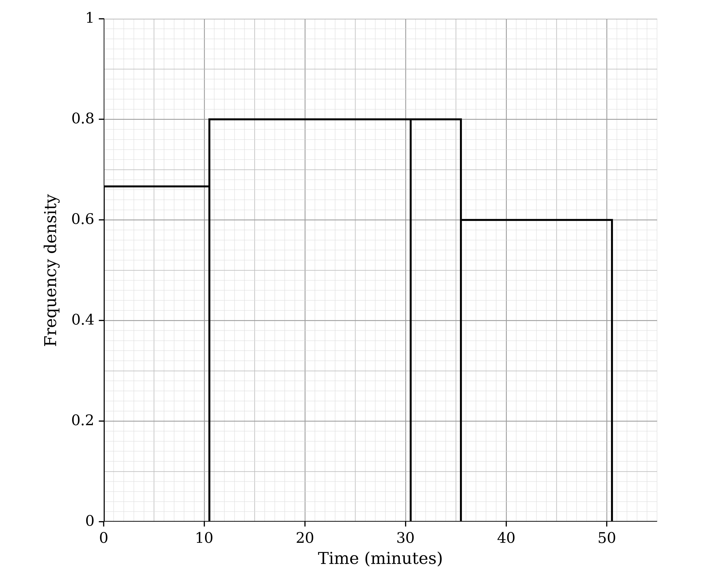

The bar for 36 – 50 is three quarters of the height of the 11 – 30 bar

$\text{Frequency density for 36 – 50} = 0 . 6$

The class 36 – 50 has boundaries 35.5 and 50.5, so its width is 15

$\text{Frequency} = 0 . 6 \times 15$

**[M1]**

**Final answer:** **9 essays**

**[A1]**

> **[mark-scheme]**
> **M1**: Frequency density of a known class found using class boundaries, e.g. $\frac{16}{20}$ or $\frac{4}{5}$.
> 
> **M1**: Frequency density of the 36 – 50 bar (0.6) multiplied by its class width.
> 
> **A1**: 9.
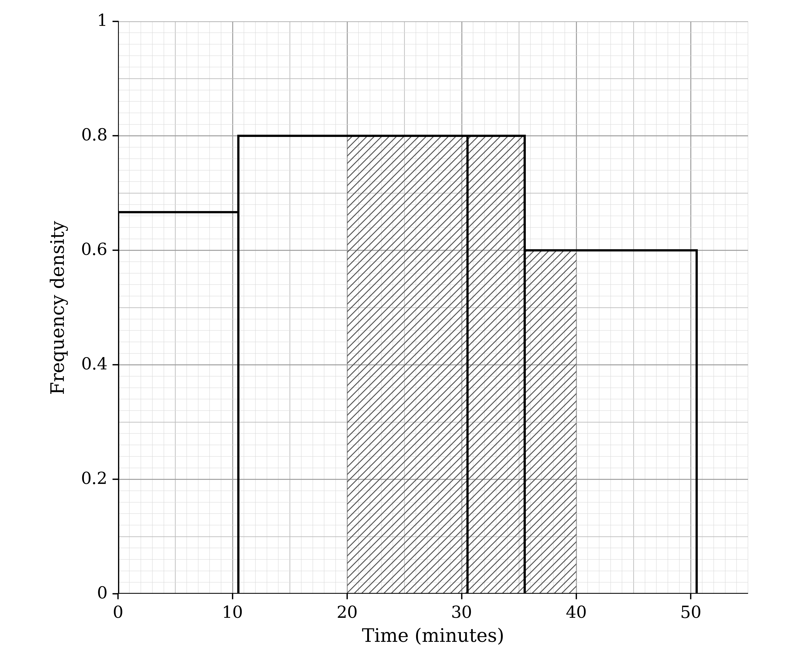

Assuming the times are spread evenly within each class, take the part of each class that lies between 20 and 40

$11 -- 30 \text{:} \frac{30.5-20}{20} \times 16 = 8 . 4$

$31 -- 35 \text{:} 4$

$36 -- 50 \text{:} \frac{40-35.5}{15} \times 9 = 2 . 7$

**[M1]**

Add the three parts

$8 . 4 + 4 + 2 . 7 = 15 . 1$

**[M1]**

A number of essays is a whole number

**Final answer:** **15 essays**

**[A1]**

> **[mark-scheme]**
> **M1**: Correct proportion of at least one partial class, e.g. $\frac{10.5}{20} \times 16$ or $\frac{4.5}{15} \times 9$ (or frequency density × width, e.g. $0 . 8 \times 10 . 5$).
> 
> **M1**: Their two partial amounts added to 4.
> 
> **A1**: A single whole number from 14 to 16 (15 using boundaries of 20 and 40), with no approximation sign.

### Q2
The median is read across from a cumulative frequency of 80

$\frac{160}{2} = 80$

*Median = 100*

**[B1]**

Scores within 5 of the median lie between 95 and 105. Read up from these scores to the curve

*Cumulative frequency at 95 = 50*

*Cumulative frequency at 105 = 112*

**[M1]**

The number of employees between the two scores is the difference

$112 - 50$

**[M1]**

**Final answer:** **62 employees**

**[A1]**

> **[mark-scheme]**
> **B1**: Median from 99.5 to 100.5, with the reading shown on the graph.
> 
> **M1**: Cumulative frequencies read at their median − 5 and their median + 5, shown on the graph.
> 
> **M1**: The difference between their two readings.
> 
> **A1**: A single whole number from 60 to 64 (62 for a correct reading of the graph).
10% of 160 is 16, so the course is offered to the employees above the 144th score

$160 - 0 . 1 \times 160 = 144$

**[M1]**

Read across from a cumulative frequency of 144 to the curve and down to the score axis

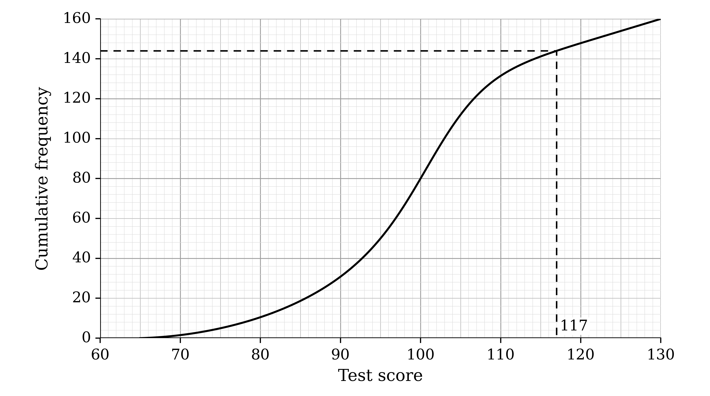

**Final answer:** **Lowest score = 117**

**[A1]**

> **[mark-scheme]**
> **M1**: 144 seen, or implied by a reading from a cumulative frequency of 144 on the graph.
> 
> **A1**: Score from 116.5 to 117.5, with the reading shown on the graph. A correct value with no reading shown earns 1 mark only.
5% of 160 is 8, so extra support is offered to the employees up to the 8th score

$0 . 05 \times 160 = 8$

**[M1]**

Read across from a cumulative frequency of 8 to the curve and down to the score axis

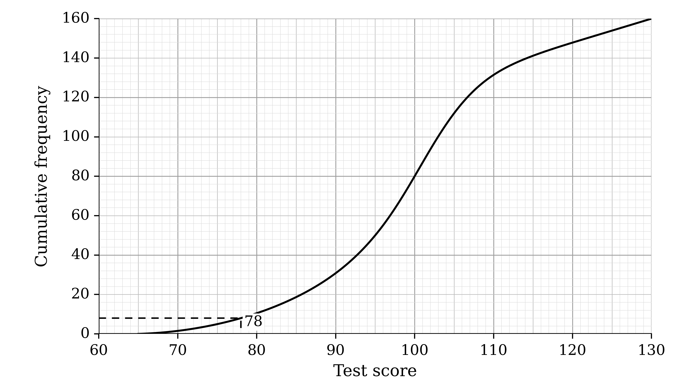

**Final answer:** **Highest score = 78**

**[A1]**

> **[mark-scheme]**
> **M1**: 8 seen, or implied by a reading from a cumulative frequency of 8 on the graph.
> 
> **A1**: Score from 77.5 to 78.5, with the reading shown on the graph. A correct value with no reading shown earns 1 mark only.

### Q3
Read the cumulative frequencies at the class boundaries 12, 16 and 20

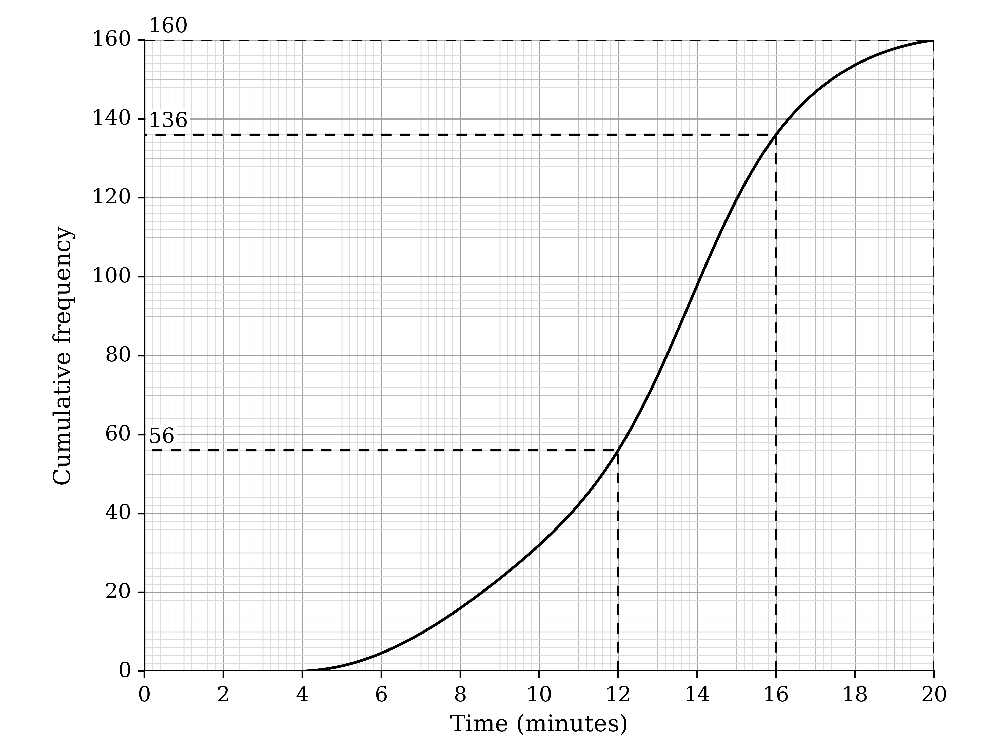

*Cumulative frequency at 12 = 56*

*Cumulative frequency at 16 = 136*

*Cumulative frequency at 20 = 160*

**[M1]**

Each frequency is the difference between consecutive cumulative frequencies

$a = 56 - 16$

**[M1]**

$a = 40$

$b = 136 - 56 = 80$

$c = 160 - 136 = 24$

**[A1]**

> **[mark-scheme]**
> **M1**: Cumulative frequencies read at 12, 16 and 20 (at least two correct), shown on the graph.
> 
> **M1**: A frequency found as the difference of consecutive cumulative frequencies.
> 
> **A1**: $a = 40$, $b = 80$ and $c = 24$.
There are 160 calls in total, so the quartiles are read across from cumulative frequencies of 40 and 120

$\frac{160}{4} = 40$

$\frac{3\times160}{4} = 120$

**[M1]**

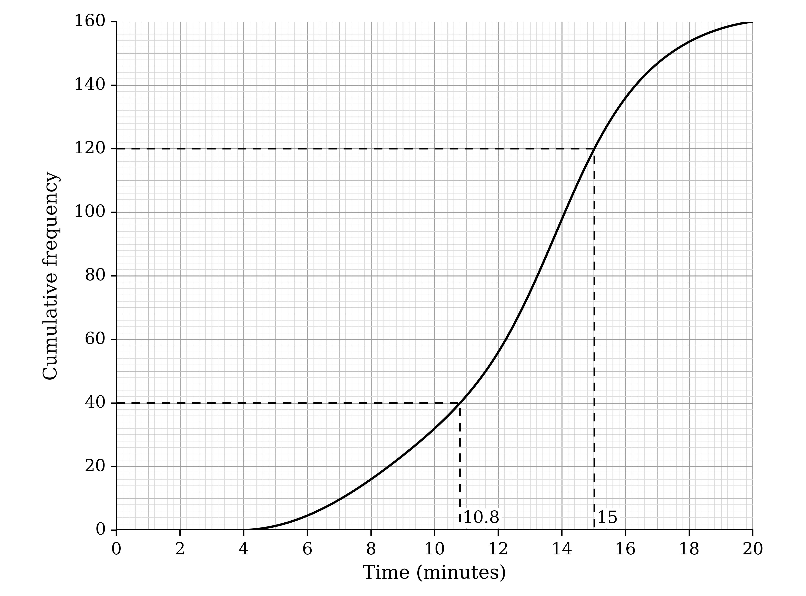

*Lower quartile = 10.8*

*Upper quartile = 15.0*

Subtract the lower quartile from the upper quartile

$15 . 0 - 10 . 8$

**[M1]**

**Final answer:** **Interquartile range = 4.2 minutes**

**[A1]**

> **[mark-scheme]**
> **M1**: Readings taken at cumulative frequencies of 40 and 120, shown on the graph.
> 
> **M1**: Upper quartile minus lower quartile, with an upper quartile from 14.8 to 15.3 and a lower quartile from 10.5 to 10.9.
> 
> **A1**: Interquartile range from 4 to 4.8 minutes, from correct readings.
Read up from 10 minutes to the curve and across to the cumulative frequency axis

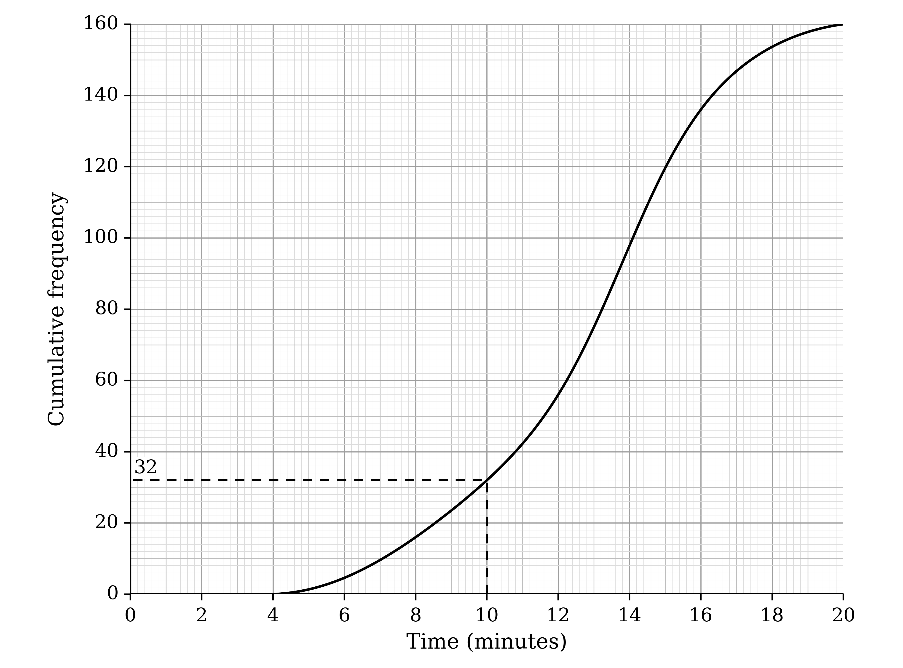

*Cumulative frequency at 10 minutes = 32*

The calls longer than 10 minutes are the rest of the 160

$\frac{160-32}{160} \times 100$

**[M1]**

**Final answer:** **80%**

**[A1]**

> **[mark-scheme]**
> **M1**: 160 minus their reading at 10 minutes, as a percentage of 160, with the reading shown on the graph.
> 
> **A1**: A percentage from 78% to 81%.

### Q4
The whisker on the right ends at the maximum, 81, and the right-hand end of the box, 72, is the upper quartile. The left-hand end of the box, 56, is either the lower quartile or the median

Diagram 1: the box runs from the lower quartile, 56, to the upper quartile, 72

$\text{Interquartile range} = 72 - 56 = 16$

$81 - \text{minimum} = 2 . 5 \times 16 = 40$

**[M1]**

*Minimum = 41*

$\text{Median} = \frac{41+81}{2} = 61$

**[A1]**

Diagram 2: 56 is the median, so it is halfway between the minimum and 81

$\frac{\text{minimum}+81}{2} = 56$

*Minimum = 31*

**[M1]**

The range is then 81 − 31 = 50, which is 2.5 times the interquartile range

$2 . 5 \times ( 72 - \text{lower quartile} ) = 50$

*Lower quartile = 52*

**[A1]**

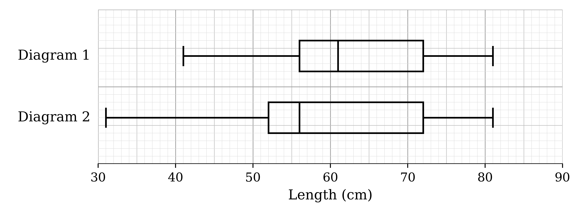

**[B1]**

> **[mark-scheme]**
> **M1**: With 56 and 72 as the quartiles, range = 2.5 × 16 used to find the minimum.
> 
> **A1**: Minimum 41 and median 61.
> 
> **M1**: With 56 as the median, the midpoint condition used to find the minimum.
> 
> **A1**: Minimum 31 and lower quartile 52.
> 
> **B1**: Both diagrams completed accurately.
With 99 masses in order, the quartiles and the median are single values

$\text{Lower quartile:} \frac{99+1}{4} = 25 \text{th value}$

$\text{Median:} \frac{99+1}{2} = 50 \text{th value}$

$\text{Upper quartile:} \frac{3(99+1)}{4} = 75 \text{th value}$

**[B1]**

Look at where each change moves a value

*11 kg (above the upper quartile) becomes 8 kg (between the lower quartile and the median)*

*9 kg (between the lower quartile and the median) becomes 10 kg (between the median and the upper quartile)*

**Final answer:** **The minimum (2.8 kg) and maximum (11.2 kg) are not changed, and the number of masses below the lower quartile and below the median stays the same, so the lower quartile and the median do not change**

**[B1]**

**Final answer:** **One mass moves from above the upper quartile to below it, so the upper quartile is the only value that could change**

**[B1]**

> **[mark-scheme]**
> **B1**: The quartiles and median identified as the 25th, 50th and 75th values.
> 
> **B1**: A reason why the minimum, maximum, lower quartile and median are unchanged.
> 
> **B1**: The conclusion that only the upper quartile could change, because a value has moved from above it to below it.

After the correction there is one more mass below 10.2 kg, so the new 75th value is either the old 74th value or the corrected mass of 10 kg

**Final answer:** **If the old 74th value is also 10.2 kg, it becomes the new 75th value, so the upper quartile is still 10.2 kg and the plot does not change**

**[B1 B1]**

> **[mark-scheme]**
> **B1**: The new upper quartile identified as the old 74th value (the corrected 10 kg being smaller than 10.2).
> 
> **B1**: The condition that the old 74th value is equal to 10.2 kg, so the plot is unchanged.

### Q5
(i)

**Final answer:** **There are only 29 values, so a stem-and-leaf diagram shows the shape of the distribution while keeping every original value**

**[B1]**

(ii)

Split each stem into two rows, the first for leaves 0 to 4 and the second for leaves 5 to 9, write the leaves in order, and add a key

**[B1 B1 B1]**

> **[mark-scheme]**
> **B1**: A valid reason, e.g. a small data set, the original values are kept, or the shape of the distribution is shown.
> 
> **B1**: Correct split stems 6, 7, 7, 8, 8, 9, 9, 10, 10 (an extra empty first row is condoned).
> 
> **B1**: All leaves correct, in order, lined up vertically and with no commas.
> 
> **B1**: A correct key, e.g. 7 | 2 means 72 goals.
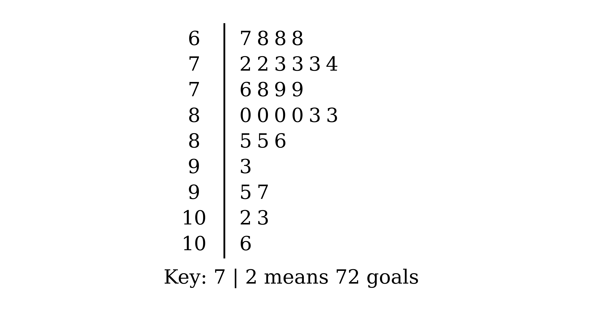

(i)

A few seasons have much higher numbers of goals (93 to 106) than the rest, and these pull the mean above the median

**Final answer:** **The distribution is not symmetrical (it is positively skewed)**

**[B1]**

(ii)

**Final answer:** **The median**

**[B1]**

**Final answer:** **The goals are skewed, with extreme values of 102, 103 and 106 goals which would raise the mean but do not affect the median**

**[B1]**

> **[mark-scheme]**
> **B1**: Not symmetrical, or skewed; the direction of the skew is not required.
> 
> **B1**: Median.
> 
> **B1**: A reason referring to the skew or to the extreme numbers of goals affecting the mean, in the context of the question. A comment about "values" in general does not score.

### Q6
The area of each bar is proportional to its frequency. Measure the areas in large grid squares (each 2 dB wide) using the heights of the bars

$90 \text{to} 94 \text{:} 2 \times 4 = 8$

$94 \text{to} 98 \text{:} 2 \times 7 = 14$

$98 \text{to} 104 \text{:} 3 \times 3 = 9$

$104 \text{to} 106 \text{:} 1 \times 1 = 1$

$106 \text{to} 110 \text{:} 2 \times 2 = 4$

**[M1]**

The total area, 36 large squares, represents all 180 dogs

$\frac{180}{36} = 5$

*1 large square represents 5 dogs*

**[A1]**

The frequency density scale follows from this (for example, the first bar has frequency 40 and width 4, so its height is 10)

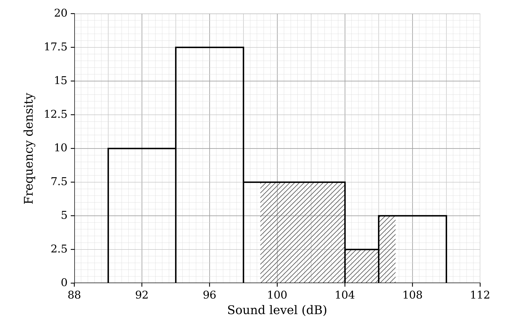

Find the area between 99 dB and 107 dB, assuming the dogs are spread evenly within each class

$98 \text{to} 104 \text{class, from 99 to 104:} 2 . 5 \times 3 = 7 . 5$

$104 \text{to} 106 \text{class:} 1$

$106 \text{to} 110 \text{class, from 106 to 107:} 0 . 5 \times 2 = 1$

**[M1]**

Add the areas and convert to a number of dogs

$( 7 . 5 + 1 + 1 ) \times 5 = 47 . 5$

**[M1]**

A number of dogs is a whole number

**Final answer:** **48 dogs**

**[A1]**

> **[mark-scheme]**
> **M1**: Areas (or relative areas) of all five bars found, or equivalent use of the total area.
> 
> **A1**: Correct scale: 1 large square represents 5 dogs, or frequency densities 10, 17.5, 7.5, 2.5, 5, or frequencies 40, 70, 45, 5, 20.
> 
> **M1**: Correct proportion of at least one partial class, e.g. $\frac{5}{6} \times 45$ for 99 to 104, or $\frac{1}{4} \times 20$ for 106 to 107.
> 
> **M1**: Their three parts added: 37.5 + 5 + 5.
> 
> **A1**: 48 (accept 47 or 48; a single whole number, with no approximation sign).

### Q7
(i)

**Final answer:** **A box-and-whisker plot shows the median and the spread of the wind speeds clearly, and makes it easy to compare with another month**

**[B1]**

(ii)

**Final answer:** **The extreme wind speed of 68 knots would raise the mean, but it does not affect the median**

**[B1]**

> **[mark-scheme]**
> **B1**: A valid reason, e.g. it shows the median and the spread (quartiles, interquartile range or range) at a glance, or it allows easy comparison with another data set.
> 
> **B1**: A reason referring to the extreme wind speed of 68 knots affecting the mean (and not the median), in the context of the question. A comment about "values" in general, or with no reference to the wind speeds, does not score. No contradictory statements.
Compare the medians, 45 knots in June and 42 knots in July

**Final answer:** **On average, the highest wind speeds were greater in June than in July**

**[B1]**

Compare the interquartile ranges, 16 knots in June and 11 knots in July (the ranges, 44 and 34 knots, agree)

**Final answer:** **The highest wind speeds in June were more varied than those in July**

**[B1]**

> **[mark-scheme]**
> **B1**: A comparison of the average wind speeds in context, e.g. wind speeds were generally higher in June.
> 
> **B1**: A comparison of the spread of the wind speeds in context, e.g. wind speeds were more varied (less consistent) in June.
> 
> A comparison that only quotes the values of the statistics, with no statement about the wind speeds, does not score.

### Q8
The diagram is already in order. There are 23 lengths, so the median is the 12th length

$\frac{23+1}{2} = 12$

**Final answer:** **Median = 53 mm**

**[B1]**

The lower quartile is the middle of the 11 lengths below the median (the 6th length), and the upper quartile is the middle of the 11 lengths above it (the 18th length)

*Lower quartile = 49*

*Upper quartile = 59*

Subtract the lower quartile from the upper quartile

$59 - 49$

**[M1]**

**Final answer:** **Interquartile range = 10 mm**

**[A1]**

> **[mark-scheme]**
> **B1**: Median of 53.
> 
> **M1**: Upper quartile minus lower quartile, with an upper quartile from 58.5 to 59 and a lower quartile from 49 to 50.
> 
> **A1**: Interquartile range of 10 (or 8.5 to 10 from quartiles in those ranges).
**Final answer:** **A stem-and-leaf diagram shows every one of the original lengths, so no data are lost**

**[B1]**

> **[mark-scheme]**
> **B1**: A reference to keeping all the original (raw) data values, or to being able to find further statistics such as the mean, mode or standard deviation, which a box-and-whisker plot does not allow.

### Q9
Read the median from the line inside the box

**Final answer:** **Median = 19 minutes**

**[B1]**

Read the quartiles from the ends of the box

*Lower quartile = 18*

*Upper quartile = 21*

Subtract the lower quartile from the upper quartile

$21 - 18$

**[M1]**

**Final answer:** **Interquartile range = 3 minutes**

**[A1]**

> **[mark-scheme]**
> **B1**: Median of 19.
> 
> **M1**: Upper quartile minus lower quartile, using values read from the diagram.
> 
> **A1**: Interquartile range of 3.
Plot the five values on the same scale as the weekday plot: the whiskers run from the fastest time (16) to the slowest time (25), and the box runs from the lower quartile (18) to the upper quartile (20), with a line at the median (19)

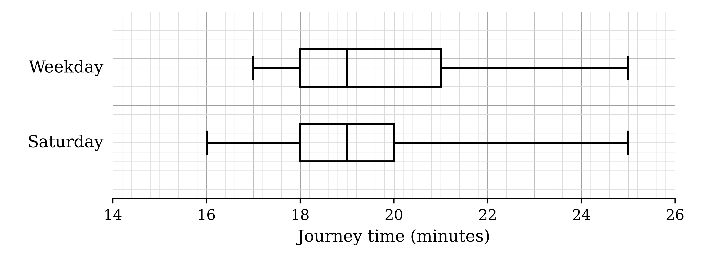

**[B1 B1 B1]**

> **[mark-scheme]**
> **B1**: Box drawn from 18 to 20 with the median line at 19.
> 
> **B1**: Whiskers drawn to 16 and 25.
> 
> **B1**: Whiskers not drawn through the box or from its corners, the plot labelled Saturday, on the same linear scale as the weekday plot.

Compare the medians, which are both 19 minutes

**Final answer:** **On average, the journey times are the same on weekdays and on Saturdays**

**[B1]**

Compare the interquartile ranges, 3 minutes on weekdays and 2 minutes on Saturdays

**Final answer:** **The journey times on weekdays are more varied than the journey times on Saturdays**

**[B1]**

> **[mark-scheme]**
> **B1**: A comparison of the average journey times (the medians) in context, e.g. the journey times are the same on average.
> 
> **B1**: A comparison of the spread of the journey times in context. A comparison based on the interquartile range (weekdays more varied) or on the range (Saturdays more varied) is accepted, provided the statement matches the measure used.
> 
> A comparison that only quotes the values of the statistics, with no statement about the journey times, does not score.

### Q10
There are 40 contestants, so the median is read across from a cumulative frequency of 20, and the quartiles from 10 and 30

$\frac{40}{2} = 20$

$\frac{40}{4} = 10$

$\frac{3\times40}{4} = 30$

**Final answer:** **Median = 33.5 m**

**[B1]**

*Lower quartile = 26.5*

*Upper quartile = 38.5*

Subtract the lower quartile from the upper quartile

$38 . 5 - 26 . 5$

**[M1]**

**Final answer:** **Interquartile range = 12 m**

**[A1]**

> **[mark-scheme]**
> **B1**: Median from 33 to 34 m, with the reading shown on the graph.
> 
> **M1**: Upper quartile minus lower quartile, with an upper quartile from 38 to 39 and a lower quartile from 26 to 27.
> 
> **A1**: Interquartile range from 11 to 13 m, from correct readings.
The 9 furthest distances are the top 9 of 40, so the cut-off is the distance with 31 contestants below it

$40 - 9 = 31$

**[M1]**

Read across from a cumulative frequency of 31 to the curve and down to the distance axis

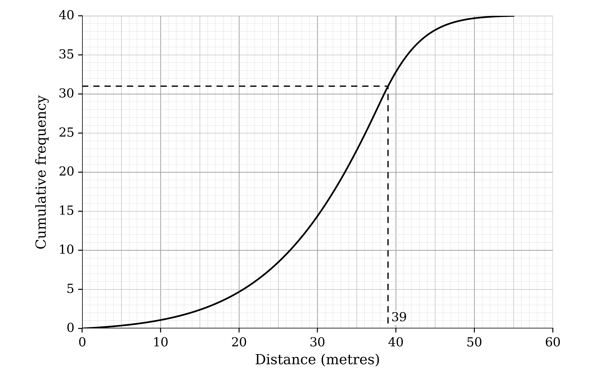

**Final answer:** **Least distance = 39 m**

**[A1]**

> **[mark-scheme]**
> **M1**: 31 seen, or implied by a reading from a cumulative frequency of 31 on the graph.
> 
> **A1**: Distance from 38.5 to 39.5 m, with the reading shown on the graph. A correct value with no reading shown on the graph earns 1 mark only.

### Q11
Each frequency density is the frequency divided by the class width, so a missing frequency is the frequency density multiplied by the class width

$\text{Frequency} = \text{frequency density} \times \text{class width}$

For $150 \leq l < 175$ the class width is 25 and the frequency density is 0.4

$\text{Frequency} = 0 . 4 \times 25 = 10$

**[M1]**

For $175 \leq l < 200$ the class width is 25 and the bar has a frequency density of 0.8

$\text{Frequency} = 0 . 8 \times 25 = 20$

**[A1]**

Find the missing frequency densities by dividing each frequency by its class width

$200 \leq l < 225 \text{:} \frac{15}{25} = 0 . 6$

$225 \leq l < 275 \text{:} \frac{10}{50} = 0 . 2$

**[B1]**

| Snap length ($l$ mm) | Frequency | Class width | Frequency density |
|---|---|---|---|
| $100 \leq l < 150$ | 5 | 50 | 0.1 |
| $150 \leq l < 175$ | **Final answer:** **10** | **Final answer:** **25** | 0.4 |
| $175 \leq l < 200$ | **Final answer:** **20** | **Final answer:** **25** | **Final answer:** **0.8** |
| $200 \leq l < 225$ | 15 | 25 | **Final answer:** **0.6** |
| $225 \leq l < 275$ | 10 | **Final answer:** **50** | **Final answer:** **0.2** |

Draw the two missing bars with heights equal to their frequency densities

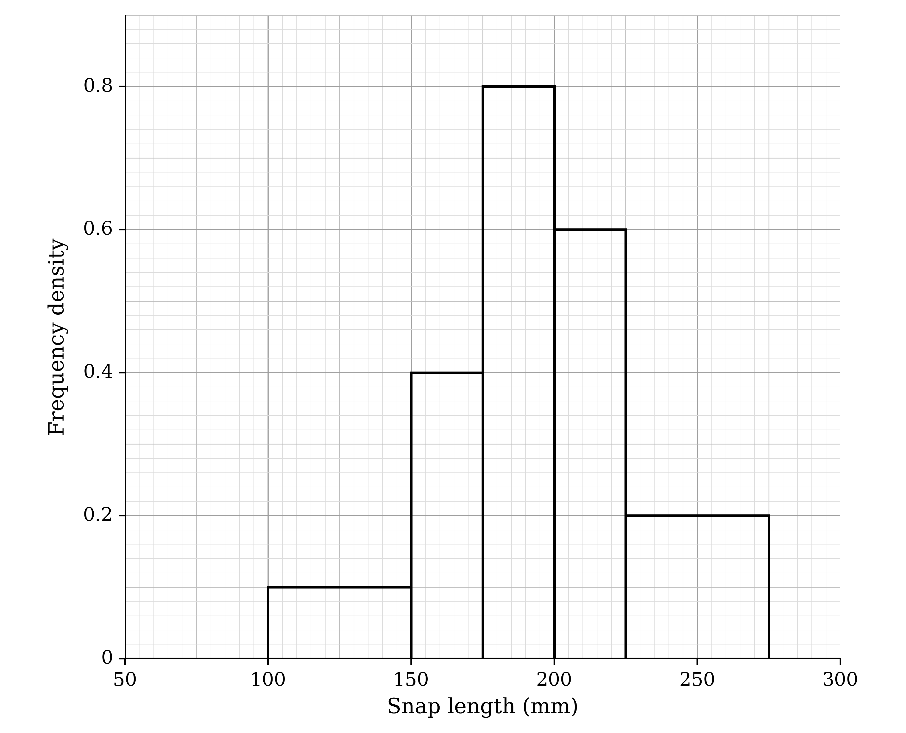

**[B1 B1]**

> **[mark-scheme]**
> **M1**: Use of frequency = frequency density × class width for a missing frequency, e.g. $0 . 4 \times 25$.
> 
> **A1**: Both missing frequencies correct: 10 and 20.
> 
> **B1**: Both missing frequency densities correct: 0.6 and 0.2.
> 
> **B1**: Bar from 200 to 225 drawn at a height of 0.6.
> 
> **B1**: Bar from 225 to 275 drawn at a height of 0.2.

### Q12
Find the cumulative frequencies by adding the frequencies in turn

| Time ($t$ seconds) | $t < 4$ | $t < 8$ | $t < 12$ | $t < 16$ |
|---|---|---|---|---|
| Cumulative frequency | **Final answer:** **12** | **Final answer:** **37** | **Final answer:** **53** | **Final answer:** **55** |

**[B1]**

Plot each cumulative frequency at the upper boundary of its class, starting from (0, 0), and join the points with a smooth curve

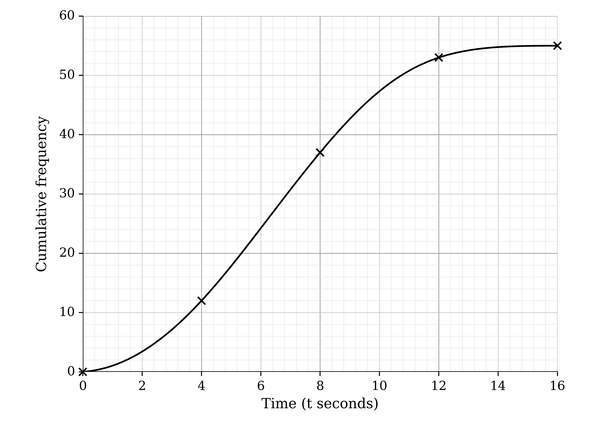

**[M1 A1]**

> **[mark-scheme]**
> **B1**: Cumulative frequencies 12, 37, 53 and 55, seen in a table or on the graph.
> 
> **M1**: At least 3 points plotted at the upper class boundaries (4, 8, 12, 16) on linear scales.
> 
> **A1**: All points plotted correctly and joined by a curve that starts at (0, 0), with the axes labelled cumulative frequency and time in seconds. A graph drawn with straight-line segments does not earn this mark.
The median is the time halfway through the 55 contestants, so read across from a cumulative frequency of 27.5

$\frac{55}{2} = 27 . 5$

**Final answer:** **Median = 6.5 seconds**

**[B1]**

> **[mark-scheme]**
> **B1**: A median from 6.3 to 6.7 seconds, or a value read correctly from the graph drawn in part (a) at a cumulative frequency of 27.5 (or 28). The reading must be shown on the graph.

### Q13
The classes have different widths, so the height of each bar is the frequency density

$\text{Frequency density} = \frac{\text{frequency}}{\text{class width}}$

Find the frequency density for each class

| Tempo ($b$ beats per minute) | Frequency | Class width | Frequency density |
|---|---|---|---|
| $140 \leq b < 160$ | 10 | 20 | $\frac{10}{20} = 0 . 5$ |
| $160 \leq b < 170$ | 20 | 10 | $\frac{20}{10} = 2$ |
| $170 \leq b < 175$ | 20 | 5 | $\frac{20}{5} = 4$ |
| $175 \leq b < 180$ | 10 | 5 | $\frac{10}{5} = 2$ |

**[M1]**

Draw each bar between its class boundaries, with height equal to its frequency density

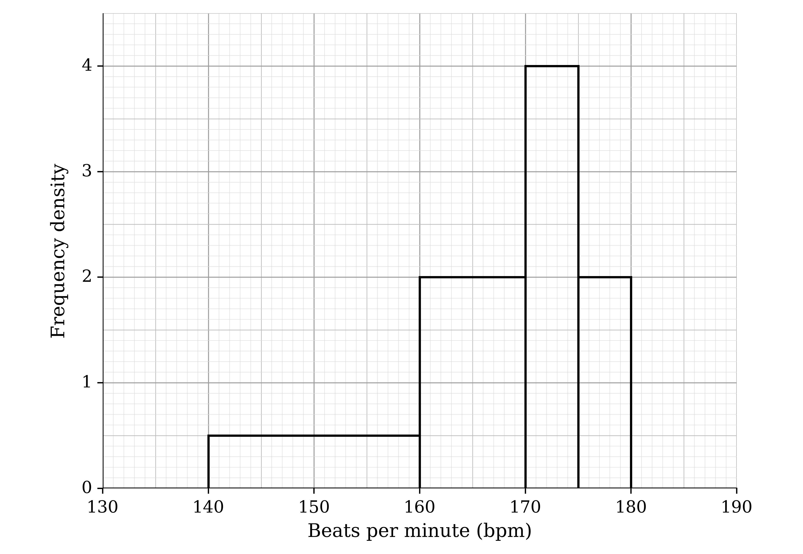

**[A1 B1 B1]**

> **[mark-scheme]**
> **M1**: At least 3 frequency densities calculated as frequency divided by class width (accept unsimplified).
> 
> **A1**: All bar heights correct on the graph.
> 
> **B1**: Bars drawn between the class boundaries 140, 160, 170, 175 and 180 on a linear horizontal scale.
> 
> **B1**: Axes labelled frequency density and tempo (beats per minute), with the frequency density scale starting at 0 and linear.
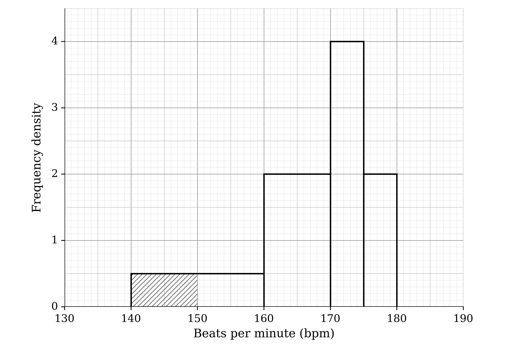

150 lies in the class $140 \leq b < 160$, which has frequency 10. Assuming the songs are spread evenly across the class, find the fraction of the class width below 150

$\frac{150-140}{160-140} \times 10$

**[M1]**

**Final answer:** **5 songs**

**[A1]**

> **[mark-scheme]**
> **M1**: Correct proportion of the $140 \leq b < 160$ class, e.g. $\frac{10}{20} \times 10$, or frequency density times width, $0 . 5 \times 10$.
> 
> **A1**: 5 songs.

### Q14
Write the times in order

*3, 4, 5, 6, 6, 7, 7, 7,*

*8, 8, 9, 9, 10, 12, 14*

There are 15 times, so the median is the 8th time in order

**Final answer:** **Median = 7 minutes**

**[B1]**

The lower quartile is the 4th time and the upper quartile is the 12th time (the middle of each half either side of the median)

*Lower quartile = 6*

*Upper quartile = 9*

Subtract the lower quartile from the upper quartile

$9 - 6$

**[M1]**

**Final answer:** **Interquartile range = 3 minutes**

**[A1]**

> **[mark-scheme]**
> **B1**: Median of 7.
> 
> **M1**: Upper quartile minus lower quartile, with an upper quartile from 9 to 10 and a lower quartile from 5 to 6.
> 
> **A1**: Interquartile range of 3.
The five values needed are the minimum and maximum from the ordered list, and the quartiles and median from part (a)

*Minimum = 3*

*Lower quartile = 6*

*Median = 7*

*Upper quartile = 9*

*Maximum = 14*

Draw the box from the lower quartile to the upper quartile with a line at the median, and the whiskers out to the minimum and maximum

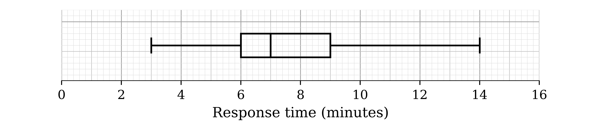

**[B1 B1 B1]**

> **[mark-scheme]**
> **B1**: Box drawn from 6 to 9 with the median line at 7 (follow through from part (a)).
> 
> **B1**: Whiskers drawn to 3 and 14.
> 
> **B1**: Whiskers not drawn through the box or from its corners, on a linear scale labelled response time in minutes.

### Q15
With 199 running times in order, find the position of the lower quartile

$\frac{199+1}{4} = 50$

The 50th running time is one hour

*Lower quartile = 60*

**[B1]**

Add the interquartile range to find the upper quartile

$\text{Upper quartile} = 60 + 63 = 123$

The median divides the interquartile range of 63 in the ratio 3 : 4, so it is $\frac{3}{7}$ of the way from the lower quartile

$\frac{3}{7} \times 63 = 27$

$\text{Median} = 60 + 27 = 87$

**[M1]**

The longest running time is two and a half hours, and subtracting the range gives the shortest

*Maximum = 150*

$\text{Minimum} = 150 - 123 = 27$

**[A1]**

Draw the box from 60 to 123 with a line at 87, and the whiskers out to 27 and 150

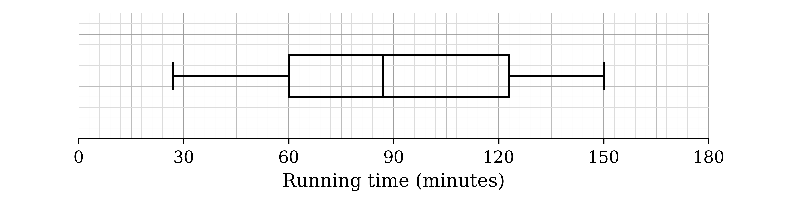

**[B1]**

> **[mark-scheme]**
> **B1**: Lower quartile of 60, from the 50th value.
> 
> **M1**: Median found as their lower quartile plus $\frac{3}{7}$ of 63.
> 
> **A1**: Upper quartile 123, median 87 and minimum 27, all correct.
> 
> **B1**: All five values plotted accurately, whiskers not through the box or from its corners, on a linear scale labelled running time in minutes.

### Q16
The cumulative frequency is 0 at 2.5 minutes, so no rat had found the exit by then. By the next count, at 5 minutes, at least one rat had found the exit

$2 . 5 < t \leq 5$

**[B1 B1]**

> **[mark-scheme]**
> **B1**: Lower limit of 2.5 (with $<$ or $\leq$).
> 
> **B1**: Upper limit of 5 (with $<$ or $\leq$).
There are 80 rats, so read across from cumulative frequencies of 20 (lower quartile), 40 (median) and 60 (upper quartile)

$\frac{80}{4} = 20$

$\frac{80}{2} = 40$

$\frac{3\times80}{4} = 60$

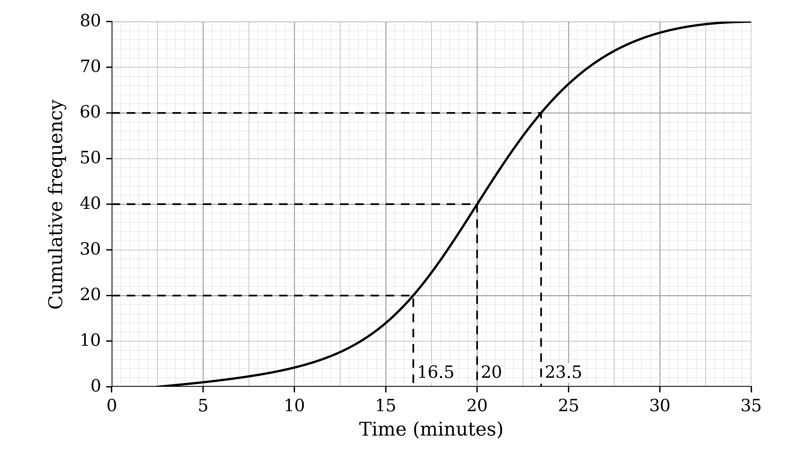

**[M1]**

*Lower quartile = 16.5*

*Median = 20*

*Upper quartile = 23.5*

**[A1]**

Draw the box from 16.5 to 23.5 with a line at 20, and join the whiskers to 4 and 33

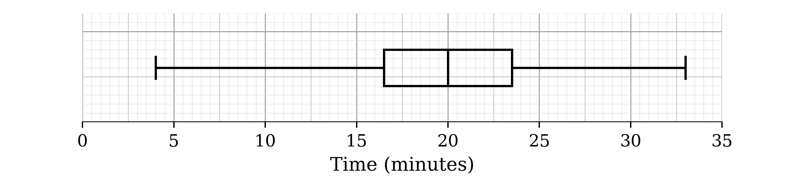

**[B1]**

> **[mark-scheme]**
> **M1**: Readings taken at cumulative frequencies of 20, 40 and 60, shown on the graph.
> 
> **A1**: Lower quartile from 16 to 17, median from 19.5 to 20.5 and upper quartile from 23 to 24.
> 
> **B1**: Box and median line drawn at their values, with the whiskers joined to 4 and 33, not through the box.

### Q17
Find the total number of friends who fell before the bottom of the hill

$23 + 11 + 9 + 7 + 6 = 56$

The other friends did not fall

$60 - 56 = 4$

**Final answer:** **4 friends**

**[B1]**

> **[mark-scheme]**
> **B1**: 4.
Find the cumulative frequencies by adding the frequencies in turn

| Distance ($d$ metres) | Cumulative frequency |
|---|---|
| $d < 0$ | 0 |
| $d < 40$ | **Final answer:** **23** |
| $d < 80$ | **Final answer:** **34** |
| $d < 120$ | **Final answer:** **43** |
| $d < 160$ | **Final answer:** **50** |
| $d < 200$ | **Final answer:** **56** |

**[B1]**

Plot each cumulative frequency at the upper boundary of its class, starting from (0, 0), and join the points with a smooth curve

**[M1 A1]**

> **[mark-scheme]**
> **B1**: Cumulative frequencies 23, 34, 43, 50 and 56, seen in a table or on the graph.
> 
> **M1**: At least 3 points plotted at the upper class boundaries (40, 80, 120, 160, 200) on linear scales.
> 
> **A1**: All points plotted correctly and joined by a curve that starts at (0, 0) and ends at (200, 56), with the axes labelled cumulative frequency and distance in metres. A graph drawn with straight-line segments does not earn this mark.
Read up from 100 and from 140 to the curve, and across to the cumulative frequency axis

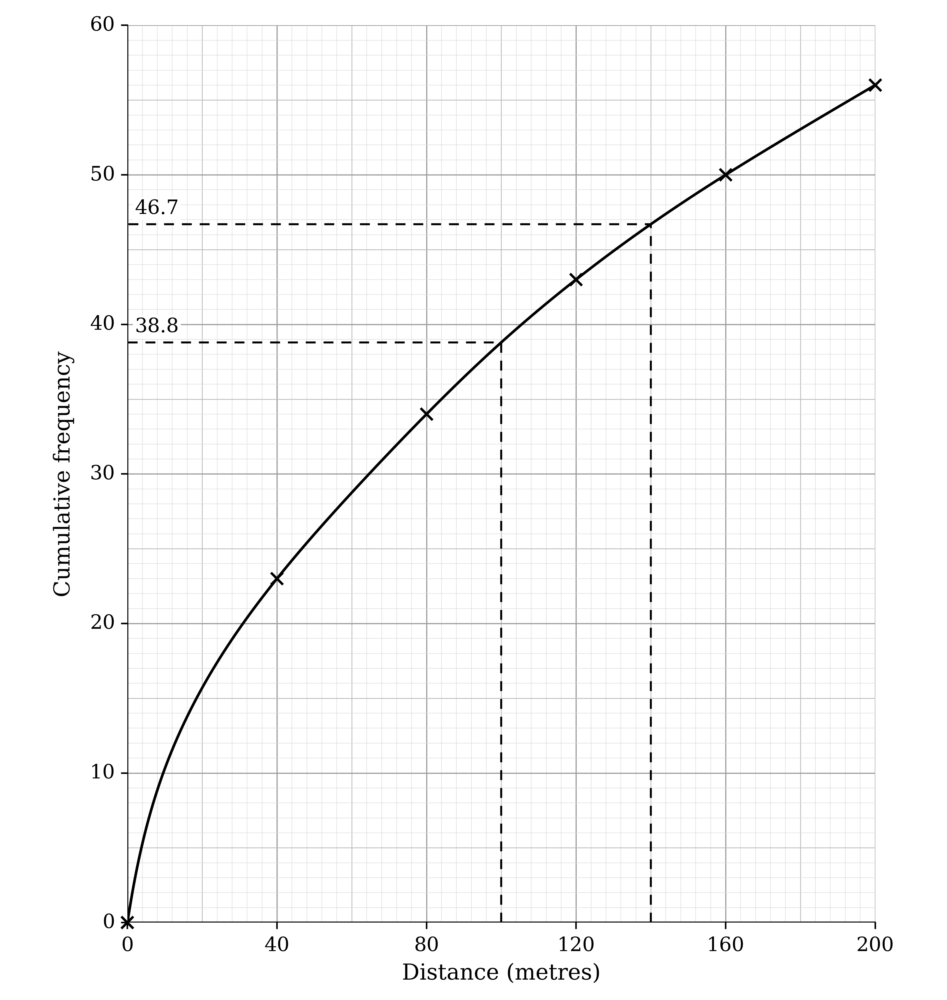

*Cumulative frequency at 100 m = 38.8*

*Cumulative frequency at 140 m = 46.7*

**[M1]**

The friends who fell between 100 m and 140 m are the difference

$46 . 7 - 38 . 8 = 7 . 9$

**[M1]**

A number of people is a whole number

**Final answer:** **8 friends**

**[A1]**

> **[mark-scheme]**
> **M1**: Readings at 100 and 140 on the graph, shown on the graph (38 to 39.5 and 46 to 47.5 for a correct graph).
> 
> **M1**: Their reading at 140 minus their reading at 100.
> 
> **A1**: A single whole number from 7 to 9 (8 for a correct graph), with no approximation sign.

### Q18
(i)

**Final answer:** **The ages are two-digit values and there are not too many of them, so the diagram shows the shape of each distribution while keeping every original age**

**[B1]**

(ii)

**Final answer:** **Only a random sample of 35 male members was chosen, so there may be male members under 20 who were not selected**

**[B1]**

> **[mark-scheme]**
> **B1**: A valid reason, e.g. the data set is small enough to display, the ages are two-digit values, or all the original data values are kept.
> 
> **B1**: A reference to the ages being from a sample (not all the male members), so younger members may not have been selected.
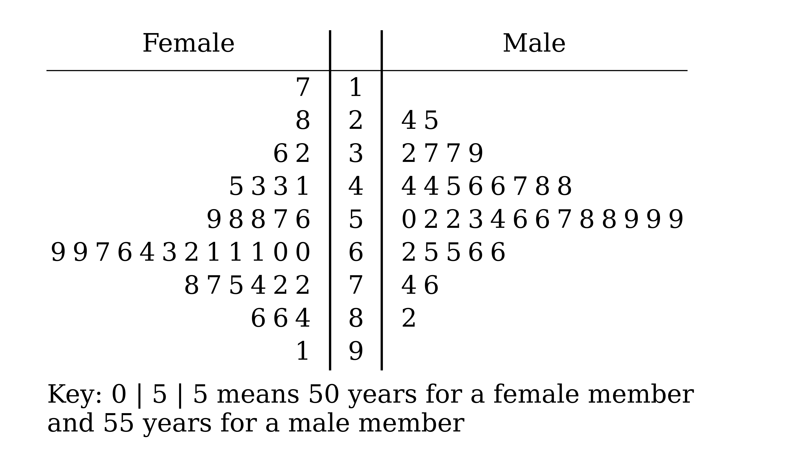

Each group has 35 ages, so the median is the 18th age in order, and the quartiles are the 9th and 27th ages (the middle of the 17 ages either side of the median)

$\frac{35+1}{2} = 18$

Read the ages from the diagram, counting from the lowest age in each group

*Female: median = 61*

*Male: median = 53*

**[B1]**

$\text{Female: interquartile range} = 72 - 56 = 16$

$\text{Male: interquartile range} = 59 - 45 = 14$

**[B1]**

Compare the medians

**Final answer:** **On average, the female members are older than the male members**

**[B1]**

Compare the interquartile ranges

**Final answer:** **The ages of the female members are more varied than the ages of the male members**

**[B1]**

> **[mark-scheme]**
> **B1**: Both medians: 61 (female) and 53 (male).
> 
> **B1**: Both interquartile ranges: 16 (female, from an LQ of 56 to 56.5 and a UQ of 72) and 14 (male, from an LQ of 45 to 45.5 and a UQ of 59); accept 15.5 to 16 and 13.5 to 14.
> 
> **B1**: A comparison of the average ages in context, e.g. the female members are generally older.
> 
> **B1**: A comparison of the spread of the ages in context, e.g. the female ages are more spread out.
> 
> A comparison that only quotes the values of the statistics does not score the last two marks. A correct comparison using means and standard deviations is accepted for these two marks.

### Q19
**Final answer:** **Time is continuous and the data are grouped into classes of different widths**

**[B1]**

> **[mark-scheme]**
> **B1**: A valid reason: time is a continuous variable, or the data are grouped (with unequal class widths).
The times are recorded to the nearest minute, so a time recorded as 90 to 129 lies between 89.5 and 129.5. Use these class boundaries to find the class widths, then the frequency densities

$\text{Frequency density} = \frac{\text{frequency}}{\text{class width}}$

| Time (minutes) | Class boundaries | Class width | Frequency | Frequency density |
|---|---|---|---|---|
| 90 – 129 | 89.5 to 129.5 | 40 | 6 | $\frac{6}{40} = 0 . 15$ |
| 130 – 169 | 129.5 to 169.5 | 40 | 8 | $\frac{8}{40} = 0 . 2$ |
| 170 – 199 | 169.5 to 199.5 | 30 | 12 | $\frac{12}{30} = 0 . 4$ |
| 200 – 249 | 199.5 to 249.5 | 50 | 4 | $\frac{4}{50} = 0 . 08$ |

**[M1]**

Draw each bar between its class boundaries, with height equal to its frequency density

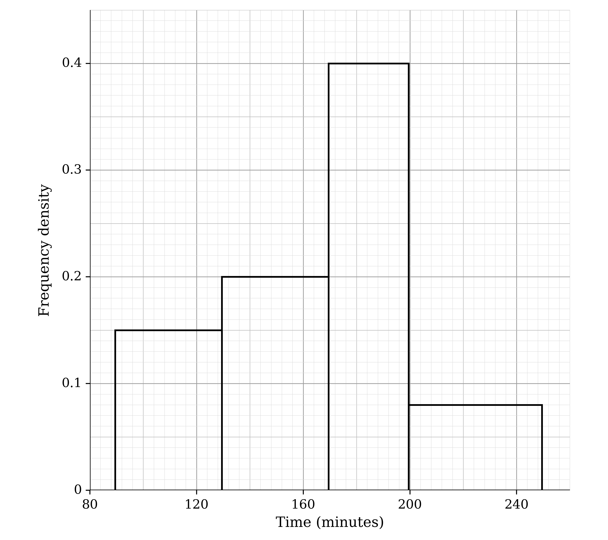

**[A1 B1 B1]**

> **[mark-scheme]**
> **M1**: At least 3 frequency densities calculated as frequency divided by class width (accept widths of 39, 39, 29, 49 for this mark only).
> 
> **A1**: All bar heights correct on the graph.
> 
> **B1**: Bars drawn between the boundaries 89.5, 129.5, 169.5, 199.5 and 249.5 (not at 90, 129, 130 etc.) on a linear horizontal scale.
> 
> **B1**: Axes labelled frequency density and time (minutes), with the frequency density scale starting at 0 and linear.
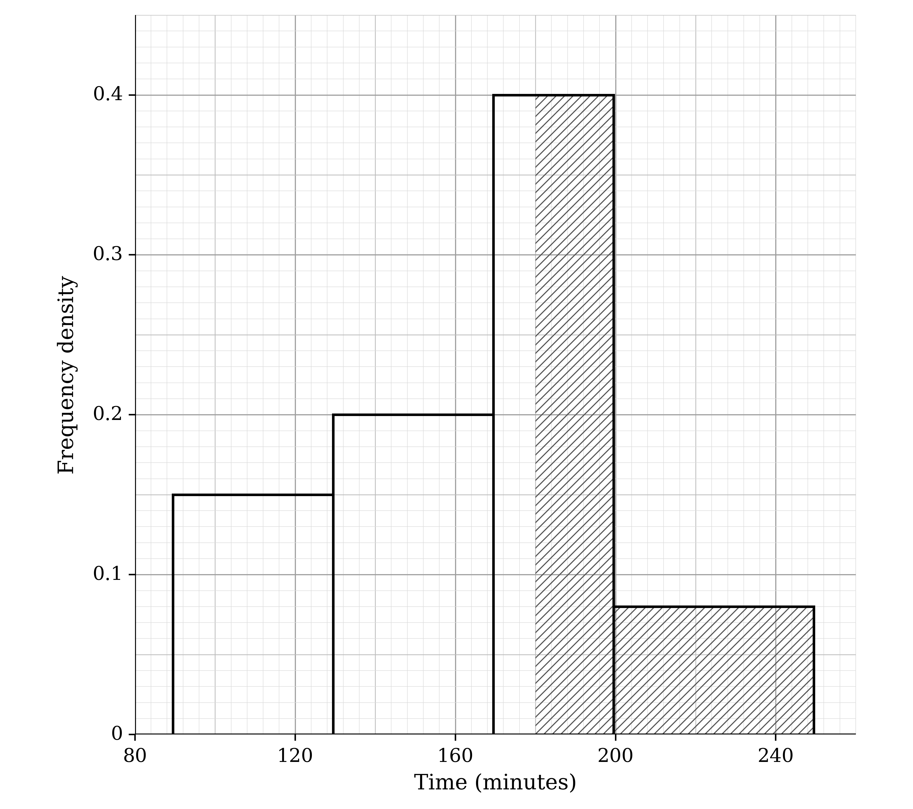

Three hours is 180 minutes, which lies in the class 169.5 to 199.5 (frequency 12). Assuming the times are spread evenly across the class, estimate the number of faults in this class that took longer than 180 minutes

$\frac{199.5-180}{199.5-169.5} \times 12 = \frac{19.5}{30} \times 12 = 7 . 8$

**[M1]**

Add the 4 faults in the class 200 to 249, and divide by the total of 30 faults

$\frac{7.8+4}{30} = \frac{11.8}{30}$

**[M1]**

**Final answer:** $\text{Proportion} = \frac{59}{150} = 0 . 393$** (3 s.f.)**

**[A1]**

> **[mark-scheme]**
> **M1**: Correct proportion of the 170 – 199 class above 180, e.g. $\frac{19.5}{30} \times 12$ (using 179.5 or 180.5 in place of 180 is accepted).
> 
> **M1**: Their estimate for the 170 – 199 class plus 4, divided by 30.
> 
> **A1**: $\frac{59}{150}$, or answers which round to 0.393 (0.4 from using 179.5, or 0.387 from using 180.5, is accepted).

### Q20
The part of the box already drawn runs from the median, 20, to the upper quartile, 23, and the whisker ends at the maximum, 28

The median is 4 kg more than the lower quartile

$\text{Lower quartile} = 20 - 4 = 16$

**[B1]**

Find the interquartile range, then the range

$\text{Interquartile range} = 23 - 16 = 7$

$\text{Range} = 3 \times 7 = 21$

**[M1]**

Subtract the range from the maximum to find the minimum

$\text{Minimum} = 28 - 21 = 7$

**[A1]**

> **[mark-scheme]**
> **B1**: Lower quartile of 16.
> 
> **M1**: Range found as 3 × (23 − their lower quartile), and subtracted from 28.
> 
> **A1**: Box extended to 16 and the lower whisker drawn to 7, accurately on the given scale.

With the 19 weights in order, the median is the middle weight

$\frac{19+1}{2} = 10$

**[M1]**

The median, 20 kg, is the 10th weight. The weights are all different, so exactly 9 weights are less than 20 kg

$\text{Proportion} = \frac{9}{19}$

**[A1]**

> **[mark-scheme]**
> **M1**: The median identified as the 10th of the 19 ordered weights.
> 
> **A1**: $\frac{9}{19}$ (or answers which round to 0.474).
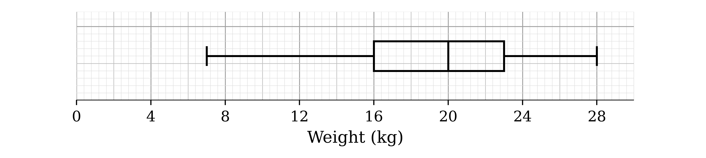

With the 19 weights in order, the upper quartile is the middle of the 9 weights above the median

$\frac{3(19+1)}{4} = 15$

**[M1]**

The upper quartile, 23 kg, is the 15th weight. The weights are all different, so the 16th to 19th weights are more than 23 kg

**Final answer:** **4 students**

**[A1]**

> **[mark-scheme]**
> **M1**: The upper quartile identified as the 15th of the 19 ordered weights.
> 
> **A1**: 4 students.

### Q21
Use a class whose frequency is known to find the scale on the frequency density axis. For $0 \leq a < 5$

$\text{Frequency density} = \frac{15}{5} = 3$

**[M1]**

So the first bar is at 3, and each large square on the vertical axis is 1 (each small square is 0.1)

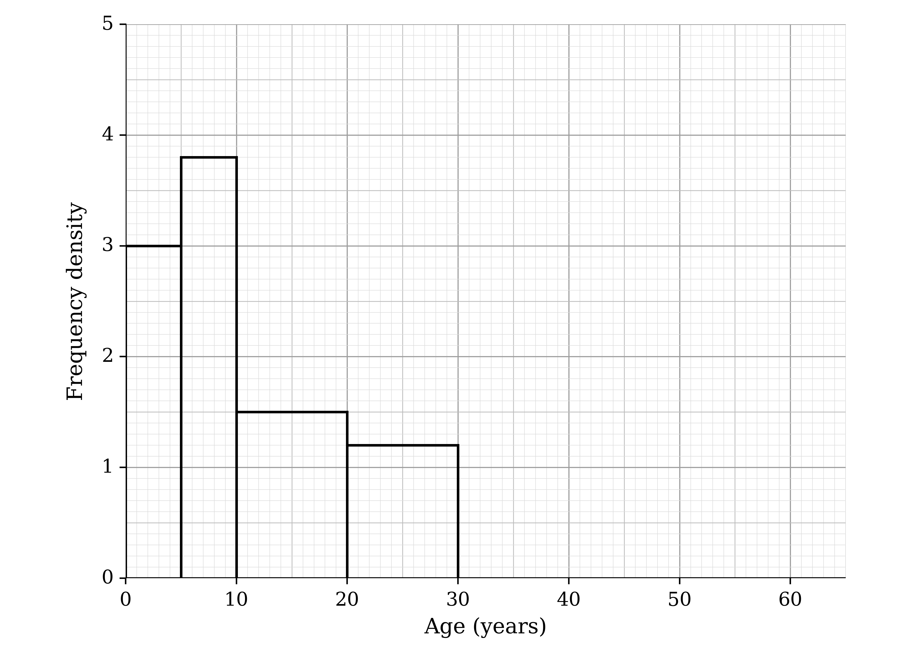

Read the frequency densities of the other bars: $5 \leq a < 10$ is at 3.8 and $10 \leq a < 20$ is at 1.5 (as a check, $20 \leq a < 30$ is at $\frac{12}{10} = 1 . 2$)

Multiply each frequency density by its class width to find the missing frequencies

$5 \leq a < 10 \text{:} 3 . 8 \times 5 = 19$

$10 \leq a < 20 \text{:} 1 . 5 \times 10 = 15$

**[A1]**

Find the frequency densities of the last two classes

$30 \leq a < 50 \text{:} \frac{18}{20} = 0 . 9$

$50 \leq a < 60 \text{:} \frac{7}{10} = 0 . 7$

| Age ($a$ years) | Frequency |
|---|---|
| $0 \leq a < 5$ | 15 |
| $5 \leq a < 10$ | **Final answer:** **19** |
| $10 \leq a < 20$ | **Final answer:** **15** |
| $20 \leq a < 30$ | 12 |
| $30 \leq a < 50$ | 18 |
| $50 \leq a < 60$ | 7 |

Draw the two missing bars at these heights

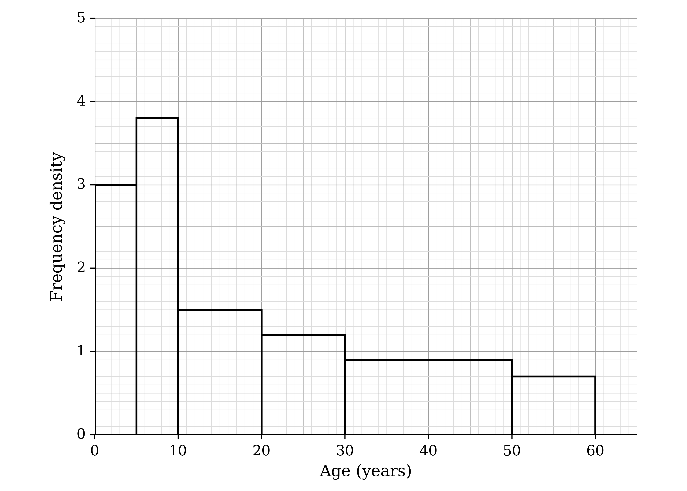

**[B1 B1]**

> **[mark-scheme]**
> **M1**: The frequency density scale found from a class with a known frequency, e.g. $\frac{15}{5} = 3$ for the first bar.
> 
> **A1**: Both missing frequencies correct: 19 and 15.
> 
> **B1**: Bar from 30 to 50 drawn at a height of 0.9.
> 
> **B1**: Bar from 50 to 60 drawn at a height of 0.7.

### Q22
Read the median from the line inside the box

**Final answer:** **Median = 115 g**

**[B1]**

Read the quartiles from the ends of the box

*Lower quartile = 103*

*Upper quartile = 120*

Subtract the lower quartile from the upper quartile

$120 - 103$

**[M1]**

**Final answer:** **Interquartile range = 17 g**

**[A1]**

> **[mark-scheme]**
> **B1**: Median of 115.
> 
> **M1**: Upper quartile minus lower quartile, using values read from the diagram (upper quartile from 119 to 121, lower quartile from 102 to 104).
> 
> **A1**: Interquartile range of 17 (accept 16 to 18 from readings in those ranges).
The range is the largest weight minus the smallest weight, so add the range to the smallest weight

$\text{Largest weight} = 125 + 48 = 173$

The interquartile range is the upper quartile minus the lower quartile, so subtract it from the upper quartile

$\text{Lower quartile} = 164 - 33 = 131$

**[B1]**

Draw the box from 131 to 164 with a line at the median, 152, and the whiskers out to 125 and 173

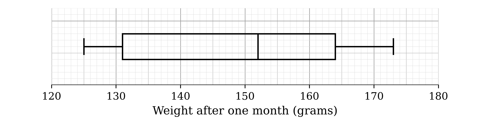

**[B1 B1]**

> **[mark-scheme]**
> **B1**: Largest weight 173 and lower quartile 131, both seen or plotted.
> 
> **B1**: All five values (125, 131, 152, 164, 173) plotted accurately.
> 
> **B1**: Whiskers not drawn through the box or from its corners, on a linear scale labelled weight in grams.

### Q23
Find the cumulative frequencies by adding the frequencies in turn

| Distance ($d$ km) | Cumulative frequency |
|---|---|
| $d < 25$ | 0 |
| $d < 30$ | **Final answer:** **8** |
| $d < 35$ | **Final answer:** **18** |
| $d < 40$ | **Final answer:** **50** |
| $d < 45$ | **Final answer:** **104** |
| $d < 50$ | **Final answer:** **114** |
| $d < 55$ | **Final answer:** **120** |

**[B1]**

Plot each cumulative frequency at the upper boundary of its class, starting from (25, 0), and join the points with a smooth curve

**[M1 A1]**

> **[mark-scheme]**
> **B1**: Cumulative frequencies 8, 18, 50, 104, 114 and 120, seen in a table or on the graph.
> 
> **M1**: At least 4 points plotted at the upper class boundaries (30, 35, 40, 45, 50, 55) on linear scales.
> 
> **A1**: All points plotted correctly and joined by a curve that starts at (25, 0), with the axes labelled cumulative frequency and distance in km. A graph drawn with straight-line segments does not earn this mark.
There are 120 runners, so read across from cumulative frequencies of 60 (median), 30 (lower quartile) and 90 (upper quartile)

$\frac{120}{2} = 60$

$\frac{120}{4} = 30$

$\frac{3\times120}{4} = 90$

**Final answer:** **Median = 41 km**

**[B1]**

*Lower quartile = 37.4*

*Upper quartile = 43.3*

Subtract the lower quartile from the upper quartile

$43 . 3 - 37 . 4$

**[M1]**

**Final answer:** **Interquartile range = 5.9 km**

**[A1]**

> **[mark-scheme]**
> **B1**: Median from 40.5 to 41.5 km, or read correctly from the graph drawn in part (a), with the reading shown on the graph.
> 
> **M1**: Upper quartile minus lower quartile, with an upper quartile from 43 to 44 and a lower quartile from 36.5 to 37.5 (or read correctly from the graph drawn in part (a)).
> 
> **A1**: Interquartile range from 5.5 to 7 km, from correct readings.

### Q24
Use the tens digits (0 to 4) as the stems and the units digits as the leaves, with the leaves in order and a key

**[B1 B1 B1]**

> **[mark-scheme]**
> **B1**: Correct stems 0, 1, 2, 3, 4 (not in reverse order).
> 
> **B1**: All leaves correct, in order, lined up vertically and with no commas.
> 
> **B1**: A correct key, e.g. 2 | 1 means 21 donations.
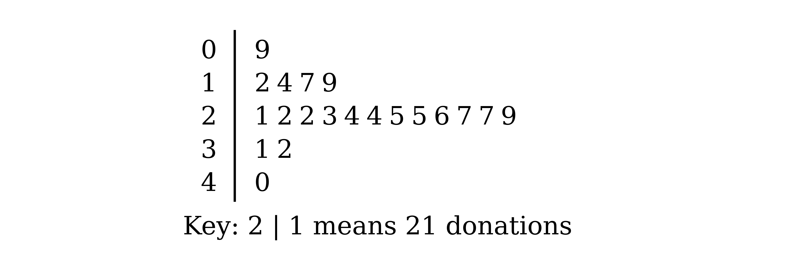

There are 20 values, so the median is halfway between the 10th and 11th values in order

$\text{Median} = \frac{24+24}{2} = 24$

**[M1]**

Compare the median with 25

$24 < 25$

**Final answer:** **The median is less than 25, so the manager should not continue to run the advert**

**[A1]**

> **[mark-scheme]**
> **M1**: Median found as the mean of the 10th and 11th values, e.g. $\frac{24+24}{2}$.
> 
> **A1**: Median of 24, compared with 25, and the conclusion that the advert should not continue.
**Final answer:** **The stem-and-leaf diagram keeps every original value, whereas grouping the data loses the individual values**

**[B1]**

> **[mark-scheme]**
> **B1**: A reference to keeping all the original (raw) data values, or to being able to find exact statistics such as the median, which a grouped frequency table does not allow.

### Q25
(i)

**Final answer:** **Time is continuous and the data are grouped into classes of different widths**

**[B1]**

(ii)

The classes have different widths, so the height of each bar is the frequency density

$\text{Frequency density} = \frac{\text{frequency}}{\text{class width}}$

| Time ($t$ minutes) | Frequency | Class width | Frequency density |
|---|---|---|---|
| $0 \leq t < 90$ | 9 | 90 | $\frac{9}{90} = 0 . 1$ |
| $90 \leq t < 120$ | 24 | 30 | $\frac{24}{30} = 0 . 8$ |
| $120 \leq t < 200$ | 12 | 80 | $\frac{12}{80} = 0 . 15$ |
| $200 \leq t < 250$ | 4 | 50 | $\frac{4}{50} = 0 . 08$ |

**[M1]**

Draw each bar between its class boundaries, with height equal to its frequency density

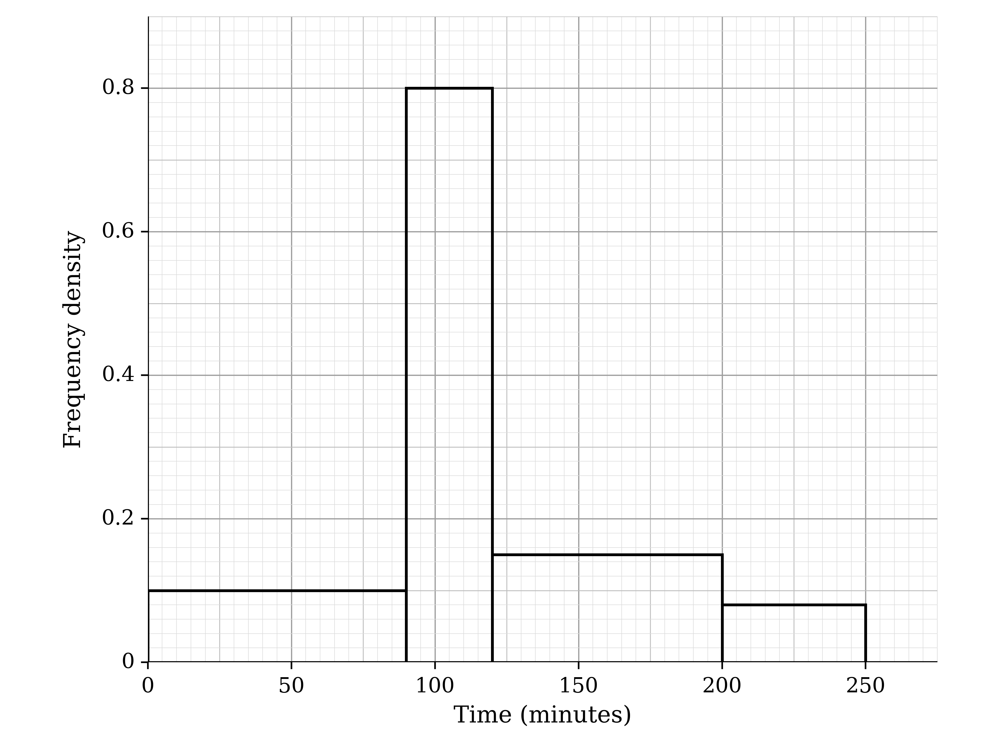

**[A1 B1 B1]**

> **[mark-scheme]**
> **B1**: A valid reason: time is a continuous variable, or the data are grouped (with unequal class widths).
> 
> **M1**: At least 3 frequency densities calculated as frequency divided by class width (accept unsimplified).
> 
> **A1**: All bar heights correct on the graph.
> 
> **B1**: Bars drawn between the class boundaries 0, 90, 120, 200 and 250 on a linear horizontal scale.
> 
> **B1**: Axes labelled frequency density and time (minutes), with the frequency density scale starting at 0 and linear.
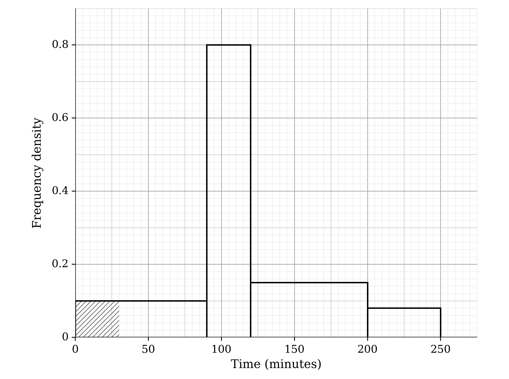

30 minutes lies in the class $0 \leq t < 90$, which has frequency 9. Assuming the times are spread evenly across the class, find the fraction of the class width below 30

$\frac{30}{90} \times 9$

**[M1]**

**Final answer:** **3 days**

**[A1]**

> **[mark-scheme]**
> **M1**: Correct proportion of the $0 \leq t < 90$ class, e.g. $\frac{30}{90} \times 9$, or frequency density times width, $0 . 1 \times 30$.
> 
> **A1**: 3 days.

### Q26
Write the times in order

*5, 6, 6, 7, 7, 8, 12, 14, 16, 19,*

*20, 20, 24, 24, 27, 27, 30, 31, 32, 34*

There are 20 times, so the median is halfway between the 10th and 11th times

$\text{Median} = \frac{19+20}{2}$

**Final answer:** **Median = 19.5 minutes**

**[B1]**

The lower quartile is the median of the lowest 10 times (halfway between the 5th and 6th), and the upper quartile is the median of the highest 10 times (halfway between the 15th and 16th)

$\text{Lower quartile} = \frac{7+8}{2} = 7 . 5$

$\text{Upper quartile} = \frac{27+27}{2} = 27$

Subtract the lower quartile from the upper quartile

$27 - 7 . 5$

**[M1]**

**Final answer:** **Interquartile range = 19.5 minutes**

**[A1]**

> **[mark-scheme]**
> **B1**: Median of 19.5.
> 
> **M1**: Upper quartile minus lower quartile, with an upper quartile from 26.5 to 27.5 and a lower quartile from 7 to 8.
> 
> **A1**: Interquartile range from 19 to 20, from quartiles in those ranges.
The five values needed are the shortest and longest times from the ordered list, and the quartiles and median from part (a)

*Shortest time = 5*

*Lower quartile = 7.5*

*Median = 19.5*

*Upper quartile = 27*

*Longest time = 34*

Draw the box from the lower quartile to the upper quartile with a line at the median, and the whiskers out to the shortest and longest times

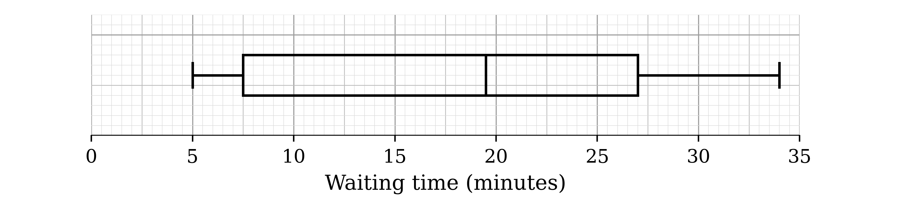

**[B1 B1 B1]**

> **[mark-scheme]**
> **B1**: Box drawn from 7.5 to 27 with the median line at 19.5 (follow through from part (a)).
> 
> **B1**: Whiskers drawn to 5 and 34.
> 
> **B1**: Whiskers not drawn through the box or from its corners, on a linear scale labelled waiting time in minutes.

### Q27
The median is the speed halfway through the 80 vehicles, so read across from a cumulative frequency of 40

$\frac{80}{2} = 40$

**[M1]**

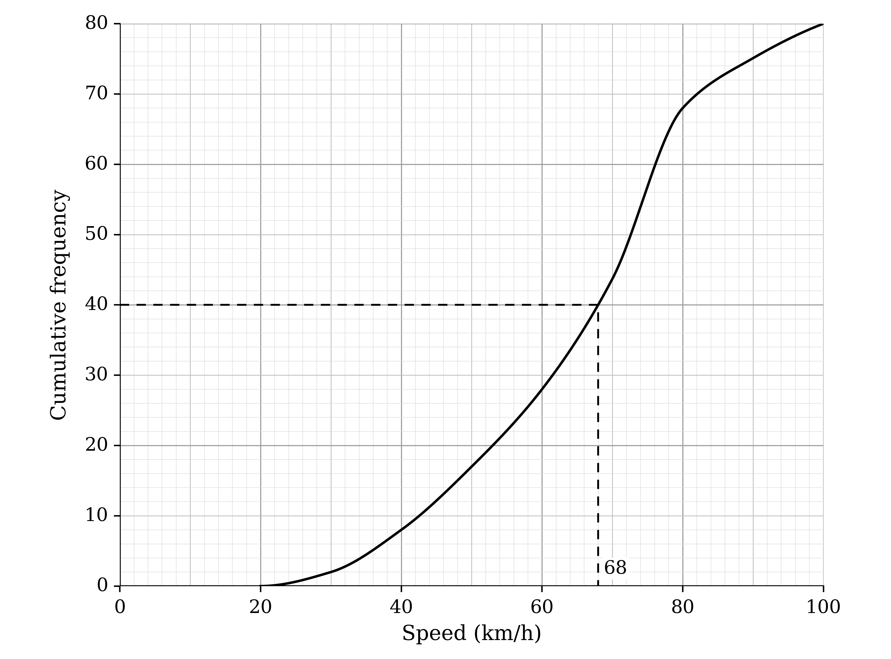

**Final answer:** **Median = 68 km/h**

**[A1]**

> **[mark-scheme]**
> **M1**: A cumulative frequency of 40 used, seen in the working or on the graph.
> 
> **A1**: Median from 67 to 69 km/h, with the reading shown on the graph.
Find the speed that is 10% above the speed limit

$80 \times 1 . 1 = 88$

Read up from 88 km/h to the curve and across to the cumulative frequency axis

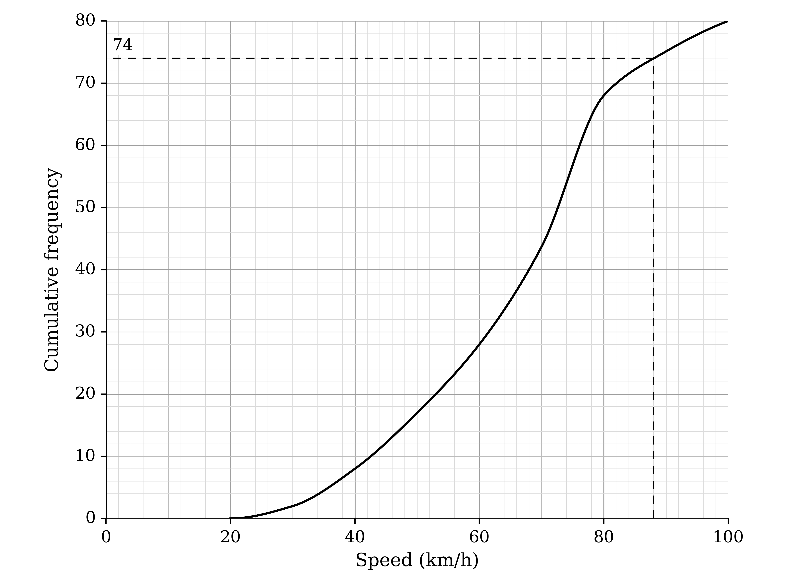

*Cumulative frequency at 88 km/h = 74*

**[M1]**

The vehicles that are stopped are those faster than 88 km/h

$80 - 74 = 6$

**[M1]**

Write this as a percentage of the 80 vehicles

$\frac{6}{80} \times 100$

**Final answer:** **7.5%**

**[A1]**

> **[mark-scheme]**
> **M1**: 88 found and a cumulative frequency read from the graph at 88, with the reading shown on the graph.
> 
> **M1**: 80 minus the cumulative frequency read at 88.
> 
> **A1**: A percentage from 6.25% to 8.75% (from a reading of 73 to 75), or a correct percentage from a correct reading of the graph.
