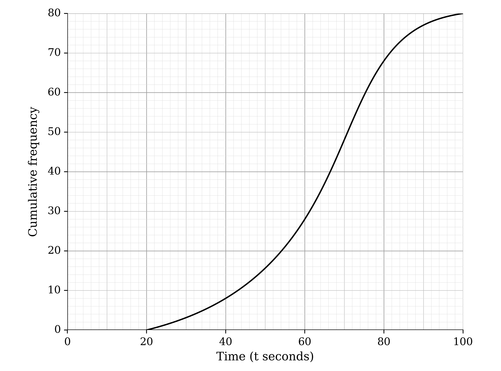
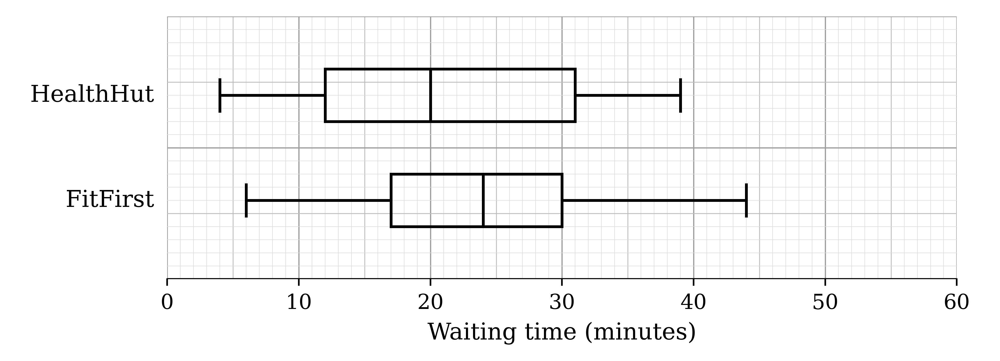
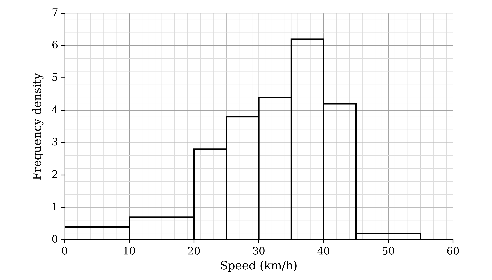
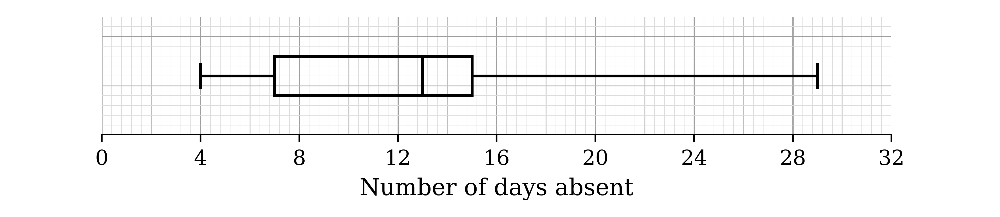
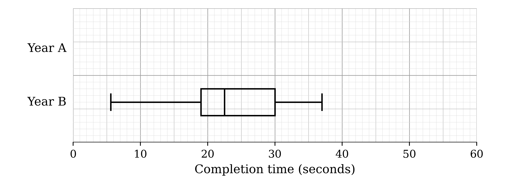
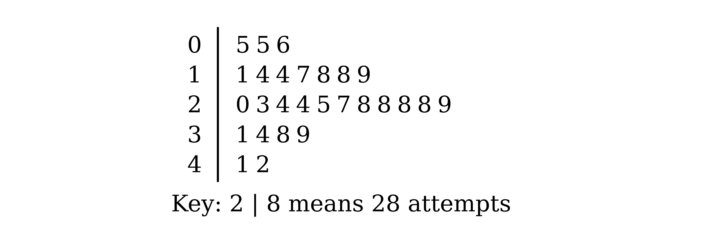
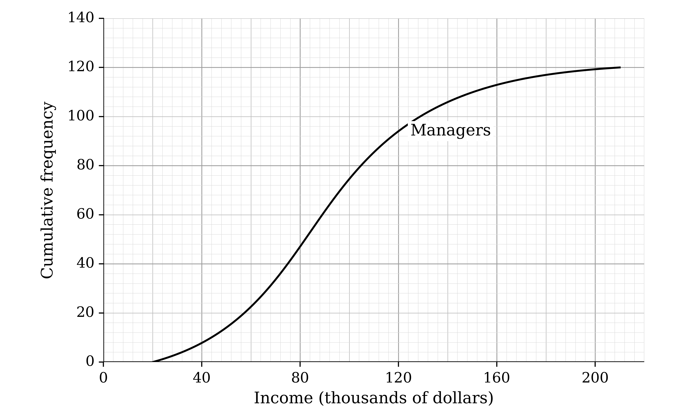

# Exam Questions — Working with Data
**Data Presentation & Interpretation** · Cambridge (CIE) A-LEVEL maths (9709)
> Source: [https://www.savemyexams.com/a-level/maths/cie/20/probability-and-statistics-1/topic-questions/](https://www.savemyexams.com/a-level/maths/cie/20/probability-and-statistics-1/topic-questions/) · 23 questions across 1 sets

## Exam Questions (23 questions)

### Q1 — hard — 9 marks

**Q1** [2 marks]

The times taken, $t$ seconds, by 80 students to run one lap of a sports hall are represented in the cumulative frequency graph.

Complete the frequency table.

| Time (t seconds) | 20 < t ≤ 40 | 40 < t ≤ 60 | 60 < t ≤ 80 | 80 < t ≤ 100 |
|---|---|---|---|---|
| Frequency | 8 |   |   |   |

**Q1** [5 marks]

Estimate the mean and the interquartile range of the times.

**Q1** [2 marks]

Any times under 32 seconds or over 90 seconds are recorded as unusual. Use the graph to estimate the percentage of the students' times that are recorded as unusual.

### Q2 — medium — 8 marks

**Q2** [4 marks]

In a safety test, firefighters set fire to a sofa in a typical living-room setting. After 10 minutes the fire is put out, and an expert records the percentage of the room that is destroyed. The test is carried out 15 times with an untreated sofa and 15 times with a sofa treated with a fire-resistant chemical. The percentages are as follows.

Without the fire-resistant chemical

| 85 | 76 | 83 | 48 | 91 |
|---|---|---|---|---|
| 80 | 67 | 82 | 79 | 85 |
| 76 | 72 | 84 | 76 | 69 |

With the fire-resistant chemical

| 40 | 51 | 52 | 48 | 60 |
|---|---|---|---|---|
| 48 | 77 | 46 | 40 | 51 |
| 54 | 51 | 46 | 45 | 49 |

Represent the data by drawing an ordered back-to-back stem-and-leaf diagram, with the results without the chemical on the left-hand side.

**Q2** [2 marks]

Find the median percentage destroyed without the chemical and the median percentage destroyed with the chemical.

**Q2** [2 marks]

It is later found that two of the values were recorded in the wrong set. The value 48% recorded without the chemical should have been recorded with the chemical, and the value 77% recorded with the chemical should have been recorded without the chemical.

Without doing any further calculations, state with reasons the effect of correcting these errors on each of your answers to part (b).

### Q3 — hard — 7 marks

**Q3** [2 marks]

Marya is often late for work. Her manager, David, records the number of minutes that she is late on each of the next six days. The mean of these six values is 18 minutes and the variance is 210. On one of the six days, Marya was 50 minutes late.

Marya says that the value of 50 minutes should not be included, as it is an extreme value.

(i) Give a reason why Marya wants the value of 50 minutes to be excluded.

(ii) Give a reason why David wants the value of 50 minutes to be included.

**Q3** [5 marks]

Marya shows David evidence that she was 50 minutes late that day because of a road closure. David agrees to remove the value of 50 from the data.

Calculate the mean and the standard deviation of the remaining five values.

### Q4 — medium — 5 marks

**Q4** [1 mark]

Tim has moved to a new town and wants to register at whichever of two medical centres, HealthHut or FitFirst, sees patients faster. He records the waiting times of a sample of 150 patients at each medical centre on their last visit. He represents the data by the box-and-whisker plots below.

Give a reason why box-and-whisker plots are suitable for Tim's purpose.

**Q4** [1 mark]

Give a reason why the median is likely to be more suitable than the mean as a measure of the central tendency of the waiting times at FitFirst.

**Q4** [3 marks]

Make two comparisons between the waiting times at the two medical centres. Hence state, with a reason, which medical centre Tim should join.

### Q5 — hard — 6 marks

**Q5** [4 marks]

The captain of a car ferry records the masses, $m$ kg, of 30 randomly chosen cars. The data are summarised by

$\sum ( m - a ) = 90$

$\sum ( m - a )^{2} = 2182818$

where $a$ is a constant. The mean mass of the 30 cars is 1423 kg.

Find the value of $a$ and the standard deviation of the masses of the 30 cars.

**Q5** [2 marks]

A 31st car, of mass 1423 kg, is added to the sample.

Without doing any further calculations, state with a reason whether the mean and the standard deviation of the masses of the 31 cars are greater than, less than or the same as those of the 30 cars.

### Q6 — medium — 8 marks

**Q6** [5 marks]

The ages, $a$ years, of the 27 children at a birthday party are summarised in the table. No child at the party was older than 7 years.

| Age (a years) | 0 ≤ a < 2 | 2 ≤ a < 5 | 5 ≤ a < 6 | a ≥ 6 |
|---|---|---|---|---|
| Frequency | 6 | 9 | 10 | 2 |

Calculate estimates of the mean and the standard deviation of the ages of the children.

**Q6** [1 mark]

State one disadvantage of grouping data before analysing it.

**Q6** [2 marks]

Two more children, both aged 3 years, arrive at the party.

Without doing any further calculations, state with a reason whether each of your estimates in part (a) would increase, decrease or stay the same.

### Q7 — easy — 6 marks

**Q7** [3 marks]

The lengths of time, in minutes, of 100 phone calls made to a computer help centre one morning are represented in the cumulative frequency graph.

Use the graph to estimate

(i) the lower quartile and the upper quartile of the call lengths,

(ii) the interquartile range of the call lengths.

**Q7** [3 marks]

The lengths of another 100 calls to the help centre were recorded in the afternoon of the same day. For these calls, the median was 15 minutes and the interquartile range was 9 minutes.

Use the graph to estimate the median length of the morning calls. Hence make two comparisons between the lengths of the calls in the morning and the lengths of the calls in the afternoon.

### Q8 — easy — 7 marks

**Q8** [5 marks]

Shara is practising the long jump. In one practice session she makes 23 jumps, and the distances, in metres, are recorded to the nearest 10 cm. The results are as follows.

| 3.4 | 3.1 | 3.5 | 3.8 | 4.1 |
|---|---|---|---|---|
| 2.8 | 3.2 | 3.0 | 3.2 | 3.6 |
| 3.1 | 2.9 | 3.9 | 3.1 | 2.7 |
| 3.4 | 3.1 | 3.2 | 3.5 | 3.3 |
| 3.6 | 2.8 | 4.0 |   |   |

(i) Draw an ordered stem-and-leaf diagram to represent these distances.

(ii) State the median and the mode of these distances.

**Q8** [2 marks]

(i) Calculate the mean of these distances.

(ii) State what feature of the data accounts for the mean being greater than the median.

### Q9 — easy — 5 marks

**Q9** [3 marks]

A hotel manager records the number of towels that go missing each day for 12 days. The results are as follows.

| 2 | 4 | 1 | 0 | 3 | 4 |
|---|---|---|---|---|---|
| 3 | 9 | 3 | 2 | 4 | 5 |

Calculate the mean and the standard deviation of the number of towels that go missing each day.

**Q9** [2 marks]

(i) Find the median number of towels that go missing each day.

(ii) Give a reason why the median is likely to be more suitable than the mean as a measure of the central tendency for these data.

### Q10 — easy — 5 marks

**Q10** [3 marks]

In a conkers competition, the number of strikes needed to smash the opponent's conker is recorded for each of 15 matches. The results are as follows.

| 6 | 2 | 9 | 10 | 9 |
|---|---|---|---|---|
| 12 | 5 | 8 | 7 | 5 |
| 11 | 9 | 17 | 8 | 9 |

Find the median and the interquartile range of the number of strikes.

**Q10** [2 marks]

(i) Find the mean number of strikes.

(ii) State, with a reason, whether the mean or the median is the more suitable measure of central tendency for these data.

### Q11 — medium — 5 marks

**Q11** [1 mark]

Joe counts the number of different species of bird visiting his garden each day for a week. The results are given below.

| 7 | 8 | 5 | 12 | 9 | 7 | 3 |
|---|---|---|---|---|---|---|

Calculate the mean number of different species of bird visiting Joe's garden.

**Q11** [3 marks]

Joe continues to record the number of different species of bird visiting his garden each day for the rest of the month and calculates the mean number of different species is 9.25 for the remaining 24 days.

Joe says, using the data from the whole month, he would expect to see 9 different species of bird every day. Explain whether Joe is correct. You must support your answer with clear working.

**Q11** [1 mark]

Joe decides he will repeat his investigation into species of bird visiting his garden three months later. That month he finds the mean number of different species visiting his garden per day is 4.5. Joe is concerned that this indicates some species of bird are dying out. Suggest a reason why this may not be the case.

### Q12 — easy — 6 marks

**Q12** [4 marks]

Two geologists are measuring the size of rocks on a beach in front of a cliff. They record the greatest length, $x$ millimetres, of each rock in random samples of 20 rocks taken at 5 m and at 25 m from the base of the cliff. Their results are summarised in the table.

| Distance from the base of the cliff | 5 m | 25 m |
|---|---|---|
| Number of rocks, $n$ | 20 | 20 |
| $\sum x$ | 3885 | 2220 |
| $\sum x^{2}$ | 1 124 175 | 534 000 |

Calculate the mean and the standard deviation of the lengths of the rocks at 5 m and at 25 m from the base of the cliff.

**Q12** [2 marks]

Make two comparisons between the lengths of the rocks at 5 m and the lengths of the rocks at 25 m from the base of the cliff.

### Q13 — hard — 6 marks

**Q13** [3 marks]

A road safety team records the speeds of 120 vehicles travelling along a village road with a speed limit of 40 km/h. The histogram represents the speeds.

(i) State one disadvantage of using a histogram to represent these speeds.

(ii) Determine the class containing the median.

**Q13** [3 marks]

The team will recommend speed-reduction measures if 30% or more of the recorded speeds are higher than 2.5 km/h below the speed limit.

Determine whether the team will recommend speed-reduction measures.

### Q14 — very_hard — 6 marks

**Q14** [2 marks]

Jan visits 19 shops and counts the number of packs of toilet rolls available in each one. The results are shown in the stem-and-leaf diagram.

Find the median and the lower quartile of the numbers of packs.

**Q14** [4 marks]

Jan later visits one more shop and counts the packs of toilet rolls there. Jan forgets the number, and remembers only that it was between 10 and 19 inclusive.

(i) Explain the effect that this new value has on the median.

(ii) Explain the possible effects that this new value could have on the lower quartile.

### Q15 — medium — 6 marks

**Q15** [2 marks]

Hugo records the number of days that each of the 23 employees in the IT department of a company was absent last quarter. The box-and-whisker plot summarises his results.

(i) State the median number of days absent.

(ii) State, with a reason, whether the mean or the median is the more suitable measure of central tendency for these data.

**Q15** [4 marks]

For the 23 employees, $\sum x = 286$ and $\sum x^{2} = 4238$, where $x$ is the number of days absent.

The employee who was absent for 29 days had a long-term illness, and Hugo decides to remove this value from the data.

Calculate the mean and the standard deviation of the number of days absent for the remaining 22 employees.

### Q16 — easy — 7 marks

**Q16** [5 marks]

Students at two martial arts schools, School A and School B, measured the force, $x$ newtons, of a particular style of hit. The results are summarised in the table.

|   | $n$ | $\sum x$ | $\sum x^{2}$ |
|---|---|---|---|
| School A | 12 | 21 873 | 41 532 545 |
| School B | 17 | 29 520 | 52 330 890 |

Calculate the mean and the standard deviation of the forces for each school.

**Q16** [2 marks]

Make two comparisons between the forces of the hits for students at School A and students at School B.

### Q17 — easy — 6 marks

**Q17** [5 marks]

A café owner records the number of customers served between 12 pm and 2 pm on each weekday for three weeks. The results are as follows.

| 52 | 64 | 58 | 49 | 52 |
|---|---|---|---|---|
| 71 | 63 | 52 | 56 | 58 |
| 53 | 52 | 47 | 68 | 56 |

(i) State the mode and find the median of the number of customers served.

(ii) For these data, $\sum x = 851$ and $\sum x^{2} = 48965$. Calculate the mean and the standard deviation of the number of customers served.

**Q17** [1 mark]

State what feature of the data accounts for the mean being greater than the median.

### Q18 — medium — 7 marks

**Q18** [3 marks]

The numbers of vaccinations given each day at a vaccination centre over a period of 14 days are as follows.

| 237 | 264 | 308 | 313 | 319 | 352 | 378 |
|---|---|---|---|---|---|---|
| 378 | 405 | 421 | 428 | 450 | 465 | 583 |

For these data, $\sum x = 5301$ and $\sum x^{2} = 2113195$.

Calculate the mean and the standard deviation of the number of vaccinations given each day.

**Q18** [3 marks]

The value 583 is found to have been recorded incorrectly and is removed from the data.

Calculate the mean and the standard deviation of the remaining 13 values.

**Q18** [1 mark]

Without doing any further calculations, state with a reason whether removing the value 583 increases, decreases or does not change the median.

### Q19 — easy — 7 marks

**Q19** [3 marks]

The heights, in metres, of the 20 flamingos in a flock are as follows.

| 0.9 | 0.9 | 1.0 | 1.0 | 1.2 |
|---|---|---|---|---|
| 1.2 | 1.2 | 1.2 | 1.2 | 1.2 |
| 1.3 | 1.3 | 1.3 | 1.4 | 1.4 |
| 1.4 | 1.4 | 1.5 | 1.5 | 1.6 |

Find the median and the interquartile range of these heights.

**Q19** [3 marks]

On the grid, draw a box-and-whisker plot to represent these heights.

**Q19** [1 mark]

Another flamingo, of height 1.7 metres, joins the flock.

Without doing any further calculations, state with a reason whether the median height increases, decreases or stays the same.

### Q20 — medium — 6 marks

**Q20** [4 marks]

The completion times, in seconds, of the 100 competitors in a puzzle-cube competition in Year A are represented in the cumulative frequency graph. The quickest time was 9.8 seconds and the slowest time was 52.4 seconds.

The completion times of the competitors in the same competition in Year B are represented by the box-and-whisker plot on the grid below.

On the same grid, draw a box-and-whisker plot to represent the completion times in Year A.

**Q20** [2 marks]

Make two comparisons between the completion times in Year A and the completion times in Year B.

### Q21 — easy — 5 marks

**Q21** [1 mark]

The numbers of attempts taken by 27 gamers to complete the final level of a computer game are represented in the stem-and-leaf diagram.

State an advantage of using a stem-and-leaf diagram compared to a box-and-whisker plot to represent these data.

**Q21** [3 marks]

Find the median, the lower quartile and the upper quartile of the number of attempts.

**Q21** [1 mark]

The game developer replaces the final level with a new, more difficult level. State, with a reason, what effect you would expect this to have on the median number of attempts taken by the same 27 gamers.

### Q22 — medium — 7 marks

**Q22** [3 marks]

A disgruntled chocaholic is complaining that their favourite tub of chocolates seems to have very few of their favourite 'toffee deluxe' sweets in, compared to the other four available. In a bid to show they have a valid complaint, the chocaholic bought 10 tubs of the sweets and counted how many of each of the five sweets are contained in each tub. The results are summarised in the box and whisker diagrams below.

(i) Write down the median number of 'toffee deluxe' sweets in a tub.

(ii) Work out the interquartile range for 'toffee deluxe'.

**Q22** [1 mark]

One of the tubs contained 16 'toffee deluxe' sweets. State, with a reason, whether the mean or the median gives a better representation of the typical number of 'toffee deluxe' sweets in a tub.

**Q22** [3 marks]

(i) Briefly compare the central tendency and variation of 'toffee deluxe' with the other four sweets.

(ii) Do you think the disgruntled chocaholic has a valid complaint regarding the number of 'toffee deluxe' sweets in a tub? Fully justify your answer.

### Q23 — medium — 7 marks

**Q23** [3 marks]

The incomes, in thousands of dollars, of 120 managers at a supermarket chain are represented in the cumulative frequency graph.

The incomes of a sample of 120 other employees at the supermarket chain are summarised in the table.

| Income, I (thousands of dollars) | Frequency |
|---|---|
| 0 ≤ I < 20 | 34 |
| 20 ≤ I < 40 | 28 |
| 40 ≤ I < 60 | 27 |
| 60 ≤ I < 80 | 17 |
| 80 ≤ I < 100 | 10 |
| 100 ≤ I < 120 | 4 |

On the same grid, draw a cumulative frequency graph to represent the incomes of the other employees.

**Q23** [4 marks]

Use the graphs to estimate the median and the interquartile range of the incomes for each group. Hence make two comparisons between the incomes of the managers and the incomes of the other employees.
