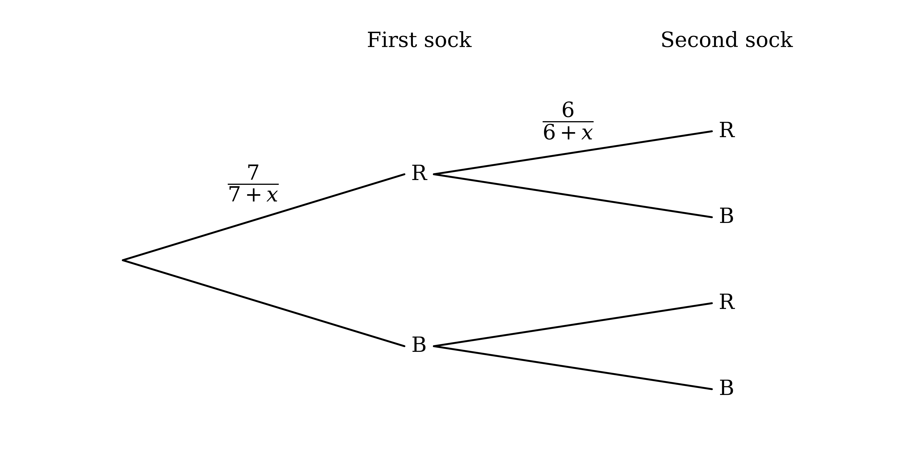
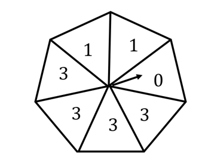
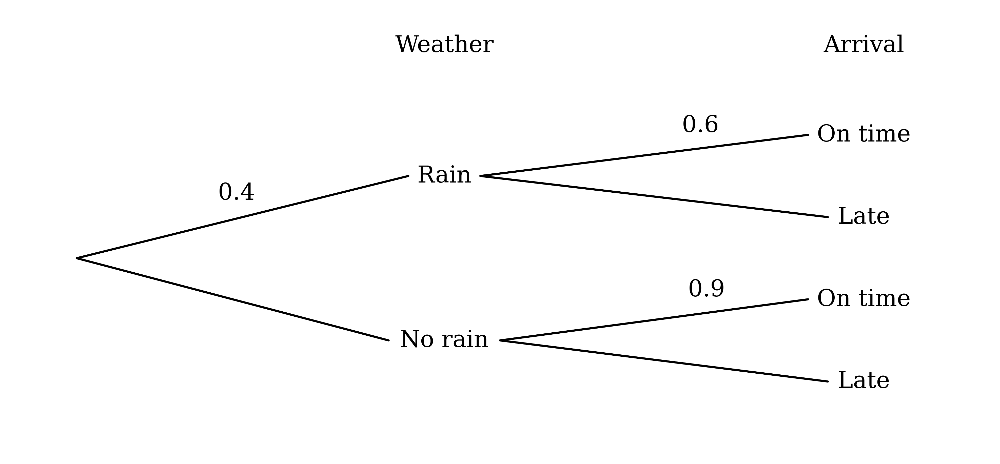
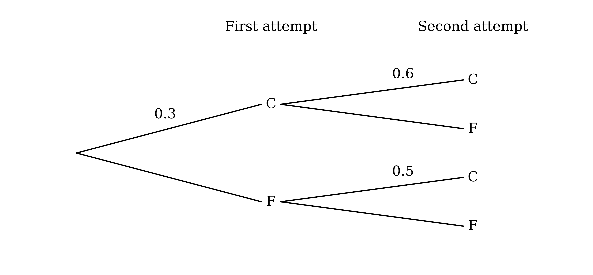

# Exam Questions — Further Probability
**Probability** · Cambridge (CIE) A-LEVEL maths (9709)
> Source: [https://www.savemyexams.com/a-level/maths/cie/20/probability-and-statistics-1/topic-questions/](https://www.savemyexams.com/a-level/maths/cie/20/probability-and-statistics-1/topic-questions/) · 25 questions across 1 sets

## Exam Questions (25 questions)

### Q1 — medium — 8 marks

**Q1** [2 marks]

A spinner has five sections numbered 1, 2, 3, 4 and 5. The probability that the spinner lands on the section numbered $x$ is $k x^{2}$, where $k$ is a constant and $x$ = 1, 2, 3, 4 or 5 only.

Find the value of $k$.

**Q1** [3 marks]

Draw up a two-way table of probabilities for the events 'the spinner lands on an odd number' and 'the spinner lands on a prime number'.

**Q1** [3 marks]

Find the probability that the spinner lands on a number that is

(i) neither odd nor prime

(ii) not odd, given that it is prime

(iii) prime, given that it is odd.

### Q2 — very_hard — 7 marks

**Q2** [5 marks]

In an online chess tournament, each match begins with a standard game, which is either won outright, lost outright or drawn. If the standard game is drawn, a single sudden-death game is played to decide the winner of the match. A sudden-death game cannot be drawn. A player who wins a match goes on to play another match.

In his first match, the probability that Jamie wins outright is 0.7 and the probability that he loses outright is 0.1.

If Jamie wins his first match outright, the probabilities that he wins or loses his second match outright are again 0.7 and 0.1.

If Jamie wins his first match after a sudden-death game, the probability that he wins his second match outright is 0.55 and the probability that he loses it outright is 0.3.

The probability that Jamie wins any sudden-death game is $p$.

Given that the probability that Jamie wins both of his first two matches is 0.6508, find the value of $p$.

**Q2** [2 marks]

Find the probability that Jamie won both of his first two matches outright, given that he won both of these matches.

### Q3 — hard — 8 marks

**Q3** [5 marks]

A basket contains 6 green apples and 8 red apples. Five apples are chosen at random from the basket, without replacement.

(i) Find the probability that 2 red apples and 3 green apples are chosen.

(ii) Given that the first 4 apples chosen are green, find the probability that the fifth apple chosen is green.

**Q3** [3 marks]

A second basket contains 4 green apples and 5 red apples. The apples in the two baskets are combined, and 2 apples are chosen at random from the combined apples, without replacement.

Find the probability that the 2 apples are from the same basket, given that they are the same colour.

### Q4 — hard — 4 marks

**Q4** [4 marks]

A group of 180 people consists of mathematics students and mathematics teachers. Each person was asked whether they prefer reading Latin poetry or taking part in extreme sports in their free time. Some of the results are shown in the table below.

|   | Latin poetry | Extreme sports | Total |
|---|---|---|---|
| **Students** | 63 |   |   |
| **Teachers** |   |   | 72 |
| **Total** |   |   | 180 |

A person is chosen at random from the group. It is given that the events 'the person chosen is a mathematics student' and 'the person chosen prefers reading Latin poetry' are independent.

Complete the table.

### Q5 — very_hard — 8 marks

**Q5** [5 marks]

Dennis and Minnie play a game using a box containing black counters and red counters. The number of red counters in the box is 3 more than the number of black counters.

In each turn of the game, a player selects two counters at random from the box at the same time. The first player to obtain two counters of the same colour wins the game.

Dennis takes the first turn. The probability that Dennis wins on his first turn is $\frac{17}{35}$.

Find the two possible values for the number of black counters in the box.

**Q5** [3 marks]

Dennis does not win on his first turn, and he does not replace his counters in the box. Minnie then selects two counters at random from the counters left in the box.

Given that Minnie wins on her first turn, the probability that she selects two red counters is $\frac{14}{19}$.

Find the original number of black counters in the box.

### Q6 — hard — 7 marks

**Q6** [4 marks]

The table shows the cost, in dollars, of Lucy's three favourite snacks at two cinemas, The Amenic and The Seivom.

| Snack | Cost at The Amenic (\$) | Cost at The Seivom (\$) |
|---|---|---|
| **Popcorn** | 4.50 | 6.00 |
| **Ice cream** | 3.80 | 4.20 |
| **Nachos** | 6.00 | 8.20 |

When Lucy goes to the cinema, she always chooses one of these two cinemas and always buys exactly one of these three snacks.

If Lucy chooses The Amenic, the probability that she buys popcorn is 0.2 and the probability that she buys ice cream is 0.5.

If Lucy chooses The Seivom, the probability that she buys nachos is 0.4 and the probability that she buys ice cream is 0.2.

The probability that Lucy spends exactly \$6 on her snack is 0.33.

Find the probability that Lucy chooses The Amenic.

**Q6** [3 marks]

Find the probability that Lucy chose The Seivom, given that she spent less than \$5 on her snack.

### Q7 — medium — 7 marks

**Q7** [3 marks]

Some people at a convention were asked whether they liked anchovies and whether they liked bananas as pizza toppings. Of the people asked,

144 said that they do not like anchovies

320 said that they do not like bananas

28 said that they like bananas but do not like anchovies

12 said that they like both anchovies and bananas.

Draw up a table to represent this information.

**Q7** [4 marks]

One of the people asked is chosen at random. Find the probability that this person

(i) likes bananas

(ii) likes neither anchovies nor bananas

(iii) likes bananas, given that this person likes anchovies.

### Q8 — hard — 5 marks

**Q8** [3 marks]

Three letters are selected at random from the 8 letters in the word PROBABLE and arranged in a line.

Find the number of different arrangements of 3 letters that can be formed.

**Q8** [2 marks]

Find the probability that the arrangement is EAR.

### Q9 — hard — 7 marks

**Q9** [4 marks]

Olivia owns a pottery business. On a Saturday she may run a workshop, and in the following week she opens her shop either for a short week (Monday to Thursday) or for a long week (Monday to Friday).

If she runs a workshop on a Saturday, the probability that she opens the shop for a short week is 0.6.

If she does not run a workshop on a Saturday, the probability that she opens the shop for a short week is 0.2.

The probability that Olivia opens the shop for a short week in a randomly chosen week is 0.46.

Find the probability that Olivia runs a workshop on a randomly chosen Saturday.

**Q9** [3 marks]

Given that Olivia opens the shop for a short week in a particular week, find the probability that she ran a workshop on the previous Saturday.

### Q10 — medium — 8 marks

**Q10** [3 marks]

A bag contains 12 orange marbles, 8 purple marbles and 5 red marbles. A marble is chosen at random from the bag and its colour is recorded. The marble is not replaced in the bag. A second marble is then chosen at random from the bag and its colour is recorded.

Draw a fully labelled tree diagram to represent this information, showing the probability on each of the branches.

**Q10** [5 marks]

Find the probability that

(i) the two marbles chosen are of different colours

(ii) the second marble chosen is purple, given that the two marbles chosen are of different colours.

### Q11 — medium — 4 marks

**Q11** [4 marks]

A group of 144 people, each aged either 18 to 25 or over 65, were asked whether they would prefer a beach holiday or a city break. The results are shown in the table below, where some values are missing.

|   | Beach holiday | City break | Total |
|---|---|---|---|
| **Aged 18 to 25** |   |   | 99 |
| **Aged over 65** |   |   | 45 |
| **Total** | 64 | 80 | 144 |

One person is chosen at random from the group.

(i) Find the probability that the person is aged over 65, and the probability that the person prefers a beach holiday.

(ii) It is given that the events 'the person is aged over 65' and 'the person prefers a beach holiday' are independent. Find the missing values and complete the table.

### Q12 — hard — 7 marks

**Q12** [3 marks]

A drawer contains 7 red socks and $x$ blue socks. Shalit chooses two socks at random from the drawer, without replacement.

The tree diagram shows the possibilities for the colours of the socks chosen.

Complete the tree diagram, giving the remaining probabilities in terms of $x$.

**Q12** [4 marks]

The probability that both socks chosen are red, given that both socks chosen are the same colour, is $\frac{7}{8}$.

Find the value of $x$.

### Q13 — medium — 6 marks

**Q13** [2 marks]

A fair spinner has seven equal sections numbered 0, 1, 1, 3, 3, 3 and 3. The spinner is spun twice and the sum of the two numbers obtained is recorded.

Find the probability that the sum is a positive square number.

**Q13** [4 marks]

(i) Find the probability that the sum is a positive even number.

(ii) Given that the sum is a positive even number, find the probability that the sum is a square number.

### Q14 — medium — 9 marks

**Q14** [3 marks]

Each night, Ichabod plays one game of chess online. In any game, the probabilities that he wins, draws or loses are 0.4, 0.27 and 0.33 respectively. After a game, the probability that he sleeps well is 0.7 after a win, 0.9 after a draw and 0.2 after a loss.

Draw a tree diagram to represent this information, showing the probability on each of the branches.

**Q14** [3 marks]

Find the probability that, on a randomly chosen night, Ichabod

(i) loses his game and sleeps well

(ii) sleeps well.

**Q14** [3 marks]

Given that Ichabod sleeps well on a randomly chosen night, find the probability that his game that night did not end in a draw.

### Q15 — easy — 6 marks

**Q15** [2 marks]

In a survey of 240 students, 144 said that they own a dog and 75 said that they own a cat. Of the students who own a cat, 27 also own a dog.

A student is chosen at random from the 240 students.

Find the probability that the student owns neither a dog nor a cat.

**Q15** [4 marks]

(i) Find the probability that the student owns a cat, given that the student owns a dog.

(ii) Determine whether the events 'the student owns a dog' and 'the student owns a cat' are independent, justifying your answer.

### Q16 — easy — 6 marks

**Q16** [2 marks]

$A$ and $B$ are two events with P($A$) = 0.47 and P($B$) = 0.31. Given that $A$ and $B$ are independent, write down

(i) the probability that $A$ occurs, given that $B$ occurs

(ii) the probability that $B$ occurs, given that $A$ does not occur.

**Q16** [4 marks]

A group of middle school and senior school students were asked whether they preferred vinegar or ketchup as a topping on their chips. The results are shown in the table.

|   | Vinegar | Ketchup | Total |
|---|---|---|---|
| **Middle** | 49 | 21 | 70 |
| **Senior** | 63 | 27 | 90 |
| **Total** | 112 | 48 | 160 |

A student is chosen at random from the group.

(i) Find the probability that the student prefers ketchup, given that the student is in middle school, and the probability that the student is in middle school, given that the student prefers ketchup.

(ii) Use your results from part (b)(i) to show that, for the students in the group, the events 'is in middle school' and 'prefers ketchup' are independent.

### Q17 — medium — 7 marks

**Q17** [3 marks]

A pond contains 5 female tadpoles and 6 male tadpoles. Katin takes 2 tadpoles at random from the pond, without replacement.

Draw a tree diagram to represent this information, showing the probability on each of the branches.

**Q17** [4 marks]

Find the probability that

(i) both tadpoles are of the same sex

(ii) both tadpoles are female, given that they are of the same sex.

### Q18 — easy — 6 marks

**Q18** [4 marks]

A set of 52 cards consists of 13 cards of each of four colours: red, blue, green and yellow. The 13 cards of each colour are numbered 1, 2, 3, …, 13.

One card is chosen at random from the set. Find

(i) the probability that the card is red, and the probability that the number on the card is greater than 9

(ii) the probability that the card is red and the number on it is greater than 9

(iii) the probability that the card is red, given that the number on it is greater than 9.

**Q18** [2 marks]

Determine whether the events 'the card is red' and 'the number on the card is greater than 9' are independent, justifying your answer.

### Q19 — medium — 7 marks

**Q19** [3 marks]

A bag contains 15 blue tokens and 27 yellow tokens. A token is chosen at random from the bag and is not replaced. A second token is then chosen at random from the bag.

Draw a tree diagram to represent this information, showing the probability on each of the branches.

**Q19** [4 marks]

Find the probability that

(i) the second token chosen is blue

(ii) both tokens chosen are blue, given that the second token chosen is blue.

### Q20 — medium — 7 marks

**Q20** [2 marks]

The probability that it rains on any given day in a certain month is 0.4. When it rains, Suresh travels to work by bus and arrives on time with probability 0.6. When it does not rain, Suresh cycles to work and arrives on time with probability 0.9.

The tree diagram below shows some of this information.

Complete the tree diagram to show the probabilities.

**Q20** [2 marks]

Find the probability that Suresh arrives at work on time.

**Q20** [3 marks]

Find the probability that it rained on a particular day, given that Suresh arrived at work late on that day.

### Q21 — medium — 9 marks

**Q21** [3 marks]

A box contains 7 blue counters and 3 red counters. A counter is chosen at random from the box and its colour is noted. This counter is not replaced. A second counter is then chosen at random from the box and its colour is noted.

Draw a tree diagram to represent this information, showing the probability on each of the branches.

**Q21** [3 marks]

Find the probability that

(i) both counters chosen are the same colour

(ii) neither counter chosen is blue.

**Q21** [3 marks]

Find the probability that the first counter chosen is red, given that both counters chosen are the same colour.

### Q22 — easy — 6 marks

**Q22** [2 marks]

A group of 100 children were asked whether they liked football and whether they liked cricket. 84 of the children said that they liked football and 58 said that they liked cricket. Of the children who did not like football, 10 said that they did not like cricket.

A child is chosen at random from the group.

Find the probability that the child likes both football and cricket.

**Q22** [4 marks]

Find the probability that

(i) the child likes football or cricket, but not both

(ii) the child likes football, given that the child likes cricket.

### Q23 — easy — 7 marks

**Q23** [3 marks]

200 students in Year 12 and Year 13 were asked how they usually travel to school. The incomplete table below summarises the results.

|   | Walk | Car | Bus | Cycle | Total |
|---|---|---|---|---|---|
| **Year 12** |   |   | 22 | 0 | 160 |
| **Year 13** |   | 2 | 12 | 3 |   |
| **Total** | 79 |   |   | 3 | 200 |

A student is chosen at random from the 200 students. Find the probability that the student

(i) travels to school by bus

(ii) is in Year 12 and travels to school by car.

**Q23** [4 marks]

Find the probability that the student

(i) walks to school, given that the student is in Year 13

(ii) is in Year 12, given that the student travels to school by bus.

### Q24 — medium — 8 marks

**Q24** [2 marks]

In a snowboarding competition, competitors are given two attempts to complete a trick.

The probability that Kimona completes the trick at her first attempt is 0.3.

If she completes the trick at her first attempt, the probability that she completes it at her second attempt is 0.6.

If she fails at her first attempt, the probability that she completes it at her second attempt is 0.5.

Complete the tree diagram to show the probabilities. C denotes that the trick is completed and F denotes that it is failed.

**Q24** [3 marks]

Find the probability that Kimona

(i) fails at both attempts

(ii) completes the trick at least once.

**Q24** [3 marks]

Find the probability that Kimona completes the trick at her first attempt, given that she completes the trick at least once.

### Q25 — easy — 5 marks

**Q25** [3 marks]

At a college, 40% of the students study Economics and 20% of the students study Drama. Of the students who study Drama, 70% also study Economics.

A student is chosen at random from the college. Find the probability that the student studies

(i) both Drama and Economics

(ii) neither Drama nor Economics.

**Q25** [2 marks]

Determine whether the events 'the student studies Drama' and 'the student studies Economics' are independent, justifying your answer.
