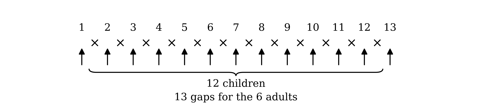
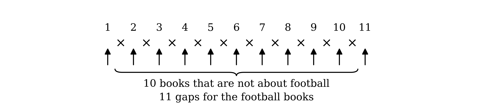

# Mark Schemes — Permutations & Combinations
**Probability** · Cambridge (CIE) A-LEVEL maths (9709)

## Exam Questions (31 questions)

### Q1
EXCELLENT has three Es, two Ls, and one each of X, C, N and T

(i)

With one E and no Ls, the other 3 letters come from X, C, N and T

`{}^{4}C_{3}`

**Final answer:** **4**

**[B1]**

(ii)

With no Ls, the selection can have 0, 1, 2 or 3 Es, with the rest chosen from X, C, N and T

*no Es: *`{}^{4}C_{4} = 1`

**[B1]**

*one E: *`{}^{4}C_{3} = 4`

*two Es: *`{}^{4}C_{2} = 6`

*three Es: *`{}^{4}C_{1} = 4`

Add the four cases

$1 + 4 + 6 + 4$

**[M1]**

**Final answer:** **15**

**[A1]**

> **[mark-scheme]**
> **B1**: 4, from `{}^{4}C_{3}`.
> 
> **B1**: One correct case value in (ii), such as `{}^{4}C_{2} = 6` for two Es.
> 
> **M1**: The values of the four correct cases (0, 1, 2 and 3 Es) added, with no incorrect or repeated cases.
> 
> **A1**: 15. All answers exact.
Find the total number of arrangements, dividing by $3 !$ for the Es and $2 !$ for the Ls

$\frac{9!}{3!\times2!} = 30  240$

**[B1]**

To keep the Es apart, first arrange the 6 other letters (with two Ls). They leave 7 gaps, including both ends, and each E goes in a different gap

The Es are identical, so choose 3 of the 7 gaps

`\dfrac{6!}{2!} \times {}^{7}C_{3} = 360 \times 35 = 12\,600`

**[M1]**

Every arrangement is equally likely, so divide by the total

$\text{P} ( \text{Es separated} ) = \frac{12600}{30240}$

**[M1]**

$\text{P} ( \text{Es separated} ) = \frac{5}{12}$

**[A1]**

> **[mark-scheme]**
> **B1**: 30 240, from $\frac{9!}{3!\times2!}$, as the total number of arrangements.
> 
> **M1**: `\dfrac{6!}{2!} \times {}^{7}C_{3}` for the arrangements with the Es separated.
> 
> **M1**: The number of arrangements with the Es separated divided by the total.
> 
> **A1**: $\frac{5}{12}$, or answers which round to 0.417.

### Q2
There are exactly 7 window seats (the A and G seats), so the 7 businesspeople fill all of them

$7 ! = 5040$

**[B1]**

The back row is row 29, but 29A is a window seat. So the trio sit in 3 of the 4 seats 29B to 29E

`{}^{4}C_{3} \times 3! = 24`

**[M1]**

The 16 cryptozoologists fill the remaining 16 seats in $16 !$ ways. Multiply the three stages

`7! \times {}^{4}C_{3} \times 3! \times 16!`

**[M1]**

**Final answer:** **2 530 820 664 852 480 000**

**[A1]**

> **[mark-scheme]**
> **B1**: $7 !$ for the businesspeople in the 7 window seats.
> 
> **M1**: `{}^{4}C_{3} \times 3!` (or `{}^{4}P_{3}`) for the trio in the back row, with 29A already taken.
> 
> **M1**: The three stages multiplied, including $16 !$ for the remaining seats.
> 
> **A1**: 2 530 820 664 852 480 000. Accept the unevaluated $7 ! \times 24 \times 16 !$ or a full calculator display such as 2.530820665 × 10¹⁸; a value rounded to 3 significant figures does not score.
With the window seats filled, the other 19 people sit in the remaining 19 seats

$19 !$

**[B1]**

The groups of three seats between the aisles are seats C, D and E in each of the 4 rows. Count the arrangements with the trio together in one of these groups

$4 \times 3 ! \times 16 !$

**[M1]**

Every arrangement is equally likely, so the probability that the trio are together is

$\text{P} ( \text{together} ) = \frac{4\times3!\times16!}{19!} = \frac{24}{19\times18\times17} = \frac{4}{969}$

**[M1]**

Subtract from 1

$\text{P} ( \text{not together} ) = 1 - \frac{4}{969}$

**[M1]**

$\text{P} ( \text{not together} ) = \frac{965}{969}$

**[A1]**

> **[mark-scheme]**
> **B1**: $19 !$ as the number of ways of seating the other 19 people.
> 
> **M1**: $4 \times 3 ! \times 16 !$ for the trio together in one of the four C, D, E groups.
> 
> **M1**: That number divided by $19 !$.
> 
> **M1**: 1 minus the probability that the trio are together.
> 
> **A1**: $\frac{965}{969}$, or answers which round to 0.996.

### Q3
With a P at each end, the 10 letters in between are H, I, P, O, O, T, A, M, U and S, with two Os

$\frac{10!}{2!}$

**[M1]**

**Final answer:** **1 814 400**

**[A1]**

> **[mark-scheme]**
> **M1**: $\frac{10!}{2!}$, with a P fixed at each end.
> 
> **A1**: 1 814 400. Exact value only.
Treat the two Os as one item, OO. There are then 11 items to arrange, with three Ps

$\frac{11!}{3!} = 6  652  800$

**[M1]**

From these, remove the arrangements where the three Ps are also all together. Treat PPP as one item too, leaving 9 different items

$9 ! = 362  880$

**[M1]**

Subtract

$6  652  800 - 362  880$

**[M1]**

**Final answer:** **6 289 920**

**[A1]**

> **[mark-scheme]**
> **M1**: $\frac{11!}{3!}$, with the two Os treated as one item.
> 
> **M1**: $9 !$, with OO and PPP each treated as one item.
> 
> **M1**: The second number subtracted from the first.
> 
> **A1**: 6 289 920. Exact value only.
The vowels in HIPPOPOTAMUS are I, O, O, A and U. Count the arrangements that start with each kind of vowel

Starting with I, A or U, the other 11 letters include three Ps and two Os

$3 \times \frac{11!}{3!\times2!}$

Starting with O, the other 11 letters include three Ps and one O

$\frac{11!}{3!}$

**[M1]**

Divide by the total number of arrangements

$\text{P} ( \text{starts with a vowel} ) = \frac{3\times\frac{11!}{3!\times2!}+\frac{11!}{3!}}{\frac{12!}{3!\times2!}} = \frac{5\times\frac{11!}{3!\times2!}}{12\times\frac{11!}{3!\times2!}}$

**[M1]**

$\text{P} ( \text{starts with a vowel} ) = \frac{5}{12}$

**[A1]**

> **[exam-tip]**
> Each of the 12 letters is equally likely to be the first letter, and 5 of them are vowels, so the probability is simply $\frac{5}{12}$. Counting arrangements works, but it is a long way round.

> **[mark-scheme]**
> **M1**: The number of arrangements starting with a vowel, $3 \times \frac{11!}{3!\times2!} + \frac{11!}{3!}$, or the 5 vowels identified among the 12 letters.
> 
> **M1**: Divided by the total $\frac{12!}{3!\times2!}$, or $\frac{5}{12}$ formed directly.
> 
> **A1**: $\frac{5}{12}$, or answers which round to 0.417.

### Q4
(i)

Choose 23 of the 28 seats, then arrange the 23 passengers in them

`{}^{28}C_{23} \times 23!`

**[M1]**

**Final answer:** **2 540 736 205 097 615 504 179 200 000**

**[A1]**

(ii)

Choose one of the 2 tables and arrange the 4 business travellers in its 4 seats. Then choose 19 of the remaining 24 seats for the other passengers and arrange them

`2 \times 4! \times {}^{24}C_{19} \times 19!`

**[M1]**

**Final answer:** **248 179 360 693 295 775 744 000**

**[A1]**

> **[mark-scheme]**
> **M1**: `{}^{28}C_{23} \times 23!`, or `{}^{28}P_{23}`, or $\frac{28!}{5!}$.
> 
> **A1**: 2 540 736 205 097 615 504 179 200 000. Accept the unevaluated form or a full calculator display such as 2.540736205 × 10²⁷; a value rounded to 3 significant figures does not score.
> 
> **M1**: `2 \times 4! \times {}^{24}C_{19} \times 19!`, or `2 \times 4! \times {}^{24}P_{19}`.
> 
> **A1**: 248 179 360 693 295 775 744 000, with the same acceptance as above.
(i)

Choose and arrange 3 of the 4 front seats for the backpackers

`{}^{4}C_{3} \times 3! = 24`

The backpackers now occupy part of both front pairs, so the teachers must share one of the other 12 pairs, in either order. The other 18 passengers fill 18 of the remaining 23 seats

`24 \times (12 \times 2) \times {}^{23}C_{18} \times 18!`

**[M1]**

Every arrangement is equally likely, so divide by the total from part (a)(i)

`\text{P} = \dfrac{24 \times 24 \times {}^{23}C_{18} \times 18!}{{}^{28}C_{23} \times 23!} = \dfrac{24 \times 24}{28 \times 27 \times 26 \times 25 \times 24}`

**[M1]**

$\text{P} = \frac{1}{20475}$

**[A1]**

(ii)

Choose a side for the children, then seat them in 12 of its 14 seats. The couple share one of the 7 pairs on the other side, in either order, and the other 9 passengers fill 9 of the remaining 14 seats

`\text{P} = \dfrac{2 \times {}^{14}C_{12} \times 12! \times (7 \times 2) \times {}^{14}C_{9} \times 9!}{{}^{28}C_{23} \times 23!}`

**[M1]**

$\text{P} = \frac{7}{20058300}$

**[A1]**

> **[mark-scheme]**
> **M1**: The favourable arrangements for (i): `{}^{4}C_{3} \times 3!` for the backpackers, $12 \times 2$ for the teachers and `{}^{23}C_{18} \times 18!` for the rest, multiplied.
> 
> **M1**: Divided by the total number of arrangements, `{}^{28}C_{23} \times 23!`.
> 
> **A1**: $\frac{1}{20475}$, or answers which round to 4.88 × 10⁻⁵.
> 
> **M1**: `2 \times {}^{14}C_{12} \times 12! \times 14 \times {}^{14}C_{9} \times 9!` divided by the total number of arrangements.
> 
> **A1**: $\frac{7}{20058300}$, or answers which round to 3.49 × 10⁻⁷.

### Q5
The digits are 0, 0, 0, 5, 5, 1, 2, 3 and 4, and the circular cards show 2, 3 and 4. A multiple of 5 ends in 0 or 5, so consider each case. In each, subtract the arrangements that start with 0

Ending in 0: the other 8 cards are 0, 0, 5, 5, 1, 2, 3, 4

$\frac{8!}{2!\times2!} - \frac{7!}{2!} = 10  080 - 2520 = 7560$

**[M1]**

Ending in 5: the other 8 cards are 0, 0, 0, 5, 1, 2, 3, 4

$\frac{8!}{3!} - \frac{7!}{2!} = 6720 - 2520 = 4200$

**[M1]**

Now count the numbers with the circular cards together. Treat 2, 3 and 4 as one block, which can be ordered in $3 !$ ways

Ending in 0, the block and 0, 0, 5, 5, 1 make 6 items

`3! \times \left(\dfrac{6!}{2! \times 2!} - \dfrac{5!}{2!}\right) = 6 \times (180 - 60) = 720`

Ending in 5, the block and 0, 0, 0, 5, 1 make 6 items

`3! \times \left(\dfrac{6!}{3!} - \dfrac{5!}{2!}\right) = 6 \times (120 - 60) = 360`

**[M1]**

Subtract these from each case

$( 7560 - 720 ) + ( 4200 - 360 ) = 6840 + 3840$

**[M1 M1]**

**Final answer:** **10 680**

**[A1]**

> **[mark-scheme]**
> **M1**: Numbers ending in 0 with no leading 0: $\frac{8!}{2!\times2!} - \frac{7!}{2!}$, or an equivalent count by first digit.
> 
> **M1**: Numbers ending in 5 with no leading 0: $\frac{8!}{3!} - \frac{7!}{2!}$, or equivalent.
> 
> **M1**: The arrangements with the circular cards together counted as a block, with $3 !$ for the order within the block, in either case.
> 
> **M1**: The arrangements with the circular cards together subtracted, in both cases.
> 
> **M1**: The two cases added.
> 
> **A1**: 10 680. Exact value only.
Both triangular cards show 0, the circular cards show 2, 3 or 4, and the rectangular cards show 5, 1 or 0. So the code contains either one 0 or two 0s

One 0: the rectangular card is 1 or 5, so the code has three different digits

$( 3 \times 2 ) \times 3 ! = 36$

**[B1]**

Two 0s: the rectangular card is the 0, so two digits are the same

$3 \times \frac{3!}{2!} = 9$

**[M1]**

Add the two cases

$36 + 9$

**Final answer:** **45**

**[A1]**

> **[mark-scheme]**
> **B1**: 36 codes with one 0, from $( 3 \times 2 ) \times 3 !$.
> 
> **M1**: $3 \times \frac{3!}{2!}$ for the codes with two 0s, added to the codes with one 0.
> 
> **A1**: 45. Exact value only.

### Q6
(i)

First arrange the 12 children

$12 !$

**[M1]**

The children leave 13 gaps, including both ends. Put each adult in a different gap so that no two adults are next to each other

Choose 6 of the 13 gaps, then arrange the 6 adults in them

`12! \times {}^{13}C_{6} \times 6!`

**[M1]**

**Final answer:** **591 816 056 832 000**

**[A1]**

(ii)

Treat each family as one block, so the 4 blocks can be ordered in $4 !$ ways. Then arrange the people within each family: the Mitchells, Kims and Millers have 4 people each, and the Lees have 6

$4 ! \times ( 4 ! \times 6 ! \times 4 ! \times 4 ! )$

**[M1]**

**Final answer:** **238 878 720**

**[A1]**

> **[mark-scheme]**
> **M1**: $12 !$ for the children.
> 
> **M1**: Multiplied by `{}^{13}C_{6} \times 6!` (or `{}^{13}P_{6}`) for placing the adults in the gaps.
> 
> **A1**: 591 816 056 832 000. Accept the unevaluated product or a full calculator display such as 5.918160568 × 10¹⁴; a value rounded to 3 significant figures does not score.
> 
> **M1**: $4 !$ for the order of the families, multiplied by $4 ! \times 6 ! \times 4 ! \times 4 !$.
> 
> **A1**: 238 878 720.
There are $18 !$ ways to seat everyone. With all the adults in the back row, the 6 adults fill those 6 seats in $6 !$ ways and the 12 children fill the other seats in $12 !$ ways

$6 ! \times 12 !$

**[M1]**

Every arrangement is equally likely, so divide by the total

$\text{P} ( \text{all adults in back row} ) = \frac{6!\times12!}{18!}$

**[M1]**

$\text{P} ( \text{all adults in back row} ) = \frac{1}{18564}$

**[A1]**

> **[exam-tip]**
> Notice that `\dfrac{6! \times 12!}{18!} = \dfrac{1}{{}^{18}C_{6}}`. There are `{}^{18}C_{6}` equally likely ways to choose the 6 seats the adults sit in, and only one of them is the back row.

> **[mark-scheme]**
> **M1**: $6 ! \times 12 !$ for the arrangements with all the adults in the back row.
> 
> **M1**: Divided by $18 !$. Also accept `\dfrac{1}{{}^{18}C_{6}}` directly.
> 
> **A1**: $\frac{1}{18564}$, or answers which round to 5.39 × 10⁻⁵.

### Q7
(i)

Order matters for a pin code, since 1234 and 2134 are different codes

**Final answer:** **Permutation**

**[B1]**

(ii)

Order does not matter, since choosing the same three students in a different order gives the same group

**Final answer:** **Combination**

**[B1]**

(iii)

Order does not matter, since the same five toppings give the same pizza whatever order they are chosen in

**Final answer:** **Combination**

**[B1]**

(iv)

Order matters, since the three roles are different: swapping the president and the treasurer gives a different outcome

**Final answer:** **Permutation**

**[B1]**

> **[mark-scheme]**
> **B1**: Permutation for the pin code.
> 
> **B1**: Combination for the three students.
> 
> **B1**: Combination for the five toppings.
> 
> **B1**: Permutation for the president, vice-president and treasurer.

### Q8
There are four identical 2s, so divide the $6 !$ arrangements by $4 !$

$\frac{6!}{4!} = 6 \times 5$

**Final answer:** **30**

**[B1]**

> **[mark-scheme]**
> **B1**: 30. Exact value only.
A number greater than 300 000 must start with the 3, which leaves 1, 2, 2, 2 and 2 to arrange in the other five places

$\frac{5!}{4!}$

**[M1]**

**Final answer:** **5**

**[A1]**

> **[mark-scheme]**
> **M1**: A 3 fixed in the first place with the remaining five cards arranged, $\frac{5!}{4!}$, or the five numbers listed.
> 
> **A1**: 5.
Each of the 30 numbers from part (a) is equally likely, so divide the answer to part (b) by the answer to part (a)

$\text{P} ( \text{greater than} 300  000 ) = \frac{5}{30}$

**[M1]**

$\text{P} ( \text{greater than} 300  000 ) = \frac{1}{6}$

**[A1]**

> **[mark-scheme]**
> **M1**: The answer to part (b) divided by the answer to part (a).
> 
> **A1**: $\frac{1}{6}$, or answers which round to 0.167. A correct follow-through from parts (a) and (b) can also score.

### Q9
The medals are different, so order matters: there are 5 choices for gold, then 4 for silver, then 3 for bronze

`5 \times 4 \times 3 = {}^{5}P_{3}`

**Final answer:** **60 ways**

**[B1]**

> **[mark-scheme]**
> **B1**: 60. Exact value only. It may come from $5 \times 4 \times 3$, `{}^{5}P_{3}` or `{}^{5}C_{3} \times 3!`.

### Q10
(i)

The 14 students are all different, so they can be arranged in $14 !$ ways

$14 !$

**Final answer:** **87 178 291 200**

**[B1]**

(ii)

The two Year 13 students can stand at the two ends in $2 !$ ways, and the other 12 students fill the middle in $12 !$ ways

$2 ! \times 12 ! = 2 \times 479  001  600$

**[M1]**

**Final answer:** **958 003 200**

**[A1]**

(iii)

The order of the year groups is fixed, so the only choice is the order of the two students within each year group

$2 ! = 2$* ways for each year group*

**[B1]**

There are seven year groups, so multiply seven of these together

$( 2 ! )^{7} = 2^{7}$

**[M1]**

**Final answer:** **128**

**[A1]**

> **[mark-scheme]**
> **B1**: 87 178 291 200. Exact value only; a rounded answer or standard form does not score.
> 
> **M1**: $2 \times 12 !$ or $2 ! \times 12 !$.
> 
> **A1**: 958 003 200.
> 
> **B1**: 2 ways (or $2 !$) of ordering the two students within a year group.
> 
> **M1**: $2^{7}$ or $( 2 ! )^{7}$, or seven 2s multiplied.
> 
> **A1**: 128.

### Q11
(i)

The order of the players does not matter, so use the formula for the number of combinations, `{}^{n}C_{r} = \dfrac{n!}{r!(n - r)!}`, with $n = 18$ and $r = 11$

`{}^{18}C_{11} = \dfrac{18!}{11! \times 7!}`

**Final answer:** **31 824**

**[B1]**

(ii)

Now the order matters. Each selection from part (i) can be arranged in $11 !$ ways

`{}^{18}C_{11} \times 11! = 31\,824 \times 11!`

**[M1]**

**Final answer:** **1 270 312 243 200**

**[A1]**

> **[mark-scheme]**
> **B1**: 31 824. Exact value only.
> 
> **M1**: `{}^{18}C_{11} \times 11!`, or `{}^{18}P_{11}`, or $\frac{18!}{7!}$.
> 
> **A1**: 1 270 312 243 200. Accept the unevaluated form or a full calculator display such as 1.270312243 × 10¹²; a value rounded to 3 significant figures does not score.
The order does not matter, so choose 4 from 11

`{}^{11}C_{4} = \dfrac{11!}{4! \times 7!}`

**Final answer:** **330**

**[B1]**

> **[mark-scheme]**
> **B1**: 330. Exact value only.

### Q12
ENTHUSIASM has 10 letters, and the S appears twice, so divide the $10 !$ arrangements by $2 !$

$\frac{10!}{2!}$

**[M1]**

**Final answer:** **1 814 400**

**[A1]**

> **[mark-scheme]**
> **M1**: $\frac{10!}{2!}$, or $10 !$ divided by 2.
> 
> **A1**: 1 814 400. Exact value only.
There are 4 consonants and 3 vowels, so they alternate only in the pattern consonant, vowel, consonant, …, consonant

The four consonants are all different, so they can fill the four C positions in $4 !$ ways

$4 ! = 24$

The vowels include two Os, so they can fill the three V positions in $\frac{3!}{2!}$ ways

$\frac{3!}{2!} = 3$

**[B1]**

Multiply, since each arrangement of the consonants can go with each arrangement of the vowels

$4 ! \times \frac{3!}{2!} = 24 \times 3$

**[M1]**

**Final answer:** **72**

**[A1]**

> **[mark-scheme]**
> **B1**: $4 !$ for the consonants or $\frac{3!}{2!}$ for the vowels seen.
> 
> **M1**: The number of consonant arrangements multiplied by the number of vowel arrangements.
> 
> **A1**: 72. Exact value only.
Find the total number of arrangements of BOREDOM, dividing by $2 !$ for the two Os

$\frac{7!}{2!} = 2520$

Each arrangement is equally likely, so divide the number of alternating arrangements from part (b) by the total

$\text{P} ( \text{alternate} ) = \frac{72}{2520}$

**[M1]**

$\text{P} ( \text{alternate} ) = \frac{1}{35}$

**[A1]**

> **[mark-scheme]**
> **M1**: The answer to part (b) divided by $\frac{7!}{2!}$ (or 2520).
> 
> **A1**: $\frac{1}{35}$. A follow-through fraction from an incorrect part (b), in its simplest form, can also score.

### Q13
Choose the 4 friends for Taxi A from all 12

`{}^{12}C_{4} = 495`

**[B1]**

Then choose 4 of the remaining 8 for Taxi B. The last 4 friends go in Taxi C

`{}^{12}C_{4} \times {}^{8}C_{4} \times {}^{4}C_{4} = 495 \times 70 \times 1`

**[M1]**

**Final answer:** **34 650**

**[A1]**

> **[mark-scheme]**
> **B1**: `{}^{12}C_{4}` (or 495) for the choice of friends for the first taxi.
> 
> **M1**: `{}^{12}C_{4} \times {}^{8}C_{4}`, with or without `\times \; {}^{4}C_{4}`. Also accept $\frac{12!}{4!\times4!\times4!}$.
> 
> **A1**: 34 650. Exact value only.

### Q14
(i)

$5 !$ is the product of all the integers from 1 to 5

$5 ! = 5 \times 4 \times 3 \times 2 \times 1$

$5 ! = 120$

**[B1]**

(ii)

There are 5 choices for the first digit, then 4 for the second, and so on

$5 \times 4 \times 3 \times 2 \times 1 = 5 !$

**Final answer:** **120 distinct codes**

**[B1]**

> **[mark-scheme]**
> **B1**: $5 \times 4 \times 3 \times 2 \times 1$ written out in full, leading to 120. Because the result is given, the full product must be seen.
> 
> **B1**: 120 codes, from $5 !$ or $5 \times 4 \times 3 \times 2 \times 1$.
(i)

Write both factorials in full, then cancel the common factors $5 \times 4 \times 3 \times 2 \times 1$

$\frac{7!}{5!} = \frac{7\times6\times5\times4\times3\times2\times1}{5\times4\times3\times2\times1}$

$\frac{7!}{5!} = 7 \times 6$

**[B1]**

(ii)

In the same way, every factor of $( n - 2 ) !$ cancels, leaving the two largest factors of $n !$

$\frac{n!}{(n-2)!} = \frac{n\times(n-1)\times(n-2)\times\dots\times2\times1}{(n-2)\times\dots\times2\times1}$

$\frac{n!}{(n-2)!} = n ( n - 1 )$

**[B1]**

(iii)

The seven digits include five identical 1s, so divide the $7 !$ arrangements by the $5 !$ ways of arranging the 1s among themselves

$\frac{7!}{5!} = 7 \times 6$

**Final answer:** **42 distinct codes**

**[B1]**

> **[mark-scheme]**
> **B1**: Both factorials written in full with the common factors cancelled, leading to $7 \times 6$. Because the result is given, the cancelling must be seen.
> 
> **B1**: $n ( n - 1 )$, or the equivalent $n^{2} - n$.
> 
> **B1**: 42 codes. Accept a correct method such as $\frac{7!}{5!}$ or $7 \times 6$ (7 positions for the 2, then 6 for the 3).
Compare the letters in the two words

*All five letters in MATHS are different, but STATS has two Ss and two Ts, so swapping the two Ss or the two Ts gives the same arrangement*

**Final answer:** **So some arrangements of STATS are identical, and STATS has fewer distinct arrangements than MATHS**

**[B1]**

Divide the $5 !$ arrangements by $2 !$ for the two Ss and by $2 !$ for the two Ts

$\frac{5!}{2!\times2!} = \frac{120}{4}$

**[M1]**

**Final answer:** **30 distinct arrangements**

**[A1]**

> **[mark-scheme]**
> **B1**: Explanation that STATS contains repeated letters (two Ss and two Ts), so some arrangements are identical, whereas all the letters of MATHS are different.
> 
> **M1**: $\frac{5!}{2!\times2!}$, or $5 !$ divided by $2 !$ for each repeated letter.
> 
> **A1**: 30. Exact value only.

### Q15
(i)

Choose 1 of the 4 tetras, 1 of the 6 guppies and 1 of the 2 platies

`{}^{4}C_{1} \times {}^{6}C_{1} \times {}^{2}C_{1} = 4 \times 6 \times 2`

**[M1]**

**Final answer:** **48**

**[A1]**

(ii)

Choose 1 of the 4 tetras and 2 of the 6 guppies

`{}^{4}C_{1} \times {}^{6}C_{2} = 4 \times 15`

**[M1]**

**Final answer:** **60**

**[A1]**

(iii)

Choose 2 of the 4 tetras, then 1 of the 8 fish that are not tetras (6 guppies and 2 platies)

`{}^{4}C_{2} \times {}^{8}C_{1} = 6 \times 8`

**[M1]**

**Final answer:** **48**

**[A1]**

> **[mark-scheme]**
> **M1**: `{}^{4}C_{1} \times {}^{6}C_{1} \times {}^{2}C_{1}`, or $4 \times 6 \times 2$.
> 
> **A1**: 48.
> 
> **M1**: `{}^{4}C_{1} \times {}^{6}C_{2}`, or $4 \times 15$.
> 
> **A1**: 60.
> 
> **M1**: `{}^{4}C_{2} \times {}^{8}C_{1}`, or the two cases added: `{}^{4}C_{2} \times {}^{6}C_{1} + {}^{4}C_{2} \times {}^{2}C_{1}`.
> 
> **A1**: 48. All answers exact.

### Q16
(i)

Choose any 5 of the 12 questions

`{}^{12}C_{5} = \dfrac{12!}{5! \times 7!}`

**Final answer:** **792**

**[B1]**

(ii)

"At least 3 from Section A" means 3 or 4 from Section A, with the rest from Section B

*3 from A: *`{}^{4}C_{3} \times {}^{8}C_{2} = 4 \times 28 = 112`

*4 from A: *`{}^{4}C_{4} \times {}^{8}C_{1} = 1 \times 8 = 8`

$112 + 8$

**[M1]**

**Final answer:** **120**

**[A1]**

> **[mark-scheme]**
> **B1**: 792.
> 
> **M1**: `{}^{4}C_{3} \times {}^{8}C_{2} + {}^{4}C_{4} \times {}^{8}C_{1}`, with no incorrect or repeated cases.
> 
> **A1**: 120. All answers exact.
Case 1: Question 1 of Section A is chosen. The other 4 questions all come from the 8 in Section B

`{}^{8}C_{4} = 70`

**[B1]**

Case 2: Question 1 of Section A is not chosen. Question 1 of Section B is fixed, so 4 more questions are needed: 2 or 3 from the other 3 questions in Section A, and the rest from the other 7 questions in Section B

*2 from A: *`{}^{3}C_{2} \times {}^{7}C_{2} = 3 \times 21 = 63`

*3 from A: *`{}^{3}C_{3} \times {}^{7}C_{1} = 1 \times 7 = 7`

**[M1]**

Add all the cases

$70 + 63 + 7$

**[M1]**

**Final answer:** **140**

**[A1]**

> **[mark-scheme]**
> **B1**: 70, from `{}^{8}C_{4}`, for the case where Question 1 of Section A is chosen.
> 
> **M1**: At least one correct product for the case where Question 1 of Section A is not chosen, using the 3 remaining Section A questions and the 7 remaining Section B questions.
> 
> **M1**: The values of the three correct cases added, with no incorrect or repeated cases.
> 
> **A1**: 140. Exact value only.

### Q17
(i)

The 3 Mathematics textbooks are identical, so divide $15 !$ by $3 !$

$\frac{15!}{3!}$

**Final answer:** **217 945 728 000**

**[B1]**

(ii)

First arrange the 10 books that are not about football, which include the 3 identical Mathematics textbooks

$\frac{10!}{3!} = 604  800$

**[M1]**

These 10 books leave 11 gaps, including both ends. Put each football book in a different gap so that no two are next to each other

Choose 5 of the 11 gaps, then arrange the 5 different football books in them

`\dfrac{10!}{3!} \times {}^{11}C_{5} \times 5! = 604\,800 \times 462 \times 120`

**[M1]**

**Final answer:** **33 530 112 000**

**[A1]**

(iii)

With a Mathematics textbook at each end, the 13 books in between are all different (7 GeoGebra, 5 football and 1 Mathematics textbook)

$13 !$

**Final answer:** **6 227 020 800**

**[B1]**

> **[mark-scheme]**
> **B1**: 217 945 728 000, from $\frac{15!}{3!}$.
> 
> **M1**: $\frac{10!}{3!}$ for the books that are not about football.
> 
> **M1**: Multiplied by `{}^{11}C_{5} \times 5!` (or `{}^{11}P_{5}`) for placing the football books in the gaps.
> 
> **A1**: 33 530 112 000.
> 
> **B1**: 6 227 020 800, from $13 !$. All answers exact.
(i)

The Mathematics textbooks are identical, so there is only one way to choose one of them

$7 \times 5 \times 1$

**Final answer:** **35**

**[B1]**

(ii)

Three different books can include at most one Mathematics textbook. So choose from 13 different books: the 7 GeoGebra books, the 5 football books and one Mathematics textbook

`{}^{13}C_{3}`

**[M1]**

**Final answer:** **286**

**[A1]**

> **[mark-scheme]**
> **B1**: 35.
> 
> **M1**: `{}^{13}C_{3}`, or the two cases added: `{}^{12}C_{3} + {}^{12}C_{2}` (no Mathematics textbook, or one).
> 
> **A1**: 286. All answers exact.

### Q18
POSITIVITY has three Is, two Ts, and one each of P, O, S, V and Y. Divide $10 !$ by $3 !$ for the Is and $2 !$ for the Ts

$\frac{10!}{3!\times2!}$

**[M1]**

**Final answer:** **302 400**

**[A1]**

> **[mark-scheme]**
> **M1**: $\frac{10!}{3!\times2!}$.
> 
> **A1**: 302 400. Exact value only.
(i)

Treat the three Is as one item, III. There are then 8 items to arrange, with two Ts

$\frac{8!}{2!}$

**[M1]**

**Final answer:** **20 160**

**[A1]**

(ii)

First find the arrangements with the two Ts together. Treat TT as one item, which leaves 9 items with three Is

$\frac{9!}{3!} = 60  480$

**[M1]**

Subtract these from the total in part (a)

$302  400 - 60  480$

**[M1]**

**Final answer:** **241 920**

**[A1]**

> **[mark-scheme]**
> **M1**: $\frac{8!}{2!}$, with the three Is treated as one item.
> 
> **A1**: 20 160.
> 
> **M1**: $\frac{9!}{3!}$ for the arrangements with the Ts together.
> 
> **M1**: That number subtracted from the answer to part (a).
> 
> **A1**: 241 920.
> 
> Alternative method for (ii): arrange the 8 letters other than the Ts in $\frac{8!}{3!}$ ways (M1), then place the two Ts in 2 of the 9 gaps, `\dfrac{8!}{3!} \times {}^{9}C_{2}` (M1), leading to 241 920 (A1). All answers exact.
First count the arrangements with the vowels all together. The vowel block O, I, I, I can be arranged in $\frac{4!}{3!}$ ways

$\frac{4!}{3!} = 4$

**[B1]**

The block and the 6 consonants (with two Ts) make 7 items

$4 \times \frac{7!}{2!} = 4 \times 2520 = 10  080$

**[M1]**

Every arrangement is equally likely, so subtract the probability that the vowels are all together from 1

$\text{P} ( \text{not all together} ) = 1 - \frac{10080}{302400}$

**[M1]**

$\text{P} ( \text{not all together} ) = \frac{29}{30}$

**[A1]**

> **[mark-scheme]**
> **B1**: 4 ways of arranging the vowels within the block, from $\frac{4!}{3!}$.
> 
> **M1**: The number of arrangements of the block and the consonants, $\frac{7!}{2!}$, multiplied by the number of arrangements within the block.
> 
> **M1**: 1 minus their number of arrangements with the vowels together divided by the answer to part (a). Equivalently, (total − together) ÷ total.
> 
> **A1**: $\frac{29}{30}$, or answers which round to 0.967.

### Q19
CALIFORNIA has two As, two Is, and one each of C, L, F, O, R and N

(i)

With no As and no Is, all 4 letters come from the 6 single letters

`{}^{6}C_{4}`

**Final answer:** **15**

**[B1]**

(ii)

The As are identical, so there is one way to include one A. Choose the other 3 letters from the 6 single letters

`{}^{6}C_{3}`

**Final answer:** **20**

**[B1]**

(iii)

With exactly one A, the other 3 letters can include 0, 1 or 2 Is. Find each case

*no Is: *`{}^{6}C_{3} = 20`

*one I: *`{}^{6}C_{2} = 15`

*two Is: *`{}^{6}C_{1} = 6`

Add the three cases

$20 + 15 + 6$

**[M1]**

**Final answer:** **41**

**[A1]**

> **[mark-scheme]**
> **B1**: 15, from `{}^{6}C_{4}`.
> 
> **B1**: 20, from `{}^{6}C_{3}`.
> 
> **M1**: The values of the three correct cases (0, 1 and 2 Is) added, with no incorrect or repeated cases.
> 
> **A1**: 41. All answers exact.
The word contains 8 different letters: C, A, L, I, F, O, R and N

**[B1]**

Choose 4 of these 8 letters, then arrange each selection in $4 !$ ways

`{}^{8}C_{4} \times 4! = 70 \times 24`

**[M1]**

**Final answer:** **1680**

**[A1]**

> **[mark-scheme]**
> **B1**: 8 different letters identified.
> 
> **M1**: `{}^{8}C_{4} \times 4!`, or `{}^{8}P_{4}`, or $8 \times 7 \times 6 \times 5$.
> 
> **A1**: 1680. Exact value only.

### Q20
List every case of (acacia, banyan, cedar) with a total of 6, at most 3 of each type and at least 1 cedar. There are only 2 banyan samples

*(3, 2, 1): *`{}^{4}C_{3} \times {}^{2}C_{2} \times {}^{3}C_{1} = 4 \times 1 \times 3 = 12`

**[B1]**

*(3, 1, 2): *`{}^{4}C_{3} \times {}^{2}C_{1} \times {}^{3}C_{2} = 4 \times 2 \times 3 = 24`

*(3, 0, 3): *`{}^{4}C_{3} \times {}^{2}C_{0} \times {}^{3}C_{3} = 4 \times 1 \times 1 = 4`

*(2, 2, 2): *`{}^{4}C_{2} \times {}^{2}C_{2} \times {}^{3}C_{2} = 6 \times 1 \times 3 = 18`

*(2, 1, 3): *`{}^{4}C_{2} \times {}^{2}C_{1} \times {}^{3}C_{3} = 6 \times 2 \times 1 = 12`

*(1, 2, 3): *`{}^{4}C_{1} \times {}^{2}C_{2} \times {}^{3}C_{3} = 4 \times 1 \times 1 = 4`

**[M1]**

Add the six cases

$12 + 24 + 4 + 18 + 12 + 4$

**[M1]**

**Final answer:** **74**

**[A1]**

> **[mark-scheme]**
> **B1**: One correct case value, such as `{}^{4}C_{3} \times {}^{2}C_{1} \times {}^{3}C_{2} = 24`.
> 
> **M1**: Cases that meet the conditions, each written as a product of three combinations.
> 
> **M1**: The values of the six correct cases added, with no incorrect or repeated cases.
> 
> **A1**: 74. Exact value only.
The 6 samples are all different, so there are $6 !$ arrangements in total

$6 ! = 720$

Treat the two banyan samples as one item to count the arrangements with them together. The pair can be in either order

$2 ! \times 5 ! = 240$

**[M1]**

Subtract these from the total

$720 - 240$

**[M1]**

**Final answer:** **480**

**[A1]**

> **[mark-scheme]**
> **M1**: $2 ! \times 5 !$ (or 240) for the arrangements with the banyan samples together.
> 
> **M1**: That number subtracted from $6 !$.
> 
> **A1**: 480. Exact value only.
> 
> Alternative method: arrange the other 4 samples in $4 !$ ways (M1), then place the 2 banyan samples in 2 of the 5 gaps, `4! \times {}^{5}P_{2}` (M1), leading to 480 (A1).

### Q21
(i)

With 19 songs, the middle song is the 10th. The 3 country songs fill places 1, 10 and 19 in $3 !$ ways, and the other 16 songs fill the remaining places in $16 !$ ways

$3 ! \times 16 !$

**[M1]**

**Final answer:** **125 536 739 328 000**

**[A1]**

(ii)

The order of the four types is fixed, so only the order within each type can change

$3 ! \times 3 ! \times 5 ! \times 8 !$

**[M1]**

**Final answer:** **174 182 400**

**[A1]**

> **[mark-scheme]**
> **M1**: $3 ! \times 16 !$.
> 
> **A1**: 125 536 739 328 000. Accept the unevaluated $3 ! \times 16 !$ or a full calculator display such as 1.255367393 × 10¹⁴; a value rounded to 3 significant figures does not score.
> 
> **M1**: $3 ! \times 3 ! \times 5 ! \times 8 !$.
> 
> **A1**: 174 182 400. Exact value only.
Choose and order 2 of the 3 blues songs for the first two places

`{}^{3}C_{2} \times 2! = 6`

**[B1]**

The ten alternating songs are 5 afrobeats and 5 drum and bass. All 5 afrobeats songs are used, in $5 !$ orders, and 5 of the 8 drum and bass songs are chosen and ordered in `{}^{8}C_{5} \times 5!` ways

`5! \times {}^{8}C_{5} \times 5! = 120 \times 6720`

**[M1]**

The alternating songs can start with afrobeats or with drum and bass, so multiply by 2

$6 \times 2 \times 120 \times 6720$

**[M1]**

**Final answer:** **9 676 800**

**[A1]**

> **[mark-scheme]**
> **B1**: 6 ways for the two blues songs, from `{}^{3}C_{2} \times 2!` or `{}^{3}P_{2}`.
> 
> **M1**: `5! \times {}^{8}C_{5} \times 5!` (or `5! \times {}^{8}P_{5}`) for the alternating songs.
> 
> **M1**: Multiplied by 2 for the two possible starting types, and by the number of ways for the blues songs.
> 
> **A1**: 9 676 800. Exact value only.

### Q22
Choose the 4 candidates for Group A from all 15

`{}^{15}C_{4} = 1365`

**[B1]**

Then choose 4 of the remaining 11 for Group B and 4 of the remaining 7 for Group C. The last 3 candidates form Group D

`{}^{15}C_{4} \times {}^{11}C_{4} \times {}^{7}C_{4} \times {}^{3}C_{3} = 1365 \times 330 \times 35 \times 1`

**[M1]**

**Final answer:** **15 765 750**

**[A1]**

> **[mark-scheme]**
> **B1**: `{}^{15}C_{4}` (or 1365) for the first group.
> 
> **M1**: `{}^{15}C_{4} \times {}^{11}C_{4} \times {}^{7}C_{4}`, with or without `\times \; {}^{3}C_{3}`. Also accept $\frac{15!}{4!\times4!\times4!\times3!}$.
> 
> **A1**: 15 765 750. Exact value only.
Excluding the brother and sister leaves 8 other men and 5 other women. Consider the two cases

Both in the team: choose 1 more man and 1 more woman

`{}^{8}C_{1} \times {}^{5}C_{1} = 8 \times 5 = 40`

**[B1]**

Both out of the team: choose 2 men and 2 women from the others

`{}^{8}C_{2} \times {}^{5}C_{2} = 28 \times 10 = 280`

Add the two cases

$40 + 280$

**[M1]**

**Final answer:** **320**

**[A1]**

> **[mark-scheme]**
> **B1**: One correct case value: `{}^{8}C_{1} \times {}^{5}C_{1} = 40` or `{}^{8}C_{2} \times {}^{5}C_{2} = 280`.
> 
> **M1**: The values of the two correct cases added, with no incorrect or repeated cases.
> 
> **A1**: 320. Exact value only.

### Q23
The odd cards are 1, 3, 5, 5 and 5, and the even cards are 2, 2, 6 and 8

(i)

With 5 odd and 4 even cards, the odd cards can only be kept apart by the pattern O E O E O E O E O. Arrange the odd cards (three 5s) and the even cards (two 2s) in their places

$\frac{5!}{3!} \times \frac{4!}{2!} = 20 \times 12$

**[M1]**

**Final answer:** **240**

**[A1]**

(ii)

Treat the 5 odd cards as one block, which can be arranged in $\frac{5!}{3!}$ ways. The block and the 4 even cards make 5 items, with two 2s

$\frac{5!}{3!} \times \frac{5!}{2!} = 20 \times 60$

**[M1]**

**Final answer:** **1200**

**[A1]**

> **[mark-scheme]**
> **M1**: $\frac{5!}{3!} \times \frac{4!}{2!}$.
> 
> **A1**: 240.
> 
> **M1**: $\frac{5!}{3!} \times \frac{5!}{2!}$, with the odd cards treated as one block.
> 
> **A1**: 1200. All answers exact.
(i)

There are 6 different digits: 1, 2, 3, 5, 6 and 8. Choose 4 of them, then arrange them in $4 !$ ways

`{}^{6}C_{4} \times 4! = 15 \times 24`

**[M1]**

**Final answer:** **360**

**[A1]**

(ii)

The other two cards come from 1, 3, 5, 5, 5, 6 and 8. Split by the number of 5s

*two 5s: *$\frac{4!}{2!\times2!} = 6$

**[B1]**

*one 5: *`{}^{4}C_{1} \times \dfrac{4!}{2!} = 4 \times 12 = 48`

*no 5s: *`{}^{4}C_{2} \times \dfrac{4!}{2!} = 6 \times 12 = 72`

**[M1]**

Add the three cases

$6 + 48 + 72$

**[M1]**

**Final answer:** **126**

**[A1]**

> **[mark-scheme]**
> **M1**: `{}^{6}C_{4} \times 4!`, or `{}^{6}P_{4}`, or $6 \times 5 \times 4 \times 3$.
> 
> **A1**: 360.
> 
> **B1**: One correct case value, such as $\frac{4!}{2!\times2!} = 6$ for 2, 2, 5, 5.
> 
> **M1**: Each case with one or no 5s counted as the choice of the other digits multiplied by $\frac{4!}{2!}$.
> 
> **M1**: The values of the three correct cases added, with no incorrect or repeated cases. Also accept `{}^{5}C_{2} \times \dfrac{4!}{2!} + \dfrac{4!}{2! \times 2!} = 120 + 6`.
> 
> **A1**: 126. All answers exact.

### Q24
The black ball is fixed in the last place, so only the order of the other 14 balls can change

$14 !$

**[M1]**

**Final answer:** **87 178 291 200**

**[A1]**

> **[mark-scheme]**
> **M1**: $14 !$, with the black ball fixed last.
> 
> **A1**: 87 178 291 200. Exact value only.
(i)

The 7 striped balls can be ordered in $7 !$ ways and the 7 spotted balls in $7 !$ ways. Either type can go first, so multiply by 2

$2 \times 7 ! \times 7 !$

**[M1]**

**Final answer:** **50 803 200**

**[A1]**

(ii)

Treat each coloured pair as one block. The 7 blocks can be ordered in $7 !$ ways

$7 ! = 5040$

**[M1]**

Within each block the two balls can be potted in 2 ways, so multiply by 2 for each of the 7 pairs

$7 ! \times 2^{7} = 5040 \times 128$

**[M1]**

**Final answer:** **645 120**

**[A1]**

> **[mark-scheme]**
> **M1**: $7 ! \times 7 !$ multiplied by 2.
> 
> **A1**: 50 803 200.
> 
> **M1**: $7 !$ for the order of the seven coloured pairs.
> 
> **M1**: Multiplied by $2^{7}$ (or $( 2 ! )^{7}$) for the order within each pair.
> 
> **A1**: 645 120. All answers exact.

### Q25
(i)

Apart from the two identical Is, REVISION has 6 different letters: R, E, V, S, O and N. With no Is, choose all 3 letters from these 6

`{}^{6}C_{3} = \dfrac{6!}{3! \times 3!}`

**[M1]**

**Final answer:** **20**

**[A1]**

(ii)

The Is are identical, so there is only one way to include one I. Choose the other 2 letters from the 6

`{}^{6}C_{2} = \dfrac{6!}{2! \times 4!}`

**Final answer:** **15**

**[A1]**

(iii)

Both Is are in the selection, so choose the third letter from the 6

`{}^{6}C_{1}`

**Final answer:** **6**

**[A1]**

> **[mark-scheme]**
> **M1**: A combination `{}^{6}C_{r}` for choosing the other letters from the 6 letters R, E, V, S, O and N, in any of the three sub-parts.
> 
> **A1**: 20.
> 
> **A1**: 15.
> 
> **A1**: 6. All answers exact.
Each of the 15 selections from part (a)(ii) contains three different letters, so each can be arranged in $3 !$ ways

$15 \times 3 ! = 15 \times 6$

**[M1]**

**Final answer:** **90**

**[A1]**

> **[mark-scheme]**
> **M1**: The answer to part (a)(ii) multiplied by $3 !$. Also accept $3 \times 6 \times 5$ (3 positions for the I, then 6 and 5 choices for the other two letters), or `3 \times {}^{6}P_{2}`.
> 
> **A1**: 90. A correct follow-through from part (a)(ii) can also score.

### Q26
(i)

The number must start with the 5. The other 7 cards are 1, 2, 2, 3, 4, 4 and 4, with two 2s and three 4s

$\frac{7!}{2!\times3!}$

**[M1]**

**Final answer:** **420**

**[A1]**

(ii)

An odd number ends in 1, 3 or 5. In each case the other 7 cards still include two 2s and three 4s

$3 \times \frac{7!}{2!\times3!}$

**[M1]**

**Final answer:** **1260**

**[A1]**

(iii)

The 5 is at the start, so the number must end in 1 or 3. The 6 cards in between include two 2s and three 4s

$2 \times \frac{6!}{2!\times3!}$

**[M1]**

**Final answer:** **120**

**[A1]**

> **[mark-scheme]**
> **M1**: $\frac{7!}{2!\times3!}$, with the 5 fixed first.
> 
> **A1**: 420.
> 
> **M1**: $3 \times \frac{7!}{2!\times3!}$, or three cases of $\frac{7!}{2!\times3!}$ added.
> 
> **A1**: 1260.
> 
> **M1**: $2 \times \frac{6!}{2!\times3!}$, with the 5 first and a 1 or 3 last.
> 
> **A1**: 120. All answers exact.
Find the total number of different 8-digit numbers, dividing $8 !$ by $2 !$ for the 2s and by $3 !$ for the 4s

$\frac{8!}{2!\times3!} = 3360$

Every number is equally likely, so divide the answer to part (a)(iii) by this total

$\text{P} ( \text{odd and greater than} 50  000  000 ) = \frac{120}{3360}$

**[M1]**

$\text{P} ( \text{odd and greater than} 50  000  000 ) = \frac{1}{28}$

**[A1]**

> **[mark-scheme]**
> **M1**: The answer to part (a)(iii) divided by $\frac{8!}{2!\times3!}$ (or 3360).
> 
> **A1**: $\frac{1}{28}$, or answers which round to 0.0357. A correct follow-through from part (a)(iii) can also score.

### Q27
(i)

The 12 textbooks are all different

$12 !$

**Final answer:** **479 001 600**

**[B1]**

(ii)

Arrange the 5 Statistics textbooks in the first five places and the 7 Pure textbooks in the last seven places

$5 ! \times 7 !$

**[M1]**

**Final answer:** **604 800**

**[A1]**

(iii)

The two groups can now be in either order, Statistics first or Pure first, so multiply part (ii) by 2

$2 \times 5 ! \times 7 !$

**[M1]**

**Final answer:** **1 209 600**

**[A1]**

(iv)

Treat the 5 Statistics textbooks as one block. The block and the 7 Pure textbooks make 8 items, and the Statistics textbooks can be arranged within the block in $5 !$ ways

$8 ! \times 5 !$

**[M1]**

**Final answer:** **4 838 400**

**[A1]**

> **[mark-scheme]**
> **B1**: 479 001 600.
> 
> **M1**: $5 ! \times 7 !$.
> 
> **A1**: 604 800.
> 
> **M1**: $2 \times 5 ! \times 7 !$, or 2 times the answer to (ii).
> 
> **A1**: 1 209 600.
> 
> **M1**: $8 ! \times 5 !$, with the Statistics textbooks treated as one item.
> 
> **A1**: 4 838 400. All answers exact.

### Q28
The list has 8 places. Country A and Country B each appear twice, so divide $8 !$ by $2 !$ for each of them

$\frac{8!}{2!\times2!}$

**[M1]**

**Final answer:** **10 080**

**[A1]**

> **[mark-scheme]**
> **M1**: $\frac{8!}{2!\times2!}$.
> 
> **A1**: 10 080. Exact value only.
With Country A in first place, the other 7 places hold one Country A, two Country B and the four other countries

$\frac{7!}{2!} = 2520$

Every order in part (a) is equally likely, so divide by the total from part (a)

$\text{P} ( \text{Country A first} ) = \frac{2520}{10080}$

**[M1]**

$\text{P} ( \text{Country A first} ) = \frac{1}{4}$

**[A1]**

> **[exam-tip]**
> There is a much quicker route here. Each of the 8 competitors is equally likely to finish first, and 2 of them are from Country A, so the probability is $\frac{2}{8}$. Both methods score full marks.

> **[mark-scheme]**
> **M1**: $\frac{7!}{2!}$ divided by the answer to part (a), or $\frac{2}{8}$.
> 
> **A1**: $\frac{1}{4}$, or 0.25.

### Q29
With four toys and at least one of each type, he has two of one type and one of each of the other two. Find each case

*2 dinosaurs, 1 car, 1 reptile: *`{}^{9}C_{2} \times {}^{6}C_{1} \times {}^{5}C_{1} = 36 \times 6 \times 5 = 1080`

**[B1]**

*1 dinosaur, 2 cars, 1 reptile: *`{}^{9}C_{1} \times {}^{6}C_{2} \times {}^{5}C_{1} = 9 \times 15 \times 5 = 675`

*1 dinosaur, 1 car, 2 reptiles: *`{}^{9}C_{1} \times {}^{6}C_{1} \times {}^{5}C_{2} = 9 \times 6 \times 10 = 540`

**[M1]**

Add the three cases

$1080 + 675 + 540$

**[M1]**

**Final answer:** **2295**

**[A1]**

> **[mark-scheme]**
> **B1**: One correct case value, such as `{}^{9}C_{2} \times {}^{6}C_{1} \times {}^{5}C_{1} = 1080`.
> 
> **M1**: Each case written as a product of three combinations, one for each type of toy.
> 
> **M1**: The values of the three correct cases added, with no incorrect or repeated cases.
> 
> **A1**: 2295. Exact value only.
With only 2 dinosaurs, the other 3 toys would include at least 2 cars or at least 2 reptiles, so he must take at least 3 dinosaurs. List every case of (dinosaurs, cars, reptiles)

*(3, 2, 0): *`{}^{9}C_{3} \times {}^{6}C_{2} \times {}^{5}C_{0} = 84 \times 15 \times 1 = 1260`

**[B1]**

*(3, 0, 2): *`{}^{9}C_{3} \times {}^{6}C_{0} \times {}^{5}C_{2} = 84 \times 1 \times 10 = 840`

*(3, 1, 1): *`{}^{9}C_{3} \times {}^{6}C_{1} \times {}^{5}C_{1} = 84 \times 6 \times 5 = 2520`

*(4, 1, 0): *`{}^{9}C_{4} \times {}^{6}C_{1} \times {}^{5}C_{0} = 126 \times 6 \times 1 = 756`

*(4, 0, 1): *`{}^{9}C_{4} \times {}^{6}C_{0} \times {}^{5}C_{1} = 126 \times 1 \times 5 = 630`

*(5, 0, 0): *`{}^{9}C_{5} \times {}^{6}C_{0} \times {}^{5}C_{0} = 126 \times 1 \times 1 = 126`

**[M1]**

Add the six cases

$1260 + 840 + 2520 + 756 + 630 + 126$

**[M1]**

**Final answer:** **6132**

**[A1]**

> **[mark-scheme]**
> **B1**: One correct case value, such as `{}^{9}C_{3} \times {}^{6}C_{1} \times {}^{5}C_{1} = 2520`.
> 
> **M1**: Cases with at least 3 dinosaurs identified, each written as a product of three combinations.
> 
> **M1**: The values of the six correct cases added, with no incorrect or repeated cases.
> 
> **A1**: 6132. Exact value only.

### Q30
(i)

SAVEMYEXAMS has 11 letters: S, A, E and M each appear twice, and V, Y and X once each. Divide $11 !$ by $2 !$ for each repeated letter

$\frac{11!}{2!\times2!\times2!\times2!}$

**[M1]**

**Final answer:** **2 494 800**

**[A1]**

(ii)

With an S fixed at each end, arrange the other 9 letters (two As, two Es, two Ms, V, Y and X) in the middle

$\frac{9!}{2!\times2!\times2!}$

**[M1]**

**Final answer:** **45 360**

**[A1]**

(iii)

Treat the two As as a single item, AA. There are then 10 items to arrange, with S, E and M each appearing twice

$\frac{10!}{2!\times2!\times2!}$

**[M1]**

**Final answer:** **453 600**

**[A1]**

> **[mark-scheme]**
> **M1**: $\frac{11!}{2!\times2!\times2!\times2!}$. The divisor must have a $2 !$ for each of the four repeated letters.
> 
> **A1**: 2 494 800. Exact value only.
> 
> **M1**: $\frac{9!}{2!\times2!\times2!}$, with the two Ss fixed at the ends.
> 
> **A1**: 45 360.
> 
> **M1**: $\frac{10!}{2!\times2!\times2!}$, with the two As treated as one item.
> 
> **A1**: 453 600.
MYEXAMSSAVE is one of the 2 494 800 equally likely arrangements found in part (a)(i)

$\text{P} ( \text{MYEXAMSSAVE} ) = \frac{1}{2494800}$

**[B1]**

> **[mark-scheme]**
> **B1**: $\frac{1}{2494800}$, or 1 over the answer to part (a)(i). Accept 4.01 × 10⁻⁷.

### Q31
(i)

Both mostly white puppies are included, so choose the other 3 puppies from the remaining 9

`{}^{9}C_{3} = \dfrac{9!}{3! \times 6!}`

**Final answer:** **84**

**[B1]**

(ii)

With no mixed puppies, all 5 come from the 2 mostly white and 4 mostly black puppies, which is 6 puppies

`{}^{6}C_{5}`

**[M1]**

**Final answer:** **6**

**[A1]**

(iii)

"At least two" means 2, 3 or 4 mostly black puppies, with the rest chosen from the 7 puppies that are not mostly black

*2 black: *`{}^{4}C_{2} \times {}^{7}C_{3} = 6 \times 35 = 210`

**[B1]**

*3 black: *`{}^{4}C_{3} \times {}^{7}C_{2} = 4 \times 21 = 84`

*4 black: *`{}^{4}C_{4} \times {}^{7}C_{1} = 1 \times 7 = 7`

Add the three cases

$210 + 84 + 7$

**[M1]**

**Final answer:** **301**

**[A1]**

> **[mark-scheme]**
> **B1**: 84, from `{}^{9}C_{3}`.
> 
> **M1**: `{}^{6}C_{5}`, or 5 chosen from the 6 puppies that are not mixed.
> 
> **A1**: 6.
> 
> **B1**: One correct case value, such as `{}^{4}C_{2} \times {}^{7}C_{3} = 210`.
> 
> **M1**: The values of the three correct cases (2, 3 and 4 mostly black) added, with no incorrect or repeated cases. Alternatively, `{}^{11}C_{5}` minus the cases with 0 and 1 mostly black: $462 - 21 - 140$.
> 
> **A1**: 301. All answers exact.
