# Mark Schemes — Normal Distribution
**Statistical Distributions** · Cambridge (CIE) A-LEVEL maths (9709)

## Exam Questions (26 questions)

### Q1
Let $X$ be the mass of a vase, in kg, so `X \sim \text{N}(\mu, \; \sigma^{2})`

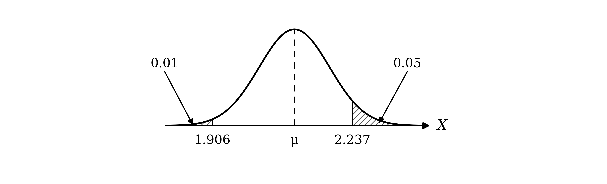

The area to the left of 2.237 is 0.95, which is in the table of critical values for the normal distribution in the formula booklet

$z_{1} = 1 . 645$

**[B1]**

The area to the left of 1.906 is 0.01, so 1.906 is below the mean. By symmetry its $z$-value is the negative of the critical value for 0.99

$z_{2} = - 2 . 326$

**[B1]**

Standardise using the formula

$Z = \frac{X-μ}{σ}$

Substitute each value and set the result equal to its $z$-value

$\frac{2.237-μ}{σ} = 1 . 645$

**[M1]**

$\frac{1.906-μ}{σ} = - 2 . 326$

Rearrange each equation

$μ + 1 . 645 σ = 2 . 237$

$μ - 2 . 326 σ = 1 . 906$

Subtract the second equation from the first to eliminate $μ$

$3 . 971 σ = 0 . 331$

**[M1]**

$σ = \frac{0.331}{3.971} = 0 . 083354 \dots$

Substitute into the first equation

$μ = 2 . 237 - 1 . 645 \times 0 . 083354 \dots = 2 . 09988 \dots$

**Final answer:** $\text{Mean} = 2 . 10 \text{kg}$**, **$\text{standard deviation} = 0 . 0834 \text{kg}$** (3 s.f.)**

**[A1]**

> **[mark-scheme]**
> **B1**: z = 1.645 or −1.645 seen.
> 
> **B1**: z = −2.326 or 2.326 seen.
> 
> **M1**: A standardisation with μ and σ and 2.237 or 1.906, equated to a z-value. Equating to 0.95, 0.05, 0.99 or 0.01, or using σ², does not score.
> 
> **M1**: Solving their two equations by elimination or substitution to find at least one of μ and σ.
> 
> **A1**: Mean 2.10 and standard deviation 0.0834, or answers which round to these.
> 
> If one or both M marks are not scored, award 1 mark for both correct answers.
Let $p$ be the probability that a single vase is fragile, $p = \text{P} ( X < m )$. The 10 vases are chosen at random, so they are independent

$p^{10} = 9 . 766 \times 10^{-24}$

Take the 10th root of both sides

`p = \left(9.766 \times 10^{-24}\right)^{\frac{1}{10}} = 0.005000\ldots`

**[M1]**

$\text{P} ( X < m ) = 0 . 005$

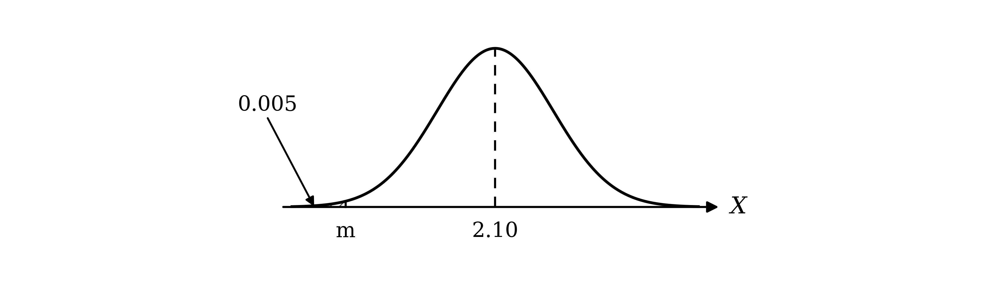

The area to the left of $m$ is 0.005, so $m$ is below the mean. By symmetry its $z$-value is the negative of the critical value for 0.995 in the table of critical values for the normal distribution in the formula booklet

$z = - 2 . 576$

**[B1]**

Standardise using the formula

$Z = \frac{X-μ}{σ}$

Substitute $X = m$ and the unrounded mean and standard deviation from part (a), and set the result equal to this $z$-value

$\frac{m-2.09988\dots}{0.083354\dots} = - 2 . 576$

**[M1]**

$m = 2 . 09988 \dots - 2 . 576 \times 0 . 083354 \dots = 1 . 88516 \dots$

**Final answer:** $m = 1 . 89$** (3 s.f.)**

**[A1]**

> **[mark-scheme]**
> **M1**: Finding p as the 10th root of 9.766 × 10⁻²⁴, giving 0.005.
> 
> **B1**: z = −2.576 or 2.576 seen.
> 
> **M1**: A standardisation of m with their mean and standard deviation from (a), equated to their z-value. Equating to 0.005 or 0.995, or using σ², does not score.
> 
> **A1**: 1.89, or answers which round to 1.885 or 1.89.

### Q2
Let $X$ be the mass of a turkey, in kg. The variance is 1.9, so the standard deviation is $\sqrt{1.9} = 1 . 3784 \dots$

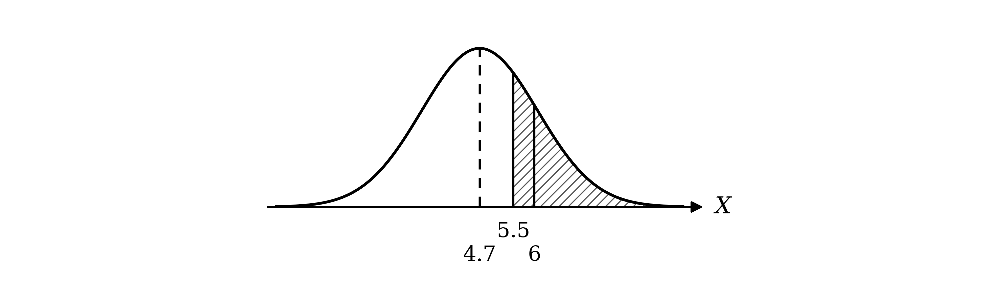

A turkey with a mass less than 6 kg that is also 'holiday ready' has a mass between 5.5 and 6 kg, so

`\text{P}(X < 6 \mid X > 5.5) = \dfrac{\text{P}(5.5 < X < 6)}{\text{P}(X > 5.5)}`

Standardise using the formula

$Z = \frac{X-μ}{σ}$

Substitute each value, with $μ = 4 . 7$ and $σ = \sqrt{1.9}$

$\frac{5.5-4.7}{\sqrt{1.9}} = 0 . 580$

$\frac{6-4.7}{\sqrt{1.9}} = 0 . 943$

**[M1]**

In the table of the normal distribution function in the formula booklet, the 0.9 row and the 4 column give 0.8264, and ADD 3 in the 0.9 row is 8

$Φ ( 0 . 943 ) = 0 . 8264 + 0 . 0008 = 0 . 8272$

The 0.5 row and the 8 column give

$Φ ( 0 . 580 ) = 0 . 7190$

$\text{P} ( 5 . 5 < X < 6 ) = Φ ( 0 . 943 ) - Φ ( 0 . 580 ) = 0 . 8272 - 0 . 7190 = 0 . 1082$

**[M1]**

$\text{P} ( X > 5 . 5 ) = 1 - Φ ( 0 . 580 ) = 1 - 0 . 7190 = 0 . 2810$

**[M1]**

`\text{P}(X < 6 \mid X > 5.5) = \dfrac{0.1082}{0.2810} = 0.38505\ldots`

**Final answer:** `\text{P}(X < 6 \mid X > 5.5) = 0.385`** (3 s.f.)**

**[A1]**

> **[mark-scheme]**
> **M1**: A standardisation of 5.5 or 6 with 4.7 and √1.9. No continuity correction.
> 
> **M1**: Φ(0.943) − Φ(0.580), or 0.1082, seen as the numerator of a conditional probability fraction.
> 
> **M1**: 1 − Φ(0.580), or 0.2810, seen as the denominator of a conditional probability fraction.
> 
> **A1**: 0.385, or answers which round to 0.385.
In a large sample, the median of the 'holiday ready' turkeys is close to the value $m$ that splits the area above 5.5 in half. So half of $\text{P} ( X > 5 . 5 )$ lies above $m$

$\text{P} ( X > m ) = \frac{1}{2} \times 0 . 2810 = 0 . 1405$

**[M1]**

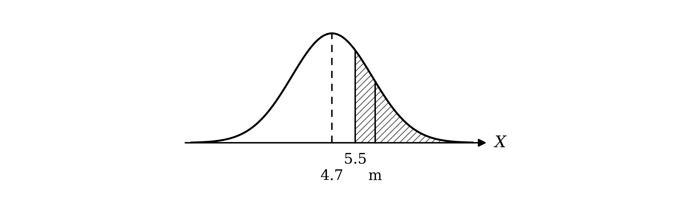

$\text{P} ( X < m ) = 1 - 0 . 1405 = 0 . 8595$

0.8595 is not in the body of the table of the normal distribution function in the formula booklet, so find the nearest value below it, which is in the 1.0 row and the 7 column

$Φ ( 1 . 07 ) = 0 . 8577$

Subtract to find how much more area is needed

$0 . 8595 - 0 . 8577 = 0 . 0018$

In the 1.0 row, 18 is not in the ADD columns; the nearest is 19, in the ADD 8 column, so the third decimal place is 8

$z = 1 . 078$

**[B1]**

Standardise using the formula

$Z = \frac{X-μ}{σ}$

Substitute $X = m$, $μ = 4 . 7$ and $σ = \sqrt{1.9}$, and set the result equal to this $z$-value

$\frac{m-4.7}{\sqrt{1.9}} = 1 . 078$

**[M1]**

$m = 4 . 7 + 1 . 078 \times \sqrt{1.9} = 6 . 1859 \dots$

**Final answer:** $\text{Median} = 6 . 19 \text{kg}$** (3 s.f.)**

**[A1]**

> **[mark-scheme]**
> **M1**: P(X > m) = ½ × their P(X > 5.5), or P(X < m) = 1 − ½ × their P(X > 5.5).
> 
> **B1**: z = 1.078, accepting any value from 1.077 to 1.079.
> 
> **M1**: A standardisation of m with 4.7 and √1.9, equated to their z-value. Equating to a probability, or dividing by 1.9, does not score.
> 
> **A1**: 6.19, accepting values from 6.18 to 6.19.

### Q3
Let $X$ be a candidate's score, so `X \sim \text{N}(520, \; 89.9^{2})`. 25% of scores lie below the lower quartile and 25% above the upper quartile

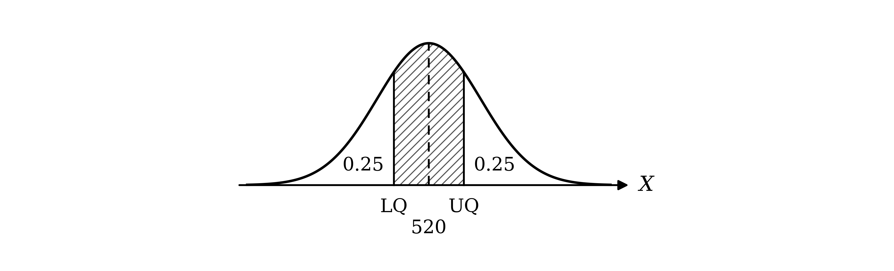

0.75 is in the table of critical values for the normal distribution in the formula booklet, and by symmetry the lower quartile has the negative $z$-value

$z = \pm 0 . 674$

**[B1]**

Standardise using the formula

$Z = \frac{X-μ}{σ}$

Substitute $X = \text{UQ}$, $μ = 520$ and $σ = 89 . 9$, and set the result equal to this $z$-value

$\frac{\text{UQ}-520}{89.9} = 0 . 674$

**[M1]**

$\text{UQ} = 520 + 0 . 674 \times 89 . 9 = 580 . 5926$

$\text{LQ} = 520 - 0 . 674 \times 89 . 9 = 459 . 4074$

$\text{IQR} = 580 . 5926 - 459 . 4074 = 121 . 1852$

**[M1]**

**Final answer:** $\text{IQR} = 121$** (3 s.f.)**

**[A1]**

> **[mark-scheme]**
> **B1**: z = ±0.674 seen.
> 
> **M1**: Standardisation with 520, 89.9 and a quartile, equated to their z-value. Equating to 0.75 or 0.25 does not score.
> 
> **M1**: UQ − LQ from their quartiles, or 2 × their z × 89.9.
> 
> **A1**: IQR = 121, or answers which round to 121.
Anyone offered a scholarship (score above 750) has also been invited to an interview (score above 670), so "both" is just "score above 750"

`\text{P}(X > 750 \mid X > 670) = \dfrac{\text{P}(X > 750 \cap X > 670)}{\text{P}(X > 670)} = \dfrac{\text{P}(X > 750)}{\text{P}(X > 670)}`

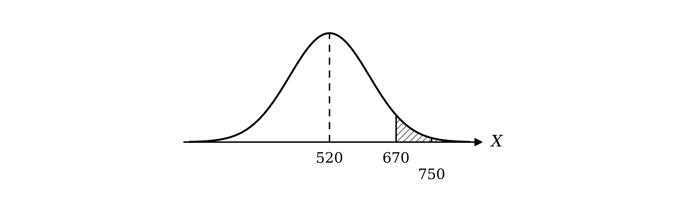

Standardise using the formula

$Z = \frac{X-μ}{σ}$

Substitute each score, with $μ = 520$ and $σ = 89 . 9$

$\frac{670-520}{89.9} = 1 . 669$

**[M1]**

$\frac{750-520}{89.9} = 2 . 558$

**[A1]**

Find each tail from the table of the normal distribution function in the formula booklet. The 1.6 row and the 6 column give 0.9515, and ADD 9 in the 1.6 row is 9

$Φ ( 1 . 669 ) = 0 . 9515 + 0 . 0009 = 0 . 9524$

$\text{P} ( X > 670 ) = 1 - Φ ( 1 . 669 ) = 1 - 0 . 9524 = 0 . 0476$

The 2.5 row and the 5 column give 0.9946, and ADD 8 in the 2.5 row is 1

$Φ ( 2 . 558 ) = 0 . 9946 + 0 . 0001 = 0 . 9947$

$\text{P} ( X > 750 ) = 1 - Φ ( 2 . 558 ) = 1 - 0 . 9947 = 0 . 0053$

**[M1]**

`\text{P}(X > 750 \mid X > 670) = \dfrac{0.0053}{0.0476}`

**[M1]**

`\text{P}(X > 750 \mid X > 670) = 0.11134\ldots`

**Final answer:** `\text{P}(X > 750 \mid X > 670) = 0.111`** (3 s.f.)**

**[A1]**

> **[mark-scheme]**
> **M1**: Standardising 670 or 750 with 520 and 89.9.
> 
> **A1**: Both z-values correct: 1.669 (or 1.668) and 2.558.
> 
> **M1**: Both upper tails found as 1 − Φ(z), each giving a probability less than 0.5.
> 
> **M1**: P(X > 750) seen as the numerator and P(X > 670) seen as the denominator of the conditional probability fraction.
> 
> **A1**: 0.111, accepting any value from 0.110 to 0.112. (The table gives 0.111; a calculator gives 0.110.)

### Q4
Let $X$ be an applicant's score, so `X \sim \text{N}(120, \; 26.5^{2})`. The scores that allow a resit lie between a boundary $a$ with 40% of scores below it and a boundary $b$ with 10% of scores above it

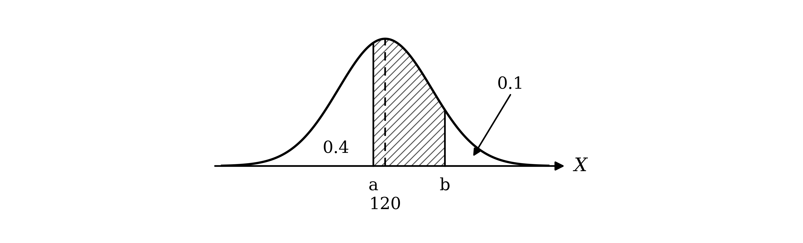

For $a$, the area to the left is 0.4, so $a$ is below the mean. By symmetry

$Φ ( - z_{1} ) = 0 . 6$

In the table of the normal distribution function in the formula booklet, the nearest value below 0.6 is in the 0.2 row and the 5 column

$Φ ( 0 . 25 ) = 0 . 5987$

The remaining 0.0013 lies between ADD 3 (12) and ADD 4 (15) in the 0.2 row, so take the third decimal place halfway

$z_{1} = - 0 . 2535$

**[B1]**

For $b$, the area to the left is 0.9, which is in the table of critical values for the normal distribution in the formula booklet

$z_{2} = 1 . 282$

**[B1]**

Standardise using the formula

$Z = \frac{X-μ}{σ}$

Substitute each boundary, with $μ = 120$ and $σ = 26 . 5$, and set the result equal to its $z$-value

$\frac{a-120}{26.5} = - 0 . 2535 \Rightarrow a = 113 . 28 \dots$

**[M1]**

$\frac{b-120}{26.5} = 1 . 282 \Rightarrow b = 153 . 97 \dots$

Scores are whole numbers, so the lowest score above 113.28 is 114 and the highest score below 153.97 is 153

**Final answer:** **The scores from 114 to 153 inclusive**

**[A1]**

> **[mark-scheme]**
> **B1**: z = −0.253, accepting any value from −0.2535 to −0.253 (or the positive value used consistently).
> 
> **B1**: z = 1.282.
> 
> **M1**: A standardisation of a boundary with 120 and 26.5, equated to a z-value. Equating to 0.4, 0.6, 0.1 or 0.9 does not score.
> 
> **A1**: The whole-number range 114 to 153 inclusive, in any clear form, for example 114 ⩽ X ⩽ 153. A range given only as decimals (113.3 to 154.0) does not score.
(i)

Standardise using the formula

$Z = \frac{X-μ}{σ}$

Substitute $X = 180$, $μ = 120$ and $σ = 26 . 5$

`\text{P}(X > 180) = \text{P}\left(Z > \dfrac{180 - 120}{26.5}\right) = \text{P}(Z > 2.264)`

**[M1]**

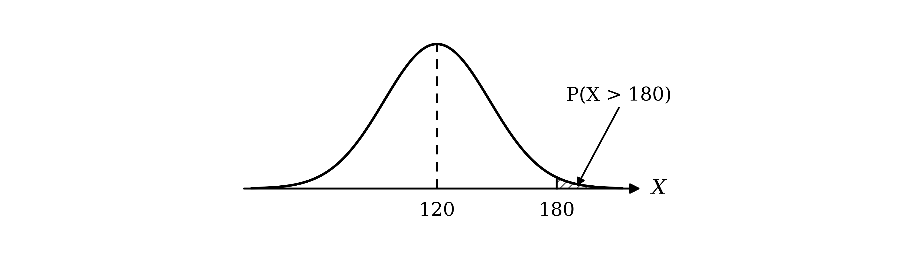

The area to the right is 1 minus the area to the left

$\text{P} ( X > 180 ) = 1 - Φ ( 2 . 264 )$

**[M1]**

In the table of the normal distribution function in the formula booklet, the 2.2 row and the 6 column give 0.9881, and ADD 4 in the 2.2 row is 1

$Φ ( 2 . 264 ) = 0 . 9881 + 0 . 0001 = 0 . 9882$

$\text{P} ( X > 180 ) = 1 - 0 . 9882$

**Final answer:** $\text{P} ( X > 180 ) = 0 . 0118$** (3 s.f.)**

**[A1]**

(ii)

A score above 180 is impossible, but the model gives it a non-zero probability

**Final answer:** **The model predicts that about 1.2% of applicants score more than 180, which is impossible, so the model may not be suitable**

**[B1]**

> **[mark-scheme]**
> **M1**: Standardising 180 with 120 and 26.5.
> 
> **M1**: 1 − Φ(their z), leading to a probability less than 0.5.
> 
> **A1**: 0.0118, or answers which round to 0.0118.
> 
> **B1**: The model gives a non-zero probability (their answer to (i)) of a score above 180, which is impossible. The comment must refer to the maximum score or to impossible scores; "the probability is small" alone does not score.
> 
> If 0.0118 is given with no working, for example straight from a calculator, award 1 mark only for (i).

### Q5
Let $H$ be the height, in metres, so `H \sim \text{N}(\mu, \; \sigma^{2})`. The trees sold lie between a lower limit $h_{1}$, with 10% below it, and an upper limit $h_{2}$, with 2.5% above it

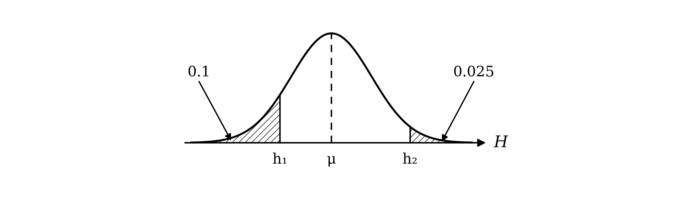

$h_{1}$ is below the mean with 0.1 to its left, so by symmetry its $z$-value is the negative of the critical value for 0.9 in the table of critical values for the normal distribution in the formula booklet

$z_{1} = - 1 . 282$

**[B1]**

The area to the left of $h_{2}$ is 0.975, which is also in the table of critical values

$z_{2} = 1 . 960$

**[B1]**

Standardise using the formula

$Z = \frac{X-μ}{σ}$

Substitute each limit, keeping $μ$ and $σ$ as letters, and set the result equal to its $z$-value

$\frac{h_{1}-μ}{σ} = - 1 . 282$

**[M1]**

Rearrange to find the least height

$\text{Least height} = μ - 1 . 282 σ$

**[A1]**

$\frac{h_{2}-μ}{σ} = 1 . 960$

Rearrange to find the greatest height

$\text{Greatest height} = μ + 1 . 960 σ$

**[A1]**

> **[mark-scheme]**
> **B1**: z = ±1.282 seen.
> 
> **B1**: z = ±1.960 seen (accept 1.96).
> 
> **M1**: A standardisation of a limit with μ and σ, equated to a z-value. Equating to 0.1, 0.9, 0.025 or 0.975 does not score.
> 
> **A1**: Least height μ − 1.282σ.
> 
> **A1**: Greatest height μ + 1.960σ (accept μ + 1.96σ).
> 
> The two heights may be given together as an inequality, for example μ − 1.282σ < H < μ + 1.960σ.
Every tree taller than $μ + 8$ is also taller than $μ - 8$, so the "both" event is just "taller than $μ + 8$"

`\text{P}(H > \mu + 8 \mid H > \mu - 8) = \dfrac{\text{P}(H > \mu + 8)}{\text{P}(H > \mu - 8)}`

$μ + 8$ and $μ - 8$ are the same distance from the mean, so by symmetry the area above $μ + 8$ equals the area below $μ - 8$

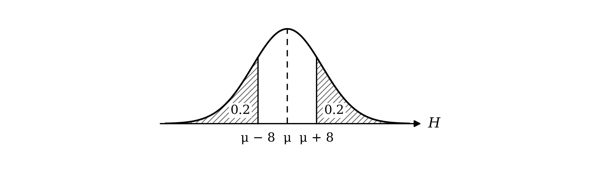

$\text{P} ( H > μ + 8 ) = \text{P} ( H < μ - 8 ) = 0 . 2$

**[M1]**

$\text{P} ( H > μ - 8 ) = 1 - 0 . 2 = 0 . 8$

**[M1]**

`\text{P}(H > \mu + 8 \mid H > \mu - 8) = \dfrac{0.2}{0.8}`

`\text{P}(H > \mu + 8 \mid H > \mu - 8) = 0.25`

**[A1]**

> **[exam-tip]**
> You do not need to find σ here. The question gives the probability below μ − 8, and the symmetry of the normal curve gives the probability above μ + 8 straight away.

> **[mark-scheme]**
> **M1**: P(H > μ + 8) = 0.2 seen as the numerator of the conditional probability fraction, from symmetry.
> 
> **M1**: P(H > μ − 8) = 0.8 seen as the denominator of the conditional probability fraction.
> 
> **A1**: 0.25, or 1/4.
> 
> A correct method that finds σ first (σ = 8/0.842 = 9.50) and standardises is equally acceptable.

### Q6
Let $W$ be the mass of feed in a sack, in kg, so $σ = \frac{1}{60}$ kg. Work in kilograms: 35 g = 0.035 kg, so "within 35 g of the mean" means $19 . 965 < W < 20 . 035$

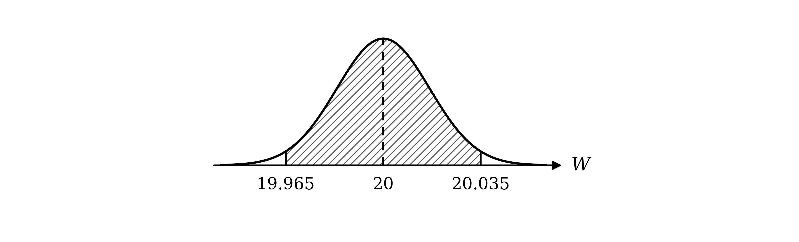

Standardise using the formula

$Z = \frac{X-μ}{σ}$

Substitute the upper value; the lower value gives the negative of it

$\frac{20.035-20}{\frac{1}{60}} = 0 . 035 \times 60 = 2 . 1$

$\text{P} ( 19 . 965 < W < 20 . 035 ) = \text{P} ( - 2 . 1 < Z < 2 . 1 )$

**[M1]**

The area between −2.1 and 2.1 is the area to the left of 2.1 minus the area to the left of −2.1

$\text{P} ( - 2 . 1 < Z < 2 . 1 ) = Φ ( 2 . 1 ) - Φ ( - 2 . 1 )$

The table only gives positive values of $z$. By symmetry, the area to the left of −2.1 equals the area to the right of 2.1

$Φ ( - 2 . 1 ) = 1 - Φ ( 2 . 1 )$

Substitute this into the first line

`\text{P}(-2.1 < Z < 2.1) = \mathrm{\Phi}(2.1) - \left(1 - \mathrm{\Phi}(2.1)\right)`

$\text{P} ( - 2 . 1 < Z < 2 . 1 ) = 2 Φ ( 2 . 1 ) - 1$

**[M1]**

In the table of the normal distribution function in the formula booklet, the 2.1 row and the 0 column give

$Φ ( 2 . 1 ) = 0 . 9821$

$\text{P} ( 19 . 965 < W < 20 . 035 ) = 2 \times 0 . 9821 - 1 = 0 . 9642$

**[A1]**

The 12 sacks are chosen at random, so their masses are independent, and all 12 must lie within 35 g of the mean

$0 . 9642^{12} = 0 . 64566 \dots$

**Final answer:** $\text{P(all 12 within 35 g)} = 0 . 646$** (3 s.f.)**

**[B1]**

> **[mark-scheme]**
> **M1**: Both 2.1 and −2.1 seen as the z-values (from 0.035 and 1/60, in consistent units), and no other z-values. Using 35 with 1/60, or dividing by (1/60)², does not score.
> 
> **M1**: The area from Φ values of ± the same number, such as Φ(2.1) − (1 − Φ(2.1)) or 2Φ(2.1) − 1.
> 
> **A1**: 0.9642, or answers which round to 0.964.
> 
> **B1**: (their probability)¹², using their probability to 4 s.f. or better: 0.646, accepting values from 0.645 to 0.646.

### Q7
Let $X$ be the mass, in grams. The variance is 15, so the standard deviation is

$σ = \sqrt{15} = 3 . 87298 \dots$

(i)

`\text{P} \left(X > a\right) = 0 . 2`, so the area to the left of $a$ is 0.8

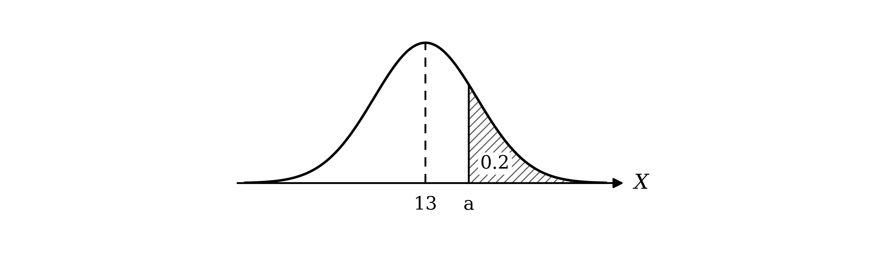

0.8 is not in the table of critical values, so look for it in the body of the table of the normal distribution function in the formula booklet. The nearest value below 0.8 is in the 0.8 row and the 4 column

`\Phi \left(0 . 84\right) = 0 . 7995`

Subtract to find how much more area is needed

$0 . 8 - 0 . 7995 = 0 . 0005$

In the 0.8 row, 5 is in the ADD 2 column, so the third decimal place is 2

$z = 0 . 842$

**[B1]**

Standardise using the formula

$Z = \frac{X-μ}{σ}$

Substitute $X = a$, $μ = 13$ and $σ = \sqrt{15}$, and set the result equal to this $z$-value

$\frac{a-13}{\sqrt{15}} = 0 . 842$

**[M1]**

$a = 13 + 0 . 842 \sqrt{15} = 16 . 2611 \dots$

**Final answer:** $a = 16 . 3$** (3 s.f.)**

**[A1]**

(ii)

First find the area to the left of 14. Standardise 14 in the same way

`\text{P} \left(X < 14\right) = \Phi \left(\frac{14 - 13}{\sqrt{15}}\right) = \Phi \left(0 . 258\right)`

In the table, the 0.2 row and the 5 column give 0.5987. For the third decimal place, ADD 8 in the 0.2 row is 31, so add 0.0031

`\Phi \left(0 . 258\right) = 0 . 5987 + 0 . 0031 = 0 . 6018`

The area between $b$ and 14 is 0.5, so the area to the left of $b$ is what remains

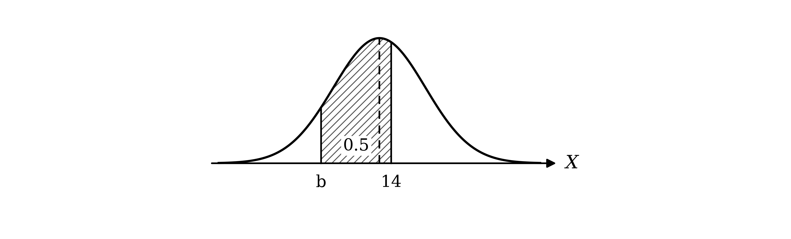

`\text{P} \left(X < b\right) = 0 . 6018 - 0 . 5 = 0 . 1018`

**[M1]**

0.1018 is less than 0.5, so $b$ is below the mean. By symmetry

`\Phi \left(- z\right) = 1 - 0 . 1018 = 0 . 8982`

The nearest value below 0.8982 in the body of the table is in the 1.2 row and the 7 column

`\Phi \left(1 . 27\right) = 0 . 8980`

Subtract to find how much more area is needed

$0 . 8982 - 0 . 8980 = 0 . 0002$

In the 1.2 row, 2 is in the ADD 1 column, so the third decimal place is 1

$- z = 1 . 271$

$z = - 1 . 271$

**[B1]**

Standardise $b$ in the same way and set the result equal to this $z$-value

$\frac{b-13}{\sqrt{15}} = - 1 . 271$

**[M1]**

$b = 13 - 1 . 271 \sqrt{15} = 8 . 0774 \dots$

**Final answer:** $b = 8 . 08$** (3 s.f.)**

**[A1]**

(iii)

"Differs from the mean by less than $c$" means $13 - c < X < 13 + c$. This interval is symmetrical about the mean, so the two tails share the remaining probability equally

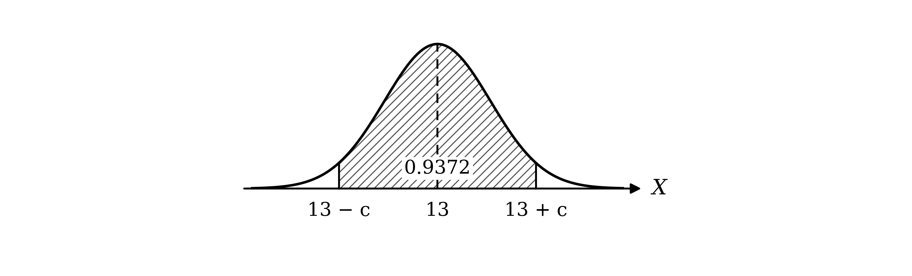

`\Phi \left(z\right) = 0 . 9372 + \frac{1 - 0 . 9372}{2} = 0 . 9686`

0.9686 is in the body of the table of the normal distribution function in the formula booklet, in the 1.8 row and the 6 column

$z = 1 . 86$

**[B1]**

Standardise using the formula

$Z = \frac{X-μ}{σ}$

Substitute $X = 13 + c$, $μ = 13$ and $σ = \sqrt{15}$, and set the result equal to this $z$-value

`\frac{\left(13 + c\right) - 13}{\sqrt{15}} = \frac{c}{\sqrt{15}} = 1 . 86`

**[M1]**

$c = 1 . 86 \sqrt{15} = 7 . 2037 \dots$

**Final answer:** $c = 7 . 20$** (3 s.f.)**

**[A1]**

> **[mark-scheme]**
> **B1**: z = 0.842 for (i), accepting any value from 0.8415 to 0.842.
> 
> **M1**: (a − 13)/√15 equated to their z-value. Equating to 0.8 or 0.2, or dividing by 15, does not score.
> 
> **A1**: a = 16.3, or answers which round to 16.3.
> 
> **M1**: P(X < b) = P(X < 14) − 0.5, evaluated (0.1018), or the equivalent 0.8982 for the other tail.
> 
> **B1**: z = −1.271 for (ii), accepting any value from −1.272 to −1.270 (or the positive value used consistently).
> 
> **M1**: (b − 13)/√15 equated to their z-value. Equating to a probability does not score.
> 
> **A1**: b = 8.08, or answers which round to 8.08.
> 
> **B1**: z = 1.86 for (iii), from Φ(z) = 0.9686, accepting any value from 1.86 to 1.861.
> 
> **M1**: c/√15, or ((13 + c) − 13)/√15, equated to their z-value.
> 
> **A1**: c = 7.20, accepting any value from 7.20 to 7.21. (The table gives z = 1.86 and c = 7.20; a calculator gives z = 1.8606 and c = 7.21.)
From (a)(ii), the area to the left of 14 is 0.6018, so the area to the right of 14 is

$\text{P} ( X > 14 ) = 1 - 0 . 6018 = 0 . 3982$

**[B1]**

The area between 14 and any value $d$ above it can be no larger than the whole area to the right of 14

**Final answer:** **0.3982 is less than 0.5, so no interval starting at 14 can contain 50% of the plums**

**[B1]**

> **[mark-scheme]**
> **B1**: P(X > 14) = 0.398, or answers which round to 0.398, found or quoted from (a)(ii).
> 
> **B1**: The argument that the probability of a mass between 14 and d is at most P(X > 14), which is less than 0.5. Accept an equivalent argument, for example that 14 is above the mean, so less than half the masses lie above it.

### Q8
Let $W$ be the weight, in kg, so `W \sim \text{N}(3, \; \sigma^{2})` and $\text{P} ( W > 3 . 05 ) = 0 . 07$

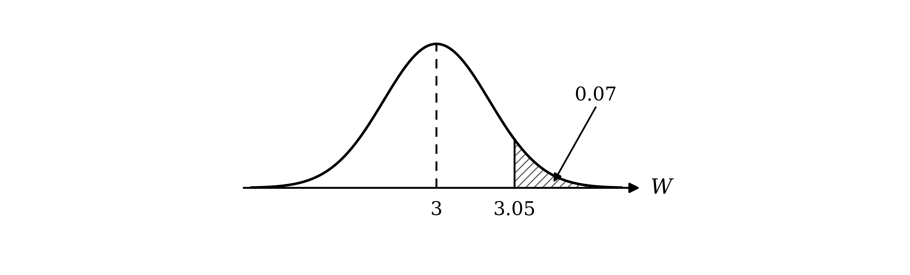

The area to the left of 3.05 is 0.93, which is not in the table of critical values, so look for it in the body of the table of the normal distribution function in the formula booklet. The nearest value below 0.93 is in the 1.4 row and the 7 column

$Φ ( 1 . 47 ) = 0 . 9292$

Subtract to find how much more area is needed

$0 . 93 - 0 . 9292 = 0 . 0008$

In the 1.4 row, 8 is in the ADD 6 column, so the third decimal place is 6

$z = 1 . 476$

**[B1]**

Standardise using the formula

$Z = \frac{X-μ}{σ}$

Substitute $X = 3 . 05$ and $μ = 3$, and set the result equal to this $z$-value

$\frac{3.05-3}{σ} = 1 . 476$

**[M1]**

$σ = \frac{0.05}{1.476} = 0 . 033875 \dots$

**Final answer:** $σ = 0 . 0339$** (3 s.f.)**

**[A1]**

> **[mark-scheme]**
> **B1**: z = 1.476, accepting any value from 1.475 to 1.476 (or the negative value used consistently).
> 
> **M1**: (3.05 − 3)/σ equated to their z-value. Equating to 0.07 or 0.93 does not score.
> 
> **A1**: σ = 0.0339, or answers which round to 0.0339.
2.9 and 3.1 are each 0.1 kg from the mean, so the interval is symmetrical. Standardise using the formula

$Z = \frac{X-μ}{σ}$

Substitute $X = 3 . 1$, $μ = 3$ and the unrounded $σ = 0 . 033875 \dots$ from part (a)

$\frac{3.1-3}{0.033875\dots} = 2 . 952$

$\text{P} ( 2 . 9 \leq W \leq 3 . 1 ) = \text{P} ( - 2 . 952 \leq Z \leq 2 . 952 )$

**[M1]**

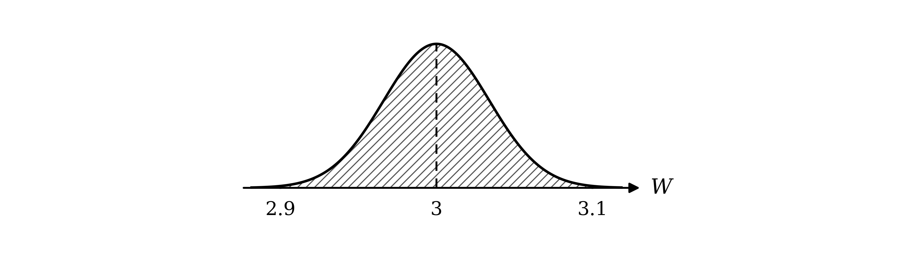

The area between −2.952 and 2.952 is the area to the left of 2.952 minus the area to the left of −2.952

$\text{P} ( - 2 . 952 \leq Z \leq 2 . 952 ) = Φ ( 2 . 952 ) - Φ ( - 2 . 952 )$

The table only gives positive values of $z$. By symmetry, the area to the left of −2.952 equals the area to the right of 2.952

$Φ ( - 2 . 952 ) = 1 - Φ ( 2 . 952 )$

Substitute this into the first line

`\text{P}(-2.952 \leq Z \leq 2.952) = \mathrm{\Phi}(2.952) - \left(1 - \mathrm{\Phi}(2.952)\right)`

$\text{P} ( - 2 . 952 \leq Z \leq 2 . 952 ) = 2 Φ ( 2 . 952 ) - 1$

**[M1]**

In the table of the normal distribution function in the formula booklet, the 2.9 row and the 5 column give 0.9984, and ADD 2 in the 2.9 row is 0

$Φ ( 2 . 952 ) = 0 . 9984$

$2 \times 0 . 9984 - 1 = 0 . 9968$

**Final answer:** $\text{P} ( 2 . 9 \leq W \leq 3 . 1 ) = 0 . 997$** (3 s.f.)**

**[A1]**

> **[mark-scheme]**
> **M1**: Both 2.952 and −2.952 (from their σ) seen as the z-values, and no other z-values.
> 
> **M1**: The area from Φ values of ± the same number, such as Φ(2.952) − (1 − Φ(2.952)) or 2Φ(2.952) − 1.
> 
> **A1**: 0.997, or answers which round to 0.997.
> 
> If the answer is given with no working, for example straight from a calculator, award 1 mark only.
First find the probability $p$ that one bag contains less than 2.96 kg. Standardise using the formula

$Z = \frac{X-μ}{σ}$

Substitute $X = 2 . 96$, $μ = 3$ and the unrounded $σ = 0 . 033875 \dots$

`p = \text{P}(W < 2.96) = \text{P}\left(Z < \dfrac{2.96 - 3}{0.033875\ldots}\right) = \text{P}(Z < -1.181)`

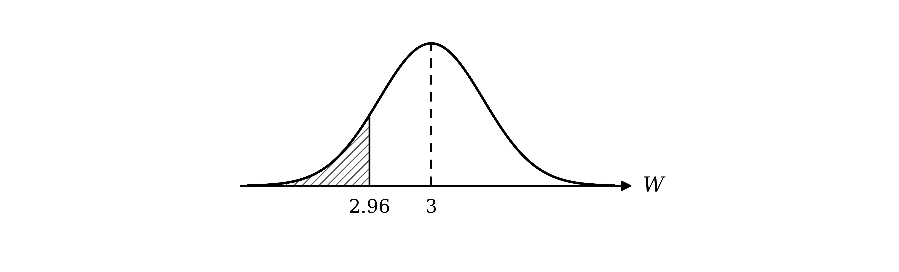

The $z$-value is negative, so use symmetry

$p = 1 - Φ ( 1 . 181 )$

**[M1]**

In the table of the normal distribution function in the formula booklet, the 1.1 row and the 8 column give 0.8810, and ADD 1 in the 1.1 row is 2

$Φ ( 1 . 181 ) = 0 . 8810 + 0 . 0002 = 0 . 8812$

$p = 1 - 0 . 8812$

$p = 0 . 1188$

**[A1]**

The 12 bags are chosen at random, so they are independent, each with the same probability 0.1188 of containing less than 2.96 kg. So $X$, the number of these bags, follows a binomial distribution

`X \sim \text{B}(12, \; 0.1188)`

Use the binomial probability formula

`\text{P}(X = r) = {}^{n}C_{r} p^{r} (1 - p)^{n - r}`

"Not more than one" means $X = 0$ or 1

`\text{P}(X \leq 1) = \left(0.8812\right)^{12} + {}^{12}C_{1}(0.1188)\left(0.8812\right)^{11}`

**[M1 A1]**

$\text{P} ( X \leq 1 ) = 0 . 21923 + 0 . 35466 = 0 . 57389 \dots$

**Final answer:** $\text{P} ( X \leq 1 ) = 0 . 574$** (3 s.f.)**

**[A1]**

> **[mark-scheme]**
> **M1**: Standardising 2.96 with 3 and their σ, and 1 − Φ (or Φ of the negative value) found.
> 
> **A1**: p = 0.119, or answers which round to 0.119, kept to at least 3 s.f. for the next step.
> 
> **M1**: At least one term of the form `{}^{12}C_{x}\,p^{x}(1 - p)^{12 - x}` with any p.
> 
> **A1**: A correct expression for P(X = 0) + P(X = 1), written out in full with no terms missing, using their p to at least 3 s.f. Accept unsimplified.
> 
> **A1**: 0.574, or answers which round to 0.574. Accept 0.573 or 0.574 from a calculator value of p.
> 
> If 0.574 is given with no working, for example straight from a calculator, award 1 mark only.

### Q9
Let $T$ be the time, in minutes, in a month, so `T \sim \text{N}(2048, \; 64^{2})`

Standardise using the formula

$Z = \frac{X-μ}{σ}$

Substitute $μ = 2048$ and $σ = 64$

`\text{P}(T < 1945) = \text{P}\left(Z < \dfrac{1945 - 2048}{64}\right) = \text{P}(Z < -1.609)`

**[M1]**

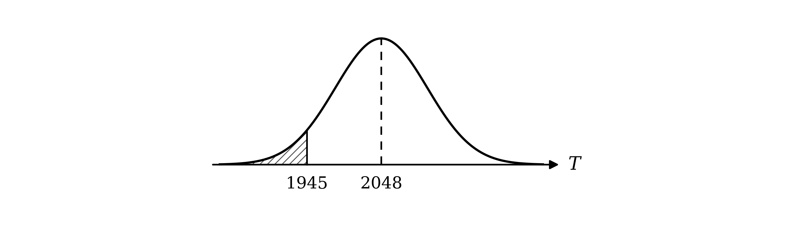

The $z$-value is negative, so use symmetry

$\text{P} ( T < 1945 ) = 1 - Φ ( 1 . 609 )$

**[M1]**

In the table of the normal distribution function in the formula booklet, the 1.6 row and the 0 column give 0.9452. For the third decimal place, ADD 9 in the 1.6 row is 9, so add 0.0009

$Φ ( 1 . 609 ) = 0 . 9452 + 0 . 0009 = 0 . 9461$

$\text{P} ( T < 1945 ) = 1 - 0 . 9461$

**Final answer:** $\text{P} ( T < 1945 ) = 0 . 0539$** (3 s.f.)**

**[A1]**

> **[mark-scheme]**
> **M1**: Standardising 1945 with 2048 and 64. Dividing by 64² does not score.
> 
> **M1**: 1 − Φ(1.609), or Φ(−1.609) correctly found, leading to a probability less than 0.5.
> 
> **A1**: 0.0539, or 0.0538 from a calculator.
> 
> If the answer is given with no working, for example straight from a calculator, award 1 mark only.
First find the probability for one month. Standardise using the formula

$Z = \frac{X-μ}{σ}$

Substitute $μ = 2048$ and $σ = 64$ for both values

`\text{P}(2019 < T < 2091) = \text{P}\left(\dfrac{2019 - 2048}{64} < Z < \dfrac{2091 - 2048}{64}\right)`

$\text{P} ( 2019 < T < 2091 ) = \text{P} ( - 0 . 453 < Z < 0 . 672 )$

**[M1]**

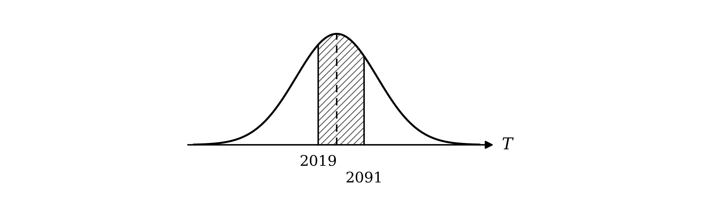

The lower value is negative, so use $Φ ( - 0 . 453 ) = 1 - Φ ( 0 . 453 )$

`\text{P}(2019 < T < 2091) = \mathrm{\Phi}(0.672) - \left(1 - \mathrm{\Phi}(0.453)\right)`

**[M1]**

In the table of the normal distribution function in the formula booklet, the 0.6 row and the 7 column give 0.7486, and ADD 2 in the 0.6 row is 7

$Φ ( 0 . 672 ) = 0 . 7486 + 0 . 0007 = 0 . 7493$

The 0.4 row and the 5 column give 0.6736, and ADD 3 in the 0.4 row is 11

$Φ ( 0 . 453 ) = 0 . 6736 + 0 . 0011 = 0 . 6747$

$\text{P} ( 2019 < T < 2091 ) = 0 . 7493 - ( 1 - 0 . 6747 ) = 0 . 4240$

**[A1]**

There are 12 months in a year, so multiply the probability, kept to 4 significant figures, by 12

$12 \times 0 . 4240 = 5 . 088$

**Final answer:** **5 months**

**[B1]**

> **[mark-scheme]**
> **M1**: Standardising 2019 or 2091 with 2048 and 64.
> 
> **M1**: Φ(0.672) − Φ(−0.453), with Φ(−0.453) found as 1 − Φ(0.453), or an equivalent area method.
> 
> **A1**: P(2019 < T < 2091) = 0.424 (0.4239 or 0.4240).
> 
> **B1**: 12 × their probability, kept to 4 s.f. or better, giving a single whole number: 5 (accept 5 or 6). A decimal such as 5.09, or an approximation sign, does not score.
Solving fewer than $n$ puzzles means spending less than $10 n$ minutes, so the condition is

$\text{P} ( T < 10 n ) < 0 . 01$

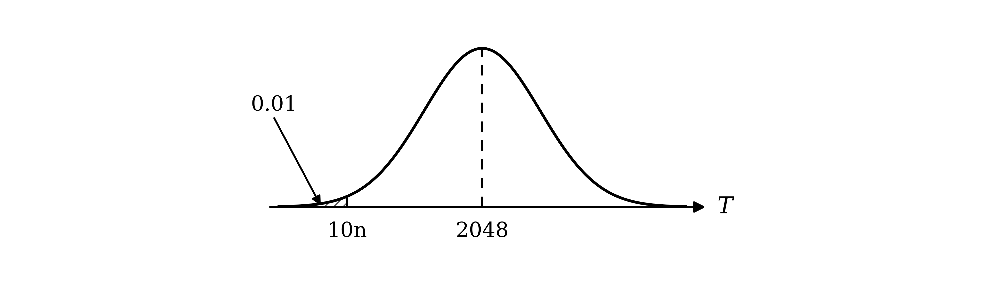

0.01 is less than 0.5, so $10 n$ is below the mean. By symmetry, the critical value for 0.99 in the table of critical values for the normal distribution in the formula booklet gives

$z = - 2 . 326$

**[B1]**

Standardise using the formula

$Z = \frac{X-μ}{σ}$

Substitute $X = 10 n$, $μ = 2048$ and $σ = 64$. The probability is below 0.01 when $10 n$ is further below the mean than this $z$-value

$\frac{10n-2048}{64} < - 2 . 326$

**[M1]**

$10 n < 2048 - 2 . 326 \times 64 = 1899 . 136$

$n < 189 . 9136$

**[A1]**

$n$ is a whole number of puzzles

$n = 189$

**[A1]**

> **[mark-scheme]**
> **B1**: z = ±2.326 seen.
> 
> **M1**: (10n − 2048)/64 compared with, or equated to, their z-value. Accept = in place of <.
> 
> **A1**: n < 189.9, or n = 189.9 from an equation.
> 
> **A1**: n = 189. Must be an integer: 190 does not score.

### Q10
Let $X$ be an applicant's score, so `X \sim \text{N}(210, \; 27.8^{2})`. The quartiles have 25% of the scores below the lower quartile and 25% above the upper quartile

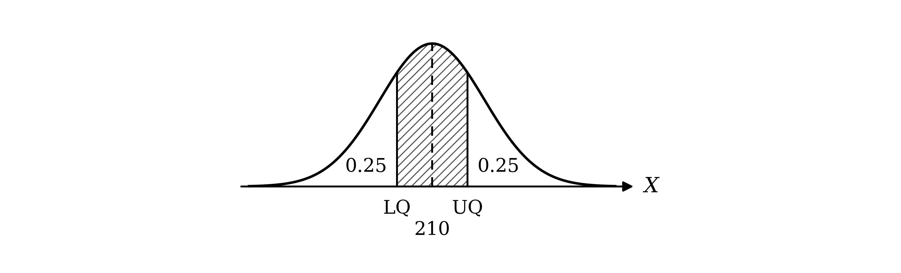

0.75 is in the table of critical values for the normal distribution in the formula booklet, and by symmetry the lower quartile has the negative $z$-value

$z = \pm 0 . 674$

**[B1]**

Standardise using the formula

$Z = \frac{X-μ}{σ}$

Substitute $X = \text{UQ}$, $μ = 210$ and $σ = 27 . 8$, and set the result equal to this $z$-value

$\frac{\text{UQ}-210}{27.8} = 0 . 674$

**[M1]**

$\text{UQ} = 210 + 0 . 674 \times 27 . 8 = 228 . 7372$

By symmetry about the mean

$\text{LQ} = 210 - 0 . 674 \times 27 . 8 = 191 . 2628$

$\text{IQR} = \text{UQ} - \text{LQ} = 228 . 7372 - 191 . 2628$

**[M1]**

$\text{IQR} = 37 . 4744$

**Final answer:** $\text{IQR} = 37 . 5$** (3 s.f.)**

**[A1]**

> **[mark-scheme]**
> **B1**: z = ±0.674 seen.
> 
> **M1**: Standardisation with 210, 27.8 and a quartile, equated to their z-value. Equating to 0.75 or 0.25, or dividing by 27.8², does not score.
> 
> **M1**: UQ − LQ from their quartiles, or 2 × their z × 27.8.
> 
> **A1**: IQR = 37.5, or answers which round to 37.5.
**Method 1 - Find the cut-off score**

Find the score $c$ that cuts off the top 30%, so $\text{P} ( X > c ) = 0 . 3$ and $\text{P} ( X < c ) = 0 . 7$

0.7 is not in the table of critical values, so look for it in the body of the table of the normal distribution function in the formula booklet. It is not there either, so find the nearest value below it, which is in the 0.5 row and the 2 column

$Φ ( 0 . 52 ) = 0 . 6985$

Subtract to find how much more area is needed

$0 . 7 - 0 . 6985 = 0 . 0015$

In the 0.5 row, 15 is not in the ADD columns; the nearest is 14, in the ADD 4 column, so the third decimal place is 4

$z = 0 . 524$

**[B1]**

Standardise using the formula

$Z = \frac{X-μ}{σ}$

Substitute $X = c$, $μ = 210$ and $σ = 27 . 8$, and set the result equal to this $z$-value

$\frac{c-210}{27.8} = 0 . 524$

**[M1]**

$c = 210 + 0 . 524 \times 27 . 8 = 224 . 5672$

Compare Amelia's score with the cut-off

$231 > 224 . 57$

**Final answer:** **Amelia's score is in the top 30%, so she is invited to an interview**

**[A1]**

> **[mark-scheme]**
> **B1**: z = 0.524, accepting any value from 0.524 to 0.525.
> 
> **M1**: (c − 210)/27.8 equated to their z-value. Equating to 0.7 or 0.3 does not score.
> 
> **A1**: A cut-off which rounds to 225 (224.5 to 224.6), compared with 231, and the correct conclusion in context.
> 
> A conclusion with no comparison does not score the final mark.

**Method 2 - Find the probability of a score above 231**

Find the proportion of applicants who score more than 231, then compare it with 30%

Standardise using the formula

$Z = \frac{X-μ}{σ}$

Substitute $X = 231$, $μ = 210$ and $σ = 27 . 8$

`\text{P}(X > 231) = \text{P}\left(Z > \dfrac{231 - 210}{27.8}\right) = \text{P}(Z > 0.755)`

**[M1]**

The area to the right is 1 minus the area to the left

$\text{P} ( X > 231 ) = 1 - Φ ( 0 . 755 )$

**[M1]**

In the table of the normal distribution function in the formula booklet, the 0.7 row and the 5 column give 0.7734, and ADD 5 in the 0.7 row is 15

$Φ ( 0 . 755 ) = 0 . 7734 + 0 . 0015 = 0 . 7749$

$\text{P} ( X > 231 ) = 1 - 0 . 7749 = 0 . 2251$

Fewer than 30% of applicants score more than 231, so 231 lies inside the top 30%

$0 . 2251 < 0 . 3$

**Final answer:** **Amelia's score is in the top 30%, so she is invited to an interview**

**[A1]**

> **[mark-scheme]**
> **M1**: Standardising 231 with 210 and 27.8, giving z = 0.755.
> 
> **M1**: 1 − Φ(0.755), leading to a probability less than 0.5.
> 
> **A1**: P(X > 231) = 0.225 (or answers which round to 0.225), compared with 0.3, and the correct conclusion in context.
> 
> A conclusion with no comparison does not score the final mark.

### Q11
Let $M$ be the mass, in grams, so `M \sim \text{N}(\mu, \; \sigma^{2})`, with $\text{P} ( M > 34 . 451 ) = 0 . 001$ and $\text{P} ( M < 14 . 792 ) = 0 . 1966$

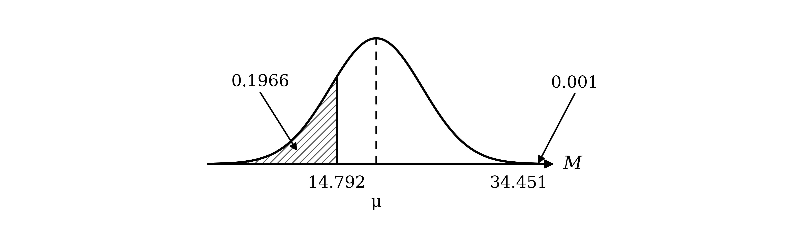

The area to the left of 34.451 is 0.999, which is in the table of critical values for the normal distribution in the formula booklet

$z_{1} = 3 . 090$

**[B1]**

14.792 is below the mean, with 0.1966 to its left. By symmetry, the area to the left of $- z_{2}$ is $1 - 0 . 1966 = 0 . 8034$.

0.8034 is not in the body of the table of the normal distribution function in the formula booklet, so find the nearest value below it, which is in the 0.8 row and the 5 column

$Φ ( 0 . 85 ) = 0 . 8023$

Subtract to find how much more area is needed

$0 . 8034 - 0 . 8023 = 0 . 0011$

In the 0.8 row, 11 is in the ADD 4 column, so the third decimal place is 4

$- z_{2} = 0 . 854$

$z_{2} = - 0 . 854$

**[B1]**

Standardise using the formula

$Z = \frac{X-μ}{σ}$

Substitute each mass and set the result equal to its $z$-value

$\frac{34.451-μ}{σ} = 3 . 090$

**[M1]**

$\frac{14.792-μ}{σ} = - 0 . 854$

Rearrange each into a linear equation

$μ + 3 . 090 σ = 34 . 451$

$μ - 0 . 854 σ = 14 . 792$

Subtract the second equation from the first to eliminate $μ$

$3 . 944 σ = 19 . 659$

$σ = \frac{19.659}{3.944} = 4 . 98453 \dots$

**[M1]**

Substitute the unrounded $σ$ into the first equation

$μ = 34 . 451 - 3 . 090 \times 4 . 98453 \dots = 19 . 0488 \dots$

**Final answer:** $μ = 19 . 0 ,  σ = 4 . 98$** (3 s.f.)**

**[A1]**

> **[mark-scheme]**
> **B1**: z = ±3.090 seen (accept 3.09).
> 
> **B1**: z = ±0.854 seen, accepting any value from 0.853 to 0.855.
> 
> **M1**: One standardisation of 34.451 or 14.792 with μ and σ, equated to a z-value. Equating to a probability (0.001, 0.999, 0.1966 or 0.8034), or using σ², does not score.
> 
> **M1**: Solving two simultaneous equations in μ and σ, by elimination or substitution, to obtain values for both.
> 
> **A1**: μ = 19.0 and σ = 4.98, or answers which round to these.
> 
> If either M mark is not awarded, award 1 mark for both correct values.

### Q12
`V \sim \text{N}(450, \; \sigma^{2})` and $\text{P} ( V < 429 ) = 0 . 05$

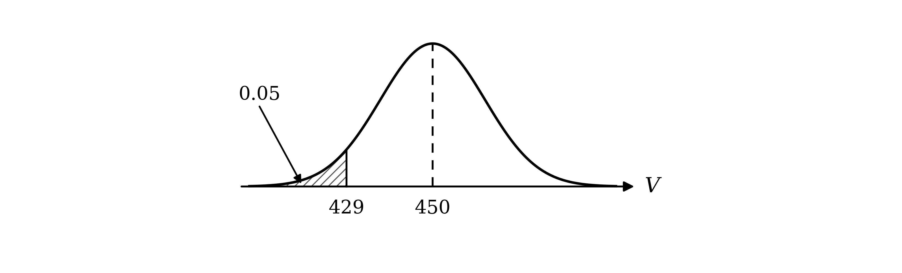

429 is below the mean with 0.05 to its left, so by symmetry its $z$-value is the negative of the critical value for 0.95 in the table of critical values for the normal distribution in the formula booklet

$z = - 1 . 645$

**[B1]**

Standardise using the formula

$Z = \frac{X-μ}{σ}$

Substitute $X = 429$ and $μ = 450$, and set the result equal to this $z$-value

$\frac{429-450}{σ} = - 1 . 645$

**[M1]**

$σ = \frac{21}{1.645} = 12 . 7659 \dots$

**Final answer:** $σ = 12 . 8$** (3 s.f.)**

**[A1]**

> **[mark-scheme]**
> **B1**: z = ±1.645 seen.
> 
> **M1**: (429 − 450)/σ equated to their z-value. Equating to 0.05 or 0.95 does not score.
> 
> **A1**: σ = 12.8, or answers which round to 12.8.
Standardise using the formula

$Z = \frac{X-μ}{σ}$

Substitute $X = 485$, $μ = 450$ and the unrounded $σ = 12 . 7659 \dots$ from part (a)

`\text{P}(V \geq 485) = \text{P}\left(Z \geq \dfrac{485 - 450}{12.7659\ldots}\right) = \text{P}(Z \geq 2.742)`

**[M1]**

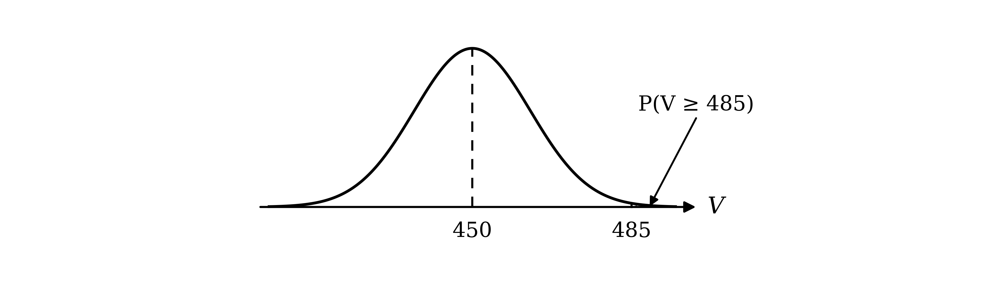

$\text{P} ( V \geq 485 ) = 1 - Φ ( 2 . 742 )$

**[M1]**

In the table of the normal distribution function in the formula booklet, the 2.7 row and the 4 column give 0.9969, and ADD 2 in the 2.7 row is 0

$Φ ( 2 . 742 ) = 0 . 9969$

$\text{P} ( V \geq 485 ) = 1 - 0 . 9969 = 0 . 0031$

**Final answer:** $\text{P} ( V \geq 485 ) = 0 . 00306$** (3 s.f.)**

**[A1]**

> **[mark-scheme]**
> **M1**: Standardising 485 with 450 and their σ.
> 
> **M1**: 1 − Φ(their z), leading to a probability less than 0.5.
> 
> **A1**: 0.00306, or 0.0031 from the table. Accept values from 0.00305 to 0.0031.
> 
> If the answer is given with no working, for example straight from a calculator, award 1 mark only.
Standardise using the formula

$Z = \frac{X-μ}{σ}$

Within one standard deviation of the mean means $450 - σ < V < 450 + σ$, which standardises to $- 1 < Z < 1$ whatever the value of $σ$

$\text{P} ( 450 - σ < V < 450 + σ ) = \text{P} ( - 1 < Z < 1 )$

**[M1]**

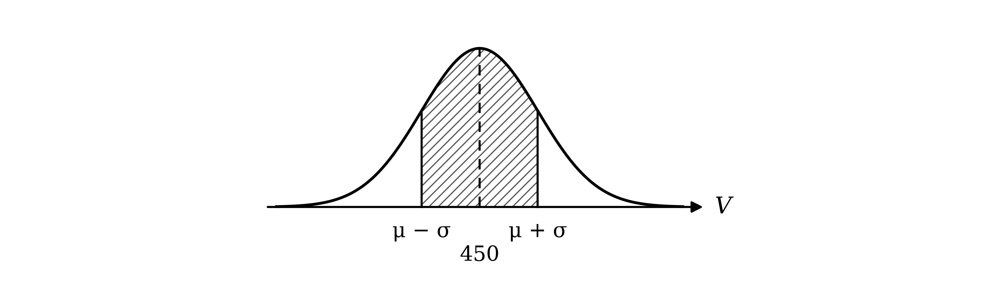

The area between −1 and 1 is the area to the left of 1 minus the area to the left of −1

$\text{P} ( - 1 < Z < 1 ) = Φ ( 1 ) - Φ ( - 1 )$

The table only gives positive values of $z$. By symmetry, the area to the left of −1 equals the area to the right of 1

$Φ ( - 1 ) = 1 - Φ ( 1 )$

Substitute this into the first line

`\text{P}(-1 < Z < 1) = \mathrm{\Phi}(1) - \left(1 - \mathrm{\Phi}(1)\right)`

$\text{P} ( - 1 < Z < 1 ) = 2 Φ ( 1 ) - 1$

**[M1]**

In the table of the normal distribution function in the formula booklet, the 1.0 row and the 0 column give

$Φ ( 1 ) = 0 . 8413$

$\text{P} ( - 1 < Z < 1 ) = 2 \times 0 . 8413 - 1 = 0 . 6826$

**Final answer:** $\text{P} ( 450 - σ < V < 450 + σ ) = 0 . 683$** (3 s.f.)**

**[A1]**

> **[mark-scheme]**
> **M1**: Both 1 and −1 seen as the z-values, and no other z-values.
> 
> **M1**: The area from Φ values of ± the same number, such as 2Φ(1) − 1 or Φ(1) − (1 − Φ(1)).
> 
> **A1**: 0.683, or answers which round to 0.683. Accept 0.6826.
> 
> If the answer is given with no working, for example straight from a calculator, award 1 mark only.

### Q13
Let $W$ be the weight, in kg, so `W \sim \text{N}(1.25, \; 0.38^{2})`. The exported coconuts are the middle 80%, between a lower limit $w_{1}$ with 10% below it and an upper limit $w_{2}$ with 10% above it

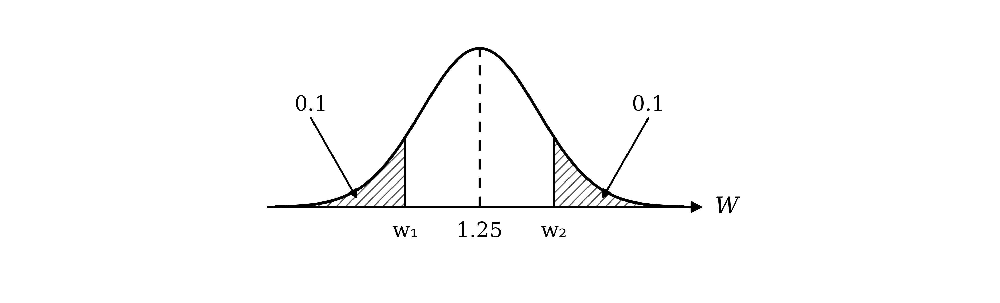

The area to the left of $w_{2}$ is 0.9, which is in the table of critical values for the normal distribution in the formula booklet. By symmetry, $w_{1}$ has the negative of this $z$-value

$z = \pm 1 . 282$

**[B1]**

Standardise using the formula

$Z = \frac{X-μ}{σ}$

Substitute $X = w_{2}$, $μ = 1 . 25$ and $σ = 0 . 38$, and set the result equal to this $z$-value

$\frac{w_{2}-1.25}{0.38} = 1 . 282$

**[M1]**

$w_{2} = 1 . 25 + 1 . 282 \times 0 . 38 = 1 . 73716$

**[A1]**

By symmetry about the mean

$w_{1} = 1 . 25 - 1 . 282 \times 0 . 38 = 0 . 76284$

$0 . 76 < W < 1 . 74$

**[A1]**

> **[mark-scheme]**
> **B1**: z = ±1.282 seen. 1.28 does not score.
> 
> **M1**: Standardisation with 1.25, 0.38 and a limit, equated to their z-value. Equating to 0.1 or 0.9, or dividing by 0.38², does not score.
> 
> **A1**: One limit correct: 1.74 or 0.76 (or 1.737 or 0.763).
> 
> **A1**: The range 0.76 kg to 1.74 kg, in any clear form, for example 0.76 < W < 1.74 or "from 0.76 kg to 1.74 kg". Accept ⩽ in place of <.

### Q14
(i)

Let $T$ be the waiting time, in minutes, so `T \sim \text{N}(10, \; 3^{2})` and $\text{P} ( T < a ) = 0 . 4$

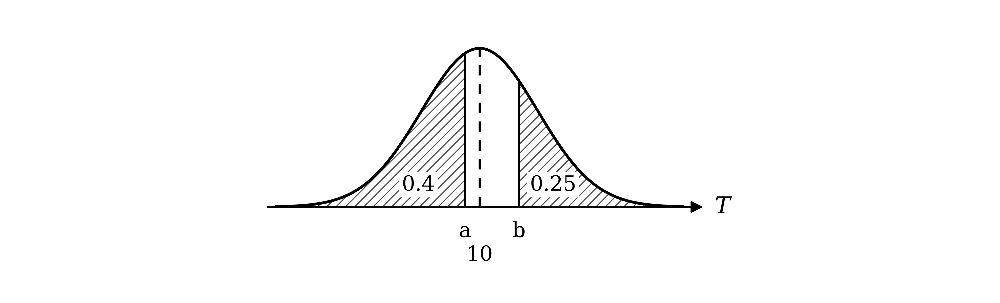

0.4 is less than 0.5, so $a$ is below the mean and its $z$-value is negative. By symmetry, the area to the left of $- z$ is 0.6

$Φ ( - z ) = 0 . 6$

In the table of the normal distribution function in the formula booklet, the nearest value below 0.6 is in the 0.2 row and the 5 column, $Φ ( 0 . 25 ) = 0 . 5987$

$0 . 6 - 0 . 5987 = 0 . 0013$

In the 0.2 row, 13 lies between ADD 3 (12) and ADD 4 (15), so take the third decimal place halfway

$- z = 0 . 2535 \Rightarrow z = - 0 . 2535$

**[B1]**

Standardise using the formula

$Z = \frac{X-μ}{σ}$

Substitute $X = a$, $μ = 10$ and $σ = 3$, and set the result equal to this $z$-value

$\frac{a-10}{3} = - 0 . 2535$

**[M1]**

$a = 10 - 0 . 2535 \times 3 = 9 . 2395$

**Final answer:** $a = 9 . 24$** (2 d.p.)**

**[A1]**

(ii)

$\text{P} ( T > b ) = 0 . 25$, so the area to the left of $b$ is 0.75, which is in the table of critical values for the normal distribution in the formula booklet

$Φ ( z ) = 0 . 75 \Rightarrow z = 0 . 674$

**[B1]**

Standardise $b$ in the same way and set the result equal to this $z$-value

$\frac{b-10}{3} = 0 . 674$

**[M1]**

$b = 10 + 0 . 674 \times 3 = 12 . 022$

**Final answer:** $b = 12 . 02$** (2 d.p.)**

**[A1]**

> **[mark-scheme]**
> **B1**: z = −0.253 for (i), accepting any value from −0.2535 to −0.253 (or the positive value used consistently).
> 
> **M1**: (a − 10)/3 equated to their z-value. Equating to 0.4 or 0.6, or dividing by 9, does not score.
> 
> **A1**: a = 9.24.
> 
> **B1**: z = 0.674 for (ii).
> 
> **M1**: (b − 10)/3 equated to their z-value. Equating to 0.25 or 0.75 does not score.
> 
> **A1**: b = 12.02.
The whole area under the curve is 1. The area to the left of $a$ is 0.4 and the area to the right of $b$ is 0.25, so the area between them is what remains

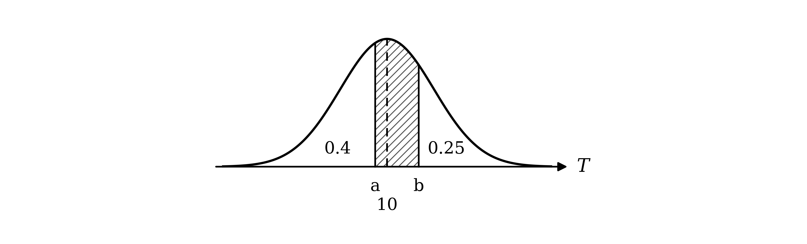

$\text{P} ( a < T < b ) = 1 - 0 . 4 - 0 . 25$

**[M1]**

$\text{P} ( a < T < b ) = 0 . 35$

**[A1]**

> **[mark-scheme]**
> **M1**: 1 − 0.4 − 0.25, or an equivalent such as 0.75 − 0.4, or the area from their Φ values.
> 
> **A1**: 0.35. Accept answers which round to 0.35 from recalculating with the values of a and b.

### Q15
Let $L$ be the length, in cm, so `L \sim \text{N}(\mu, \; 6^{2})` and $\text{P} ( L < 51 ) = 0 . 8665$

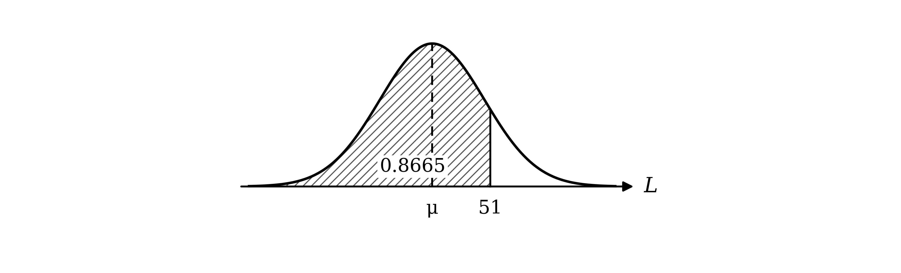

0.8665 is in the body of the table of the normal distribution function in the formula booklet, in the 1.1 row and the 1 column

$Φ ( z ) = 0 . 8665 \Rightarrow z = 1 . 11$

**[B1]**

0.8665 is more than 0.5, so 51 is above the mean and its $z$-value is positive. Standardise using the formula

$Z = \frac{X-μ}{σ}$

Substitute $X = 51$ and $σ = 6$, and set the result equal to this $z$-value

$\frac{51-μ}{6} = 1 . 11$

**[M1]**

$51 - μ = 6 . 66$

$μ = 44 . 34$

**[A1]**

> **[mark-scheme]**
> **B1**: z = 1.11, or −1.11 used consistently.
> 
> **M1**: (51 − μ)/6 equated to their z-value. Equating to 0.8665 or 0.1335, or dividing by 36, does not score.
> 
> **A1**: μ = 44.34, or answers which round to 44.3.
Let $M$ be the mass, in grams, so `M \sim \text{N}(93, \; \sigma^{2})` and $\text{P} ( M > 101 ) = 0 . 0735$

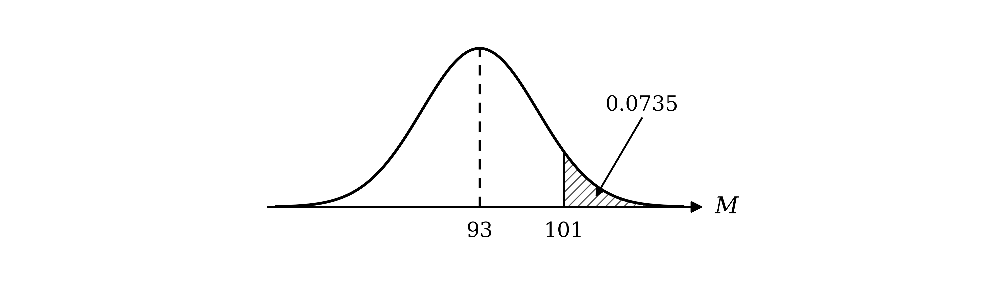

The area to the left of 101 is

$Φ ( z ) = 1 - 0 . 0735 = 0 . 9265$

0.9265 is in the body of the table of the normal distribution function in the formula booklet, in the 1.4 row and the 5 column

$z = 1 . 45$

**[B1]**

Standardise using the formula

$Z = \frac{X-μ}{σ}$

Substitute $X = 101$ and $μ = 93$, and set the result equal to this $z$-value

$\frac{101-93}{σ} = 1 . 45$

**[M1]**

$1 . 45 σ = 8$

$σ = \frac{8}{1.45} = 5 . 5172 \dots$

**Final answer:** $σ = 5 . 52$** (3 s.f.)**

**[A1]**

> **[mark-scheme]**
> **B1**: z = 1.45, or −1.45 used consistently.
> 
> **M1**: (101 − 93)/σ equated to their z-value. Equating to 0.0735 or 0.9265 does not score.
> 
> **A1**: σ = 5.52, or answers which round to 5.52.

### Q16
(i)

In the table of the normal distribution function in the formula booklet, the 1.5 row and the 0 column give the area to the left of 1.5

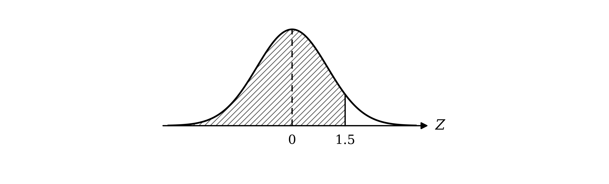

$\text{P} ( Z < 1 . 5 ) = Φ ( 1 . 5 )$

$\text{P} ( Z < 1 . 5 ) = 0 . 9332$

**[B1]**

(ii)

By symmetry, the area to the right of −0.8 equals the area to the left of 0.8

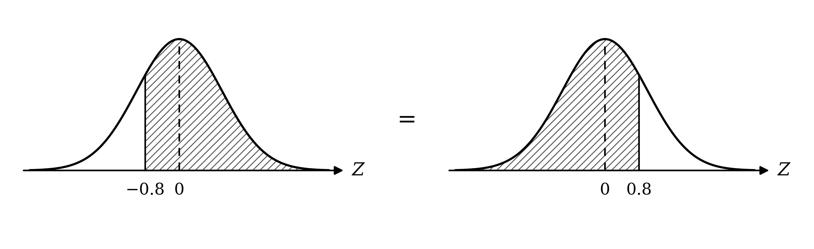

$\text{P} ( Z > - 0 . 8 ) = Φ ( 0 . 8 )$

In the same table, the 0.8 row and the 0 column give

$\text{P} ( Z > - 0 . 8 ) = 0 . 7881$

**[B1]**

(iii)

By symmetry, the area between −2.1 and −0.3 equals the area between 0.3 and 2.1

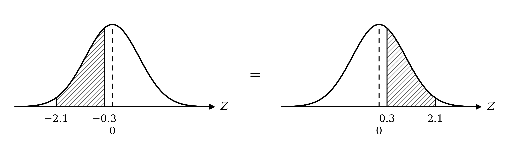

$\text{P} ( - 2 . 1 < Z < - 0 . 3 ) = Φ ( 2 . 1 ) - Φ ( 0 . 3 )$

**[M1]**

In the same table, the 2.1 row and the 0 column give

$Φ ( 2 . 1 ) = 0 . 9821$

The 0.3 row and the 0 column give

$Φ ( 0 . 3 ) = 0 . 6179$

$\text{P} ( - 2 . 1 < Z < - 0 . 3 ) = 0 . 9821 - 0 . 6179$

$\text{P} ( - 2 . 1 < Z < - 0 . 3 ) = 0 . 3642$

**[A1]**

> **[mark-scheme]**
> **B1**: P(Z < 1.5) = 0.9332.
> 
> **B1**: P(Z > −0.8) = 0.7881.
> 
> **M1**: Φ(2.1) − Φ(0.3), or an equivalent such as (1 − Φ(0.3)) − (1 − Φ(2.1)).
> 
> **A1**: P(−2.1 < Z < −0.3) = 0.3642, or answers which round to 0.364.
> 
> The answers to (i), (ii) and (iii) are marked independently.
Each value of $X$ standardises to the matching value of $Z$, so rearrange the standardisation

$z = \frac{x-μ}{σ}$

$x = μ + z σ = 2 + 0 . 1 z$

(i)

$a = 2 + 0 . 1 \times 1 . 5$

$a = 2 . 15$

**[B1]**

(ii)

$b = 2 + 0 . 1 \times ( - 0 . 8 )$

$b = 1 . 92$

**[B1]**

(iii)

The interval from $c$ to $d$ on $X$ matches the interval from −2.1 to −0.3 on $Z$

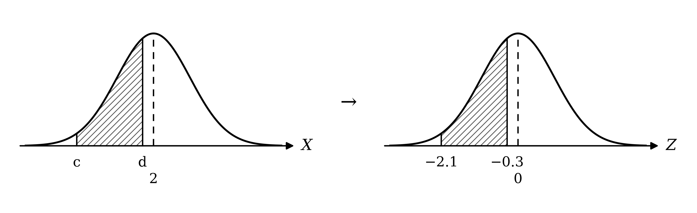

$c = 2 + 0 . 1 \times ( - 2 . 1 )$

$c = 1 . 79$

**[B1]**

$d = 2 + 0 . 1 \times ( - 0 . 3 )$

$d = 1 . 97$

**[B1]**

> **[mark-scheme]**
> **B1**: a = 2.15.
> 
> **B1**: b = 1.92.
> 
> **B1**: c = 1.79.
> 
> **B1**: d = 1.97.
> 
> The four values are marked independently.

### Q17
Let $T$ be the time taken, in minutes, so `T \sim \text{N}(50, \; 7^{2})` and $\text{P} ( T < a ) = 0 . 975$

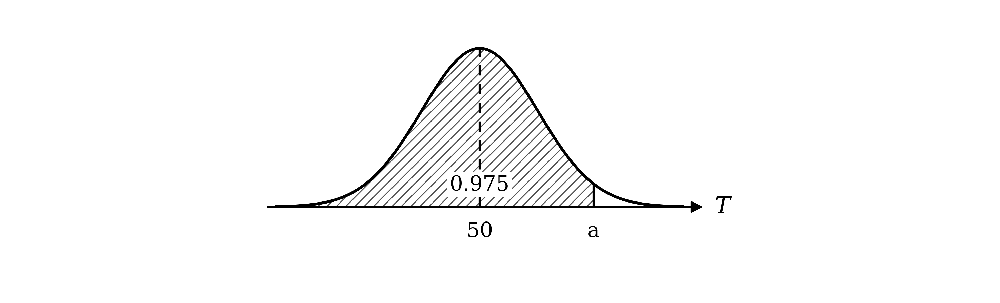

0.975 is in the table of critical values for the normal distribution in the formula booklet

$\text{P} ( Z < z ) = 0 . 975 \Rightarrow z = 1 . 960$

**[B1]**

Standardise using the formula

$Z = \frac{X-μ}{σ}$

Substitute $X = a$, $μ = 50$ and $σ = 7$, and set the result equal to this $z$-value

$\frac{a-50}{7} = 1 . 960$

**[M1]**

$a = 50 + 1 . 960 \times 7 = 63 . 72$

**Final answer:** $a = 63 . 7$** (3 s.f.)**

**[A1]**

> **[mark-scheme]**
> **B1**: z = 1.960, or −1.960 used consistently. Accept 1.96.
> 
> **M1**: (a − 50)/7 equated to their z-value. Equating to 0.975 or 0.025, or dividing by 49, does not score.
> 
> **A1**: a = 63.7, or answers which round to 63.7.
$\text{P} ( T > b ) = 0 . 001$, so the area to the left of $b$ is 0.999

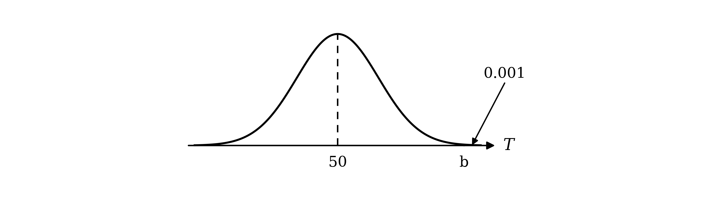

0.999 is in the table of critical values for the normal distribution in the formula booklet

$\text{P} ( Z < z ) = 0 . 999 \Rightarrow z = 3 . 090$

**[B1]**

Standardise using the formula

$Z = \frac{X-μ}{σ}$

Substitute $X = b$, $μ = 50$ and $σ = 7$, and set the result equal to this $z$-value

$\frac{b-50}{7} = 3 . 090$

**[M1]**

$b = 50 + 3 . 090 \times 7 = 71 . 63$

**Final answer:** $b = 71 . 6$** (3 s.f.)**

**[A1]**

> **[mark-scheme]**
> **B1**: z = 3.090, or −3.090 used consistently. Accept 3.09.
> 
> **M1**: (b − 50)/7 equated to their z-value. Equating to 0.001 or 0.999, or dividing by 49, does not score.
> 
> **A1**: b = 71.6, or answers which round to 71.6.

### Q18
`X \sim \text{N}(\mu, \; \sigma^{2})` gives the mean and the variance

$μ = 32$

**[B1]**

The standard deviation is the square root of the variance

$σ = \sqrt{9}$

$σ = 3$

**[B1]**

> **[mark-scheme]**
> **B1**: Mean = 32.
> 
> **B1**: Standard deviation = 3. A standard deviation of 9 does not score.
> 
> The two answers are marked independently.
(i)

34 is above the mean of 32, so the probability is more than 0.5

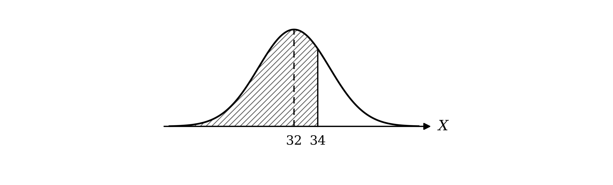

Standardise using the formula

$Z = \frac{X-μ}{σ}$

Substitute $μ = 32$ and $σ = 3$

`\text{P}(X \leq 34) = \text{P}\left(Z \leq \dfrac{34 - 32}{3}\right)`

$\text{P} ( X \leq 34 ) = \text{P} ( Z \leq 0 . 667 ) = Φ ( 0 . 667 )$

**[M1]**

To find $Φ ( 0 . 667 )$, use the table of the normal distribution function in the formula booklet. The 0.6 row and the 6 column give

$Φ ( 0 . 66 ) = 0 . 7454$

For the third decimal place, 7, look in the ADD columns: ADD 7 in the 0.6 row is 23, so add 0.0023

$Φ ( 0 . 667 ) = 0 . 7454 + 0 . 0023 = 0 . 7477$

**Final answer:** $\text{P} ( X \leq 34 ) = 0 . 748$** (3 s.f.)**

**[A1]**

(ii)

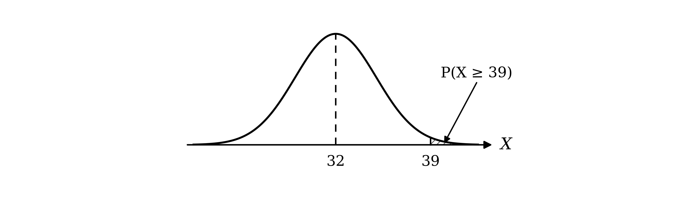

Standardise 39 in the same way

`\text{P}(X \geq 39) = \text{P}\left(Z \geq \dfrac{39 - 32}{3}\right) = \text{P}(Z \geq 2.333)`

The area to the right is 1 minus the area to the left

$\text{P} ( X \geq 39 ) = 1 - Φ ( 2 . 333 )$

**[M1]**

In the same table, the 2.3 row and the 3 column give

$Φ ( 2 . 33 ) = 0 . 9901$

ADD 3 in the 2.3 row is 1, so add 0.0001

$Φ ( 2 . 333 ) = 0 . 9901 + 0 . 0001 = 0 . 9902$

$\text{P} ( X \geq 39 ) = 1 - 0 . 9902 = 0 . 0098$

**Final answer:** $\text{P} ( X \geq 39 ) = 0 . 00980$** (3 s.f.)**

**[A1]**

(iii)

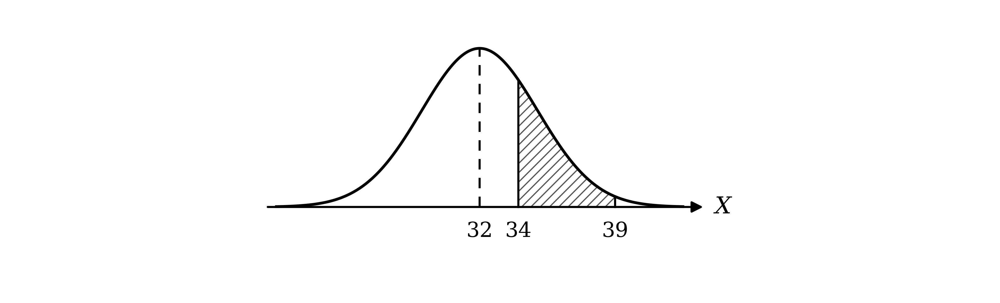

Subtract the area to the left of 34 from the area to the left of 39, using the values of $Φ$ found in (i) and (ii)

$\text{P} ( 34 \leq X \leq 39 ) = Φ ( 2 . 333 ) - Φ ( 0 . 667 )$

**[M1]**

$\text{P} ( 34 \leq X \leq 39 ) = 0 . 9902 - 0 . 7477 = 0 . 2425$

**Final answer:** $\text{P} ( 34 \leq X \leq 39 ) = 0 . 243$** (3 s.f.)**

**[A1]**

> **[mark-scheme]**
> **M1**: Standardising 34 with 32 and 3, and using Φ of the result. Dividing by 9 instead of 3 does not score.
> 
> **A1**: P(X ≤ 34) = 0.748, or answers which round to 0.748.
> 
> **M1**: Standardising 39 with 32 and 3, and subtracting Φ of the result from 1.
> 
> **A1**: P(X ≥ 39) = 0.00980, or answers which round to 0.0098. Accept 0.00982.
> 
> **M1**: The difference of the two Φ values, with the larger first.
> 
> **A1**: P(34 ≤ X ≤ 39) = 0.243, or answers which round to 0.243.
> 
> If 0.748, 0.00980 or 0.243 is given with no working, for example straight from a calculator, award 1 mark only for that answer.

### Q19
Let $L$ be the length, in cm, so `L \sim \text{N}(\mu, \; \sigma^{2})`, with $\text{P} ( L > 36 . 88 ) = 0 . 025$ and $\text{P} ( L < 27 . 16 ) = 0 . 1$

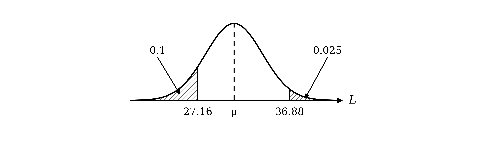

The area to the left of 36.88 is 0.975, which is in the table of critical values for the normal distribution in the formula booklet

$z_{1} = 1 . 960$

**[B1]**

27.16 is below the mean with 0.1 to its left, so its $z$-value is the negative of the critical value for 0.9

$z_{2} = - 1 . 282$

**[B1]**

Standardise using the formula

$Z = \frac{X-μ}{σ}$

Substitute each length and set the result equal to its $z$-value

$\frac{36.88-μ}{σ} = 1 . 960$

**[M1]**

$\frac{27.16-μ}{σ} = - 1 . 282$

Rearrange each into a linear equation

$μ + 1 . 960 σ = 36 . 88$

$μ - 1 . 282 σ = 27 . 16$

Subtract the second equation from the first to eliminate $μ$

$3 . 242 σ = 9 . 72$

$σ = \frac{9.72}{3.242} = 2 . 99815 \dots$

**[M1]**

Substitute the unrounded $σ$ into the first equation

$μ = 36 . 88 - 1 . 960 \times 2 . 99815 \dots = 31 . 0036 \dots$

**Final answer:** $μ = 31 . 0 ,  σ = 3 . 00$** (3 s.f.)**

**[A1]**

> **[mark-scheme]**
> **B1**: z = ±1.960 seen (accept 1.96).
> 
> **B1**: z = ±1.282 seen.
> 
> **M1**: One standardisation of 36.88 or 27.16 with μ and σ, equated to a z-value. Equating to a probability (0.025, 0.975, 0.1 or 0.9), or using σ², does not score.
> 
> **M1**: Solving two simultaneous equations in μ and σ, by elimination or substitution, to obtain values for both.
> 
> **A1**: μ = 31.0 and σ = 3.00, or answers which round to these. Accept 31.00 and 3.00.
> 
> If either M mark is not awarded, award 1 mark for both correct values.

### Q20
(i)

Standardise using the formula

$Z = \frac{X-μ}{σ}$

Substitute $μ = 23$ and $σ = 4$

`\text{P}(X < 20) = \text{P}\left(Z < \dfrac{20 - 23}{4}\right) = \text{P}(Z < -0.75)`

The $z$-value is negative, so use symmetry: the area to the left of −0.75 equals the area to the right of 0.75

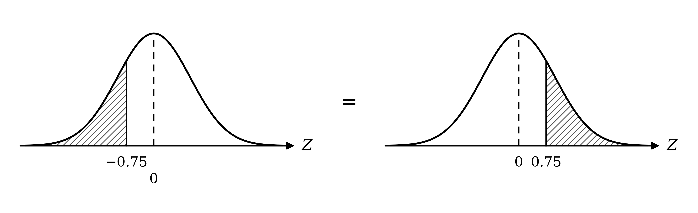

$\text{P} ( X < 20 ) = 1 - Φ ( 0 . 75 )$

**[M1]**

In the table of the normal distribution function in the formula booklet, the 0.7 row and the 5 column give

$Φ ( 0 . 75 ) = 0 . 7734$

$\text{P} ( X < 20 ) = 1 - 0 . 7734 = 0 . 2266$

**Final answer:** $\text{P} ( X < 20 ) = 0 . 227$** (3 s.f.)**

**[A1]**

(ii)

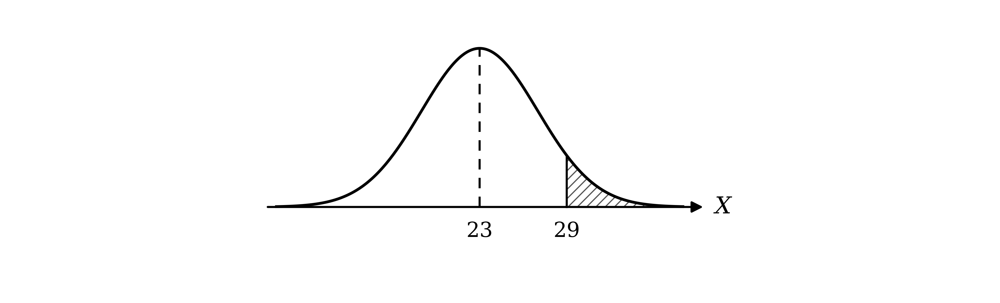

Standardise 29 in the same way

`\text{P}(X \geq 29) = \text{P}\left(Z \geq \dfrac{29 - 23}{4}\right) = \text{P}(Z \geq 1.5)`

The area to the right is 1 minus the area to the left

$\text{P} ( X \geq 29 ) = 1 - Φ ( 1 . 5 )$

**[M1]**

In the same table, the 1.5 row and the 0 column give

$Φ ( 1 . 5 ) = 0 . 9332$

$\text{P} ( X \geq 29 ) = 1 - 0 . 9332 = 0 . 0668$

**Final answer:** $\text{P} ( X \geq 29 ) = 0 . 0668$** (3 s.f.)**

**[A1]**

(iii)

The area between 20 and 29 is everything except the two tails found in (i) and (ii)

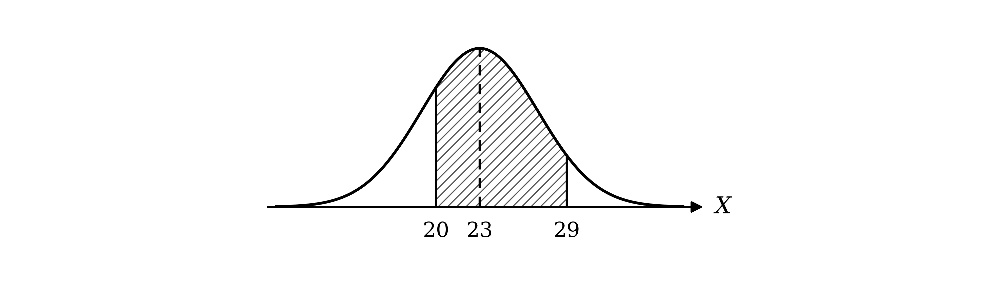

$\text{P} ( 20 \leq X < 29 ) = 1 - 0 . 2266 - 0 . 0668$

**[M1]**

$\text{P} ( 20 \leq X < 29 ) = 0 . 7066$

**Final answer:** $\text{P} ( 20 \leq X < 29 ) = 0 . 707$** (3 s.f.)**

**[A1]**

> **[mark-scheme]**
> **M1**: Standardising 20 with 23 and 4, and 1 − Φ(0.75) (or Φ(−0.75)) found.
> 
> **A1**: 0.227, or answers which round to 0.227.
> 
> **M1**: Standardising 29 with 23 and 4, and 1 − Φ(1.5) found.
> 
> **A1**: 0.0668, or answers which round to 0.0668.
> 
> **M1**: 1 − (their (i)) − (their (ii)), or Φ(1.5) − Φ(−0.75), or an equivalent method giving a probability.
> 
> **A1**: 0.707, or answers which round to 0.707.
> 
> Dividing by 16 instead of 4 does not score the method marks. If 0.227, 0.0668 or 0.707 is given with no working, for example straight from a calculator, award 1 mark only for that answer.
(i)

To find the standard deviation, square root the variance

$σ = \sqrt{225} = 15$

Standardise using the formula

$Z = \frac{X-μ}{σ}$

Substitute $μ = 100$ and $σ = 15$

`\text{P}(Y \leq 90) = \text{P}\left(Z \leq \dfrac{90 - 100}{15}\right) = \text{P}(Z \leq -0.667)`

The $z$-value is negative, so use symmetry: the area to the left of −0.667 equals the area to the right of 0.667

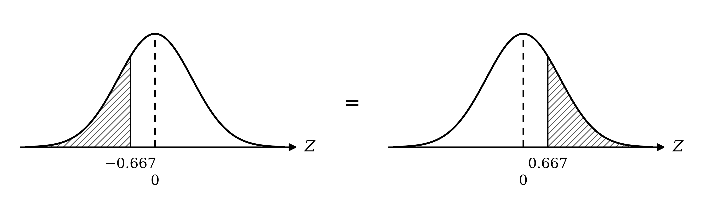

$\text{P} ( Y \leq 90 ) = 1 - Φ ( 0 . 667 )$

**[M1]**

To find $Φ ( 0 . 667 )$, use the table of the normal distribution function in the formula booklet. The 0.6 row and the 6 column give

$Φ ( 0 . 66 ) = 0 . 7454$

For the third decimal place, 7, look in the ADD columns: ADD 7 in the 0.6 row is 23, so add 0.0023

$Φ ( 0 . 667 ) = 0 . 7454 + 0 . 0023 = 0 . 7477$

$\text{P} ( Y \leq 90 ) = 1 - 0 . 7477 = 0 . 2523$

**Final answer:** $\text{P} ( Y \leq 90 ) = 0 . 252$** (3 s.f.)**

**[A1]**

(ii)

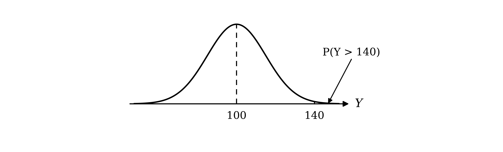

Standardise 140 in the same way

`\text{P}(Y > 140) = \text{P}\left(Z > \dfrac{140 - 100}{15}\right) = \text{P}(Z > 2.667)`

The area to the right is 1 minus the area to the left

$\text{P} ( Y > 140 ) = 1 - Φ ( 2 . 667 )$

**[M1]**

In the same table, the 2.6 row and the 6 column give

$Φ ( 2 . 66 ) = 0 . 9961$

ADD 7 in the 2.6 row is 1, so add 0.0001

$Φ ( 2 . 667 ) = 0 . 9961 + 0 . 0001 = 0 . 9962$

$\text{P} ( Y > 140 ) = 1 - 0 . 9962$

$\text{P} ( Y > 140 ) = 0 . 0038$

**[A1]**

(iii)

85 and 115 are each one standard deviation from the mean, so the interval is symmetrical

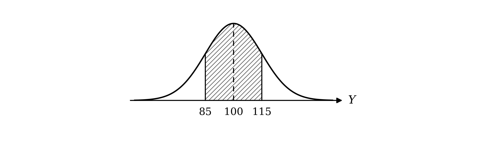

$\text{P} ( 85 \leq Y \leq 115 ) = \text{P} ( - 1 \leq Z \leq 1 )$

The area between −1 and 1 is the area to the left of 1 minus the area to the left of −1

$\text{P} ( - 1 \leq Z \leq 1 ) = Φ ( 1 ) - Φ ( - 1 )$

The table only gives positive values of $z$. By symmetry, the area to the left of −1 equals the area to the right of 1

$Φ ( - 1 ) = 1 - Φ ( 1 )$

Substitute this into the first line

`\text{P}(-1 \leq Z \leq 1) = \mathrm{\Phi}(1) - \left(1 - \mathrm{\Phi}(1)\right)`

$\text{P} ( - 1 \leq Z \leq 1 ) = 2 Φ ( 1 ) - 1$

**[M1]**

In the same table, the 1.0 row and the 0 column give

$Φ ( 1 ) = 0 . 8413$

$\text{P} ( 85 \leq Y \leq 115 ) = 2 \times 0 . 8413 - 1 = 0 . 6826$

**Final answer:** $\text{P} ( 85 \leq Y \leq 115 ) = 0 . 683$** (3 s.f.)**

**[A1]**

> **[mark-scheme]**
> **M1**: Standardising 90 with 100 and 15, and 1 − Φ(0.667) (or Φ(−0.667)) found.
> 
> **A1**: 0.252, or answers which round to 0.252. Accept 0.2525.
> 
> **M1**: Standardising 140 with 100 and 15, and 1 − Φ(2.667) found.
> 
> **A1**: 0.0038, or 0.00383 from a calculator.
> 
> **M1**: Both of ±1 used as z-values and the area from Φ values of ± the same number, such as Φ(1) − (1 − Φ(1)) or 2Φ(1) − 1.
> 
> **A1**: 0.683, or answers which round to 0.683.
> 
> Dividing by 225 instead of 15 does not score the method marks. If 0.252, 0.0038 or 0.683 is given with no working, for example straight from a calculator, award 1 mark only for that answer.

### Q21
Let $X$ be the time taken, in minutes, so `X \sim \text{N}(21, \; 4^{2})`

To use the table, standardise: the value 26 on $X$ matches the value $z = \frac{x-μ}{σ}$ on $Z$

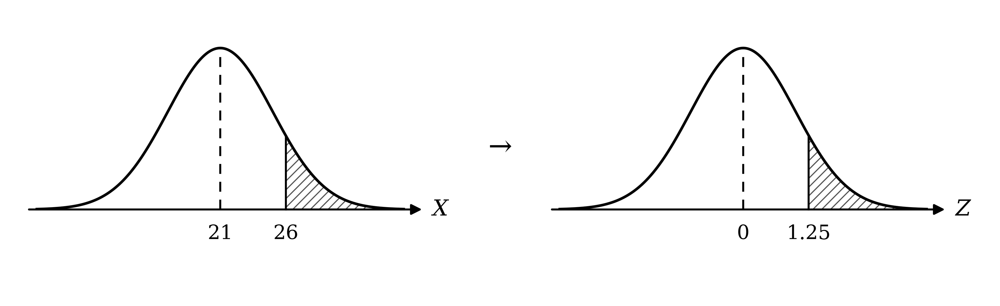

`\text{P}(X > 26) = \text{P}\left(Z > \dfrac{26 - 21}{4}\right)`

$\text{P} ( X > 26 ) = \text{P} ( Z > 1 . 25 )$

**[M1]**

The table of the normal distribution function in the formula booklet gives the area to the left of 1.25, so subtract it from 1

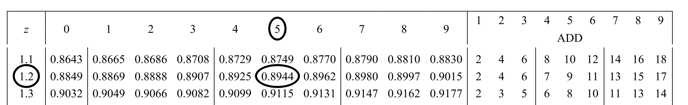

$\text{P} ( X > 26 ) = 1 - Φ ( 1 . 25 )$

**[M1]**

The 1.2 row and the 5 column of the table give

$Φ ( 1 . 25 ) = 0 . 8944$

$\text{P} ( X > 26 ) = 1 - 0 . 8944 = 0 . 1056$

**Final answer:** $\text{P} ( X > 26 ) = 0 . 106$** (3 s.f.)**

**[A1]**

> **[mark-scheme]**
> **M1**: Standardising with 26, 21 and 4. Dividing by 16, or by the square root of 4, does not score.
> 
> **M1**: 1 − Φ(their z), leading to a probability less than 0.5.
> 
> **A1**: P(X > 26) = 0.106, or answers which round to 0.106. Accept 0.1056.
> 
> If 0.106 is given with no working, for example straight from a calculator, award 1 mark only.
(i)

Let $W$ be the weight, in kg, so `W \sim \text{N}(54, \; 5^{2})`

Standardise using the formula

$Z = \frac{X-μ}{σ}$

Substitute $μ = 54$ and $σ = 5$

`\text{P}(W < 51) = \text{P}\left(Z < \dfrac{51 - 54}{5}\right)`

$\text{P} ( W < 51 ) = \text{P} ( Z < - 0 . 6 )$

**[M1]**

The table only gives positive $z$-values. By symmetry, the area to the left of −0.6 equals the area to the right of 0.6

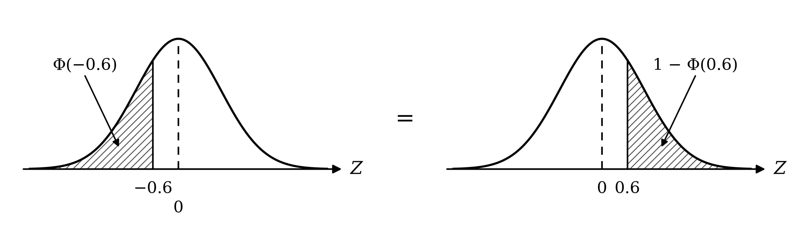

$\text{P} ( W < 51 ) = 1 - Φ ( 0 . 6 )$

**[M1]**

In the table of the normal distribution function in the formula booklet, the 0.6 row and the 0 column give

$Φ ( 0 . 6 ) = 0 . 7257$

$\text{P} ( W < 51 ) = 1 - 0 . 7257 = 0 . 2743$

**Final answer:** $\text{P} ( W < 51 ) = 0 . 274$** (3 s.f.)**

**[A1]**

(ii)

"At least 58 kg" means $W \geq 58$. For a continuous variable, $\text{P} ( W \geq 58 ) = \text{P} ( W > 58 )$

`\text{P}(W \geq 58) = \text{P}\left(Z \geq \dfrac{58 - 54}{5}\right)`

$\text{P} ( W \geq 58 ) = \text{P} ( Z \geq 0 . 8 )$

**[M1]**

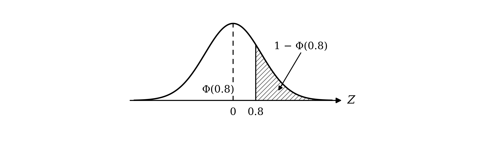

$\text{P} ( W \geq 58 ) = 1 - Φ ( 0 . 8 )$

**[M1]**

In the same table, the 0.8 row and the 0 column give

$Φ ( 0 . 8 ) = 0 . 7881$

$\text{P} ( W \geq 58 ) = 1 - 0 . 7881 = 0 . 2119$

**Final answer:** $\text{P} ( W \geq 58 ) = 0 . 212$** (3 s.f.)**

**[A1]**

> **[mark-scheme]**
> **M1**: Standardising 51 with 54 and 5. Dividing by 25 does not score.
> 
> **M1**: 1 − Φ(0.6), or Φ(−0.6) correctly found, leading to a probability less than 0.5.
> 
> **A1**: 0.274, or answers which round to 0.274.
> 
> **M1**: Standardising 58 with 54 and 5. No continuity correction: 57.5 or 58.5 does not score.
> 
> **M1**: 1 − Φ(their z), leading to a probability less than 0.5.
> 
> **A1**: 0.212, or answers which round to 0.212.
> 
> If 0.274 or 0.212 is given with no working, for example straight from a calculator, award 1 mark only for that answer.
Let $H$ be the height, in cm, so `H \sim \text{N}(187, \; 10^{2})`

Standardise using the formula

$Z = \frac{X-μ}{σ}$

Substitute $μ = 187$ and $σ = 10$ for both values

`\text{P}(190 < H < 203) = \text{P}\left(\dfrac{190 - 187}{10} < Z < \dfrac{203 - 187}{10}\right)`

$\text{P} ( 190 < H < 203 ) = \text{P} ( 0 . 3 < Z < 1 . 6 )$

**[M1]**

The area between the two values is the area to the left of 1.6 minus the area to the left of 0.3

$\text{P} ( 190 < H < 203 ) = Φ ( 1 . 6 ) - Φ ( 0 . 3 )$

**[M1]**

In the table of the normal distribution function in the formula booklet, the 1.6 row and the 0 column give

$Φ ( 1 . 6 ) = 0 . 9452$

The 0.3 row and the 0 column give

$Φ ( 0 . 3 ) = 0 . 6179$

$\text{P} ( 190 < H < 203 ) = 0 . 9452 - 0 . 6179 = 0 . 3273$

**Final answer:** $\text{P} ( 190 < H < 203 ) = 0 . 327$** (3 s.f.)**

**[A1]**

> **[mark-scheme]**
> **M1**: Standardising either 190 or 203 with 187 and 10. Dividing by 100 does not score.
> 
> **M1**: Φ(1.6) − Φ(0.3), from their two z-values, giving a probability.
> 
> **A1**: 0.327, or answers which round to 0.327.
> 
> If 0.327 is given with no working, for example straight from a calculator, award 1 mark only.

### Q22
(i)

The table of the normal distribution function in the formula booklet only gives positive values of $z$. The curve is symmetrical about 0, so the area to the left of −0.5 equals the area to the right of 0.5

$Φ ( - 0 . 5 ) = 1 - Φ ( 0 . 5 )$

The 0.5 row and the 0 column of the table give

$Φ ( 0 . 5 ) = 0 . 6915$

$Φ ( - 0 . 5 ) = 1 - 0 . 6915$

$Φ ( - 0 . 5 ) = 0 . 3085$

**[B1]**

(ii)

In the 0.5 row, the 7 column gives 0.7157 and ADD 9 gives 31

$Φ ( - 0 . 579 ) = 1 - Φ ( 0 . 579 )$

$Φ ( - 0 . 579 ) = 1 - ( 0 . 7157 + 0 . 0031 )$

$Φ ( - 0 . 579 ) = 1 - 0 . 7188$

$Φ ( - 0 . 579 ) = 0 . 2812$

**[B1]**

(iii)

In the 2.7 row, the 8 column gives 0.9973 and ADD 5 gives 0

$Φ ( - 2 . 785 ) = 1 - Φ ( 2 . 785 )$

$Φ ( - 2 . 785 ) = 1 - 0 . 9973$

$Φ ( - 2 . 785 ) = 0 . 0027$

**[B1]**

> **[mark-scheme]**
> **B1**: Φ(−0.5) = 0.3085.
> 
> **B1**: Φ(−0.579) = 0.2812. Accept 0.2813 from a calculator.
> 
> **B1**: Φ(−2.785) = 0.0027. Accept 0.00268 or 0.002676 from a calculator.
> 
> The three answers are marked independently.
(i)

0.1093 is less than 0.5, so $z$ is negative. By symmetry, the area to the right of $- z$ is also 0.1093

$Φ ( - z ) = 1 - 0 . 1093 = 0 . 8907$

0.8907 is in the body of the table of the normal distribution function in the formula booklet, in the 1.2 row and the 3 column

$- z = 1 . 23$

$z = - 1 . 23$

**[B1]**

(ii)

0.001 is less than 0.5, so $z$ is negative

$Φ ( - z ) = 1 - 0 . 001 = 0 . 999$

0.999 is in the table of critical values for the normal distribution in the formula booklet

$- z = 3 . 090$

$z = - 3 . 090$

**[B1]**

(iii)

$Φ ( - z ) = 1 - 0 . 0549 = 0 . 9451$

0.9451 is not in the body of the table of the normal distribution function in the formula booklet, so find the nearest value below it, which is in the 1.5 row and the 9 column

$Φ ( 1 . 59 ) = 0 . 9441$

Subtract to find how much more area is needed

$0 . 9451 - 0 . 9441 = 0 . 0010$

In the 1.5 row, 10 is in the ADD 8 column, so the third decimal place is 8

$- z = 1 . 598$

$z = - 1 . 598$

**[B1]**

(iv)

$Φ ( - z ) = 1 - 0 . 0005 = 0 . 9995$

0.9995 is in the table of critical values

$- z = 3 . 291$

$z = - 3 . 291$

**[B1]**

> **[mark-scheme]**
> **B1**: z = −1.23.
> 
> **B1**: z = −3.090. Accept −3.09.
> 
> **B1**: z = −1.598. Accept −1.599 from a calculator.
> 
> **B1**: z = −3.291.
> 
> The four answers are marked independently. A positive value of z does not score.

### Q23
(i)

$Φ ( 0 . 60 )$ is the area under the standard normal curve to the left of 0.60

Read the value where the 0.6 row meets the 0 column of the table of the normal distribution function in the formula booklet

$Φ ( 0 . 60 ) = 0 . 7257$

**[B1]**

(ii)

Read the value where the 0.6 row meets the 3 column

$Φ ( 0 . 63 ) = 0 . 7357$

**[B1]**

(iii)

Read the value where the 1.5 row meets the 9 column

$Φ ( 1 . 59 ) = 0 . 9441$

**[B1]**

(iv)

Read the value where the 2.9 row meets the 9 column

$Φ ( 2 . 99 ) = 0 . 9986$

**[B1]**

> **[mark-scheme]**
> **B1**: Φ(0.60) = 0.7257.
> 
> **B1**: Φ(0.63) = 0.7357.
> 
> **B1**: Φ(1.59) = 0.9441.
> 
> **B1**: Φ(2.99) = 0.9986.
> 
> The four answers are marked independently. Accept answers from a calculator, which agree with the table to 4 decimal places.
(i)

The third decimal place comes from the ADD columns on the right of the table, which give an amount to add in units of 0.0001

In the table of the normal distribution function in the formula booklet, the 0.6 row and the 0 column give 0.7257, and ADD 1 in that row gives 3, which means 0.0003

$Φ ( 0 . 601 ) = 0 . 7257 + 0 . 0003$

$Φ ( 0 . 601 ) = 0 . 7260$

**[B1]**

(ii)

In the 0.6 row, the 3 column gives 0.7357 and ADD 5 gives 16

$Φ ( 0 . 635 ) = 0 . 7357 + 0 . 0016$

$Φ ( 0 . 635 ) = 0 . 7373$

**[B1]**

(iii)

In the 1.0 row, the 0 column gives 0.8413 and ADD 4 gives 9

$Φ ( 1 . 004 ) = 0 . 8413 + 0 . 0009$

$Φ ( 1 . 004 ) = 0 . 8422$

**[B1]**

(iv)

In the 1.5 row, the 9 column gives 0.9441 and ADD 8 gives 10

$Φ ( 1 . 598 ) = 0 . 9441 + 0 . 0010$

$Φ ( 1 . 598 ) = 0 . 9451$

**[B1]**

> **[mark-scheme]**
> **B1**: Φ(0.601) = 0.7260.
> 
> **B1**: Φ(0.635) = 0.7373.
> 
> **B1**: Φ(1.004) = 0.8422.
> 
> **B1**: Φ(1.598) = 0.9451.
> 
> The four answers are marked independently. Accept a calculator value that differs from the table value by 0.0001 (0.7261, 0.8423 or 0.9450).

### Q24
(i)

The table gives areas to the left, so the area to the right of 0.74 is 1 minus the area to its left

$\text{P} ( Z > 0 . 74 ) = 1 - Φ ( 0 . 74 )$

In the table of the normal distribution function in the formula booklet, the 0.7 row and the 4 column give

$Φ ( 0 . 74 ) = 0 . 7704$

$\text{P} ( Z > 0 . 74 ) = 1 - 0 . 7704$

$\text{P} ( Z > 0 . 74 ) = 0 . 2296$

**[B1]**

(ii)

The curve is symmetrical about 0, so the area to the right of −0.74 equals the area to the left of 0.74

$\text{P} ( Z > - 0 . 74 ) = Φ ( 0 . 74 )$

Using the value of $Φ ( 0 . 74 )$ from (i)

$\text{P} ( Z > - 0 . 74 ) = 0 . 7704$

**[B1]**

(iii)

As in part (i), subtract the area to the left of 2.142 from 1. In the 2.1 row, the 4 column gives 0.9838 and ADD 2 gives 1

$\text{P} ( Z > 2 . 142 ) = 1 - Φ ( 2 . 142 )$

$\text{P} ( Z > 2 . 142 ) = 1 - 0 . 9839$

$\text{P} ( Z > 2 . 142 ) = 0 . 0161$

**[B1]**

(iv)

As in part (ii), use symmetry. In the 1.5 row, the 1 column gives 0.9345 and ADD 6 gives 7

$\text{P} ( Z > - 1 . 516 ) = Φ ( 1 . 516 )$

$\text{P} ( Z > - 1 . 516 ) = 0 . 9345 + 0 . 0007$

$\text{P} ( Z > - 1 . 516 ) = 0 . 9352$

**[B1]**

> **[mark-scheme]**
> **B1**: P(Z > 0.74) = 0.2296.
> 
> **B1**: P(Z > −0.74) = 0.7704.
> 
> **B1**: P(Z > 2.142) = 0.0161.
> 
> **B1**: P(Z > −1.516) = 0.9352. Accept 0.9353 from a calculator.
> 
> The four answers are marked independently.
(i)

0.9306 is more than 0.5, so more than half the area is to the right of $z$ and $z$ is negative. By symmetry, the area to the left of $- z$ is also 0.9306

$Φ ( - z ) = 0 . 9306$

0.9306 is in the body of the table of the normal distribution function in the formula booklet, in the 1.4 row and the 8 column

$- z = 1 . 48$

$z = - 1 . 48$

**[B1]**

(ii)

0.0694 is less than 0.5, so $z$ is positive, and the area to its left is 1 minus 0.0694

$Φ ( z ) = 1 - 0 . 0694 = 0 . 9306$

$z = 1 . 48$

**[B1]**

(iii)

0.1292 is less than 0.5, so $z$ is positive

$Φ ( z ) = 1 - 0 . 1292 = 0 . 8708$

0.8708 is in the 1.1 row and the 3 column

$z = 1 . 13$

**[B1]**

(iv)

0.5931 is more than 0.5, so $z$ is negative, and by symmetry

$Φ ( - z ) = 0 . 5931$

The nearest value below 0.5931 is $Φ ( 0 . 23 ) = 0 . 5910$

$0 . 5931 - 0 . 5910 = 0 . 0021$

In the 0.2 row, 21 lies between ADD 5 (19) and ADD 6 (23), so the third decimal place is between 5 and 6

$- z = 0 . 2355 \dots$

**Final answer:** $z = - 0 . 236$** (3 d.p.)**

**[B1]**

> **[mark-scheme]**
> **B1**: z = −1.48.
> 
> **B1**: z = 1.48.
> 
> **B1**: z = 1.13.
> 
> **B1**: z = −0.236. Accept −0.235 or −0.2355.
> 
> The four answers are marked independently. A positive value where z should be negative, or a negative value where z should be positive, does not score.

### Q25
(i)

$z$ is the value with an area of 0.5398 to its left

Find 0.5398 in the body of the table: it is in the 0.1 row and the 0 column

$z = 0 . 1$

**[B1]**

(ii)

0.9147 is in the body of the table of the normal distribution function in the formula booklet, in the 1.3 row and the 7 column

$z = 1 . 37$

**[B1]**

(iii)

0.8642 is not in the body of the table, so use the ADD columns. The nearest value below it is $Φ ( 1 . 09 ) = 0 . 8621$

$0 . 8642 - 0 . 8621 = 0 . 0021$

In the 1.0 row, 21 is in the ADD 9 column, so the third decimal place is 9

$z = 1 . 099$

**[B1]**

(iv)

The nearest value below 0.9764 is $Φ ( 1 . 98 ) = 0 . 9761$

$0 . 9764 - 0 . 9761 = 0 . 0003$

In the 1.9 row, 3 is in the ADD 5 column

$z = 1 . 985$

**[B1]**

> **[mark-scheme]**
> **B1**: z = 0.1. Accept 0.10.
> 
> **B1**: z = 1.37.
> 
> **B1**: z = 1.099.
> 
> **B1**: z = 1.985. Accept values between 1.984 and 1.986, for example from a calculator.
> 
> The four answers are marked independently.
(i)

Find 0.75 in the $p$ row of the table of critical values for the normal distribution in the formula booklet and read the $z$-value below it

$z = 0 . 674$

**[B1]**

(ii)

Find 0.999 in the $p$ row

$z = 3 . 090$

**[B1]**

> **[mark-scheme]**
> **B1**: z = 0.674.
> 
> **B1**: z = 3.090. Accept 3.09.
> 
> The two answers are marked independently.

### Q26
(i)

The area between two values is the area to the left of the upper value minus the area to the left of the lower value

$\text{P} ( a < Z < b ) = Φ ( b ) - Φ ( a )$

$\text{P} ( 0 . 12 < Z < 1 . 34 ) = Φ ( 1 . 34 ) - Φ ( 0 . 12 )$

In the table of the normal distribution function in the formula booklet, the 1.3 row and the 4 column give

$Φ ( 1 . 34 ) = 0 . 9099$

The 0.1 row and the 2 column give

$Φ ( 0 . 12 ) = 0 . 5478$

$\text{P} ( 0 . 12 < Z < 1 . 34 ) = 0 . 9099 - 0 . 5478 = 0 . 3621$

**Final answer:** $\text{P} ( 0 . 12 < Z < 1 . 34 ) = 0 . 362$** (3 s.f.)**

**[B1]**

(ii)

In the same table, the 1.0 row and the 3 column give 0.8485. For the third decimal place, ADD 7 in the 1.0 row is 16, so add 0.0016

$Φ ( 1 . 037 ) = 0 . 8485 + 0 . 0016 = 0 . 8501$

The 2.9 row and the 1 column give 0.9982, and ADD 3 in the 2.9 row is 0

$Φ ( 2 . 913 ) = 0 . 9982 + 0 = 0 . 9982$

$\text{P} ( 1 . 037 < Z < 2 . 913 ) = Φ ( 2 . 913 ) - Φ ( 1 . 037 )$

$\text{P} ( 1 . 037 < Z < 2 . 913 ) = 0 . 9982 - 0 . 8501 = 0 . 1481$

**Final answer:** $\text{P} ( 1 . 037 < Z < 2 . 913 ) = 0 . 148$** (3 s.f.)**

**[B1]**

(iii)

The lower value is negative, so use $Φ ( - 2 ) = 1 - Φ ( 2 )$

$\text{P} ( - 2 < Z < 1 ) = Φ ( 1 ) - Φ ( - 2 )$

`\text{P}(-2 < Z < 1) = \mathrm{\Phi}(1) - \left(1 - \mathrm{\Phi}(2)\right)`

In the same table, the 1.0 row and the 0 column give

$Φ ( 1 ) = 0 . 8413$

The 2.0 row and the 0 column give

$Φ ( 2 ) = 0 . 9772$

$\text{P} ( - 2 < Z < 1 ) = 0 . 8413 - ( 1 - 0 . 9772 ) = 0 . 8185$

**Final answer:** $\text{P} ( - 2 < Z < 1 ) = 0 . 819$** (3 s.f.)**

**[B1]**

(iv)

By symmetry, the area between −1.5 and −0.5 equals the area between 0.5 and 1.5

$\text{P} ( - 1 . 5 < Z < - 0 . 5 ) = Φ ( 1 . 5 ) - Φ ( 0 . 5 )$

In the same table, the 1.5 row and the 0 column give

$Φ ( 1 . 5 ) = 0 . 9332$

The 0.5 row and the 0 column give

$Φ ( 0 . 5 ) = 0 . 6915$

$\text{P} ( - 1 . 5 < Z < - 0 . 5 ) = 0 . 9332 - 0 . 6915 = 0 . 2417$

**Final answer:** $\text{P} ( - 1 . 5 < Z < - 0 . 5 ) = 0 . 242$** (3 s.f.)**

**[B1]**

> **[mark-scheme]**
> **B1**: P(0.12 < Z < 1.34) = 0.362, or answers which round to 0.362.
> 
> **B1**: P(1.037 < Z < 2.913) = 0.148, or answers which round to 0.148.
> 
> **B1**: P(−2 < Z < 1) = 0.819, or answers which round to 0.819. Accept 0.8185.
> 
> **B1**: P(−1.5 < Z < −0.5) = 0.242, or answers which round to 0.242.
> 
> The four answers are marked independently.
(i)

Half the area lies to the left of 0, so $Φ ( 0 ) = 0 . 5$

$Φ ( z ) - Φ ( 0 ) = 0 . 499$

$Φ ( z ) = 0 . 499 + 0 . 5 = 0 . 999$

0.999 is in the table of critical values for the normal distribution in the formula booklet

$z = 3 . 090$

**[B1]**

(ii)

Find $Φ ( 2 . 093 )$ first. In the table of the normal distribution function in the formula booklet, the 2.0 row and the 9 column give 0.9817, and ADD 3 in the 2.0 row is 1, so add 0.0001

$Φ ( 2 . 093 ) = 0 . 9817 + 0 . 0001 = 0 . 9818$

$Φ ( 2 . 093 ) - Φ ( z ) = 0 . 319$

$Φ ( z ) = 0 . 9818 - 0 . 319 = 0 . 6628$

0.6628 is in the 0.4 row and the 2 column

$z = 0 . 42$

**[B1]**

(iii)

In the table of the normal distribution function in the formula booklet, the 1.3 row and the 0 column give

$Φ ( 1 . 3 ) = 0 . 9032$

$Φ ( 1 . 3 ) - Φ ( z ) = 0 . 9027$

$Φ ( z ) = 0 . 9032 - 0 . 9027 = 0 . 0005$

0.0005 is less than 0.5, so $z$ is negative. By symmetry

$Φ ( - z ) = 1 - 0 . 0005 = 0 . 9995$

0.9995 is in the table of critical values for the normal distribution in the formula booklet

$- z = 3 . 291$

$z = - 3 . 291$

**[B1]**

(iv)

The area between $- z$ and $z$ is the area to the left of $z$ minus the area to the left of $- z$

$\text{P} ( - z < Z < z ) = Φ ( z ) - Φ ( - z )$

By symmetry, the area to the left of $- z$ equals the area to the right of $z$

$Φ ( - z ) = 1 - Φ ( z )$

Substitute this into the first line

`\text{P}(-z < Z < z) = \mathrm{\Phi}(z) - \left(1 - \mathrm{\Phi}(z)\right)`

$\text{P} ( - z < Z < z ) = 2 Φ ( z ) - 1$

The area between $- z$ and $z$ is 0.6826

$2 Φ ( z ) - 1 = 0 . 6826$

$Φ ( z ) = \frac{1.6826}{2} = 0 . 8413$

0.8413 is in the 1.0 row and the 0 column

$z = 1$

**[B1]**

> **[mark-scheme]**
> **B1**: z = 3.090. Accept 3.09.
> 
> **B1**: z = 0.42.
> 
> **B1**: z = −3.291.
> 
> **B1**: z = 1. Accept 1.00.
> 
> The four answers are marked independently.
