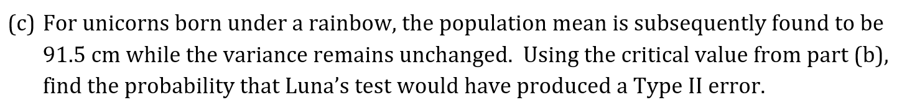

# Exam Questions — Hypothesis Testing (Normal Distribution)
**Hypothesis Testing** · Cambridge (CIE) A-LEVEL maths (9709)
> Source: [https://www.savemyexams.com/a-level/maths/cie/20/probability-and-statistics-2/topic-questions/](https://www.savemyexams.com/a-level/maths/cie/20/probability-and-statistics-2/topic-questions/) · 29 questions across 1 sets

## Exam Questions (29 questions)

### Q1 — very_hard — 5 marks

**Q1** [2 marks]

The population mean of the random variable  $X \sim N ( \mu , 5^{2} )$ is being tested using a null hypothesis  $H_{0}:μ=p$ against the alternative hypothesis  $H_{1}:μ\neqp.$ A random sample of 16 observations is taken from the population and the sample mean is calculated as $\overline{x}=s.$ There is insufficient evidence to reject the null hypothesis using a 5% level of significance.

When $p=30$ find the range of values for $s$.

**Q1** [3 marks]

When $s=25$ find the range of values for $p.$

### Q2 — very_hard — 9 marks

**Q2** [3 marks]

Cyd is a fan of jazz music.  The length of a jazz song, $L$, follows a normal distribution with a standard deviation of 0.71 minutes. Cyd reads a headline that states that the mean length of a jazz song is 4 minutes, Cyd claims that the mean length of a jazz song is less than 4 minutes.  To test her claim, she takes a random sample of 40 songs and calculates the sample mean.

Stating your hypotheses clearly, find the rejection region for $̅L$ for Cyd’s test using a 5% level of significance.

**Q2** [1 mark]

Cyd decides to include more songs in her sample, what effect would this have on the rejection region?

**Q2** [4 marks]

Cyd includes  songs in her sample and calculates the sample mean as 3.95 minutes.

Given that this sample mean is in the rejection region, find the minimum possible value for the sample size $n$.

**Q2** [1 mark]

Explain whether it was necessary to use the Central Limit theorem for any part of this question.

### Q3 — very_hard — 9 marks

**Q3** [6 marks]

The proportion of dalmatians that have no black spots on their faces is denoted $p$.  It is claimed that $p$ is 0.2 but Ella suspects that the true value is lower.  Ella takes a random sample of 101 dalmatians and finds that 88 have black spots on their faces.

Using an appropriate approximating distribution, test Ella’s suspicion at the 5% significance level.

**Q3** [1 mark]

Justify your choice of approximating distribution.

**Q3** [2 marks]

State, with a reason, which of the errors, Type I or Type II, might have been made in carrying out the test in part (a).

### Q4 — very_hard — 13 marks

**Q4** [2 marks]

The weight of an adult pig can be modelled using a normal distribution with a mean of 255 kg and a variance of 2000 kg². A pig is labelled as *supersized* if it weighs more than 350 kg.

Using the model, find the probability that a randomly selected pig is labelled as *supersized*.

**Q4** [5 marks]

Ramon, a farmer, believes that the probability that his pigs are *supersized* is higher than the probability given by the model.  To test his belief Ramon randomly selects 12 pigs that he has owned and finds that two of them were classed as *supersized*.

Stating your hypotheses clearly, test Ramon’s belief using a 5% significance level.

**Q4** [4 marks]

Ramon also claims that the mean weight of the pigs on his farm is higher than the mean weight according to the model.  Using the 12 pigs in his sample, Ramon calculates the sample mean as 273 kg.

Stating your hypotheses clearly, test Ramon’s claim using a 5% significance level.

**Q4** [2 marks]

What do the results from parts (b) and (c) suggest about the variance of the weights of the pigs on Ramon’s farm? Explain your answer.

### Q5 — very_hard — 11 marks

**Q5** [6 marks]

Margot, a biologist, is researching the lengths of snails that are bred in captivity.  It is known that the standard deviation of the length of a snail in captivity is 7.2 mm.  Margot claims that the mean length of snails is less than 60 mm.  Taking 20 snails as a sample, Margot calculates the sample mean as 56.1 mm.

Stating your hypotheses clearly, test Margot’s claim using a 1% level of significance.

**Q5** [2 marks]

State two assumptions that you made whilst carrying out the test in part (a).

**Q5** [2 marks]

State, with a reason, which of the errors, Type I or Type II, might have been made in carrying out the test in part (a).

**Q5** [1 mark]

Margot repeats the same test but with a different random sample of 20 snails. Write down the probability that the test will produce a Type I error.

### Q6 — very_hard — 8 marks

**Q6** [8 marks]

There is a large cohort of students studying the statistics course at the University of Bernoulli.  The students’ marks on an exam can be modelled by a normal distribution with mean $μ$ and standard deviation 12.  The lecturer, Jacob, is trying to demonstrate the power of hypothesis testing.  He knows the true value of $μ$ to be 59 but he keeps this a secret from the students.

Jacob asks the students to use the mean of a random sample of 25 exam results to test the null hypothesis $H_{0} ∶ \mu = 55$ against the alternate hypothesis $H_{1} ∶ \mu > 55$.  Jacob calculates the probability of the test producing a Type II error to be 0.325.

(i) The students calculate the probability that their test will result in a Type I error, find this probability.

(ii) Write down the actual probability of a Type I error on this test.

### Q7 — very_hard — 9 marks

**Q7** [5 marks]

Dr Yassin is a newly qualified dentist.  The length of time it takes him to perform a routine tooth extraction is normally distributed with a standard deviation of 41 seconds.  The mean time for a tooth extraction, $μ$, should be 420 seconds.  His supervisor, Dr Holden, takes a random sample of six patients and records how long it takes Dr Yassin to perform the procedure.  Five of the times are:

433        381       498       363      419

Dr Holden uses a 5% level of significance to test $\mathrm{H}_{0} ∶ \mu = 420$  against $\mathrm{H}_{1} ∶ \mu \ne 420$.

Given that the result of the hypothesis test is that there is insufficient evidence to reject at the 5% level of significance, find an inequality for the length of time, $t$ , for the sixth procedure.

**Q7** [4 marks]

If Dr Holden had instead used the alternative hypothesis $\mathrm{H}_{1} ∶ \mu < 420$ then the result would have been different.

Using this information, find an improved inequality for $t$.

### Q8 — easy — 6 marks

**Q8** [1 mark]

The Starlighter is a new brand of flashlight.  It is known that the brightness, $B$ lumens, of the light emitted from a Starlighter follows a normal distribution with a standard deviation of 15 lumens.  Annie, a salesperson, claims that the mean brightness of a Starlighter is greater than 110 lumens.  To test her claim, the null hypothesis $\mathrm{H}_{0} ∶ \mu = 110$ is used with a 5% level of significance.

Write down a suitable alternative hypothesis to test Annie’s claim.

**Q8** [3 marks]

To test Annie’s claim a random sample of 40 Starlighters is taken and the mean brightness, $\overline{b}$, is calculated.

(i) Assuming that the null hypothesis is true write down the distribution of the sample mean, $\overline{B}$.

(ii) Find the critical region for the test.

**Q8** [2 marks]

Given that the mean of sample is $\overline{b}=114.5$lumens,

(i) State whether there is sufficient evidence to reject the null hypothesis at the 5% level of significance

(ii) Write a conclusion, in context, to the test.

### Q9 — easy — 10 marks

**Q9** [2 marks]

A random sample of 25 independent observations of the random variable $X \sim N ( 50 , 10 ² )$ is taken. The sample mean, $̅X$ is calculated.

Explain why `̅ X tilde N ( 50 , 2 ^2 )`.

**Q9** [4 marks]

Find

(i) $P(̅X<45)$

(ii) $P(̅X>54)$

**Q9** [4 marks]

Find the value of $k$ such that:

(i) $P(̅X<k)=0.05$

(ii) $P(̅X>k)=0.1$

### Q10 — easy — 5 marks

**Q10** [5 marks]

Write suitable null and alternative hypotheses for each of the following situations.

(i) A butcher advertises that their burgers weigh 180 g.  A customer believes that the burgers are on average underweight.

(ii) The CEO of a large multi-academy trust claims that the students in her schools spend on average 150 minutes on homework each night.  A parent wants to test if the claim is true, so he takes a random sample of 20 students and calculates the mean time spent on homework during a specific night.

(iii) The average weight of an adult male in the UK was known to be 83.6 kg before the country had a lockdown.  After the lockdown ended the standard deviation of weights remained the same.  A fitness instructor is investigating whether adult males in the UK got heavier during the lockdown.

(iv) The manager of a company buys a hot drink vending machine for his employees.  The machine is supposed to dispense 350 ml of coffee when a customer selects the medium option.  The manager believes that the machine does not dispense enough coffee.  To test this, he takes a sample of 25 medium coffees and calculates the mean as 342 ml.

### Q11 — easy — 8 marks

**Q11** [1 mark]

The random variable $S$ follows a normal distribution with a mean of 40 and a standard deviation of 8.  The mean of 16 independent observations of $S$ is denoted as $\overline{S}$.

Explain why the standard deviation of $\overline{S}$ is 2.

**Q11** [4 marks]

By standardising and using the table of values for the normal distribution, find:

(i) $P(S<39)$

(ii) $P(\overline{S}<39)$

**Q11** [3 marks]

By standardising and using the table of critical values for the normal distribution, find:

(i) the value of $x$ such that $P(S>x)=0.1$

(ii) the value of $y$ such that $P(\overline{S}>y)=0.1$.

### Q12 — easy — 6 marks

**Q12** [1 mark]

A hypothesis test is used to investigate the population mean of the random variable $X \sim N ( \mu , 10^{2} )$. A random sample of size 16 is used to test the null hypothesis $H_{0} ∶ \mu = 25$.

Write down the probability of a Type I error if a 10% significance level is used.

**Q12** [3 marks]

Find the probability of a Type I error given that the rejection region is

(i) `( ̅ X less than 21 )`

(ii) `( ̅ X less than 21 ) o r ( ̅ X greater than 29 )`

**Q12** [2 marks]

Given that the rejection region is `( ̅ X greater than 29 )`, find the probability of a Type II error if the true mean is 27.

### Q13 — easy — 5 marks

**Q13** [4 marks]

A random sample of size 100 is taken from a population given by $X \sim N ( \mu , 9 )$.

A two-tailed test is used to investigate the null hypothesis $H_{0}:μ=50$ at the 10% level of significance.

(i) Write down a suitable alternative hypothesis for this test.

(ii) Find the rejection regions for $\overline{X}$ for this test.

**Q13** [1 mark]

Given that there is insufficient evidence to reject the null hypothesis when $\overline{x}=k,$ write down an inequality for the range of values of $k.$

### Q14 — easy — 9 marks

**Q14** [2 marks]

The wingspan of a small white butterfly, $W$ cm, follows a normal distribution with a standard deviation of 0.8 cm.  A report states that the average wingspan of a small white butterfly is 4.1 cm.  Kenzie, a butterfly enthusiast, wants to conduct a two-tailed hypothesis test, using a 5% level of significance, to investigate the validity of the statement made by the report.

(i) Write down a suitable null hypothesis for Kenzie’s test.

(ii) Write down a suitable alternative hypothesis for Kenzie’s test.

**Q14** [3 marks]

Kenzie uses a random sample of 6 small white butterflies and finds that the mean wingspan is 2.65 cm.  Kenzie starts off the hypothesis test as follows:

$I f H_{0} i s t r u e t h e n W \sim N ( 4.1 , 0.8^{2} )$

$P(W<2.65)=P(Z<-1.8125)\,=1-0.9651\,=0.0349<0.05$

Identify and explain the two mistakes that Kenzie has made in his hypothesis test.

**Q14** [4 marks]

(i) Find the test statistic, $z$, that Kenzie should use.

(ii) Write down the critical value for the test statistic, $z$, using the table of critical values.

(iii) By comparing the test statistic, $z$, with the critical value, complete the hypothesis test.

### Q15 — easy — 9 marks

**Q15** [5 marks]

The population mean of the random variable $X \sim N ( \mu , 6^{2} )$  is being tested using a null hypothesis $H_{0}:μ=15$ against the alternative hypothesis $H_{1}:μ<15.$ A random sample of 10 observations is taken from the population and the sample mean is calculated as $\overline{x}$.

(i) Write down the distribution of the sample mean,$\overline{X}$.

(ii) Find the test statistic, $z$, for $̅x=12$ and hence find $P(̅X<12)$.

(iii) Find the rejection region for $̅X$, when a 10% significance level is used.

**Q15** [4 marks]

The population mean of the random variable $Y \sim N ( \mu , 10 )$ is being tested using a null hypothesis $H_{0}:μ=0$ against an alternative hypothesis.  A random sample of 36 observations is taken from the population and the critical region for the test is $\overline{Y}>0.7778$.

(I) Write down the appropriate alternative hypothesis for the test.

(ii) Write down the distribution of the sample mean, $\overline{Y}$.

(iii) Find the level of significance that was used in the test.

### Q16 — medium — 6 marks

**Q16** [2 marks]

The mass of a Burmese cat, $C$, follows a normal distribution with a mean of 4.2 kg and a standard deviation 1.3 kg. Kamala, a cat breeder, claims that Burmese cats weigh more than the average if they live in a household that contains young children. To test her claim, Kamala takes a random sample of 25 cats that live in households containing young children.

The null hypothesis, $H_{0}:μ=4.2$,  is used to test Kamala’s claim.

(i) Write down the alternative hypothesis to test Kamala’s claim.

(ii) Write down the distribution of the sample mean, $̅C$.

**Q16** [2 marks]

Using a 5% significance level, find the rejection region of $̅C$ for this test.

**Q16** [2 marks]

Kamala calculates the mean mass of the 25 cats included in her sample to be 4.65 kg.

Determine the outcome of the hypothesis test at the 5% significance level, giving your answer in context.

### Q17 — medium — 7 marks

**Q17** [1 mark]

The IQ of a student at Calculus High can be modelled as a random variable with the distribution $N(126,50)$ . The headteacher decides to play classical music during lunchtimes and suspects that this has caused a change in the average IQ of the students.

Write suitable null and alternative hypotheses to test the headteacher’s suspicion.

**Q17** [5 marks]

The headteacher selects 10 students and asks them to complete an IQ test.  Their scores are:

127, 127, 129, 130, 130, 132, 132, 132, 133, 138

Test, at the 5% level of significance, whether there is evidence to support the headteacher’s suspicion.

**Q17** [1 mark]

It was later discovered that the 10 students used in the sample were all in the same advanced classes.

Comment on the validity of the conclusion of the test based on this information.

### Q18 — medium — 6 marks

**Q18** [1 mark]

The time, $X$ seconds, that it takes Pierre to run a 400 m race can be modelled using $X \sim N ( 87 , 16 )$. Pierre changes his diet and claims that the time it takes him to run 400 m has decreased.

Write suitable null and alternative hypotheses to test Pierre’s claim.

**Q18** [4 marks]

After changing his diet, Pierre runs 36 separate 400 m races and calculates his mean time on these races to be 86.1 seconds.

Use these 36 races as a sample to test, at the 5% level of significance, whether there is evidence to support Pierre’s claim.

**Q18** [1 mark]

Give a reason to explain why the 36 races might not form a suitable sample for this test.

### Q19 — medium — 8 marks

**Q19** [2 marks]

The average length, $L$, of a unicorn’s horn is 91 cm with a variance of 5 cm².  Luna researches unicorns and believes that unicorns that were born beneath a rainbow have longer horns.  To test her belief, Luna takes a random sample of 12 unicorns that were born beneath a rainbow and measures the length of their horns.

(i) Write suitable null and alternative hypotheses to test Luna’s claim.

(ii) What assumption do we need to make about the length of unicorn horns so that a normal distribution can be used for the mean of the sample, $\overline{L.}$

**Q19** [3 marks]

Given that the critical value for the hypothesis test is 92.1 cm, calculate the level of significance for the test.

**Q19** [3 marks]

### Q20 — medium — 11 marks

**Q20** [2 marks]

Carl and Ashleigh are highly competitive siblings.  Ashleigh can complete a crossword in 28 minutes on average.  Carl claims that his mean time for completing a crossword, $μ$ minutes, is different to Ashleigh’s mean time.

Explain why a two-tailed test is needed to test Carl’s claim and write down suitable null and alternative hypotheses.

**Q20** [3 marks]

Carl decides to use the rejection regions $̅X<27\mathrm{and}̅X>29$. Carl takes a random sample of 40 crosswords and records the times, $X$ minutes, it takes him to complete each one. The results are summarised as follows.

$n=40\sumx=1103\sumx^{2}=30870$

Calculate unbiased estimates for the mean and variance of $X$.

**Q20** [2 marks]

Explain how you know that Carl’s test has not resulted in a Type I error.

**Q20** [3 marks]

The true value for $μ$ is subsequently found to be 27.4 minutes.  Find the probability that Carl’s test would have produced a Type II error.

**Q20** [1 mark]

Explain whether the results of the Central Limit theorem were necessary for giving your answer to part (d).

### Q21 — medium — 9 marks

**Q21** [1 mark]

Carol is a new employee at a company and wishes to investigate whether there is a difference in pay based on gender, but she does not have access to information for all the employees.  It is known that the average salary of a male employee is £32500, and it can be assumed the salary of a female employee follows a normal distribution with a standard deviation of £6100.  Carol forms a sample using 20 randomly selected female employees.

Write suitable null and alternative hypotheses to test whether the average salary of a female employee is different to the average salary of a male employee.

**Q21** [3 marks]

Using a 5% level of significance, find the critical regions for the mean salary which would lead to the rejection of the null hypothesis.

**Q21** [2 marks]

The total of the salaries of the 20 employees used in the sample is `£ 602000`.

Use this information to state a conclusion for Carol’s investigation into pay differences based on gender.

**Q21** [3 marks]

Would the outcome of the test have been different if a 10% level of significance had been used?

### Q22 — medium — 7 marks

**Q22** [3 marks]

The standard normal distribution is denoted by $Z \sim N ( 0 , 1^{2} )$ .

(i) Write down a formula that links the standard normal distribution,$Z$ , to the distribution  $\bar{X} \sim N ( \mu , \frac{\sigma ^{2}}{n} )$.

(ii) Find the value of $d$  such that  $P(Z<d)=0.05$ , correct to 3 decimal places.

**Q22** [4 marks]

The population mean of the random variable $X \sim N ( \mu , 10^{2} )$ is being tested using a null hypothesis  $H_{0}:μ=30$ against the alternative hypothesis  $H_{1}:μ<30$.  A random sample of  observations is taken from the population and the sample mean is calculated as 28.

Using a 5% level of significance, there is not enough evidence to reject the null hypothesis.

(i) Show that $\sqrt{n}<8.2245$

(ii) Hence find the greatest possible value for the sample size, $n$ .

### Q23 — hard — 9 marks

**Q23** [4 marks]

*Adrenaline* is a new rollercoaster at a theme park.  It is known that the time a customer spends in the queue follows a normal distribution with a variance of 52 minutes².  The mean time spent in a queue for other rollercoasters is 41 minutes.  The manager of the theme park wants to use a hypothesis test to investigate whether the mean time in the queue for *Adrenaline* is different to the mean time for the other rollercoasters.  She takes a sample of 10 customers over a period of several days and records their times spent in the queue for *Adrenaline*.

Find the critical region for the test at the 10% level of significance. State your hypotheses clearly.

**Q23** [3 marks]

The queuing times for the 10 people in the sample are:

38        49        40        39        49

39        59        32        55        41

State the conclusion of the test in context.

**Q23** [2 marks]

It was discovered that the manager always took her sample during the first opening hour of the day.

Explain the effect this has on the conclusion to the test.

### Q24 — hard — 8 marks

**Q24** [6 marks]

The mean time that teenagers in the UK spend on social media is 132 minutes per day and the standard deviation is known to be 24 minutes.  Mr Headnovel, a teacher in the UK, claims that the students at his school spend more time on social media than the country’s average.  He takes a random sample of 15 students and calculates the mean time spent on social media to be 144 minutes.

Stating your hypotheses clearly, test Mr Headnovel’s claim using a 5% level of significance.

**Q24** [2 marks]

State two assumptions you had to make about the times that teenagers in Mr Headnovel’s school spend on social media?

### Q25 — hard — 13 marks

**Q25** [3 marks]

A conker is a seed from a horse chestnut tree.  The masses of conkers are known to be normally distributed with mean $μ$ grams.  Camilla’s teacher claims that the mean mass is 14.5 g but Camilla believes that this is too low.  To test her belief, Camilla takes a random sample of 100 conkers and measures their masses, $M$.  The results are summarised as follows.

$n=100\summ=1490\summ^{2}=22498$

Calculate unbiased estimates for the population mean and variance.

**Q25** [4 marks]

Test at the 5% significance level whether there is evidence to support Camilla’s belief. Clearly state your hypotheses and conclusion.

**Q25** [1 mark]

Would the distribution of the sample mean have been any different had the masses of conkers not followed a normal distribution? Give a reason for your answer.

**Q25** [2 marks]

State, with a reason, which of the errors, Type I or Type II, might have been made in carrying out the test in part (b).

**Q25** [3 marks]

Camilla repeats the test with a different sample of 100 conkers.  The unbiased estimate for the variance is unchanged.

Given that the actual value for the population mean is 15.3 g, find the probability that the test will produce a Type II error.

### Q26 — hard — 9 marks

**Q26** [3 marks]

A random sample of 25 observations from the random variable $X \sim N ( \mu , 60^{2} )$ is used to test the null hypothesis $\mathrm{H}_{0} ∶ \mu = 400$ against different alternative hypotheses.

Given that $\mathrm{H}_{1} ∶ \mu > 400$, find the rejection region for $̅X$ for the test using a 5% level of significance.

**Q26** [3 marks]

Given that $H_{1} ∶ \mu < 400$ and that the rejection region is $̅X<382$, find the probability of a Type I error.

**Q26** [3 marks]

Given that $H_{1} ∶ \mu \ne 400$, determine the conclusion to the test using a 5% significance level if the sample mean is $̅x=379$.

### Q27 — hard — 8 marks

**Q27** [4 marks]

Pizza Prince is a fast-food restaurant which is known for their Crown pizza.  The weights of Crown pizza are normally distributed with standard deviation 42 g.  It is thought that the mean weight,$μ$, is 350 g.

A restaurant inspector believes that the mean weight of the Crown pizza is less than 350 g.  She visits the restaurant over the period of a week, and samples and weighs five randomly selected Crown pizzas.  She uses the data to carry out a hypothesis test at the 5% level of significance.

She tests $\mathrm{H}_{0} ∶ \mu = 350$  against  $\mathrm{H}_{1} ∶ \mu < 350.$

When the inspector writes up her report, she can only find the values for four of the weights, these are shown below:

325.2              356.1              319.7              300.5

Given that the result of the hypothesis test is that there is insufficient evidence to reject $H_{0}$ at the 5% level of significance, calculate the minimum possible value for the missing weight, $w$. Give your answer correct to 1 decimal place.

**Q27** [4 marks]

The inspector remembers her assistant claiming that if she had used a 10% level of significance then the outcome to the hypothesis test would have been different.

Using this information, write down an inequality for $w$.

### Q28 — hard — 5 marks

**Q28** [1 mark]

Given that $Z \sim N ( 0 , 1^{2} )$, find the value of $d$  such that  $P(Z>d)=0.1$, correct to 3 decimal places.

**Q28** [4 marks]

The population mean of the random variable $X \sim N ( \mu , 5^{2} )$   is being tested using a null hypothesis $H_{0}:μ=20$ against the alternative hypothesis  $H_{1}:μ>20.$  A random sample of  observations is taken from the population and the sample mean is calculated as 22.

Using a 10% level of significance, the null hypothesis is rejected. Find the smallest possible value of the sample size $n$.

### Q29 — hard — 7 marks

**Q29** [5 marks]

Lucy leads a team of question writers. The number of questions which the team write can be modelled as a Poisson distribution with an average rate of 25 questions a day.  Lucy gives her team a one week holiday and when they return, she believes that the rate at which they write questions has changed.  Lucy uses a 5-day period as a sample, during this time the team write 148 questions.

Using an approximating distribution, test at the 5% significance level whether there is evidence to support Lucy’s belief that the writing rate has changed.

**Q29** [2 marks]

Explain which of the errors, Type I or Type II, might have been made in carrying out the test in part (a).
