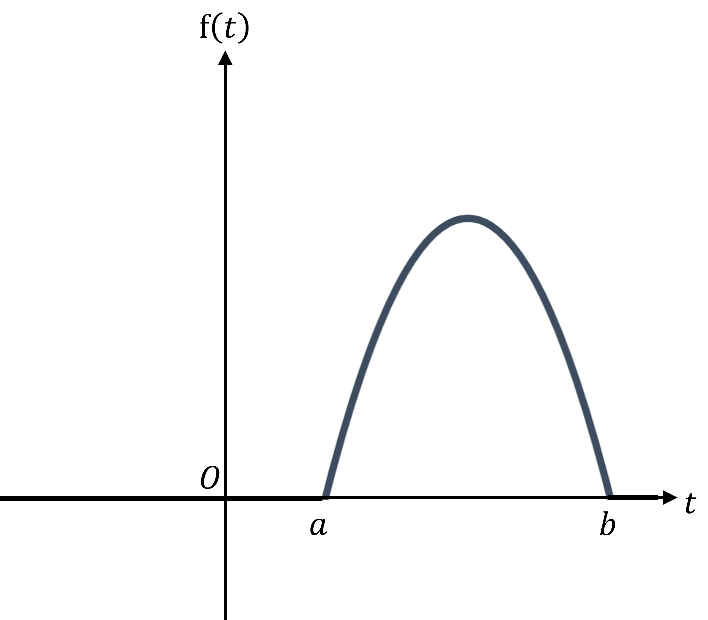

# Exam Questions — Continuous Random Variables
**Statistical Distributions** · Cambridge (CIE) A-LEVEL maths (9709)
> Source: [https://www.savemyexams.com/a-level/maths/cie/20/probability-and-statistics-2/topic-questions/](https://www.savemyexams.com/a-level/maths/cie/20/probability-and-statistics-2/topic-questions/) · 33 questions across 1 sets

## Exam Questions (33 questions)

### Q1 — very_hard — 11 marks

**Q1** [3 marks]

The continuous random variable $X$ has probability density function

$f ( x ) = \{ \begin{gathered} \frac{k}{x^{3}} 2 \text{less} \text{or} \text{equal} \text{than} x \text{less} \text{or} \text{equal} \text{than} a \\ 0 o t h e r w i s e \end{gathered} )$

Show that $k=\frac{8a²}{a^{2}-4}$.

**Q1** [5 marks]

Given that $E(X)=\frac{20}{7}$ show that $a=5$ and hence find the value of $k$.

**Q1** [3 marks]

Find the exact value of $Var(X)$.

### Q2 — very_hard — 14 marks

**Q2** [6 marks]

A meeting at a company lasts $T$ hours. The random variable $T$ can be modelled by the probability density function

$f ( t ) = \{ \begin{gathered} \frac{3}{4} t ( t - 2 )^{2} 0 \text{less} \text{or} \text{equal} \text{than} t \text{less} \text{or} \text{equal} \text{than} 2 \\ 0 o t h e r w i s e \end{gathered} )$

Find the mean time of a meeting and find the standard deviation of times.

**Q2** [4 marks]

Show that the median length of a meeting is 0.771 hours, correct to 3 significant figures.

**Q2** [4 marks]

By using differentiation, find the mode of the times.

### Q3 — very_hard — 10 marks

**Q3** [1 mark]

The diagram below shows the probability density function, $g ( y )$, of a random variable $Y$.

Find the value of $k$.

**Q3** [3 marks]

Find $P(5<Y<6)$.

**Q3** [2 marks]

Find the median of $Y$.

**Q3** [4 marks]

Find $E(Y)$.

### Q4 — very_hard — 4 marks

**Q4** [1 mark]

Paul is travelling around France to try to find the perfect baguette. The random variable $C$ represents the cost, in euros, of a baguette. It can be modelled by the probability density function

$f ( c ) = \{ \begin{gathered} \frac{1}{36} ( 14 c - c^{2} - 40 ) 4 \text{less} \text{or} \text{equal} \text{than} c \text{less} \text{or} \text{equal} \text{than} 10 \\ 0 o t h e r w i s e \end{gathered} )$

Sketch the graph of $y=f(c)$.

**Q4** [1 mark]

Explain why the mean price of a baguette is €7.

**Q4** [2 marks]

Given that $P(C<9)=\frac{25}{27}$, find the value of $P(5<C<9)$.

### Q5 — very_hard — 8 marks

**Q5** [5 marks]

The random variable, $U$, follows a continuous uniform distribution on the interval `left square bracket a comma b right square bracket`. The probability density function $g$ is defined by:

$g ( u ) = \{ \begin{gathered} k a \text{less} \text{or} \text{equal} \text{than} u \text{less} \text{or} \text{equal} \text{than} b \\ 0 o t h e r w i s e \end{gathered} )$

(i) Write down an expression for $k$ in terms of $a\mathrm{and}b$.

(ii) Write down an expression for $E(U)$ in terms of $a\mathrm{and}b$.

(iii) Show that $Var(U)=\frac{(b-a)²}{12}$.

**Q5** [3 marks]

Given that $E(U)=8.5\mathrm{and}Var(U)=6.75$, find the values of $a\mathrm{and}b$.

### Q6 — very_hard — 8 marks

**Q6** [2 marks]

The diagram below shows the probability density function, $f ( x )$, of a random variable $X$.

Find the value of $k$.

**Q6** [2 marks]

Find $P(X\leq6)$.

**Q6** [4 marks]

Find the interquartile range of $X$.

### Q7 — very_hard — 6 marks

**Q7** [2 marks]

A computer takes $T$ seconds to start up. The random variable, $T$, can be modelled by the probability distribution, $f ( t )$, shown below.

For $a\leqt\leqb,f(t)=\frac{1}{8π}\sqrt{(12t-t^{2}-20)}$, elsewhere $f(t)=0$.

Find the values of $a\mathrm{and}b$.

**Q7** [1 mark]

State the mean time for the computer to start up.

**Q7** [1 mark]

Find probability that the computer takes between 6 and 15 seconds to start up.

**Q7** [2 marks]

Given that $P(4\leqT\leq8)=\sqrt{\frac{3}{2π}}+\frac{1}{3}$, find the exact value of $P(T>8)$.

### Q8 — easy — 4 marks

**Q8** [2 marks]

Evaluate the following definite integral, giving your answer in terms of $k$.

$\int_{3}^{9} k ( x^{2} + 3 ) d x$

**Q8** [2 marks]

Hence find the value of $k$ given that $f ( x )$ is a probability density function where

$f ( x ) = \{ \begin{gathered} k ( x^{2} + 3 ) 3 \text{less} \text{or} \text{equal} \text{than} x \text{less} \text{or} \text{equal} \text{than} 9 \\ 0 o t h e r w i s e \end{gathered} )$

### Q9 — easy — 6 marks

**Q9** [6 marks]

The median, $m$, of a continuous random variable $X$, is the value for $X$ which splits the under the graph of the probability density function exactly in half, such that $P(X<m)=0.5$.

Find the value of the median of the continuous random variables which have probability density functions show in the graphs below.

| (i) |  |
|---|---|

| (ii) |  |
|---|---|

| (iii) |  |
|---|---|

| (iv) |  |
|---|---|

### Q10 — easy — 4 marks

**Q10** [1 mark]

The continuous uniform (rectangular) distribution over the interval $( a , b )$ has probability density function

$f ( x ) = \{ \begin{gathered} \frac{1}{b - a} a < x < b \\ 0 o t h e r w i s e \end{gathered} )$

The random variable $X$ follows a rectangular distribution over the interval $( 2 , 18 )$.

The graph below shows the probability density function of $X$. Write down the values of $a,b\mathrm{and}c$.

**Q10** [3 marks]

Write down

(i) the median of $X$

(ii) the value of $E ( X )$

(iii)  $P(14<X<18)$

### Q11 — easy — 7 marks

**Q11** [2 marks]

The continuous random variable $X$ has probability density function

$f ( x ) = \{ \begin{gathered} \frac{3}{16} ( x^{2} - 1 ) 2 \text{less} \text{or} \text{equal} \text{than} x \text{less} \text{or} \text{equal} \text{than} 3 \\ 0 o t h e r w i s e \end{gathered} )$

Find $\int \frac{3}{16} x ( x^{2} - 1 ) d x$

**Q11** [1 mark]

Hence find the value of $E ( X )$ using the formula

$E ( X ) = \int x f ( x ) d x$

**Q11** [2 marks]

Find $\int \frac{3}{16} x ² ( x^{2} - 1 ) d x$

**Q11** [1 mark]

Hence find the value of $E ( X^{2} )$ using the formula

$E ( X^{2} ) = \int x^{2} f ( x ) d x$

**Q11** [1 mark]

Hence find the value of $Var(X)$ using the formula $Var(X)=E(X^{2})-(E(X))^{2}$.

### Q12 — easy — 6 marks

**Q12** [6 marks]

If $f ( x )$ is the probability density function for a random variable, $X$ which takes values in the interval $( a , b )$ then:

$\int_{a}^{b} f ( x ) d x = 1$

Use integration to decide whether the following functions could represent probability distribution functions.

(i) $f ( x ) = \{ \begin{gathered} 2 x 0 \text{less} \text{or} \text{equal} \text{than} x \text{less} \text{or} \text{equal} \text{than} 1 \\ 0 o t h e r w i s e \end{gathered} )$

(ii) $f ( x ) = \{ \begin{gathered} 1 \frac{1}{3} x^{2} 1 \text{less} \text{or} \text{equal} \text{than} x \text{less} \text{or} \text{equal} \text{than} 4 \\ 0 o t h e r w i s e \end{gathered} )$

(iii) $f ( x ) = \{ \begin{gathered} \frac{4}{27} ( x^{3} + 1 ) - 1 \text{less} \text{or} \text{equal} \text{than} x \text{less} \text{or} \text{equal} \text{than} 2 \\ 0 o t h e r w i s e \end{gathered} )$

### Q13 — easy — 7 marks

**Q13** [2 marks]

The continuous random variable, $X$, has probability density function

$f ( x ) = \{ \begin{gathered} \frac{1}{24} ( x^{3} + 2 ) 1 \text{less} \text{or} \text{equal} \text{than} x \text{less} \text{or} \text{equal} \text{than} 3 \\ 0 o t h e r w i s e \end{gathered} )$

The value of $P(a<X<b)$ is equal to

$\int_{a}^{b} f ( x ) d x$

Find $P(1<X<2)$.

**Q13** [3 marks]

(i) Explain why $P ( X > 2.5 ) = \int_{2.5}^{3} \frac{1}{24} ( x^{3} + 2 ) d x$

(ii) Hence find $P(X>2.5)$

**Q13** [2 marks]

State, with a reason, the value of

(i) $P(5<X<10)$

(ii) $P(X=2)$

### Q14 — easy — 4 marks

**Q14** [4 marks]

If $f ( x )$ is the probability density function for a random variable, $X$ then the area under the graph of the probability density function must equal 1.

State, with a reason, whether each of the following could be graphs of probability density functions.

| (i) |  |
|---|---|

| (ii) |  |
|---|---|

| (iii) |  |
|---|---|

| (iv) |  |
|---|---|

### Q15 — easy — 4 marks

**Q15** [4 marks]

The mode of a continuous random variable $X$, where it exists, is a value for $X$ where the probability density function is at its maximum.

State the mode, where it exists, of the continuous random variables which have probability density functions show in the graphs below.

| (i) |  |
|---|---|

| (ii) |  |
|---|---|

| (iii) |  |
|---|---|

| (iv) |  |
|---|---|

### Q16 — easy — 4 marks

**Q16** [4 marks]

The graph below shows the probability density function of a continuous random variable, $X$.

By finding relevant areas under the graph, find:

(i) $P(0<X<0.1)$

(ii) $P(X>0.15)$

(iii) $P(0.05<X<0.12)$

### Q17 — hard — 8 marks

**Q17** [4 marks]

The continuous random variable, $X$, has probability density function

$f ( x ) = \{ \begin{gathered} 1 \frac{1}{4} x ( x - 1 ) ( x + 1 ) 1 \text{less} \text{or} \text{equal} \text{than} x \text{less} \text{or} \text{equal} \text{than} k \\ 0 o t h e r w i s e \end{gathered} )$

Find the exact value for $k$.

**Q17** [4 marks]

Find $P(X<E(X))$.

### Q18 — hard — 7 marks

**Q18** [1 mark]

The diagram below shows the probability density function, $f ( x )$, of a random variable $X$.

Find the value of $k$.

**Q18** [2 marks]

Find $P(X>0.4)$

**Q18** [4 marks]

Find the median of $X$.

### Q19 — hard — 6 marks

**Q19** [6 marks]

Find the mode of the continuous random variable, $X$, which has probability density function defined by:

(i) $f ( x ) = \{ \begin{gathered} \frac{3}{140} ( 5 - 6 x - x^{2} ) - 4 \text{less} \text{or} \text{equal} \text{than} x \text{less} \text{or} \text{equal} \text{than} 0 \\ 0 o t h e r w i s e \end{gathered} )$

(ii) $f ( x ) = \{ \begin{gathered} \frac{3}{34} ( 10 - ( x - 2 )^{2} ) 3 \text{less} \text{or} \text{equal} \text{than} x \text{less} \text{or} \text{equal} \text{than} 5 \\ 0 o t h e r w i s e \end{gathered} )$

(iii) $f ( x ) = \{ \begin{gathered} 1 \frac{1}{2} ( \sin ( x ) + \cos ( x ) ) 0 \text{less} \text{or} \text{equal} \text{than} x \text{less} \text{or} \text{equal} \text{than} \frac{\pi }{2} \\ 0 o t h e r w i s e \end{gathered} )$

### Q20 — hard — 9 marks

**Q20** [2 marks]

The diagram below shows the probability density function, $f ( t )$, of a random variable $T$.

For $a\leqt\leqb,f(t)=\frac{3}{32}(10t-t^{2}-21)$, elsewhere $f(t)=0$.

Find the values of $a\mathrm{and}b$.

**Q20** [4 marks]

State the value of $E(T)$ and find $Var(T)$.

**Q20** [1 mark]

Find $P(-2\leqT\leq5)$.

**Q20** [2 marks]

Given that $P(4\leqT\leq6)=\frac{11}{16}$, find $P(T\geq6)$.

### Q21 — hard — 9 marks

**Q21** [2 marks]

Geoff is taking part in a quiz where he has 4 seconds to answer each question. The time, in seconds, it takes Geoff to answer a question is denoted $T$ which can be modelled by the probability density function, $f ( t )$ shown below.

Find the probability that Geoff answers a question in less than 2 seconds.

**Q21** [4 marks]

Find the mean time it takes Geoff to answer a question.

**Q21** [3 marks]

There are 10 questions in the quiz. Find the probability that for at least one of the questions Geoff takes longer than 3 seconds.

### Q22 — hard — 7 marks

**Q22** [1 mark]

The diagram below shows the probability density function, $f ( x )$, of a random variable $X$. $f(x)=k$ when $0\leqx\leqa$, otherwise $f(x)=0$.

Write down an expression for $k$ in terms of $a$.

**Q22** [1 mark]

Write down an expression for $E ( X )$ in terms of $a$.

**Q22** [3 marks]

Find a simplified expression for $V a r ( X )$ in terms of $a$.

**Q22** [2 marks]

Given that $P(X>5)=0.6$ find the value of $a$.

### Q23 — hard — 5 marks

**Q23** [5 marks]

State, with a reason, whether the following functions could represent probability distribution functions.

(i) $f ( x ) = \{ \begin{gathered} 1 \frac{1}{3} ( x^{2} - 2 ) 1 \text{less} \text{or} \text{equal} \text{than} x \text{less} \text{or} \text{equal} \text{than} 2 \\ 0 o t h e r w i s e \end{gathered} )$

(ii) $f ( x ) = \{ \begin{gathered} \frac{4}{x^{5} } x \text{greater} \text{or} \text{equal} \text{than} 1 \\ 0 o t h e r w i s e \end{gathered} )$

(iii) $f ( x ) = \{ \begin{gathered} \frac{2}{x^{2}} - 1 \text{less} \text{or} \text{equal} \text{than} x \text{less} \text{or} \text{equal} \text{than} 2 \\ 0 o t h e r w i s e \end{gathered} )$

### Q24 — hard — 5 marks

**Q24** [4 marks]

Harry is trying to draw specific lengths without measuring equipment. He draws a straight line and stops when he thinks it is 10 cm long. The actual length of Harry’s line, $L$ cm, can be modelled by the probability density function

$f ( l ) = \{ \begin{gathered} \frac{20}{421} ( l - 10.5 )^{4} 8 \text{less} \text{or} \text{equal} \text{than} l \text{less} \text{or} \text{equal} \text{than} 12 \\ 0 o t h e r w i s e \end{gathered} )$

Estimate the lower quartile of the lengths of Harry’s lines.

**Q24** [1 mark]

Harry tries to draw a 10 cm line 80 times.

Write down how many of Harry’s line you would expect to be less than the lower quartile.

### Q25 — medium — 8 marks

**Q25** [2 marks]

May calls her nephew Peter each day to check on him. May enjoys talking so much so that Peter has programmed his phone to disconnect from a call after 15 minutes. The length of a call, in minutes, between May and Peter is denoted by the continuous random variable $T$. It is modelled by the probability density function

$f ( t ) = \{ \begin{gathered} \frac{1}{1125} t^{2} 0 < t < 15 \\ 0 o t h e r w i s e \end{gathered} )$

Find the mean length of a call.

**Q25** [3 marks]

Find the standard deviation of the lengths of calls.

**Q25** [2 marks]

Find the probability that a random call between May and Peter will last longer than 10 minutes.

**Q25** [1 mark]

Out of the next 100 calls between May and Peter, estimate the number of them that will last less than 10 minutes.

### Q26 — medium — 7 marks

**Q26** [2 marks]

The mass, in kilograms, of a wrestler in a local club is denoted by the continuous random variable $M$. It is modelled by the probability density function

$f ( m ) = \{ \begin{gathered} k - \frac{1}{9000} ( m - 80 ) ² 70 < m < 100 \\ 0 o t h e r w i s e \end{gathered} )$

Show that $k=\frac{4}{90}$.

**Q26** [2 marks]

Wrestlers who weigh less than 85 kg can enter Heavy Middleweight competitions.

Find the probability that a randomly selected wrestler can enter Heavy Middleweight competition.

**Q26** [3 marks]

Wrestlers who weigh less than 80 kg can enter Middleweight competitions.

Given that a wrestler can enter Heavy Middleweight competitions, find the probability that they can also enter Middleweight competitions.

### Q27 — medium — 6 marks

**Q27** [6 marks]

State, with a reason, whether each of the following could be graphs of probability density functions.

| (i) |  |
|---|---|

| (ii) |  |
|---|---|

| (iii) |  |
|---|---|

| (iv) |   This is a semicircle. |
|---|---|

### Q28 — medium — 6 marks

**Q28** [3 marks]

The continuous random variable $X$ follows a continuous uniform distribution over the interval $(3,28)$ so that its probability density function is

$f ( x ) = \{ \begin{gathered} \frac{1}{25} 3 \text{less} \text{or} \text{equal} \text{than} x \text{less} \text{or} \text{equal} \text{than} 28 \\ 0 o t h e r w i s e \end{gathered} )$

Find

(i) $P(X<15)$

(ii) $P(20<X<30)$

(iii) $P(X=25)$

**Q28** [3 marks]

(i) Write down $E ( X )$.

(ii) Find $V a r ( X )$.

### Q29 — medium — 6 marks

**Q29** [2 marks]

The continuous random variable, $X$, has probability density function

$f ( x ) = \{ \begin{array}{l} k ( 3 x^{4} - 2 x ) 1 \text{less} \text{or} \text{equal} \text{than} x \text{less} \text{or} \text{equal} \text{than} 2 \\ 0 o t h e r w i s e \end{array} )$

Show that $k=\frac{5}{78}$.

**Q29** [4 marks]

(i) Find $P(1.2<X<1.8)$

(ii) Find $P(X<1.5)$

### Q30 — medium — 6 marks

**Q30** [6 marks]

State, with a reason, whether the following functions could represent probability distribution functions.

(i) $f ( x ) = \{ \begin{gathered} 3 ( x^{5} - 2 x^{3} ) 1 \text{less} \text{or} \text{equal} \text{than} x \text{less} \text{or} \text{equal} \text{than} 2 \\ 0 o t h e r w i s e \end{gathered} )$

(ii) $f ( x ) = \{ \begin{gathered} \frac{3}{8} ( x + 1 )^{2} - 1 \text{less} \text{or} \text{equal} \text{than} x \text{less} \text{or} \text{equal} \text{than} 1 \\ 0 o t h e r w i s e \end{gathered} )$

(iii) $f ( x ) = \{ \begin{gathered} \frac{6}{x^{2}} - 3 \text{less} \text{or} \text{equal} \text{than} x \text{less} \text{or} \text{equal} \text{than} - 2 \\ 0 o t h e r w i s e \end{gathered} )$

### Q31 — medium — 7 marks

**Q31** [2 marks]

The continuous random variable $X$ has probability density function

$f ( x ) = \{ \begin{gathered} k ( 2 + \sqrt{x} ) 4 \text{less} \text{or} \text{equal} \text{than} x \text{less} \text{or} \text{equal} \text{than} 9 \\ 0 o t h e r w i s e \end{gathered} )$

Show that $k=\frac{3}{68}$.

**Q31** [2 marks]

Find $E ( X )$.

**Q31** [3 marks]

Find $V a r ( X )$.

### Q32 — medium — 5 marks

**Q32** [2 marks]

The continuous random variable, $X$, has probability density function

$f ( x ) = \{ \begin{gathered} \frac{5}{62} \sqrt{x^{3}} 1 \text{less} \text{or} \text{equal} \text{than} x \text{less} \text{or} \text{equal} \text{than} 4 \\ 0 o t h e r w i s e \end{gathered} )$

Find an expression, in terms of $m$, for

$\int_{1}^{m} \frac{5}{62} \sqrt{x^{3} } d x$

**Q32** [3 marks]

Hence find the median of $X$.

### Q33 — medium — 4 marks

**Q33** [4 marks]

Find the mode of the continuous random variable, $X$, which has probability density function defined by:

(i) $f ( x ) = \{ \begin{gathered} \frac{2}{21} x 2 \text{less} \text{or} \text{equal} \text{than} x \text{less} \text{or} \text{equal} \text{than} 5 \\ 0 o t h e r w i s e \end{gathered} )$

(ii) $f ( x ) = \{ \begin{gathered} \frac{1}{9} ( 4 - ( x + 1 )^{2} ) - 2 \text{less} \text{or} \text{equal} \text{than} x \text{less} \text{or} \text{equal} \text{than} 1 \\ 0 o t h e r w i s e \end{gathered} )$

(iii) $f ( x ) = \{ \begin{gathered} 1 \frac{1}{2} \sin ( x ) 0 \text{less} \text{or} \text{equal} \text{than} x \text{less} \text{or} \text{equal} \text{than} \pi \\ 0 o t h e r w i s e \end{gathered} )$
