# Exam Questions — Combinations of Transformations
**Algebra & Functions** · Cambridge (CIE) A-LEVEL maths (9709)
> Source: [https://www.savemyexams.com/a-level/maths/cie/20/pure-1/topic-questions/](https://www.savemyexams.com/a-level/maths/cie/20/pure-1/topic-questions/) · 28 questions across 1 sets

## Exam Questions (28 questions)

### Q1 — easy — 4 marks

**Q1** [4 marks]

The graph of $y = \text{f} ( x )$ is transformed. In each case, write down, in terms of $\text{f} ( x )$, the equation of the resulting graph.

(i) a translation by `\begin{pmatrix} -2 \\ 3 \end{pmatrix}`

(ii) a horizontal stretch with scale factor 2, followed by a vertical stretch with scale factor 3

### Q2 — easy — 4 marks

**Q2** [4 marks]

The diagram below shows the graph of $y = \text{f} ( x )$.

The stationary point $A ( - 2 , 8 )$ is marked on the diagram.

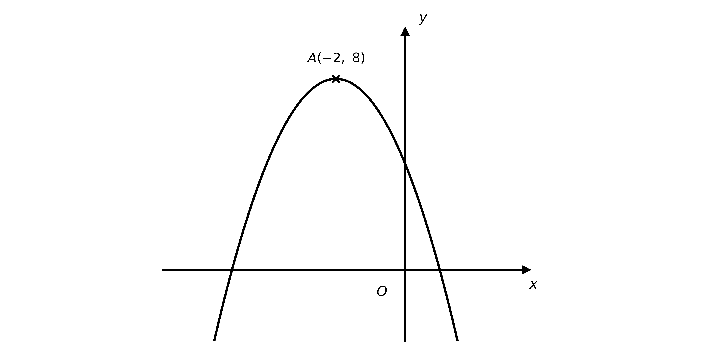

On separate diagrams, sketch the following graphs.

(i) $y = 2 \text{f} ( x ) + 1$

(ii) $y = \frac{1}{2} \text{f} ( x + 1 )$

On each diagram, state the coordinates of the image of point $A$ under the given transformation.

### Q3 — easy — 6 marks

**Q3** [2 marks]

The function $\text{g}$ is defined by $\text{g} ( x ) = 2 x$.

On the same diagram, sketch the graphs of $y = \text{g} ( x )$ and $y = \text{g}^{-1} ( x )$, and indicate the line of symmetry.

Label the coordinates of any point where the graphs cross the coordinate axes.

**Q3** [4 marks]

(i) Write down an expression for $\text{g}^{-1} ( x )$ in terms of $x$.

(ii) Find an expression for $\text{g}^{-1} ( x )$ in terms of $\text{g} ( x )$, and state the single transformation this represents.

### Q4 — medium — 4 marks

**Q4** [4 marks]

Describe fully, in order, the sequence of transformations that maps the graph of $y = \text{f} ( x )$ onto each of the following graphs.

(i) $y = 3 \text{f} ( x ) - 1$

(ii) $y = \frac{1}{3} \text{f} ( x - 1 )$

### Q5 — easy — 3 marks

**Q5** [3 marks]

The graph of $y = \text{f} ( x )$ is transformed by the following sequence of transformations, applied in this order.

1. a reflection in the $y$-axis
2. a vertical stretch with scale factor 4
3. a translation by `\begin{pmatrix} 0 \\ -2 \end{pmatrix}`

Write down, in terms of $\text{f} ( x )$, the equation of the resulting graph.

### Q6 — easy — 4 marks

**Q6** [4 marks]

The diagram shows the graph of $y = \text{g} ( x )$, where $\text{g} ( x ) = \frac{1}{x}$, $x \neq 0$.

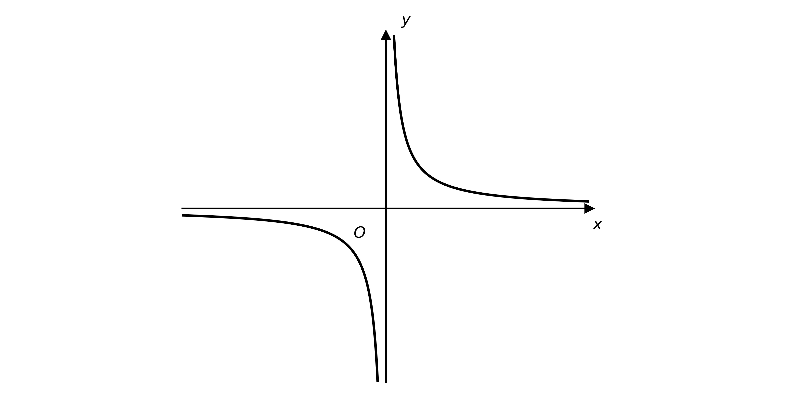

(i) Write down the equations of the two asymptotes of $y = \text{g} ( x )$.

(ii) Determine the equations of the two asymptotes of the graph of $y = \text{g} ( x - 1 ) + 5$.

### Q7 — easy — 4 marks

**Q7** [4 marks]

The diagram shows the graph of $y = \text{f} ( x )$, where $\text{f} ( x ) = ( x - 2 )^{2}$.

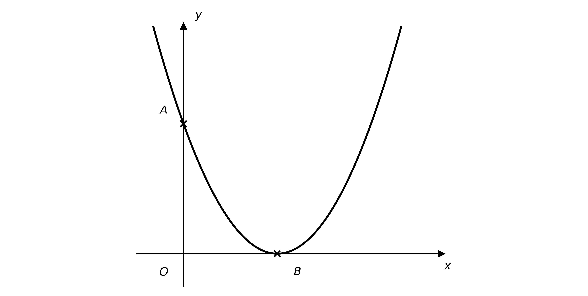

The graph meets the $y$-axis at $A$ and touches the $x$-axis at $B$.

(i) Write down the coordinates of $A$ and $B$.

(ii) The graph of $y = \text{f} ( x )$ is transformed to the graph of $y = - \text{f} ( x ) - 4$. Find the coordinates of the images of $A$ and $B$ under this transformation.

### Q8 — easy — 6 marks

**Q8** [2 marks]

The diagram shows the graph of $y = \text{f} ( t )$, where $\text{f} ( t ) = \text{cos}  t$ for $0 ^{\circ} \leq t \leq 360 ^{\circ}$.

(i) Write down the minimum value of $\text{f} ( t )$ in the given domain.

(ii) Write down the value of $t$ at which this minimum occurs.

**Q8** [2 marks]

(i) Write down the minimum value of $y = 3  \text{f} ( t - 45 ^{\circ} )$ in the given domain.

(ii) Write down the value of $t$ at which this minimum occurs.

**Q8** [2 marks]

Describe the combination of transformations that maps the graph of $y = \text{f} ( t )$ onto the graph of $y = 3  \text{cos}  t + 1$ for $0 ^{\circ} \leq t \leq 360 ^{\circ}$.

### Q9 — very_hard — 7 marks

**Q9** [2 marks]

The diagram shows the graph of $y = \text{f} ( x )$, where $\text{f} ( x ) = ( x^{2} - a )^{2}$ and $a > 1$. The points $A$, $B$ and $C$ are where the graph meets the coordinate axes.

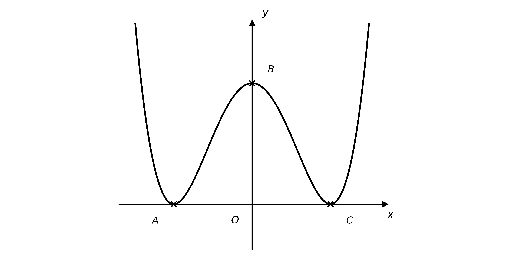

Write down, in terms of $a$, the coordinates of $A$, $B$ and $C$.

**Q9** [3 marks]

Sketch the graph of $y = - \frac{1}{2} \text{f} ( x - 1 )$, labelling the images of $A$, $B$ and $C$ and stating their coordinates in terms of $a$.

**Q9** [2 marks]

Suggest, in terms of $\text{f} ( x )$, a combination of at least two transformations for which $A$, $B$ and $C$ move to new positions but each remains on its original axis.

### Q10 — hard — 4 marks

**Q10** [4 marks]

The function $\text{p}$ is defined by $\text{p} ( x ) = 2 x + 1$.

Show that the graph of $y = \text{p} ( x )$ maps onto the graph of its inverse under the transformation $\frac{1}{2} \text{p} ( \frac{1}{2} x ) - 1$.

### Q11 — very_hard — 7 marks

**Q11** [2 marks]

The diagram shows the graph of $x^{2} - y^{2} = 1$, which has asymptotes $y = x$ and $y = - x$ and meets the $x$-axis at the points $A$ and $B$.

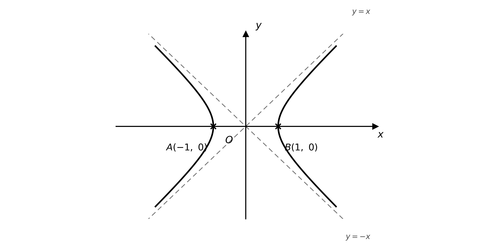

Determine the coordinates of the images of $A$ and $B$ on the graph of $( x - 3 )^{2} - ( y - 1 )^{2} = 1$.

**Q11** [5 marks]

(i) Determine the equations of the asymptotes of the graph of $( x - 3 )^{2} - ( y - 1 )^{2} = 1$.

(ii) Find the domain of $( x - 3 )^{2} - ( y - 1 )^{2} = 1$.

### Q12 — very_hard — 6 marks

**Q12** [6 marks]

The diagram shows the graph of $y = \text{f} ( x )$, where $a$ is a positive constant. The maximum point $C ( 0 , - 4 a )$, the minimum point $B ( 2 - a , - 20 )$ and the $x$-axis intercept $A ( - a , 0 )$ are marked on the diagram.

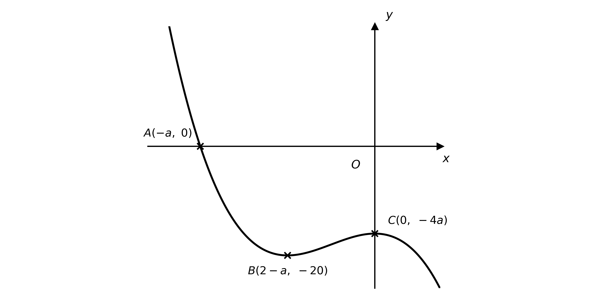

On separate diagrams, sketch the following graphs, marking the coordinates of the images of $A$, $B$ and $C$ in terms of $a$.

(i) $y = 2 \text{f} ( \frac{1}{3} x - 1 )$

(ii) $y = - 2 \text{f} ( x + 1 ) + 1$

### Q13 — very_hard — 7 marks

**Q13** [5 marks]

Describe, in order, a sequence of transformations that maps the graph of $y = \text{f} ( x )$ onto each of the following graphs.

(i) $y = a \text{f} ( x + b ) + c$, for the case when $a > 0$

(ii) $y = - \text{f} ( - x )$

**Q13** [2 marks]

How, if at all, would your answer to part (a)(i) change if $a = 1$, or if $a < 0$?

### Q14 — very_hard — 4 marks

**Q14** [4 marks]

A function $\text{f}$ is defined by $\text{f} ( x ) = k x$, where $k$ is a non-zero constant.

Show that `\text{f}^{-1}(x) = \tfrac{1}{k}\,\text{f}\left(\tfrac{1}{k}x\right)`.

### Q15 — medium — 4 marks

**Q15** [4 marks]

The graph of $y = \text{f} ( x )$ is transformed by the following sequence of transformations, applied in this order.

1. a translation by `\begin{pmatrix} 2 \\ 0 \end{pmatrix}`
2. a reflection in the $y$-axis
3. a vertical stretch with scale factor $\frac{2}{3}$
4. a translation by `\begin{pmatrix} 0 \\ 4 \end{pmatrix}`

Write down, in terms of $\text{f} ( x )$, the equation of the resulting graph.

### Q16 — hard — 5 marks

**Q16** [3 marks]

The diagram shows the graph of $y = \text{f} ( x )$, where $\text{f} ( x ) = ( x^{2} - 4 )^{2}$.

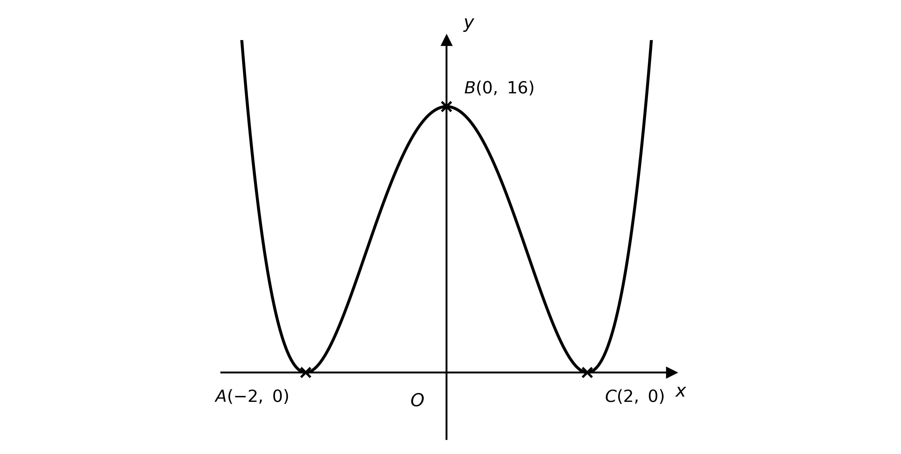

The points $A ( - 2 , 0 )$, $B ( 0 , 16 )$ and $C ( 2 , 0 )$ are where the graph meets the coordinate axes.

Sketch the graph of $y = - 3 \text{f} ( 2 x )$, labelling the images of $A$, $B$ and $C$.

**Q16** [2 marks]

Suggest a combination of at least two transformations that maps $A$, $B$ and $C$ so that none of them lies on a coordinate axis. Give your answer as an expression in terms of $\text{f} ( x )$.

### Q17 — hard — 8 marks

**Q17** [5 marks]

The diagram shows the graph of $y = \text{g} ( x )$, where $\text{g} ( x ) = \frac{1}{ax}$, with $a$ a non-zero constant.

(i) Write down the equations of the asymptotes of $y = \text{g} ( x )$.

(ii) Determine the equations of the asymptotes of the graph of $y = 3 \text{g} ( 2 x + 1 )$.

**Q17** [3 marks]

The function $\text{f}$ is defined by `\text{f}(x) = -2\text{g}\left(\tfrac{1}{3}x + 3\right) - 4`. Determine the domain and range of $\text{f}$.

### Q18 — hard — 6 marks

**Q18** [6 marks]

The diagram shows the graph of $y = \text{f} ( x )$. The maximum point $B ( - 1 , 32 )$ and the $x$-axis intercepts $A ( - 3 , 0 )$ and $C ( 3 , 0 )$ are marked on the diagram.

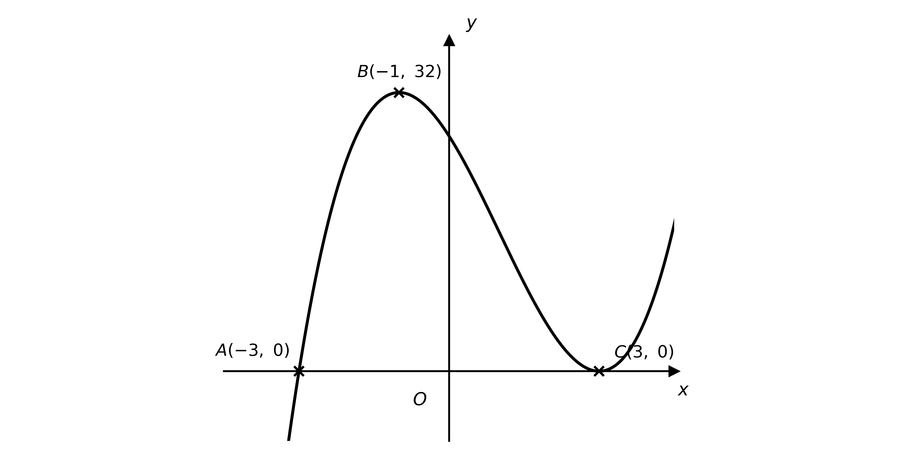

On separate diagrams, sketch the following graphs.

(i) $y = \text{f} ( \frac{1}{2} x ) + 2$

(ii) $y = - \text{f} ( x - 1 )$

On each diagram, mark the coordinates of the images of the points $A$, $B$ and $C$ under the given transformation.

### Q19 — hard — 4 marks

**Q19** [2 marks]

The diagram shows the graph of $y = \text{f} ( t )$, where $\text{f} ( t ) = \text{cos}  t$ for $0 ^{\circ} \leq t \leq 360 ^{\circ}$.

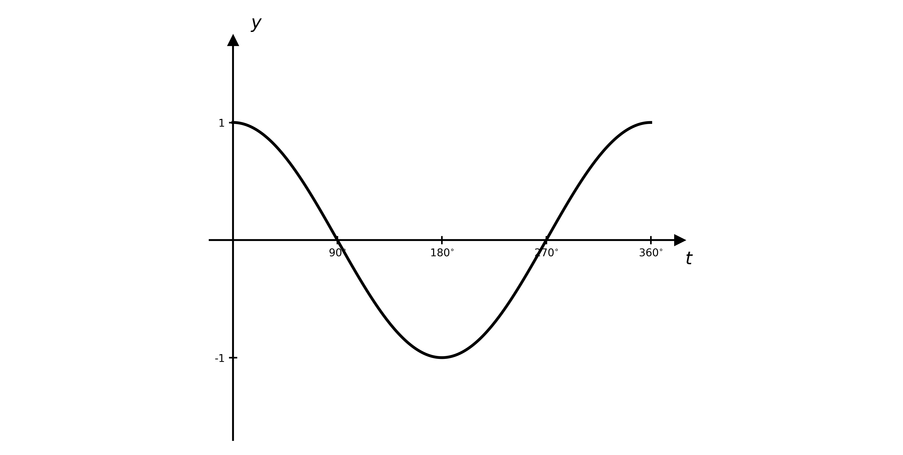

(i) Write down the maximum value of $y = - 2 \text{f} ( 3 t )$.

(ii) Write down the value of $t$ at which this maximum first occurs.

**Q19** [2 marks]

Find, in terms of $\text{f} ( t )$, a combination of transformations that maps the graph of $y = \text{f} ( t )$ onto the graph of $y = 2 - 4  \text{sin}  t$ for $0 ^{\circ} \leq t \leq 360 ^{\circ}$.

### Q20 — hard — 4 marks

**Q20** [4 marks]

The function $\text{f}$ is defined by $\text{f} ( x ) = \sqrt{2x+1}$. Find an expression for $\text{g} ( x )$, where $\text{g} ( x )$ is obtained by applying the following sequence of transformations to $y = \text{f} ( x )$, in this order.

1. a translation by `\begin{bmatrix} - 3 \\ 0 \end{bmatrix}`
2. a horizontal stretch with scale factor $\frac{1}{2}$
3. a reflection in the $x$-axis

### Q21 — hard — 6 marks

**Q21** [6 marks]

Describe fully, in order, the sequence of transformations that maps the graph of $y = \text{f} ( x )$ onto each of the following graphs.

(i) $y = - \text{f} ( 3 x - 1 )$

(ii) $y = 2 \text{f} ( 5 - x )$

### Q22 — medium — 4 marks

**Q22** [4 marks]

Given that $\text{f} ( x ) = 3 x^{2} - 2 x$, find an expression for $\text{g} ( x )$, where $\text{g} ( x )$ is obtained by applying the following sequence of transformations to $y = \text{f} ( x )$, in this order.

1. a translation by `\begin{pmatrix} 2 \\ 0 \end{pmatrix}`
2. a vertical stretch with scale factor 4
3. a translation by `\begin{pmatrix} 0 \\ -3 \end{pmatrix}`

### Q23 — medium — 3 marks

**Q23** [3 marks]

The graph of $y = \text{f} ( x )$ is transformed by the following sequence of transformations, applied in this order.

1. a horizontal stretch with scale factor 2
2. a reflection in the $x$-axis
3. a translation by `\begin{pmatrix} 0 \\ 2 \end{pmatrix}`

Write down, in terms of $\text{f} ( x )$, the equation of the resulting graph.

### Q24 — medium — 8 marks

**Q24** [4 marks]

The function $\text{p}$ is defined by $\text{p} ( x ) = 3 x - 4$.

(i) Sketch the graph of $y = \text{p} ( x )$.

(ii) On the same axes, sketch the graph of $y = \text{p}^{-1} ( x )$, indicating the line of symmetry.

Label the coordinates of the points where each graph crosses the coordinate axes.

**Q24** [4 marks]

(i) Find an expression for $\text{p}^{-1} ( x )$.

(ii) Find an expression for `\tfrac{1}{9}\left[\text{p}(x) + 16\right]`, giving your answer in its simplest form.

(iii) Hence state what the sequence of transformations represented by `\tfrac{1}{9}\left[\text{p}(x) + 16\right]` does to the graph of $y = \text{p} ( x )$.

### Q25 — medium — 4 marks

**Q25** [4 marks]

The diagram shows the graph of $y = \text{f} ( x )$. The stationary points $A ( - 3 , 27 )$ and $B ( 1 , - 5 )$ are marked on the diagram.

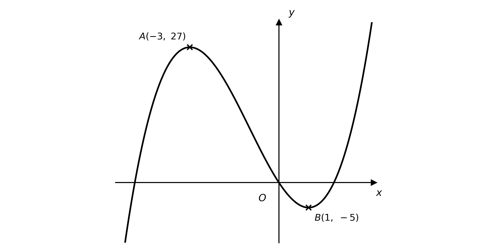

On separate diagrams, sketch the following graphs.

(i) $y = 2 \text{f} ( x ) - 4$

(ii) $y = \text{f} ( x + 1 ) + 3$

On each diagram, state the coordinates of the images of $A$ and $B$ under the given transformation.

### Q26 — medium — 4 marks

**Q26** [4 marks]

Describe fully, in order, the sequence of transformations that maps the graph of $y = \text{f} ( x )$ onto each of the following graphs.

(i) $y = 3 \text{f} ( x + 2 )$

(ii) $y = \text{f} ( - x ) - 1$

### Q27 — medium — 6 marks

**Q27** [2 marks]

The diagram shows the graph of $y = \text{f} ( t )$, where $\text{f} ( t ) = \text{sin}  2 t$ for $0 ^{\circ} \leq t \leq 180 ^{\circ}$.

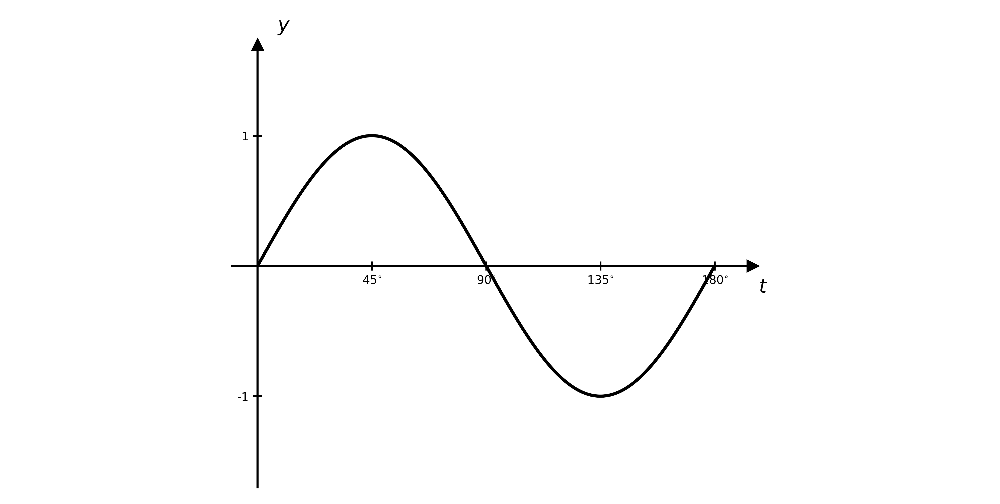

(i) Write down the maximum value of $y = 3 \text{f} ( t )$.

(ii) Write down the first value of $t$ at which this maximum occurs.

**Q27** [2 marks]

(i) Write down the minimum value of $y = 5 \text{f} ( t + 30 ^{\circ} )$.

(ii) Write down the first value of $t$ at which this minimum occurs.

**Q27** [2 marks]

Describe, in terms of $\text{f} ( t )$, the combination of transformations that maps the graph of $y = \text{f} ( t )$ onto the graph of $y = 2 + \text{sin}  t$ for $0 ^{\circ} \leq t \leq 180 ^{\circ}$.

### Q28 — medium — 6 marks

**Q28** [2 marks]

The diagram shows the graph of $y = \text{f} ( x )$, where $\text{f} ( x ) = ( x - a )^{2}$ and $a > 1$.

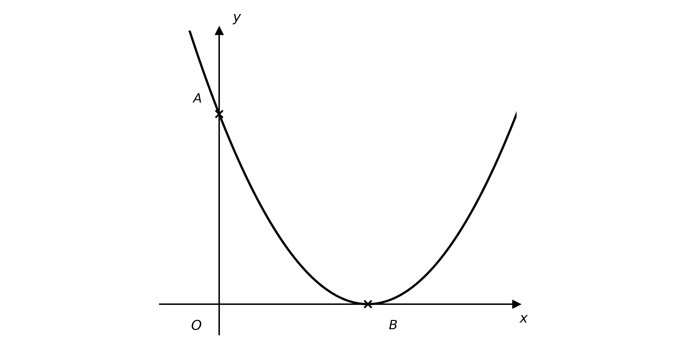

The points $A$ and $B$ are where the graph meets the coordinate axes.

Write down, in terms of $a$, the coordinates of $A$ and $B$.

**Q28** [3 marks]

Sketch the graph of $y = - \text{f} ( - x )$, labelling the images of $A$ and $B$ and stating their coordinates in terms of $a$.

**Q28** [1 mark]

Given that $A$ is three times as far from the origin as $B$, find the value of $a$.
