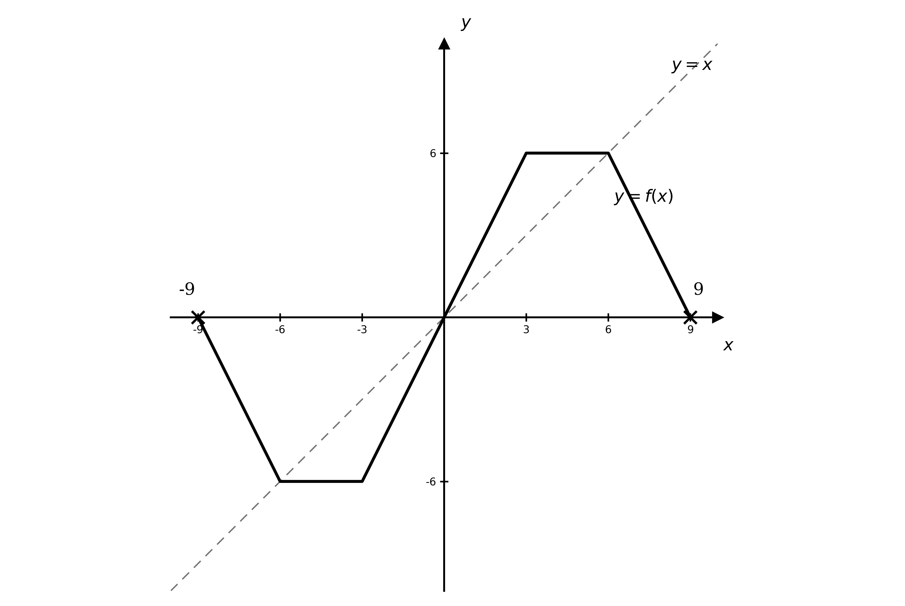
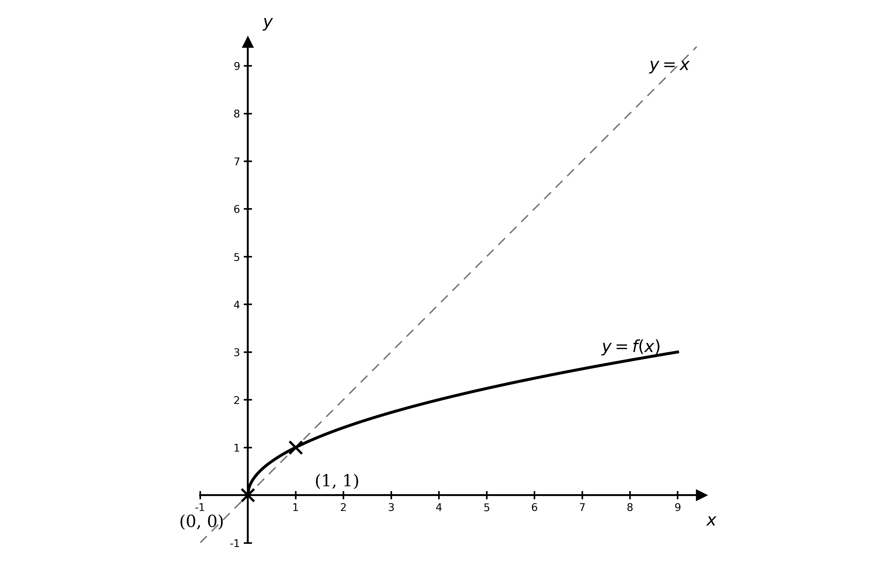
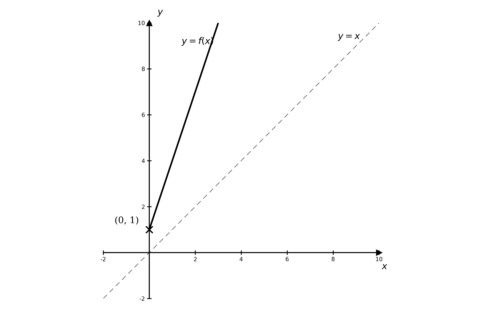

# Exam Questions — Functions
**Algebra & Functions** · Cambridge (CIE) A-LEVEL maths (9709)
> Source: [https://www.savemyexams.com/a-level/maths/cie/20/pure-1/topic-questions/](https://www.savemyexams.com/a-level/maths/cie/20/pure-1/topic-questions/) · 21 questions across 1 sets

## Exam Questions (21 questions)

### Q1 — easy — 4 marks

**Q1** [4 marks]

State whether each of the following mappings is one-one, many-one, one-many or many-many.

(i) `\text{f}: x \mapsto 4x - 2`

(ii) `\text{f}: x \mapsto x^{2}`

(iii) `\text{f}: x \mapsto \dfrac{x}{4}`

(iv) `\text{f}: x \mapsto \sqrt{x}`

### Q2 — easy — 6 marks

**Q2** [4 marks]

The functions $\text{f}$ and $\text{g}$ are defined by

$\text{f} ( x ) = 3 x + 5$

$\text{g} ( x ) = - 2 x$

for $x \in ℝ$.

Find an expression for

(i) $\text{fg} ( x )$,

(ii) $\text{gf} ( x )$.

**Q2** [2 marks]

Solve the equation $\text{f} ( x ) = \text{g} ( x )$.

### Q3 — easy — 5 marks

**Q3** [3 marks]

The function $\text{f}$ is defined by

$\text{f} ( x ) = x^{2} - 8 x - 20$

for $x \in ℝ$.

Sketch the graph of $y = \text{f} ( x )$, giving the coordinates of the points where the graph meets the coordinate axes.

**Q3** [2 marks]

Given that the minimum point of the graph has $x$-coordinate $4$, state the range of $\text{f}$.

### Q4 — medium — 5 marks

**Q4** [3 marks]

The function $\text{f}$ is defined by

$\text{f} ( x ) = 3 x^{2} + 1$

for $x \geq 0$.

Find an expression for $\text{f}^{-1} ( x )$.

**Q4** [2 marks]

State the domain and range of $\text{f}^{-1}$.

### Q5 — easy — 3 marks

**Q5** [3 marks]

The function $\text{f}$ is defined by

$\text{f} ( x ) = x^{2} - 9$

for $x \geq 3$.

(i) State the range of $\text{f}$.

(ii) The domain of $\text{f}$ is changed to $x \geq 0$. State the range of $\text{f}$ for this new domain.

### Q6 — hard — 6 marks

**Q6** [1 mark]

The function $\text{f}$ is defined by

`\text{f}: x \mapsto \sqrt{25 - x^{2}}`

for $x \in ℝ ,  - 5 \leq x \leq 5$.

Explain why $\text{f}$ does not have an inverse.

**Q6** [2 marks]

Suggest an adaptation to the domain of $\text{f}$ so that:

- the inverse of $\text{f}$ exists,
- the graph of $y = \text{f} ( x )$ lies in the first quadrant only, and
- the domain of $\text{f}$ is as large as possible.

State the range of your adapted $\text{f}$.

**Q6** [3 marks]

The domain of $\text{f}$ is changed to $- 5 \leq x \leq 0$. Find an expression for $\text{f}^{-1} ( x )$, and state its domain and range.

### Q7 — very_hard — 4 marks

**Q7** [2 marks]

The function $\text{f}$ is defined by

$\text{f} ( x ) = ( x - 3 )^{2} ( x - 4 )^{2}$

for $2 \leq x \leq 5$.

Work out the range of $\text{f}$.

**Q7** [1 mark]

If the domain of $\text{f}$ is changed to $x \leq 2$, what is the range of $\text{f}$?

**Q7** [1 mark]

State another domain for $\text{f}$ that would have the same effect as that in part (b).

### Q8 — very_hard — 5 marks

**Q8** [3 marks]

The diagram shows the graph of $y = \text{f} ( x )$ together with the line $y = x$ (dotted). The function $\text{f}$ has rotational symmetry about the origin, and for $x > 0$ there is a vertical line of symmetry at $x = 4 . 5$.

Use the graph to write down the domain and range of $\text{f}$.

On the diagram, sketch the reflection of $\text{f}$ in the line $y = x$, and explain why this cannot be the graph of $\text{f}^{-1} ( x )$.

**Q8** [2 marks]

(i) Given that the maximum solution to $\text{f} ( x ) = 6$ is $x = 6$, state the restriction on the domain of $\text{f}$ such that $\text{f}^{-1}$ exists.

(ii) Hence write down the domain and range of $\text{f}^{-1}$.

### Q9 — hard — 5 marks

**Q9** [2 marks]

The function $\text{f}$ is defined by

$\text{f} ( x ) = 4 x^{3} + 4 x^{2} - 7 x + 2$

Write down the domain and range of $\text{f}$.

**Q9** [3 marks]

Sketch the graph of $y = \text{f} ( x )$, stating the coordinates of any intersections with the axes. (You do not need to give the coordinates of any turning points.)

### Q10 — hard — 6 marks

**Q10** [1 mark]

The functions $\text{f}$ and $\text{g}$ are defined by

$\text{f} ( x ) = x^{2} - 2$ for $x \in ℝ$,

$\text{g} ( x ) = 1 - \frac{2}{x}$ for $x \in ℝ ,  x \neq 0$.

Write down the range of $\text{f}$.

**Q10** [3 marks]

Leaving your answers as single fractions, find an expression for

(i) $\text{fg} ( x )$,

(ii) $\text{gf} ( x )$.

**Q10** [2 marks]

Given that $( x - 1 )^{2}$ is a factor of $x^{3}-3x+2$, solve the equation $\text{f} ( x ) = \text{g} ( x )$.

### Q11 — very_hard — 9 marks

**Q11** [3 marks]

The functions $\text{f}$ and $\text{g}$ are defined by

$\text{f} ( x ) = ( x - 1 )^{2} - 4$ for $x \geq 1$,

$\text{g} ( x ) = 1 + \sqrt{x+4}$ for $x \geq - 4$.

Find an expression for

(i) $\text{fg} ( x )$,

(ii) $\text{gf} ( x )$.

**Q11** [2 marks]

Write down $\text{f}^{-1} ( x )$ and state its domain and range.

**Q11** [2 marks]

The graphs of $\text{f}$ and $\text{f}^{-1}$ are drawn on the same axes. Describe the transformation that maps one graph onto the other.

**Q11** [2 marks]

Find the coordinates of the point where the graphs of $y = \text{f} ( x )$ and $y = \text{f}^{-1} ( x )$ meet.

### Q12 — medium — 5 marks

**Q12** [3 marks]

The graph of `y = f \left(x\right)` is shown below.

The diagram shows the graph of $y = \text{f} ( x )$ (solid curve) together with a dotted line.

(i) Use the graph to write down the domain and range of $\text{f}$.

(ii) Write down the equation of the dotted line.

**Q12** [2 marks]

On the diagram, sketch the graph of $y = \text{f}^{-1} ( x )$.

### Q13 — medium — 7 marks

**Q13** [1 mark]

The functions $\text{f}$ and $\text{g}$ are defined by

$\text{f} ( x ) = 3 x^{2} + 2$

$\text{g} ( x ) = 1 - 3 x$

for $x \in ℝ$.

Write down the range of $\text{f}$.

**Q13** [4 marks]

Find an expression for

(i) $\text{fg} ( x )$,

(ii) $\text{gf} ( x )$.

**Q13** [2 marks]

Solve the equation $\text{f} ( x ) = \text{g} ( x ) + 1$.

### Q14 — medium — 5 marks

**Q14** [1 mark]

The function $\text{f}$ is defined by

$\text{f} ( x ) = \frac{2}{x}$

Write down the domain of $\text{f}$.

**Q14** [3 marks]

Sketch the graph of $y = \text{f} ( x )$, stating the coordinates of any intersections with the axes and the equations of any asymptotes.

**Q14** [1 mark]

Write down the range of $\text{f}$.

### Q15 — easy — 3 marks

**Q15** [2 marks]

The function $\text{f}$ is defined by

$\text{f} ( x ) = x^{2} - 4$

for $x \geq 0$.

State the range of $\text{f}$.

**Q15** [1 mark]

The domain of $\text{f}$ is changed to $x \leq 0$. State the range of $\text{f}$ for this new domain.

### Q16 — medium — 5 marks

**Q16** [3 marks]

The diagram shows the graph of $y = \text{f} ( x )$ (solid line) together with a dotted line.

Use the graph to write down the domain and range of $\text{f}$.

Given that $( 1 , 1 )$ lies on the dotted line, write down the equation of the dotted line.

**Q16** [2 marks]

On the diagram, sketch the graph of $y = \text{f}^{-1} ( x )$.

### Q17 — medium — 4 marks

**Q17** [3 marks]

The function $\text{f}$ is defined by

$\text{f} ( x ) = x^{2} + 2 x - 3$

for $x \in ℝ$.

Sketch the graph of $y = \text{f} ( x )$, giving the coordinates of the points where the graph meets the coordinate axes and the coordinates of the turning point.

**Q17** [1 mark]

Write down the range of $\text{f}$.

### Q18 — medium — 8 marks

**Q18** [2 marks]

The function $\text{f}$ is defined by

`\text{f}: x \mapsto \dfrac{x^{2} + 1}{x^{2}}`

for $x \in ℝ ,  x \neq 0$.

Show that $\text{f} ( x )$ can be written as $1 + \frac{1}{x^{2}}$.

**Q18** [2 marks]

Explain why $\text{f}$ does not have an inverse, and suggest an adaptation to its domain so that the inverse exists.

**Q18** [4 marks]

The domain of $\text{f}$ is changed to $x > 0$. Find an expression for $\text{f}^{-1} ( x )$, and state its domain and range.

### Q19 — medium — 6 marks

**Q19** [3 marks]

The functions $\text{f}$ and $\text{g}$ are defined by

$\text{f} ( x ) = \frac{1}{2} ( 4 x - 3 )$

$\text{g} ( x ) = 0 . 5 x + 0 . 75$

for $x \in ℝ$.

Find an expression for

(i) $\text{fg} ( x )$,

(ii) $\text{gf} ( x )$.

**Q19** [3 marks]

Write down $\text{f}^{-1} ( x )$ and state its domain and range.

### Q20 — medium — 7 marks

**Q20** [1 mark]

The functions $\text{f}$ and $\text{g}$ are defined by

$\text{f} ( x ) = x^{2}$

$\text{g} ( x ) = 4 x - 3$

for $x \in ℝ$.

Write down the range of $\text{f}$.

**Q20** [4 marks]

Find an expression for

(i) $\text{fg} ( x )$,

(ii) $\text{gf} ( x )$.

**Q20** [2 marks]

Solve the equation $\text{f} ( x ) = \text{g} ( x )$.

### Q21 — easy — 4 marks

**Q21** [4 marks]

State whether each of the following mappings is one-one, many-one, one-many or many-many.

(i) `\text{f}: x \mapsto x^{2}`

(ii) `\text{f}: x \mapsto 3x + 1`

(iii) `\text{f}: x \mapsto (x + 1)^{3}`

(iv) `\text{f}: x \mapsto \pm\sqrt{x}`
