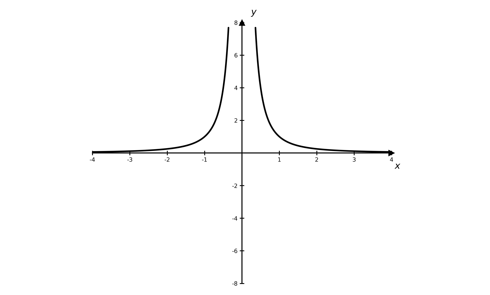
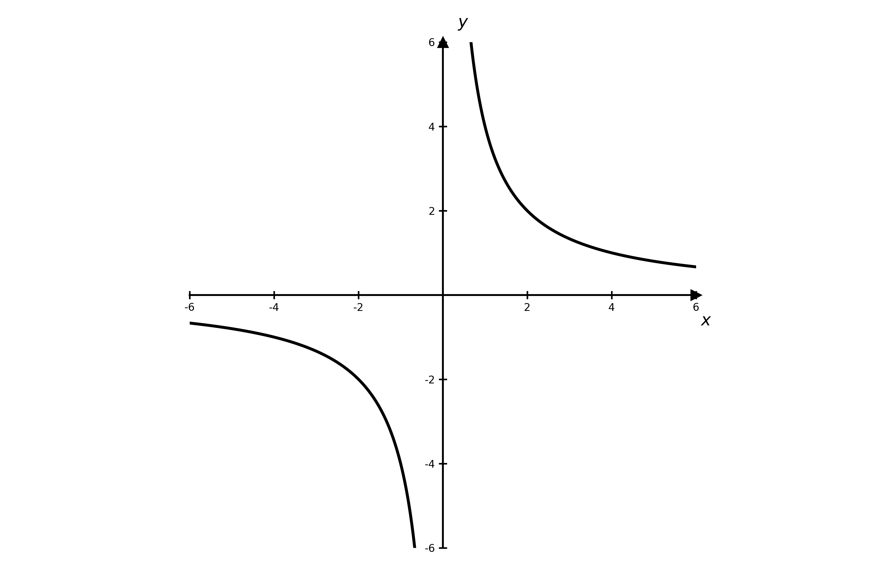
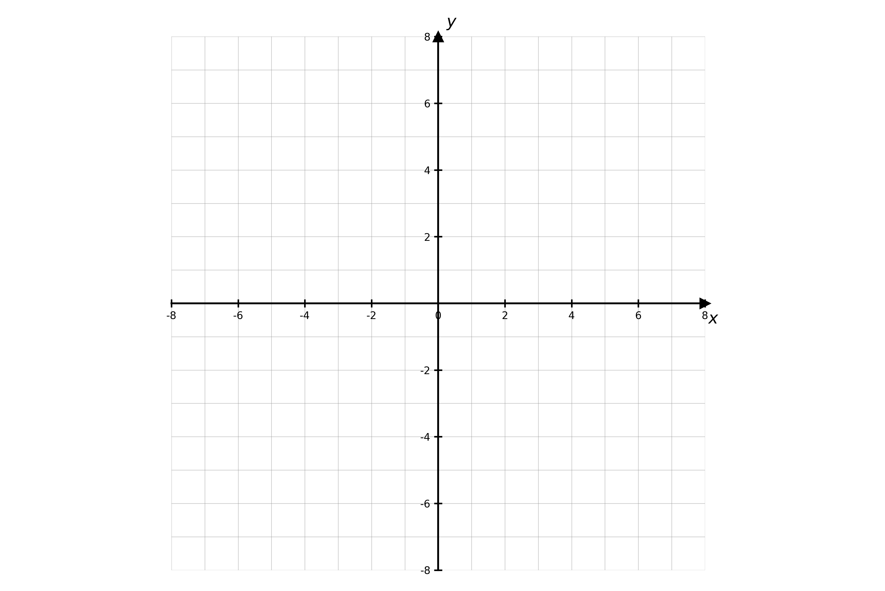
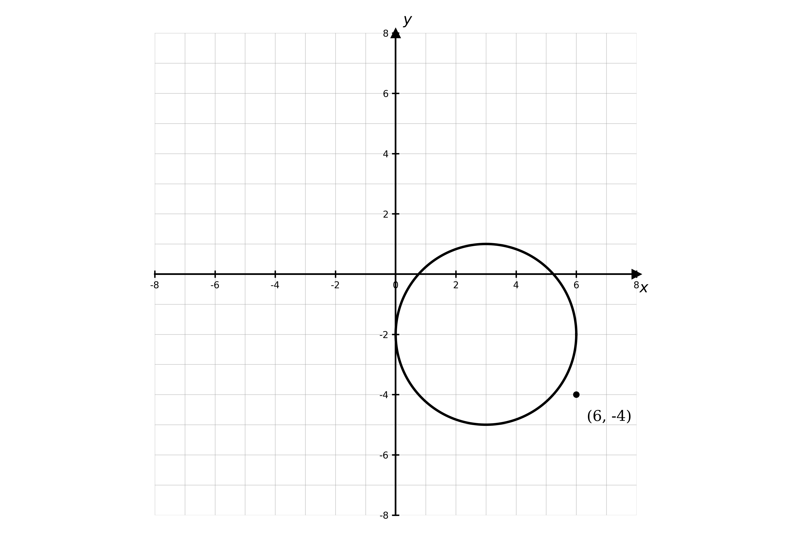

# Exam Questions — Graphs of Functions
**Algebra & Functions** · Cambridge (CIE) A-LEVEL maths (9709)
> Source: [https://www.savemyexams.com/a-level/maths/cie/20/pure-1/topic-questions/](https://www.savemyexams.com/a-level/maths/cie/20/pure-1/topic-questions/) · 30 questions across 1 sets

## Exam Questions (30 questions)

### Q1 — hard — 5 marks

**Q1** [3 marks]

On the axes below, sketch the graphs of $y = ( x - 1 )^{2}$ and $y = 2 - x^{2} - x$.

**Q1** [2 marks]

Using your graphs, or otherwise, find the solutions of the equation $x^{2} - 2 x + 1 = 2 - x^{2} - x$.

### Q2 — hard — 6 marks

**Q2** [3 marks]

On separate diagrams, sketch the graphs of $y = \frac{a}{x^{2}}$, where $a > 0$, and $y = \frac{a}{x^{2}}$, where $a < 0$.

**Q2** [3 marks]

One of the graphs passes through the point with coordinates $( m , m^{6} )$.

Write $a$ in terms of $m$ and, justifying your answer, state which graph this point lies on.

### Q3 — hard — 4 marks

**Q3** [4 marks]

$y$ is inversely proportional to the square of $x$. When $x = 4$, $y = 8$.

Find the constant of proportionality and sketch the graph of $y$ against $x$.

### Q4 — hard — 5 marks

**Q4** [3 marks]

On the same diagram, sketch the graphs of $y = \frac{1}{x^{2}}$ and $y = \frac{-3}{x^{2}}$.

**Q4** [2 marks]

Write down the equation(s) of any lines of symmetry and asymptotes for the two graphs in part (a).

### Q5 — hard — 6 marks

**Q5** [4 marks]

A machine completes a calculation in a time, $t$ seconds, that is proportional to the cube root of the number of processes, $p$, involved. For a calculation involving $8$ processes the machine takes $6 . 4 \times 10^{-4}$ seconds.

How many processes are involved in a calculation taking $1 . 28 \times 10^{-3}$ seconds?

**Q5** [2 marks]

Find the time it takes for the machine to complete a calculation involving $250$ processes.

### Q6 — hard — 4 marks

**Q6** [2 marks]

The diagram shows the graph of $y = \frac{a}{x^{2}}$, where $a > 0$.

Sketch the graph of $y = \frac{a}{x^{2}}$, where $a < 0$.

**Q6** [2 marks]

Given that $m$ is a negative real number, state, with a reason, which graph passes through the point $( m , m^{4} )$.

### Q7 — hard — 3 marks

**Q7** [3 marks]

Sketch the graph of $y = 3 x^{3} - 2 x^{2} - x$, giving the coordinates of the points where the graph meets the coordinate axes.

### Q8 — hard — 4 marks

**Q8** [3 marks]

On the same diagram, sketch the graphs of $y = x^{3} - 2 x^{2} - 8 x$ and $y = \frac{1}{x}$.

**Q8** [1 mark]

Use your diagram to determine the number of solutions of the equation $x^{3} - 2 x^{2} - 8 x = \frac{1}{x}$.

### Q9 — medium — 4 marks

**Q9** [4 marks]

$y$ is inversely proportional to $x$. When $x = 2$, $y = 10$.

Find the constant of proportionality and sketch the graph of $y$ against $x$.

### Q10 — hard — 2 marks

**Q10** [2 marks]

Sketch the graph of $y = \frac{-2}{x^{2}}$, and write down the equations of any asymptotes.

### Q11 — hard — 5 marks

**Q11** [3 marks]

On the axes below, sketch the graphs of $y = x^{2} + 2 x - 3$ and $y = x - 1$.

**Q11** [2 marks]

Using your graphs, or otherwise, solve the simultaneous equations $y = ( x + 3 ) ( x - 1 )$ and $x - y = 1$.

### Q12 — hard — 6 marks

**Q12** [2 marks]

A machine completes a calculation in a time, $t$ seconds, that is proportional to the square of the number of processes, $p$, involved. For a calculation involving $8$ processes the machine takes $0 . 032$ seconds.

Find an equation linking $p$ and $t$.

**Q12** [2 marks]

How many processes are involved in a calculation taking $0 . 2$ seconds?

**Q12** [2 marks]

Find the time it takes for the machine to complete a calculation involving $30$ processes.

### Q13 — medium — 6 marks

**Q13** [2 marks]

The diagram shows the graph of $y = \frac{a}{x}$, where $a > 0$.

Sketch the graph of $y = \frac{a}{x}$, where $a < 0$.

**Q13** [4 marks]

State which graph each of the following points must lie on, and find the value of $a$ in each case.

(i) $( - 4 , - 5 )$

(ii) $( - 0 . 02 , 250 )$

### Q14 — medium — 3 marks

**Q14** [3 marks]

Sketch the graph of $y = ( x + 3 )^{3}$, giving the coordinates of the points where the graph meets the coordinate axes.

### Q15 — medium — 4 marks

**Q15** [3 marks]

On the same diagram, sketch the graphs of $y = x ( x + 2 ) ( x - 1 )$ and $y = \frac{1}{x}$.

**Q15** [1 mark]

Use your diagram to determine the number of solutions of the equation $x ( x + 2 ) ( x - 1 ) = \frac{1}{x}$.

### Q16 — medium — 10 marks

**Q16** [3 marks]

Solve the equation $x^{3} - x^{2} - 2 x + 4 = 4 x + 4$.

**Q16** [1 mark]

Write down the $x$-coordinates of the points of intersection of the graphs of $y = x^{3} - x^{2} - 2 x + 4$ and $y = 4 x + 4$.

**Q16** [2 marks]

Find the $y$-coordinates of these points of intersection.

**Q16** [4 marks]

On the same diagram, sketch the graphs of $y = x^{3} - x^{2} - 2 x + 4$ and $y = 4 x + 4$.

### Q17 — medium — 3 marks

**Q17** [3 marks]

Sketch the graph of $y = 2 x^{2} ( x + 3 )$, giving the coordinates of the points where the graph meets the coordinate axes.

### Q18 — medium — 3 marks

**Q18** [3 marks]

$y$ is inversely proportional to $x$. When $x = 3$, $y = 12$.

Find the constant of proportionality and sketch the graph of $y$ against $x$.

### Q19 — medium — 2 marks

**Q19** [2 marks]

Sketch the graph of $y = \frac{1}{x^{2}}$, and write down the equations of any asymptotes.

### Q20 — medium — 3 marks

**Q20** [2 marks]

On the axes below, sketch the graphs of $y = 3 x - 2$ and $y = x + 4$.

**Q20** [1 mark]

Using your graphs, or otherwise, solve the simultaneous equations $3 x - y = 2$ and $x - y = - 4$.

### Q21 — medium — 7 marks

**Q21** [2 marks]

A machine completes a calculation in a time, $t$ seconds, that is proportional to the number of processes, $p$, involved. For a calculation involving $10$ processes the machine takes $0 . 01$ seconds.

Show that the constant of proportionality is $0 . 001$.

**Q21** [1 mark]

Hence write down an equation linking $p$ and $t$.

**Q21** [2 marks]

Find the time it takes for the machine to complete a calculation involving $200$ processes.

**Q21** [2 marks]

How many processes are involved in a calculation taking $2 . 3$ seconds?

### Q22 — easy — 3 marks

**Q22** [3 marks]

(i) On the axes below, sketch the graphs of $y = x$ and $y = - x + 2$.

(ii) Use your graphs to solve the simultaneous equations $y = x$ and $y = - x + 2$.

### Q23 — easy — 3 marks

**Q23** [3 marks]

Sketch the graph of $y = \frac{1}{x}$, stating the coordinates of any points where the graph meets the coordinate axes and the equations of any asymptotes.

### Q24 — easy — 3 marks

**Q24** [3 marks]

Sketch the graph of $y = x^{2} - 1$, giving the coordinates of the points where the graph meets the coordinate axes.

### Q25 — easy — 3 marks

**Q25** [3 marks]

By sketching the graphs of $y = x^{3}$ and $y = \frac{1}{x}$ on the same diagram, show that the equation $x^{3} = \frac{1}{x}$ has exactly two real solutions.

### Q26 — easy — 5 marks

**Q26** [2 marks]

The function $\text{f}$ is defined by

$\text{f} ( x ) = x^{2} + 3 x - 4$

for $x \in ℝ$.

(i) Write down the value of $\text{f} ( 0 )$.

(ii) Factorise $\text{f} ( x )$.

**Q26** [3 marks]

Hence sketch the graph of $y = \text{f} ( x )$, giving the coordinates of the points where the graph meets the coordinate axes.

### Q27 — easy — 3 marks

**Q27** [3 marks]

$y$ is proportional to $x$. When $x = 2$, $y = 10$.

(i) Find the constant of proportionality.

(ii) Sketch the graph of $y$ against $x$.

### Q28 — medium — 5 marks

**Q28** [2 marks]

Express $2 x^{3} + 2 x^{2} - 12 x$ in the form $a x ( x + b ) ( x + c )$, where $a$, $b$ and $c$ are integers.

**Q28** [3 marks]

Hence sketch the graph of $y = 2 x^{3} + 2 x^{2} - 12 x$, giving the coordinates of the points where the graph meets the coordinate axes.

### Q29 — easy — 3 marks

**Q29** [3 marks]

The diagram shows the circle with equation $( x - 3 )^{2} + ( y + 2 )^{2} = 9$.

On the diagram, draw three straight lines through the point $( 6 , - 4 )$ to show that a line through this point can meet the circle at no points, at exactly one point, or at two points.

### Q30 — easy — 3 marks

**Q30** [3 marks]

Sketch the graph of $y = 6 x - 12$, giving the coordinates of the points where the graph meets the coordinate axes.
