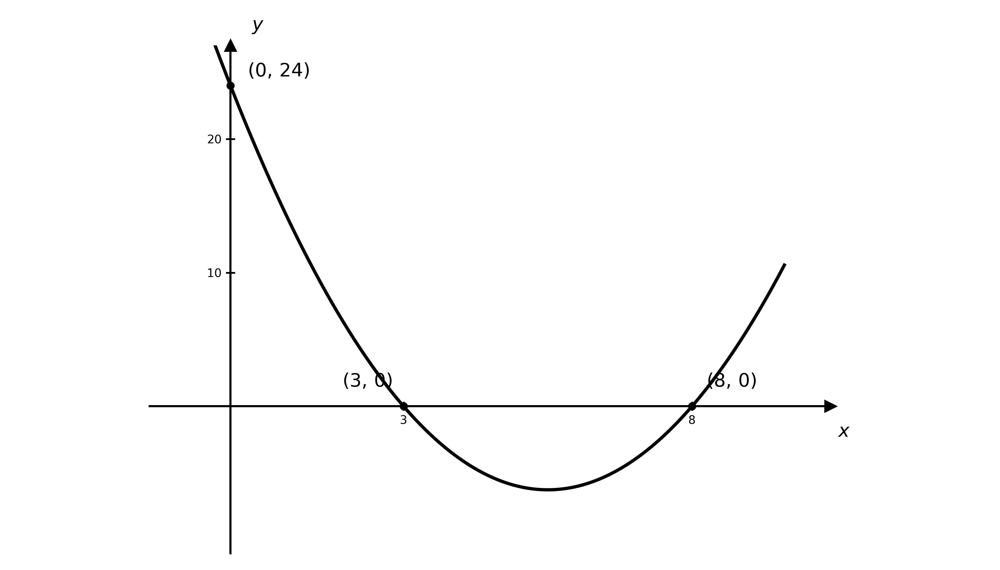
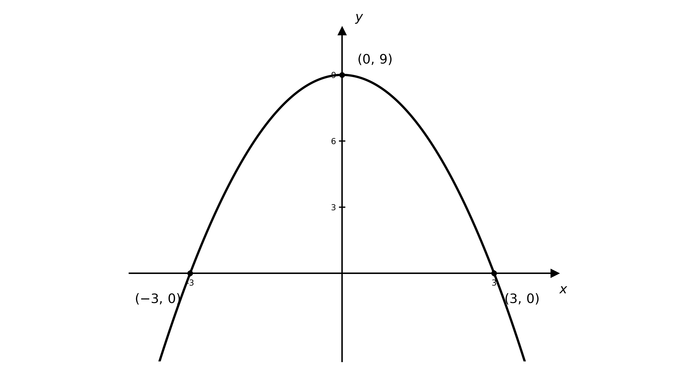
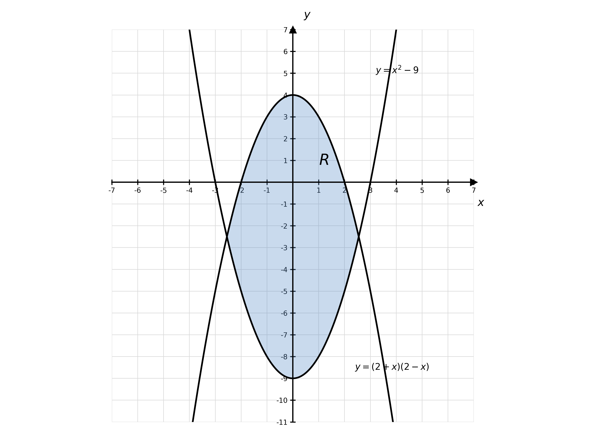
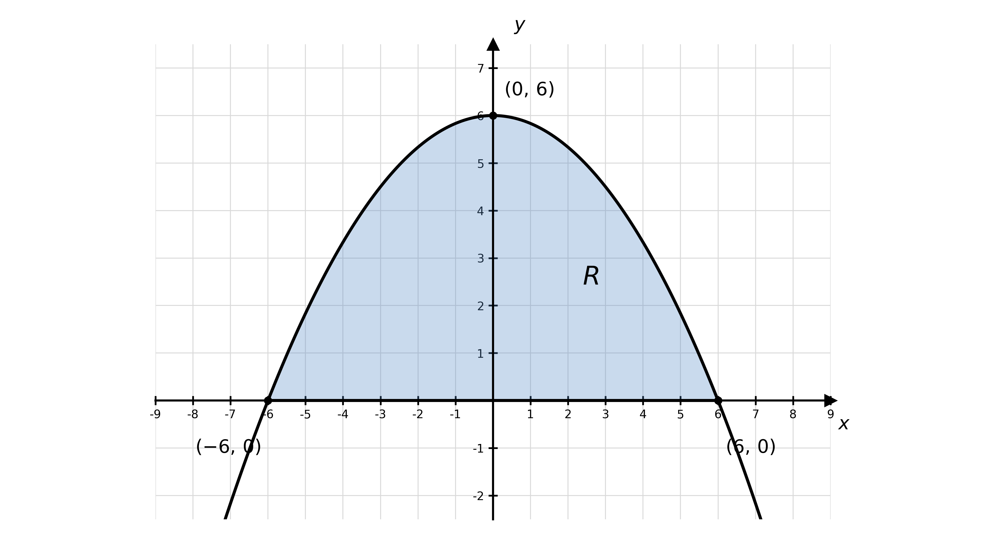
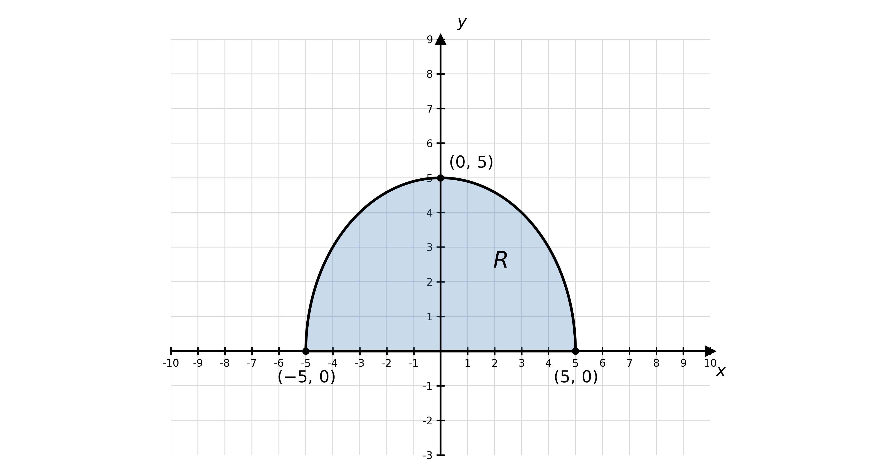
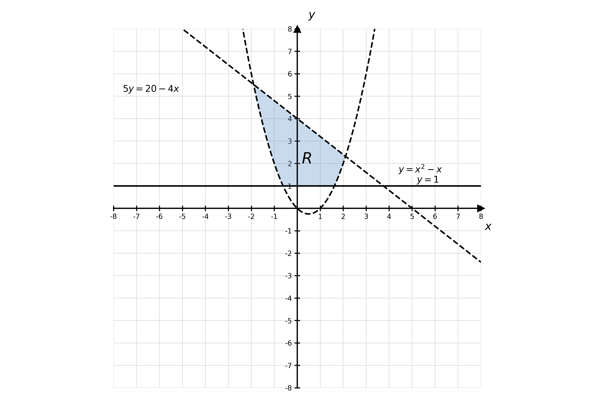
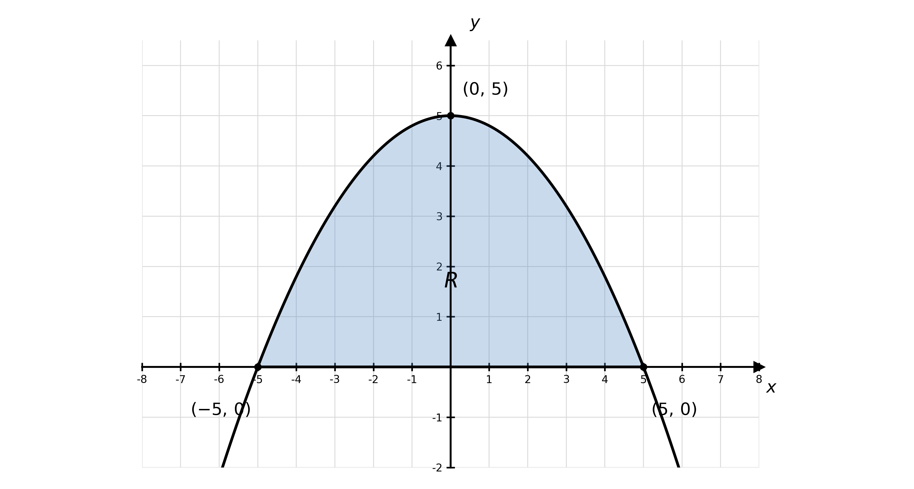

# Mark Schemes — Inequalities & Simultaneous Equations
**Algebra & Functions** · Cambridge (CIE) A-LEVEL maths (9709)

## Exam Questions (48 questions)

### Q1
The discriminant is $b^{2} - 4 a c$, with $a = 1$, $b = 8$ and $c = 15$

$8^{2} - 4 ( 1 ) ( 15 ) = 64 - 60$

**[M1]**

$4$

**[A1]**

> **[mark-scheme]**
> **M1**: Correct use of $b^{2} - 4 a c$ with $a = 1$, $b = 8$, $c = 15$ (not merely substituted into the quadratic formula).
> 
> **A1**: Correct value $4$.
The discriminant is positive ($4 > 0$), so the equation has

$\text{two real solutions}$

**[B1]**

> **[mark-scheme]**
> **B1**: Correct statement of two real solutions, following from a positive discriminant. Accept "two real roots" or "2".

### Q2
Rearrange the linear equation to $x = 1 - 3 y$ and substitute into the second equation

$( 1 - 3 y )^{2} + 9 y = 2 - y^{2}$

**[M1]**

Expand and collect all terms on one side

$1 - 6 y + 9 y^{2} + 9 y = 2 - y^{2}$

$10 y^{2} + 3 y - 1 = 0$

**[A1]**

Factorise and solve

$( 5 y - 1 ) ( 2 y + 1 ) = 0$

$y = \frac{1}{5}$* or *$y = - \frac{1}{2}$

**[M1]**

Substitute each $y$ into $x = 1 - 3 y$

**Final answer:** `\left(\dfrac{2}{5},\, \dfrac{1}{5}\right)`** and **`\left(\dfrac{5}{2},\, -\dfrac{1}{2}\right)`

**[A1]**

> **[mark-scheme]**
> **M1**: Correct substitution of $x = 1 - 3 y$ into the second equation.
> 
> **A1**: Correct three-term quadratic $10 y^{2} + 3 y - 1 = 0$.
> 
> **M1**: Valid attempt to solve the three-term quadratic.
> 
> **A1**: Both points correctly paired, `\left(\dfrac{2}{5}, \dfrac{1}{5}\right)` and `\left(\dfrac{5}{2}, -\dfrac{1}{2}\right)`. Can be written as x=... and y=... as long as clearly paired.

### Q3
Rearrange the linear equation to $y = x + 1$ and substitute

$( 2 x + 1 )^{2} - 3 ( x + 1 )^{2} + 3 x - 10 = 0$

**[M1]**

Expand and collect terms

$( 4 x^{2} + 4 x + 1 ) - 3 ( x^{2} + 2 x + 1 ) + 3 x - 10 = 0$

$x^{2} + x - 12 = 0$

**[A1]**

Factorise and solve

$( x + 4 ) ( x - 3 ) = 0$

$x = - 4$* or *$x = 3$

**[M1]**

Substitute each $x$ into $y = x + 1$

**Final answer:** $( - 4 ,  - 3 )$** and **$( 3 ,  4 )$

**[A1]**

> **[mark-scheme]**
> **M1**: Correct substitution of $y = x + 1$ into the second equation.
> 
> **A1**: Correct three-term quadratic $x^{2} + x - 12 = 0$.
> 
> **M1**: Valid attempt to solve the three-term quadratic.
> 
> **A1**: Both points correctly paired, $( - 4 , - 3 )$ and $( 3 , 4 )$. Can be written as x=... and y=... as long as clearly paired.

### Q4
Substitute $y = 2 x - 1$ into $x^{2} + y^{2} - 2 = 0$

$x^{2} + ( 2 x - 1 )^{2} - 2 = 0$

**[M1]**

Expand and simplify

$x^{2} + 4 x^{2} - 4 x + 1 - 2 = 0$

$5 x^{2} - 4 x - 1 = 0$

**[A1]**

Factorise and solve

$( 5 x + 1 ) ( x - 1 ) = 0$

$x = - \frac{1}{5}$* or *$x = 1$

**[M1]**

Substitute each $x$ into $y = 2 x - 1$

**Final answer:** `\left(-\dfrac{1}{5},\, -\dfrac{7}{5}\right)`** and **$( 1 ,  1 )$

**[A1]**

> **[mark-scheme]**
> **M1**: Correct substitution of $y = 2 x - 1$ into the second equation.
> 
> **A1**: Correct three-term quadratic $5 x^{2} - 4 x - 1 = 0$.
> 
> **M1**: Valid attempt to solve the three-term quadratic.
> 
> **A1**: Both points correctly paired, `\left(-\dfrac{1}{5}, -\dfrac{7}{5}\right)` and $( 1 , 1 )$. Can be written as x=... and y=... as long as clearly paired.

### Q5
For no real roots the discriminant must be negative, with $a = 1$, $b = k$ and $c = 4$

$b^{2} - 4 a c = k^{2} - 16$

**[M1]**

$k^{2} - 16 < 0$

**[M1]**

The critical values are where $k^{2} - 16 = 0$, giving $k = 4$ and $k = - 4$

**[A1]**

The expression is negative between the critical values

$- 4 < k < 4$

**[A1]**

> **[mark-scheme]**
> **M1**: Correct use of the discriminant $b^{2} - 4 a c = k^{2} - 16$ (not merely substituted into the quadratic formula).
> 
> **M1**: Recognition that "no real roots" requires the discriminant to be negative, $k^{2} - 16 < 0$.
> 
> **A1**: Correct critical values $k = 4$ and $k = - 4$.
> 
> **A1**: Correct set of values $- 4 < k < 4$. The inequality must be strict; $- 4 \leq k \leq 4$ is not accepted.

### Q6
Substitute $y = x + 3$ into $2 x^{2} - y^{2} = 5 x + 3$

$2 x^{2} - ( x + 3 )^{2} = 5 x + 3$

**[M1]**

Expand and collect all terms on one side

$2 x^{2} - ( x^{2} + 6 x + 9 ) = 5 x + 3$

$x^{2} - 11 x - 12 = 0$

**[A1]**

Factorise and solve

$( x - 12 ) ( x + 1 ) = 0$

$x = 12$* or *$x = - 1$

**[M1]**

Substitute each $x$ into $y = x + 3$ to find the corresponding $y$

**Final answer:** $x=12,y=15$** **

**Final answer:** **and**

**Final answer:** ** **$x=-1,y=2$

**[A1]**

> **[mark-scheme]**
> **M1**: Correct substitution of $y = x + 3$ into the quadratic equation.
> 
> **A1**: Correct three-term quadratic $x^{2} - 11 x - 12 = 0$.
> 
> **M1**: Valid attempt to solve the three-term quadratic (factorising, the quadratic formula or completing the square).
> 
> **A1**: Both solutions correctly paired, $( 12 , 15 )$ and $( - 1 , 2 )$. The values of $x$ and $y$ must be clearly paired.

### Q7
Setting each factor equal to zero gives the solutions

**Final answer:** $x = 3$** or **$x = 8$

**[B1 B1]**

> **[mark-scheme]**
> **B1**: Correct solution $x = 3$.
> 
> **B1**: Correct solution $x = 8$.
The coefficient of $x^{2}$ is positive, so the graph is a parabola opening upwards

**[B1]**

From part (a), the curve crosses the $x$-axis at $( 3 , 0 )$ and $( 8 , 0 )$

**[B1]**

> **[mark-scheme]**
> **B1**: Correct shape — a parabola opening upwards (positive quadratic).
> 
> **B1**: Both $x$-axis intercepts labelled, $( 3 , 0 )$ and $( 8 , 0 )$.
The graph lies below the $x$-axis (so $y < 0$) between the two roots

**[M1]**

$3 < x < 8$

**[A1]**

> **[mark-scheme]**
> **M1**: Correct identification that the curve lies below the $x$-axis between the roots $x = 3$ and $x = 8$.
> 
> **A1**: Correct solution $3 < x < 8$. The inequality must be strict; $3 \leq x \leq 8$ is not accepted. Accept equivalent forms such as $x > 3$ and $x < 8$, or the interval $( 3 , 8 )$.

### Q8
With $a = 1$, $b = 8$ and $c = 4 k$

$b^{2} - 4 a c = 64 - 16 k$

**[B1]**

> **[mark-scheme]**
> **B1**: Correct discriminant $64 - 16 k$ (accept the unsimplified $8^{2} - 4 ( 1 ) ( 4 k )$).
For two real and distinct solutions the discriminant must be positive

$64 - 16 k > 0$

**[M1]**

Solving for $k$

$k < 4$

**[A1]**

> **[mark-scheme]**
> **M1**: Correct use of the discriminant set strictly greater than zero, $64 - 16 k > 0$ (strict because the roots are distinct).
> 
> **A1**: Correct set of values $k < 4$. The inequality must be strict; $k \leq 4$ is not accepted.

### Q9
(i)

Rearrange and take square roots

$x^{2} = 9$

**[M1]**

**Final answer:** $x = 3$** or **$x = - 3$

**[A1]**

(ii)

The turning point lies on the axis of symmetry, midway between the roots $x = - 3$ and $x = 3$, so $x = 0$; substituting gives $y = 9$

$( 0 ,  9 )$

**[B1]**

> **[mark-scheme]**
> **M1**: Correct rearrangement to $x^{2} = 9$ (or correct factorising to $( 3 - x ) ( 3 + x ) = 0$).
> 
> **A1**: Both correct solutions $x = 3$ and $x = - 3$.
> 
> **B1**: Correct turning point $( 0 , 9 )$.
The coefficient of $x^{2}$ is negative, so the graph is a parabola opening downwards, with $x$-axis intercepts $( - 3 , 0 )$ and $( 3 , 0 )$ and maximum point $( 0 , 9 )$

**[M1]**

The graph is on or above the $x$-axis (so $y \geq 0$) between and including the two roots

**[M1]**

$- 3 \leq x \leq 3$

**[A1]**

> **[mark-scheme]**
> **M1**: Correct sketch — a parabola opening downwards with intercepts $( - 3 , 0 )$ and $( 3 , 0 )$ and maximum $( 0 , 9 )$ labelled.
> 
> **M1**: Correct identification that the curve is on or above the $x$-axis between the roots.
> 
> **A1**: Correct solution $- 3 \leq x \leq 3$. The inequality is inclusive because the question uses $\geq$; accept the interval `[-3, 3]`.

### Q10
Rearrange the linear equation to $y = \frac{1-3x}{4}$, so that $8 y^{2} = \frac{(1-3x)^{2}}{2}$

$8 y^{2} = \frac{(1-3x)^{2}}{2}$

**[M1]**

Substitute into the first equation and multiply through by $2$

$( 1 - 3 x )^{2} - 6 x^{2} - 8 x = - 11$

$1 - 6 x + 9 x^{2} - 6 x^{2} - 8 x = - 11$

$3 x^{2} - 14 x + 12 = 0$

**[A1]**

> **[mark-scheme]**
> **M1**: Correct method to eliminate $y$ (squaring $y = \frac{1-3x}{4}$ and substituting).
> 
> **A1**: Correct derivation of $3 x^{2} - 14 x + 12 = 0$ with no errors or omitted steps (this is a given answer).
The quadratic does not factorise, so use the quadratic formula with $a = 3$, $b = - 14$, $c = 12$

$x = \frac{14\pm\sqrt{(-14)^{2}-4(3)(12)}}{2(3)} = \frac{14\pm\sqrt{52}}{6}$

**[M1]**

Simplify the surd using $\sqrt{52} = 2 \sqrt{13}$

**Final answer:** $x = \frac{7+\sqrt{13}}{3}$** or **$x = \frac{7-\sqrt{13}}{3}$

**[A1]**

Substitute each value of $x$ into $y = \frac{1-3x}{4}$

$x = \frac{7+\sqrt{13}}{3} \Rightarrow y = \frac{-6-\sqrt{13}}{4}$

$x = \frac{7-\sqrt{13}}{3} \Rightarrow y = \frac{-6+\sqrt{13}}{4}$

**[M1 A1]**

State the solutions as coordinate pairs

**Final answer:** `\left(\dfrac{7 + \sqrt{13}}{3},\, \dfrac{-6 - \sqrt{13}}{4}\right)`** and **`\left(\dfrac{7 - \sqrt{13}}{3},\, \dfrac{-6 + \sqrt{13}}{4}\right)`

**[A1]**

> **[mark-scheme]**
> **M1**: Use of the quadratic formula (or completing the square) on $3 x^{2} - 14 x + 12 = 0$.
> 
> **A1**: Correct $x = \frac{7\pm\sqrt{13}}{3}$.
> 
> **M1**: Substituting both $x$-values into the linear equation to find $y$.
> 
> **A1**: Correct `y = \dfrac{-6 \mp \sqrt{13}}{4}` or accurate equivalent.
> 
> **A1**: Solutions correctly paired. Can be written as x=... and y=... as long as clearly paired. Accept any accurate equivalent answers.

### Q11
The region is bounded below by the upward parabola $y = ( x + 4 ) ( x - 1 ) = x^{2} + 3 x - 4$ (roots $- 4$ and $1$); R lies above it

$y > x^{2} + 3 x - 4$

**[B1]**

It is bounded above by the line $x + y = 1$ (through $( 0 , 1 )$ and $( 1 , 0 )$); R lies on or below it

$x + y \leq 1$

**[B1]**

It is bounded below by the line $y = \frac{1}{2} x - 2$ (through $( 0 , - 2 )$ and $( 4 , 0 )$); R lies above it

$y > \frac{1}{2} x - 2$

**[B1]**

> **[mark-scheme]**
> **B1**: Correct parabola inequality $y > x^{2} + 3 x - 4$ (accept $y > ( x + 4 ) ( x - 1 )$).
> 
> **B1**: Correct line inequality $x + y \leq 1$ (or $y \leq 1 - x$).
> 
> **B1**: Correct line inequality $y > \frac{1}{2} x - 2$. Strict/non-strict should match dashed/solid boundaries, but CIE condones a swap.

### Q12
Each height above the ground is the model plus its starting height. Each stone is at least $4$ m above the ground when

$13 . 2 t - 4 . 9 t^{2} + 2 \geq 4 \Rightarrow 4 . 9 t^{2} - 13 . 2 t + 2 \leq 0$

$13 t - 4 . 9 t^{2} + 2 . 3 \geq 4 \Rightarrow 4 . 9 t^{2} - 13 t + 1 . 7 \leq 0$

**[M1]**

Solve each quadratic with the formula

$\text{Stone 1:} t = \frac{13.2\pm\sqrt{135.04}}{9.8} ,  t = 0 . 1612 \dots ,  2 . 5327 \dots$

$\text{Stone 2:} t = \frac{13\pm\sqrt{135.68}}{9.8} ,  t = 0 . 1379 \dots ,  2 . 5151 \dots$

**[M1 A1]**

Both are above $4$ m on the overlap of the two intervals — from the later start time to the earlier end time

$0 . 1612 \dots \leq t \leq 2 . 5151 \dots$

**[M1]**

The duration is the difference

$2 . 5151 \dots - 0 . 1612 \dots = 2 . 3539 \dots$

**Final answer:** $2 . 35 \text{s}$** (3 s.f.)**

**[A1]**

> **[mark-scheme]**
> **M1**: Adjusting both models for their starting heights and forming the two inequalities $4 . 9 t^{2} - 13 . 2 t + 2 \leq 0$ and $4 . 9 t^{2} - 13 t + 1 . 7 \leq 0$.
> 
> **M1**: Solving both quadratics with the formula (or completing the square).
> 
> **A1**: All four correct times (kept unrounded for the next step).
> 
> **M1**: Identifying the simultaneous interval as the later start time to the earlier end time.
> 
> **A1**: Correct duration $2 . 35$ s (answers which round to $2 . 35$ s to 3 significant figures).

### Q13
Split the double inequality into two parts. The left inequality

$x^{2} + 3 x - 4 \geq - 6$

$x^{2} + 3 x + 2 \geq 0 \Rightarrow ( x + 1 ) ( x + 2 ) \geq 0$

**[M1]**

$x \leq - 2$* or *$x \geq - 1$

**[A1]**

The right inequality

$x^{2} + 3 x - 4 \leq 6$

$x^{2} + 3 x - 10 \leq 0 \Rightarrow ( x + 5 ) ( x - 2 ) \leq 0$

**[M1]**

$- 5 \leq x \leq 2$

**[A1]**

Both must hold; take the overlap of ($x \leq - 2$ or $x \geq - 1$) and $- 5 \leq x \leq 2$

**[M1]**

`\left\{ x : -5 \leq x \leq -2 \right\} \cup \left\{ x : -1 \leq x \leq 2 \right\}`

**[A1]**

> **[mark-scheme]**
> **M1**: Forming and factorising the left inequality, $x^{2} + 3 x + 2 \geq 0$.
> 
> **A1**: Correct solution $x \leq - 2$ or $x \geq - 1$.
> 
> **M1**: Forming and factorising the right inequality, $x^{2} + 3 x - 10 \leq 0$.
> 
> **A1**: Correct solution $- 5 \leq x \leq 2$.
> 
> **M1**: Taking the overlap of the two solution sets.
> 
> **A1**: Correct answer in set notation, `\left\{ x : -5 \leq x \leq -2 \right\} \cup \left\{ x : -1 \leq x \leq 2 \right\}` (disjoint sets joined with $\cup$, not "and").

### Q14
Since $( x + 1 )^{2} > 0$ for all $x \neq - 1$, multiply both sides by $( x + 1 )^{2}$ (the inequality sign is unchanged)

$4 x^{2} - 11 \geq 4 ( x + 1 )^{2}$

**[M1]**

Expand the right-hand side; the $x^{2}$ terms cancel

$4 x^{2} - 11 \geq 4 x^{2} + 8 x + 4$

**[M1]**

$- 15 \geq 8 x$

**[A1]**

Solve for $x$ (note $- \frac{15}{8} < - 1$, so $x \neq - 1$ holds automatically)

$x \leq - \frac{15}{8}$

**[A1]**

> **[mark-scheme]**
> **M1**: Multiplying both sides by $( x + 1 )^{2}$ to clear the fraction (no reversal of the inequality, as $( x + 1 )^{2} > 0$).
> 
> **M1**: Expanding $4 ( x + 1 )^{2}$ correctly.
> 
> **A1**: Reducing to the linear inequality $- 15 \geq 8 x$ (the $x^{2}$ terms cancel).
> 
> **A1**: Correct solution $x \leq - \frac{15}{8}$ (inclusive, from $\geq$).

### Q15
The income from selling $c$ cables is $c ( 38 - c ) = 38 c - c^{2}$. A profit needs income strictly greater than cost

$38 c - c^{2} > 160 + 12 c$

**[M1]**

Rearrange to a three-term quadratic and factorise

$c^{2} - 26 c + 160 < 0$

$( c - 10 ) ( c - 16 ) < 0$

**[M1]**

$10 < c < 16$

**[A1]**

The minimum whole number of cables for a profit is

$11$

**[A1]**

The maximum whole number of cables for a profit is

$15$

**[A1]**

> **[mark-scheme]**
> **M1**: Forming income $= 38 c - c^{2}$ and setting income strictly greater than cost.
> 
> **M1**: Rearranging to $c^{2} - 26 c + 160 < 0$ and solving (factorising or the formula).
> 
> **A1**: Correct critical values, giving $10 < c < 16$.
> 
> **A1**: Correct minimum number of cables, $11$.
> 
> **A1**: Correct maximum number of cables, $15$ ($c = 10$ and $c = 16$ only break even).
The profit $P = ( 38 c - c^{2} ) - ( 160 + 12 c ) = - c^{2} + 26 c - 160$ is greatest at the vertex, midway between the roots $10$ and $16$

$13$

**[B1]**

> **[mark-scheme]**
> **B1**: Correct number of cables for maximum profit, $13$ (the vertex of the profit parabola).

### Q16
Rearrange the linear equation to make $y$ the subject

$y = \frac{-6-3x}{2}$

**[M1]**

Substitute into $9 x^{2} - 7 x y + 4 y^{2} = 36$ and simplify

`9x^{2} - 7x\left(\dfrac{-6 - 3x}{2}\right) + 4\left(\dfrac{-6 - 3x}{2}\right)^{2} = 36`

**[M1]**

$\frac{57}{2} x^{2} + 57 x = 0 \Rightarrow x^{2} + 2 x = 0$

**[A1]**

Factorise and solve

$x ( x + 2 ) = 0$

$x = 0$* or *$x = - 2$

**[M1 A1]**

Substitute each value of $x$ into $y = \frac{-6-3x}{2}$

$x = 0 \Rightarrow y = - 3$

$x = - 2 \Rightarrow y = 0$

**[M1]**

State the solutions as coordinate pairs

**Final answer:** $( 0 ,  - 3 )$** and **$( - 2 ,  0 )$

**[A1]**

> **[mark-scheme]**
> **M1**: Rearranging the linear equation to make $y$ the subject.
> 
> **M1**: Substituting into the quadratic equation (including the $x y$ term).
> 
> **A1**: Correct simplified quadratic $x^{2} + 2 x = 0$.
> 
> **M1**: Valid attempt to solve the quadratic.
> 
> **A1**: Both correct values $x = 0$ and $x = - 2$.
> 
> **M1**: Substituting both $x$-values into the linear equation to find $y$.
> 
> **A1**: Solutions correctly paired, $( 0 , - 3 )$ and $( - 2 , 0 )$. Can be written as x=... and y=... as long as clearly paired.

### Q17
Rearrange the linear equation to $x = y + k$ and substitute into the first equation

$( y + k )^{2} + 2 y^{2} = 25$

**[M1]**

$3 y^{2} + 2 k y + ( k^{2} - 25 ) = 0$

**[A1]**

The number of solutions is determined by the discriminant of this quadratic in $y$

$( 2 k )^{2} - 4 ( 3 ) ( k^{2} - 25 ) = 300 - 8 k^{2}$

**[M1]**

The discriminant is zero at the critical values

$300 - 8 k^{2} = 0 \Rightarrow k = \pm \frac{5\sqrt{6}}{2}$

**[A1]**

**One solution** (discriminant $= 0$):

**Final answer:** $k = \frac{5\sqrt{6}}{2}$** or **$k = - \frac{5\sqrt{6}}{2}$

**[A1]**

**Two solutions** (discriminant $> 0$) and **no solutions** (discriminant $< 0$):

$- \frac{5\sqrt{6}}{2} < k < \frac{5\sqrt{6}}{2}$

**Final answer:** $k < - \frac{5\sqrt{6}}{2}$** or **$k > \frac{5\sqrt{6}}{2}$

**[A1]**

> **[mark-scheme]**
> **M1**: Substituting $x = y + k$ into the first equation.
> 
> **A1**: Correct quadratic in $y$, $3 y^{2} + 2 k y + ( k^{2} - 25 ) = 0$.
> 
> **M1**: Using the discriminant $b^{2} - 4 a c$ of this quadratic.
> 
> **A1**: Correct critical values $k = \pm \frac{5\sqrt{6}}{2}$ (from $300 - 8 k^{2} = 0$).
> 
> **A1**: Correct set for one solution, $k = \pm \frac{5\sqrt{6}}{2}$.
> 
> **A1**: Correct sets for two solutions ($- \frac{5\sqrt{6}}{2} < k < \frac{5\sqrt{6}}{2}$) and no solutions ($k < - \frac{5\sqrt{6}}{2}$ or $k > \frac{5\sqrt{6}}{2}$). Disjoint sets joined with "or"/comma, not "and".
With one solution the quadratic has a repeated root $y = - \frac{2k}{2(3)} = - \frac{k}{3}$, and $x = y + k$

**[M1]**

For $k = \frac{5\sqrt{6}}{2}$: $y = - \frac{5\sqrt{6}}{6}$ and $x = \frac{5\sqrt{6}}{3}$

`\left(\dfrac{5\sqrt{6}}{3},\, -\dfrac{5\sqrt{6}}{6}\right)`

**[A1]**

For $k = - \frac{5\sqrt{6}}{2}$: $y = \frac{5\sqrt{6}}{6}$ and $x = - \frac{5\sqrt{6}}{3}$

`\left(-\dfrac{5\sqrt{6}}{3},\, \dfrac{5\sqrt{6}}{6}\right)`

**[A1]**

> **[mark-scheme]**
> **M1**: Using the repeated root $y = - \frac{k}{3}$ (or substituting a critical value of $k$ to find the repeated solution).
> 
> **A1**: Correct pair for one value of $k$.
> 
> **A1**: Correct pair for the other value of $k$. Can be written as x=... and y=... as long as clearly paired.

### Q18
Take the left inequality

$2 x^{2} + 1 \leq x^{2} + 10 x - 8$

$x^{2} - 10 x + 9 \leq 0 \Rightarrow ( x - 1 ) ( x - 9 ) \leq 0$

**[M1]**

$1 \leq x \leq 9$

**[A1]**

Take the right inequality

$x^{2} + 10 x - 8 < 2 x^{2} - 7 x + 52$

$x^{2} - 17 x + 60 > 0 \Rightarrow ( x - 5 ) ( x - 12 ) > 0$

**[M1]**

$x < 5$* or *$x > 12$

**[A1]**

Both must hold; the overlap of $1 \leq x \leq 9$ with ($x < 5$ or $x > 12$) is

`[1,\, 5)`

**[A1]**

> **[mark-scheme]**
> **M1**: Forming and factorising the left inequality, $x^{2} - 10 x + 9 \leq 0$.
> 
> **A1**: Correct solution $1 \leq x \leq 9$.
> 
> **M1**: Forming and factorising the right inequality, $x^{2} - 17 x + 60 > 0$.
> 
> **A1**: Correct solution $x < 5$ or $x > 12$.
> 
> **A1**: Correct combined answer in interval notation, `[1, 5)` (square bracket at $1$, round at $5$).

### Q19
The unicorn is at ground level when $h = 0$

$- 0 . 02 x ( x - k ) = 0 \Rightarrow x = 0  \text{or}  x = k$

**Final answer:** **The unicorn leaves the ground at **$x = 0$** and lands at **$x = k$**, so the horizontal distance leapt is **$k - 0 = k$

**[B1]**

> **[mark-scheme]**
> **B1**: Explaining that the unicorn starts at $x = 0$ and returns to the ground at $x = k$, so $k$ is the horizontal distance leapt.
The unicorn is safe only if its path does not cross or touch the laser beam. Setting the two paths equal, with the laser as $h = 5 - \frac{x}{5}$

$- 0 . 02 x ( x - k ) = 5 - \frac{x}{5}$

**[M1]**

Multiplying through by $- 50$ and collecting terms

$x^{2} - ( k + 10 ) x + 250 = 0$

**[A1]**

The greatest safe leap is when the path just touches the laser, i.e. the discriminant is zero

$( k + 10 )^{2} - 4 ( 250 ) = 0$

**[M1]**

$( k + 10 )^{2} = 1000 \Rightarrow k = 10 \sqrt{10} - 10 \approx 21 . 6$

**[A1]**

So the unicorn can leap at most about $21 . 6$ m safely; compare this with the target of $22$ m

*Since *$22 > 21 . 6$*, the discriminant is positive, so the path crosses the laser beam (two real roots) and the level is failed*

**[M1]**

$\text{No, a 22 m leap is not achievable safely}$

**[A1]**

> **[mark-scheme]**
> **M1**: Equating the unicorn path and the laser beam $h = 5 - \frac{x}{5}$.
> 
> **A1**: Correct three-term quadratic $x^{2} - ( k + 10 ) x + 250 = 0$.
> 
> **M1**: Setting the discriminant to zero for the critical (tangency) leap.
> 
> **A1**: Correct maximum safe leap $k = 10 \sqrt{10} - 10 \approx 21 . 6$ m.
> 
> **M1**: Comparing the target $22$ m with the critical value.
> 
> **A1**: Correct conclusion, linking $22 > 21 . 6$ to two real roots (the path crosses the laser) so the goal is **not** achievable safely.

### Q20
Draw the upward parabola $y = x^{2} - 9$ (vertex $( 0 , - 9 )$, $x$-intercepts $\pm 3$); $x^{2} - 9 \leq y$ is the region on or above it

**[B1]**

Draw the downward parabola $y = ( 2 + x ) ( 2 - x ) = 4 - x^{2}$ (vertex $( 0 , 4 )$, $x$-intercepts $\pm 2$); $y \leq ( 2 + x ) ( 2 - x )$ is the region on or below it

**[B1]**

Shade the region between the two parabolas and label it $R$

**[B1]**

> **[mark-scheme]**
> **B1**: Correct upward parabola $y = x^{2} - 9$.
> 
> **B1**: Correct downward parabola $y = 4 - x^{2}$.
> 
> **B1**: Correct region shaded (between the two curves) and labelled $R$.
Both parabolas are symmetric about the $y$-axis, so the region is symmetric about

$x = 0$

**[B1]**

> **[mark-scheme]**
> **B1**: Correct line of symmetry $x = 0$ (accept "the $y$-axis").

### Q21
The boundary $y = 6 - \frac{x^{2}}{6}$ is a parabola opening downwards, with maximum $( 0 , 6 )$ and $x$-intercepts $\pm 6$

**[B1]**

Shade the region on or below this curve and on or above the $x$-axis

**[B1]**

> **[mark-scheme]**
> **B1**: Correct boundary parabola (maximum $( 0 , 6 )$, meeting the $x$-axis at $\pm 6$).
> 
> **B1**: Correct region shaded (on or below the curve, on or above the $x$-axis).

The height is the maximum value of $y$

$6 \text{m}$

**[B1]**

The maximum width is the distance between the $x$-intercepts

$12 \text{m}$

**[B1]**

> **[mark-scheme]**
> **B1**: Correct height $6$ m.
> 
> **B1**: Correct maximum width $12$ m.

Approximate the cross-section by a semicircle of radius $6$

$\frac{1}{2} π r^{2} = \frac{1}{2} π ( 6 )^{2}$

**[M1]**

$= 18 π$

**[A1]**

$\approx 56 . 5 \text{m}^{2}$

**[A1]**

> **[mark-scheme]**
> **M1**: Correct use of the semicircle area $\frac{1}{2} π r^{2}$ with $r = 6$.
> 
> **A1**: Correct exact area $18 π$ m².
> 
> **A1**: Correct value, answers which round to $56 . 5$ m² to 3 significant figures.
The volume is the cross-sectional area multiplied by the length

$18 π \times 20 = 360 π$

**[M1]**

$\approx 1130 \text{m}^{3}$

**[A1]**

> **[mark-scheme]**
> **M1**: Multiplying the estimated cross-sectional area by the length $20$.
> 
> **A1**: Correct volume, answers which round to $1130$ m³ to 3 significant figures (accept $360 π$).

### Q22
Solve the first inequality

$( t - 5 ) ( t + 3 ) < 0$

$- 3 < t < 5$

**[M1]**

Rearrange and solve the second inequality

$t^{2} - 9 t + 14 \leq 0$

$( t - 2 ) ( t - 7 ) \leq 0 \Rightarrow 2 \leq t \leq 7$

**[M1]**

Both inequalities must hold; take the overlap

$- 3 < t < 5  \text{and}  2 \leq t \leq 7$

**[A1]**

$2 \leq t < 5$

**[A1]**

> **[mark-scheme]**
> **M1**: Solving the first quadratic inequality to $- 3 < t < 5$.
> 
> **M1**: Solving the second quadratic inequality to $2 \leq t \leq 7$.
> 
> **A1**: Correct method to combine (take the overlap of the two solution sets).
> 
> **A1**: Correct combined answer $2 \leq t < 5$ ($2$ inclusive, $5$ strict, matching the two inequalities).

### Q23
Rearrange to standard form, with $a = k + 1$, $b = 2 ( k + 2 )$, $c = - 3 ( k + 3 )$, and apply the condition for real roots, discriminant $\geq 0$

`[2(k + 2)]^{2} - 4(k + 1)[-3(k + 3)] \geq 0`

**[M1]**

Expand and simplify

$4 ( k + 2 )^{2} + 12 ( k + 1 ) ( k + 3 ) \geq 0$

$16 k^{2} + 64 k + 52 \geq 0 \Rightarrow 4 k^{2} + 16 k + 13 \geq 0$

The critical values are $k = \frac{-16\pm\sqrt{48}}{8} = \frac{-4\pm\sqrt{3}}{2}$

**[M1]**

The positive parabola is on or above the axis outside its roots

**Final answer:** $k \leq \frac{-4-\sqrt{3}}{2}$** or **$k \geq \frac{-4+\sqrt{3}}{2}$

**[A1]**

> **[mark-scheme]**
> **M1**: Correct use of the discriminant $\geq 0$ with $a = k + 1$, $b = 2 ( k + 2 )$, $c = - 3 ( k + 3 )$.
> 
> **M1**: Simplifying to $4 k^{2} + 16 k + 13 \geq 0$ and finding the critical values $k = \frac{-4\pm\sqrt{3}}{2}$.
> 
> **A1**: Correct set of values $k \leq \frac{-4-\sqrt{3}}{2}$ or $k \geq \frac{-4+\sqrt{3}}{2}$ (inclusive; joined with "or"/comma, not "and").

### Q24
Make $6 y$ the subject of the linear equation by doubling it

$2 x - 3 y = - 1$

$6 y = 4 x + 2$

**[M1]**

Substitute into $4 x^{2} + 2 x - 6 y = 4$

$4 x^{2} + 2 x - ( 4 x + 2 ) = 4$

**[M1]**

$4 x^{2} - 2 x - 6 = 0 \Rightarrow 2 x^{2} - x - 3 = 0$

**[A1]**

Factorise and solve

$( 2 x - 3 ) ( x + 1 ) = 0$

$x = \frac{3}{2}$* or *$x = - 1$

**[M1 A1]**

Substitute each value of $x$ into $y = \frac{2x+1}{3}$

$x = \frac{3}{2} \Rightarrow y = \frac{4}{3}$

$x = - 1 \Rightarrow y = - \frac{1}{3}$

**[M1]**

State the solutions as coordinate pairs

**Final answer:** `\left(\dfrac{3}{2},\, \dfrac{4}{3}\right)`** and **`\left(-1,\, -\dfrac{1}{3}\right)`

**[A1]**

> **[mark-scheme]**
> **M1**: Rearranging the linear equation to make $6 y$ (or $y$) the subject.
> 
> **M1**: Substituting into the quadratic equation.
> 
> **A1**: Correct three-term quadratic $2 x^{2} - x - 3 = 0$.
> 
> **M1**: Valid attempt to solve the quadratic.
> 
> **A1**: Both correct values $x = \frac{3}{2}$ and $x = - 1$.
> 
> **M1**: Substituting both $x$-values into the linear equation to find $y$.
> 
> **A1**: Solutions correctly paired, `\left(\dfrac{3}{2}, \dfrac{4}{3}\right)` and `\left(-1, -\dfrac{1}{3}\right)`. Can be written as x=... and y=... as long as clearly paired.

### Q25
Rearrange the linear equation to $y = 4 - x$ and substitute into the second equation

$x^{2} - 4 x - 3 ( 4 - x ) = 0$

**[M1]**

Expand and simplify

$x^{2} - 4 x - 12 + 3 x = 0$

$x^{2} - x - 12 = 0$

**[A1]**

Factorise and solve

$( x - 4 ) ( x + 3 ) = 0$

$x = 4$* or *$x = - 3$

**[M1 A1]**

Substitute each value of $x$ into $y = 4 - x$

$x = 4 \Rightarrow y = 0$

$x = - 3 \Rightarrow y = 7$

**[M1 A1]**

State the solutions as coordinate pairs

**Final answer:** $( 4 ,  0 )$** and **$( - 3 ,  7 )$

**[A1]**

> **[mark-scheme]**
> **M1**: Substituting $y = 4 - x$ into the second equation.
> 
> **A1**: Correct three-term quadratic $x^{2} - x - 12 = 0$.
> 
> **M1**: Valid attempt to solve the quadratic (factorising, formula or completing the square).
> 
> **A1**: Both correct values $x = 4$ and $x = - 3$.
> 
> **M1**: Substituting both $x$-values into the linear equation to find $y$.
> 
> **A1**: Both correct values $y = 0$ and $y = 7$.
> 
> **A1**: Solutions correctly paired, $( 4 , 0 )$ and $( - 3 , 7 )$. Can be written as x=... and y=... as long as clearly paired.

### Q26
Solve the first inequality; rearrange and factorise

$x^{2} + x - 2 < 0$

$( x + 2 ) ( x - 1 ) < 0$

**[M1]**

The critical values are $x = - 2$ and $x = 1$

**[A1]**

The positive parabola is below the $x$-axis between its roots

$- 2 < x < 1$

**[A1]**

Solve the second inequality

$x^{2} < 4 \Rightarrow - 2 < x < 2$

**[B1]**

Both inequalities must hold; the overlap is

$- 2 < x < 1$

**[A1]**

> **[mark-scheme]**
> **M1**: Rearranging the first inequality to $x^{2} + x - 2 < 0$ and factorising.
> 
> **A1**: Correct critical values $x = - 2$ and $x = 1$.
> 
> **A1**: Correct solution of the first inequality, $- 2 < x < 1$.
> 
> **B1**: Correct solution of the second inequality, $- 2 < x < 2$.
> 
> **A1**: Correct combined answer $- 2 < x < 1$, given as a single resolved inequality.

### Q27
Take the square root of both sides, remembering both signs

$x + 2 = \pm \sqrt{5}$

**[M1]**

The critical values are

$x = - 2 + \sqrt{5}$* or *$x = - 2 - \sqrt{5}$

**[A1]**

The graph of $y = ( x + 2 )^{2} - 5$ is a positive parabola, which is above the $x$-axis outside its roots

**Final answer:** $x < - 2 - \sqrt{5}$** or **$x > - 2 + \sqrt{5}$

**[A1]**

> **[mark-scheme]**
> **M1**: Valid method for the critical values — taking square roots to get $x + 2 = \pm \sqrt{5}$ (or expanding to $x^{2} + 4 x - 1 > 0$ and using the formula).
> 
> **A1**: Correct critical values $x = - 2 \pm \sqrt{5}$.
> 
> **A1**: Correct solution $x < - 2 - \sqrt{5}$ or $x > - 2 + \sqrt{5}$. Strict inequalities, joined with "or" (or a comma), not "and".

### Q28
Split the double inequality into two separate inequalities

$x^{2} - 4 \geq - 2$

$x^{2} - 4 \leq 5$

**[M1]**

Solve the first: $x^{2} \geq 2$

$x \leq - \sqrt{2}$* or *$x \geq \sqrt{2}$

**[A1]**

Solve the second: $x^{2} \leq 9$

$- 3 \leq x \leq 3$

**[A1]**

Both must hold; combine the two solutions

**Final answer:** $- 3 \leq x \leq - \sqrt{2}$** or **$\sqrt{2} \leq x \leq 3$

**[A1]**

> **[mark-scheme]**
> **M1**: Splitting into $x^{2} - 4 \geq - 2$ and $x^{2} - 4 \leq 5$ (or equivalent).
> 
> **A1**: Correct solution of $x^{2} \geq 2$, i.e. $x \leq - \sqrt{2}$ or $x \geq \sqrt{2}$.
> 
> **A1**: Correct solution of $x^{2} \leq 9$, i.e. $- 3 \leq x \leq 3$.
> 
> **A1**: Correct combined solution $- 3 \leq x \leq - \sqrt{2}$ or $\sqrt{2} \leq x \leq 3$ (accept $\cup$ of the two intervals).
Rearrange the first inequality to a three-term quadratic and solve

$x^{2} + 4 x - 3 \leq 2 - x^{2} - 5 x$

$2 x^{2} + 9 x - 5 \leq 0$

$( 2 x - 1 ) ( x + 5 ) \leq 0$

**[M1]**

$- 5 \leq x \leq \frac{1}{2}$

**[A1]**

Rearrange the second inequality and solve

$8 - 2 x^{2} \leq 4 x^{2} + 2 x$

$3 x^{2} + x - 4 \geq 0$

$( 3 x + 4 ) ( x - 1 ) \geq 0$

$x \leq - \frac{4}{3}$* or *$x \geq 1$

**[M1]**

Both inequalities must hold; only $- 5 \leq x \leq - \frac{4}{3}$ satisfies both, so in set notation

`\left\{ x : -5 \leq x \leq -\dfrac{4}{3} \right\}`

**[A1]**

> **[mark-scheme]**
> **M1**: Rearranging the first inequality to $2 x^{2} + 9 x - 5 \leq 0$ and solving.
> 
> **A1**: Correct solution of the first inequality, $- 5 \leq x \leq \frac{1}{2}$.
> 
> **M1**: Rearranging the second inequality to $3 x^{2} + x - 4 \geq 0$ and solving to $x \leq - \frac{4}{3}$ or $x \geq 1$.
> 
> **A1**: Correct combined answer in set notation, `\left\{ x : -5 \leq x \leq -\dfrac{4}{3} \right\}`.

### Q29
The boundary $x^{2} + y^{2} = 25$ is a circle centred at the origin with radius $5$

**[B1]**

$x^{2} + y^{2} \leq 25$ is the region inside the circle, and $y \geq 0$ restricts it to the upper half

**[B1]**

Shade the upper half of the disc

**[B1]**

> **[mark-scheme]**
> **B1**: Correct boundary circle, centre the origin, radius $5$.
> 
> **B1**: Region restricted to $y \geq 0$ (the upper half).
> 
> **B1**: Correct region shaded (inside the circle, upper half).

The height is the radius of the circle

$5 \text{m}$

**[B1]**

The maximum width is the diameter

$10 \text{m}$

**[B1]**

> **[mark-scheme]**
> **B1**: Correct height $5$ m (the radius).
> 
> **B1**: Correct maximum width $10$ m (the diameter).
The cross-section is a semicircle of radius $5$

$\frac{1}{2} π r^{2} = \frac{1}{2} π ( 5 )^{2}$

**[M1]**

$12 . 5 π \approx 39 . 3 \text{m}^{2}$

**[A1]**

> **[mark-scheme]**
> **M1**: Correct use of the semicircle area $\frac{1}{2} π r^{2}$ with $r = 5$.
> 
> **A1**: Correct area $12 . 5 π$ m² (or answers which round to $39 . 3$ m² to 3 significant figures).

### Q30
The stone starts $1 . 5$ m above the ground and $d ( t )$ is its height above that starting point, so its height above the ground is $d ( t ) + 1 . 5$. It is $3$ m above the ground when

$16 t - 4 . 9 t^{2} + 1 . 5 = 3$

$4 . 9 t^{2} - 16 t + 1 . 5 = 0$

**[M1]**

Solve using the quadratic formula

$t = \frac{16\pm\sqrt{(-16)^{2}-4(4.9)(1.5)}}{2(4.9)} = \frac{16\pm\sqrt{226.6}}{9.8}$

**[M1]**

$t = 0 . 0966 \dots$* or *$t = 3 . 1687 \dots$

**[A1]**

The stone is above $3$ m between these times, so the duration is the difference

$3 . 1687 \dots - 0 . 0966 \dots = 3 . 0721 \dots$

**Final answer:** $3 . 07 \text{s}$** (3 s.f.)**

**[A1]**

> **[mark-scheme]**
> **M1**: Using the datum correctly — height above ground $= d ( t ) + 1 . 5$ — and forming $4 . 9 t^{2} - 16 t + 1 . 5 = 0$ (or the inequality).
> 
> **M1**: Correct use of the quadratic formula to solve for $t$.
> 
> **A1**: Both correct times, $t = 0 . 0966$ and $t = 3 . 17$ (keep unrounded values for the next step).
> 
> **A1**: Correct duration, the difference of the two times, $3 . 07$ s (answers which round to $3 . 07$ s to 3 significant figures).

### Q31
Rearrange the linear equation to make $y$ the subject

$20 x - 4 y = - 5 \Rightarrow y = 5 x + \frac{5}{4}$

**[M1]**

Substitute into $x^{2} - y + 3 x = k$

`x^{2} - \left(5x + \dfrac{5}{4}\right) + 3x = k`

**[M1]**

$x^{2} - 2 x - \frac{5}{4} - k = 0$

**[A1]**

For exactly one solution the discriminant must be zero, with $a = 1$, $b = - 2$, `c = -\left(\dfrac{5}{4} + k\right)`

`(-2)^{2} - 4(1)\left(-\dfrac{5}{4} - k\right) = 0`

**[M1]**

$9 + 4 k = 0$

$k = - \frac{9}{4}$

**[A1]**

> **[mark-scheme]**
> **M1**: Rearranging the linear equation to make $y$ the subject.
> 
> **M1**: Substituting into the quadratic equation to obtain a quadratic in $x$.
> 
> **A1**: Correct quadratic $x^{2} - 2 x - \frac{5}{4} - k = 0$ (or equivalent).
> 
> **M1**: Setting the discriminant equal to zero (the condition for exactly one solution).
> 
> **A1**: Correct value $k = - \frac{9}{4}$.
Substitute $k = - \frac{9}{4}$ into the quadratic from part (a)

$x^{2} - 2 x - \frac{5}{4} + \frac{9}{4} = 0$

$x^{2} - 2 x + 1 = 0$

**[M1]**

$( x - 1 )^{2} = 0 \Rightarrow x = 1$

**[A1]**

Substitute $x = 1$ into $y = 5 x + \frac{5}{4}$

$y = 5 ( 1 ) + \frac{5}{4} = \frac{25}{4}$

`\left(1,\, \dfrac{25}{4}\right)`

**[A1]**

> **[mark-scheme]**
> **M1**: Substituting $k = - \frac{9}{4}$ into the quadratic and simplifying.
> 
> **A1**: Correct repeated root $x = 1$.
> 
> **A1**: Correct solution `\left(1, \dfrac{25}{4}\right)`. Can be written as x=... and y=... as long as clearly paired.

### Q32
Substitute $y = \frac{2}{3} x + 2$ into the first equation

`4x^{2} + 5x\left(\dfrac{2}{3}x + 2\right) + 9\left(\dfrac{2}{3}x + 2\right)^{2} = 36`

**[M1]**

Expand and simplify

$4 x^{2} + \frac{10}{3} x^{2} + 10 x + 4 x^{2} + 24 x + 36 = 36$

$\frac{34}{3} x^{2} + 34 x = 0$

Multiply through by $\frac{3}{34}$ to obtain the required result

$x^{2} + 3 x = 0$

**[A1]**

> **[mark-scheme]**
> **M1**: Correct substitution of $y = \frac{2}{3} x + 2$ into the quadratic equation.
> 
> **A1**: Correct derivation of $x^{2} + 3 x = 0$ with no errors or omitted steps (this is a given answer).
Factorise the quadratic from part (a) and solve

$x ( x + 3 ) = 0$

**[M1]**

**Final answer:** $x = 0$** or **$x = - 3$

**[A1]**

Substitute each value of $x$ into $y = \frac{2}{3} x + 2$

$x = 0 \Rightarrow y = 2$

$x = - 3 \Rightarrow y = 0$

**[M1 A1]**

State the solutions as coordinate pairs

**Final answer:** $( 0 ,  2 )$** and **$( - 3 ,  0 )$

**[A1]**

> **[mark-scheme]**
> **M1**: Valid attempt to solve the quadratic from part (a).
> 
> **A1**: Both correct values $x = 0$ and $x = - 3$.
> 
> **M1**: Substituting both $x$-values into the linear equation to find $y$.
> 
> **A1**: Both correct values $y = 2$ and $y = 0$.
> 
> **A1**: Solutions correctly paired, $( 0 , 2 )$ and $( - 3 , 0 )$. Can be written as x=... and y=... as long as clearly paired.

### Q33
Rearrange the linear equation to $y = \frac{1-4x}{2}$, so that $4 y^{2} = ( 1 - 4 x )^{2}$

$4 y^{2} = 1 - 8 x + 16 x^{2}$

**[M1]**

Substitute into $15 x^{2} - 4 y^{2} = 12$ and rearrange

$15 x^{2} - ( 1 - 8 x + 16 x^{2} ) = 12$

$- x^{2} + 8 x - 1 = 12$

$x^{2} - 8 x + 13 = 0$

**[A1]**

> **[mark-scheme]**
> **M1**: Correct method to eliminate $y$ (squaring $y = \frac{1-4x}{2}$ and substituting).
> 
> **A1**: Correct derivation of $x^{2} - 8 x + 13 = 0$ with no errors or omitted steps (this is a given answer).
The quadratic does not factorise, so use the quadratic formula with $a = 1$, $b = - 8$, $c = 13$

$x = \frac{8\pm\sqrt{(-8)^{2}-4(1)(13)}}{2} = \frac{8\pm\sqrt{12}}{2}$

**[M1]**

Simplify the surd using $\sqrt{12} = 2 \sqrt{3}$

**Final answer:** $x = 4 + \sqrt{3}$** or **$x = 4 - \sqrt{3}$

**[A1]**

Substitute each value of $x$ into $y = \frac{1-4x}{2}$

$x = 4 + \sqrt{3} \Rightarrow y = \frac{1-4(4+\sqrt{3})}{2} = - \frac{15}{2} - 2 \sqrt{3}$

$x = 4 - \sqrt{3} \Rightarrow y = - \frac{15}{2} + 2 \sqrt{3}$

**[M1 A1]**

State the solutions as coordinate pairs

**Final answer:** `\left(4 + \sqrt{3},\, -\dfrac{15}{2} - 2\sqrt{3}\right)`** and **`\left(4 - \sqrt{3},\, -\dfrac{15}{2} + 2\sqrt{3}\right)`

**[A1]**

> **[mark-scheme]**
> **M1**: Use of the quadratic formula (or completing the square) on $x^{2} - 8 x + 13 = 0$.
> 
> **A1**: Correct $x = 4 \pm \sqrt{3}$.
> 
> **M1**: Substituting both $x$-values into the linear equation to find $y$.
> 
> **A1**: Correct `y = -\dfrac{15}{2} \mp 2\sqrt{3}`.
> 
> **A1**: Solutions correctly paired, `\left(4 + \sqrt{3}, -\dfrac{15}{2} - 2\sqrt{3}\right)` and `\left(4 - \sqrt{3}, -\dfrac{15}{2} + 2\sqrt{3}\right)`. Can be written as x=... and y=... as long as clearly paired.

### Q34
Since $3 x^{2} + 2 > 0$ for all real $x$, multiply both sides by $3 x^{2} + 2$ (the inequality sign is unchanged)

$5 \leq 2 ( 3 x^{2} + 2 )$

**[M1]**

Expand and isolate $x^{2}$

$5 \leq 6 x^{2} + 4$

$x^{2} \geq \frac{1}{6}$

**[M1]**

The critical values are $x = \pm \frac{1}{\sqrt{6}}$, that is $\pm \frac{\sqrt{6}}{6}$

**[A1]**

$x^{2} \geq \frac{1}{6}$ is satisfied outside the critical values

**Final answer:** $x \leq - \frac{1}{\sqrt{6}}$** or **$x \geq \frac{1}{\sqrt{6}}$

**[A1]**

> **[mark-scheme]**
> **M1**: Multiplying both sides by $3 x^{2} + 2$ to clear the fraction (no reversal of the inequality needed, since the denominator is positive).
> 
> **M1**: Rearranging to $x^{2} \geq \frac{1}{6}$ (or $6 x^{2} \geq 1$).
> 
> **A1**: Correct exact critical values $x = \pm \frac{1}{\sqrt{6}}$ (accept $\pm \frac{\sqrt{6}}{6}$).
> 
> **A1**: Correct solution $x \leq - \frac{1}{\sqrt{6}}$ or $x \geq \frac{1}{\sqrt{6}}$. The inequalities are inclusive (the question uses $\leq$), joined with "or", not "and".

### Q35
The income is the number of cables sold multiplied by the price of each

$c \times ( 40 - c )$

**[M1]**

Expand to obtain the required result

$40 c - c^{2}$

**[A1]**

> **[mark-scheme]**
> **M1**: Forming the product (number of cables) × (price each), $c ( 40 - c )$.
> 
> **A1**: Correct expansion to $40 c - c^{2}$ (this is a given answer).
A profit is made when the income is strictly greater than the cost

$40 c - c^{2} > 200 + 10 c$

**[M1]**

Rearrange to a three-term quadratic and factorise

$c^{2} - 30 c + 200 < 0$

$( c - 10 ) ( c - 20 ) < 0$

**[M1]**

$10 < c < 20$

**[A1]**

A profit needs $c > 10$ ($c = 10$ only breaks even), so the minimum whole number of cables is

$11$

**[A1]**

> **[mark-scheme]**
> **M1**: Setting income strictly greater than cost, $40 c - c^{2} > 200 + 10 c$.
> 
> **M1**: Rearranging to $c^{2} - 30 c + 200 < 0$ and solving (factorising or the formula).
> 
> **A1**: Correct critical values, giving $10 < c < 20$.
> 
> **A1**: Correct minimum number of cables, $11$ (the integer must be stated; $c = 10$ is break-even, not a profit).

### Q36
The firework meets the roof where the two models are equal

$0 . 84 x - 0 . 07 x^{2} = 2 + 0 . 1 x$

**[M1]**

Rearrange into a three-term quadratic

$0 . 07 x^{2} - 0 . 74 x + 2 = 0$

**[A1]**

Evaluate the discriminant $b^{2} - 4 a c$

$( - 0 . 74 )^{2} - 4 ( 0 . 07 ) ( 2 ) = 0 . 5476 - 0 . 56$

**[M1]**

$= - 0 . 0124$

**[A1]**

The discriminant is negative, so the equation has no real roots; the two paths never meet

$\text{The firework does not hit the roof}$

**[A1]**

> **[mark-scheme]**
> **M1**: Equating the two models, $0 . 84 x - 0 . 07 x^{2} = 2 + 0 . 1 x$.
> 
> **A1**: Correct three-term quadratic $0 . 07 x^{2} - 0 . 74 x + 2 = 0$ (or equivalent).
> 
> **M1**: Correct use of the discriminant $b^{2} - 4 a c$ with their $a$, $b$, $c$.
> 
> **A1**: Correct value $- 0 . 0124$ (or showing $0 . 5476 < 0 . 56$).
> 
> **A1**: Correct conclusion linking the negative discriminant to no real roots, so the paths do not meet and the firework does not hit the roof.

### Q37
The equation is $k^{2} x^{2} + ( k - 2 ) x + 1 = 0$. For two distinct real roots the discriminant must be positive, with $a = k^{2}$, $b = k - 2$, $c = 1$

$( k - 2 )^{2} - 4 k^{2} > 0$

**[M1]**

Expand and simplify

$k^{2} - 4 k + 4 - 4 k^{2} > 0$

$3 k^{2} + 4 k - 4 < 0$

**[A1]**

Factorise to find the critical values

$( 3 k - 2 ) ( k + 2 ) < 0 \Rightarrow - 2 < k < \frac{2}{3}$

**[M1]**

The coefficient of $x^{2}$ is $k^{2}$, so $k \neq 0$ is needed for a quadratic with two roots; exclude $k = 0$

**Final answer:** $- 2 < k < 0$** or **$0 < k < \frac{2}{3}$

**[A1]**

> **[mark-scheme]**
> **M1**: Correct use of the discriminant $> 0$ with $a = k^{2}$, $b = k - 2$, $c = 1$.
> 
> **A1**: Correct simplified inequality $3 k^{2} + 4 k - 4 < 0$ (or equivalent).
> 
> **M1**: Correct critical values $k = - 2$ and $k = \frac{2}{3}$, giving $- 2 < k < \frac{2}{3}$.
> 
> **A1**: Correct final set with $k = 0$ excluded: $- 2 < k < 0$ or $0 < k < \frac{2}{3}$. Strict inequalities; "or"/comma, not "and".

### Q38
Draw the parabola $y = x^{2} - x$ (crossing the $x$-axis at $0$ and $1$)

$y + x > x^{2}$ is the region above it

**[B1]**

Draw the line $5 y = 20 - 4 x$ (through $( 0 , 4 )$ and $( 5 , 0 )$)

$5 y < 20 - 4 x$ is the region below it

**[B1]**

Draw the line $y = 1$

$y - 1 \geq 0$ is the region on or above it

**[B1]**

Shade the region satisfying all three inequalities

**[B1]**

Label the shaded region $R$

**[B1]**

> **[mark-scheme]**
> **B1**: Correct parabola $y = x^{2} - x$ in roughly the right position.
> 
> **B1**: Correct line $5 y = 20 - 4 x$.
> 
> **B1**: Correct line $y = 1$.
> 
> **B1**: Correct region — on the correct side of all three boundaries.
> 
> **B1**: Region clearly shaded and labelled $R$. (Strict boundaries are ideally dashed and $y = 1$ solid, but a dashed/solid swap is condoned.)

### Q39
The company recovers its costs when the income is at least equal to the cost

$30 c - c^{2} \geq 100 + 5 c$

**[M1]**

Rearrange into a quadratic inequality and factorise

$c^{2} - 25 c + 100 \leq 0$

$( c - 5 ) ( c - 20 ) \leq 0$

**[M1]**

The positive parabola is on or below the $c$-axis between its roots

$5 \leq c \leq 20$

**[A1]**

The company must sell at least $5$ cables, so the minimum number is

$5$

**[A1]**

> **[mark-scheme]**
> **M1**: Setting income $\geq$ cost, $30 c - c^{2} \geq 100 + 5 c$ (accept an equation for the critical values).
> 
> **M1**: Rearranging to a three-term quadratic and solving (factorising or the formula).
> 
> **A1**: Correct critical values, giving $5 \leq c \leq 20$.
> 
> **A1**: Correct minimum number of cables, $5$ (the integer must be stated, not just the interval).

### Q40
The stone is at least $2$ m above the ground while $d ( t ) \geq 2$, so find the times when $d ( t ) = 2$

$12 t - 4 . 9 t^{2} = 2$

$4 . 9 t^{2} - 12 t + 2 = 0$

**[M1]**

Solve using the quadratic formula

$t = \frac{12\pm\sqrt{(-12)^{2}-4(4.9)(2)}}{2(4.9)} = \frac{12\pm\sqrt{104.8}}{9.8}$

**[M1]**

$t = 0 . 1799 \dots$* or *$t = 2 . 2691 \dots$

**[A1]**

The stone is above $2$ m between these times, so the duration is the difference

$2 . 2691 \dots - 0 . 1799 \dots = 2 . 0892 \dots$

**Final answer:** $2 . 09 \text{s}$** (3 s.f.)**

**[A1]**

> **[mark-scheme]**
> **M1**: Forming the equation $12 t - 4 . 9 t^{2} = 2$ (or inequality) and rearranging to a three-term quadratic.
> 
> **M1**: Correct use of the quadratic formula (or completing the square) to solve for $t$.
> 
> **A1**: Both correct times, $t = 0 . 180$ and $t = 2 . 27$ (keep unrounded values for the next step).
> 
> **A1**: Correct duration, the difference of the two times, $2 . 09$ s (answers which round to $2 . 09$ s to 3 significant figures).

### Q41
Rearrange the linear equation to make $y$ the subject

$2 x - y = k \Rightarrow y = 2 x - k$

**[M1]**

Substitute into $x^{2} - 2 y = 10$

$x^{2} - 2 ( 2 x - k ) = 10$

$x^{2} - 4 x + 2 k - 10 = 0$

**[M1]**

Write $2 k - 10$ as $2 ( k - 5 )$ to obtain the required result

$x^{2} - 4 x + 2 ( k - 5 ) = 0$

**[A1]**

> **[mark-scheme]**
> **M1**: Rearranging the linear equation to make $y$ the subject.
> 
> **M1**: Substituting into the quadratic equation to obtain a quadratic in $x$.
> 
> **A1**: Correct derivation of $x^{2} - 4 x + 2 ( k - 5 ) = 0$ with no omitted steps (this is a given answer).
For only one solution the discriminant must be zero, with $a = 1$, $b = - 4$, $c = 2 ( k - 5 )$

$( - 4 )^{2} - 4 ( 1 ) ( 2 ( k - 5 ) ) = 0$

**[M1]**

$16 - 8 ( k - 5 ) = 0$

$56 - 8 k = 0$

$k = 7$

**[A1]**

> **[mark-scheme]**
> **M1**: Setting the discriminant of the quadratic equal to zero (the condition for one repeated solution).
> 
> **A1**: Correct value $k = 7$.
Substitute $k = 7$ into the quadratic from part (a)

$x^{2} - 4 x + 2 ( 7 - 5 ) = 0$

$x^{2} - 4 x + 4 = 0$

**[M1]**

$( x - 2 )^{2} = 0 \Rightarrow x = 2$

**[A1]**

Substitute $x = 2$ into $2 x - y = 7$ to find $y$

$y = 2 ( 2 ) - 7 = - 3$

$( 2 ,  - 3 )$

**[A1]**

> **[mark-scheme]**
> **M1**: Substituting $k = 7$ into the quadratic and simplifying.
> 
> **A1**: Correct repeated root $x = 2$.
> 
> **A1**: Correct solution $( 2 , - 3 )$. Can be written as x=... and y=... as long as clearly paired.

### Q42
The boundary $y = 5 - \frac{x^{2}}{5}$ is a parabola opening downwards

**[B1]**

Its maximum is $( 0 , 5 )$ and it meets the $x$-axis where $5 - \frac{x^{2}}{5} = 0$, giving $x = \pm 5$

**[B1]**

Shade the region on or below this curve and on or above the $x$-axis

**[B1]**

> **[mark-scheme]**
> **B1**: Correct boundary curve — a parabola opening downwards meeting the $x$-axis.
> 
> **B1**: Maximum point $( 0 , 5 )$ and $x$-intercepts $( \pm 5 , 0 )$ identified.
> 
> **B1**: Correct region shaded — bounded above by the curve and below by the $x$-axis.

The height is the maximum value of $y$, at the vertex of the parabola

$5 \text{m}$

**[B1]**

The maximum width is the distance between the two $x$-intercepts, $5 - ( - 5 )$

$10 \text{m}$

**[B1]**

> **[mark-scheme]**
> **B1**: Correct height $5$ m (the maximum value of $y$).
> 
> **B1**: Correct maximum width $10$ m (the distance between the $x$-intercepts).

### Q43
For two distinct real roots the discriminant must be positive, with $a = k$, $b = 2 k$ and $c = 4$

$b^{2} - 4 a c = ( 2 k )^{2} - 4 ( k ) ( 4 ) > 0$

**[M1]**

$4 k^{2} - 16 k > 0$

**[A1]**

Factorise to find the critical values

$4 k ( k - 4 ) > 0$

$k = 0$* or *$k = 4$

**[M1]**

The expression is positive outside the critical values

**Final answer:** $k < 0$** or **$k > 4$

**[A1]**

> **[mark-scheme]**
> **M1**: Correct use of the discriminant $> 0$ with $a = k$, $b = 2 k$, $c = 4$ (not merely substituted into the quadratic formula).
> 
> **A1**: Correct simplified inequality $4 k^{2} - 16 k > 0$ (or equivalent, e.g. $k^{2} - 4 k > 0$).
> 
> **M1**: Correct critical values $k = 0$ and $k = 4$.
> 
> **A1**: Correct set of values $k < 0$ or $k > 4$. The inequalities must be strict, and the two regions must be joined with "or" (or a comma), not "and".

### Q44
Rearrange so that one side is zero

$x^{2} - 5 x - 6 > 0$

**[M1]**

Factorise to find the critical values

$( x - 6 ) ( x + 1 ) = 0$

$x = - 1$* or *$x = 6$

**[A1]**

The graph of $y = x^{2} - 5 x - 6$ is a positive parabola, which lies above the $x$-axis outside its roots

**[M1]**

**Final answer:** $x < - 1$** or **$x > 6$

**[A1]**

> **[mark-scheme]**
> **M1**: Rearranging to a three-term quadratic with one side zero, $x^{2} - 5 x - 6 > 0$.
> 
> **A1**: Correct critical values $x = - 1$ and $x = 6$.
> 
> **M1**: Correct identification that a positive parabola is above the $x$-axis outside the roots.
> 
> **A1**: Correct solution $x < - 1$ or $x > 6$. The inequalities must be strict, and the two regions must be joined with "or" (or a comma), not "and". Accept the interval form $( - \infty , - 1 ) \cup ( 6 , \infty )$.

### Q45
Solve the quadratic inequality first; rearrange so one side is zero and factorise

$x^{2} + 3 x - 4 > 0$

$( x + 4 ) ( x - 1 ) > 0$

**[M1]**

The critical values are $x = - 4$ and $x = 1$

**[A1]**

The positive parabola lies above the $x$-axis outside its roots

$x < - 4$* or *$x > 1$

**[A1]**

Solve the linear inequality

$4 x + 1 > 4$

$x > \frac{3}{4}$

**[M1]**

Both inequalities must hold simultaneously; only values with $x > 1$ satisfy both

$x > 1$

**[A1]**

> **[mark-scheme]**
> **M1**: Rearranging $x^{2} + 3 x > 4$ to a three-term quadratic and factorising.
> 
> **A1**: Correct critical values $x = - 4$ and $x = 1$.
> 
> **A1**: Correct solution of the quadratic inequality, $x < - 4$ or $x > 1$.
> 
> **M1**: Correct solution of the linear inequality, $x > \frac{3}{4}$.
> 
> **A1**: Correct combined answer $x > 1$, given as a single resolved inequality (not listed alongside $x > \frac{3}{4}$).

### Q46
Substitute $y = 2 x + 10$ into the first equation

$x^{2} + 10 x + ( 2 x + 10 )^{2} = - 20$

**[M1]**

Expand and simplify

$x^{2} + 10 x + 4 x^{2} + 40 x + 100 = - 20$

$5 x^{2} + 50 x + 120 = 0$

Divide through by $5$ to obtain the required result

$x^{2} + 10 x + 24 = 0$

**[A1]**

> **[mark-scheme]**
> **M1**: Correct substitution of $y = 2 x + 10$ into the quadratic equation.
> 
> **A1**: Correct derivation of $x^{2} + 10 x + 24 = 0$ with no errors or omitted steps (this is a given answer).
Factorise the quadratic from part (a) and solve

$( x + 4 ) ( x + 6 ) = 0$

**[M1]**

**Final answer:** $x = - 4$** or **$x = - 6$

**[A1]**

Substitute each value of $x$ into $y = 2 x + 10$

$x = - 4 \Rightarrow y = 2$

$x = - 6 \Rightarrow y = - 2$

**[M1 A1]**

State the solutions as coordinate pairs

**Final answer:** $( - 4 ,  2 )$** and **$( - 6 ,  - 2 )$

**[A1]**

> **[mark-scheme]**
> **M1**: Valid attempt to solve the three-term quadratic (factorising, the quadratic formula or completing the square).
> 
> **A1**: Both correct values $x = - 4$ and $x = - 6$.
> 
> **M1**: Substitution of both $x$-values into the linear equation to find the corresponding $y$-values.
> 
> **A1**: Both correct values $y = 2$ and $y = - 2$.
> 
> **A1**: Solutions correctly paired, $( - 4 , 2 )$ and $( - 6 , - 2 )$. Can be written as x=... and y=... as long as clearly paired.

### Q47
Make $8 y$ the subject of each equation. From the linear equation

$3 x + 2 y = 4 \Rightarrow 8 y = 16 - 12 x$

From the other equation

$x^{2} - 8 y = - 40 \Rightarrow 8 y = x^{2} + 40$

**[M1]**

Equate the two expressions for $8 y$ to obtain the required result

$x^{2} + 40 = 16 - 12 x$

$x^{2} + 12 x + 24 = 0$

**[A1]**

> **[mark-scheme]**
> **M1**: Correct method to eliminate $y$ (equating expressions for $8 y$, or substituting from the linear equation).
> 
> **A1**: Correct derivation of $x^{2} + 12 x + 24 = 0$ with no errors or omitted steps (this is a given answer).
The quadratic does not factorise, so use the quadratic formula with $a = 1$, $b = 12$, $c = 24$

$x = \frac{-12\pm\sqrt{12^{2}-4(1)(24)}}{2} = \frac{-12\pm\sqrt{48}}{2}$

**[M1]**

Simplify the surd using $\sqrt{48} = 4 \sqrt{3}$

**Final answer:** $x = - 6 + 2 \sqrt{3}$** or **$x = - 6 - 2 \sqrt{3}$

**[A1]**

Substitute each value of $x$ into the linear equation, $y = \frac{4-3x}{2}$

$x = - 6 + 2 \sqrt{3} \Rightarrow y = \frac{4-3(-6+2\sqrt{3})}{2} = 11 - 3 \sqrt{3}$

$x = - 6 - 2 \sqrt{3} \Rightarrow y = 11 + 3 \sqrt{3}$

**[M1 A1]**

State the solutions as coordinate pairs

**Final answer:** $( - 6 + 2 \sqrt{3} ,  11 - 3 \sqrt{3} )$** and **$( - 6 - 2 \sqrt{3} ,  11 + 3 \sqrt{3} )$

**[A1]**

> **[mark-scheme]**
> **M1**: Use of the quadratic formula (or completing the square) on $x^{2} + 12 x + 24 = 0$. A calculator-only or factorised answer is not accepted for the surd form.
> 
> **A1**: Correct $x = - 6 \pm 2 \sqrt{3}$.
> 
> **M1**: Substitution of both $x$-values into the linear equation to find the corresponding $y$-values.
> 
> **A1**: Correct `y = 11 \mp 3\sqrt{3}`.
> 
> **A1**: Solutions correctly paired, $( - 6 + 2 \sqrt{3} , 11 - 3 \sqrt{3} )$ and $( - 6 - 2 \sqrt{3} , 11 + 3 \sqrt{3} )$. Can be written as x=... and y=... as long as clearly paired.

### Q48
Rearrange the linear equation so the $y$-term matches the $4 y$ in the quadratic equation

$3 x + 2 y = - 11$

$4 y = - 22 - 6 x$

**[M1]**

Substitute into $3 x^{2} + 4 y = 83$ and simplify

$3 x^{2} + ( - 22 - 6 x ) = 83$

$3 x^{2} - 6 x - 105 = 0$

Divide through by $3$ to obtain the required result

$x^{2} - 2 x - 35 = 0$

**[A1]**

> **[mark-scheme]**
> **M1**: Correct method to eliminate $y$ — rearranging the linear equation and substituting into the quadratic equation.
> 
> **A1**: Correct derivation of $x^{2} - 2 x - 35 = 0$ with no errors or omitted steps (this is a given answer).
Factorise the quadratic from part (a) and solve

$( x - 7 ) ( x + 5 ) = 0$

**[M1]**

**Final answer:** $x = 7$** or **$x = - 5$

**[A1]**

Substitute each value of $x$ into the linear equation $3 x + 2 y = - 11$ to find $y$

$x = 7 \Rightarrow 2 y = - 11 - 21 = - 32 \Rightarrow y = - 16$

$x = - 5 \Rightarrow 2 y = - 11 + 15 = 4 \Rightarrow y = 2$

**[M1 A1]**

State the solutions as coordinate pairs

**Final answer:** $( 7 ,  - 16 )$** and **$( - 5 ,  2 )$

**[A1]**

> **[mark-scheme]**
> **M1**: Valid attempt to solve the three-term quadratic (factorising, the quadratic formula or completing the square).
> 
> **A1**: Both correct values $x = 7$ and $x = - 5$.
> 
> **M1**: Substitution of both $x$-values into the linear equation to find the corresponding $y$-values.
> 
> **A1**: Both correct values $y = - 16$ and $y = 2$.
> 
> **A1**: Solutions correctly paired, $( 7 , - 16 )$ and $( - 5 , 2 )$. Can be written as x=... and y=... as long as clearly paired.
