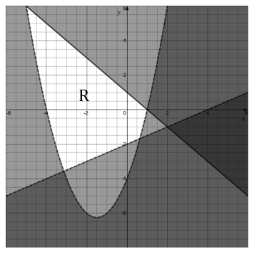
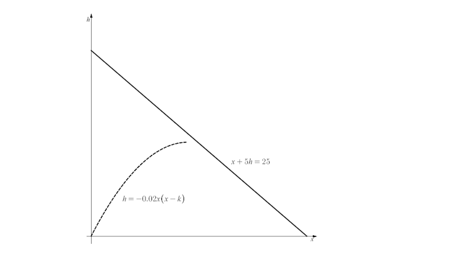
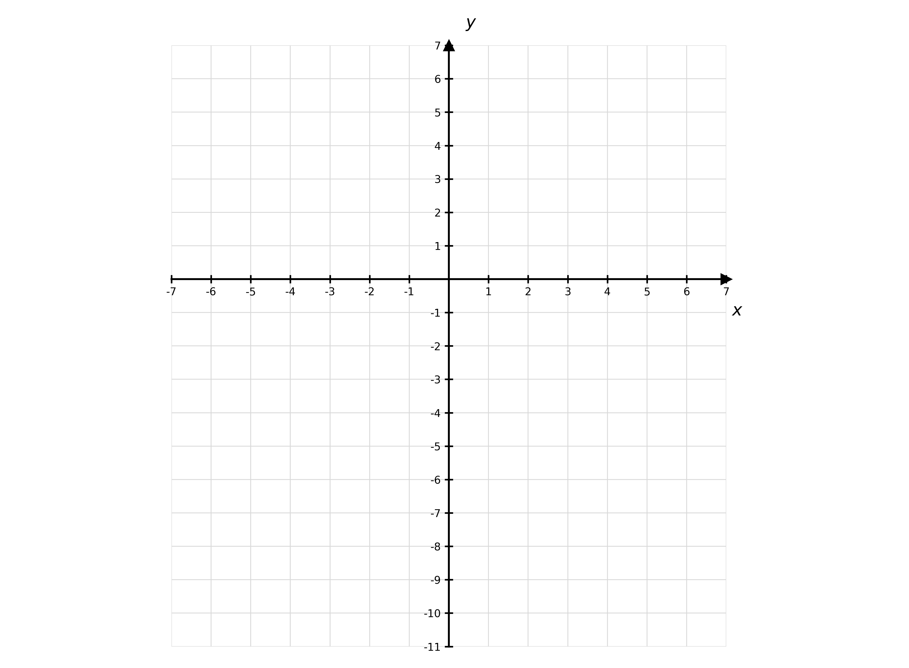
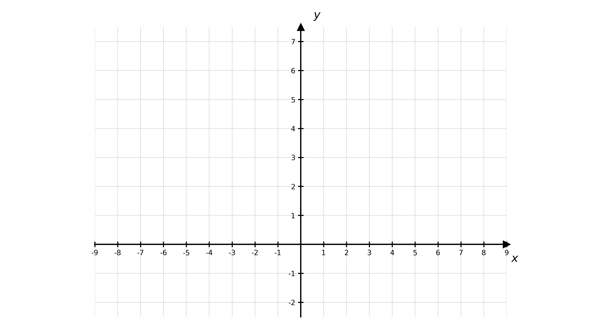
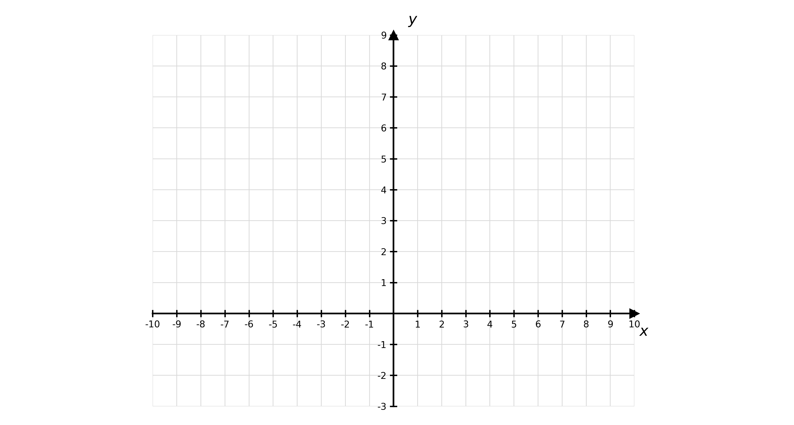
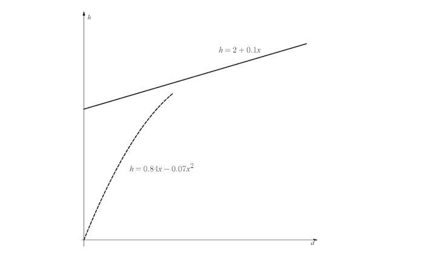
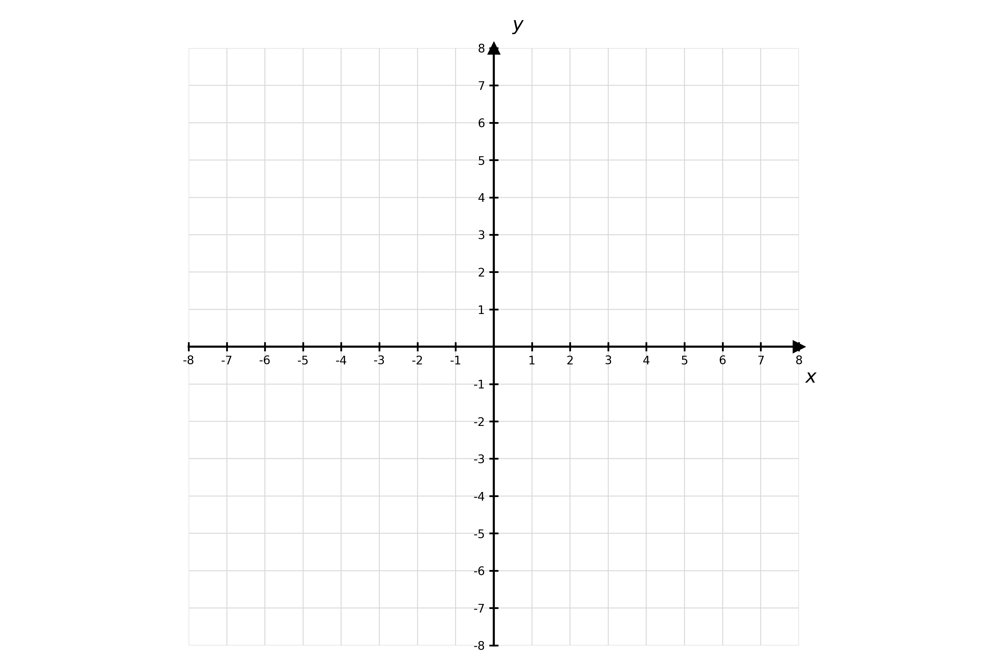
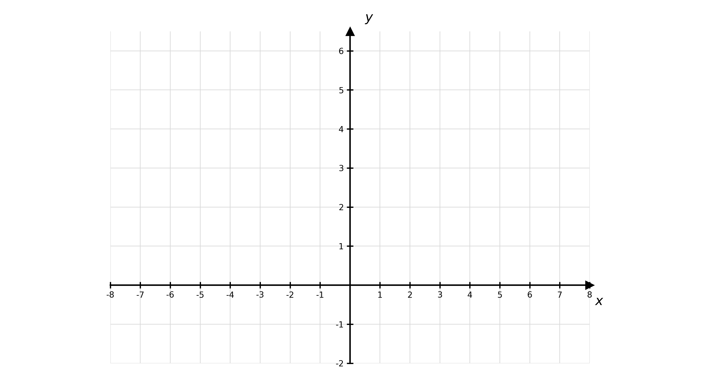

# Exam Questions — Inequalities & Simultaneous Equations
**Algebra & Functions** · Cambridge (CIE) A-LEVEL maths (9709)
> Source: [https://www.savemyexams.com/a-level/maths/cie/20/pure-1/topic-questions/](https://www.savemyexams.com/a-level/maths/cie/20/pure-1/topic-questions/) · 48 questions across 1 sets

## Exam Questions (48 questions)

### Q1 — easy — 3 marks

**Q1** [2 marks]

Find the discriminant of the quadratic function $x^{2} + 8 x + 15$.

**Q1** [1 mark]

Hence state the number of real solutions of the equation $x^{2} + 8 x + 15 = 0$.

### Q2 — easy — 4 marks

**Q2** [4 marks]

Solve the simultaneous equations

$x + 3 y - 1 = 0$

$x^{2} + 9 y = 2 - y^{2}$

### Q3 — easy — 4 marks

**Q3** [4 marks]

Solve the simultaneous equations

$y - x - 1 = 0$

$( 2 x + 1 )^{2} - 3 y^{2} + 3 x - 10 = 0$

### Q4 — easy — 4 marks

**Q4** [4 marks]

Solve the simultaneous equations

$y = 2 x - 1$

$x^{2} + y^{2} - 2 = 0$

### Q5 — medium — 4 marks

**Q5** [4 marks]

The equation $x^{2} + k x + 4 = 0$, where $k$ is a constant, has no real roots.

Find the possible values of $k$.

### Q6 — easy — 4 marks

**Q6** [4 marks]

Substitute $y = x + 3$ into the equation $2 x^{2} - y^{2} = 5 x + 3$ in order to solve the equations simultaneously.

Clearly state which values of $x$ correspond to which values of $y$ in your solutions.

### Q7 — easy — 6 marks

**Q7** [2 marks]

Write down the solutions to $( x - 3 ) ( x - 8 ) = 0$.

**Q7** [2 marks]

Sketch the graph of $y = ( x - 3 ) ( x - 8 )$, clearly showing the coordinates of the points where the graph intercepts the $x$-axis.

**Q7** [2 marks]

Hence, or otherwise, solve the inequality $( x - 3 ) ( x - 8 ) < 0$.

### Q8 — easy — 3 marks

**Q8** [1 mark]

Write down, in terms of $k$, the discriminant of $x^{2} + 8 x + 4 k$.

**Q8** [2 marks]

Hence find the set of values of $k$ for which the equation $x^{2} + 8 x + 4 k = 0$ has two real and distinct solutions.

### Q9 — easy — 6 marks

**Q9** [3 marks]

(i) Solve the equation $9 - x^{2} = 0$.

(ii) Use symmetry to write down the coordinates of the turning point on the graph of $y = 9 - x^{2}$.

**Q9** [3 marks]

Sketch the graph of $y = 9 - x^{2}$ and hence solve the inequality $9 - x^{2} \geq 0$.

### Q10 — very_hard — 7 marks

**Q10** [2 marks]

By eliminating $y$ from the equations

$8 y^{2} - 3 x^{2} - 4 x = - \frac{11}{2}$

$3 x + 4 y = 1$

show that $3 x^{2} - 14 x + 12 = 0$.

**Q10** [5 marks]

Hence solve the simultaneous equations

$8 y^{2} - 3 x^{2} - 4 x = - \frac{11}{2}$

$3 x + 4 y = 1$

giving $x$ and $y$ in the form $a \pm b \sqrt{c}$, where $a$ and $b$ are rational numbers and $c$ is a prime number.

### Q11 — very_hard — 3 marks

**Q11** [3 marks]

Write down the inequalities that define the region R shown in the diagram below.

### Q12 — very_hard — 5 marks

**Q12** [5 marks]

A stone is projected vertically upwards from a height of $2$ m. Its height, above its starting position, $d_{1}$ m, at time $t$ seconds after launch, is given by

$d_{1} ( t ) = 13 . 2 t - 4 . 9 t^{2}$

At the same time a second stone is projected upwards from a height of $2 . 3$ m. Its height, above its starting position, is given by

$d_{2} ( t ) = 13 t - 4 . 9 t^{2}$

For how long are both stones simultaneously at least $4$ m above the ground?

### Q13 — hard — 6 marks

**Q13** [6 marks]

Solve the inequality $- 6 \leq x^{2} + 3 x - 4 \leq 6$, giving your answer in set notation.

### Q14 — hard — 4 marks

**Q14** [4 marks]

Solve the inequality $\frac{4x^{2}-11}{(x+1)^{2}} \geq 4$.

### Q15 — very_hard — 6 marks

**Q15** [5 marks]

An electronics company can produce $c$ cables at a total cost of $( 160 + 12 c )$ pence. The cables can then be sold for $( 38 - c )$ pence each.

Find the minimum and maximum number of cables the company needs to sell in order to make a profit.

**Q15** [1 mark]

How many cables does the company need to sell to make the maximum profit?

### Q16 — very_hard — 7 marks

**Q16** [7 marks]

Solve the simultaneous equations

$9 x^{2} - 7 x y + 4 y^{2} = 36$

$3 x + 2 y = - 6$

### Q17 — very_hard — 9 marks

**Q17** [6 marks]

$x^{2} + 2 y^{2} = 25$

$x - y = k$

are simultaneous equations, where $k$ is a constant.

Find the respective sets of values for $k$ for which the simultaneous equations have one, two, and no solutions.

**Q17** [3 marks]

Given that the simultaneous equations have exactly one solution, find all possible pairs $( x , y )$ that might correspond to that solution. Give all your values for $x$ and $y$ in the form $a \sqrt{6}$, where $a$ is a rational number.

### Q18 — very_hard — 5 marks

**Q18** [5 marks]

Solve the inequality $2 x^{2} + 1 \leq x^{2} + 10 x - 8 < 2 x^{2} - 7 x + 52$, giving your answer in interval notation.

### Q19 — very_hard — 7 marks

**Q19** [1 mark]

The goal in a video game is to have a unicorn leap as far as possible in a horizontal direction without failing the level by touching the laser beam that is sweeping overhead. You find that the height of the unicorn, $h$, is being modelled in relation to the horizontal distance from the point it jumps by the quadratic equation $h = - 0 . 02 x ( x - k )$, where $k \geq 0$ is a parameter that can be controlled by the player's actions, and $x$ is the horizontal distance in metres. The path of the laser beam is modelled by the equation $x + 5 h = 25$.

The value of $h$ can never be less than zero, and if the path of the unicorn crosses or touches the path of the laser beam, the level is failed.

Ignoring the laser beam, explain why the parameter $k$ represents the horizontal distance leapt by the unicorn.

**Q19** [6 marks]

Your friend's personal best in the game is a leap of 21.5 m without failing the level. He is determined to keep playing until his unicorn has leapt 22 m safely. Determine whether or not your friend has a chance of reaching this goal. Show your full working.

### Q20 — very_hard — 4 marks

**Q20** [3 marks]

On the axes below show the region satisfied by the inequalities

$x^{2} - 9 \leq y$

$y \leq ( 2 + x ) ( 2 - x )$

Label this region R.

**Q20** [1 mark]

Write down the equation(s) of any line(s) of symmetry of the region R.

### Q21 — very_hard — 9 marks

**Q21** [2 marks]

The cross section of a tunnel is in the shape of the region defined by the inequalities

| $y \leq 6 - \frac{x^{2}}{6}$ | $y \geq 0$ |
|---|---|

On the axes below show the region satisfying the inequalities.

**Q21** [2 marks]

Given that $x$ and $y$ are in metres, write down the height and the maximum width of the tunnel.

**Q21** [3 marks]

Using a semi-circle of radius 6, estimate the area of the cross-section of the tunnel. Write your answer to 3 significant figures.

**Q21** [2 marks]

Given that the tunnel is to be 20 m in length, estimate the volume of earth that will need to be removed in order to build the tunnel.

### Q22 — hard — 4 marks

**Q22** [4 marks]

Solve the simultaneous inequalities

$t^{2} - 2 t - 15 < 0$ and $t^{2} + 14 \leq 9 t$.

### Q23 — very_hard — 3 marks

**Q23** [3 marks]

The equation $( k + 1 ) t^{2} + 2 ( k + 2 ) t = 3 ( k + 3 )$ has real roots.

Find the possible values of $k$.

### Q24 — medium — 7 marks

**Q24** [7 marks]

Solve the simultaneous equations

$4 x^{2} + 2 x - 6 y = 4$

$2 x - 3 y = - 1$

### Q25 — medium — 7 marks

**Q25** [7 marks]

Solve the simultaneous equations

$x + y = 4$

$x^{2} - 4 x - 3 y = 0$

### Q26 — hard — 5 marks

**Q26** [5 marks]

Find the values of $x$ that satisfy the inequalities

$x^{2} + x < 2$

$x^{2} < 4$

### Q27 — medium — 3 marks

**Q27** [3 marks]

Solve the inequality $( x + 2 )^{2} > 5$.

### Q28 — hard — 8 marks

**Q28** [4 marks]

Solve the inequality $- 2 \leq x^{2} - 4 \leq 5$.

**Q28** [4 marks]

Find the values of $x$ that satisfy the inequalities

$x^{2} + 4 x - 3 \leq 2 - x^{2} - 5 x$

$8 - 2 x^{2} \leq 2 x ( 2 x + 1 )$

Give your answer in set notation.

### Q29 — hard — 7 marks

**Q29** [3 marks]

The cross section of a tunnel is in the shape of the region defined by the inequalities

| $x^{2} + y^{2} \leq 25$ | $y \geq 0$ |
|---|---|

On the axes below show the region satisfying the inequalities

**Q29** [2 marks]

Given that $x$ and $y$ are in metres, write down the height and the maximum width of the tunnel.

**Q29** [2 marks]

Find the area of the cross-section of the tunnel.

### Q30 — hard — 4 marks

**Q30** [4 marks]

A stone is projected vertically upwards from a height of $1 . 5$ m.

Its height, above its starting position, $d$ m at time $t$ seconds after launch, is given by

$d ( t ) = 16 t - 4 . 9 t^{2}$

How long does the stone remain $3$ m above the ground?

### Q31 — hard — 8 marks

**Q31** [5 marks]

$x^{2} - y + 3 x = k$

$20 x - 4 y = - 5$

are simultaneous equations, where $k$ is a constant.

Given that the simultaneous equations have exactly one solution, find the value of the constant $k$.

**Q31** [3 marks]

Find the solution to the simultaneous equations for the value of $k$ that you found in part (a).

### Q32 — hard — 7 marks

**Q32** [2 marks]

By eliminating $y$ from the equations

$4 x^{2} + 5 x y + 9 y^{2} = 36$

$y = \frac{2}{3} x + 2$

show that $x^{2} + 3 x = 0$.

**Q32** [5 marks]

Hence solve the simultaneous equations

$4 x^{2} + 5 x y + 9 y^{2} = 36$

$y = \frac{2}{3} x + 2$

### Q33 — hard — 7 marks

**Q33** [2 marks]

By eliminating $y$ from the equations

$15 x^{2} - 4 y^{2} = 12$

$4 x + 2 y = 1$

show that $x^{2} - 8 x + 13 = 0$.

**Q33** [5 marks]

Hence solve the simultaneous equations

$15 x^{2} - 4 y^{2} = 12$

$4 x + 2 y = 1$

giving $x$ and $y$ in the form $a \pm b \sqrt{3}$, where $a$ and $b$ are rational numbers.

### Q34 — hard — 4 marks

**Q34** [4 marks]

Solve the inequality $\frac{5}{3x^{2}+2} \leq 2$.

### Q35 — hard — 6 marks

**Q35** [2 marks]

An electronics company can produce $c$ cables at a total cost of $( 200 + 10 c )$ pence. The cables can be sold for $( 40 - c )$ pence each.

Show that the total income from selling $c$ cables is $( 40 c - c^{2} )$ pence.

**Q35** [4 marks]

What is the minimum number of cables the company needs to sell in order to make a profit?

### Q36 — hard — 5 marks

**Q36** [5 marks]

A firework is launched inside a large shed with a sloping roof. In relation to the horizontal distance from the point it was launched, the height of the firework, $h$ m, can be modelled by the quadratic equation

$h = 0 . 84 x - 0 . 07 x^{2}$

The sloping roof of the shed can be modelled with the equation

$h = 2 + 0 . 1 x$

Determine whether, according to the model, the firework will hit the roof of the shed before escaping out the open end of the shed on the right of the diagram.

### Q37 — hard — 4 marks

**Q37** [4 marks]

The equation $( k x )^{2} + ( k - 2 ) x + 1 = 0$, where $k$ is a constant, has two distinct real roots.

Find the possible values of $k$.

### Q38 — hard — 5 marks

**Q38** [5 marks]

On the axes below show the region satisfied by the inequalities

$y + x > x^{2}$

$5 y < 20 - 4 x$

$y - 1 \geq 0$

Label this region R.

### Q39 — medium — 4 marks

**Q39** [4 marks]

The total cost to a company manufacturing $c$ cables is $( 100 + 5 c )$ pence.

The total income from selling all $c$ cables is $( 30 c - c^{2} )$ pence.

What is the minimum number of cables the company needs to sell in order to recover their costs?

### Q40 — medium — 4 marks

**Q40** [4 marks]

A stone is projected vertically upwards from ground level.

The distance above the ground, $d$ m at $t$ seconds after launch, is given by

$d ( t ) = 12 t - 4 . 9 t^{2}$

How long does the stone remain $2$ m above the ground?

### Q41 — medium — 8 marks

**Q41** [3 marks]

$x^{2} - 2 y = 10$

$2 x - y = k$

are simultaneous equations, where $k$ is a constant.

By eliminating $y$ from the equations show that $x^{2} - 4 x + 2 ( k - 5 ) = 0$.

**Q41** [2 marks]

By considering the discriminant of $x^{2} - 4 x + 2 ( k - 5 ) = 0$ find the value of $k$ for which the simultaneous equations have only one solution.

**Q41** [3 marks]

Find the solution to the simultaneous equations for the value of $k$ that you found in part (b).

### Q42 — medium — 5 marks

**Q42** [3 marks]

The cross section of a tunnel is in the shape of the region defined by the inequalities

| $y \leq 5 - \frac{x^{2}}{5}$ | $y \geq 0$ |
|---|---|

On the axes below show the region satisfying the inequalities.

**Q42** [2 marks]

Given that $x$ and $y$ are in metres, write down the height and the maximum width of the tunnel.

### Q43 — medium — 4 marks

**Q43** [4 marks]

The equation $k x^{2} + 2 k x + 4 = 0$, where $k$ is a constant, has two distinct real roots.

Find the possible values of $k$.

### Q44 — medium — 4 marks

**Q44** [4 marks]

Solve the inequality $x^{2} - 5 x > 6$.

### Q45 — medium — 5 marks

**Q45** [5 marks]

Find the values of $x$ that satisfy the inequalities

$x^{2} + 3 x > 4$

$4 x + 1 > 4$

### Q46 — medium — 7 marks

**Q46** [2 marks]

By eliminating $y$ from the equations

$x^{2} + 10 x + y^{2} = - 20$

$y = 2 x + 10$

show that $x^{2} + 10 x + 24 = 0$.

**Q46** [5 marks]

Hence solve the simultaneous equations

$x^{2} + 10 x + y^{2} = - 20$

$y = 2 x + 10$

### Q47 — medium — 7 marks

**Q47** [2 marks]

By eliminating $y$ from the equations

$x^{2} - 8 y = - 40$

$3 x + 2 y = 4$

show that $x^{2} + 12 x + 24 = 0$.

**Q47** [5 marks]

Hence solve the simultaneous equations

$x^{2} - 8 y = - 40$

$3 x + 2 y = 4$

giving $x$ and $y$ in the form $a \pm b \sqrt{3}$, where $a$ and $b$ are integers.

### Q48 — medium — 7 marks

**Q48** [2 marks]

By eliminating $y$ from the equations

$3 x^{2} + 4 y = 83$

$3 x + 2 y = - 11$

show that $x^{2} - 2 x - 35 = 0$.

**Q48** [5 marks]

Hence solve the simultaneous equations

$3 x^{2} + 4 y = 83$

$3 x + 2 y = - 11$
